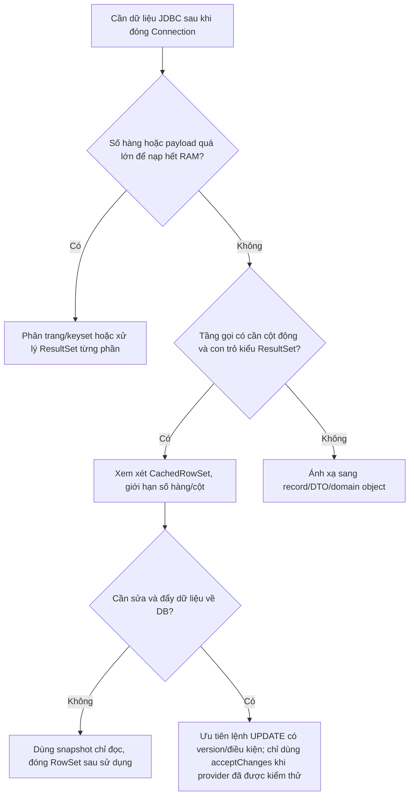

# Lựa chọn RowSet hoặc ánh xạ sang đối tượng ứng dụng

## 1. Hai cách mang kết quả truy vấn ra khỏi tầng JDBC

Trong ứng dụng Java sử dụng **JDBC** để truy cập cơ sở dữ liệu quan hệ, tầng repository thường lấy `Connection` từ `DataSource`, thực thi câu SQL tham số hóa bằng `PreparedStatement` và đọc các hàng từ `ResultSet`. Vấn đề thiết kế xuất hiện khi tầng nghiệp vụ, giao diện hoặc tác vụ xử lý cần **sử dụng dữ liệu sau khi repository đã đóng kết nối**.

Có hai cách chính:

1. **RowSet ngoại tuyến (*disconnected RowSet*)**, điển hình là `CachedRowSet`: chép các hàng và metadata của một `ResultSet` vào đối tượng có giao diện con trỏ giống JDBC. Tầng gọi có thể duyệt, di chuyển con trỏ và, với một số triển khai, chỉnh sửa bản sao dữ liệu mà không giữ kết nối DB mở.
2. **Ánh xạ thành đối tượng ứng dụng**: đọc từng hàng và tạo `record`, DTO hoặc domain object, chẳng hạn `List<WorkOrderView>`; tầng nghiệp vụ làm việc với mô hình Java thay vì các tên cột và phương thức `ResultSet`.

Cả hai đều có thể tách dữ liệu đã đọc khỏi vòng đời kết nối. Nhưng chúng có **hợp đồng, chi phí và mức phụ thuộc vào lược đồ** rất khác nhau.

Ví dụ: hệ thống quản lý đơn công việc cần liệt kê hàng trăm đơn để xem ngoại tuyến, đôi khi chỉnh sửa trạng thái rồi gửi thay đổi. Một công cụ quản trị dữ liệu chung có thể muốn hiển thị các cột động; một dịch vụ nghiệp vụ lại cần kiểu dữ liệu rõ ràng và quy tắc trạng thái. Hai nhu cầu này không nhất thiết nên dùng cùng một kiểu kết quả.

**Mục tiêu bài học:** phân biệt `CachedRowSet` với `ResultSet` và `JdbcRowSet`; đánh giá lựa chọn RowSet hoặc DTO/domain object; viết ví dụ với `DataSource`, `PreparedStatement`, `ResultSet` và `RowSetProvider`; hiểu vòng đời tài nguyên, bộ nhớ, dữ liệu lỗi thời, đồng bộ và xung đột; áp dụng một quy trình ra quyết định có thể kiểm thử.

## 2. RowSet là gì và loại nào thực sự ngoại tuyến?

`javax.sql.RowSet` là giao diện JDBC mở rộng `java.sql.ResultSet`, cho phép các thành phần hoạt động với mô hình tập hàng. Các giao diện triển khai phổ biến nằm trong gói `javax.sql.rowset`.

| Loại | Đặc tính quan trọng | Có thể tách kết nối? | Tình huống phù hợp |
|---|---|---|---|
| `JdbcRowSet` | Bọc một `ResultSet` kết nối trực tiếp, cung cấp giao diện RowSet và sự kiện | **Không** theo ý nghĩa snapshot ngoại tuyến; cần kết nối khi thao tác | Thành phần cần cursor JDBC có kết nối và RowSet listener |
| `CachedRowSet` | Lưu bản sao hàng và metadata trong bộ nhớ; cho phép duyệt khi đã đóng connection | **Có** sau khi nạp dữ liệu | Ảnh chụp kết quả nhỏ/vừa, công cụ xem bảng, thao tác tạm thời |
| `WebRowSet` | Mở rộng `CachedRowSet` với khả năng đọc/ghi biểu diễn XML | **Có** | Trao đổi theo hợp đồng XML đã kiểm soát; lưu ý dữ liệu nhạy cảm |
| `FilteredRowSet` | Mở rộng `WebRowSet`, lọc các hàng ở phía Java theo `Predicate` | **Có** | Lọc hiển thị sau khi đã nạp; không thay thế `WHERE` về bảo mật |
| `JoinRowSet` | Kết hợp các RowSet theo cột khớp theo khả năng triển khai | Thường hoạt động trên dữ liệu đã nạp | Ghép các tập dữ liệu nhỏ cho công cụ hỗ trợ; không thay thế SQL JOIN quy mô lớn |

JDK cung cấp cơ chế tạo RowSet qua `RowSetProvider.newFactory()`:

```java
import javax.sql.rowset.CachedRowSet;
import javax.sql.rowset.JdbcRowSet;
import javax.sql.rowset.RowSetFactory;
import javax.sql.rowset.RowSetProvider;

RowSetFactory factory = RowSetProvider.newFactory();
CachedRowSet snapshot = factory.createCachedRowSet();
JdbcRowSet connected = factory.createJdbcRowSet();

// Hai đối tượng mới tạo chưa chứa dữ liệu.
// Cần đóng tài nguyên đúng lúc sau khi sử dụng.
snapshot.close();
connected.close();
```

Các lớp chuẩn thuộc module Java `java.sql.rowset` khi dùng Java modular. Đừng đồng nhất mọi `RowSet` với một snapshot ngoại tuyến: **`JdbcRowSet` vẫn dựa vào kết nối**, trong khi `CachedRowSet` giữ các hàng được sao chép để tiếp tục đọc sau khi `Connection` ban đầu đóng.

### Đặc điểm của `CachedRowSet`

`CachedRowSet` thường cung cấp:

- Các thao tác con trỏ như `next()`, `beforeFirst()`, `absolute()` và getter như `getString()`, `getBigDecimal()`.
- Thông tin cột qua `ResultSetMetaData`, giúp thành phần hiển thị bảng động mà không cần một kiểu Java định sẵn cho mỗi câu truy vấn.
- Bản sao hàng trên phía Java; việc duyệt không cần giữ `Connection` nạp dữ liệu ban đầu đang mở.
- Hỗ trợ đánh dấu chỉnh sửa cục bộ và API đồng bộ qua `acceptChanges()` khi được cấu hình, nhưng việc đồng bộ **không tự động** xảy ra sau mỗi `updateRow()`.

Đây là công cụ quản lý **dữ liệu quan hệ dạng bảng**. Nó không tự chuyển hàng thành domain object, không xác thực mọi quy tắc nghiệp vụ và không đảm bảo rằng dữ liệu vẫn mới so với DB.

## 3. So sánh trực tiếp: RowSet và đối tượng ứng dụng

| Tiêu chí | `CachedRowSet` | `List<DTO>` / `List<record>` / domain object |
|---|---|---|
| Cách truy cập | Tên/chỉ số cột, getter JDBC, con trỏ có trạng thái | Thuộc tính/phương thức Java có kiểu rõ ràng |
| Phụ thuộc lược đồ SQL | Tương đối trực tiếp: nhãn cột và kiểu SQL đi theo snapshot | Lớp ánh xạ cô lập thay đổi cột khỏi các tầng khác |
| Tính tiện lợi cho bảng cột động | Cao, có `ResultSetMetaData` | Cần thiết kế DTO động hoặc cấu trúc bảng riêng |
| Kiểm tra bất biến nghiệp vụ | Không tự cung cấp | Có thể kiểm tra ngay tại constructor/factory của domain object |
| Dữ liệu sau khi đóng kết nối | Có, nếu đã populate đầy đủ | Có, nếu đã sao chép đủ giá trị cần dùng |
| Sửa dữ liệu cục bộ | Có API `updateXxx()`/`updateRow()`, tùy RowSet | Thường tạo object mới hoặc lệnh thay đổi rõ ràng |
| Đẩy sửa đổi về DB | Cần `acceptChanges()` và cấu hình đồng bộ; có giới hạn driver/provider | Repository thực thi SQL `UPDATE ... WHERE ...` theo nghiệp vụ |
| Khả năng tuần tự hóa | Một số RowSet hỗ trợ serialization/XML nhưng rủi ro tương thích và lộ dữ liệu | DTO có thể được chuyển thành JSON/API schema theo hợp đồng riêng |
| Tính an toàn khi dùng chung | Con trỏ và trạng thái chỉnh sửa là mutable; không mặc định an toàn đa luồng | Record/DTO bất biến dễ dùng chung hơn, nếu trường bên trong cũng bất biến |
| Bộ nhớ | Lưu dữ liệu dạng bảng, metadata và có thể cả trạng thái gốc/phần thay đổi | Chỉ giữ những trường bạn ánh xạ, tùy mô hình |
| API nghiệp vụ ổn định | Dễ lộ chi tiết JDBC ra tầng trên | Dễ giữ ranh giới rõ giữa persistence và domain |
| Dữ liệu rất lớn | Không phù hợp nếu nạp toàn bộ vào RAM | `List` toàn bộ cũng không phù hợp; cần phân trang/stream xử lý từng phần |

Không có quy tắc “RowSet luôn chậm” hay “record luôn tốt hơn”. Chi phí phụ thuộc số hàng, số cột, dữ liệu lớn trong từng cột, logic của ứng dụng, khả năng đồng bộ và cách driver tạo `ResultSet`. Tuy nhiên, với ứng dụng nghiệp vụ Java thông thường, **đối tượng ứng dụng thường dễ kiểm soát và bảo trì hơn**, còn `CachedRowSet` hữu ích khi tầng gọi thực sự cần mô hình bảng/con trỏ.

## 4. Một mô hình dữ liệu dùng chung cho hai cách đọc

Giả sử cơ sở dữ liệu có bảng:

```sql
CREATE TABLE work_orders (
    id           BIGINT PRIMARY KEY,
    tenant_id    BIGINT NOT NULL,
    title        VARCHAR(200) NOT NULL,
    status       VARCHAR(20) NOT NULL,
    total_amount DECIMAL(14, 2) NOT NULL,
    version      BIGINT NOT NULL DEFAULT 0
);
```

Dữ liệu ví dụ:

| `id` | `tenant_id` | `title` | `status` | `total_amount` | `version` |
|---:|---:|---|---|---:|---:|
| 101 | 7 | Kiểm tra hợp đồng | `OPEN` | 125.50 | 2 |
| 102 | 7 | Đối soát chứng từ | `IN_REVIEW` | 300.00 | 5 |
| 201 | 8 | Duyệt báo cáo | `OPEN` | 78.00 | 1 |

Ứng dụng cần lấy **các đơn thuộc tenant 7**, và chỉ cần bốn cột cho danh sách:

```sql
SELECT id, status, total_amount, version
FROM work_orders
WHERE tenant_id = ?
ORDER BY id;
```

Cột `tenant_id` được dùng để **lọc ở database**. RowSet hoặc DTO chỉ chứa các hàng đã được DB trả về. Không được tải đơn của tất cả tenant rồi sử dụng `FilteredRowSet` hoặc Java `stream().filter(...)` làm cơ chế **phân quyền duy nhất**: dữ liệu không được phép có thể đã được tải vào bộ nhớ từ trước.

Từ cùng câu `SELECT` này, ta có thể chọn `CachedRowSet` hoặc `List<WorkOrderView>`.

## 5. Cách A: dùng `CachedRowSet` để giữ snapshot ngoại tuyến

Repository sau dùng `PreparedStatement` tham số hóa, lấy dữ liệu từ `ResultSet` rồi gọi `populate(rs)`. Sau khi populate xong, kết nối và statement được đóng, còn `CachedRowSet` được trả về cho tầng gọi.

```java
import java.sql.Connection;
import java.sql.PreparedStatement;
import java.sql.ResultSet;
import java.sql.SQLException;
import java.util.Objects;
import javax.sql.DataSource;
import javax.sql.rowset.CachedRowSet;
import javax.sql.rowset.RowSetProvider;

public final class WorkOrderRepository {
    private static final String LIST_SQL = """
            SELECT id, status, total_amount, version
            FROM work_orders
            WHERE tenant_id = ?
            ORDER BY id
            """;

    private final DataSource dataSource;

    public WorkOrderRepository(DataSource dataSource) {
        this.dataSource = Objects.requireNonNull(dataSource);
    }

    public CachedRowSet loadSnapshot(long tenantId)
            throws SQLException {
        if (tenantId <= 0) {
            throw new IllegalArgumentException("Invalid tenantId");
        }

        CachedRowSet snapshot =
                RowSetProvider.newFactory().createCachedRowSet();

        try (Connection connection = dataSource.getConnection();
             PreparedStatement ps =
                     connection.prepareStatement(LIST_SQL)) {
            ps.setLong(1, tenantId);

            try (ResultSet rs = ps.executeQuery()) {
                snapshot.populate(rs);
            }
            return snapshot;
        } catch (SQLException | RuntimeException failure) {
            try {
                snapshot.close();
            } catch (SQLException closeFailure) {
                failure.addSuppressed(closeFailure);
            }
            throw failure;
        }
    }
}
```

**Diễn biến tài nguyên:**

1. `RowSetProvider` tạo một `CachedRowSet` trống.
2. `ps.setLong(1, tenantId)` gắn tenant đã được xác thực vào câu `SELECT`.
3. `executeQuery()` trả `ResultSet` còn gắn với `Connection`.
4. `snapshot.populate(rs)` sao chép **toàn bộ kết quả truy vấn** cần thiết vào đối tượng RowSet.
5. `ResultSet`, `PreparedStatement` và `Connection` được đóng khi ra khỏi khối `try-with-resources`.
6. Tầng gọi nhận `snapshot` để tiếp tục duyệt **mà không cần connection cũ**; tầng gọi chịu trách nhiệm đóng `snapshot` khi xong.

Đọc dữ liệu đã nạp:

```java
try (CachedRowSet rows = repository.loadSnapshot(7L)) {
    while (rows.next()) {
        long id = rows.getLong("id");
        String status = rows.getString("status");
        java.math.BigDecimal amount =
                rows.getBigDecimal("total_amount");
        long version = rows.getLong("version");

        // Hiển thị / tính toán với bản sao dữ liệu hiện tại.
    }

    rows.beforeFirst(); // Duyệt lại nếu cần.
}
```

Đoạn code giả định `repository` là một `WorkOrderRepository` đã được khởi tạo. Hàng snapshot vẫn là **hàng dạng bảng**: tầng gọi phải biết tên cột `"id"`, `"status"`, `"total_amount"` và `"version"`. Với cột nullable dùng getter nguyên thủy như `getLong()`, cần gọi `wasNull()` ngay sau getter; trong ví dụ, `id` và `version` đã được khai báo `NOT NULL`.

### 5.1. RowSet hữu ích khi cột có thể thay đổi

Trong một công cụ xem kết quả SQL do nhân viên vận hành được phân quyền sử dụng, số cột và tên cột có thể khác giữa các báo cáo. `CachedRowSet` giữ `ResultSetMetaData`, nhờ vậy có thể vẽ bảng mà không định nghĩa record mới cho từng truy vấn:

```java
java.sql.ResultSetMetaData columns = rows.getMetaData();
int numberOfColumns = columns.getColumnCount();

for (int i = 1; i <= numberOfColumns; i++) {
    String label = columns.getColumnLabel(i);
    int jdbcType = columns.getColumnType(i);
    // Dùng nhãn/kiểu để cấu hình thành phần hiển thị.
}
```

Tuy nhiên, metadata chỉ mô tả kết quả truy vấn, **không tự lọc dữ liệu nhạy cảm**. Cần kiểm soát câu SQL được phép chạy, danh sách cột, tenant, quyền truy cập và số hàng tối đa **trước khi populate**.

### 5.2. Không tự coi RowSet là dữ liệu mới nhất

Giả sử tenant 7 tải đơn `101` với `status = OPEN` và `version = 2`, rồi kết nối đóng. Trong lúc người dùng chỉnh sửa, một transaction khác chuyển đơn sang `CANCELLED` và tăng version lên `3`. Bản `CachedRowSet` vẫn phản ánh ảnh chụp khi nạp; việc con trỏ cuộn được không khiến nó tự nhận thay đổi của DB.

> **Snapshot ngoại tuyến không đồng nghĩa với bảo đảm tính mới.** Mỗi lần dùng snapshot để quyết định cập nhật, phải kiểm tra lại các điều kiện nghiệp vụ khi ghi dữ liệu vào cơ sở dữ liệu.

## 6. Cách B: ánh xạ ResultSet sang record hoặc DTO

Nếu tầng trên cần các thuộc tính rõ ràng và không nên biết cú pháp JDBC, hãy chuyển dữ liệu sang đối tượng Java ngay trong repository.

```java
import java.math.BigDecimal;
import java.util.Objects;

public record WorkOrderView(
        long id,
        String status,
        BigDecimal totalAmount,
        long version) {

    public WorkOrderView {
        if (id <= 0 || version < 0) {
            throw new IllegalArgumentException("Invalid order identity");
        }
        Objects.requireNonNull(status, "status");
        Objects.requireNonNull(totalAmount, "totalAmount");
    }
}
```

`WorkOrderView` là **read model/DTO**, không phải đối tượng trực tiếp phụ trách mọi thao tác nghiệp vụ. Trong trường hợp này, các trường `String` và `BigDecimal` là bất biến nên record có thể được sử dụng thuận tiện ở nhiều tầng mà không mang theo con trỏ mutable. Nếu muốn domain object đầy đủ, có thể dùng enum trạng thái và thêm phương thức kiểm tra bất biến/điều kiện chuyển trạng thái.

Tiếp tục trong `WorkOrderRepository` ở mục trước, thêm phương thức:

```java
import java.sql.Connection;
import java.sql.PreparedStatement;
import java.sql.ResultSet;
import java.sql.SQLException;
import java.util.ArrayList;
import java.util.List;

public List<WorkOrderView> loadViews(long tenantId)
        throws SQLException {
    if (tenantId <= 0) {
        throw new IllegalArgumentException("Invalid tenantId");
    }

    List<WorkOrderView> results = new ArrayList<>();
    try (Connection connection = dataSource.getConnection();
         PreparedStatement ps =
                 connection.prepareStatement(LIST_SQL)) {
        ps.setLong(1, tenantId);

        try (ResultSet rs = ps.executeQuery()) {
            while (rs.next()) {
                results.add(new WorkOrderView(
                        rs.getLong("id"),
                        rs.getString("status"),
                        rs.getBigDecimal("total_amount"),
                        rs.getLong("version")
                ));
            }
        }
    }
    return List.copyOf(results);
}
```

Khi phương thức trả về, `ResultSet`, `PreparedStatement` và `Connection` đã được đóng. Tầng nghiệp vụ xử lý danh sách `WorkOrderView` như dữ liệu Java:

```java
List<WorkOrderView> orders = repository.loadViews(7L);

for (WorkOrderView order : orders) {
    if ("OPEN".equals(order.status())) {
        // Dùng dữ liệu đã ánh xạ cho quy tắc hiển thị/nghiệp vụ.
    }
}
```

**Lợi ích của cách ánh xạ:**

- Tầng gọi không phụ thuộc tên cột như `"total_amount"`; cách chuyển đổi SQL → Java nằm ở repository.
- Có vị trí tập trung để xử lý `NULL`, `BigDecimal`, ngày giờ, enum và validation.
- API dịch vụ rõ hơn: `List<WorkOrderView>` mô tả ý nghĩa dữ liệu tốt hơn một cursor tổng quát.
- Có thể tạo DTO khác nhau cho màn hình danh sách, chi tiết hoặc API mà không trả dư các cột nhạy cảm.
- Dễ kiểm thử logic nghiệp vụ với record/DTO tự tạo, không cần dựng một `ResultSet` giả.

**Chi phí đánh đổi:** phải duy trì mã mapping và sửa DTO khi nghiệp vụ thay đổi. Nếu biểu diễn một báo cáo có hàng trăm cột động, việc tạo một record mới cho mỗi truy vấn có thể không phù hợp; khi đó RowSet hoặc mô hình bảng động có thể tiện hơn.

### 6.1. Không đồng nhất DTO với domain entity

Một DTO chỉ ghi lại dữ liệu cần hiển thị; domain object có thể phải bảo vệ quy tắc nghiệp vụ. Ví dụ:

```java
enum WorkOrderStatus {
    OPEN, IN_REVIEW, APPROVED, CANCELLED
}

public record WorkOrder(
        long id,
        WorkOrderStatus status,
        BigDecimal totalAmount,
        long version) {

    public WorkOrder {
        if (id <= 0 || version < 0) {
            throw new IllegalArgumentException("Invalid order identity");
        }
        Objects.requireNonNull(status);
        Objects.requireNonNull(totalAmount);
        if (totalAmount.signum() < 0) {
            throw new IllegalArgumentException("Negative amount");
        }
    }

    public boolean canApprove() {
        return status == WorkOrderStatus.IN_REVIEW;
    }
}
```

Mã trên minh họa một phần bất biến của domain. Repository có thể chuyển `rs.getString("status")` thành `WorkOrderStatus.valueOf(...)`, và phải có chính sách khi DB chứa trạng thái không nhận diện được. Những kiểm tra ở Java giúp phát hiện dữ liệu không hợp lệ, nhưng **không thay thế ràng buộc DB** hay điều kiện cập nhật SQL.

## 7. Cập nhật ngoại tuyến: local change khác hoàn toàn commit DB

`CachedRowSet` có API chỉnh sửa:

```java
try (CachedRowSet rows = repository.loadSnapshot(7L)) {
    rows.beforeFirst();
    while (rows.next()) {
        if (rows.getLong("id") == 101L) {
            rows.updateString("status", "APPROVED");
            rows.updateRow();
            break;
        }
    }

    // Giá trị APPROVED hiện là thay đổi trong RowSet ngoại tuyến;
    // database chưa được cập nhật bởi updateRow() này.

    rows.restoreOriginal(); // Hủy các thay đổi cục bộ của RowSet.
}
```

**Không nhầm với `ResultSet` cập nhật trực tiếp trên connection:** với `CachedRowSet` đã ngắt kết nối, `updateRow()` ghi thay đổi vào bộ đệm/thông tin thay đổi của RowSet, **không lập tức thực thi SQL lên DB**. `restoreOriginal()` phục hồi dữ liệu gốc trong RowSet theo hợp đồng triển khai, không rollback bất cứ transaction DB nào trước đó.

Để gửi thay đổi về nguồn dữ liệu, `CachedRowSet` có các API `acceptChanges()` hoặc `acceptChanges(Connection)`. Tuy nhiên, cơ chế này dựa vào **`SyncProvider`** và metadata/khả năng của nguồn dữ liệu:

- RowSet phải có đủ thông tin để xác định hàng/bảng gốc, khóa hoặc cột cần đồng bộ; snapshot tạo bằng `populate(ResultSet)` không tự bảo đảm rằng provider có thể dựng và gửi cập nhật đúng.
- Provider có thể cần connection, cấu hình lệnh truy vấn hoặc quyền cập nhật phù hợp.
- Khi dữ liệu ở DB đã thay đổi kể từ khi nạp, quá trình đồng bộ có thể phát hiện xung đột và ném `SyncProviderException`. Mức phát hiện phụ thuộc provider, bản ghi và cấu hình.
- Không coi việc gọi `acceptChanges()` là cơ chế kiểm tra toàn bộ quy tắc trạng thái, quyền tenant hoặc optimistic locking của ứng dụng.
- Phải xác minh cách provider quản lý commit, rollback và connection trước khi đưa vào transaction nghiệp vụ lớn; không tự giả định nó phối hợp hoàn hảo với transaction khác.

Vì thế, trong ứng dụng nghiệp vụ, có thể **dùng RowSet để hiển thị/chỉnh sửa tạm thời**, rồi chuyển dữ liệu người dùng xác nhận thành một lệnh cập nhật rõ ràng qua `PreparedStatement`. Cách này giúp điều kiện ở `WHERE` và phạm vi transaction dễ đọc, dễ kiểm soát và dễ kiểm thử.

### 7.1. Dùng phiên bản cũ để cập nhật an toàn

Ví dụ, khi gửi yêu cầu thay trạng thái của đơn `101`, tầng ứng dụng giữ `version = 2` được đọc lúc ban đầu:

```sql
UPDATE work_orders
SET status = ?,
    version = version + 1
WHERE id = ?
  AND tenant_id = ?
  AND status = 'IN_REVIEW'
  AND version = ?;
```

Câu SQL thể hiện ba điều kiện: bản ghi đích, tenant được phép truy cập và trạng thái/phiên bản cũ. Nếu đơn đã đổi sang `CANCELLED` hoặc version thành `3`, lệnh không thỏa điều kiện; trong một số mức cô lập có thể phát sinh lỗi xung đột transaction cần xử lý riêng.

```java
// Phương thức trong WorkOrderRepository, dùng một thao tác SQL độc lập.
public boolean approveIfUnchanged(
        long id, long tenantId, long expectedVersion)
        throws SQLException {
    String sql = """
            UPDATE work_orders
            SET status = 'APPROVED',
                version = version + 1
            WHERE id = ?
              AND tenant_id = ?
              AND status = 'IN_REVIEW'
              AND version = ?
            """;

    try (Connection connection = dataSource.getConnection();
         PreparedStatement ps = connection.prepareStatement(sql)) {
        ps.setLong(1, id);
        ps.setLong(2, tenantId);
        ps.setLong(3, expectedVersion);

        int count = ps.executeUpdate();
        if (count > 1) {
            throw new SQLException("Unexpected update count: " + count);
        }
        return count == 1;
    }
}
```

Mã đơn giản này giả định một `Connection` được quản lý ở chế độ auto-commit cho thao tác độc lập. Nếu thuộc transaction nhiều bước, tầng quản lý transaction phải dùng chung connection và chỉ xác nhận nghiệp vụ sau `commit()` thành công. Khi `count == 0`, không thể biết chắc chỉ từ count rằng “bản ghi không tồn tại”: có thể do tenant, trạng thái hoặc phiên bản không khớp.

Tương tự, khi gửi thay đổi từ DTO về DB, đừng đọc phiên bản mới nhất rồi áp đặt nội dung cũ với phiên bản mới. Việc đó vô hiệu hóa cơ chế phát hiện ghi đè vì snapshot người dùng đang giữ thực chất đã lỗi thời.

## 8. Chọn theo nhu cầu: một sơ đồ quyết định



Một vài lựa chọn thường gặp:

| Nhu cầu thực tế | Lựa chọn đề xuất | Lý do |
|---|---|---|
| API trả danh sách đơn đã chuẩn hóa | `List<WorkOrderView>` | Có hợp đồng kiểu rõ và không lộ chi tiết JDBC |
| Logic nghiệp vụ chuyển trạng thái | Domain object/command + SQL có điều kiện | Bảo vệ bất biến và phát hiện xung đột |
| Bảng dữ liệu nội bộ có cột tùy truy vấn | `CachedRowSet` hoặc một mô hình bảng động được kiểm soát | Có metadata cột và API cursor |
| UI chỉnh sửa ngoại tuyến rồi đồng bộ | DTO/command có version thường dễ kiểm soát; RowSet nếu đã kiểm thử `SyncProvider` | Cần quy trình giải quyết xung đột và xác thực |
| Biểu diễn RowSet/XML theo hợp đồng cũ | `WebRowSet` khi thật sự cần XML | Không dùng XML như cách trao đổi công khai mặc định |
| Báo cáo hàng triệu bản ghi | Xử lý dòng dần, phân trang hoặc xuất stream | Không giữ toàn bộ hàng trong `CachedRowSet` hoặc `List` |
| Ghép bảng SQL phức tạp | SQL `JOIN` rồi ánh xạ DTO phù hợp | DB thực hiện lọc/ghép trước, hạn chế copy dữ liệu |
| Cache dữ liệu chỉ đọc có hạn dùng | DTO bất biến, hoặc snapshot nếu thật sự cần cursor | Dễ xác định TTL và tránh mutate nhầm |

Tập trung vào **hợp đồng API mà tầng sử dụng cần**, không chọn RowSet chỉ vì nó “có sẵn trong JDBC”, cũng không tạo hàng chục record nếu công cụ thực sự cần khám phá cấu trúc cột động.

## 9. Dữ liệu lớn, bộ nhớ và vòng đời tài nguyên

`CachedRowSet.populate(rs)` sao chép kết quả vào bộ nhớ ứng dụng. Nếu kết quả có một triệu hàng, nhiều cột `BLOB`, `CLOB` hoặc chuỗi lớn, RowSet có thể tiêu thụ bộ nhớ đáng kể; nó còn có thể cần lưu metadata và trạng thái gốc để hỗ trợ cập nhật/đồng bộ.

Nhưng `List<WorkOrderView>` cũng không tự tiết kiệm bộ nhớ khi nạp một triệu object vào RAM. Với kết quả quá lớn, cần thay **chiến lược tải dữ liệu**:

```java
String sql = """
        SELECT id, status, total_amount, version
        FROM work_orders
        WHERE tenant_id = ?
        ORDER BY id
        """;

try (Connection connection = dataSource.getConnection();
     PreparedStatement ps = connection.prepareStatement(sql)) {
    ps.setLong(1, tenantId);
    ps.setFetchSize(200); // Gợi ý cho driver; không bảo đảm streaming.

    try (ResultSet rs = ps.executeQuery()) {
        while (rs.next()) {
            WorkOrderView row = new WorkOrderView(
                    rs.getLong("id"),
                    rs.getString("status"),
                    rs.getBigDecimal("total_amount"),
                    rs.getLong("version")
            );
            processOneRow(row); // Phác họa callback xử lý một hàng.
        }
    }
}
```

`processOneRow(...)` là phương thức/callback do ứng dụng cung cấp, không phải API JDBC. Với dữ liệu thực sự lớn, nên có giới hạn kết quả/phân trang theo khóa chính, timeout, quyền truy cập và kiểm tra độ chậm/khả năng stream của driver. `setFetchSize()` chỉ là gợi ý; một số driver cần cấu hình cursor hoặc transaction riêng để đọc từng đợt.

### Quy tắc vòng đời

- Không trả trực tiếp `ResultSet` từ phương thức đã đóng `Connection`; con trỏ đó không còn hợp lệ theo hợp đồng JDBC thông thường.
- Nếu trả `CachedRowSet`, tầng nhận có trách nhiệm `close()` sau sử dụng; không chia sẻ một cursor mutable giữa nhiều luồng đồng thời mà không có thiết kế đồng bộ rõ ràng.
- Nếu trả `List<record>`, đảm bảo các trường đã sao chép độc lập với `ResultSet`. Với dữ liệu LOB, đừng giữ `Blob`, `Clob` hoặc stream còn phụ thuộc connection đã đóng mà không xử lý vòng đời phù hợp.
- Tránh giữ transaction mở xuyên suốt thời gian người dùng chỉnh sửa biểu mẫu. Đọc dữ liệu, đóng connection, rồi mở transaction **mới** khi ghi với version/điều kiện.
- Đối với snapshot, luôn xác định thời gian dữ liệu còn đáng tin và cần làm mới; RowSet không tự biết lúc nào dữ liệu ngoài DB đã đổi.

## 10. Bảo mật và tính tương thích

### 10.1. RowSet không thay thế phân quyền ở truy vấn

`FilteredRowSet` có thể lọc hàng trong bộ nhớ để hiển thị, nhưng nếu nạp dữ liệu nhiều tenant trước đó, chương trình đã mang dữ liệu trái quyền vào bộ nhớ. Hãy dùng `WHERE tenant_id = ?`, kiểm tra quyền từ ngữ cảnh xác thực và chỉ chọn cột cần thiết **trước khi populate hoặc mapping**.

Ngoài ra, RowSet có thể chứa giá trị nhạy cảm như email, số tài khoản, token, hoặc dữ liệu tệp trong các cột đã được chọn. Không ghi `CachedRowSet` hoặc toàn bộ DTO vào log chung; chỉ ghi thông tin thao tác, `SQLState` và metadata kỹ thuật đã kiểm soát.

### 10.2. Không tùy tiện serialize RowSet

Các RowSet ngoại tuyến có khả năng serialization hoặc trao đổi XML (đặc biệt `WebRowSet`). Điều đó không có nghĩa nên đưa object Java serialized vào API công khai, session hoặc hệ thống cache mà không kiểm soát:

- Có thể tiết lộ toàn bộ hàng, tên cột và metadata mà người nhận không cần.
- Thay đổi class/provider/JDK có thể gây khó tương thích qua phiên bản.
- Deserialization dữ liệu Java không tin cậy có rủi ro bảo mật; không nhận object serialized tùy ý từ client.
- Một RowSet đã chỉnh sửa có cả trạng thái bản gốc/bản thay đổi; có thể mang dữ liệu cũ hoặc dữ liệu nhạy cảm không chủ đích.

Với API công khai, thường nên ánh xạ sang DTO có schema JSON/Protobuf đã kiểm soát và chỉ xuất các trường người nhận được quyền xem. Nếu buộc phải dùng WebRowSet/XML cho tích hợp cũ, hãy có chính sách lọc cột, giới hạn kích thước, xác thực và kiểm soát truyền tải riêng.

### 10.3. Tính di động không đồng nghĩa đồng bộ chắc chắn

`CachedRowSet` là API chuẩn, nhưng provider đồng bộ, hành vi `acceptChanges()`, nhận diện khóa chính và xử lý xung đột không phải lúc nào cũng giống nhau. Trước khi dùng tính năng đồng bộ, cần kiểm tra phiên bản JDK, `SyncProvider`, JDBC driver, lược đồ, quyền cập nhật và ràng buộc transaction của ứng dụng.

## 11. Các lỗi thiết kế thường gặp

| Sai lầm | Hậu quả | Cách xử lý |
|---|---|---|
| Trả `ResultSet` ra ngoài `try-with-resources` của connection | Tầng gọi dùng con trỏ đã đóng | Chép sang `CachedRowSet` hoặc ánh xạ sang DTO trước khi đóng |
| Coi `JdbcRowSet` là offline | Vẫn cần connection cho hoạt động dữ liệu | Dùng `CachedRowSet` khi thật sự cần disconnected cursor |
| Dùng `CachedRowSet` cho kết quả không giới hạn hàng | Tốn RAM, nguy cơ OOM | Phân trang, giới hạn cột/hàng hoặc xử lý từng phần |
| Dùng `List` và tin rằng luôn ít RAM hơn | Danh sách vẫn giữ toàn bộ dữ liệu | Đo kích thước thực và chọn streaming/paging khi cần |
| Đọc một snapshot rồi tin trạng thái mãi không đổi | Ghi đè dữ liệu mới hoặc áp dụng quy tắc cũ | Lưu phiên bản và kiểm tra trong `UPDATE ... WHERE ...` |
| Tưởng `CachedRowSet.updateRow()` tự ghi DB | Thay đổi chỉ còn trong snapshot | Phân biệt local edit và đồng bộ/SQL cập nhật |
| Gọi `acceptChanges()` mà không xử lý xung đột | Có thể ghi sai hoặc gặp lỗi đồng bộ khó xử lý | Kiểm thử `SyncProvider`, quyền, khóa và chính sách conflict |
| Trả RowSet thẳng qua API nghiệp vụ | Rò cấu trúc SQL và khó kiểm tra bất biến | Dùng record/DTO/domain object có kiểu rõ |
| Dùng `FilteredRowSet` thay kiểm tra quyền SQL | Dữ liệu trái quyền đã được tải lên ứng dụng | Thực hiện lọc/ủy quyền trước khi truy vấn |
| Giữ con trỏ mutable trong cache chia sẻ nhiều luồng | Tranh chấp vị trí cursor, sửa nhầm hàng | Dùng snapshot bất biến hoặc quản lý vòng đời riêng |
| Chuyển `CLOB`/`BLOB` từ RowSet thành đối tượng phụ thuộc connection | Không đọc được sau khi connection đóng | Sao chép dữ liệu phù hợp hoặc dùng cơ chế streaming có vòng đời rõ |
| Ghi nguyên RowSet vào log | Có thể lộ toàn bộ hàng và metadata | Log mã thao tác và trường kỹ thuật đã cho phép |

## 12. Bài thực hành tự kiểm chứng

Thực hiện với một database thử nghiệm, `DataSource` và `work_orders` như mô hình ở mục 4:

1. **Tạo snapshot:** gọi `repository.loadSnapshot(7L)`, đóng connection theo `try-with-resources` trong repository; ở tầng gọi dùng `rows.next()`, `beforeFirst()` để duyệt lại. Xác nhận vẫn đọc được mà không mở lại connection.
2. **Đọc DTO:** gọi `repository.loadViews(7L)`. So sánh hai hàng với kết quả RowSet, xác nhận thứ tự, kiểu `BigDecimal` và version đúng.
3. **So sánh chi phí:** nạp 100, 10.000 và 100.000 hàng dữ liệu giả trong môi trường test, đo thời gian populate/mapping, bộ nhớ dùng và thời gian chiếm connection. Không kết luận chung từ một bộ số liệu.
4. **Chỉnh sửa cục bộ:** gọi `updateString()` rồi `updateRow()` trên `CachedRowSet`; truy vấn DB qua connection khác để xác nhận giá trị chưa tự thay đổi. Gọi `restoreOriginal()` để xem snapshot được phục hồi.
5. **Mô phỏng xung đột:** A đọc đơn `102` ở `version = 5`; B thay trạng thái và tăng version lên `6`. A cố phê duyệt bằng `approveIfUnchanged(102, 7, 5)`; kết quả không được áp dụng, không tự ghi đè `version = 6`.
6. **Kiểm tra quyền:** nạp tenant 7, xác nhận không có hàng tenant 8. Thử một màn hình lọc tại Java và giải thích vì sao vẫn cần SQL lọc tenant.
7. **Đọc dữ liệu rất lớn:** dùng vòng lặp `ResultSet.next()` với `setFetchSize()`; so sánh với nạp tất cả vào RowSet/List. Kiểm chứng hành vi streaming thực tế của driver.
8. **Khảo sát đồng bộ:** nếu dự án có yêu cầu offline edit thật, dựng bảng test và kiểm tra khả năng `acceptChanges(Connection)` của provider, dữ liệu khóa, phản ứng khi DB đã đổi và kết quả `SyncProviderException`. Không chạy thử trực tiếp trên dữ liệu thật.

### Câu hỏi tự đánh giá

- `JdbcRowSet` và `CachedRowSet` khác nhau như thế nào về vòng đời kết nối?
- Khi nào cần `ResultSetMetaData` và con trỏ động hơn một record có kiểu cố định?
- Vì sao `CachedRowSet.updateRow()` không đồng nghĩa một transaction DB đã commit?
- Khi một người dùng đã sửa dữ liệu trong lúc snapshot của bạn nằm ngoại tuyến, nên kiểm tra điều kiện gì khi ghi?
- `CachedRowSet` có luôn tiết kiệm RAM hơn `List<DTO>` không? Nếu không, cách xử lý một triệu hàng là gì?
- Vì sao không được dùng `FilteredRowSet` làm lớp kiểm soát truy cập giữa các tenant?
- Khi nào nên chọn một DTO bất biến thay vì trả RowSet qua API?

### Ghi nhớ

**`CachedRowSet`** phù hợp khi cần **snapshot quan hệ có con trỏ và metadata cột** tiếp tục sử dụng sau khi đóng connection. **Record/DTO/domain object** phù hợp khi cần **hợp đồng Java rõ ràng, bảo vệ bất biến nghiệp vụ và tách tầng ứng dụng khỏi JDBC**. Cả hai đều giữ dữ liệu đã đọc nên có thể lỗi thời, và cả hai đều có thể tốn RAM nếu nạp quá nhiều hàng. Với dữ liệu lớn, hãy phân trang hoặc xử lý từng phần; với cập nhật ngoại tuyến, hãy tách rõ thay đổi cục bộ khỏi việc ghi DB, kiểm tra version/trạng thái/quyền bằng SQL có điều kiện và quản lý transaction đến khi commit thành công. Lựa chọn tốt nhất là lựa chọn đáp ứng nhu cầu của tầng gọi với mức phức tạp và rủi ro đồng bộ thấp nhất.
