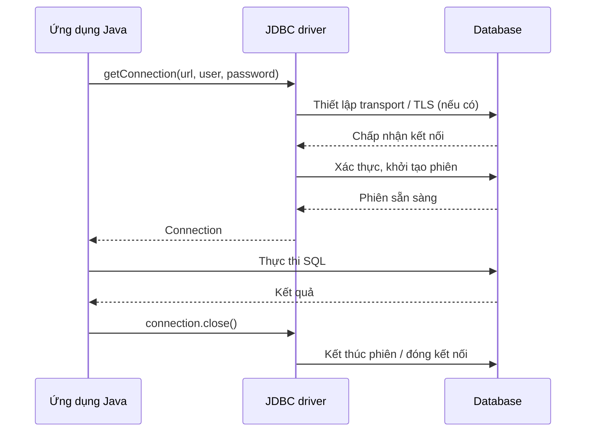
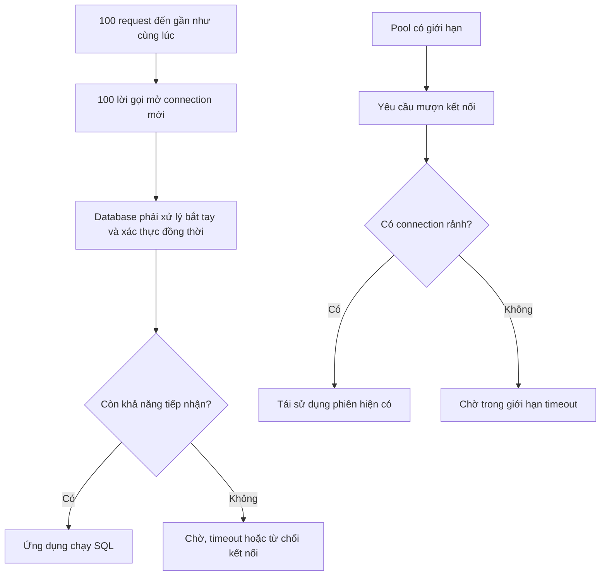
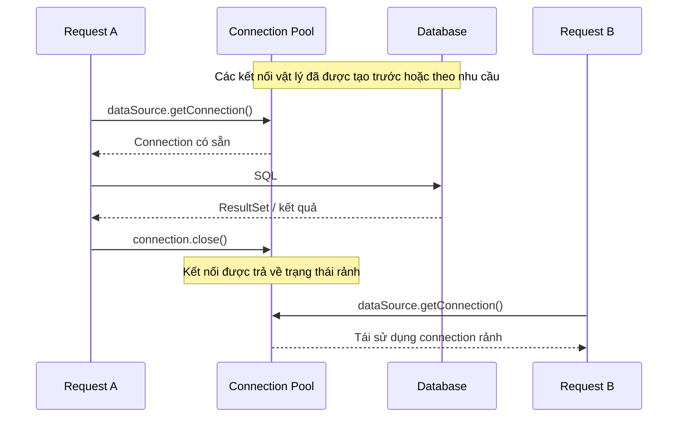

# Vì sao tạo mới kết nối cho từng thao tác gây chi phí trong JDBC?

Trong ứng dụng Java truy cập cơ sở dữ liệu quan hệ qua **JDBC (Java Database Connectivity)**, một thao tác đọc hoặc ghi dữ liệu thường rất ngắn: tìm một đơn hàng, cập nhật trạng thái thanh toán, kiểm tra một bản ghi. Nếu **mỗi thao tác đều mở một `Connection` mới bằng `DriverManager.getConnection(...)` rồi đóng ngay**, chương trình phải lặp lại cả quy trình thiết lập phiên làm việc với cơ sở dữ liệu.

Phần chi phí này có thể lớn hơn chính câu SQL, đặc biệt khi ứng dụng và máy chủ database ở hai máy khác nhau hoặc lưu lượng yêu cầu tăng nhanh. Đó là lý do các hệ thống có nhiều truy cập thường dùng **connection pool (pool kết nối)** để tái sử dụng các kết nối còn hoạt động.

Mục tiêu của bài học là phân biệt chi phí **thiết lập kết nối** với chi phí **thực thi truy vấn**, thấy hệ quả khi lặp lại kết nối ở quy mô lớn, và hiểu pool giúp giảm phần chi phí nào.

## 1. Một `Connection` không chỉ là một đối tượng Java

Lời gọi JDBC:

```java
Connection connection =
        DriverManager.getConnection(url, username, password);
```

trả về một đối tượng Java triển khai giao diện `java.sql.Connection`. Tuy nhiên, để trả về đối tượng sử dụng được, JDBC driver thường phải tạo hoặc thiết lập một phiên giao tiếp thực với database.

Tùy hệ quản trị và cách triển khai driver, một kết nối mới có thể cần:

1. **Phân tích cấu hình:** kiểm tra JDBC URL, cổng, tham số driver và thông tin đăng nhập.
2. **Tìm địa chỉ máy chủ:** phân giải DNS nếu URL chứa hostname chưa được tra cứu hoặc cache.
3. **Thiết lập đường truyền:** tạo kết nối TCP hoặc transport thích hợp giữa ứng dụng và database.
4. **Thỏa thuận bảo mật:** thực hiện bắt tay TLS và xác minh chứng chỉ nếu cấu hình dùng TLS.
5. **Xác thực và khởi tạo phiên:** trao đổi thông tin đăng nhập, kiểm tra quyền và tạo trạng thái phiên ở phía server.
6. **Đưa kết nối vào trạng thái sẵn sàng:** áp dụng các thiết lập phiên cần thiết trước khi thực thi SQL.

Không phải driver nào cũng thực hiện đầy đủ các bước theo đúng thứ tự hoặc cùng số lần trao đổi mạng. DNS có thể được cache, TLS có thể có cơ chế tiếp tục phiên, còn database nội bộ nhúng không cần kết nối TCP. Dù vậy, **mở kết nối vật lý mới thường tốn nhiều công hơn lấy lại một phiên đã sẵn sàng**.

### Minh họa vòng đời khi không có pool



Nếu ứng dụng gọi `getConnection()` cho *từng* thao tác, toàn bộ phần đầu của sơ đồ có thể lặp lại nhiều lần trong cùng một yêu cầu nghiệp vụ.

## 2. Các loại chi phí bị lặp lại

| Loại chi phí | Phát sinh ở đâu? | Vì sao đáng quan tâm? |
| --- | --- | --- |
| **Độ trễ mạng** | Trao đổi giữa tiến trình Java và database khi bắt tay, xác thực, thiết lập phiên. | Nhiều lượt đi về mạng cộng dồn vào thời gian phản hồi, nhất là khi hai hệ thống ở xa nhau. |
| **CPU và mã hóa** | Driver, TLS, xác thực và phần mềm database. | Mở liên tục nhiều kết nối gây thêm công việc ngoài SQL, làm giảm năng lực dành cho truy vấn hữu ích. |
| **Bộ nhớ và trạng thái phiên** | Tài nguyên server, backend/thread/process hoặc cấu trúc trạng thái theo connection tùy DB. | Nhiều phiên đồng thời làm tăng mức dùng tài nguyên máy chủ. |
| **Giới hạn số kết nối** | Cấu hình hoặc khả năng phục vụ của database và proxy. | Burst lớn có thể chạm trần số kết nối cho phép. |
| **Dọn dẹp kết nối** | Driver, network stack, server. | Đóng phiên vật lý cũng cần xử lý, giải phóng trạng thái và có thể phát sinh trao đổi mạng. |
| **Tài nguyên phía ứng dụng** | Socket, bộ đệm, đối tượng driver và công việc quản lý vòng đời. | Mở và hủy liên tục tạo tải phụ, ngay cả khi câu SQL rất đơn giản. |

Có hai loại chi phí dễ nhầm:

- **Chi phí kết nối:** thời gian và tài nguyên để phiên làm việc sẵn sàng.
- **Chi phí truy vấn:** thời gian gửi SQL, lập kế hoạch và thực thi, khóa/chờ nếu có, nhận kết quả.

Một lệnh `SELECT` rất nhanh vẫn có thể phải đợi khá lâu nếu trước mỗi lần chạy nó buộc phải mở kết nối mới.

## 3. Tác động trực tiếp lên độ trễ của từng thao tác

Giả sử một thao tác có thời gian gần đúng:

```text
Không dùng pool:
  Tổng ≈ mở kết nối + thực thi SQL + nhận kết quả + đóng kết nối

Pool đã có kết nối sẵn:
  Tổng ≈ mượn kết nối + thực thi SQL + nhận kết quả + trả kết nối
```

Đây là cách phân rã để phân tích, không phải công thức đảm bảo thời gian thực tế. Lấy từ pool đôi khi phải chờ kết nối rảnh, kiểm tra kết nối, hoặc tạo kết nối mới nếu pool chưa đủ; đóng kết nối vật lý cũng có thể thực hiện một phần bất đồng bộ.

### Ví dụ số liệu giả định

Giả sử mỗi thao tác chỉ thực thi một câu SQL và tải còn thấp:

| Thành phần | Tạo mới mỗi lần | Mượn kết nối đã sẵn sàng |
| --- | ---: | ---: |
| Mở kết nối vật lý | 20 ms | 0 ms |
| Mượn/trả kết nối từ pool | 0 ms | 1 ms |
| SQL và nhận kết quả | 5 ms | 5 ms |
| **Thời gian minh họa** | **25 ms** | **6 ms** |

Theo các giả định trên, một thao tác có thể mất **25 ms thay vì 6 ms** dù câu SQL không thay đổi. Đây là **ví dụ để hiểu cơ chế, không phải kết quả benchmark hoặc mức cải thiện được bảo đảm**. Thực tế phụ thuộc driver, network, TLS, độ phức tạp SQL, kích thước kết quả và tình trạng pool.

Nếu một luồng xử lý gọi ba thao tác SQL và **mở ba kết nối độc lập**, phần chi phí thiết lập có thể bị trả ba lần. Với cùng phiên đã sẵn sàng, luồng xử lý có thể tiết kiệm đáng kể chi phí này. Khi các thao tác cần cùng một transaction, còn có lý do nghiệp vụ để chúng dùng chung một `Connection`.

## 4. Lượng yêu cầu tăng khiến chi phí nhân lên

Độ trễ của một lời gọi chỉ là một mặt. Vấn đề trở nên nghiêm trọng khi hàng trăm hoặc hàng nghìn thao tác cùng tranh nhau tài nguyên kết nối.

Ví dụ giả định một ứng dụng nhận **100 yêu cầu mỗi giây**, mỗi yêu cầu thực hiện **2 thao tác SQL**:

- Nếu mỗi thao tác gọi `DriverManager.getConnection()` riêng, tốc độ tạo kết nối có thể lên tới **200 kết nối mới mỗi giây** trong thời gian tải ổn định.
- Nếu các thao tác mượn kết nối từ pool và trả ngay khi xong, database không nhất thiết phải nhận 200 lượt tạo phiên mới mỗi giây. Các phiên vật lý đã mở được tái sử dụng cho nhiều yêu cầu theo thời gian.

Số lượng **kết nối được tạo mỗi giây** khác với số lượng **kết nối tồn tại đồng thời**. Chẳng hạn, nếu chỉ xét thời gian thiết lập 20 ms ở ví dụ trên và tốc độ 200 lần thiết lập/giây ổn định, trung bình có khoảng `200 × 0,020 = 4` tác vụ đang ở *giai đoạn thiết lập* tại một thời điểm (theo quan hệ lưu lượng–thời gian trung bình). Con số này chưa tính thời gian thực thi SQL, giữ connection, đóng connection hoặc các đỉnh tải. Không nên nhầm nó với mức pool nên cấu hình.

### Khi lưu lượng tăng đột biến

Một đợt burst có thể làm hàng loạt thread cùng mở kết nối mới:



Một pool giúp **giới hạn số phiên vật lý** do ứng dụng sử dụng và chuyển áp lực tăng vọt thành hàng đợi đợi kết nối ở phía ứng dụng. Cơ chế này có thể giúp database tránh quá tải kết nối, nhưng không làm công suất xử lý SQL của database tăng vô hạn. Nếu tốc độ yêu cầu liên tục vượt khả năng xử lý, người dùng vẫn gặp độ trễ và timeout.

### Giới hạn tổng của toàn hệ thống

Giả sử một database cho tối đa 100 kết nối ứng dụng, trong khi dịch vụ chạy 4 instance, mỗi instance cấu hình pool tối đa 30 kết nối. Tổng tiềm năng là:

```text
4 instance × 30 connection/instance = 120 connection
```

120 vượt giới hạn 100 ngay cả khi mỗi instance riêng lẻ hoạt động bình thường. Ngoài pool của ứng dụng còn có kết nối của hệ thống quản trị, tác vụ bảo trì và dịch vụ khác. Vì thế, **phải tính tổng pool của mọi instance**, chừa đủ khả năng cho các thành phần khác và có kế hoạch khi tự động mở rộng số replica.

## 5. Code JDBC: cách làm khiến kết nối được tạo lặp lại

Ví dụ dưới đây minh họa cách lập trình có thể gây chi phí nếu phương thức được gọi liên tục. Mỗi lần gọi `countOrders(...)`, `DriverManager` sẽ mở một kết nối qua driver thông thường rồi đóng ngay sau truy vấn.

```java
import java.sql.Connection;
import java.sql.DriverManager;
import java.sql.PreparedStatement;
import java.sql.ResultSet;
import java.sql.SQLException;

public class DirectConnectionExample {
    public static long countOrders(
            String url,
            String user,
            String password,
            long customerId) throws SQLException {

        try (Connection connection =
                     DriverManager.getConnection(url, user, password);
             PreparedStatement statement =
                     connection.prepareStatement(
                             "SELECT COUNT(*) FROM orders WHERE customer_id = ?")) {

            statement.setLong(1, customerId);

            try (ResultSet result = statement.executeQuery()) {
                result.next();
                return result.getLong(1);
            }
        }
    }
}
```

Đoạn mã này **không sai về đóng tài nguyên**: `try-with-resources` đảm bảo đóng `ResultSet`, `PreparedStatement` và `Connection` kể cả khi phát sinh lỗi. Vấn đề là việc đặt `getConnection()` bên trong một phương thức được gọi thường xuyên có thể lặp đi lặp lại chi phí khởi tạo phiên.

Nếu dùng `DriverManager.getConnection()` trực tiếp với driver JDBC thông thường, `Connection.close()` thường đóng kết nối vật lý. `DriverManager` bản thân **không tích hợp connection pool** để giữ lại phiên dùng cho lần sau. Một số hệ thống có proxy hoặc cơ chế đặc biệt ở lớp dưới, nhưng không nên tự giả định điều đó có sẵn.

## 6. Pool kết nối giảm chi phí bằng cách nào?

**Connection pool** quản lý một tập các kết nối vật lý đến database và cho ứng dụng **mượn** chúng khi cần. Khi kết thúc công việc, ứng dụng gọi `close()` trên connection do pool cấp. Với các triển khai pool phổ biến, thao tác này trả kết nối hợp lệ về pool để yêu cầu khác dùng lại.



Điểm khác biệt là **vòng đời của handle mà ứng dụng mượn** có thể ngắn, trong khi **vòng đời kết nối vật lý** kéo dài qua nhiều lượt mượn. Pool vẫn phải tạo kết nối lúc ban đầu, khi cần tăng số lượng trong giới hạn, hoặc khi kết nối cũ bị hỏng/đến hạn thay thế. Vì vậy, pooling **giảm số lần tạo kết nối ở trạng thái ổn định**, không xóa hoàn toàn chi phí mở kết nối.

### Chuyển sang `DataSource` có pool

JDBC cung cấp giao diện `javax.sql.DataSource` để lấy `Connection`. Bản thân `DataSource` **không mặc định có pooling**; cần chọn một triển khai có pool, ví dụ HikariCP.

Trong ứng dụng đã cấu hình sẵn `DataSource` có pool, mã truy vấn có thể viết:

```java
import javax.sql.DataSource;
import java.sql.Connection;
import java.sql.PreparedStatement;
import java.sql.ResultSet;
import java.sql.SQLException;

public class PooledConnectionExample {
    private final DataSource dataSource;

    public PooledConnectionExample(DataSource dataSource) {
        this.dataSource = dataSource;
    }

    public long countOrders(long customerId) throws SQLException {
        try (Connection connection = dataSource.getConnection();
             PreparedStatement statement =
                     connection.prepareStatement(
                             "SELECT COUNT(*) FROM orders WHERE customer_id = ?")) {

            statement.setLong(1, customerId);

            try (ResultSet result = statement.executeQuery()) {
                result.next();
                return result.getLong(1);
            }
        }
    }
}
```

So với đoạn `DriverManager`, phần SQL hầu như không đổi. Khác biệt là `DataSource` đã được cấu hình và chia sẻ trong ứng dụng. Lệnh `connection.close()` vẫn **bắt buộc**; bỏ quên nó có thể làm cạn pool vì các kết nối bị giữ mãi ở trạng thái đang mượn.

Ví dụ khởi tạo một pool HikariCP (cần thêm thư viện HikariCP và JDBC driver thích hợp vào dependency):

```java
import com.zaxxer.hikari.HikariConfig;
import com.zaxxer.hikari.HikariDataSource;

public class PoolSetupExample {
    public static void main(String[] args) throws Exception {
        HikariConfig config = new HikariConfig();
        config.setJdbcUrl(System.getenv("JDBC_URL"));
        config.setUsername(System.getenv("DB_USER"));
        config.setPassword(System.getenv("DB_PASSWORD"));
        config.setMaximumPoolSize(10);

        try (HikariDataSource pool = new HikariDataSource(config)) {
            PooledConnectionExample repository =
                    new PooledConnectionExample(pool);

            System.out.println(repository.countOrders(123L));
            System.out.println(repository.countOrders(456L));
        } // Đóng pool lúc ứng dụng thực sự kết thúc.
    }
}
```

Ví dụ giả định các biến môi trường, database và bảng `orders` đã tồn tại. Trong dịch vụ web thực tế, pool thường được **khởi tạo một lần ở vòng đời ứng dụng** (hoặc được framework quản lý), rồi tái sử dụng giữa nhiều request. Tạo một `HikariDataSource` mới bên trong **mỗi request** sẽ đánh mất lợi ích chính của pooling.

## 7. Pool không phải là lời giải cho mọi vấn đề hiệu năng

Pool giải quyết chi phí **quản lý và tái sử dụng kết nối**. Nó không tự làm truy vấn chậm trở nên nhanh, không thay thế thiết kế index và cũng không bảo đảm transaction đúng.

| Tình huống | Pool giúp gì? | Pool không tự giải quyết điều gì? |
| --- | --- | --- |
| Nhiều SQL nhỏ, kết nối ngắn | Giảm lặp lại khởi tạo phiên. | Chi phí thực thi SQL hoặc truyền dữ liệu lớn. |
| Tải tăng đột biến | Giới hạn số connection vật lý, cho request chờ trong giới hạn. | Năng lực CPU, I/O và khóa của database. |
| Một SQL chạy hàng chục giây | Có thể giảm chi phí mở kết nối ban đầu. | Chính câu SQL lâu và thời gian giữ connection. |
| SQL đang chờ lock | Quản lý số kết nối chờ. | Nguyên nhân lock/contention trong transaction. |
| Mất mạng hoặc DB restart | Có thể phát hiện, loại bỏ và thay thế connection hỏng. | Tránh toàn bộ lỗi trong request đang chạy hoặc bảo đảm failover tức thì. |

Cũng có tình huống ứng dụng rất nhỏ, chỉ chạy một lệnh vài lần một ngày, nơi sự đơn giản của `DriverManager` có thể phù hợp. Cần cân nhắc **tần suất sử dụng, thời gian chạy, chi phí vận hành và tải đồng thời**, không áp dụng pool theo thói quen.

## 8. Khi pool cấu hình sai, chi phí có thể chuyển thành vấn đề mới

Một pool quá nhỏ so với lượng SQL đang xử lý sẽ khiến các yêu cầu chờ `getConnection()`. Ngược lại, một pool quá lớn có thể tạo quá nhiều session, tiêu thụ tài nguyên và làm database chậm hơn.

Các thông số quan trọng thường gặp:

| Thông số | Ý nghĩa | Nếu cấu hình thiếu cân nhắc |
| --- | --- | --- |
| Kích thước tối đa | Giới hạn connection vật lý do pool giữ. | Quá nhỏ: request chờ; quá lớn: database quá tải phiên. |
| Số connection nhàn rỗi | Lượng phiên có thể sẵn sàng để dùng lại. | Quá nhiều gây giữ tài nguyên không cần thiết, quá ít có thể tăng lần tạo mới khi tải dâng. |
| Thời gian chờ mượn | Thời gian request được phép chờ connection rảnh. | Quá lâu làm request treo; quá ngắn dễ timeout trong biến động bình thường. |
| Thời gian sống tối đa | Thời điểm connection nên được thay mới. | Có thể giữ phiên quá cũ hoặc tạo vòng đời thay thế quá thường xuyên. |
| Thời gian nhàn rỗi | Khi nào connection ít dùng được phép thu hồi. | Giá trị không phù hợp làm kết nối chết tồn tại lâu hoặc churn nhiều. |
| Kiểm tra tính hợp lệ | Cách phát hiện connection hỏng trước/sau khi mượn. | Dễ gặp lỗi stale connection hoặc tăng chi phí kiểm tra không cần thiết. |

Tên tham số, đơn vị thời gian và tương tác giữa chúng phụ thuộc thư viện pool. Không nên suy ra rằng thiết lập có tên giống nhau ở mọi pool sẽ hoạt động giống hệt.

### Pool bị cạn do giữ connection quá lâu

Một connection chỉ nên được mượn lúc cần truy cập DB và trả về sớm sau khi thao tác hoàn tất. Ví dụ sau giữ connection không cần thiết trong lúc gọi dịch vụ khác:

```java
try (Connection connection = dataSource.getConnection()) {
    // Thực hiện một truy vấn database.
    // Sau đó gọi HTTP API mất vài giây dù chưa cần DB nữa.
    // Trong thời gian chờ HTTP, connection vẫn đang bị chiếm.
}
```

Nếu không cần giữ transaction hoặc consistency xuyên suốt, hãy hoàn tất truy vấn, đóng tài nguyên JDBC rồi mới chuyển sang công việc không liên quan. Mượn connection quá sớm hoặc trả quá muộn gây chờ pool ngay cả khi database không bận chạy SQL.

Với transaction thực sự cần nhiều bước SQL, phải giữ cùng connection đến lúc `commit()` hoặc `rollback()`; không được trả connection về pool giữa một transaction đang chạy chỉ để giảm thời gian giữ tài nguyên.

### Không chia sẻ một `Connection` tùy tiện giữa các request

Pool được thiết kế để chia sẻ **nguồn cấp kết nối** (`DataSource`), không có nghĩa các request được sử dụng đồng thời **cùng một đối tượng `Connection`**. Trộn truy vấn, transaction hoặc trạng thái phiên giữa các luồng có thể gây lỗi khó tái hiện.

## 9. Cách đo để xác nhận chi phí trong hệ thống thực

Đừng chỉ đo một truy vấn SQL sau khi đã kết nối rồi kết luận rằng thao tác JDBC nhanh. Cần phân biệt rõ thời gian tạo phiên, thời gian chờ pool và thời gian chạy SQL.

Những phép đo hữu ích:

1. **Thời gian `DriverManager.getConnection()`:** đo khi tạo kết nối vật lý mới trong môi trường thử nghiệm đại diện.
2. **Thời gian `dataSource.getConnection()`:** đo cả trường hợp có connection rảnh và trường hợp phải đợi; giá trị này không đồng nghĩa thời gian bắt tay mạng.
3. **Độ trễ thao tác end-to-end:** đo từ lúc bắt đầu xử lý yêu cầu đến khi đã nhận kết quả và giải phóng tài nguyên.
4. **Số connection mới mỗi giây:** quan sát có xảy ra nhiều chu kỳ tạo/hủy kết nối không.
5. **Số connection active/idle/pending của pool:** theo dõi có bao nhiêu connection đang dùng, rảnh và bao nhiêu request đang chờ.
6. **Chỉ số máy chủ DB:** kết nối đồng thời, CPU, bộ nhớ, tốc độ xác thực, trạng thái lock và thời gian thực thi SQL.
7. **Percentile độ trễ (p95/p99):** đánh giá ảnh hưởng đến request chậm trong các đợt tăng tải, không chỉ trung bình.

Khi so sánh hai phương án, giữ cùng tập SQL, dữ liệu, cấu hình TLS, số lượng request đồng thời và môi trường mạng. Quan sát cả trạng thái **pool mới khởi động** lẫn **pool đã ấm**; chạy vài lượt để phân biệt tác dụng cache và việc chuẩn bị sẵn kết nối. Phải kiểm tra thông lượng, tỷ lệ lỗi và tải server cùng với độ trễ, vì tối ưu một chỉ số có thể làm chỉ số khác xấu đi.

## 10. Những hiểu nhầm thường gặp

**“`Connection` chỉ là một đối tượng Java, tạo mới không đáng kể.”** — Đối tượng là bề mặt API; driver thường phải có transport và trạng thái server phía sau. Chi phí lớn nằm ở bước này.

**“Đóng `Connection` là lãng phí nên cứ giữ mãi.”** — Không. Trong mã dùng pool, gọi `close()` đúng lúc thường là hành động **trả kết nối về pool**. Không đóng là nguyên nhân phổ biến làm cạn pool.

**“Dùng `DataSource` mặc định đã có pool.”** — Không. `DataSource` là giao diện; pooling tùy thuộc triển khai và cấu hình.

**“Pool 100 connection chắc chắn nhanh gấp đôi pool 50.”** — Không. Nhiều connection có thể làm tăng tranh chấp CPU, I/O và khóa ở DB. Mức tối ưu phụ thuộc loại truy vấn và khả năng của máy chủ.

**“Có pool thì không còn timeout hay lỗi kết nối.”** — Không. Pool có thể hết connection, connection cũ hỏng, mạng gián đoạn hoặc database không đủ công suất. Ứng dụng vẫn cần xử lý `SQLException`, timeout, retry có kiểm soát và rollback phù hợp.

**“Có pool thì mỗi truy vấn tự động cùng một transaction.”** — Không. Mỗi lần mượn connection là một lượt sử dụng; transaction phải được quản lý rõ ràng trên connection phù hợp. Nhiều lần mượn không mặc nhiên cùng transaction.

## 11. Bài tập suy nghĩ và thực hành

1. **Tìm số lần mở kết nối:** một API gọi ba repository method, mỗi method dùng `DriverManager.getConnection()`. Nếu API nhận 50 request/giây và cả ba method luôn được gọi, có bao nhiêu lần mở kết nối mới mỗi giây? Đáp án theo giả định là **150**.
2. **Phân tích độ trễ:** một lượt mở kết nối mới mất 15 ms, SQL mất 4 ms, còn mượn/trả connection rảnh tốn 1 ms. Với một thao tác độc lập và bỏ qua chi phí khác, tính thời gian tương ứng cho hai cách. Đáp án là **19 ms** so với **5 ms**.
3. **Tính tổng giới hạn:** triển khai 5 instance với pool tối đa 25 connection/instance; tổng nhu cầu lý thuyết là **125 connection**. Hãy kiểm tra xem DB còn đủ connection cho ứng dụng khác, quản trị và tác vụ nền không.
4. **Nhận diện pool leak:** một service có `maximumPoolSize = 10`, sau vài phút toàn bộ request bắt đầu chờ `getConnection()` nhưng SQL trên database ít hoạt động. Hãy tìm những nơi mượn connection mà quên `close()` hoặc giữ connection trong khi thực hiện I/O ngoài database.
5. **Thiết kế phép đo:** chạy cùng một tập truy vấn với hai phiên bản dùng `DriverManager` và pool. Thu thập thời gian tạo connection, p95 độ trễ request, active/idle/pending của pool và số session trên database; giải thích sự khác biệt.

## Ghi nhớ

- Mỗi lần mở kết nối JDBC mới có thể phải thiết lập đường truyền, bảo mật, xác thực và trạng thái phiên trước khi chạy SQL.
- Nếu thực hiện điều đó cho từng thao tác, chi phí lặp lại làm tăng độ trễ và có thể tạo tải lớn lên database khi lượng request tăng.
- Connection pool **tái sử dụng phiên vật lý**: ứng dụng mượn connection cho công việc rồi gọi `close()` để trả về pool.
- `DriverManager` không cung cấp pooling sẵn; `DataSource` chỉ có pooling khi được triển khai/cấu hình với cơ chế pool phù hợp.
- Pool cần được giới hạn kích thước, quản lý timeout và giám sát theo tải thực. Pool quá lớn, kết nối bị giữ lâu hoặc thiếu `close()` đều có thể gây nghẽn.
- Lợi ích rõ nhất thường xuất hiện trong ứng dụng có nhiều thao tác database nhỏ và lặp lại; hãy đo độ trễ, thông lượng và tài nguyên database để xác nhận trong hệ thống cụ thể.
