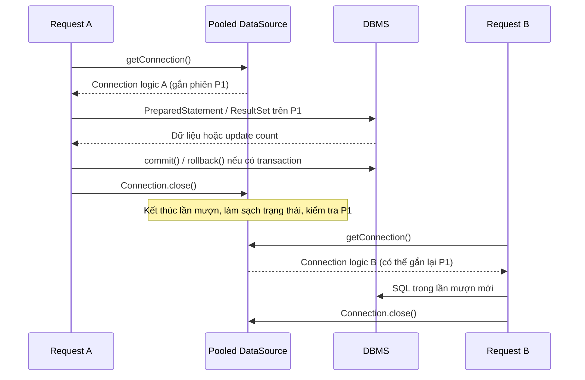
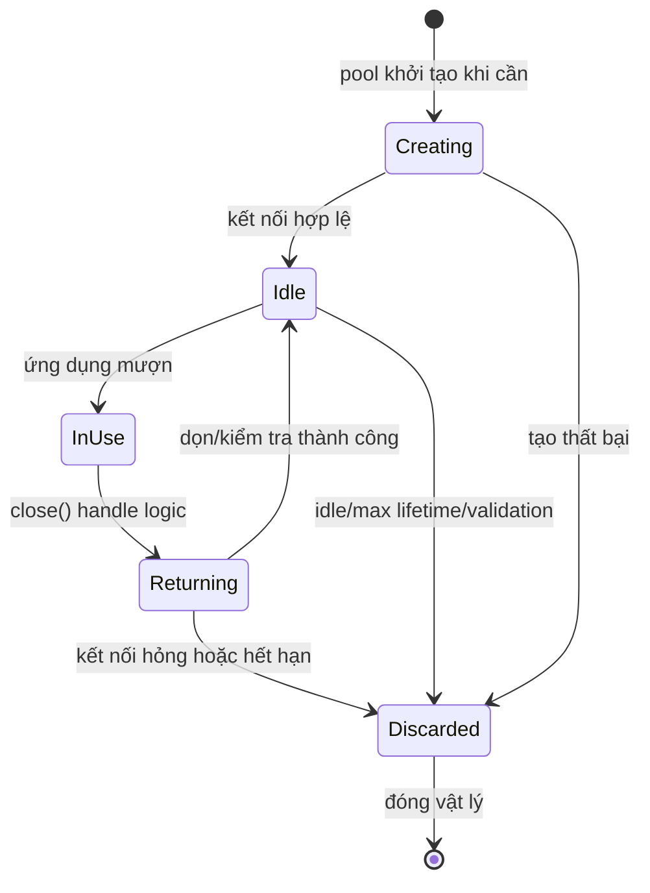
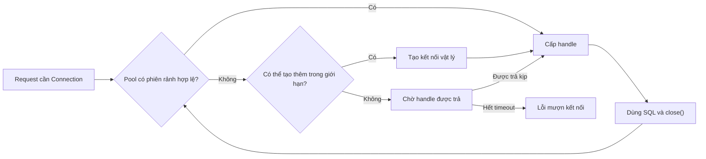

# Luồng mượn, sử dụng, đóng logic và tái sử dụng kết nối trong JDBC

Khi ứng dụng Java dùng **JDBC** để đọc hoặc ghi dữ liệu quan hệ, nó cần một `java.sql.Connection`. Việc tạo kết nối vật lý mới cho từng request có thể phải thiết lập kênh mạng, xác thực với máy chủ cơ sở dữ liệu, khởi tạo phiên làm việc và cấp phát tài nguyên; nếu làm liên tục dưới tải cao, chi phí đó có thể trở thành điểm nghẽn. **Connection pool** duy trì một tập kết nối vật lý có thể dùng lại, còn ứng dụng **mượn một kết nối logic**, dùng trong thời gian ngắn rồi **đóng handle để trả về pool**.

Bài này thuộc chương **Pool kết nối** của module **JDBC**. Trọng tâm là luồng **mượn → sử dụng → đóng logic → làm sạch/kiểm tra → tái sử dụng**, cách kết hợp `DataSource`, `Connection`, `PreparedStatement`, `ResultSet` và transaction, cũng như những điều có thể xảy ra khi pool hết kết nối, phiên kết nối hỏng hoặc ứng dụng quên đóng tài nguyên.

> **Quy tắc quan trọng nhất:** Với một `DataSource` được cấu hình sử dụng pool, ứng dụng phải gọi **`Connection.close()`** sau mỗi lần mượn. Trong mô hình pool thông thường, lệnh này đóng **handle logic** và trả tài nguyên về pool; nó **không nhất thiết đóng socket/kết nối vật lý**. Ngược lại, nếu `DataSource` không dùng pool, `close()` thường đóng chính kết nối vật lý. Không được suy ra hành vi chỉ từ tên interface `DataSource`.

## 1. Tại sao cần pool kết nối?

Một ứng dụng có nhiều request đồng thời có thể truy cập database bằng hai cách.

**Không dùng pool** (mô hình khái niệm):

```text
Request A: mở kết nối vật lý → chạy SQL → đóng kết nối vật lý
Request B: mở kết nối vật lý → chạy SQL → đóng kết nối vật lý
Request C: mở kết nối vật lý → chạy SQL → đóng kết nối vật lý
```

**Có pool**:

```text
                              Pool kết nối
                            ┌───────────────────┐
Request A ── mượn ─────────>│ P1: đang sử dụng  │
Request B ── mượn ─────────>│ P2: đang sử dụng  │
                            │ P3: sẵn sàng      │
Request C ── mượn P3 ──────>│ P3: đang sử dụng  │
                            └───────────────────┘
Request A ── close() ──────> P1 trở về trạng thái có thể mượn
Request D ── getConnection() ─> được cấp một handle cho P1 (ví dụ)
```

Pool có thể giảm chi phí thiết lập kết nối lặp đi lặp lại, giới hạn tổng số phiên DB được mở từ một ứng dụng và cung cấp chính sách quản lý kết nối lỗi hoặc quá tuổi. Nhưng pool **không làm cho một kết nối vật lý có thể xử lý vô hạn request cùng lúc**. Nếu toàn bộ kết nối đang được mượn, request tiếp theo có thể phải chờ, gặp timeout hoặc bị từ chối tùy cấu hình.

### Lợi ích và giới hạn

| Lợi ích mong đợi | Điều không được suy ra |
|---|---|
| Tái sử dụng phiên kết nối thay vì mở mới liên tục | Không phải mọi `DataSource` đều tự động có pool. |
| Giới hạn số kết nối vật lý tới DBMS | Không bảo đảm mọi request luôn có kết nối ngay lập tức. |
| Thu hồi và thay thế kết nối không còn hợp lệ | Không thể cứu transaction đã thất bại hoặc thay thế idempotency. |
| Theo dõi số kết nối đang mượn/chờ/nhàn rỗi | Không thay thế việc đóng `ResultSet` và `Statement`. |
| Cải thiện throughput cho workload phù hợp | Pool quá lớn vẫn có thể gây nghẽn DB, tranh chấp khóa hoặc vượt giới hạn DBMS. |

Sử dụng pool đúng cách là bài toán **quản lý vòng đời tài nguyên**. Số lượng kết nối hay loại driver chỉ là một phần của thiết kế.

## 2. Phân biệt kết nối vật lý và handle logic

Một **kết nối vật lý** là phiên giao tiếp mà pool duy trì với DBMS. Một **handle logic** là đối tượng `Connection` mà mã ứng dụng nhận từ `DataSource.getConnection()`; trong pool, handle thường là một wrapper/proxy đại diện cho một kết nối vật lý đã được cấp phát.

Giả sử ứng dụng gọi:

```java
try (Connection connection = dataSource.getConnection()) {
    // Sử dụng connection trong phạm vi này.
}
```

Khi ra khỏi khối `try`:

- Java tự gọi `connection.close()`.
- **Với DataSource có pool:** pool được thông báo rằng handle đã trả; nó có thể kết thúc transaction chưa hoàn tất theo chính sách, làm sạch trạng thái và đưa kết nối vật lý trở lại danh sách sẵn sàng, hoặc loại bỏ kết nối nếu hỏng.
- **Với DataSource không có pool:** `close()` thường đóng tài nguyên kết nối vật lý.

Khi một request khác gọi `getConnection()`, nó có thể được gán **chính phiên vật lý vừa trả**, hoặc một phiên khác. Ứng dụng không được dựa vào việc lần mượn sau luôn nhận cùng kết nối vật lý, cùng session ID hay cùng trạng thái tạm của phiên trước.

| Đối tượng / khái niệm | Ai quản lý? | Khi nào hết vòng đời? |
|---|---|---|
| `DataSource` đã cấu hình pool | Tầng khởi tạo ứng dụng / framework / container | Thường sống trong suốt vòng đời ứng dụng rồi được shutdown. |
| Kết nối vật lý tới DBMS | Pool và driver | Khi pool chủ động đóng, gặp lỗi, hết tuổi hoặc ứng dụng shutdown. |
| `Connection` logic do `getConnection()` trả về | Mã đang mượn kết nối | Khi mã gọi `close()`; handle không còn dùng để chạy SQL. |
| `PreparedStatement` | Mã thực hiện câu SQL | Khi đóng statement hoặc kết nối quản lý nó kết thúc. |
| `ResultSet` | Mã duyệt kết quả truy vấn | Khi đóng result set hoặc tài nguyên cha kết thúc. |
| Transaction JDBC | `Connection` và DBMS | Khi `commit()/rollback()` hoặc theo quy tắc giao dịch tương ứng. |

**Không được nhầm “đã gọi `close()`” với “đã đóng kết nối vật lý”.** Mục tiêu của pool là tách hai thao tác này, cho phép ứng dụng đóng handle nhất quán mà vẫn tận dụng được tài nguyên kết nối nền.

## 3. Luồng đầy đủ: từ mượn tới tái sử dụng

Vòng đời điển hình có thể hình dung như sau:



Mô hình này gồm **sáu giai đoạn**:

1. **Lấy tài nguyên:** `dataSource.getConnection()` yêu cầu một handle. Pool tìm kết nối nhàn rỗi đủ điều kiện; nếu chưa có, nó có thể tạo kết nối vật lý mới nếu còn trong giới hạn, hoặc chờ một handle được trả.
2. **Bàn giao:** pool cấp handle logic cho đúng lần mượn. Từ đây, mã ứng dụng sở hữu trách nhiệm đóng handle.
3. **Sử dụng:** tạo `PreparedStatement`, bind giá trị, thực thi SQL, đọc `ResultSet`; có thể bắt đầu và hoàn tất transaction.
4. **Đóng logic:** gọi `Connection.close()`, thường tự động qua `try-with-resources`. Mã ứng dụng **không được tiếp tục dùng handle đã đóng**.
5. **Dọn và đánh giá:** pool áp dụng chính sách trả kết nối: xử lý transaction bỏ dở, khôi phục cấu hình, kiểm tra kết nối còn hợp lệ, đánh dấu nhàn rỗi hoặc loại bỏ.
6. **Tái sử dụng:** một lần mượn tiếp theo nhận handle mới được liên kết với một kết nối vật lý đủ điều kiện.

Không phải mọi pool đều thực hiện đầy đủ các bước dọn **vào cùng một thời điểm**; một số thao tác có thể diễn ra khi trả, khi mượn lại hoặc trong chu kỳ bảo trì. Vì thế, **đừng coi một chính sách reset cụ thể là bảo đảm phổ quát của JDBC**.

### Chuyển trạng thái của kết nối vật lý



Bảng trạng thái ở trên mô tả **kết nối vật lý**. Một handle logic đã đóng không chuyển từ `closed` trở lại `open`; lần mượn mới phải lấy một handle mới từ `getConnection()`, dù pool có thể tái sử dụng cùng phiên vật lý.

## 4. Ví dụ JDBC chuẩn: mượn kết nối, đọc dữ liệu, trả về pool

Giả sử ứng dụng có bảng:

```sql
CREATE TABLE product (
    id BIGINT PRIMARY KEY,
    name VARCHAR(120) NOT NULL,
    stock INTEGER NOT NULL
);
```

Khi cần tìm tên sản phẩm theo ID, hãy dùng `PreparedStatement` với `?` thay vì nối dữ liệu vào SQL:

```java
import java.sql.Connection;
import java.sql.PreparedStatement;
import java.sql.ResultSet;
import java.sql.SQLException;
import javax.sql.DataSource;

public final class ProductRepository {
    private final DataSource dataSource;

    public ProductRepository(DataSource dataSource) {
        this.dataSource = dataSource;
    }

    public String findName(long id) throws SQLException {
        String sql = "SELECT name FROM product WHERE id = ?";

        try (Connection connection = dataSource.getConnection();
             PreparedStatement ps = connection.prepareStatement(sql)) {

            ps.setLong(1, id);

            try (ResultSet rs = ps.executeQuery()) {
                return rs.next() ? rs.getString("name") : null;
            }
        }
    }
}
```

Đây là ví dụ **JDBC chuẩn**, không phụ thuộc API của một thư viện pool cụ thể. Nếu `dataSource` là pooled DataSource đã được cấu hình, mỗi lời gọi `findName(...)`:

1. Mượn một handle kết nối ở `getConnection()`.
2. Chuẩn bị câu SQL tham số hóa trên handle đó.
3. Đọc đúng một hàng nếu tồn tại.
4. Đóng `ResultSet`, `PreparedStatement` và `Connection` theo thứ tự ngược với lúc mở.
5. Trả handle về pool; pool có thể tái sử dụng kết nối vật lý cho request sau.

Nếu `dataSource` không được cấu hình dùng pool, mã vẫn đúng về mặt quản lý tài nguyên, nhưng `close()` khi đó có thể đóng kết nối vật lý. **Đặt pool trong cấu hình của DataSource, không phải bằng cách bỏ lời gọi `close()` trong DAO.**

### Vì sao truyền `DataSource` thay vì lưu một `Connection` dùng chung?

`DataSource` là **nguồn cấp kết nối** và ở các triển khai pool thông dụng có thể được chia sẻ bởi nhiều request. Trong khi đó, `Connection` đại diện cho một phiên làm việc có transaction, trạng thái và tài nguyên cursor, nên **không nên lưu làm trường dùng chung giữa các thread**.

```java
// Phù hợp: lưu DataSource được ứng dụng cấp ở phạm vi dài.
private final DataSource dataSource;

// Không phù hợp: giữ một Connection mượn từ pool làm trường singleton
// rồi dùng cho mọi request và không bao giờ close.
// private final Connection sharedConnection;
```

Sử dụng một `Connection` đang được mượn cho **một đơn vị công việc rõ ràng**. Nhiều `PreparedStatement` có thể cùng dùng kết nối đó nếu một nghiệp vụ cần cùng transaction. Nhưng mỗi thread/request độc lập thường nên mượn handle riêng thay vì đồng thời thao tác trên một `Connection` dùng chung.

## 5. `close()` logic không phải `close()` vật lý

Điểm khác biệt này dễ gây hiểu nhầm khi lần đầu quan sát connection pool.

### Sau khi close, object Connection có còn sử dụng được không?

Không. Với một handle đã được đóng:

```java
Connection c = dataSource.getConnection();
try {
    // Dùng c cho công việc hiện tại.
} finally {
    c.close();
}

// Không được tiếp tục dùng c để executeQuery()/prepareStatement().
```

Dù kết nối vật lý nền có thể được pool giữ lại, **handle `c` không được dùng tiếp**. Nếu muốn làm công việc khác, gọi `dataSource.getConnection()` và nhận handle mới. `Connection.isClosed()` thường cho biết handle đã đóng, nhưng không nên sử dụng nó làm cơ chế “đánh thức” kết nối.

### `close()` có bắt buộc tái sử dụng cùng phiên vật lý không?

Không. Pool có thể:

- Đưa kết nối về danh sách nhàn rỗi và cấp cho một request khác.
- Đóng kết nối vì đã vượt `maxLifetime` hoặc chính sách hết hạn.
- Loại bỏ kết nối vì DBMS báo lỗi hoặc kiểm tra sức khỏe không đạt.
- Tạo kết nối vật lý mới khi nhu cầu tăng mà chưa chạm giới hạn.
- Chủ động co pool khi tải giảm.

Do đó, kiểm thử đúng phải tập trung vào **đóng handle và tài nguyên hoạt động ổn định**, không dựa vào phép so sánh `c1 == c2`, `System.identityHashCode(c)` hoặc giả định session ID của hai lần mượn phải giống nhau.

### Ai thật sự quyết định việc “trả về pool”?

Lớp triển khai pool hoặc môi trường ứng dụng (ví dụ application server) kiểm soát ý nghĩa logic của `Connection.close()` đối với handle nó cấp. Đây không phải chức năng mà một `Connection` không có pool tự bật được.

Ở cấp API JDBC còn có `javax.sql.ConnectionPoolDataSource` và `javax.sql.PooledConnection` dành cho thành phần quản lý pooling, nhưng mã nghiệp vụ **thường chỉ làm việc với `javax.sql.DataSource` và `java.sql.Connection`**. Việc tự gọi các API quản lý `PooledConnection` không phải yêu cầu để dùng một pool đã được cấu hình sẵn.

## 6. Transaction trong một lần mượn: phải kết thúc rõ ràng

Kết nối có trạng thái transaction. Nếu ứng dụng tắt auto-commit và cập nhật dữ liệu, nó phải quyết định **commit hoặc rollback trước khi trả handle**. Đừng dựa vào hành vi mặc định khi trả một transaction chưa hoàn tất.

Giả sử thêm giao dịch nhập kho và tăng tồn sản phẩm phải cùng thành công. Với bảng minh họa:

```sql
CREATE TABLE stock_receipt (
    id BIGINT PRIMARY KEY,
    product_id BIGINT NOT NULL,
    added_quantity INTEGER NOT NULL CHECK (added_quantity > 0)
);
```

Mẫu nghiệp vụ dùng **một kết nối được mượn** cho cả hai thao tác:

```java
import java.sql.Connection;
import java.sql.PreparedStatement;
import java.sql.SQLException;
import javax.sql.DataSource;

public final class StockService {
    private final DataSource dataSource;

    public StockService(DataSource dataSource) {
        this.dataSource = dataSource;
    }

    public void receive(
            long receiptId,
            long productId,
            int quantity
    ) throws SQLException {
        if (quantity <= 0) {
            throw new IllegalArgumentException("Quantity must be positive");
        }

        String insertReceipt =
                "INSERT INTO stock_receipt (id, product_id, added_quantity) "
                + "VALUES (?, ?, ?)";
        String increaseStock =
                "UPDATE product SET stock = stock + ? WHERE id = ?";

        try (Connection connection = dataSource.getConnection()) {
            // Thiết lập trước khi thực hiện câu ghi đầu tiên.
            connection.setAutoCommit(false);

            try {
                try (PreparedStatement receipt =
                             connection.prepareStatement(insertReceipt);
                     PreparedStatement stock =
                             connection.prepareStatement(increaseStock)) {

                    receipt.setLong(1, receiptId);
                    receipt.setLong(2, productId);
                    receipt.setInt(3, quantity);

                    if (receipt.executeUpdate() != 1) {
                        throw new SQLException("Không tạo được phiếu nhập");
                    }

                    stock.setInt(1, quantity);
                    stock.setLong(2, productId);

                    if (stock.executeUpdate() != 1) {
                        throw new SQLException("Không tìm thấy sản phẩm");
                    }
                }

                // Chỉ commit khi cả hai câu SQL thành công.
                connection.commit();

            } catch (SQLException | RuntimeException failure) {
                try {
                    connection.rollback();
                } catch (SQLException rollbackError) {
                    failure.addSuppressed(rollbackError);
                }
                throw failure;
            }

            // Không cần gọi setAutoCommit(true) ở đây:
            // trả handle trong close() để pool dọn/reset theo cấu hình.
        }
    }
}
```

**Quan trọng:** Ví dụ không giả định mọi pool luôn reset auto-commit đúng chuẩn theo cùng cách. Pool được dùng trong sản xuất phải được **cấu hình và kiểm thử** để khôi phục trạng thái giữa các lần mượn, hoặc ứng dụng cần tuân thủ hợp đồng quản lý trạng thái của pool cụ thể. Nếu kết nối thuộc môi trường transaction manager của framework, ranh giới commit/rollback có thể do manager điều phối; không trộn commit thủ công với transaction do manager sở hữu.

Trong ví dụ thuần JDBC này, mã gọi `commit()` hoặc cố gắng `rollback()` **trước** khi `Connection.close()`. Pool chỉ nhận một kết nối đã được ứng dụng kết thúc transaction về mặt logic trong trường hợp bình thường.

### Không bật auto-commit trước khi rollback

Một lỗi rất nguy hiểm:

```java
// Sai nếu đang có thay đổi chưa commit:
connection.setAutoCommit(true);
// Sau đó mới nghĩ tới connection.rollback().
```

Theo ngữ nghĩa JDBC, chuyển từ auto-commit tắt sang bật khi transaction đang hoạt động có thể **commit transaction hiện tại**. Do đó không dùng `setAutoCommit(true)` như cách “dọn dẹp” trong nhánh lỗi.

**Thứ tự đúng về mặt nghiệp vụ:** thành công thì `commit()`; thất bại thì cố gắng `rollback()`; sau đó mới trả handle để pool quản lý trạng thái kế tiếp. Cách reset `autoCommit`/isolation/readOnly... cần theo hợp đồng pool hoặc transaction manager đang sử dụng.

### Nếu rollback thất bại thì sao?

Khi lỗi mạng hoặc DBMS hỏng, `rollback()` cũng có thể ném `SQLException`. Ví dụ trên dùng `failure.addSuppressed(rollbackError)` để không mất nguyên nhân lỗi đầu tiên. Khi connection không còn lành mạnh, pool phải có cơ chế **loại bỏ kết nối không hợp lệ** thay vì bàn giao lại bừa cho request khác.

Thêm một giới hạn quan trọng: nếu `commit()` ném lỗi do mất phản hồi, ứng dụng đôi khi **không thể biết chắc DBMS đã commit hay chưa**. Không nên retry nghiệp vụ có tác dụng phụ ngay lập tức nếu chưa có mã yêu cầu duy nhất/idempotency và cơ chế đối soát. Pool thay kết nối hỏng **không xác định hộ kết quả giao dịch trước đó**.

## 7. Trạng thái phiên có thể rò rỉ giữa các lần mượn

Một kết nối JDBC có nhiều thuộc tính hoặc trạng thái có thể bị thay đổi trong quá trình sử dụng:

| Nhóm trạng thái | API hoặc ví dụ | Rủi ro nếu truyền sang lần mượn tiếp theo |
|---|---|---|
| Auto-commit | `setAutoCommit(false)` | Request sau có thể tưởng mỗi lệnh đã commit nhưng thực tế còn transaction chưa kết thúc. |
| Isolation | `setTransactionIsolation(...)` | Truy vấn sau có mức cô lập khác dự kiến, làm tăng tranh chấp hoặc thay đổi hành vi đọc. |
| Read-only | `setReadOnly(true)` | Request sau có thể không ghi được hoặc nhận hành vi tối ưu hóa khác. |
| Catalog/schema | `setCatalog(...)`, `setSchema(...)` | SQL không đủ tên schema có thể chạy trên namespace khác. |
| Session-level SQL | `SET ...`, bảng tạm, biến phiên, thiết lập thời gian | Pool có thể không tự phát hiện hoặc không thể reset mọi thay đổi tùy DBMS/driver. |
| Transaction đang mở | DML chưa `commit/rollback` | Khóa/tài nguyên hoặc thay đổi chưa xác nhận có thể tồn tại, gây bất nhất hoặc ảnh hưởng borrower khác. |
| ResultSet/cursor/statement | `ResultSet` và `PreparedStatement` chưa đóng | Rò rỉ tài nguyên, cursor bị giữ, tăng tải máy chủ hoặc cản trở tái sử dụng. |

Không nên mặc định mọi pool đều reset **tất cả** các thuộc tính trên. Các pool thông dụng thường có cơ chế theo dõi/reset một số thuộc tính JDBC, nhưng **session SQL tùy ý** như biến riêng của DBMS hoặc bảng tạm có thể cần chiến lược riêng.

### Nguyên tắc kiểm soát trạng thái

1. Mã nghiệp vụ phải luôn **kết thúc transaction** mình tạo ra.
2. Tránh dùng `Connection` để thiết lập trạng thái phiên tùy ý mà không có kế hoạch reset.
3. Nếu có đổi isolation/read-only/catalog/schema, hãy hiểu hợp đồng của pool và framework. Khi mã sở hữu trạng thái, cân nhắc khôi phục có chủ đích sau khi transaction hoàn tất; không reset giữa transaction đang chạy.
4. Các cấu hình mặc định dùng chung nên được thiết lập ở tầng quản lý DataSource/pool, không để mỗi DAO tự sáng tạo một mặc định khác.
5. Kiểm thử nhiều request liên tiếp để xác minh borrower B không nhìn thấy trạng thái tùy ý do borrower A để lại.

**Đặc biệt:** Một `Connection` logic trả về pool có thể bị pool reset tại `close()` hoặc ở lần mượn sau. Nhưng quy tắc portable của ứng dụng vẫn là **không để transaction dở dang** và **không phụ thuộc session state tồn tại từ lần mượn trước**.

## 8. Mượn kết nối khi pool đã hết chỗ

Giả sử pool có tối đa 10 kết nối đang hoạt động và cả 10 đều được mượn. Request thứ 11 cần kết nối để thực thi `SELECT`.

Điều gì xảy ra phụ thuộc triển khai và cấu hình:

- Request có thể **chờ** một handle được `close()` bởi request khác.
- Nếu thời gian chờ vượt ngưỡng, `getConnection()` có thể ném `SQLException` hoặc một ngoại lệ kết nối cụ thể của pool.
- Một số cấu hình cho phép pool tạo thêm kết nối tới giới hạn; nếu DBMS từ chối kết nối mới, thao tác mượn cũng có thể thất bại.
- Nếu ứng dụng quên đóng handle, pool có thể bị cạn kiệt dù mỗi truy vấn SQL riêng lẻ chạy rất nhanh.



**Timeout mượn kết nối** khác với **query timeout** và **lock timeout**:

| Loại timeout | Giai đoạn | Ví dụ hậu quả |
|---|---|---|
| Acquisition/borrow timeout | `DataSource.getConnection()` đang chờ pool cấp handle | Chưa chạy câu SQL nào nhưng request đã bị từ chối vì hết tài nguyên. |
| Query timeout | `Statement.executeQuery()/executeUpdate()` đang thực thi | Câu SQL bị hủy/chấm dứt theo driver/DBMS; cần xử lý trạng thái transaction. |
| Lock timeout | DBMS chờ khóa bị transaction khác giữ | Lệnh SQL lỗi vì chờ khóa quá lâu. |
| Connection/network timeout | Kết nối mạng hoặc xác thực/giao tiếp bị treo/lỗi | Handle hoặc phiên vật lý có thể bị đánh dấu hỏng. |

Không nên chữa lỗi pool cạn bằng cách **tăng vô hạn pool size**. Nếu request giữ kết nối lâu hoặc có leak, tăng kích thước chỉ che giấu nguyên nhân và có thể đẩy DBMS vào trạng thái quá tải.

### Mẹo: mượn càng muộn, trả càng sớm càng tốt

Ví dụ cách viết chưa tốt:

```java
try (Connection connection = dataSource.getConnection()) {
    // Gọi HTTP đến dịch vụ khác mất nhiều giây.
    // Parse file lớn không dùng DB.
    // Sau đó mới chạy một SELECT rất ngắn.
}
```

Kết nối bị chiếm trong cả lúc gọi HTTP và parse file, dù không có truy vấn SQL. Một cách tổ chức tốt hơn là thực hiện phần tính toán và chuẩn bị dữ liệu **trước khi mượn**, sau đó mượn cho phần SQL cần thiết rồi trả ngay. Nếu cần transaction bao quanh một quyết định nghiệp vụ, phải xem xét tính nhất quán và không tách các thao tác cần nguyên tử; vẫn có thể tối ưu để không giữ kết nối trong lúc chờ không liên quan.

## 9. Dấu hiệu rò rỉ kết nối và cách phòng ngừa

**Connection leak** xảy ra khi ứng dụng mượn handle nhưng không trả về pool theo vòng đời mong đợi. Ví dụ:

```java
// Sai: không đảm bảo close() nếu executeQuery() ném ngoại lệ.
Connection connection = dataSource.getConnection();
PreparedStatement ps =
        connection.prepareStatement("SELECT name FROM product WHERE id = 1");
ResultSet rs = ps.executeQuery();
// Hàm return hoặc ném lỗi ở đây mà không đóng các tài nguyên.
```

Hậu quả có thể là số lượng **active/in-use** tăng dần, số **idle** về 0, số luồng chờ tăng và timeout ở `getConnection()`. Đây không nhất thiết là lỗi database; đôi khi chỉ là mã không trả kết nối.

Giải pháp thông dụng:

```java
try (Connection connection = dataSource.getConnection();
     PreparedStatement ps = connection.prepareStatement(
             "SELECT name FROM product WHERE id = ?")) {

    ps.setLong(1, 1L);

    try (ResultSet rs = ps.executeQuery()) {
        while (rs.next()) {
            System.out.println(rs.getString("name"));
        }
    }
}
```

**`try-with-resources`** đóng tài nguyên theo thứ tự ngược với thứ tự khai báo:

1. Đóng `ResultSet` của truy vấn.
2. Đóng `PreparedStatement`.
3. Gọi `Connection.close()` để trả handle.

Ngay cả khi `executeQuery()` hoặc code trong vòng lặp phát sinh ngoại lệ, Java vẫn cố gắng đóng những tài nguyên đã được tạo. Ngoại lệ phát sinh trong lúc đóng sẽ được xử lý theo cơ chế *suppressed exception* của try-with-resources, giúp giữ lại lỗi chính trong nhiều trường hợp.

### Leak thật và kết nối được giữ lâu là hai chuyện khác nhau

Một request đang chạy transaction hợp lệ nhưng mất 10 giây cũng chiếm handle trong 10 giây. Một số pool có chức năng **leak detection** phát cảnh báo nếu một handle được giữ quá ngưỡng; cảnh báo đó có thể là **false positive** đối với transaction dài nhưng hợp lệ. Không nên coi mọi cảnh báo leak là bằng chứng quên `close()`, nhưng phải điều tra trace và thời gian giữ kết nối.

Các câu hỏi cần đo:

- Handle được mượn từ stack trace/vị trí code nào?
- Có đường đi exception/return nào bỏ qua `close()`?
- Có đọc `ResultSet` lớn quá lâu trong lúc giữ connection?
- Có gọi HTTP hoặc chờ lock ngoài DB khi đang mượn connection?
- Transaction có bị giữ mở vì thiếu commit/rollback?
- Kích thước pool và mức concurrency có phù hợp với sức chịu tải của DB không?

## 10. Validation, eviction và kết nối chết

Một kết nối vật lý đang nhàn rỗi không có nghĩa nó chắc chắn còn dùng được. DBMS có thể tự đóng kết nối lâu không hoạt động, thiết bị mạng có thể cắt phiên, máy chủ có thể restart hoặc session có thể bị vô hiệu hóa.

Pool thường có chiến lược:

1. **Validation** khi mượn hoặc theo lịch để đánh giá kết nối còn hoạt động.
2. **Eviction** loại phiên bị hỏng hoặc đã quá tuổi.
3. **Replenishment** tạo phiên thay thế khi tải/cấu hình yêu cầu.
4. **Shutdown** đóng các phiên vật lý khi pool ngừng hoạt động.

JDBC có `Connection.isValid(int timeout)` để kiểm tra một kết nối có còn hợp lệ theo hỗ trợ của driver. Một số pool dùng API này hoặc chạy **validation query** theo quy tắc riêng. Ứng dụng nghiệp vụ thường không cần tự gọi validation trước **mọi câu SQL** nếu pool đã quản lý sức khỏe kết nối; làm vậy có thể tốn thêm round trip mà vẫn không loại trừ lỗi xảy ra **sau** kiểm tra.

```java
// Minh họa khi thật sự cần kiểm tra khả năng của một kết nối đã mượn:
try (Connection connection = dataSource.getConnection()) {
    boolean valid = connection.isValid(2); // Timeout theo giây.
    if (!valid) {
        throw new SQLException("Kết nối không hợp lệ");
    }
}
```

Đoạn mã trên không thể bảo đảm kết nối sẽ còn hợp lệ ở lệnh SQL kế tiếp. Vẫn phải xử lý `SQLException` và trạng thái transaction. Với pooled DataSource, để pool chủ động loại bỏ phiên vật lý hỏng theo cơ chế của nó; đừng tự ý giữ lại handle lỗi để tái sử dụng.

### Không nhầm tuổi kết nối với thời gian mượn

- **Idle timeout:** khoảng thời gian một phiên nằm nhàn rỗi trước khi pool cân nhắc đóng, tùy cấu hình.
- **Maximum lifetime:** giới hạn tuổi phiên vật lý theo chính sách pool, kể cả khi phiên đã được tái sử dụng nhiều lần.
- **Borrow timeout:** thời gian request chờ để nhận handle khi pool hết chỗ.
- **Leak detection threshold:** ngưỡng cảnh báo handle được giữ lâu, không nhất thiết là cơ chế đóng kết nối.

Các tên tham số cụ thể khác nhau theo thư viện pool. Đừng suy rằng một cấu hình `maxLifetime` sẽ tự đóng một kết nối **đang được ứng dụng sử dụng** ngay tại thời điểm hết tuổi; chính sách trì hoãn tới khi trả handle là điều thường gặp.

## 11. Ai cấu hình và ai đóng pool?

Để ứng dụng Java sử dụng pool, cần một thành phần cung cấp `DataSource` đã được cấu hình: ví dụ một thư viện pooling, container hoặc framework. **API `javax.sql.DataSource` không tự quy định kích thước pool, validation strategy hay các tham số timeout cụ thể.**

Cách phân chia trách nhiệm:

| Tầng | Trách nhiệm |
|---|---|
| Cấu hình ứng dụng / dependency injection | Tạo và cấu hình pooled `DataSource`; quản lý quyền, thông tin kết nối, kích thước pool, timeouts. |
| Pool / driver | Duy trì phiên vật lý, cấp handle logic, theo dõi sử dụng, validation, reset, eviction và shutdown. |
| DAO / repository | Mượn handle khi cần, tạo và đóng `PreparedStatement/ResultSet`, bind tham số an toàn. |
| Service / tầng nghiệp vụ | Quyết định phạm vi transaction; đảm bảo commit/rollback và thời gian giữ kết nối hợp lý. |
| Ứng dụng khi shutdown | Đóng **pool/DataSource** bằng API của triển khai cụ thể để giải phóng các kết nối vật lý. |

**Mỗi request phải đóng `Connection` của nó, nhưng không nên đóng cả pool** sau mỗi request. Pool là tài nguyên dùng chung sống dài, thường được dọn một lần khi ứng dụng tắt.

### `DataSource` và `ConnectionPoolDataSource`

Trong JDBC có hai interface dễ nhầm:

- `javax.sql.DataSource`: ứng dụng dùng để gọi `getConnection()`. Một DataSource **có thể** triển khai pooling hoặc không.
- `javax.sql.ConnectionPoolDataSource`: API dành cho thành phần quản lý pool lấy `PooledConnection`; nó **không** phải tên chung của một pool hoàn chỉnh với cấu hình concurrency, metrics hay lifecycle cho ứng dụng.

Mã nghiệp vụ không cần giữ trực tiếp `PooledConnection`, không cần đăng ký listener sự kiện pool để đọc một bảng. Với cách tiếp cận phổ biến, cấu hình pool một lần, tiêm `DataSource` vào DAO/service, và luôn dùng `try-with-resources`.

## 12. Pool size: quan sát trước khi điều chỉnh

Không có công thức “pool càng lớn càng nhanh”. Số kết nối hữu dụng phụ thuộc lượng truy vấn đồng thời thực sự, thời gian mỗi transaction chiếm kết nối, năng lực DBMS, giới hạn `max_connections`, số instance ứng dụng, query plan và mức tranh chấp khóa.

Ví dụ, có ba instance ứng dụng, mỗi instance có pool tối đa 20 kết nối. Tổng mức kết nối **có thể yêu cầu từ phía ứng dụng** lên tới 60, chưa kể công cụ quản trị và dịch vụ khác. Nếu DBMS chỉ cho phép số phiên ít hơn mức đó, tăng kích thước riêng từng pool không giải quyết được vấn đề.

Các chỉ số thường đáng theo dõi:

| Chỉ số | Ý nghĩa trong luồng mượn/trả |
|---|---|
| Active / in-use connections | Số kết nối đang được mượn. |
| Idle connections | Số phiên hiện sẵn sàng được cấp phát. |
| Pending / waiting requests | Số tác vụ đang chờ một handle. |
| Connection acquisition time | Thời gian `getConnection()` cần để trả về handle. |
| Connection usage/hold time | Thời gian ứng dụng giữ handle từ lúc mượn tới `close()`. |
| Acquisition timeout / failed borrows | Số lần mượn thất bại do quá tải hoặc vấn đề kết nối. |
| Connection creation/validation failures | Khả năng mở phiên mới hoặc xác minh phiên cũ đang gặp vấn đề. |

**Tín hiệu cần phân tích cùng nhau:** active luôn bằng max + waiting tăng + borrow timeout tăng. Nguyên nhân có thể là pool quá nhỏ, DB chậm, transaction dài, deadlock, leak hoặc lỗi mạng. Chỉ số không đủ để chọn cách xử lý nếu thiếu log SQL và thời gian transaction.

Với một ứng dụng có truy vấn rất ngắn, pool nhỏ nhưng ổn định có thể hiệu quả hơn pool lớn. Với giao dịch dài do nghiệp vụ bắt buộc, tăng pool có thể cải thiện mức phục vụ tới một giới hạn, nhưng phải đo khả năng DBMS chịu tải và tổng kết nối của tất cả ứng dụng.

## 13. Những lỗi thường gặp trong chu kỳ mượn–trả

| Lỗi | Hậu quả | Cách làm đúng |
|---|---|---|
| Không gọi `Connection.close()` vì nghĩ pool sẽ tự thu hồi | Handle bị giữ, pool cạn, request sau timeout. | Dùng try-with-resources cho mọi lần mượn. |
| Tưởng `close()` luôn phá kết nối vật lý nên cố giữ Connection lâu | Tăng thời gian chiếm tài nguyên và rủi ro chia sẻ sai giữa request. | Đóng logic nhanh để pool tái sử dụng. |
| Giữ `Connection` trong singleton service | Nhiều thread có thể dùng chung transaction/cursor không an toàn. | Giữ `DataSource` trong service; mượn Connection theo thao tác. |
| Trả handle rồi vẫn dùng biến `connection` cũ | `SQLException`, hành vi không hợp lệ. | Mỗi lần thao tác tiếp theo phải mượn handle mới. |
| Trả Connection khi transaction chưa commit/rollback | Pool phải xử lý trạng thái bỏ dở; có thể giữ khóa hoặc sinh lỗi. | Kết thúc transaction rõ ràng trước close. |
| Bật `setAutoCommit(true)` trong nhánh lỗi để reset | Có thể commit transaction còn hoạt động. | Rollback trước khi thay đổi trạng thái hoặc trả handle. |
| Dựa vào session variable/schema từ lần mượn trước | Kết nối vật lý lần sau có thể khác hoặc bị pool reset. | Thiết lập trạng thái cần thiết trong từng lần mượn theo hợp đồng. |
| Quên đóng `ResultSet` / `PreparedStatement` | Tốn cursor/tài nguyên DB, leak và chậm tái sử dụng. | Đóng mọi tài nguyên con qua try-with-resources. |
| Tự gọi `isValid()` trước mọi query | Tăng công việc mạng mà vẫn không ngăn lỗi sau validation. | Dùng cơ chế pool và xử lý SQLException đúng cách. |
| Pool hết chỗ thì tăng `maxPoolSize` không kiểm tra | DBMS có thể quá tải, lỗi kết nối tăng. | Đo thời gian hold, waiting, query latency và leak. |
| Dùng cùng một `Connection` cho nhiều request đồng thời | Trộn transaction và trạng thái SQL, lỗi cursor. | Mỗi đơn vị công việc mượn handle riêng. |
| Đóng pooled DataSource sau từng request | Mất khả năng tái sử dụng, làm hỏng các request khác. | Chỉ đóng pool trong lifecycle shutdown của ứng dụng. |
| Retry nghiệp vụ ngay sau lỗi `commit()` do mất mạng | Có thể thực hiện trùng giao dịch đã commit. | Idempotency và đối soát, phân biệt lỗi borrow/query/commit. |

## 14. Thực hành để quan sát vòng đời

Các bài thử nên được chạy trên **cơ sở dữ liệu kiểm thử** với driver và pool cụ thể của ứng dụng; không dùng dữ liệu sản xuất để cố ý làm hết kết nối.

### Bài 1 — Hai request nối tiếp dùng cùng DataSource

1. Khởi tạo pooled DataSource tại tầng cấu hình ứng dụng.
2. Gọi `ProductRepository.findName(42)` hai lần liên tiếp.
3. Bật metrics của pool, quan sát active tăng khi mượn và giảm sau `close()`; idle có thể tăng.
4. Không kiểm tra bằng `connection1 == connection2`. Điều cần chứng minh là **handle đã được trả** và pool có thể đáp ứng lần mượn sau.

### Bài 2 — Quên đóng kết nối

1. Đặt pool size nhỏ trên môi trường kiểm thử, chẳng hạn 2 kết nối.
2. Cố tình mượn hai handle và chưa `close()` chúng; request thứ ba gọi `getConnection()`.
3. Quan sát thời gian chờ hoặc lỗi borrow timeout theo cấu hình.
4. Đóng hai handle trong `finally`, kiểm tra request mới mượn được kết nối trở lại.

### Bài 3 — Ngoại lệ trong `ResultSet`

1. Viết một DAO dùng `try-with-resources` cho `Connection`, `PreparedStatement` và `ResultSet`.
2. Cố tình ném một `RuntimeException` sau `rs.next()`.
3. Dựa vào metrics/log pool xác nhận số active trở về mức ban đầu sau khi unwind.
4. So sánh với mã bỏ qua `close()` để thấy vì sao leak hình thành.

### Bài 4 — Giao dịch dở dang

1. Mượn kết nối, `setAutoCommit(false)`, sửa một hàng nhưng chưa commit.
2. Gọi `rollback()` rồi `close()`; mượn tiếp để đọc lại, xác nhận thay đổi chưa được giữ.
3. Kiểm tra lại trạng thái `getAutoCommit()` trong lần mượn mới theo **cấu hình pool**; đừng coi một giá trị cố định là bảo đảm của mọi triển khai.
4. Không dựa vào việc đóng handle đang có transaction dở dang để kiểm chứng nghiệp vụ rollback; đó là hành vi cần tránh trong ứng dụng.

### Bài 5 — Đổi isolation/readOnly

1. Trên connection A, đặt `setReadOnly(true)` hoặc isolation khác mặc định, rồi kết thúc công việc và trả handle.
2. Mượn connection B và kiểm tra trạng thái; ghi nhận pool có khôi phục hay không.
3. Nếu thay đổi các cài đặt session-level SQL đặc thù DBMS, xác minh thêm chúng có được reset không.
4. Lập quy tắc dùng trạng thái session phù hợp với khả năng pool thay vì giả định tất cả thuộc tính đều tự về mặc định.

### Bài 6 — Kết nối vật lý hỏng

1. Dùng môi trường cách ly, tạo tình huống DBMS restart hoặc phiên kết nối bị ngắt theo cách kiểm soát.
2. Xem một request có thể nhận `SQLException` dù pool có validation hay không.
3. Kiểm tra pool loại bỏ phiên hỏng, có thể tạo lại kết nối và request mới phục hồi theo cấu hình.
4. Không retry mù các thao tác ghi không có idempotency nếu lỗi xảy ra tại commit.

### Bài 7 — Tải đồng thời và kích thước pool

1. Đo các chỉ số active, idle, pending, borrow latency và query latency.
2. Tăng số request đồng thời có kiểm soát cho workload chủ yếu là SQL ngắn.
3. So sánh vài kích thước pool trong giới hạn DBMS; tìm điểm throughput/latency phù hợp.
4. Nếu active luôn bằng giới hạn, xem **thời gian giữ connection** trước khi quyết định tăng pool.

## 15. Câu hỏi tự kiểm tra

**1. Khi gọi `Connection.close()` trên một handle mượn từ pool, có phải lúc nào socket tới DBMS cũng bị đóng?**

Không. Trong pooled DataSource, thao tác đó thường **trả handle logic về pool** để kết nối vật lý được tái sử dụng. Kết nối vật lý có thể được giữ lại hoặc bị pool loại bỏ theo chính sách.

**2. Sau `close()` có thể tiếp tục sử dụng object `Connection` cũ nếu biết pool vẫn còn kết nối vật lý không?**

Không. Handle đã đóng hết vòng đời. Muốn chạy SQL tiếp, phải gọi `DataSource.getConnection()` để mượn handle mới.

**3. `DataSource` có đồng nghĩa đang dùng pool không?**

Không. `DataSource` chỉ chuẩn hóa cơ chế lấy kết nối; pooling phụ thuộc triển khai và cấu hình cụ thể.

**4. Vì sao một `PreparedStatement` hoặc `ResultSet` cũng cần đóng dù đã đặt `Connection` trong try-with-resources?**

Vì chúng có tài nguyên riêng như cursor/statement handle. Đóng sớm giảm giữ tài nguyên và làm rõ vòng đời; không nên phụ thuộc hoàn toàn vào cleanup gián tiếp của connection hoặc pool.

**5. Một transaction chưa commit có thể được “giải quyết” an toàn bằng `setAutoCommit(true)` ngay trước close không?**

Không. Chuyển từ auto-commit tắt sang bật có thể commit những thay đổi đang chờ. Cần commit hoặc rollback theo kết quả nghiệp vụ trước khi trả handle.

**6. Nếu pool cạn kết nối, liệu tăng `maxPoolSize` luôn là giải pháp?**

Không. Phải xem xét connection leak, thời gian giữ handle, truy vấn chậm, khóa DB, tổng số kết nối của các instance và năng lực DBMS.

**7. Vì sao request mới không nên dựa vào `setSchema(...)` do request trước đã thiết lập?**

Vì pool có thể reset session hoặc cấp một phiên vật lý khác. Dùng session state giữa các lần mượn sẽ làm kết quả phụ thuộc pool và lịch chạy.

**8. Nếu `commit()` lỗi do mất kết nối, pool có thể cấp lại một kết nối tốt; vậy có thể gửi lại thao tác ghi ngay không?**

Không nhất thiết. Kết quả commit trước đó có thể không xác định; một kết nối tốt mới không chứng minh giao dịch cũ chưa được xác nhận. Phải dùng idempotency/đối soát theo nghiệp vụ.

## 16. Checklist khi sử dụng pooled DataSource

- `DataSource` có **thật sự** được cấu hình với pool, đã biết ai tạo và ai shutdown pool?
- Mỗi lần `getConnection()` có `try-with-resources` hoặc `finally` bảo đảm `close()` trên mọi đường đi?
- Mã có **không** chia sẻ `Connection`, `PreparedStatement`, `ResultSet` đang mở giữa các request/thread độc lập?
- Khi transaction nhiều bước, có dùng **cùng một kết nối**, `setAutoCommit(false)` đúng lúc, commit khi thành công và rollback khi lỗi?
- Có phân biệt **đóng handle logic** với **đóng kết nối vật lý** và không cố dùng lại handle đã đóng?
- Các thuộc tính như auto-commit, isolation, read-only, schema, catalog và session state đặc thù có được quản lý theo hợp đồng pool/DBMS?
- Có đo active, idle, pending, borrow latency, hold time, borrow timeout và các trường hợp kết nối hỏng?
- Có tránh giữ connection trong lúc xử lý CPU/HTTP/chờ người dùng không liên quan đến transaction?
- Có kiểm tra quy trình lỗi giữa transaction, lỗi rollback, lỗi commit không xác định và cơ chế loại bỏ kết nối vật lý lỗi?
- Có bài test tích hợp xác nhận handle được trả sau cả luồng thành công lẫn ngoại lệ?

**Ghi nhớ:** `DataSource.getConnection()` **mượn** một handle kết nối; `PreparedStatement` và `ResultSet` sử dụng tài nguyên trong lần mượn đó; `Connection.close()` **kết thúc lần mượn** và trong mô hình pooling thường **trả handle logic về pool**. Pool chịu trách nhiệm quản lý kết nối vật lý và khả năng tái sử dụng, còn ứng dụng phải đóng handle kịp thời, kết thúc transaction rõ ràng và không dựa vào trạng thái phiên còn sót từ request trước. Đó là nền tảng của JDBC an toàn, ổn định và hiệu quả khi nhiều request truy cập cơ sở dữ liệu đồng thời.
