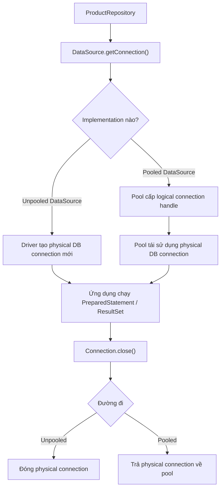

# Phân biệt pool JDBC và DataSource do ứng dụng cung cấp

> **Chương:** Pool kết nối  
> **Phạm vi:** JDBC trong ứng dụng Java truy cập cơ sở dữ liệu quan hệ qua driver, `DataSource`, `Connection`, `PreparedStatement`, `ResultSet`, transaction và xử lý lỗi. Ví dụ sử dụng Java 17+; một số đoạn cấu hình là minh họa cho MySQL Connector/J và HikariCP, không phải API chuẩn có sẵn trong JDK.

Khi nhìn thấy một lớp Java nhận `DataSource` trong constructor, có thể kết luận ứng dụng **đang dùng connection pool** không? **Không.** `DataSource` là **hợp đồng để lấy kết nối** trong JDBC. Một implementation có thể mở kết nối vật lý mới mỗi lần gọi, trả kết nối logic từ pool, lấy kết nối do application server quản lý hoặc dùng một cơ chế đặc thù khác. Chỉ riêng kiểu `javax.sql.DataSource` không tiết lộ chiến lược quản lý kết nối ở phía sau.

Ngược lại, **connection pool** là cơ chế quản lý vòng đời và tái sử dụng các kết nối vật lý với database. Nó thường cung cấp một `DataSource` cho mã ứng dụng sử dụng, nhưng **pool không phải là một phương thức bắt buộc của interface `DataSource`**, và việc có `DataSource` không đủ chứng minh có pool.

Bài học giúp phân biệt ba lớp trách nhiệm:

1. **JDBC API:** định nghĩa cách lấy và sử dụng `Connection`, chạy SQL qua `PreparedStatement`/`ResultSet`, quản lý transaction và đóng tài nguyên.
2. **DataSource do ứng dụng cung cấp:** là object/configuration được xây dựng ở ranh giới ứng dụng rồi truyền vào DAO/service. Nó có thể là pooled hoặc unpooled.
3. **Pool implementation:** quyết định khi nào mở kết nối vật lý, bao nhiêu kết nối được giữ, ai chờ khi hết chỗ, khi nào loại bỏ kết nối hỏng và reset trạng thái trước khi cho mượn lại.

Các ví dụ sẽ chỉ rõ nơi nào thuộc JDBC chuẩn và nơi nào là thư viện ngoài để người học không nhầm interface, implementation và lifecycle.

## 1. Từ `DriverManager` tới `DataSource`

Với JDBC, cách lấy connection trực tiếp quen thuộc là:

```java
import java.sql.Connection;
import java.sql.DriverManager;
import java.sql.SQLException;

String url = "jdbc:mysql://localhost:3306/shop";
String user = System.getenv("DB_USER");
String password = System.getenv("DB_PASSWORD");

try (Connection connection =
         DriverManager.getConnection(url, user, password)) {
    // PreparedStatement / ResultSet / transaction ...
}
```

Ở đây mã gọi tự biết URL và thông tin kết nối. `DriverManager.getConnection()` **không phải connection pool**; theo cách dùng thông thường, nó yêu cầu driver tạo một connection mới. Nếu ứng dụng làm vậy cho từng câu truy vấn, việc mở session mạng, xác thực và thiết lập session có thể trở thành chi phí đáng kể.

Cách tách cấu hình và tầng dữ liệu thường dùng `javax.sql.DataSource`:

```java
import javax.sql.DataSource;
import java.sql.Connection;
import java.sql.SQLException;

DataSource dataSource = obtainFromApplicationConfiguration();

try (Connection connection = dataSource.getConnection()) {
    // DAO dùng JDBC chuẩn; không cần biết pool nằm phía sau hay không.
}
```

`obtainFromApplicationConfiguration()` chỉ là tên minh họa cho bước cấu hình ứng dụng, không phải hàm của JDK. Điểm khác biệt kiến trúc là **DAO không cần biết URL, user, password hay loại pool**. Các chi tiết đó nằm ở application bootstrap, dependency injection container hoặc application server.

**Kết luận quan trọng:** `DataSource` là *entry point* được JDBC chuẩn hóa; **pooling là một lựa chọn triển khai**, không phải đặc tính tự động có được chỉ bằng cách thay `DriverManager` bằng `DataSource`.

## 2. Interface `DataSource` thật sự cam kết điều gì?

`DataSource` thuộc package `javax.sql` (trong Java hiện đại vẫn dùng tên này, không phải `jakarta.sql`). Các API nổi bật:

| API | Ý nghĩa | Có tự động tạo pool không? |
|---|---|---|
| `getConnection()` | Yêu cầu một `java.sql.Connection` | **Không** |
| `getConnection(username, password)` | Yêu cầu connection bằng thông tin đăng nhập cụ thể | **Không**; mức hỗ trợ/policy phụ thuộc implementation |
| `getLogWriter()` / `setLogWriter()` | Điều khiển `PrintWriter` ghi log ở cấp DataSource | Không |
| `getLoginTimeout()` / `setLoginTimeout()` | Thiết lập timeout đăng nhập theo hợp đồng API | Không; không đồng nghĩa timeout chờ pool |
| `getParentLogger()` | Tìm logger của DataSource/driver nếu hỗ trợ | Không |
| `unwrap()` / `isWrapperFor()` | Thao tác với wrapper JDBC | Không |

`DataSource` không có các phương thức tiêu chuẩn như `setMaximumPoolSize()`, `getActiveConnections()`, `evictIdleConnections()` hoặc `getBorrowTimeout()`. Nếu thấy các phương thức này, chúng thuộc **thư viện hoặc implementation cụ thể**, không thuộc interface `DataSource`.

Một dependency injection container có thể khai báo:

```java
public final class ProductRepository {
    private final DataSource dataSource;

    public ProductRepository(DataSource dataSource) {
        this.dataSource = java.util.Objects.requireNonNull(dataSource);
    }
}
```

Lớp repository chỉ biết một phương thức lấy connection hợp đồng JDBC. Nhà phát triển có thể thay nguồn kết nối mà không sửa truy vấn nếu các implementation tuân thủ semantics cần thiết.

### Điểm dễ nhầm: “DataSource do ứng dụng cung cấp”

Cụm này mô tả **ai tạo/cấu hình/truyền object**, không mô tả **có pool hay không**.

- Ứng dụng có thể tự tạo một `MysqlDataSource` **không có pool** rồi inject vào DAO.
- Ứng dụng có thể tự tạo một `HikariDataSource` **có pool** rồi inject qua cùng interface.
- Framework có thể tạo `DataSource` như một bean dựa trên cấu hình và các dependency.
- Application server có thể publish một `DataSource` qua JNDI; ứng dụng lookup rồi sử dụng mà không trực tiếp quản lý pool.

Vì vậy câu “ứng dụng cung cấp DataSource” không đối lập với câu “ứng dụng sử dụng pool”. **Hai mô tả có thể đúng đồng thời.**

## 3. So sánh DataSource không pool và DataSource có pool

| Đặc điểm | DataSource không pool | DataSource backed by connection pool |
|---|---|---|
| `DataSource.getConnection()` | Thường tạo một connection/session vật lý mới | Thường mượn một logical connection/handle gắn với physical connection từ pool |
| Chi phí mỗi lần mượn | Có thể phải kết nối mạng và xác thực | Thường thấp hơn nếu sẵn physical connection hợp lệ |
| `Connection.close()` | Thường đóng connection/session vật lý | Thường đóng handle logic và **trả physical connection về pool** |
| Giới hạn đồng thời | Không có giới hạn pool tích hợp; vẫn chịu giới hạn DB/server | Pool áp dụng hạn mức active/idle/total theo cấu hình |
| Khi hết connection | Phụ thuộc DBMS/driver khi mở mới | Có thể chờ một connection được trả lại; hết timeout sẽ báo lỗi |
| Reset trạng thái trước khi tái sử dụng | Thường không có connection để tái sử dụng | Pool cần bảo đảm trạng thái phù hợp qua các lần mượn |
| Connection hỏng | Connection được loại khi đóng/không dùng được | Pool phải phát hiện và loại bỏ connection lỗi để tránh tái cấp |
| Theo dõi | Thường dùng metric tại driver/DBMS và ứng dụng | Có thể có active, idle, pending, timeout, lifetime, leak metrics |
| Ưu điểm | Đơn giản cho chương trình nhỏ, test hoặc tác vụ hiếm | Hiệu quả khi ứng dụng có nhiều request liên tục |
| Rủi ro | Tốn chi phí mở nhiều kết nối và vượt giới hạn DB | Cạn pool, cấu hình không phù hợp, connection leak, transaction bị giữ quá lâu |

**“Không có pool” không có nghĩa ứng dụng không thể hoạt động.** Với công cụ chạy theo lô thưa thớt hoặc test nhỏ, DataSource đơn giản có thể là lựa chọn hợp lý. Với dịch vụ API nhận nhiều request đồng thời, pool thường hữu ích nhưng vẫn cần đánh giá giới hạn database và chi phí giữ kết nối.

### Sơ đồ hai cách thực hiện cùng một lệnh gọi



Sơ đồ trình bày **hành vi thường gặp**. Không phải mọi pool đều cùng mô hình wrapper hoặc cùng chiến lược validation, keepalive, reset. Để biết chính xác, cần xem implementation và kiểm thử.

## 4. Ví dụ DataSource không pool: MySQL Connector/J

MySQL Connector/J cung cấp `com.mysql.cj.jdbc.MysqlDataSource`, một cách cấu hình kết nối theo `DataSource`. Ví dụ dưới đây dùng API **riêng của MySQL driver**; muốn chạy phải có MySQL Connector/J trên classpath và một MySQL server khả dụng.

```java
import com.mysql.cj.jdbc.MysqlDataSource;
import javax.sql.DataSource;

MysqlDataSource simple = new MysqlDataSource();
simple.setUrl("jdbc:mysql://localhost:3306/shop");
simple.setUser(System.getenv("DB_USER"));
simple.setPassword(System.getenv("DB_PASSWORD"));

DataSource dataSource = simple;
```

`dataSource` có kiểu interface chuẩn nhưng implementation trong ví dụ **không phải HikariCP pool**. Mỗi lần DAO gọi `getConnection()`, implementation của driver có thể tạo connection mới theo cơ chế của nó. Không suy luận rằng “đã sử dụng `MysqlDataSource` nên đã có connection pool”.

Với một test đơn giản:

```java
try (Connection first = dataSource.getConnection()) {
    System.out.println(first.isClosed()); // false khi đang mở.
}

try (Connection second = dataSource.getConnection()) {
    // Một kết nối khác; không dùng lại handle first đã đóng.
}
```

Không so sánh `first == second` để tìm bằng chứng có hoặc không có pool. Pool có thể tạo mỗi lần một wrapper khác dù dùng lại physical connection, trong khi một implementation có thể dùng proxy hoặc kết nối logic mà không phản ánh trực tiếp identity của TCP session.

Để kiểm chứng pooling, xem loại implementation/configuration, pool metrics và session ID/physical lifecycle bằng công cụ kiểm thử **đặc thù DBMS**. Không dựa vào `Connection.toString()` hoặc tên class proxy như bằng chứng duy nhất.

## 5. Ví dụ DataSource có pool: HikariCP do ứng dụng khởi tạo

`HikariCP` là một thư viện connection pool bên ngoài JDK, thường được dùng qua interface `DataSource`. `HikariDataSource` không thuộc JDBC API tiêu chuẩn; cần dependency HikariCP và JDBC driver phù hợp.

Ví dụ cấu hình độc lập với framework:

```java
import com.zaxxer.hikari.HikariConfig;
import com.zaxxer.hikari.HikariDataSource;
import javax.sql.DataSource;

HikariConfig config = new HikariConfig();
config.setJdbcUrl("jdbc:mysql://localhost:3306/shop");
config.setUsername(System.getenv("DB_USER"));
config.setPassword(System.getenv("DB_PASSWORD"));

config.setMaximumPoolSize(10);
config.setMinimumIdle(2);
config.setConnectionTimeout(2_000);  // ms: chờ lấy connection từ pool.
config.setMaxLifetime(25 * 60_000L); // ms: tuổi thọ connection trong pool.
config.setIdleTimeout(5 * 60_000L); // ms: thời gian nhàn rỗi trước khi loại.

try (HikariDataSource pool = new HikariDataSource(config)) {
    DataSource dataSource = pool;

    ProductRepository repository = new ProductRepository(dataSource);
    // Gọi các phương thức repository ở mục tiếp theo.
}
```

**Phân biệt API:**

- `config.setMaximumPoolSize(...)`, `config.setConnectionTimeout(...)`, `config.setMaxLifetime(...)` là **HikariCP-specific**.
- `dataSource.getConnection()`, `connection.prepareStatement(...)` và `connection.close()` là **JDBC-standard**.
- `pool.close()` đóng **toàn bộ pool** khi ứng dụng thực sự dừng. Đây **không phải** hành động phải thực hiện sau mỗi request.
- Các con số `10`, `2_000`, `25 phút` chỉ là cấu hình minh họa, **không phải khuyến nghị chung cho mọi production workload**.

Với nhiều framework, `HikariDataSource` được framework/container tạo và quản lý. Khi đó service không tự tạo pool hoặc gọi `pool.close()` theo từng request; lifecycle thuộc framework. Cũng không nên khởi tạo một pool mới cho **mỗi DAO**: điều này có thể nhân tổng connection vật lý lên quá giới hạn database, dù mỗi pool riêng lẻ có kích thước nhỏ.

### Vì sao cần một singleton/pool scope phù hợp?

Xét 20 repository, mỗi repository tự tạo pool 10 connection:

```text
20 repository × 10 connection tối đa / repository
= 200 connection tiềm năng cho cùng một database.
```

Nếu tất cả cùng dùng **một** pool có `maximumPoolSize = 10`, tổng số connection vật lý do pool này quản lý được giới hạn theo cấu hình đó. Lựa chọn số pool và kích thước phải xét **tất cả service instance/pod**, connection dành cho migration/monitoring và giới hạn của database, không chỉ một JVM.

## 6. DAO dùng `DataSource` mà không biết pool ở phía sau

Ta có thể viết một repository JDBC thuần để dùng **y nguyên** với `MysqlDataSource` hoặc `HikariDataSource`.

Ví dụ bảng:

```sql
CREATE TABLE products (
    id BIGINT PRIMARY KEY,
    sku VARCHAR(80) NOT NULL UNIQUE,
    price DECIMAL(12, 2) NOT NULL
);
```

Repository:

```java
import java.math.BigDecimal;
import java.sql.Connection;
import java.sql.PreparedStatement;
import java.sql.ResultSet;
import java.sql.SQLException;
import java.util.Objects;
import java.util.Optional;
import javax.sql.DataSource;

record Product(long id, String sku, BigDecimal price) {}

public final class ProductRepository {
    private final DataSource dataSource;

    public ProductRepository(DataSource dataSource) {
        this.dataSource = Objects.requireNonNull(dataSource);
    }

    public Optional<Product> findById(long id) throws SQLException {
        String sql = """
            SELECT id, sku, price
            FROM products
            WHERE id = ?
            """;

        try (Connection connection = dataSource.getConnection();
             PreparedStatement ps = connection.prepareStatement(sql)) {

            ps.setLong(1, id);

            try (ResultSet rs = ps.executeQuery()) {
                if (!rs.next()) {
                    return Optional.empty();
                }

                return Optional.of(new Product(
                    rs.getLong("id"),
                    rs.getString("sku"),
                    rs.getBigDecimal("price")
                ));
            }
        }
    }
}
```

Điểm kiến trúc:

1. Repository yêu cầu một `DataSource`, không yêu cầu `HikariDataSource` hay `MysqlDataSource`.
2. Mỗi lần gọi `findById()`, repository mượn một `Connection` trong **phạm vi nhỏ nhất cần thiết**.
3. Repository dùng `try-with-resources` để đóng `ResultSet`, `PreparedStatement` rồi `Connection` theo thứ tự ngược khai báo.
4. Nếu `DataSource` là pooled, `connection.close()` trả connection về pool; nếu không pooled, thường đóng physical connection.
5. Repository không nên tự gọi `pool.close()` hoặc giữ connection làm field singleton dùng cho nhiều request.

**Cùng code JDBC có thể chạy ở cả hai kiểu nguồn kết nối.** Việc chuyển sang pool thường là thay đổi bootstrap/configuration, không phải sửa SQL hoặc gọi `Connection.close()` theo cách khác.

### Không được bỏ `close()` vì nghĩ pool tự quản lý

Đoạn sau **sai**, dù `DataSource` có pool:

```java
Connection connection = dataSource.getConnection();
PreparedStatement ps =
    connection.prepareStatement("SELECT id FROM products");
// Không đóng ps và connection: borrowed handle vẫn bị giữ.
```

Trong pool, không đóng logical connection đúng hạn có thể làm tăng số lượng **active/borrowed** và cuối cùng khiến request khác phải chờ. Pool quản lý physical connection, nhưng **ứng dụng vẫn phải trả quyền sử dụng kết nối** khi hoàn thành. Cách an toàn thông thường là `try-with-resources`.

## 7. `Connection.close()` có hai ý nghĩa theo implementation

Đây là điểm thường gây hiểu sai nhất khi học pooling:

```java
try (Connection connection = dataSource.getConnection()) {
    // Thao tác với DB.
} // connection.close() chạy tự động.
```

Với **DataSource không pool**, `close()` thường đóng session mạng/database. Với **DataSource có pool**, `close()` thường đánh dấu logical connection đã hết quyền sử dụng và trả physical connection về pool để người gọi khác mượn.

**Không có nghĩa logical handle đã đóng có thể được tái sử dụng.** Một handle sau `close()` phải được coi là không dùng được; muốn làm việc tiếp, caller gọi lại `dataSource.getConnection()` và nhận handle mới hợp lệ.

### Tại sao lại phân biệt logical và physical?

```text
Ứng dụng                       Connection pool                 Database
   |                                  |                            |
   | -- getConnection() ------------> |                            |
   | <-- logical Connection A ------- | -- physical session #7 --> |
   | -- execute SQL qua A ----------> | -------------------------> |
   | -- A.close() ------------------> |  giữ session #7 nhàn rỗi    |
   |                                  |                            |
   | -- getConnection() ------------> |                            |
   | <-- logical Connection B ------- | -- tái dùng session #7 --> |
   | -- execute SQL qua B ----------> | -------------------------> |
   | -- B.close() ------------------> |                            |
```

Đây là **mô hình thường gặp** chứ không phải cam kết rằng pool phải tái sử dụng đúng session `#7` cho hai lần mượn; nó có thể cấp một physical connection khác, tạo mới hoặc loại kết nối hỏng.

Kết quả quan trọng của `close()` ở pooled mode là **trả lại quyền sử dụng**, không phải “đóng toàn bộ pool”. Cũng không nên dùng lại connection ở nhiều thread song song; một JDBC connection đang gắn với transaction không phải resource thread-safe mặc định cho xử lý đồng thời.

## 8. Pool có “thuộc JDBC” không? `ConnectionPoolDataSource` và `PooledConnection`

JDBC tiêu chuẩn còn định nghĩa các interface mức thấp dành cho cơ chế pooling:

- `javax.sql.ConnectionPoolDataSource`: factory tạo `PooledConnection`, phục vụ hạ tầng pool.
- `javax.sql.PooledConnection`: trừu tượng giúp pool quản lý physical connection và tạo logical connection; có cơ chế thông báo sự kiện đóng/lỗi cho pool manager.
- `javax.sql.ConnectionEventListener`: cho phép pool manager nhận thông tin sự kiện như logical connection được đóng hoặc connection gặp lỗi.

Ví dụ mô tả luồng thường thấy:

```text
Ứng dụng nghiệp vụ
    |
    v
javax.sql.DataSource
    |
    v
Pool manager / implementation
    |   (có thể dùng ConnectionPoolDataSource/PooledConnection)
    v
Physical DB connection
    |
    v
Database
```

**Không nên đồng nhất `ConnectionPoolDataSource` với `DataSource`.** Hai interface có vai trò khác nhau. `ConnectionPoolDataSource` là API hợp tác **giữa driver và pool manager** trong một mô hình JDBC; ứng dụng nghiệp vụ thường chỉ nhận `DataSource` và `Connection`.

Cũng **không phải mọi thư viện pool bắt buộc phải sử dụng `ConnectionPoolDataSource` bên trong**. Một pool có thể quản lý connection nhận từ `DriverManager` hoặc một `DataSource` của driver theo thiết kế của thư viện đó. Điều cần đánh giá ở tầng application là hợp đồng `DataSource`, tính đúng đắn khi mượn/trả connection và đặc tính pool; không nên tự xử lý `PooledConnection` trừ khi bạn đang xây dựng/chẩn đoán chính infrastructure pool.

### `XADataSource` là một khái niệm khác

`javax.sql.XADataSource` liên quan đến XA/distributed transactions; nó không đồng nghĩa với “DataSource có pool”. Trong ứng dụng dùng JTA/application server, container có thể quản lý cả pool **và** transaction phân tán. Nếu chỉ có một database và một local JDBC transaction, không cần mặc định dùng XA. Không tự gắn `setAutoCommit(false)`/`commit()` trong code DAO khi framework/container đã sở hữu transaction.

## 9. Transaction và trạng thái session khi có pooling

Một connection trong pool có **trạng thái phiên**, không chỉ là socket. Ví dụ:

- `autoCommit` và transaction chưa kết thúc.
- `readOnly`, mức isolation, schema/catalog.
- Holdability, network timeout, client information (nếu driver hỗ trợ).
- Session variables, temporary tables, advisory locks hoặc trạng thái riêng DBMS.
- Câu lệnh/ResultSet/cursor còn mở và tài nguyên liên quan.

Nếu request A mượn connection, đổi `autoCommit=false`, chạy hai câu `UPDATE` rồi quên `commit()/rollback()`, việc request B mượn lại connection đó có thể dẫn đến lỗi nghiêm trọng nếu pool không reset trạng thái đúng và tài nguyên bị rò rỉ.

**Hợp đồng an toàn khi ứng dụng làm chủ transaction:**

1. Lấy connection từ `DataSource` do ứng dụng cung cấp.
2. Cấu hình trạng thái cần thiết **trước khi chạy SQL**, ví dụ tắt auto-commit cho transaction.
3. Chạy tất cả DAO của một use case trên **cùng connection**.
4. Nếu thành công, `commit()`; nếu thất bại, `rollback()`.
5. Khôi phục trạng thái phù hợp khi đã biết transaction kết thúc, rồi `close()` để trả connection.
6. Nếu rollback/reset thất bại, không giả định connection vẫn an toàn để tái sử dụng; để pool/driver xử lý theo cơ chế xác minh/loại bỏ kết nối lỗi.

Đặc biệt, **gọi `setAutoCommit(true)` khi transaction còn mở có thể commit những thay đổi chưa được xác nhận**. Không “khôi phục auto-commit” vô điều kiện trong `finally` nếu rollback thất bại.

### Ví dụ một service điều phối nhiều DAO

Giả sử cùng một use case cần update giá và ghi audit. Các DAO nhận `Connection` từ service:

```java
import java.math.BigDecimal;
import java.sql.Connection;
import java.sql.PreparedStatement;
import java.sql.SQLException;

final class PriceDao {
    int update(Connection c, long productId, BigDecimal newPrice)
            throws SQLException {
        String sql = "UPDATE products SET price = ? WHERE id = ?";

        try (PreparedStatement ps = c.prepareStatement(sql)) {
            ps.setBigDecimal(1, newPrice);
            ps.setLong(2, productId);
            return ps.executeUpdate();
        }
    }
}

final class AuditDao {
    void record(Connection c, long productId, BigDecimal newPrice)
            throws SQLException {
        String sql = """
            INSERT INTO product_price_audit (product_id, new_price)
            VALUES (?, ?)
            """;

        try (PreparedStatement ps = c.prepareStatement(sql)) {
            ps.setLong(1, productId);
            ps.setBigDecimal(2, newPrice);

            if (ps.executeUpdate() != 1) {
                throw new SQLException("Audit insert did not affect one row");
            }
        }
    }
}
```

Bảng `product_price_audit` trong ví dụ có thể được tạo trong migration, không chạy DDL trong transaction nghiệp vụ:

```sql
CREATE TABLE product_price_audit (
    audit_id BIGINT PRIMARY KEY AUTO_INCREMENT,
    product_id BIGINT NOT NULL,
    new_price DECIMAL(12, 2) NOT NULL,
    FOREIGN KEY (product_id) REFERENCES products(id)
);
```

Cú pháp `AUTO_INCREMENT` là của MySQL; điều chỉnh identity/sequence cho DBMS khác.

Service:

```java
import java.math.BigDecimal;
import java.sql.Connection;
import java.sql.SQLException;
import java.util.Objects;
import javax.sql.DataSource;

public final class ProductPriceService {
    private final DataSource dataSource;
    private final PriceDao priceDao = new PriceDao();
    private final AuditDao auditDao = new AuditDao();

    public ProductPriceService(DataSource dataSource) {
        this.dataSource = Objects.requireNonNull(dataSource);
    }

    public void changePrice(long productId, BigDecimal newPrice)
            throws SQLException {
        Objects.requireNonNull(newPrice);

        try (Connection connection = dataSource.getConnection()) {
            if (!connection.getAutoCommit()) {
                throw new SQLException("Expected autoCommit=true");
            }

            connection.setAutoCommit(false);
            Throwable firstFailure = null;
            boolean ended = false;

            try {
                if (priceDao.update(connection, productId, newPrice) != 1) {
                    throw new IllegalStateException(
                        "Product not found or unexpected row count"
                    );
                }

                auditDao.record(connection, productId, newPrice);

                connection.commit();
                ended = true;

            } catch (SQLException | RuntimeException | Error failure) {
                firstFailure = failure;
                try {
                    connection.rollback();
                    ended = true;
                } catch (SQLException rollbackFailure) {
                    failure.addSuppressed(rollbackFailure);
                }
                throw failure;

            } finally {
                if (ended) {
                    try {
                        connection.setAutoCommit(true);
                    } catch (SQLException resetFailure) {
                        if (firstFailure == null) {
                            throw resetFailure;
                        }
                        firstFailure.addSuppressed(resetFailure);
                    }
                }
            }
        }
    }
}
```

Đoạn này minh họa **JDBC local transaction** khi service được cấp connection sạch, chưa nằm trong transaction của framework. Nó vẫn chạy như nhau trên `DataSource` pooled và unpooled: điều kiện quan trọng là **mọi DAO dùng chung connection của use case**.

Cần chú ý một lỗi từ `commit()` vì mất kết nối có thể khiến kết quả database **không rõ** dù đã thử rollback. Không retry mù các thao tác không idempotent; cần ID yêu cầu ổn định và bước đối soát. Nếu `connection.close()` lỗi sau commit thành công, đó là lỗi cleanup, không phải bằng chứng transaction chưa được commit.

### Khi framework quản lý transaction

Với Spring hoặc Jakarta EE, application có thể được cấp `DataSource`/connection gắn với transaction manager. Khi đó mã nghiệp vụ nên dùng cơ chế transaction do framework cung cấp; tránh lấy connection độc lập từ pool rồi tự commit, hoặc đóng connection mà framework đang quản lý trái hợp đồng. **Cùng pool không tự động có nghĩa cùng transaction**; việc tham gia phụ thuộc transaction manager, cách lấy connection và cấu hình.

## 10. Cách tổ chức ứng dụng để tách pool khỏi tầng truy vấn

Một thiết kế đơn giản:

```text
Application bootstrap / DI container
  ├─ đọc cấu hình DB từ secret manager / environment
  ├─ tạo MỘT DataSource phù hợp phạm vi ứng dụng
  │    ├─ lựa chọn A: unpooled DataSource từ driver
  │    └─ lựa chọn B: pooled DataSource từ pool library
  ├─ tạo ProductRepository(DataSource)
  ├─ tạo ProductPriceService(DataSource)
  └─ khi shutdown: đóng pool nếu ứng dụng sở hữu pool

HTTP handler / Use case
  └─ gọi service/repository
       └─ dataSource.getConnection()
            └─ PreparedStatement / ResultSet
            └─ commit/rollback nếu sở hữu transaction
            └─ Connection.close() -> trả quyền sử dụng
```

**Tại sao inject `DataSource` thay vì inject một `Connection` singleton?**

- `DataSource` là factory/entry point có thể được chia sẻ giữa các request.
- `Connection` có trạng thái transaction và vòng đời ngắn, thường không an toàn để chia sẻ giữa các luồng.
- Mỗi use case có thể mượn connection khi cần và trả ngay khi hoàn thành.
- Với transaction nhiều DAO, use case chủ động truyền **một connection trong phạm vi transaction**, không gọi `getConnection()` ở mỗi DAO một cách độc lập.

Ví dụ factory cấp repository:

```java
DataSource sharedDataSource = applicationProvidedDataSource;

// Được phép dùng chung DataSource.
ProductRepository repository =
    new ProductRepository(sharedDataSource);

// Không được lấy một Connection global để dùng chung mọi request.
```

Mã `applicationProvidedDataSource` là chỗ bootstrap framework/cấu hình cung cấp object; không phải biến JDBC chuẩn được JDK tự tạo.

### Không nhầm sự hiện diện của các wrapper

Một framework có thể bọc `DataSource` bằng proxy thêm logging, transaction awareness hoặc lazy connection acquisition. Do đó `getClass()` của object hoặc `unwrap()` có thể cho thấy một wrapper, không nhất thiết lộ chính xác pool gốc. Đừng tự chuyển kiểu `(HikariDataSource) dataSource` trong DAO để truy cập metric hoặc cấu hình; hãy đặt metric/config ở tầng infrastructure.

## 11. Pool sizing: nhiều connection hơn không phải luôn nhanh hơn

Một pool quá nhỏ có thể làm request chờ lâu; một pool quá lớn có thể đẩy database tới quá tải do quá nhiều session cạnh tranh CPU, lock, memory, I/O. Pool size phải được chọn dựa trên **tải thực tế, thời gian giữ connection, số instance ứng dụng và giới hạn DBMS**.

Có thể dùng quan hệ định lượng sơ bộ (*Little's Law*):

```text
Số connection active trung bình ≈ throughput DB operations / giây
                              × thời gian giữ connection trung bình (giây)
```

Ví dụ nếu hệ thống thực hiện 80 thao tác database/giây, mỗi thao tác giữ connection trung bình 0,05 giây thì mức active trung bình khoảng **4 connection**. Đây chỉ là phép ước lượng trung bình; tải đỉnh, phân phối thời gian giữ connection, transaction dài và các thao tác song song có thể đòi dung lượng khác. **Không suy ra `maximumPoolSize = 4` là tối ưu** từ phép tính này.

Nếu một ứng dụng có 6 instance, mỗi instance đặt pool tối đa 20 connection, tổng cấu hình tối đa là **120 kết nối** tới cùng DBMS, chưa kể ứng dụng khác, tác vụ background và kết nối quản trị. Database phải có sức chứa phù hợp, và việc tăng số instance có thể thay đổi tổng áp lực dù mã DAO không đổi.

### Các nút điều chỉnh phổ biến

| Tham số/khái niệm | Ý nghĩa | Rủi ro nếu đặt sai |
|---|---|---|
| Maximum pool size | Giới hạn số connection pool quản lý | Quá thấp gây chờ; quá cao gây quá tải DB |
| Minimum idle | Số connection nhàn rỗi mong muốn, tùy pool | Quá cao chiếm tài nguyên khi không có tải |
| Connection acquisition timeout | Thời gian request chờ mượn connection | Quá ngắn gây lỗi khi tải đỉnh; quá dài giữ request/thread chờ |
| Max lifetime | Giới hạn tuổi thọ connection | Lệch với timeout hạ tầng có thể gây connection bị cắt khi đang dùng |
| Idle timeout | Thời gian nhàn rỗi trước khi bị loại | Có thể gây mở kết nối lại nhiều lần hoặc giữ quá nhiều session |
| Connection validation | Kiểm tra connection còn sử dụng được | Quá tốn nếu kiểm tra mọi lần; thiếu có thể cấp connection hỏng |
| Leak detection threshold | Cảnh báo connection mượn quá lâu | Có thể báo giả cho transaction dài hợp lệ; không tự sửa leak |
| Socket/query timeout | Giới hạn network/SQL execution | Nhầm với acquisition timeout khiến khó chẩn đoán sự cố |

Tên option cụ thể khác nhau giữa thư viện pool. Không mặc định một đơn vị thời gian là giây hay mili giây nếu chưa xem API/config của thư viện đó.

**Phân biệt ba kiểu timeout quan trọng:**

1. **Chờ pool:** chưa có connection nào được mượn thành công.
2. **Kết nối tới database:** driver đang mở physical session, DNS/TCP/TLS/auth có thể lỗi.
3. **Đang chạy SQL:** có connection nhưng query hoặc network bị chậm, khóa hoặc mất kết nối.

Ba lỗi cần điều tra khác nhau. Tăng `connectionTimeout` của pool không chữa được một truy vấn bị khóa dài; tăng `setQueryTimeout()` không tạo thêm connection trống trong pool.

## 12. Cạn pool, leak và transaction kéo dài

Một request có thể mượn connection nhưng không trả vì:

- Không dùng `try-with-resources` ở đường exception.
- DAO giữ `ResultSet` hoặc `InputStream` BLOB sống quá lâu.
- Transaction mở qua cuộc gọi HTTP bên ngoài hoặc chờ tác vụ người dùng.
- Chạy `Future`/task async với connection bị dùng ngoài scope của request.
- Một luồng bị chặn bởi khóa DB hoặc truy vấn rất chậm.
- Mã tạo nhiều connection cho cùng use case mà không đóng đủ.

Khi pool hết connection, `DataSource.getConnection()` có thể phải **chờ** cho tới khi một handle được trả, rồi ném `SQLException` hoặc exception thích hợp nếu quá hạn. Tên exception và SQLState tùy pool/driver. Đừng kết luận “database đã chết” chỉ từ lỗi lấy connection; trước tiên kiểm tra **active, idle, pending, timeout, thời gian giữ connection**.

### Checklist xử lý cạn pool

1. Kiểm tra số lượng connection đang được mượn và số request đang chờ từ metrics pool.
2. Kiểm tra query/transaction chạy lâu trên database.
3. Tìm connection leak theo stack trace/metric của thư viện pool và logging có giới hạn.
4. Đảm bảo mọi đường đi có `try-with-resources`, kể cả khi `PreparedStatement.executeUpdate()` ném lỗi.
5. Đóng `ResultSet` và stream đọc BLOB trước khi trả connection.
6. Tách thao tác HTTP/email/gọi dịch vụ khác khỏi transaction database khi có thể.
7. Chỉ tăng pool size sau khi chứng minh database có đủ tài nguyên và nguyên nhân chờ là thiếu capacity, không phải leak hoặc lock.

**Leak detection là công cụ chẩn đoán, không phải “thu hồi kết nối an toàn” tự động.** Một transaction hợp lệ nhưng kéo dài hơn ngưỡng có thể bị cảnh báo; cần phân tích request context và thời điểm giữ connection trước khi kết luận leak thật.

## 13. Trạng thái SQL, kiểm tra kết nối và lỗi cleanup

Một connection từ pool có thể bị mất do database restart, firewall/load balancer timeout hoặc lỗi mạng. Pool tốt sẽ kiểm tra, loại bỏ và thay thế connection hỏng theo chính sách. Tuy vậy, không thể đảm bảo **không bao giờ xảy ra lỗi trong một transaction đang chạy**: kết nối có thể đứt ngay sau khi pool cấp.

JDBC có `Connection.isValid(timeoutSeconds)`, nhưng việc gọi trước mỗi statement **không bảo đảm** statement kế tiếp sẽ chạy thành công. Giữa `isValid()` và `executeUpdate()`, mạng vẫn có thể hỏng. Trạng thái đầu ra cần được xử lý qua exception, rollback khi có thể và idempotency/reconciliation khi commit không rõ.

### Khi rollback cũng thất bại

Trong transaction do ứng dụng sở hữu, lỗi nghiệp vụ có thể kéo theo lỗi rollback hoặc close. Tránh để lỗi dọn tài nguyên che nguyên nhân ban đầu:

```java
try {
    connection.rollback();
} catch (SQLException rollbackFailure) {
    originalFailure.addSuppressed(rollbackFailure);
}
```

`try-with-resources` tự gắn exception từ `Connection.close()` thành `suppressed` khi đã có exception chính. Cần giữ SQLState, vendor code, `SQLException.getNextException()` và cause để phân biệt vi phạm constraint, mất kết nối và lỗi pool.

**Không dùng `close()` thay cho `rollback()`.** Khi transaction chưa hoàn tất và logical connection được trả về pool, semantics của cleanup do implementation quyết định. Ứng dụng vẫn nên kết thúc transaction rõ ràng trước khi trả.

### Connection không hợp lệ sau lỗi

Sau lỗi mạng hoặc mất session, **không tiếp tục tái sử dụng cùng handle** như thể transaction không bị ảnh hưởng. Trả connection/đóng handle theo cơ chế được pool cho phép, rồi để lần thao tác mới lấy một connection mới từ `DataSource`. Không tự mở một physical connection khác **giữa chừng** để tiếp tục transaction cũ: transaction gắn với session ban đầu.

## 14. Pool không tự mang lại transaction, bảo mật hay caching

Một số quan niệm sai phổ biến:

| Khẳng định | Đúng/sai | Giải thích |
|---|---|---|
| “Có `DataSource` nghĩa là có pool” | Sai | Interface không quy định caching/reuse connection |
| “Dùng pool thì khỏi `Connection.close()`” | Sai | Không close sẽ giữ borrowed handle và làm cạn pool |
| “`close()` trên pooled connection đóng toàn bộ pool” | Sai | Thường chỉ trả logical connection |
| “Tất cả DAO cùng `DataSource` luôn nằm trong một transaction” | Sai | Phải dùng cùng connection hoặc transaction manager phù hợp |
| “Pool làm giảm số SQL statement phải chạy” | Sai | Pool tái sử dụng kết nối, không thay thế query cache |
| “Pool làm chậm query nhanh hơn nếu size lớn” | Không đúng chung | Query time phụ thuộc DBMS, lock, I/O, SQL, cache, tải |
| “Pool luôn giữ connection còn sống” | Sai | Network/DB vẫn có thể hỏng trong lúc sử dụng |
| “Có `ConnectionPoolDataSource` là DAO nên dùng nó trực tiếp” | Sai với tầng nghiệp vụ thường gặp | Đây là interface hạ tầng pooling |
| “Pool cho phép chia sẻ một connection qua nhiều thread” | Sai | Pool quản lý **nhiều** connection; một borrowed connection không nên dùng đồng thời |
| “Connection pool là nơi lưu mật khẩu và bảo mật đủ rồi” | Sai | Cần quản lý secret, TLS, quyền DB, rotation và audit độc lập |

Pool **không** tự động thực hiện SQL parameterization, chống SQL injection hay quản lý quyền truy cập bảng. DAO vẫn phải dùng `PreparedStatement` với bind tham số và database user có quyền tối thiểu. Pool cũng không miễn trừ trách nhiệm về isolation, rollback, deadlock hoặc retry.

## 15. Kiểm thử sự khác biệt giữa hai loại DataSource

Để biết mã JDBC hoạt động đúng với cả DataSource không pool và pooled DataSource, nên có **hai nhóm kiểm thử**:

- **Hợp đồng ứng dụng:** CRUD/transaction và việc đóng `Connection`, `PreparedStatement`, `ResultSet` hoạt động đúng với **cùng repository/service**.
- **Hợp đồng hạ tầng:** pool có giới hạn connection, cấp/trả connection đúng, timeout khi hết chỗ, xử lý connection hỏng và không để rò rỉ session state.

Một ví dụ gọi repository độc lập:

```java
void checkRepository(ProductRepository repository) throws SQLException {
    Optional<Product> product = repository.findById(101L);
    System.out.println(product);
}

// Trong môi trường test:
// checkRepository(new ProductRepository(nonPooledDataSource));
// checkRepository(new ProductRepository(pooledDataSource));
```

Không yêu cầu mock `DataSource` để kiểm tra **thực sự có pool**: mock có thể trả cùng một `Connection` nhiều lần và cho kết quả đánh lừa. Với hành vi pooling, dùng integration test với driver/DBMS thật hoặc test environment phù hợp.

### Ma trận kiểm thử đề xuất

| Kịch bản | Cách thực hiện | Điều cần xác minh |
|---|---|---|
| Unpooled CRUD | Gọi `ProductRepository.findById()` nhiều lần | Query đúng, mỗi connection được đóng, không leak |
| Pooled CRUD | Dùng HikariDataSource cho cùng repository | Query giữ nguyên, logical handle trả về pool |
| Bị giới hạn pool | Cấu hình pool nhỏ trong test, mượn giữ đủ connection | Lần mượn thêm bị chờ rồi hết timeout theo cấu hình |
| Trả connection | Đóng một handle đang mượn | Request tiếp theo có thể mượn được; pool metric thay đổi |
| Exception khi query | Cố gây `SQLException` rồi ra khỏi `try` | Statement/ResultSet/Connection vẫn được đóng |
| Transaction rollback | DAO đầu update, DAO sau cố ý lỗi | Không để lại partial commit ở pooled và unpooled |
| State reset | Thay auto-commit/isolation/readOnly rồi đóng | Lần mượn mới có trạng thái phù hợp theo hợp đồng pool |
| Connection bị hỏng | Restart DB trong test hoặc dùng fault injection | Pool loại/không tái cấp handle hỏng theo chính sách |
| Leak detection | Cố ý giữ connection lâu ở môi trường test | Warning/metrics xuất hiện, không khẳng định là leak thật |
| Max DB connections | Chạy nhiều application instance/pool | Tổng kết nối ở mức server không vượt ngân sách đã thiết kế |
| Shutdown lifecycle | Dừng ứng dụng/container | Pool đóng resource đúng một lần; request mới không sử dụng pool đã đóng |

### Một bài test thời gian chờ pool nhỏ

Ví dụ **chỉ dành cho môi trường thử nghiệm**, không thực thi trên pool production:

```java
HikariConfig config = new HikariConfig();
config.setJdbcUrl("jdbc:mysql://localhost:3306/shop");
config.setUsername(System.getenv("DB_USER"));
config.setPassword(System.getenv("DB_PASSWORD"));
config.setMaximumPoolSize(1);
config.setConnectionTimeout(1_000); // ms

try (HikariDataSource pool = new HikariDataSource(config)) {
    try (Connection held = pool.getConnection()) {
        // Kết nối duy nhất đang được mượn.

        try (Connection unexpected = pool.getConnection()) {
            // Nếu cấp được connection, test phải thất bại mà không leak.
            throw new AssertionError("Expected acquisition timeout");
        } catch (SQLException expected) {
            System.out.println(
                "Pool acquisition failed as expected: "
                + expected.getMessage()
            );
        }
    } // held.close() trả connection về pool.

    try (Connection again = pool.getConnection()) {
        System.out.println("Borrowed after return: " + !again.isClosed());
    }
}
```

Ví dụ giả định database sẵn sàng và cấu hình HikariCP chấp nhận các tham số (đơn vị timeout là mili giây). Nó minh họa **timeout vì pool đang hết slot**, không phải lỗi connect tới database. Trong test có concurrency thật, kết quả còn phụ thuộc thread scheduling và pool state; hãy kiểm soát số request được gửi để đo đúng tình huống.

## 16. Vận hành và quan sát pool trong sản phẩm

Bên cạnh SQL latency, theo dõi **pool metrics**:

| Metric | Điều nó cho biết | Dấu hiệu cần điều tra |
|---|---|---|
| Active/borrowed connections | Connection đang được ứng dụng sử dụng | Luôn gần maximum pool size |
| Idle connections | Connection có thể cấp ngay | Về 0 trong thời gian dài khi pending tăng |
| Pending/waiting requests | Request đang đợi connection | Tăng liên tục, latency đầu request tăng |
| Acquisition time | Thời gian mượn connection | Tăng ngay cả khi query rất nhanh |
| Acquisition timeouts | Số lần mượn không thành công đúng hạn | Cạn pool, leak hoặc DB quá tải |
| Connection creation errors | Lỗi tạo physical connection | DB/network/credentials/configuration |
| Connection lifetime/evictions | Tuổi thọ và việc loại bỏ kết nối | Tạo/hủy kết nối quá thường xuyên |
| Long transaction duration | Thời gian giữ connection/lock | Transaction chứa thao tác ngoài DB hoặc query chậm |

Không phải mọi pool expose đủ các metric trên; tên metric, đơn vị và nguồn (JMX, Micrometer, metrics library, log) phụ thuộc implementation. Khi phân tích, kết hợp **pool metrics, database server metrics, thời gian SQL và log ứng dụng**:

- **Active cao + pending cao + DB CPU thấp:** nghi ngờ connection leak, request bị block hoặc transaction giữ connection dù không chạy SQL.
- **Active cao + DB CPU/I/O/lock wait cao:** database có thể là bottleneck; tăng pool size có thể làm tình hình xấu hơn.
- **Connection creation errors cao:** điều tra hạ tầng DB, thông tin đăng nhập, TLS, DNS/network và giới hạn session.
- **Acquisition latency thấp nhưng query latency cao:** vấn đề có thể nằm ở SQL, lock, index hoặc database, không phải thời gian chờ pool.

Không ghi user/password, token hoặc nguyên văn SQL chứa thông tin nhạy cảm vào log. Khi có cảnh báo leak, dùng correlation ID/trace ID đã được phép ghi để liên hệ với request, không để log stack trace vô hạn ở môi trường tải cao.

## 17. Khi nào chọn loại nào?

| Trường hợp | Lựa chọn thường phù hợp | Lý do |
|---|---|---|
| Bài thực hành JDBC một lần, ít truy vấn | `DataSource` không pool hoặc `DriverManager` | Cấu hình đơn giản, ít connection cần tái sử dụng |
| Web/API service nhiều request đồng thời | `DataSource` backed by pool | Hạn chế chi phí mở connection, có giới hạn concurrency |
| Spring Boot hoặc DI framework đã quản lý pool | Inject `DataSource` bean của framework | Một nơi cấu hình lifecycle và transaction, DAO không phụ thuộc vendor |
| Jakarta EE/application server có datasource JNDI | Sử dụng `DataSource` do server cung cấp | Container quản lý pool, bảo mật và có thể transaction |
| Tác vụ batch lớn | Pool có giới hạn hợp lý hoặc nguồn riêng tùy workload | Cân bằng thời gian giữ connection, tải DB, chi phí cấu hình |
| Nhiều service cùng một database | Mỗi instance có pool theo ngân sách tổng | Tránh tổng session của các instance vượt mức DB |
| Kết nối tới database qua proxy ngoài | Xem xét cả app pool lẫn DB proxy | Proxy có thể quản lý session ở tầng khác; không thay đổi `DataSource` API |

**Cách lựa chọn thực tế:** viết DAO theo interface `DataSource` và JDBC chuẩn trước; sau đó chọn implementation/configuration ở tầng ứng dụng theo tải, khả năng triển khai và cách transaction được quản lý. Không để logic nghiệp vụ phụ thuộc trực tiếp vào HikariCP, MySQL driver hoặc container chỉ vì muốn dùng pool.

## 18. Bài thực hành

1. **Giải thích bằng lời:** một repository có field `private final DataSource dataSource`. Nêu ba cách khác nhau mà field đó có thể được khởi tạo, trong đó ít nhất một cách không có pool.
2. **Chuyển nguồn kết nối:** dùng `MysqlDataSource` không pool và `HikariDataSource` có pool để tạo cùng một `ProductRepository`. Chứng minh rằng mã SQL và `try-with-resources` của DAO không cần đổi.
3. **Thử `close()`:** mượn connection từ pool, đóng handle rồi mượn lại. Phân biệt handle logic đã đóng với physical session do pool giữ; không dùng object identity làm bằng chứng duy nhất.
4. **Quan sát cạn pool:** cấu hình `maximumPoolSize=1`, giữ một connection rồi mượn connection thứ hai trong test. Đọc connection acquisition timeout và xem pool metrics trước/sau khi trả connection.
5. **Sửa connection leak:** viết DAO cố ý quên `Connection.close()` ở nhánh ném `SQLException`, quan sát active connection tăng; chuyển sang `try-with-resources` để khắc phục.
6. **Transaction nhiều DAO:** thực hiện thay giá và ghi audit qua **cùng connection** của service; cố ý làm audit vi phạm constraint và xác minh giá cũ được giữ sau rollback.
7. **State reset:** trong môi trường thử nghiệm, đặt `autoCommit=false` và thay isolation/readOnly theo hỗ trợ driver, hoàn tất transaction rồi đóng. Mượn lại và kiểm tra trạng thái sạch theo chính sách pool.
8. **Ước tính capacity:** với 6 instance, mỗi pool tối đa 20 connection, tính số session tối đa của ứng dụng; bổ sung ngân sách cho connection quản trị, migration và dịch vụ khác.
9. **Phân biệt timeout:** tạo tình huống mượn connection bị chặn, query bị chặn bởi lock và DB không kết nối được. So sánh lỗi/metrics để phân biệt acquisition timeout, query timeout và connect timeout.
10. **Thiết kế quy ước:** viết tài liệu ngắn xác định ai tạo `DataSource`, ai đóng pool ở shutdown, ai đóng `Connection` trong mỗi request, ai được `commit()/rollback()`, và cách log/tracing khi pool cạn.

### Checklist trước khi đưa hệ thống vào production

- [ ] Đã biết implementation thực tế của `DataSource`: unpooled, pooled, container-managed hay proxy.
- [ ] Không tạo một pool mới trên mỗi request/DAO.
- [ ] Repository dùng `DataSource` chuẩn, không phụ thuộc class pool cụ thể.
- [ ] Mỗi logical `Connection` được đóng đúng phạm vi qua `try-with-resources`.
- [ ] Transaction nhiều DAO dùng **cùng connection** hoặc transaction manager chuẩn của framework.
- [ ] Commit/rollback được xử lý đúng; không dựa vào `Connection.close()` để rollback.
- [ ] Connection hỏng được xử lý theo pool/driver, trạng thái session được kiểm chứng trước khi tái cấp.
- [ ] Pool size được tính cho **toàn bộ instance**, trong giới hạn database và thử tải.
- [ ] Có metric active/idle/pending, acquisition latency, connection creation errors và query latency.
- [ ] Phân biệt rõ timeout mượn pool, timeout kết nối DB và timeout thực thi SQL.
- [ ] Secrets/TLS/quyền DB được quản lý độc lập với pooling.
- [ ] Đã kiểm thử các nhánh lỗi/cleanup, rollback, shutdown và tình huống cạn pool.

**Tiêu chí hoàn thành:** người học phân biệt được `javax.sql.DataSource` là interface cấp kết nối và connection pool là cơ chế triển khai tái sử dụng physical connections; hiểu rằng một `DataSource` do ứng dụng cung cấp **có thể có hoặc không có pool**; biết dùng `Connection.close()` đúng cách, phân biệt `ConnectionPoolDataSource` với `DataSource` và `XADataSource`, cấu hình/tổ chức repository độc lập implementation, đồng thời đánh giá được transaction, hiệu năng, pool sizing, leak và khả năng quan sát trong ứng dụng JDBC thực tế.
