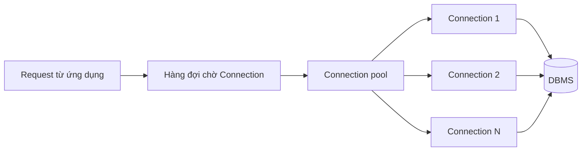

# Lựa chọn kích thước pool theo khả năng cơ sở dữ liệu

Một ứng dụng **JDBC** thường phục vụ nhiều yêu cầu đồng thời, trong khi việc tạo kết nối vật lý đến cơ sở dữ liệu quan hệ tốn thời gian và tài nguyên. **Connection pool** giữ lại các kết nối để tái sử dụng: ứng dụng mượn một `Connection`, thực hiện SQL qua `PreparedStatement`, đọc `ResultSet` rồi gọi `close()` để trả kết nối về pool. Nhờ vậy, nhiều request không phải mở phiên kết nối mới từ đầu.

Nhưng pool càng lớn **không có nghĩa hệ thống càng nhanh**. Mỗi kết nối vật lý tiêu thụ tài nguyên phía DBMS; quá nhiều truy vấn chạy đồng thời có thể gây tranh chấp CPU, I/O, khóa và bộ nhớ. Trong chương **Pool kết nối**, bài này hướng dẫn cách chọn kích thước pool dựa trên **khả năng thực tế của cơ sở dữ liệu**, giới hạn kết nối, số instance ứng dụng, thời gian giữ kết nối và số liệu kiểm thử tải. Các ví dụ bám theo `DataSource`, `Connection`, `PreparedStatement`, `ResultSet` và transaction JDBC chuẩn.

> **Thông điệp chính:** Chọn `maximumPoolSize` không phải bằng số request đồng thời hay `max_connections` của DBMS, mà bằng **mức đồng thời hữu ích** mà DB chịu được, trong giới hạn tổng tất cả các pool và dựa trên đo đạc dưới tải thực tế.

## 1. Pool kết nối giúp gì và giới hạn ở đâu?

Một `DataSource` là giao diện chuẩn `javax.sql.DataSource` để lấy `Connection`. Bản thân tên `DataSource` **không bảo đảm có pool**: đối tượng thực thi có thể tạo một kết nối mới mỗi lần, hoặc dùng thư viện pool như HikariCP, Apache Commons DBCP hay pool do application server quản lý. Các tham số như `maximumPoolSize`, `minimumIdle` và `connectionTimeout` là cấu hình của **pool cụ thể**, không phải phương thức chung của `java.sql.Connection`.

Sơ đồ luồng yêu cầu:



Khi có kết nối nhàn rỗi, pool có thể cấp ngay; nếu tất cả đang được mượn mà pool đã đạt giới hạn, yêu cầu mới thường **chờ tối đa một thời gian cấu hình**, rồi nhận lỗi nếu không có kết nối. Khi ứng dụng gọi `Connection.close()` trên kết nối do pool cấp, thông thường đó là hành động **trả kết nối logic về pool**; không nhất thiết đóng socket vật lý.

Đổi lại, ứng dụng phải đóng kết nối đúng cách và trả về trong trạng thái phù hợp. Một pool có 30 kết nối nhưng 25 kết nối bị giữ trong lúc chờ HTTP bên ngoài thường không hiệu quả bằng pool nhỏ hơn được sử dụng đúng vòng đời.

### Pool không sửa được câu SQL chậm

| Nút thắt | Tăng pool có giúp không? | Cách tiếp cận |
| --- | --- | --- |
| Mở kết nối mới trên mọi request | Có thể: pool giảm chi phí thiết lập phiên. | Dùng `DataSource` có pool và tái sử dụng connection. |
| Thiếu kết nối trong lúc DB còn tài nguyên rảnh | Có thể, đến một mức nhất định. | Tăng có kiểm soát, kiểm tra wait time và throughput. |
| CPU DB đã gần bão hòa | Thường không; còn có thể làm p95/p99 xấu đi. | Tối ưu SQL/index, giảm tải, cache phù hợp hoặc tăng năng lực DB. |
| Chờ khóa, deadlock, transaction dài | Tăng pool có thể tạo thêm giao dịch cạnh tranh. | Rút ngắn transaction, xem isolation, thứ tự khóa, index. |
| I/O/transaction log là nút thắt | Thêm request đồng thời không tạo ra I/O nhanh hơn. | Đo IOPS, wait events, batching và thiết kế ghi. |
| Connection bị giữ trong lúc gọi dịch vụ khác | Tăng pool chỉ che triệu chứng trong một thời gian. | Đóng kết nối trước các bước chờ không cần DB. |

## 2. Hai giới hạn khác nhau: số phiên kết nối và công suất xử lý

### 2.1. Giới hạn kết nối do DBMS cho phép

DBMS thường có giới hạn hoặc chi phí thực tế cho số kết nối đồng thời. Ví dụ, PostgreSQL có cấu hình `max_connections`; những hệ quản trị khác có cơ chế giới hạn phiên, worker hoặc tài nguyên tương ứng. Giới hạn đó phải chừa chỗ cho:

- Kết nối quản trị, giám sát, migration, công cụ vận hành;
- Dịch vụ khác cùng dùng một DBMS hoặc cùng endpoint DB;
- Job định kỳ, kết nối replica/routing và các pool khác;
- Số instance tối đa khi auto-scaling hoặc **rolling deployment**, khi instance cũ và mới cùng tồn tại;
- Phần dự phòng cho trường hợp sự cố, failover và các hoạt động khẩn cấp.

Một phép kiểm tra sức chứa sơ bộ:

\[
\sum_{\text{tất cả pool truy cập cùng DB}} \text{maxPoolSize}
\;\leq\;
\text{giới hạn phiên DBMS}
\;-\;
\text{phiên dành cho dịch vụ khác}
\;-\;
\text{phần dự phòng quản trị/vận hành}
\]

Đây là **ràng buộc trên** phục vụ lập kế hoạch, không phải yêu cầu phải mở đủ số kết nối đó. Một số pool chỉ tạo thêm kết nối khi có tải; một số có lượng kết nối tối thiểu nhàn rỗi. Cũng cần phân biệt số kết nối **được cấu hình tối đa** với số **thực sự đang mở** tại một thời điểm.

### 2.2. Giới hạn công suất xử lý hữu ích

Một DBMS có thể cho phép 200 phiên kết nối nhưng đạt thông lượng tốt nhất khi chỉ có vài chục truy vấn hoạt động mạnh tại một thời điểm. Các kết nối vượt quá vùng tối ưu có thể làm tăng chuyển ngữ cảnh, cạnh tranh buffer cache, hàng đợi I/O và chờ khóa. Đây thường là **điểm gối** (*knee*) của đồ thị hiệu năng: tăng đồng thời sau điểm đó làm độ trễ tăng nhanh mà throughput gần như không cải thiện.

Vì vậy cần trả lời **hai câu hỏi tách biệt**:

1. **DB cho phép bao nhiêu phiên kết nối?** Đây là giới hạn kỹ thuật và vận hành.
2. **DB xử lý hiệu quả bao nhiêu công việc SQL đồng thời?** Đây là giới hạn hiệu năng, phải đo với loại truy vấn, index, dữ liệu và phần cứng thật.

Kích thước pool nên thỏa **cả hai**, đồng thời phải có năng lực chờ và phân phối tải hợp lý ở phía ứng dụng.

## 3. Tính tổng các pool khi ứng dụng có nhiều replica

Không tính mỗi instance như thể nó là ứng dụng duy nhất. Giả sử một dịch vụ chạy 6 replica, mỗi replica có một pool tối đa 20 kết nối tới **cùng một DB primary**. Riêng dịch vụ này có thể yêu cầu đến:

\[
6 \times 20 = 120 \text{ kết nối}
\]

Nếu khi triển khai cuốn chiếu có 8 replica tồn tại tạm thời, mức tối đa có thể thành:

\[
8 \times 20 = 160 \text{ kết nối}
\]

Khi DBMS giới hạn 180 phiên và còn các ứng dụng, công cụ quản trị hoặc pool khác, 160 có thể đã vượt ngân sách thực tế dù **mỗi instance chỉ khai báo 20**.

Xét một ví dụ lập ngân sách, các số đều **giả định để minh họa**:

| Hạng mục | Số kết nối |
| --- | ---: |
| Giới hạn phiên DBMS được phép dùng | 200 |
| Dự phòng quản trị/giám sát/khẩn cấp | 30 |
| Dịch vụ khác và công việc nền | 30 |
| **Còn lại cho dịch vụ đang tính** | **140** |
| Số replica có thể cùng tồn tại khi rollout | **8** |
| Giới hạn **theo ngân sách phiên** của một pool/replica | **17** (vì 8 × 17 = 136) |

**17 chỉ là trần số phiên theo ví dụ, không phải kích thước pool được khuyến nghị.** Nếu DB chỉ xử lý hiệu quả khoảng 48 truy vấn nặng đồng thời cho dịch vụ này, một cấu hình 17 trên 8 replica cho phép tới 136 connection đang mượn, có thể làm hệ thống chậm hơn. Kích thước cần chọn dựa thêm trên nhu cầu mượn và kết quả kiểm thử tải.

Với nhiều `DataSource` (pool đọc, pool ghi, pool cho job, pool cho tenant...), phải cộng đúng các pool cùng truy cập **một tài nguyên DB có chung giới hạn**. Nếu có primary và read replica riêng biệt, lập ngân sách **theo từng endpoint** và kiểm tra chỗ đọc/ghi có thể chuyển hướng khi failover. Nếu một job mở thêm pool mới, nó không được miễn trừ ngân sách chỉ vì không phải request HTTP.

## 4. Ước lượng nhu cầu bằng throughput và thời gian giữ kết nối

Khi tải đã tương đối ổn định, **định luật Little** đưa ra một mối quan hệ thực dụng:

\[
L = \lambda \times W
\]

Trong đó, khi **xét riêng đoạn đã mượn connection**:

- \(L\): số kết nối đang được mượn **trung bình**;
- \(\lambda\): số đơn vị công việc sử dụng kết nối mỗi giây;
- \(W\): **thời gian giữ connection trung bình** (giây) cho một lần mượn.

Ví dụ, dịch vụ nhận 300 request/giây, mỗi request đúng một lần mượn connection, thời gian giữ trung bình 60 ms:

\[
L = 300 \times 0{,}060 = 18
\]

Vậy trung bình khoảng **18 connection đang được mượn trên toàn dịch vụ**, không phải 300. Với 6 replica phân tải đều, trung bình khoảng **3 connection đang bận trên một replica**. Tuy nhiên, chọn pool đúng 3 mỗi replica có thể khiến các đợt tăng đột ngột phải chờ. Có thể **thử** 6–8 kết nối mỗi replica, rồi điều chỉnh theo phân phối tải và khả năng DB; đây là điểm khởi đầu thực nghiệm, không phải công thức bảo đảm tối ưu.

**Điều kiện để phép tính không gây hiểu nhầm:**

1. \(\lambda\) là **số lần mượn connection mỗi giây**, không nhất thiết bằng QPS. Nếu một request mượn hai lần, phải tính hai lần; nếu một transaction xử lý nhiều request, cần định nghĩa lại đơn vị.
2. \(W\) tính **từ lúc được cấp kết nối đến lúc `close()`/trả về pool**, bao gồm thời gian Java giữ nó dù không chạy SQL. **Không** dùng riêng thời gian chạy câu truy vấn làm `W` nếu còn mapping, xử lý dữ liệu hoặc gọi dịch vụ bên ngoài.
3. `L` chỉ là **trung bình** trong điều kiện tương đối ổn định. Nó không biểu diễn p95/p99, burst, mất cân bằng giữa replica hoặc giới hạn tài nguyên DB.
4. Công thức giúp phát hiện nhu cầu, **không tự đưa ra kích thước pool tối ưu**. Cần thêm headroom dựa trên biến động thực tế và giới hạn đồng thời hữu ích từ DB.

Nếu p99 thời gian giữ kết nối tăng mạnh vì transaction chờ khóa, số connection đang bận tăng dù lượng request không đổi. Chỉ tăng pool có thể **làm hiện tượng cạnh tranh khóa nặng hơn**. Vì vậy phải tìm hiểu *vì sao* thời gian giữ connection tăng trước khi nới giới hạn.

## 5. Pool nhỏ quá và lớn quá biểu hiện ra sao?

| Hiện tượng đo được | Khả năng giải thích | Hướng kiểm tra |
| --- | --- | --- |
| Nhiều request chờ lấy connection, DB CPU/I/O còn thấp, SQL nhanh. | Pool có thể đang quá nhỏ hoặc một số request giữ connection không cần thiết. | Xem active, idle, pending, hold time; tối ưu vòng đời rồi mới tăng pool. |
| Pool luôn full, số request timeout cao, DB CPU/lock wait cao. | DB đang bão hòa hoặc transaction tắc; pool chỉ thể hiện áp lực. | Tối ưu truy vấn/index, giảm độ đồng thời, xử lý locking và giới hạn tải đầu vào. |
| Tăng từ 8 lên 16 mỗi replica nhưng throughput không tăng, p99 cao hơn. | Đã vượt vùng đồng thời hữu ích của DB. | Quay lại cấu hình tốt hơn, phân tích wait events và đo dưới tải tương đương. |
| Pool nhiều idle, DB connection count cao, bộ nhớ DB tăng. | Pool được cấp thừa hoặc cấu hình minimum idle lớn. | Điều chỉnh tối thiểu/giới hạn và tính tổng nhiều replica. |
| Chỉ khi job đêm chạy mới tăng thời gian chờ pool. | Job chiếm kết nối quá lâu hoặc chia sẻ pool không có hạn mức. | Giới hạn concurrency của job, tối ưu batch/transaction, cân nhắc pool riêng có ngân sách chung. |
| Mở rộng replica nhưng các request lại timeout nhiều hơn. | Tổng số kết nối tăng quá nhanh, DB không tăng công suất. | Tính tổng pool trên số replica tối đa và điều phối auto-scaling. |

**Thêm replica ứng dụng không tự tạo thêm sức mạnh xử lý cho cơ sở dữ liệu.** Nếu DB đã là nút thắt, 10 replica cùng mở nhiều connection có thể giảm hiệu năng hơn 5 replica vận hành có kiểm soát.

### Mối quan hệ giữa thời gian chờ và thông lượng

Một request có thể gồm:

```text
Hàng đợi phía ứng dụng
  + thời gian chờ pool cấp Connection
  + thời gian giữ Connection (SQL + mapping + transaction + phần xử lý khác)
  + các bước ngoài DB sau khi đã trả Connection
```

Nếu pool chật, **thời gian chờ lấy connection** tăng. Nếu pool quá lớn và DB bão hòa, **thời gian SQL/transaction** tăng. Cả hai đều làm latency cao, nhưng cách xử lý khác nhau. Chỉ nhìn “pool 100% active” không đủ để kết luận cần tăng kích thước.

## 6. Ví dụ JDBC: đo thời gian mượn và giữ Connection

Giả sử bảng mẫu:

```sql
CREATE TABLE orders (
    id BIGINT PRIMARY KEY,
    status VARCHAR(30) NOT NULL
);
```

Lớp Java sau dùng `DataSource` được cấu hình sẵn. Nó đo **thời gian chờ cấp connection** và **thời gian giữ sau khi cấp**, đồng thời đóng `ResultSet`, `PreparedStatement`, `Connection` bằng `try-with-resources`. Đây là ví dụ về cách phân biệt hai khoảng thời gian, không thay thế hệ thống metric/telemetry trong môi trường sản xuất.

```java
import java.sql.Connection;
import java.sql.PreparedStatement;
import java.sql.ResultSet;
import java.sql.SQLException;
import java.util.Objects;
import java.util.Optional;
import javax.sql.DataSource;

public final class OrderLookup {
    private final DataSource dataSource;

    public OrderLookup(DataSource dataSource) {
        this.dataSource = Objects.requireNonNull(dataSource);
    }

    public Optional<String> findStatus(long orderId) throws SQLException {
        long acquireStart = System.nanoTime();
        Connection borrowed;

        try {
            borrowed = dataSource.getConnection();
        } catch (SQLException failure) {
            observeAcquireFailure(System.nanoTime() - acquireStart);
            throw failure;
        }

        long acquiredAt = System.nanoTime();
        try (Connection connection = borrowed) {
            String sql = "SELECT status FROM orders WHERE id = ?";
            try (PreparedStatement ps = connection.prepareStatement(sql)) {
                ps.setLong(1, orderId);
                ps.setQueryTimeout(5); // Giây; không phải deadline toàn request.

                try (ResultSet rows = ps.executeQuery()) {
                    if (!rows.next()) {
                        return Optional.empty();
                    }
                    return Optional.of(rows.getString("status"));
                }
            }
        } finally {
            // Chạy sau cả close(), kể cả khi đọc SQL phát sinh lỗi.
            long returnedAt = System.nanoTime();
            observeAcquireTime(acquiredAt - acquireStart);
            observeHoldTime(returnedAt - acquiredAt);
        }
    }

    private static void observeAcquireFailure(long nanos) {
        System.err.println("getConnection thất bại sau ms="
                + nanos / 1_000_000.0);
    }

    private static void observeAcquireTime(long nanos) {
        System.out.println("Thời gian chờ/cấp Connection (ms)="
                + nanos / 1_000_000.0);
    }

    private static void observeHoldTime(long nanos) {
        System.out.println("Thời gian giữ Connection (ms)="
                + nanos / 1_000_000.0);
    }
}
```

Ví dụ sử dụng, giả định ứng dụng đã cung cấp `dataSource` có pool:

```java
OrderLookup lookup = new OrderLookup(dataSource);
Optional<String> status = lookup.findStatus(101L);
```

Trong hệ thống thật, thay `System.out`/`System.err` bằng các phép đo gộp như histogram, counter và trace. Không ghi từng truy vấn vào log ở tải cao, vì chính hoạt động logging có thể làm tăng thời gian giữ kết nối. Nên đo p50, p95, p99 thay vì chỉ trung bình.

**Chú ý ý nghĩa phép đo:** `getConnection()` có thể gồm chờ pool, kiểm tra kết nối nhàn rỗi hoặc tạo mới kết nối vật lý. Vì vậy “acquire time” không phải toàn bộ là thời gian xếp hàng. “Hold time” trong ví dụ bao gồm thực thi SQL, đọc một hàng, đóng tài nguyên; còn các thao tác của ứng dụng sau khi `findStatus` trả về **không giữ connection**.

### Đừng giữ Connection trong các bước không cần DB

Không nên:

```java
try (Connection connection = dataSource.getConnection()) {
    String status = readStatus(connection, orderId);
    callSlowExternalService(status);  // Giữ connection khi chờ mạng!
}
```

Nên:

```java
String status;
try (Connection connection = dataSource.getConnection()) {
    status = readStatus(connection, orderId);
}
callSlowExternalService(status); // Connection đã được trả pool.
```

Hai ví dụ là đoạn thân phương thức, trong đó `readStatus` và `callSlowExternalService` là hàm nghiệp vụ do ứng dụng cung cấp. Nếu logic cần dữ liệu/transaction nhất quán qua nhiều bước, phải thiết kế lại luồng xử lý; không tách tùy tiện hai thao tác DB vốn cần chung một transaction.

## 7. Cấu hình pool: maximum, minimum và timeout

Những tên cấu hình cụ thể thay đổi theo thư viện, nhưng các khái niệm phổ biến gồm:

| Tham số | Tác dụng | Lưu ý |
| --- | --- | --- |
| **Maximum pool size** | Giới hạn tổng kết nối mà pool có thể quản lý cùng lúc. | Tính với số replica, các pool khác và công suất DB. |
| **Minimum idle** | Số kết nối nhàn rỗi pool cố duy trì, nếu thư viện hỗ trợ. | Quá lớn trên nhiều replica gây lãng phí DB session. |
| **Connection acquisition timeout** | Thời gian tối đa request chờ mượn connection. | Hết hạn phải xử lý lỗi và áp dụng giới hạn tải, không chờ vô thời hạn. |
| **Idle timeout** | Điều kiện đóng bớt connection nhàn rỗi khi pool hỗ trợ. | Không chắc có hiệu lực nếu minimum idle bằng maximum size. |
| **Max lifetime** | Tuổi thọ tối đa trước khi pool thay connection theo chính sách của nó. | Phối hợp thời hạn phía DB/network; không phải giới hạn thời gian transaction. |
| **Validation/keepalive** | Kiểm tra kết nối còn hoạt động. | Tránh kiểm tra quá dày, theo dõi lỗi tái tạo connection. |
| **Leak detection threshold** | Báo connection được mượn quá lâu theo cấu hình pool. | Không phải mọi hold lâu là leak; job/SQL chậm có thể bị báo tương tự. |

Ví dụ **chỉ minh họa cấu hình HikariCP** (thư viện bên ngoài API JDBC chuẩn), cần thêm thư viện HikariCP và JDBC driver phù hợp khi chạy:

```java
import com.zaxxer.hikari.HikariConfig;
import com.zaxxer.hikari.HikariDataSource;
import javax.sql.DataSource;

HikariConfig config = new HikariConfig();
config.setJdbcUrl(System.getenv("JDBC_URL"));
config.setUsername(System.getenv("DB_USER"));
config.setPassword(System.getenv("DB_PASSWORD"));
config.setMaximumPoolSize(8);          // Số minh họa, cần đo tải.
config.setMinimumIdle(2);              // Số minh họa.
config.setConnectionTimeout(2_000);   // Thời gian chờ (ms).

HikariDataSource pool = new HikariDataSource(config);
DataSource dataSource = pool;

// Truyền dataSource đến repository/service.
// Đóng pool bằng pool.close() khi ứng dụng kết thúc.
```

`HikariConfig` và `HikariDataSource` **không thuộc JDK**; đây chỉ là ví dụ cách hiện thực pool thông qua `DataSource`. Các giá trị `8`, `2` và `2000 ms` không phải khuyến nghị chung. Không ghi tài khoản/mật khẩu DB vào mã hoặc log; nguồn cấu hình và bí mật phải được quản lý phù hợp. Một ứng dụng sử dụng dependency injection thường tạo một pool duy nhất cho mỗi nguồn DB tại thời điểm khởi động rồi đóng ở lúc shutdown, **không tạo pool mới cho mỗi request**.

Nếu pool nằm trong application server, có thể cấu hình qua môi trường/JNDI thay vì tạo `HikariDataSource` trong mã ứng dụng. Trong cả hai trường hợp, repository vẫn sử dụng giao diện chuẩn `DataSource`, giúp không phụ thuộc trực tiếp vào API của thư viện pool.

### Timeout phải phù hợp với chính sách quá tải

Thời gian chờ lấy connection không nên vô hạn. Nếu DB quá tải, để hàng nghìn request chờ trong ứng dụng chỉ tăng dùng RAM, thread và thời gian phản hồi. Một hệ thống có thể cần giới hạn số request đồng thời, giới hạn hàng đợi, rate limiting và từ chối có kiểm soát khi vượt năng lực. **Tăng timeout không làm DB xử lý nhanh hơn**; nó chỉ thay đổi thời gian người dùng chờ trước khi nhận lỗi.

`PreparedStatement.setQueryTimeout(seconds)` thuộc **thời gian thực thi statement**, khác với timeout chờ pool. Timeout của transaction, network/socket và request HTTP cũng là những lớp riêng. Không nhầm `maximumPoolSize` với số thread của web server hay số connection mà DBMS có thể phục vụ hiệu quả.

## 8. Đo tải để tìm kích thước pool hiệu quả

Một quy trình thực tế:

1. **Đo workload**: tỷ lệ đọc/ghi, SQL phổ biến, p95/p99 thời gian truy vấn, transaction, số lần mượn `Connection`/request, lượng tải nền.
2. **Xác lập ngân sách DB session**: tổng giới hạn phiên, phần dự phòng, số replica có thể cùng tồn tại và các dịch vụ/pool khác.
3. **Ước lượng `L = λW`** trên số liệu hold time để chọn một vùng thử nghiệm ban đầu, không coi nó là đáp án cuối.
4. **Tải thử với các kích thước pool** từ nhỏ lên lớn trong cùng điều kiện: cùng schema, index, dữ liệu, cấu hình DB và số replica.
5. **Theo dõi cả ứng dụng lẫn DB**: throughput, acquisition wait p95/p99, active/idle/pending, SQL/transaction latency, CPU, I/O, lock waits, số session, heap/GC.
6. **Tìm vùng ổn định**: throughput đáp ứng SLO, độ trễ tốt, lỗi chờ pool ít, DB còn khả năng phục hồi khi có burst.
7. **Kiểm tra thay đổi số replica và sự cố**: autoscaling, rolling deployment, DB failover, job batch chạy song song, tỷ lệ lỗi và thời gian hồi phục.

Ví dụ **kết quả kiểm thử giả định**, không phải số đo thực tế hoặc ngưỡng chuẩn:

| Pool/replica | Replica | Số kết nối tối đa của dịch vụ | Throughput đạt (req/s) | p95 chờ mượn | CPU DB |
| ---: | ---: | ---: | ---: | ---: | ---: |
| 4 | 4 | 16 | 180 | 75 ms | 60% |
| 8 | 4 | 32 | 236 | 12 ms | 82% |
| 16 | 4 | 64 | 233 | 20 ms | 95% |

Nếu tải mục tiêu là 240 req/s, cấu hình **8/replica** có vẻ là ứng viên tốt hơn **16/replica** trong ví dụ: tăng kích thước không tăng throughput, trong khi CPU DB và độ trễ xấu đi. Nhưng còn phải xem p99 tổng thời gian request, lỗi, tranh chấp khóa và khả năng xử lý burst trước khi chọn. Nếu DB đã gần bão hòa ở 8, cần tối ưu truy vấn hoặc năng lực DB, không chỉ thêm connection.

**Đừng so sánh kết quả ở những tải khác nhau rồi rút ra kết luận về pool.** Giữ cùng lượng tải đề nghị, phân phối request và số replica trong từng lượt thử; reset hoặc kiểm soát trạng thái dữ liệu khi benchmark các thao tác ghi. Đồng thời phải đo toàn bộ ứng dụng: nếu DB nhanh mà chi phí xử lý ngoài DB cao, tăng pool ít mang lại lợi ích.

### Cách xác định nút thắt bằng các nhóm metric

| Nhóm chỉ số | Nếu có bất thường, ưu tiên điều tra |
| --- | --- |
| Pool pending và acquire p99 tăng; DB hoạt động thấp | Connection bị giữ không cần thiết, pool nhỏ, leak hoặc phân phối không đều. |
| Active connection tăng; DB CPU sát giới hạn | Truy vấn tiêu thụ CPU, thiếu index, quá nhiều SQL chạy song song. |
| Số session lớn nhưng CPU thấp và nhiều wait lock | Transaction/khóa, không phải thiếu connection. |
| Nhiều connection nhàn rỗi nhưng DB tốn bộ nhớ | Pool/minIdle dư thừa, quá nhiều replica hoặc kết nối ở nhiều dịch vụ. |
| Timeout tăng cùng lúc với sự cố DB/network | Kiểm tra driver, cấu hình mạng, failover, validation; không giải quyết bằng tăng pool vô hạn. |

## 9. Transaction dài và connection leak làm sai việc sizing

Một request có thể giữ connection lâu dù chỉ chạy vài câu SQL:

```text
Mượn Connection
    ├── BEGIN transaction
    ├── SELECT
    ├── gọi API ngoài 3 giây
    ├── UPDATE
    └── COMMIT / close

=> Hold time khoảng vài giây, không phải chỉ tổng thời gian SQL.
```

Chỉ cần 100 request/giây mà thời gian giữ connection tăng từ 50 ms lên 3 giây, theo `L = λW`, số connection được mượn trung bình có thể tăng từ **5** lên **300**. Không có nghĩa ta nên cấu hình pool 300; đây thường là **tín hiệu kiến trúc đang giữ connection sai chỗ**.

Với transaction JDBC:

- Dùng `setAutoCommit(false)` khi nhiều lệnh thực sự cần nguyên tử, rồi `commit()` hoặc `rollback()` rõ ràng.
- Không mở transaction trong lúc chờ người dùng nhập form hoặc gọi dịch vụ bên ngoài. Với bước tích hợp ngoài DB, xem xét transactional outbox, idempotency hoặc thiết kế saga khi phù hợp.
- Dùng `try-with-resources` để `close()` kể cả khi xảy ra lỗi.
- Không tự ý thay đổi `autoCommit`, mức isolation hoặc read-only trên kết nối đang do transaction manager/framework quản lý.
- Khi `commit()` lỗi, trạng thái giao dịch có thể chưa xác định; không mặc định retry toàn bộ thao tác không có idempotency.
- Nếu rollback hoặc reset connection lỗi, pool cần cơ chế cách ly/loại kết nối không còn trạng thái đáng tin cậy.

**Connection leak** là kết nối không được trả lại đúng vòng đời; **long hold** là kết nối được trả nhưng mất quá nhiều thời gian. Hai hiện tượng đều làm pool cạn, nhưng không nên dùng leak detection để tự động kết luận mọi request dài là rò rỉ.

## 10. Dịch vụ API và job batch nên chia tài nguyên thế nào?

Một công việc nhập một triệu dòng có thể chạy hàng giờ. Nếu dùng chung pool với request trực tuyến và mở nhiều transaction đồng thời, job có thể chiếm hầu hết connection, khiến API timeout. Một số phương án:

| Phương án | Lợi ích | Điều kiện |
| --- | --- | --- |
| Cùng pool nhưng giới hạn concurrency của job | Đơn giản, không tạo thêm cấu hình; chừa khả năng cho API. | Có semaphore/worker limit và quan sát hàng đợi. |
| Pool riêng cho job batch | Cô lập hàng đợi và timeout của job/API. | **Vẫn tính tổng** hai pool vào ngân sách kết nối DB; không tạo thêm công suất DB. |
| Commit theo chunk ngắn, checkpoint rõ ràng | Rút ngắn transaction và giúp phục hồi. | Chỉ phù hợp khi nghiệp vụ cho phép không all-or-nothing toàn bộ đợt; cần idempotency. |
| Staging/bulk load hoặc lịch chạy ngoài giờ cao điểm | Có thể tận dụng công cụ DBMS và phân tách tải. | Phải kiểm tra transaction/rollback, khóa và ràng buộc của DBMS. |

Thêm một pool riêng **không cô lập CPU và I/O** nếu chúng vẫn truy cập cùng một DBMS. Nên đặt giới hạn số worker/job đồng thời độc lập với `maxPoolSize`, theo dõi độ trễ API khi batch chạy, và ưu tiên workload theo yêu cầu của hệ thống.

## 11. Checklist chọn pool size trước khi triển khai

| Câu hỏi | Nếu chưa trả lời được |
| --- | --- |
| DBMS cho phép bao nhiêu connection, cần chừa bao nhiêu cho quản trị và dịch vụ khác? | Chưa có giới hạn cấu hình an toàn cho tổng pool. |
| Có bao nhiêu replica ở đỉnh và trong lúc rolling deployment? | Chưa tính được mức kết nối tối đa theo toàn hệ thống. |
| Một request mượn `Connection` mấy lần, hold time p50/p95/p99 là bao nhiêu? | Dễ nhầm request concurrency với nhu cầu pool. |
| Khi tăng pool, throughput, DB CPU/I/O, lock wait và SQL latency thay đổi thế nào? | Chưa xác định được điểm đồng thời có ích của DB. |
| Có job batch hoặc pool khác dùng chung DB không? | Ngân sách connection có thể bị cộng thiếu. |
| Khi chờ quá acquisition timeout, hệ thống sẽ trả lỗi/backpressure ra sao? | Dễ tạo hàng đợi vô hạn và vượt SLO. |
| Có leak, transaction dài hoặc I/O ngoài DB trong lúc giữ connection không? | Sizing có thể chỉ đang che lỗi vòng đời kết nối. |
| Pool có reset trạng thái session và thay connection lỗi đúng cách không? | Dễ rò rỉ transaction/isolation giữa các request. |
| Đã thử tải khi autoscaling, rollout và DB failover chưa? | Kích thước tốt ở điều kiện bình thường có thể thất bại khi vận hành. |

## 12. Bài tập thực hành

**Tình huống:** một ứng dụng JDBC chạy 5 replica, mỗi replica có một connection pool. DBMS cho phép tối đa 150 phiên, còn 20 phiên dự phòng cho quản trị và 30 phiên cho các dịch vụ khác. Khi rolling deployment, tổng số replica của ứng dụng có thể tăng lên 8. Trong tải thử, hệ thống đạt 200 request/giây, mỗi request mượn connection đúng một lần với thời gian giữ trung bình 80 ms. Khi tăng pool từ 8 lên 20 mỗi replica, throughput không tăng nhưng DB CPU và thời gian chờ khóa tăng.

Hãy trả lời:

1. Theo ngân sách **số phiên kết nối**, tối đa có thể dành bao nhiêu connection cho ứng dụng này trên toàn hệ thống?
2. Trong lúc có 8 replica, trần `maxPoolSize`/replica theo ngân sách số phiên là bao nhiêu nếu các replica bằng nhau? Trần này đã là khuyến nghị pool size chưa?
3. Theo `L = λW`, trung bình toàn ứng dụng cần bao nhiêu kết nối đang được mượn ở mức tải đã đo? Tại sao kết quả đó không đồng nghĩa nên chọn đúng số này làm giới hạn pool?
4. Tăng pool làm CPU và lock wait tăng nhưng throughput không tăng gợi ý điều gì? Bạn nên đo hoặc tối ưu yếu tố nào trước?
5. Nếu job batch chạy cùng DB với API, nên xử lý ra sao để job không chiếm hết connection?
6. Nếu `getConnection()` mất 500 ms nhưng SQL chỉ chạy 10 ms, và nếu SQL mất 500 ms nhưng `getConnection()` chỉ mất 1 ms, hai tình huống gợi ý cách xử lý giống nhau hay khác nhau?

**Đáp án định hướng:**

1. `150 - 20 - 30 = 100` kết nối được dành tối đa cho ứng dụng.
2. Với 8 replica, trần theo số phiên là `floor(100 / 8) = 12` mỗi replica; đây mới chỉ là giới hạn kỹ thuật, không phải tối ưu hiệu năng.
3. `200 × 0,080 = 16` connection đang được mượn trung bình trên toàn ứng dụng. Cần headroom cho burst, p95/p99 và phân phối không đều, đồng thời kiểm tra khả năng DB.
4. DB có dấu hiệu quá tải hoặc tranh chấp khi tăng đồng thời; phân tích SQL, index, transaction/khóa, CPU/I/O và thử lại với tải tương đương thay vì tiếp tục tăng pool.
5. Giới hạn worker/job đồng thời, commit theo chunk nếu nghiệp vụ cho phép, hoặc dùng pool riêng có ngân sách tổng rõ ràng.
6. Khác nhau: chờ mượn cao với SQL nhanh gợi ý xem pool/connection hold/leak; SQL chậm với acquire nhanh gợi ý xem DB query plan, locks và năng lực xử lý.

**Ghi nhớ:** Pool size là một **giới hạn đồng thời**, không phải nút “tăng tốc DB”. Hãy tính **tổng số kết nối của tất cả pool và replica**, chừa dự phòng, ước lượng nhu cầu bằng **thời gian giữ connection** chứ không chỉ thời gian SQL, và chọn kích thước cuối bằng **đo tải** cùng các chỉ số p95/p99, CPU/I/O, khóa và số request chờ. Một pool vừa đủ, trả kết nối nhanh và có backpressure thường tốt hơn một pool thật lớn đẩy mọi áp lực trực tiếp vào DBMS.
