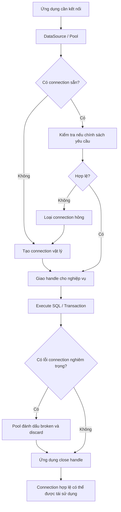

# Kiểm tra sức khỏe và loại bỏ kết nối hỏng trong JDBC connection pool

## 1. Vì sao một connection trong pool có thể hỏng?

Trong **JDBC**, tạo một kết nối vật lý tới cơ sở dữ liệu thường tốn chi phí hơn việc mượn một kết nối có sẵn. Vì thế, ứng dụng thường lấy `Connection` từ một `DataSource` có **connection pool** để thực hiện CRUD, truy vấn qua `PreparedStatement`, đọc `ResultSet` và quản lý transaction.

Pool giữ các kết nối vật lý để tái sử dụng. Nhưng trạng thái **đã tồn tại trong pool** không có nghĩa là **vẫn hoạt động được**. Kết nối có thể hỏng khi:

- DBMS khởi động lại, chủ động ngắt session hoặc đóng những kết nối rảnh quá lâu.
- Firewall, NAT, load balancer hoặc mạng đóng một kết nối TCP nhàn rỗi, trong khi phía Java chưa biết.
- Thiết bị mạng mất kết nối giữa lúc ứng dụng gửi câu SQL và nhận phản hồi.
- Driver phát hiện lỗi protocol, lỗi xác thực lại hoặc session phía server bị chấm dứt.
- Một kết nối rơi vào trạng thái transaction bất thường, không còn an toàn để giao cho yêu cầu tiếp theo.

Nếu pool cấp lại một kết nối như vậy, nghiệp vụ có thể gặp `SQLException` ngay ở câu SQL đầu tiên. Hệ thống cần cơ chế **kiểm tra sức khỏe (validation)**, **phân loại lỗi kết nối** và **loại bỏ (evict/discard) kết nối không còn dùng được**.

Mục tiêu không phải khiến mọi lỗi SQL biến mất. Đó là giảm khả năng cấp connection đã biết là hỏng và ngăn việc tái sử dụng connection bị nghi ngờ hỏng sau sự cố.

## 2. Phân biệt logical connection và physical connection

Khi dùng pool, `dataSource.getConnection()` thường trả về một **đối tượng đại diện** (*proxy/handle*) cho kết nối vật lý. Gọi `connection.close()` trên handle thông thường có nghĩa **trả nó về pool**, không nhất thiết đóng socket tới DBMS.

| Thao tác | Ý nghĩa với pool | Điều không được mặc định |
| --- | --- | --- |
| `DataSource.getConnection()` | Mượn một handle; pool lựa chọn/tạo connection vật lý. | Connection được trả về chắc chắn còn khỏe trong mọi khoảnh khắc tiếp theo. |
| `Connection.isClosed()` | Cho biết trạng thái đóng theo handle/driver. | `false` là bằng chứng kết nối mạng/server còn hoạt động. |
| `Connection.isValid(timeout)` | Yêu cầu driver xác minh kết nối còn hợp lệ trong thời hạn. | Sau khi trả `true`, không thể xảy ra sự cố ở câu SQL tiếp theo. |
| `Connection.close()` | Trả handle về pool; pool quyết định giữ hay loại connection. | Mọi connection bị hỏng đều chắc chắn bị hủy nếu pool không biết lỗi. |
| **Eviction/invalidation** của pool | Loại connection vật lý khỏi tập dùng lại, thường tạo thay thế khi cần. | Đây là phương thức JDBC chuẩn có cùng tên ở mọi pool. |

`Connection.close()` là thao tác **bắt buộc** từ phía code mượn kết nối, kể cả khi nghiệp vụ lỗi. Nhưng **việc loại connection vật lý hỏng** thuộc trách nhiệm của pool hoặc API riêng của nhà cung cấp pool; JDBC không định nghĩa một phương thức `DataSource.evictConnection()` chung.



Sơ đồ thể hiện **luồng ý tưởng**, không phải mọi pool luôn tạo connection mới tức thì hoặc kiểm tra ở cùng một thời điểm. Một pool có thể khởi tạo kết nối theo nhu cầu, giữ số lượng tối thiểu hoặc trì hoãn tạo thay thế để tránh tăng tải DBMS.

## 3. Hai phép kiểm tra JDBC: `isClosed()` và `isValid()`

### 3.1. `isClosed()` không phải kiểm tra khả năng giao tiếp

`connection.isClosed()` kiểm tra handle có được báo là đã đóng hay không. Nếu nó trả `true` thì không nên tiếp tục dùng. Nhưng `false` chỉ có nghĩa driver/handle **chưa xác nhận trạng thái đã đóng**; socket có thể đã bị thiết bị mạng hoặc DBMS ngắt trong thời gian rảnh.

Do đó, điều kiện như dưới đây **không đủ** để xác nhận kết nối khỏe:

```java
if (!connection.isClosed()) {
    // SAI nếu kết luận: kết nối chắc chắn vẫn giao tiếp được với DBMS.
}
```

### 3.2. `Connection.isValid(int timeout)`

API JDBC chuẩn:

```java
boolean valid = connection.isValid(2); // timeout tính bằng GIÂY.
```

Theo hợp đồng JDBC, `isValid(int timeout)` kiểm tra tính hợp lệ bằng một cơ chế của driver, có thể là ping hoặc truy vấn do driver quản lý. Một kết nối hợp lệ có thể dùng cho các thao tác JDBC; khi không còn hợp lệ, phương thức trả `false` hoặc ném `SQLException` tùy tình huống.

**Những điểm cần nhớ:**

- Tham số `timeout` đo bằng **giây**, không phải mili giây. Giá trị âm không hợp lệ; `0` nghĩa là không áp đặt giới hạn thời gian qua tham số này.
- Driver có thể có cơ chế xác minh riêng; không giả định `isValid()` luôn phát sinh một câu `SELECT 1` nhìn thấy được.
- Nếu driver không hỗ trợ phương thức cần thiết hoặc gặp vấn đề giao tiếp, có thể có `SQLFeatureNotSupportedException` hoặc loại `SQLException` khác. Cần kiểm chứng phiên bản driver mục tiêu.
- `true` chỉ xác nhận trạng thái tại **thời điểm kiểm tra**. Kết nối vẫn có thể chết ngay sau đó: đây là một dạng *time-of-check/time-of-use race*.
- Chạy `isValid()` liên tục trước **mỗi câu SQL** làm tăng round-trip, gây tải DBMS và không xóa được race. Thông thường để pool quản lý việc kiểm tra tại lúc cấp phát hoặc khi idle.

Khi muốn có một probe tường minh, hãy chọn timeout dương và ngắn theo SLO của ứng dụng, không mặc định dùng `0` cho mọi môi trường.

## 4. Ví dụ Java: kiểm tra một connection lấy từ `DataSource`

Lớp sau chỉ dùng API chuẩn JDBC. Nó phù hợp cho tác vụ kiểm tra định kỳ có kiểm soát hoặc công cụ chẩn đoán trong môi trường test; không nên gọi nó trên mọi HTTP request chỉ để đánh giá sức khỏe toàn ứng dụng.

```java
import javax.sql.DataSource;
import java.sql.Connection;
import java.sql.SQLException;
import java.sql.SQLFeatureNotSupportedException;
import java.util.Objects;

public final class ConnectionHealthProbe {
    private ConnectionHealthProbe() {}

    public record ProbeResult(
        boolean healthy, String description, String sqlState
    ) {}

    public static ProbeResult check(DataSource source, int timeoutSeconds) {
        Objects.requireNonNull(source, "source");
        if (timeoutSeconds <= 0) {
            throw new IllegalArgumentException("timeoutSeconds phải > 0");
        }

        try (Connection connection = source.getConnection()) {
            if (connection.isClosed()) {
                return new ProbeResult(false, "Handle đã đóng", null);
            }

            if (!connection.isValid(timeoutSeconds)) {
                return new ProbeResult(false, "Driver báo kết nối không hợp lệ",
                    null);
            }

            return new ProbeResult(true, "Validation thành công", null);
        } catch (SQLFeatureNotSupportedException unsupported) {
            return new ProbeResult(false,
                "Driver chưa hỗ trợ phép validation đã chọn",
                unsupported.getSQLState());
        } catch (SQLException failure) {
            return new ProbeResult(false,
                "Không mượn được hoặc không kiểm tra được connection",
                failure.getSQLState());
        }
    }
}
```

Sử dụng khi ứng dụng đã cấu hình `DataSource`:

```java
ConnectionHealthProbe.ProbeResult status =
    ConnectionHealthProbe.check(dataSource, 2);

System.out.println("Healthy=" + status.healthy());
System.out.println("Detail=" + status.description());
System.out.println("SQLState=" + status.sqlState());
```

Hàm này phân biệt **kiểm tra thành công** với **không thể xác nhận sức khỏe**. Trả `false` không đủ chứng minh DBMS ngừng hoạt động toàn bộ: có thể chỉ một connection hỏng, pool đang cạn, người dùng DBMS bị từ chối hoặc quá trình cấp kết nối vượt thời hạn.

**Giới hạn quan trọng:** `try-with-resources` luôn gọi `close()` để trả handle về pool. Tuy nhiên, nếu `isValid()` trả `false` mà pool không tự nhận biết trạng thái đó, chỉ `close()` **chưa bảo đảm** physical connection được evict. Để làm sạch pool, phải dựa vào cơ chế invalidation hoặc API riêng của pool; mục 7 trình bày ranh giới này.

## 5. Query validation và các loại timeout không được nhầm lẫn

Nếu driver không hỗ trợ `isValid()` hoặc hệ thống có quy định health query riêng, một pool có thể cung cấp cấu hình **connection test query**. Ví dụ trong một số DBMS, câu không thay đổi dữ liệu như `SELECT 1` có thể phù hợp:

```java
import java.sql.ResultSet;
import java.sql.SQLException;
import java.sql.Statement;

static boolean validateWithQuery(Connection connection, int seconds)
        throws SQLException {
    try (Statement statement = connection.createStatement()) {
        statement.setQueryTimeout(seconds);

        try (ResultSet rows = statement.executeQuery("SELECT 1")) {
            return rows.next() && rows.getInt(1) == 1;
        }
    }
}
```

Đây là **fallback tùy driver/DBMS**, không phải mã thay thế an toàn cho mọi hệ thống. Một số DBMS yêu cầu cú pháp khác (ví dụ `SELECT 1 FROM DUAL` ở các phiên bản Oracle cũ); `Statement.setQueryTimeout()` có thể không được hỗ trợ; và query timeout không phải hạn mức tuyệt đối cho mọi trạng thái mạng. Nếu thiếu khả năng giới hạn thời gian, **không âm thầm chạy một truy vấn có thể treo lâu** khi chính sách vận hành yêu cầu validation bị chặn theo deadline.

| Timeout | Đơn vị/đối tượng | Phạm vi |
| --- | --- | --- |
| Thời gian **mượn connection** từ pool | Thường mili giây, cấu hình theo thư viện pool. | Giới hạn chờ một handle còn trống; hết thời gian **không chứng minh** mọi connection đã chết. |
| `Connection.isValid(seconds)` | Giây. | Yêu cầu driver hoàn tất validation trong thời hạn. |
| `Statement.setQueryTimeout(seconds)` | Giây. | Giới hạn thực thi statement theo driver; có thể ném `SQLTimeoutException`. |
| `Connection.setNetworkTimeout(executor, milliseconds)` | Mili giây. | Giới hạn các thao tác mạng theo JDBC khi driver hỗ trợ; có thể làm connection mất hiệu lực. |
| Socket timeout và server-side timeout | Tùy DBMS/driver. | Tương tác mạng và thực thi ở server; lỗi có thể xuất hiện dưới nhiều lớp `SQLException`. |

**Không dùng validation query có tác dụng phụ.** Câu SQL dùng để thử kết nối không được sửa dữ liệu, gọi stored procedure nghiệp vụ hoặc giữ lock kéo dài; nó cần đủ nhẹ để không biến cơ chế giám sát thành nguyên nhân gây quá tải DBMS.

## 6. Đặt kiểm tra ở đâu trong vòng đời của pool?

Một pool trưởng thành có thể tự kiểm tra kết nối ở các thời điểm khác nhau:

| Thời điểm | Mục tiêu | Đánh đổi |
| --- | --- | --- |
| Khi tạo connection vật lý | Chỉ đưa kết nối khởi tạo thành công vào pool. | Kéo dài thời gian mở kết nối đầu tiên. |
| **Khi mượn** (*on borrow*) | Tránh giao một connection đã hỏng trong thời gian idle. | Có thể tăng độ trễ và round-trip nếu xác minh mọi lượt mượn. |
| Khi đang idle | Phát hiện và loại bỏ connection chết trước lúc có request. | Tốn một phần tài nguyên nền; không ngăn được lỗi phát sinh sau validation. |
| Keepalive định kỳ cho connection idle | Tránh một số thiết bị mạng đóng session quá lâu không hoạt động. | Có chi phí và có thể không thắng được mọi chính sách idle timeout của hạ tầng. |
| Khi trả connection về pool | Kiểm tra/khôi phục trạng thái, có thể loại nếu không sạch. | Có chi phí kiểm tra hoặc rollback/reset. |
| Khi câu SQL báo lỗi fatal | Phát hiện connection đang hoạt động đã hỏng. | Cần phân loại lỗi chính xác; không thể xem mọi `SQLException` là fatal. |

**Đừng tự viết vòng kiểm tra nền** trên cùng một `Connection` đang được business transaction sử dụng. Một connection JDBC không nên bị nhiều luồng cùng thao tác đồng thời nếu driver không có hợp đồng hỗ trợ. Validation của pool cần tôn trọng trạng thái mượn/trả và không can thiệp vào transaction đang chạy.

## 7. Loại bỏ connection hỏng: trách nhiệm của pool và ứng dụng

Trong thực tế, **phân loại lỗi để quyết định evict** thường thuộc về pool dựa trên driver, SQLState, mã lỗi nhà cung cấp và kết quả validation. Ứng dụng có trách nhiệm không giữ connection hỏng, truyền lỗi đúng và **đóng handle**. Hai thao tác liên quan nhưng khác nhau:

1. **Logical close:** gọi `connection.close()` để trả handle về pool. Không đồng nghĩa connection vật lý bị hủy.
2. **Physical discard/evict:** pool đóng connection vật lý bị lỗi và không giao nó cho request khác; tên API và cách thực hiện phụ thuộc pool.

Không có một phương thức `DataSource.evictConnection()` chung trong JDBC. Một số pool cung cấp API evict/invalidate hoặc bộ phân loại lỗi (exception override). Nhiều pool tự đánh dấu connection không hợp lệ sau những lỗi giao tiếp nghiêm trọng rồi loại nó khi handle được đóng. **Cần kiểm chứng hợp đồng của đúng pool đang dùng**; không suy luận từ mỗi hành vi `close()`.

### Minh họa với HikariCP (phần phụ thuộc nhà cung cấp)

Ở các phiên bản HikariCP có API `HikariDataSource.evictConnection(Connection)`, có thể chủ động loại một handle khi **đã xác nhận validation thất bại**. Đây là đoạn ví dụ **riêng HikariCP**, không phải mã JDBC chuẩn:

```java
import com.zaxxer.hikari.HikariDataSource;
import java.sql.Connection;
import java.sql.SQLException;
import java.sql.SQLFeatureNotSupportedException;
import java.sql.SQLNonTransientConnectionException;

public final class HikariValidationExample {
    private HikariValidationExample() {}

    public static void validateAndEvictIfBad(HikariDataSource pool)
            throws SQLException {
        try (Connection connection = pool.getConnection()) {
            boolean valid;
            try {
                valid = connection.isValid(2);
            } catch (SQLFeatureNotSupportedException unsupported) {
                // Thiếu tính năng validation không đồng nghĩa
                // connection vật lý đã chết: không evict mù quáng.
                throw unsupported;
            } catch (SQLException validationFailure) {
                // Chỉ áp dụng tại ranh giới chủ động validation.
                pool.evictConnection(connection);
                throw validationFailure;
            }

            if (!valid) {
                pool.evictConnection(connection);
                throw new SQLNonTransientConnectionException(
                    "Pool connection không qua health check", "08006");
            }
        }
    }
}
```

Điều kiện tiên quyết: module chứa mã này phải có dependency HikariCP và phiên bản cung cấp API tương ứng. `evictConnection` là **lệnh yêu cầu pool loại connection**, còn `try-with-resources` vẫn đóng logical handle để tránh rò rỉ. Trong ứng dụng thông thường, nên **để HikariCP tự xác minh và loại connection** theo chính sách cấu hình thay vì gọi phép kiểm tra này trước mọi câu SQL. Ví dụ chỉ minh họa đường xử lý khi ứng dụng thực sự cần chủ động evict một handle đã được xác định là không hợp lệ.

Không gọi evict cho mọi `SQLException` từ nghiệp vụ. Ví dụ, câu `INSERT` vi phạm khóa duy nhất không làm connection vật lý hỏng; nếu cứ evict sau mỗi lỗi ràng buộc, pool sẽ tạo kết nối mới liên tục và gây thêm tải DBMS.

### Không lạm dụng `Connection.abort(Executor)`

JDBC có `Connection.abort(Executor)` cho yêu cầu chấm dứt một connection. Nhưng API này **không phải phép thay thế phổ quát cho eviction trong pool**, có thể không được driver hỗ trợ, cần `Executor` phù hợp và có thể gây tương tác không mong muốn với proxy của pool. Chỉ sử dụng khi quy trình phục hồi đã xác định rõ và nhà cung cấp pool/driver hỗ trợ; không gọi tùy tiện để giải quyết mọi timeout SQL.

## 8. Phân loại `SQLException`: đâu là lỗi kết nối?

Không phải mọi lỗi SQL là lỗi sức khỏe connection. Một bảng phân loại thực dụng:

| Dấu hiệu | Ví dụ | Cách nhìn nhận |
| --- | --- | --- |
| SQLState **class `08`** | `08006` hoặc trạng thái kết nối bị đứt theo driver. | Tín hiệu mạnh về vấn đề kết nối; để pool/driver quyết định loại bỏ. |
| `SQLNonTransientConnectionException` | Kết nối không còn phục hồi được theo cùng trạng thái. | Không tiếp tục dùng handle; cần connection mới. |
| `SQLTransientConnectionException` | Sự cố liên quan kết nối có thể tạm thời, đôi khi khi pool cấp phát. | Phân biệt thất bại **mượn** connection với connection vật lý đã hỏng. |
| `SQLRecoverableException` | Có thể cần phục hồi bằng cách đóng và tạo kết nối mới. | Không retry trên cùng handle khi trạng thái chưa an toàn. |
| SQLState **class `23`** | Trùng khóa chính/vi phạm FK. | Lỗi dữ liệu/ràng buộc, **không tự động** kết luận kết nối hỏng. |
| SQLState **class `40`** | Transaction bị rollback do deadlock/serialization. | Cần xử lý transaction hoặc retry an toàn; không mặc định connection hỏng. |
| `SQLTimeoutException` | Câu truy vấn vượt thời hạn. | Không phải cứ timeout là connection chết; trạng thái còn tùy driver/DBMS. |
| SQLState riêng của DBMS | Hủy query, kết nối bị server chấm dứt. | Cần tham khảo tài liệu driver và mã lỗi nhà cung cấp. |

Ví dụ một hàm **gợi ý** phát hiện lỗi liên quan kết nối trong chuỗi `SQLException`:

```java
import java.sql.SQLException;
import java.sql.SQLNonTransientConnectionException;
import java.sql.SQLRecoverableException;
import java.sql.SQLTransientConnectionException;

public final class JdbcFailureHints {
    private JdbcFailureHints() {}

    public static boolean mayBeConnectionFailure(SQLException root) {
        for (SQLException current = root;
             current != null;
             current = current.getNextException()) {

            String state = current.getSQLState();
            if (state != null && state.startsWith("08")) {
                return true;
            }
            if (current instanceof SQLNonTransientConnectionException
                    || current instanceof SQLTransientConnectionException
                    || current instanceof SQLRecoverableException) {
                return true;
            }
        }
        return false;
    }
}
```

Đây chỉ là **gợi ý cho chẩn đoán**, **không** phải một thuật toán eviction hoàn chỉnh. Pool có thể có bộ đánh giá exception riêng, dùng thêm vendor error code và trạng thái vật lý. Hàm trên cũng có thể gặp `SQLTransientConnectionException` khi hết khả năng cấp phát connection, dù không hề có một physical connection đang mượn để evict. Không tự động gọi `abort()` hay API eviction chỉ vì hàm trả `true`.

**Log an toàn:** ghi loại `SQLException`, `getSQLState()`, `getErrorCode()`, đường đi xử lý (borrow/validate/execute/commit) và tên pool/driver; tránh ghi password, connection URL chứa secret hoặc toàn bộ tham số SQL nhạy cảm.

## 9. Transaction đang chạy trên connection hỏng

Một lỗi network giữa transaction có thể khiến ứng dụng **không biết chắc** DBMS đã xử lý tới đâu. Chẳng hạn:

1. Service dùng `connection.setAutoCommit(false)`.
2. `PreparedStatement.executeUpdate()` hoàn tất một lần nhưng response chưa đến Java.
3. Mạng đứt hoặc connection bị chấm dứt.
4. Service nhận `SQLException`. Việc gọi `rollback()` trên handle đó có thể tiếp tục thất bại.

**Không khẳng định rollback thành công chỉ vì đã gọi `rollback()`.** Với transaction chưa commit, DBMS thường hoàn tác khi session chết, nhưng trạng thái quan sát được còn phụ thuộc thời điểm lỗi. Đặc biệt, nếu mất kết nối khi `commit()` đang diễn ra, kết quả **có thể không xác định từ phía client**: commit có thể đã thành công dù Java nhận lỗi.

Một mẫu xử lý khi service sở hữu toàn bộ transaction:

```java
import javax.sql.DataSource;
import java.sql.Connection;
import java.sql.PreparedStatement;
import java.sql.SQLException;

public final class InventoryChangeService {
    private final DataSource dataSource;

    public InventoryChangeService(DataSource dataSource) {
        this.dataSource = dataSource;
    }

    public void decrement(String sku, int amount) throws SQLException {
        if (sku == null || sku.isBlank() || amount <= 0) {
            throw new IllegalArgumentException("Dữ liệu không hợp lệ");
        }

        try (Connection connection = dataSource.getConnection()) {
            connection.setAutoCommit(false);
            try {
                String sql =
                    "UPDATE inventory " +
                    "SET quantity = quantity - ? " +
                    "WHERE sku = ? AND quantity >= ?";

                try (PreparedStatement ps =
                        connection.prepareStatement(sql)) {
                    ps.setInt(1, amount);
                    ps.setString(2, sku);
                    ps.setInt(3, amount);

                    if (ps.executeUpdate() != 1) {
                        throw new SQLException(
                            "Không tìm thấy SKU hoặc không đủ tồn kho");
                    }
                }

                connection.commit();
            } catch (SQLException | RuntimeException failure) {
                try {
                    connection.rollback();
                } catch (SQLException rollbackFailure) {
                    failure.addSuppressed(rollbackFailure);
                }
                // Không nuốt lỗi: caller/pool cần thấy sự cố.
                throw failure;
            }
        }
    }
}
```

Ví dụ minh họa **giữ nguyên lỗi gốc và không giấu lỗi rollback**. `Connection.close()` cuối cùng vẫn được gọi nhờ `try-with-resources`, kể cả khi rollback thất bại. Nếu physical connection thật sự hỏng, pool cần xác định và loại nó trước lần mượn kế tiếp; đoạn mã không mặc nhiên thay được cơ chế của pool.

Ví dụ này không tự retry `UPDATE` vì có thể xảy ra lỗi **commit không xác định**. Với nghiệp vụ như thanh toán, nhập kho hoặc tạo đơn hàng, muốn retry phải có **idempotency key**, khóa nghiệp vụ và khả năng đối chiếu trạng thái đã ghi trên DBMS qua một kết nối **mới**. Việc đóng connection là bắt buộc nhưng không đủ thay thế thiết kế idempotent.

## 10. Cấu hình và giám sát một pool trong thực tế

Các tên cấu hình sau là ví dụ **HikariCP** (không phải thuộc tính chuẩn của `DataSource` JDBC):

```java
import com.zaxxer.hikari.HikariConfig;
import com.zaxxer.hikari.HikariDataSource;

HikariConfig config = new HikariConfig();
config.setJdbcUrl(System.getenv("APP_JDBC_URL"));
config.setUsername(System.getenv("APP_DB_USER"));
config.setPassword(System.getenv("APP_DB_PASSWORD"));

config.setMaximumPoolSize(10);
config.setMinimumIdle(2);
config.setConnectionTimeout(3_000);  // ms: tối đa chờ mượn.
config.setValidationTimeout(1_000);  // ms: tối đa chờ validate.
config.setIdleTimeout(600_000);      // ms: quản lý connection idle dư.
config.setMaxLifetime(1_500_000);    // ms: giới hạn tuổi connection.
config.setKeepaliveTime(120_000);    // ms: thăm dò kết nối idle.

try (HikariDataSource pool = new HikariDataSource(config)) {
    ConnectionHealthProbe.ProbeResult probe =
        ConnectionHealthProbe.check(pool, 2);
    System.out.println(probe);
}
```

Đây là **cấu hình minh họa**, không phải những con số tối ưu chung. Các thuộc tính có phiên bản, ràng buộc và giá trị mặc định theo HikariCP; cần kiểm tra phiên bản đang triển khai. Cần chọn `maxLifetime` phù hợp với giới hạn phía DBMS/network, thường ngắn hơn giới hạn đóng session ngoài ứng dụng; chọn `keepaliveTime` theo thời gian idle và chi phí xác minh, không dựa vào một công thức duy nhất.

Một số điều cần phân biệt:

- `connectionTimeout` là thời hạn **chờ cấp handle từ pool**, không phải `Statement.setQueryTimeout()`.
- `validationTimeout` giới hạn công việc **xác minh kết nối**, không quyết định thời hạn của toàn request.
- `maxLifetime` giúp thay kết nối cũ theo chính sách; không phải bằng chứng connection mới chắc chắn khỏe mọi thời điểm.
- `idleTimeout`/`keepaliveTime` ảnh hưởng connection **idle**; không nên hiểu là pool sẽ giết một connection đang chạy transaction chỉ vì nó đã mượn quá lâu.
- Cấu hình số kết nối tối đa không thể vượt tùy tiện giới hạn DBMS; tổng số pool trên nhiều instance phải được tính chung.

**Metrics và alert nên theo dõi:** active connections, idle connections, pending threads/requests đang chờ pool, connection-acquisition timeout, thời gian chờ mượn, số lần validation thất bại, số connection bị evict, số physical connection mới tạo, error theo SQLState và tần suất reconnect. Nguồn số liệu có thể từ pool, JMX, Micrometer hoặc hệ thống giám sát tương ứng; tên metric cụ thể phụ thuộc phiên bản và cấu hình.

Một lần `ConnectionHealthProbe.check()` thành công không chứng minh database sẵn sàng xử lý **tất cả** workload. Health endpoint nên có timeout, tần suất hợp lý và cần phân biệt **liveness** (tiến trình còn sống) với **readiness** (ứng dụng đủ điều kiện nhận lưu lượng). Khi DBMS đang quá tải, probe quá dày có thể làm tình hình xấu hơn.

## 11. Kiểm thử tình huống connection chết và cách loại bỏ

Nên kiểm thử trên **DBMS/driver/pool thật** trong môi trường cô lập, vì mock `Connection.isValid()` không đủ chứng minh pool loại physical connection đúng cách.

| Kịch bản | Điều cần xác minh |
| --- | --- |
| Mượn connection khỏe | Validation thành công, truy vấn nhỏ hoạt động và handle được trả về pool. |
| DBMS đóng một idle connection | Pool không tiếp tục cấp lại handle vật lý đã xác định hỏng; có thể tạo kết nối mới. |
| DBMS khởi động lại | Pool phát hiện connection cũ hỏng, loại bỏ dần và phục hồi theo khả năng DBMS. |
| `isValid()` trả `false` | Không đưa connection đó vào xử lý CRUD; kiểm tra pool có discard thực sự. |
| Validation ném `SQLException` | Lỗi được ghi nhận, handle đóng, không bị hiểu nhầm thành lệnh SQL nghiệp vụ thất bại. |
| Driver không hỗ trợ một kiểu validation | Chọn cơ chế tương thích hoặc từ chối cấu hình, tránh lặp probe không có giới hạn. |
| Câu SQL vi phạm ràng buộc (SQLState `23`) | Transaction xử lý lỗi đúng; pool không evict connection khỏe hàng loạt. |
| Query timeout hoặc deadlock | Phân loại transaction/statement trước, không suy đoán physical connection chắc chắn chết. |
| Mất kết nối trong `executeUpdate()` | Không dùng lại handle bị hỏng; kiểm tra dữ liệu qua kết nối mới trước khi retry. |
| Mất kết nối tại `commit()` | Ứng dụng xử lý kết quả chưa xác định và idempotency, không ghi nhận chắc chắn rollback. |
| Pool bị dùng hết (exhaustion) | Request chờ có timeout, metrics pending tăng, không quy hết lỗi thành physical connection hỏng. |
| Đóng connection hai lần hoặc quên đóng | `try-with-resources` được dùng thống nhất; giám sát leak thay vì tăng pool vô hạn. |

Để mô phỏng lỗi có thể chặn hoặc đóng session trên **database thử nghiệm**, tạm ngắt mạng trong môi trường container hoặc khởi động lại DBMS; không chủ động gây sự cố trên production. Khi xác minh **physical connection mới** được tạo, nên dùng session ID của DBMS (nếu có) và metric pool, không suy ra chỉ từ `System.identityHashCode()` của một proxy JDBC.

## 12. Những sai lầm thường gặp

| Sai lầm | Hệ quả | Cách sửa |
| --- | --- | --- |
| Xem `isClosed() == false` là kết nối khỏe. | Bỏ sót socket đã đứt. | Dùng validation thực sự và cơ chế pool thích hợp. |
| Validate bằng một câu SQL nặng. | Tăng tải DBMS, gây lock và latency. | Chọn health query nhẹ, chỉ đọc, có timeout. |
| Gọi `isValid()` trước mọi câu SQL. | Tăng round-trip nhưng vẫn có race sau khi kiểm tra. | Để pool kiểm soát validation ở các thời điểm cần thiết. |
| Tin rằng `close()` luôn hủy physical connection hỏng. | Có thể tái sử dụng kết nối không còn hợp lệ. | Kiểm chứng eviction/fatal-exception classifier của pool. |
| Evict mọi `SQLException`. | Churn kết nối sau lỗi ràng buộc/SQL không liên quan network. | Phân loại lỗi theo SQLState/driver và trạng thái transaction. |
| Dùng một timeout cho borrow, validation, query và mạng. | SLO không kiểm soát được, dễ timeout sai chỗ. | Thiết kế các hạn mức riêng và đo chúng. |
| Retry câu ghi ngay trên connection cũ sau lỗi mạng. | Có thể ghi lặp hoặc tiếp tục trên transaction hỏng. | Đóng handle, đối chiếu trạng thái và retry idempotent qua connection mới. |
| Nuốt lỗi rollback rồi báo giao dịch đã hủy chắc chắn. | Mất thông tin về kết quả không xác định. | Giữ lỗi gốc, lưu lỗi rollback bằng `addSuppressed()`. |
| Đặt keepalive quá dày. | Tăng tải và số kết nối tới DBMS không cần thiết. | Điều chỉnh theo giới hạn hạ tầng và metrics. |
| Chia sẻ một handle `Connection` giữa nhiều thread. | Race trạng thái session/transaction. | Mỗi đơn vị công việc mượn và trả handle theo phạm vi riêng. |

## 13. Quy trình ứng dụng đề xuất

1. **Dùng một `DataSource` có pool được cấu hình rõ ràng**: giới hạn số kết nối, thời hạn mượn, validation, tuổi và thời gian idle.
2. **Cho pool quản lý kiểm tra sức khỏe** ở thời điểm phù hợp. Ưu tiên `Connection.isValid()` nếu driver/pool hỗ trợ; dùng câu validation SQL tối giản nếu có lý do.
3. **Mượn/đóng đúng phạm vi** qua `try-with-resources`; không giữ handle cho request khác hoặc chia sẻ tự do giữa thread.
4. **Không che `SQLException` nghiêm trọng**; ghi loại lỗi, SQLState và vendor code để pool/ứng dụng có thể chẩn đoán.
5. **Phân biệt lỗi kết nối với lỗi nghiệp vụ**: SQLState `08` và exception kết nối là tín hiệu khác với lỗi ràng buộc `23` hay deadlock `40`.
6. **Evict physical connection khi xác định bị hỏng** bằng cơ chế của pool; không coi `DataSource` JDBC chuẩn có API evict chung.
7. **Bảo toàn kết quả transaction**: rollback khi phù hợp, ghi lỗi rollback, xử lý commit không xác định bằng idempotency/đối chiếu trên connection mới.
8. **Kiểm chứng bằng chaos test nhẹ và metrics** trước khi triển khai; kiểm tra lại khi đổi driver, DBMS, firewall hoặc cấu hình pool.

## 14. Ghi nhớ

Trong JDBC connection pool, **một handle chưa đóng không đồng nghĩa một physical connection còn khỏe**. `Connection.isValid(timeout)` là phép kiểm tra chuẩn hữu ích, còn `isClosed()` chỉ cho biết trạng thái đóng được báo cáo. Pool nên kiểm tra connection ở những thời điểm thích hợp, phân loại lỗi giao tiếp và **loại bỏ những connection không còn dùng được** trước khi giao lại cho nghiệp vụ. Ứng dụng vẫn phải đóng handle, quản lý transaction, tránh evict sau mọi lỗi SQL và không retry thao tác ghi khi trạng thái commit chưa rõ. Cách hoạt động cụ thể của validation, eviction và keepalive phụ thuộc pool, driver và DBMS; hãy kiểm chứng bằng thử nghiệm tích hợp và số liệu vận hành thực tế.
