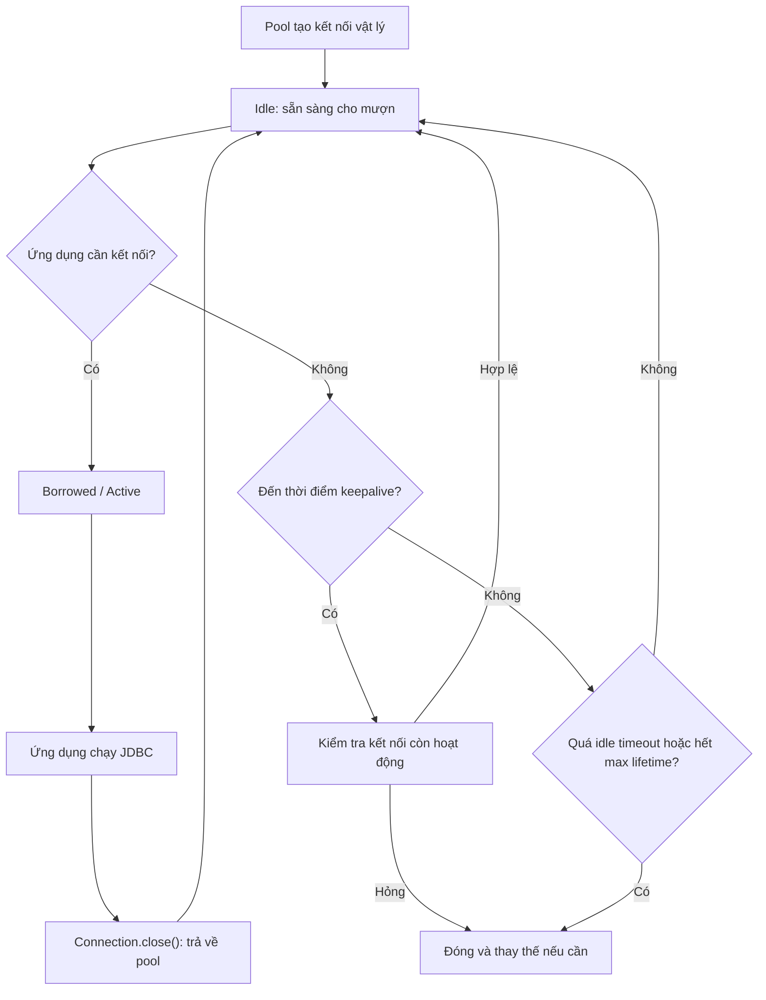
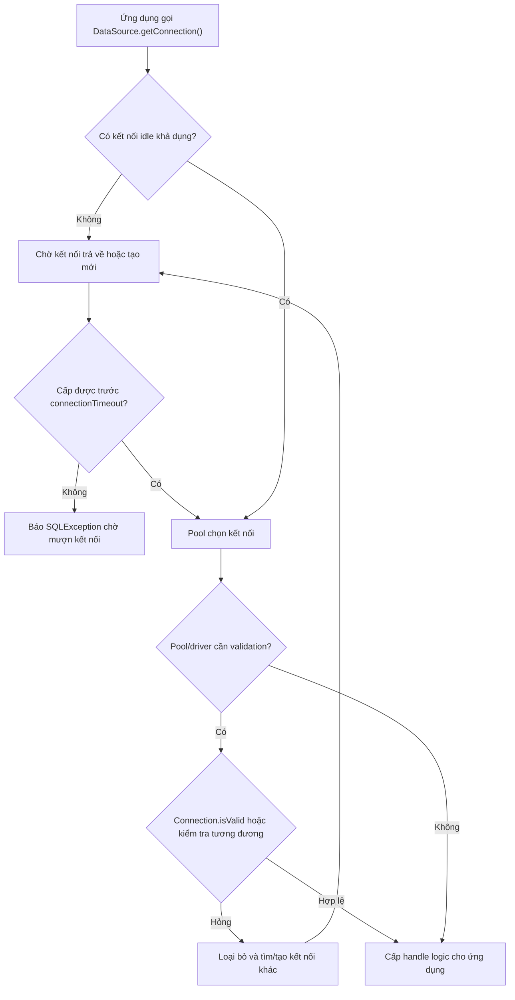

# Quản lý thời gian sống, thời gian nhàn rỗi và hoạt động giữ kết nối

## 1. Tại sao kết nối trong pool cần có vòng đời?

Trong ứng dụng Java sử dụng **JDBC**, mở một kết nối vật lý tới cơ sở dữ liệu quan hệ thường tốn thời gian: kết nối mạng, xác thực, khởi tạo phiên và có thể thiết lập TLS. `Connection pooling` giữ lại các kết nối để tái sử dụng, thay vì tạo một kết nối vật lý mới cho mọi câu `SELECT`, `INSERT`, `UPDATE` hay transaction.

Tuy vậy, **giữ một kết nối mãi mãi không phải mục tiêu của pool**. Kết nối có thể bị DBMS, proxy, firewall, bộ cân bằng tải hoặc hạ tầng mạng đóng sau một khoảng thời gian, ngay cả khi ứng dụng vẫn còn đối tượng đại diện cho nó. Ngoài ra, giữ quá nhiều kết nối nhàn rỗi sẽ chiếm tài nguyên của DBMS mà không phục vụ yêu cầu.

Một chính sách pool tốt cần điều chỉnh ít nhất ba yếu tố:

1. **Thời gian sống tối đa** (*maximum lifetime*): nên thay thế kết nối vật lý sau bao lâu kể từ khi được tạo?
2. **Thời gian nhàn rỗi tối đa** (*idle timeout*): một kết nối đã trả về pool và không được dùng bao lâu thì nên đóng để thu nhỏ pool?
3. **Hoạt động giữ kết nối** (*keepalive*): khi kết nối đang **nhàn rỗi trong pool**, có nên kiểm tra định kỳ để DBMS/proxy không đóng nó do im lặng quá lâu?

Đó là ba câu hỏi **khác nhau**. Cùng với kiểm tra tính hợp lệ, thời gian chờ mượn kết nối và giám sát, chúng quyết định pool vừa sẵn sàng phục vụ vừa không tiêu tốn tài nguyên vô ích.



Sơ đồ là **mô hình khái niệm**: thứ tự kiểm tra, lịch dọn dẹp và chính sách thay thế thực tế tùy thư viện pool. Một số pool trì hoãn việc đóng kết nối quá hạn đến khi nó không còn được ứng dụng mượn.

## 2. Phân biệt kết nối logic và kết nối vật lý

Trong JDBC, ứng dụng thường lấy `Connection` từ `DataSource`:

```java
try (Connection connection = dataSource.getConnection()) {
    // Dùng PreparedStatement, ResultSet, transaction...
}
```

Với `DataSource` có pooling, giá trị trả về thường là **proxy/handle logic** bao quanh một kết nối vật lý đang được pool quản lý.

| Thao tác | Ở tầng mã ứng dụng | Tại pool/DBMS |
| --- | --- | --- |
| `dataSource.getConnection()` | Nhận một handle để dùng JDBC | Pool cấp kết nối có sẵn, kiểm tra hoặc tạo mới |
| `connection.close()` | Đóng handle đã mượn | Thường trả kết nối vật lý về pool, không đóng socket mỗi lần |
| Hết `idleTimeout` | Ứng dụng không sở hữu handle nữa | Pool có thể đóng một kết nối vật lý dư thừa đang idle |
| Hết `maxLifetime` | Không cần thay đổi cách viết `try-with-resources` | Pool cho kết nối vật lý “nghỉ hưu” đúng lúc an toàn |
| `dataSource.close()` của pool (nếu có) | Kết thúc pool khi ứng dụng dừng | Đóng những kết nối vật lý do pool quản lý |

**Quy tắc đầu tiên:** luôn đóng **handle mượn** bằng `try-with-resources`. Một request quên gọi `Connection.close()` có thể giữ kết nối ở trạng thái *active*, khiến pool cạn kết nối. `idleTimeout` và keepalive thường **không thể thu hồi** một kết nối vẫn đang được mượn chỉ vì request đã không hoạt động.

Ngược lại, **không đóng cả `DataSource`/pool ở cuối từng request**. Pool là tài nguyên có vòng đời dài của ứng dụng; handle `Connection` có vòng đời ngắn theo nghiệp vụ.

## 3. Ba đồng hồ thời gian hoàn toàn khác nhau

Giả sử pool tạo một kết nối vật lý tại thời điểm `t = 0`. Nó được cho mượn, trả lại, rồi nằm nhàn rỗi trong pool:

```text
Thời gian:        0m       3m          7m         11m       16m
                 |--------|-----------|----------|----------|
Vòng đời vật lý:  +------------------------------------------> tuổi kết nối
Trạng thái:       [  active ] [    idle    ] [ active ] [ idle ]
                                   ^                       ^
                             có thể kiểm tra          có thể dọn
                               keepalive                idle

maxLifetime: tính từ lúc tạo kết nối vật lý, không reset khi trả về pool.
idleTimeout: tính theo khoảng thời gian kết nối nhàn rỗi trong pool.
keepalive: hoạt động kiểm tra khi kết nối đủ điều kiện idle.
```

### 3.1. Thời gian sống tối đa — `maxLifetime`

`maxLifetime` thường tính từ lúc **kết nối vật lý được tạo**, không tính từ lần cuối chạy câu SQL. Một kết nối liên tục được sử dụng và trả về vẫn già đi.

Mục tiêu là chủ động thay thế kết nối trước khi đạt giới hạn tuổi phiên do DBMS/proxy/hạ tầng áp đặt, hoặc trước khi các kết nối quá lâu dễ gặp vấn đề tài nguyên.

Ví dụ: nếu một thành phần hạ tầng đóng kết nối vật lý sau **30 phút kể từ lúc tạo**, pool có thể đặt lifetime ở mức **25 phút** để có khoảng dự phòng. Các con số là **giả định minh họa**, không phải mặc định hay khuyến nghị phổ quát cho mọi hệ thống.

Với **HikariCP**, `maxLifetime` là thời gian sống tối đa của kết nối trong pool; một kết nối **đang được ứng dụng sử dụng không bị HikariCP cưỡng bức đóng đúng mốc đó**. Việc nghỉ hưu được thực hiện khi kết nối có thể được thu hồi an toàn, thường sau khi được trả về pool. Vì thế `maxLifetime` không thể thay cho timeout của transaction chạy quá lâu.

### 3.2. Thời gian nhàn rỗi — `idleTimeout`

`idleTimeout` áp dụng cho kết nối **không được ứng dụng mượn** và đã không hoạt động trong pool một thời gian. Nó giúp giảm số kết nối vật lý khi tải hệ thống thấp.

Ví dụ: một dịch vụ có pool tối đa 8 kết nối, nhưng bình thường chỉ cần 2. Nếu đã tạo đủ 8 trong giờ cao điểm, pool có thể cho 6 kết nối dư nghỉ sau thời gian idle, giữ lại mức tối thiểu theo cấu hình.

Với **HikariCP**, `idleTimeout` có ý nghĩa khi `minimumIdle < maximumPoolSize`; pool không chủ động thu nhỏ xuống dưới `minimumIdle` chỉ vì timeout nhàn rỗi. Việc dọn idle không xảy ra chính xác tại từng mili giây: pool thường có lịch quét và mức lệch thời điểm.

**Đừng nhầm idle timeout của pool với idle timeout của DBMS/proxy.** Pool idle timeout là lúc **pool muốn đóng** kết nối; DB/proxy idle timeout là lúc **bên ngoài có thể đóng** kết nối mà pool chưa biết.

### 3.3. Hoạt động giữ kết nối — `keepalive`

Keepalive của pool thường là một thao tác nhẹ nhằm xác định kết nối nhàn rỗi vẫn còn sử dụng được. Một số pool thực hiện bằng `Connection.isValid(timeout)`, một số dùng truy vấn kiểm tra như `SELECT 1` theo cấu hình driver.

Với **HikariCP**, keepalive được thực hiện trên kết nối **đang idle trong pool**, tạm lấy kết nối ra để kiểm tra rồi trả nó về; nó không phải công việc tự ý chèn vào transaction của ứng dụng đang mượn kết nối.

Ví dụ: firewall đóng một kết nối sau 4 phút không có lưu lượng. Nếu giữ kết nối nhàn rỗi lâu hơn 4 phút, pool có nguy cơ cấp lại một socket đã bị đóng. Một nhịp kiểm tra 2 phút có thể giúp phát hiện tình trạng hỏng sớm hơn hoặc tạo lưu lượng ngăn idle cutoff — **nếu** thành phần mạng đó tính hoạt động kiểm tra là lưu lượng hợp lệ. Cần đo và thử trên hạ tầng thật.

**Keepalive không tăng tuổi thọ tối đa vô hạn.** Nếu DBMS buộc kết thúc phiên sau tổng thời gian 30 phút, nhịp keepalive mỗi 2 phút không vượt được giới hạn tuổi tuyệt đối đó. Do vậy cấu hình keepalive vẫn cần kết hợp với `maxLifetime` thích hợp.

## 4. Các timeout cùng xuất hiện nhưng không cùng mục đích

Đọc các tham số pool theo **sự kiện bắt đầu tính giờ** là cách nhanh nhất để tránh nhầm lẫn:

| Tham số (tên minh họa theo HikariCP) | Tính từ khi nào? | Nếu tới hạn thì điều gì xảy ra? |
| --- | --- | --- |
| `maxLifetime` | Lúc tạo kết nối vật lý | Kết nối được lên kế hoạch thay thế theo cơ chế pool |
| `idleTimeout` | Lúc kết nối ở trạng thái nhàn rỗi | Kết nối idle dư thừa có thể bị đóng |
| `keepaliveTime` | Lịch kiểm tra kết nối đủ điều kiện idle | Pool kiểm tra kết nối và thay thế nếu phát hiện hỏng |
| `connectionTimeout` | Lúc ứng dụng gọi `getConnection()` chờ pool cấp handle | Hết thời gian chờ sẽ báo lỗi mượn kết nối; không phải tuổi kết nối |
| `validationTimeout` | Lúc pool thực hiện phép kiểm tra tính hợp lệ | Giới hạn thời gian kiểm tra theo cơ chế pool |
| `Statement.setQueryTimeout(seconds)` | Lúc thực thi statement | Yêu cầu driver giới hạn thời gian chạy câu SQL; mức tuân thủ tùy driver |
| `Connection.setNetworkTimeout(executor, ms)` | Thao tác mạng của JDBC connection | Giới hạn liên quan I/O mạng nếu driver hỗ trợ |
| DBMS `statement_timeout`, `idle_in_transaction_session_timeout`, v.v. | Theo quy tắc riêng của DBMS | DBMS có thể hủy câu lệnh hoặc chấm dứt phiên/transaction |

**Không** đặt `connectionTimeout` thật lớn để chữa một câu `SELECT` chậm. `connectionTimeout` chỉ đo thời gian **đợi mượn connection**; câu SQL chạy sau đó có timeout và nguyên nhân chậm riêng.

Tương tự, `validationTimeout` không tương đương nhịp `keepaliveTime`: một tham số giới hạn **độ dài một phép kiểm tra**, tham số kia quyết định **khi nào thực hiện kiểm tra**.

## 5. Mối liên hệ với timeout của DBMS và hạ tầng mạng

Một kết nối có thể bị kết thúc bởi các nguyên nhân bên ngoài:

- **DBMS:** timeout phiên nhàn rỗi, giới hạn thời gian sống kết nối, chính sách quản trị hoặc khởi động lại máy chủ.
- **Proxy/pooler trước DBMS:** giới hạn phiên backend, phiên client hoặc thời gian im lặng trên một socket.
- **Firewall/load balancer/NAT:** đóng kết nối TCP không hoạt động trong một khoảng thời gian.
- **Mạng:** đứt tuyến, reset kết nối, mất phiên TLS hoặc lỗi I/O ngắn hạn.
- **Ứng dụng:** giữ connection quá lâu, transaction không hoàn tất, không đóng tài nguyên hoặc pool bị shutdown.

Một nguyên tắc cấu hình thường dùng là:

> **Chủ động thay thế kết nối trước ngưỡng mà hạ tầng có thể đóng nó bất ngờ; dùng validation/keepalive ở nơi có lợi, nhưng không dựa vào chúng để che lỗi ứng dụng.**

Ví dụ *giả định* các giới hạn đã được xác nhận:

| Thành phần | Giới hạn quan sát được | Cấu hình gợi ý để bắt đầu kiểm thử |
| --- | --- | --- |
| Proxy giới hạn tuổi phiên tuyệt đối | 30 phút | `maxLifetime` khoảng 25 phút |
| Firewall đóng socket idle | 4 phút | `keepaliveTime` khoảng 2 phút, nếu thực sự cần giữ socket |
| Ứng dụng muốn giảm kết nối dư sau cao điểm | 5 phút idle | `idleTimeout` khoảng 5 phút với `minimumIdle < maximumPoolSize` |
| DBMS cho phép tối đa 80 phiên cho nhóm ứng dụng | 80 kết nối | Tính tổng pool của mọi instance, giữ ngân sách cho kết nối khác |

Các số trên **không tự động đúng** chỉ vì đặt vào cấu hình: phải đối chiếu với tính năng driver, proxy, giới hạn mạng, độ trễ validate và số phiên thực tế. Nếu không có ngưỡng idle của hạ tầng, **không nên bật keepalive thật dày chỉ “cho chắc”**.

### Keepalive JDBC và TCP keepalive khác nhau

TCP keepalive là cơ chế của hệ điều hành/socket để phát hiện kết nối bị hỏng hoặc duy trì lưu lượng ở tầng TCP. Keepalive của connection pool thường là **phép kiểm tra kết nối JDBC ở tầng ứng dụng/driver**. Cách hạ tầng đếm lưu lượng, thời gian bật và khả năng điều chỉnh của hai cơ chế có thể khác nhau.

Vì vậy, một lần `Connection.isValid(...)` thành công không đồng nghĩa TCP keepalive đã được cấu hình, và bật tùy chọn TCP keepalive không có nghĩa pool sẽ kiểm tra trạng thái kết nối theo lịch `keepaliveTime`.

## 6. Ví dụ cấu hình HikariCP qua `DataSource`

**JDBC chuẩn không định nghĩa `maxLifetime`, `idleTimeout` hay `keepaliveTime` trên giao diện `DataSource`.** Đây là cấu hình của **thư viện connection pool**. Ví dụ sau dùng **HikariCP**, một triển khai pool được sử dụng rộng rãi với JDBC. Tên setter và chi tiết hành vi cần được xác minh theo phiên bản thư viện dùng trong dự án.

### 6.1. Khởi tạo pool một lần tại điểm bắt đầu ứng dụng

Ví dụ Java 17+ sau dùng biến môi trường làm nguồn cấu hình. Các giá trị thời gian là **mili giây** theo API HikariCP. Chúng là cấu hình minh họa ứng với kịch bản ở mục 5, không phải giá trị mặc định:

```java
import com.zaxxer.hikari.HikariConfig;
import com.zaxxer.hikari.HikariDataSource;

public final class JdbcPoolFactory {
    private JdbcPoolFactory() {}

    public static HikariDataSource create() {
        HikariConfig config = new HikariConfig();

        // Đã cấu hình JDBC URL và credentials cho DBMS thực tế.
        config.setJdbcUrl(requiredEnv("DB_JDBC_URL"));
        config.setUsername(requiredEnv("DB_USER"));
        config.setPassword(requiredEnv("DB_PASSWORD"));
        config.setPoolName("rental-db");

        // 8 là giới hạn của một instance, không phải toàn cụm.
        config.setMaximumPoolSize(8);
        config.setMinimumIdle(2);

        // Chờ mượn kết nối tối đa 3 giây; validate tối đa 1 giây.
        config.setConnectionTimeout(3_000L);
        config.setValidationTimeout(1_000L);

        // Các giá trị minh họa, tính bằng millisecond.
        config.setIdleTimeout(5 * 60_000L);       // 5 phút
        config.setKeepaliveTime(2 * 60_000L);      // 2 phút
        config.setMaxLifetime(25 * 60_000L);      // 25 phút

        // Với driver JDBC 4+ phù hợp, thường không cần tự cấu hình
        // connectionTestQuery: pool có thể dùng Connection.isValid().
        return new HikariDataSource(config);
    }

    private static String requiredEnv(String name) {
        String value = System.getenv(name);
        if (value == null || value.isBlank()) {
            throw new IllegalStateException(
                    "Thiếu biến môi trường cấu hình: " + name);
        }
        return value;
    }
}
```

Trong kịch bản này:

1. Pool có tối đa **8** kết nối vật lý đang được quản lý cho một ứng dụng instance.
2. `minimumIdle=2` khiến pool cố gắng duy trì **2** kết nối idle theo chính sách của HikariCP, khi điều kiện cho phép.
3. Khi tải giảm, các kết nối idle **dư mức tối thiểu** có thể bị thu hồi sau khoảng thời gian đặt bởi `idleTimeout`.
4. Các kết nối idle còn được giữ có thể được kiểm tra qua `keepaliveTime`.
5. Mỗi kết nối vật lý sẽ được thay thế theo `maxLifetime`, nhưng **không cưỡng ép cắt một kết nối đang được ứng dụng sử dụng** tại đúng mốc 25 phút.
6. Khi tất cả kết nối được mượn và pool đã tới giới hạn, một lời gọi `getConnection()` có thể chờ tối đa thời gian tương ứng `connectionTimeout` rồi phát sinh `SQLException` nếu chưa có kết nối.

Trong HikariCP, `keepaliveTime` phải **nhỏ hơn `maxLifetime`** để còn ý nghĩa. Tùy phiên bản, thư viện còn áp dụng các ngưỡng tối thiểu và quy tắc chuẩn hóa cấu hình; vì vậy cần xem log khởi tạo để phát hiện cấu hình bị điều chỉnh hoặc bị từ chối.

**Không lưu mật khẩu trong mã nguồn, không đưa chuỗi kết nối có bí mật vào log.** Với ứng dụng chạy trên server, pool cần được tạo một lần theo lifecycle và đóng khi ứng dụng shutdown; nếu dùng framework quản lý `DataSource`, hãy để framework sở hữu việc tạo/hủy pool.

### 6.2. Mượn kết nối ngắn hạn cho một thao tác JDBC

Các repository chỉ cần phụ thuộc vào giao diện chuẩn `javax.sql.DataSource`, không nhất thiết biết chi tiết HikariCP:

```java
import java.sql.Connection;
import java.sql.PreparedStatement;
import java.sql.ResultSet;
import java.sql.SQLException;
import javax.sql.DataSource;

public final class CustomerRepository {
    private final DataSource dataSource;

    public CustomerRepository(DataSource dataSource) {
        this.dataSource = dataSource;
    }

    public String findName(long customerId) throws SQLException {
        String sql = """
                SELECT full_name
                FROM customers
                WHERE customer_id = ?
                """;

        try (Connection c = dataSource.getConnection();
             PreparedStatement ps = c.prepareStatement(sql)) {
            ps.setLong(1, customerId);
            ps.setQueryTimeout(5); // 5 GIÂY: giới hạn câu SQL, không phải pool.

            try (ResultSet rs = ps.executeQuery()) {
                return rs.next() ? rs.getString("full_name") : null;
            }
        }
    }
}
```

Đoạn SQL giả định đã có bảng `customers(customer_id, full_name)` trong DBMS. Có thể chuẩn bị dữ liệu thử đơn giản:

```sql
CREATE TABLE customers (
    customer_id BIGINT PRIMARY KEY,
    full_name VARCHAR(200) NOT NULL
);

INSERT INTO customers (customer_id, full_name)
VALUES (1, 'Nguyễn An');
```

Sử dụng pool do ứng dụng sở hữu:

```java
// Minh họa chạy trong chương trình CLI; close pool ở cuối chương trình.
try (com.zaxxer.hikari.HikariDataSource pool =
         JdbcPoolFactory.create()) {
    CustomerRepository repository = new CustomerRepository(pool);
    System.out.println(repository.findName(1L));
}
```

Trong một dịch vụ HTTP dài hạn, không dùng `try-with-resources` bao quanh `DataSource` cho **mỗi request** như đoạn CLI trên. Hãy inject cùng một pool dùng chung vào các repository; đóng pool **một lần** khi ứng dụng dừng. Ngược lại, `Connection` từ `getConnection()` vẫn phải được đóng sau mỗi nghiệp vụ.

## 7. Điều gì xảy ra khi pool phát hiện kết nối đã hỏng?

Một pool thường có nhiều cơ hội kiểm tra:



Đây là mô hình chung, **không khẳng định mọi pool validate trước mỗi lần borrow**. Các triển khai thường tối ưu để không gọi mạng không cần thiết trên từng request; việc kiểm tra cũng có thể được thực hiện theo chu kỳ hoặc sau một khoảng idle nhất định.

Với driver JDBC 4 có triển khai tốt `Connection.isValid(int timeoutSeconds)`, đây thường là phương pháp kiểm tra ưu tiên. Nếu driver không hỗ trợ hoặc có hành vi đặc biệt, pool có thể cần truy vấn kiểm tra được cấu hình rõ ràng.

**Không mặc định thêm `SELECT 1` cho mọi yêu cầu nghiệp vụ.** Một truy vấn kiểm tra lặp dày có thể gây tải không cần thiết; hãy để pool quản lý validation và chỉ cấu hình query riêng khi driver/DBMS yêu cầu.

Nếu pool phát hiện kết nối hỏng:

- Kết nối vật lý đó bị loại bỏ, không nên tiếp tục cấp nó cho request mới.
- Pool có thể tạo kết nối khác, nhưng việc này chịu giới hạn số kết nối, timeout và khả năng DBMS đang hoạt động.
- Việc trả lỗi về `getConnection()` không đồng nghĩa tất cả SQL của một transaction trước đó đã rollback.

Một kết nối **đã được mượn** vẫn có thể mất mạng giữa câu SQL hoặc đúng lúc `commit()`. Keepalive trên kết nối **idle** không thể ngăn mọi lỗi này. Ứng dụng cần xử lý `SQLException`, transaction rollback/commit không xác định và idempotency ở tầng nghiệp vụ.

## 8. Keepalive không chữa được kết nối bị giữ quá lâu

Phân biệt hai trạng thái thường bị gọi nhầm là “idle”:

| Trạng thái | Ai đang sở hữu connection? | Keepalive của pool xử lý được? |
| --- | --- | --- |
| **Idle trong pool** | Không có request mượn | Có thể kiểm tra/giữ sống theo lịch của pool |
| **Active nhưng không chạy SQL** | Request vẫn giữ handle, có thể đã mở transaction | Thông thường **không**; pool không chen thao tác vào connection đang mượn |

Ví dụ thiết kế sai:

```java
Connection c = dataSource.getConnection();
c.setAutoCommit(false);

// Chạy UPDATE...
// Sau đó chờ HTTP 10 phút mà không commit/rollback/close.
// Pool vẫn xem connection là ACTIVE, không phải idle.
```

Đây là một kết nối **đang được mượn và transaction có thể đang mở**, dù chương trình không thực thi SQL. DBMS có thể báo `idle in transaction`, giữ lock hoặc kích hoạt giới hạn timeout cho transaction nhàn rỗi. `idleTimeout` và keepalive của pool không giải quyết đúng vấn đề này.

Cách xử lý là giữ transaction ngắn, tách HTTP/email khỏi ranh giới transaction khi khả thi, đóng tài nguyên trong `finally` hoặc `try-with-resources`, và giám sát các transaction tồn tại lâu bất thường.

### Phát hiện connection leak

Một số pool, trong đó có HikariCP, hỗ trợ cơ chế cảnh báo khi một connection **được mượn quá lâu** (ví dụ `leakDetectionThreshold`). Đây là **công cụ phát hiện**, không phải cam kết tự thu hồi một transaction đang xử lý hợp lệ.

Cần chọn ngưỡng lớn hơn phần lớn thời gian nghiệp vụ bình thường để hạn chế báo động giả. Khi thấy cảnh báo leak, kiểm tra stack trace thời điểm mượn, logic đóng `Connection` và các tình huống request bị treo; không mặc định tăng `maxLifetime` hoặc `idleTimeout` để che cảnh báo.

## 9. Chọn số lượng kết nối trước khi tinh chỉnh thời gian

Pool có thời gian sống hợp lý nhưng quá lớn vẫn có thể làm DBMS quá tải.

Giả sử một hệ thống chạy **6 instance**, mỗi instance cấu hình `maximumPoolSize=8`:

```text
Tổng kết nối ứng dụng có thể chạm tới = 6 × 8 = 48.

Chưa bao gồm:
- phiên quản trị và migration;
- background jobs hoặc service khác;
- các pool dành cho DB replica;
- kết nối do proxy/pooler và DBMS quản lý theo mô hình triển khai.
```

Không chọn `maximumPoolSize` dựa trên tổng số HTTP request đồng thời. Một request có thể không cần kết nối trong phần lớn thời gian, trong khi request chạy truy vấn lâu giữ một kết nối trong nhiều giây. Nên đo **số kết nối active thực sự, thời gian giữ kết nối, thời gian chờ mượn** và giới hạn năng lực DBMS.

`minimumIdle` là lựa chọn giữa độ sẵn sàng và chi phí duy trì kết nối:

- Mức quá thấp có thể làm phát sinh nhiều lượt tạo connection trong những đợt tải tăng đột ngột.
- Mức quá cao trên nhiều instance sẽ giữ nhiều phiên nhàn rỗi, làm tăng chi phí DBMS và các lượt keepalive.
- Với HikariCP, trong nhiều trường hợp có thể chọn pool cố định bằng cách không đặt `minimumIdle` khác `maximumPoolSize`, nhưng **không được coi một phương án là tối ưu cho mọi tải**.

Khi đã có mức pool phù hợp, mới xét `idleTimeout` để thu hồi kết nối dư, `maxLifetime` để chủ động luân chuyển và `keepaliveTime` để duy trì những kết nối idle cần giữ.

## 10. Giám sát để phân biệt thiếu kết nối và kết nối chết

Chỉ nhìn một lỗi `SQLException: connection is closed` không đủ để biết nên tăng lifetime, giảm keepalive hay mở rộng pool. Cần kết hợp dữ liệu ở nhiều tầng:

| Chỉ số / tín hiệu | Câu hỏi nó trả lời | Hành động kiểm tra |
| --- | --- | --- |
| **Active connections** | Có bao nhiêu kết nối đang được mượn? | Có request giữ lâu, transaction chưa đóng hay không? |
| **Idle connections** | Bao nhiêu kết nối sẵn sàng trong pool? | Có quá nhiều phiên không cần thiết? |
| **Pending threads / acquire wait** | Bao nhiêu request đang chờ `getConnection()`? | Pool có quá nhỏ hay SQL giữ connection quá lâu? |
| **Connection acquisition timeout** | Người dùng không lấy được kết nối trong giới hạn? | Kiểm tra tải, kích thước pool, DBMS và leak |
| **Connection creation / retirement** | Pool có đang tạo/đóng kết nối liên tục? | Lifetime/idle timeout có quá ngắn? |
| **Validation failures** | Pool phát hiện kết nối đã chết khi idle hoặc checkout? | So với thời gian đóng phiên của DB/proxy |
| **Keepalive checks** | Có nhiều lượt kiểm tra nhưng ít lỗi? | Đánh giá chi phí và sự cần thiết của nhịp keepalive |
| **DBMS sessions / idle transactions** | DB đang chịu bao nhiêu phiên, có giao dịch treo? | Kiểm tra log SQL, lock và cách đóng Connection |
| **Commit/network errors** | Lỗi xảy ra lúc nào trong transaction? | Phân biệt lỗi retryable với kết quả commit chưa rõ |

Với HikariCP, các thống kê thường có thể tích hợp qua JMX hoặc hệ thống metrics. Cụ thể tên metric, cách bật và nhãn phụ thuộc phiên bản thư viện/framework; nên kiểm tra dashboard và log đang dùng thay vì sao chép cấu hình từ ví dụ khác.

### Hai lỗi có triệu chứng giống nhau nhưng cách xử lý khác nhau

**Trường hợp A: pool cạn kết nối.** Nhiều request chờ `getConnection()`; số active sát giới hạn, pending tăng. Nguyên nhân có thể là truy vấn chậm, lock contention, connection leak hoặc pool quá nhỏ. **Tăng `keepaliveTime` không sửa được vấn đề**, vì các kết nối đang ở trạng thái active.

**Trường hợp B: socket idle bị proxy đóng.** Số active thấp, nhưng request đầu tiên sau giai đoạn yên ắng gặp lỗi validation hoặc lỗi mạng. Cần kiểm tra timeout hạ tầng, validation và nhịp keepalive hoặc giảm vòng đời idle, **không mặc định tăng `maximumPoolSize`**.

## 11. Lỗi cấu hình thường gặp

| Sai lầm | Hậu quả | Thay bằng |
| --- | --- | --- |
| `maxLifetime` dài hơn giới hạn tuổi phiên tuyệt đối của proxy | DB/proxy có thể đóng trước khi pool nghỉ hưu | Đặt lifetime ngắn hơn giới hạn đã xác minh, có khoảng dự phòng |
| `idleTimeout` quá thấp trong hệ thống có tải tăng giảm nhanh | Đóng/tạo kết nối vật lý liên tục | Đo connection churn và chọn khoảng idle hợp lý |
| `minimumIdle = maximumPoolSize` nhưng kỳ vọng pool tự thu nhỏ | Kết nối idle không giảm xuống dưới mức tối thiểu | Giảm minimumIdle khi thực sự cần elastic pool |
| Keepalive quá dày trên hàng trăm kết nối | Tăng traffic và tải DBMS, có thể tạo nhịp đồng loạt | Dùng khi có idle cutoff thực tế; đo hiệu quả |
| Keepalive dài hơn `maxLifetime` hoặc không phù hợp quy tắc thư viện | Không có ý nghĩa hoặc cấu hình bị điều chỉnh | Chọn thứ tự thời gian phù hợp, đọc log pool |
| Đặt `maxLifetime` rất ngắn để “làm mới liên tục” | Tăng chi phí tạo connection và xác thực | Chỉ luân chuyển theo giới hạn hạ tầng/tải thực |
| Dùng `connectionTimeout` như timeout câu SQL | Chẩn đoán sai lỗi chậm truy vấn | Dùng `setQueryTimeout` và theo dõi DBMS |
| Không đóng `Connection` mượn | Pool cạn, request chờ hoặc timeout | `try-with-resources` và transaction scope rõ |
| Nghĩ keepalive cứu transaction đang treo | Lock/transaction dài vẫn tồn tại | Giữ transaction ngắn, kiểm tra leak và timeout DBMS |
| Đóng cả `HikariDataSource` trong từng request | Pool bị shutdown/tạo lại liên tục | Một pool theo lifecycle ứng dụng |
| Chỉ kiểm thử khi có tải liên tục | Không phát hiện mất socket sau đêm nhàn rỗi | Thử sau khoảng không hoạt động dài hơn ngưỡng hạ tầng |

## 12. Kiểm thử vòng đời và keepalive trên môi trường thực

Môi trường test cần dùng **đúng driver JDBC, DBMS, pool và thành phần mạng** gần với production nhất. Các giá trị ở mục 6 chỉ có ý nghĩa khi kiểm chứng được bằng quan sát.

Một kế hoạch thử nghiệm hữu ích:

1. **Warm-up:** mượn rồi trả vài connection; xác nhận pool giữ tối đa số lượng đã cấu hình và `try-with-resources` trả handle về idle.
2. **Mở rộng khi tải tăng:** chạy nhiều truy vấn đồng thời trong giới hạn an toàn; xác nhận số active, idle, pending và thời gian chờ mượn.
3. **Thu nhỏ sau tải:** giảm tải, chờ quá `idleTimeout`; xem các kết nối idle **dư `minimumIdle`** có được nghỉ hưu không. Không đòi chính xác mili giây.
4. **Luân chuyển theo tuổi:** quan sát kết nối vật lý được thay thế quanh ngưỡng `maxLifetime`; kiểm tra không cắt ngang transaction đang chạy và không tạo đỉnh connection churn.
5. **Idle cutoff của hạ tầng:** để pool im lặng quá thời gian firewall/proxy có thể đóng; thử với và không có keepalive phù hợp để so sánh validation failure và request đầu tiên sau idle.
6. **DBMS restart / proxy failover:** quan sát pool loại bỏ các connection hỏng, tạo kết nối mới và mức lỗi trả cho ứng dụng; không mong chờ pool che mọi lỗi.
7. **Connection leak:** cố ý giữ một handle trong test với ngưỡng cảnh báo phù hợp; xác nhận có cảnh báo và sau khi đóng handle, pool phục hồi số idle.
8. **Transaction treo:** mượn connection, bắt đầu transaction rồi ngừng thao tác; xác nhận pool không áp keepalive idle cho handle đang active và DBMS có cơ chế cảnh báo/timeout phù hợp.
9. **Nhiều instance:** tính và đo tổng kết nối DBMS, không chỉ quan sát metric của một instance.
10. **Commit đúng lúc lỗi mạng:** xác nhận chính sách ứng dụng biết trạng thái transaction có thể chưa rõ và không retry ghi dữ liệu một cách vô điều kiện.

### Bảng kịch bản kỳ vọng

| Thử nghiệm | Kết quả mong đợi | Nếu không đạt, kiểm tra gì? |
| --- | --- | --- |
| Vừa trả handle bằng `close()` | Active giảm, idle tăng khi kết nối còn hợp lệ | Quên đóng `ResultSet`/`Statement`? Connection vẫn đang mượn? |
| Nhàn rỗi lâu, số idle vượt `minimumIdle` | Pool có thể đóng phần dư theo lịch | `idleTimeout`, `minimumIdle`, lịch dọn idle |
| Nhàn rỗi lâu, số idle ở `minimumIdle` | Có thể được giữ lại và kiểm tra keepalive | Nhịp keepalive, timeout mạng, log validation |
| Đến `maxLifetime` khi connection active | Không bị pool cắt ngang ngay chỉ vì tuổi | Phân biệt reset do DBMS/proxy với nghỉ hưu bởi pool |
| Tất cả connection đều được mượn | `getConnection()` chờ rồi timeout nếu không được cấp | Truy vấn chậm, lock, leak, kích thước pool |
| DBMS đóng socket trong lúc request đang dùng | Có thể xuất hiện `SQLException` | Code JDBC phải xử lý lỗi/transaction, pool không bảo đảm cứu được |

Không viết test dựa trên `Thread.sleep` rồi giả định chính xác thời điểm pool dọn kết nối. Sử dụng số liệu pool, đồng hồ có khoảng dung sai và log DBMS để xác nhận các trạng thái; các pool thường thực hiện công việc nền không đồng bộ.

## 13. Khi nào không cần keepalive?

Keepalive **không phải tính năng phải bật cho mọi pool**. Có những trường hợp giữ im lặng là lựa chọn hợp lý:

- Pool thường xuyên có tải, nên connection hiếm khi idle đủ lâu để gặp ngưỡng của firewall.
- Pool được cấu hình thu nhỏ nhanh sau giờ cao điểm; việc đóng kết nối idle là mong muốn thay vì cố giữ mọi socket tồn tại.
- DBMS/proxy không có giới hạn idle ngắn gây lỗi, và validation lúc mượn đã đáp ứng yêu cầu.
- Giữ kết nối nhàn rỗi qua nhiều instance tốn nhiều phiên DBMS, trong khi tạo kết nối mới không gây độ trễ đáng kể.

Nếu lỗi xảy ra chủ yếu **khi giữ một connection đang active quá lâu**, keepalive idle không giải quyết đúng nguyên nhân. Hãy điều tra transaction, timeout câu lệnh, mạng, số connection và logic release.

Quyết định nên dựa trên **lỗi đã quan sát được và số liệu giám sát**, không dựa vào quy tắc “keepalive càng thường xuyên thì càng an toàn”.

## 14. Checklist triển khai

Trước khi đưa chính sách thời gian của connection pool vào vận hành:

1. **Xác định đơn vị và phạm vi:** thời gian trong thư viện pool tính bằng ms hay giây? `maxLifetime` tính từ tạo vật lý, `idleTimeout` tính khi idle, `keepaliveTime` là lịch kiểm tra.
2. **Biết giới hạn hạ tầng:** DBMS, proxy, firewall, load balancer có idle cutoff hoặc tuổi phiên tuyệt đối không?
3. **Đặt `maxLifetime` với khoảng dự phòng** so với giới hạn tuổi phiên đã xác minh; không dùng nó để cắt transaction chạy dài.
4. **Đặt `minimumIdle`/`maximumPoolSize` theo tải thật**, tính tổng các instance và để chỗ cho thành phần khác.
5. **Dùng `idleTimeout` khi muốn giảm kết nối dư**; không kỳ vọng pool thu nhỏ thấp hơn `minimumIdle`.
6. **Chỉ dùng keepalive khi có lợi ích rõ ràng** và khoảng kiểm tra phù hợp với timeout idle; không nhầm với TCP keepalive.
7. **Không nhầm `connectionTimeout` với `setQueryTimeout` hoặc timeout mạng**.
8. **Đóng handle mượn đúng cách** bằng `try-with-resources`; giữ pool theo vòng đời ứng dụng, không tạo lại mỗi request.
9. **Giám sát active/idle/pending, validation failure, churn, timeout và idle transaction** để phân biệt nguyên nhân.
10. **Kiểm thử trên driver/DBMS/proxy thực tế**, nhất là giai đoạn sau idle dài, failover, tải cao và transaction đang hoạt động.

**Ghi nhớ:** Trong JDBC, `DataSource` có pooling giúp tái sử dụng kết nối vật lý, nhưng quản lý vòng đời kết nối là trách nhiệm của **pool và cấu hình hạ tầng**, không phải chỉ một lời gọi `getConnection()`. `maxLifetime` giới hạn tuổi kết nối, `idleTimeout` giảm kết nối nhàn rỗi dư và `keepaliveTime` kiểm tra những kết nối idle cần giữ. Hiểu đúng trạng thái active/idle, đóng handle kịp thời, chọn ngưỡng có căn cứ và kiểm chứng trên driver thật giúp pool bền vững mà không lãng phí tài nguyên cơ sở dữ liệu.
