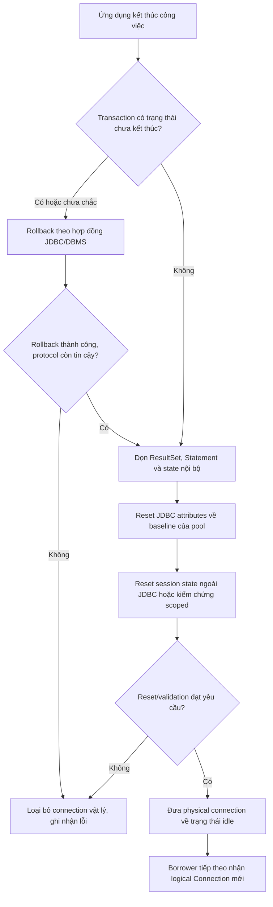

# Khôi phục trạng thái giao dịch và phiên trước khi tái sử dụng kết nối JDBC

Trong ứng dụng Java dùng JDBC, **connection pool** giữ lại các kết nối vật lý đến cơ sở dữ liệu để nhiều request có thể sử dụng lần lượt mà không phải thiết lập kết nối mới mỗi lần. Đổi lại, một request có thể nhận chính kết nối từng được request trước sử dụng. Nếu trạng thái giao dịch hoặc phiên kết nối chưa được dọn sạch, request tiếp theo có thể kế thừa **`autoCommit=false`, mức cô lập khác thường, schema của tenant khác, múi giờ phiên, khóa đang giữ hoặc transaction chưa kết thúc**.

Đây không chỉ là vấn đề hiệu năng: trạng thái còn sót có thể gây **commit nhầm, đọc sai dữ liệu, rò rỉ dữ liệu giữa tenant hoặc deadlock khó tái hiện**. Bài học thuộc chương *Pool kết nối* của JDBC, tập trung vào việc khôi phục trạng thái đúng cách khi trả và mượn kết nối qua `DataSource`.

Mục tiêu sau bài học:

- Phân biệt **`Connection` logic** mà ứng dụng mượn với **kết nối vật lý/SQL session** bên dưới.
- Biết trạng thái nào phải **rollback**, trạng thái nào cần **reset** và trạng thái nào pool **không thể tự nhận biết**.
- Hiểu thứ tự dọn dẹp an toàn trước khi kết nối được cấp lại.
- Viết code giao dịch JDBC không để lại dữ liệu chưa commit, biết xử lý lỗi `commit`/`rollback` và kiểm chứng pool bằng bài test tích hợp.
- Xác định ranh giới giữa trách nhiệm của service, JDBC driver, connection pool và DBMS.

## 1. Kết nối logic không đồng nghĩa phiên kết nối vật lý mới

Trong cách dùng JDBC không có pool, `DriverManager.getConnection(...)` có thể tạo một kết nối vật lý mới, và `Connection.close()` thường đóng tài nguyên bên dưới. Với pooled `DataSource`, `getConnection()` thường trả một **handle logic** bao quanh một kết nối vật lý được pool quản lý. Khi gọi `close()`, ứng dụng **trả handle cho pool**, không nhất thiết ngắt phiên TCP/SQL với database.

```text
Request A                    Connection pool                   Database
    |                               |                              |
    | getConnection()               |                              |
    |------------------------------>|                              |
    |<--------- logical handle A ---|---- physical connection ---->|
    |                               |          (SQL session X)      |
    | setAutoCommit(false)          |                              |
    | UPDATE ...                    |                              |
    | close()                       |                              |
    |------------------------------>|  trả connection vào pool     |
    |                               |                              |
Request B                           |                              |
    | getConnection()               |                              |
    |------------------------------>|                              |
    |<--------- logical handle B ---|---- cùng SQL session X ------>|
    |                               |                              |
    | SELECT ...                    |                              |
```

Các handle A và B không phải cùng một đối tượng Java đang mở, nhưng có thể dùng **cùng session phía database** theo thời gian. Vì vậy, `close()` mang hai ý nghĩa cần tách bạch:

1. **Với application:** kết thúc quyền sử dụng `Connection` logic hiện tại; không tiếp tục dùng handle sau `close()`.
2. **Với pool:** thu hồi/kiểm tra/khôi phục hoặc loại bỏ connection bên dưới trước khi cấp cho người mượn tiếp theo, theo cấu hình và khả năng của implementation.

**Không mặc định rằng mọi pool đều reset toàn bộ trạng thái**, và cũng không mặc định pool sẽ luôn trả lại đúng cùng kết nối vật lý. Pool có thể thử tạo connection mới nếu connection cũ hỏng hoặc quá hạn.

## 2. Hai phạm vi trạng thái phải dọn riêng

Các vấn đề xảy ra khi trả connection thường thuộc một trong hai nhóm.

### 2.1. Trạng thái giao dịch (transaction state)

Một transaction chưa kết thúc có thể bao gồm:

- Các câu `INSERT`, `UPDATE` hoặc `DELETE` đã chạy nhưng chưa `commit()`.
- Các khóa hàng/bảng, snapshot và tài nguyên giữ trong transaction.
- Các savepoint chưa bị hủy.
- Trạng thái lỗi của transaction sau một `SQLException`.
- Các thay đổi được thực hiện bởi stored procedure trong cùng transaction.

Nếu giao dịch thất bại hoặc bị hủy, cần **`rollback()` rõ ràng trên đúng `Connection`** trước khi cho công việc khác dùng phiên đó. `clearWarnings()`, `clearBatch()` hoặc đưa `autoCommit` về `true` không thay thế rollback.

### 2.2. Trạng thái phiên (session state)

Kể cả sau `commit()` hoặc `rollback()`, SQL session có thể còn giữ:

- Múi giờ phiên, ví dụ PostgreSQL `TimeZone`, MySQL `time_zone`.
- `search_path`, default schema, role hoặc session authorization tùy DBMS.
- Các biến/session options: statement timeout, lock timeout, SQL mode, search settings.
- Bảng tạm, session-scoped objects, prepared statements phía server, cursor hoặc tài nguyên tồn tại qua transaction theo sản phẩm.
- Trạng thái của driver và các thuộc tính JDBC như `autoCommit`, `readOnly`, `transactionIsolation`, `catalog`, `schema`, `holdability`, `networkTimeout`, `clientInfo`.

Một số thay đổi phiên được DBMS hoàn tác cùng transaction, một số tồn tại sau commit, và một số được JDBC driver hoặc pool theo dõi riêng. **Rollback transaction không đồng nghĩa khôi phục mọi session setting về mặc định.**

### Ma trận phạm vi

| Trạng thái | Cách kết thúc/khôi phục phù hợp | Lưu ý |
|---|---|---|
| DML chưa commit | `Connection.rollback()` | Thực hiện trước khi reset `autoCommit` |
| Savepoint và khóa trong transaction | Kết thúc transaction bằng rollback/commit hợp lệ | Không giữ transaction mở lúc trả pool |
| `autoCommit=false` | Kết thúc transaction rồi khôi phục cấu hình pool mong đợi | Đổi sang `true` khi transaction còn hoạt động có thể **commit** |
| Isolation, read-only, catalog, schema, holdability | Khôi phục bằng API JDBC/pool hoặc chính sách được kiểm chứng | Phải biết giá trị chuẩn của pool, không tự đoán |
| Session SQL như `SET search_path`/`SET TIME ZONE` | Reset SQL/khởi tạo session phù hợp DBMS | Pool không nhất thiết phát hiện SQL `SET` |
| Temporary tables, server-side prepared statements | Cơ chế cleanup riêng theo DBMS, hoặc bỏ kết nối vật lý | Không đủ nếu chỉ reset setter JDBC |
| Network timeout, client info, warnings | Reset/clear khi cần theo driver/pool | Một số tính năng không được hỗ trợ |
| Lỗi mạng, rollback thất bại, trạng thái protocol không rõ | **Không trả phiên bị nghi hỏng cho borrower mới**; để pool loại bỏ theo cơ chế của nó | Không chỉ gọi một setter rồi coi connection an toàn |

## 3. Vì sao `autoCommit` là điểm dễ gây mất dữ liệu?

Giả sử A mượn connection, tắt auto-commit, cập nhật số dư rồi gặp lỗi:

```java
Connection connection = dataSource.getConnection();
connection.setAutoCommit(false);

try (PreparedStatement ps = connection.prepareStatement(
        "UPDATE accounts SET balance = balance - ? WHERE id = ?")) {
    ps.setBigDecimal(1, new java.math.BigDecimal("50000.00"));
    ps.setLong(2, 1L);
    ps.executeUpdate();
}

// LỖI THIẾT KẾ: không commit, không rollback, không close.
```

Nếu handle không được đóng, pool bị **rò rỉ connection** và giao dịch có thể giữ khóa. Nếu `close()` được gọi nhưng không có rollback tường minh, hành vi dọn transaction phụ thuộc vào pool/driver; **không nên dùng `close()` thay cho chiến lược rollback rõ ràng của application**.

Một cách “sửa” sai thường gặp:

```java
// SAI nếu transaction đang có công việc chưa được xác nhận:
connection.setAutoCommit(true);
```

Theo hợp đồng JDBC, việc chuyển `autoCommit` từ `false` sang `true` khi có transaction đang hoạt động có thể khiến transaction hiện tại được **commit**. Hành động định “reset” lại xác nhận một cập nhật lẽ ra phải hủy.

Đúng hơn:

```java
try {
    connection.rollback();      // Hủy các thay đổi chưa commit.
} catch (SQLException failure) {
    // Không được cho rằng connection còn an toàn để dùng tiếp.
    throw failure;
}

// Chỉ sau khi transaction đã kết thúc an toàn và khi bạn thực sự
// sở hữu việc khôi phục trạng thái:
connection.setAutoCommit(true);
```

Đoạn trên minh họa **thứ tự**. Trong ứng dụng có pool, nên để pool quản lý trạng thái baseline khi có cơ chế đáng tin cậy; application quản lý biên transaction nghiệp vụ. Không thay đổi thuộc tính trong finally một cách mù quáng khi rollback đã lỗi hoặc kết quả commit chưa rõ.

## 4. Vai trò của ứng dụng, pool, driver và database

| Thành phần | Trách nhiệm chính | Không nên giả định |
|---|---|---|
| **Service/DAO** | Dùng cùng một connection trong transaction; gọi `commit` hoặc `rollback`; đóng statement/result set; trả connection qua `close` | Pool có thể đoán transaction nghiệp vụ đã thành công hay chưa |
| **Connection pool** | Cấp/thu hồi handle, theo dõi trạng thái JDBC được hỗ trợ, khôi phục baseline, validation và loại bỏ connection hỏng | Pool luôn hiểu mọi câu `SET` hoặc session variable do SQL thực thi |
| **JDBC driver** | Ánh xạ setter/getter của `Connection` sang database/protocol; báo lỗi, hỗ trợ khôi phục theo tính năng | Mọi driver có cùng hành vi reset/timeout |
| **DBMS** | Quản lý transaction, khóa, session settings, cursor và đối tượng tạm | Rollback luôn xóa hết mọi dữ liệu phiên, bao gồm session-level configuration |

Phân chia trách nhiệm nên được **ghi thành hợp đồng triển khai**. Ví dụ:

- Ứng dụng phải kết thúc transaction trước khi trả connection.
- Pool được cấu hình baseline là `autoCommit=true`, `readOnly=false`, mức cô lập mặc định tương ứng.
- Mọi thay đổi SQL session theo tenant phải **scoped theo transaction** hoặc có chiến lược reset đã kiểm chứng.
- Nếu không thể phục hồi an toàn, pool loại bỏ connection vật lý thay vì tái sử dụng.

Tránh hai cực đoan: “ứng dụng phải tự reset mọi thuộc tính dù không biết pool” và “pool chịu trách nhiệm 100%, service có thể bỏ transaction dở”. Cả hai đều gây lỗi trong một số môi trường.

## 5. Mẫu JDBC an toàn cho một nghiệp vụ giao dịch

Giả sử bảng tồn kho:

```sql
CREATE TABLE inventory (
    sku       VARCHAR(80) PRIMARY KEY,
    available INTEGER NOT NULL CHECK (available >= 0)
);

INSERT INTO inventory(sku, available)
VALUES ('BOOK-1', 20);
```

Yêu cầu: đặt trước một số lượng và chỉ commit nếu đúng một hàng đã được cập nhật. Ví dụ dưới đây dùng `DataSource`; mỗi lần gọi mượn connection logic riêng và trả về bằng `try-with-resources`:

```java
import javax.sql.DataSource;
import java.sql.Connection;
import java.sql.PreparedStatement;
import java.sql.SQLException;

public final class InventoryService {
    private InventoryService() {
    }

    public static void reserve(
            DataSource source, String sku, int quantity)
            throws SQLException {

        if (source == null || sku == null || sku.isBlank()
                || quantity <= 0) {
            throw new IllegalArgumentException("Dữ liệu không hợp lệ");
        }

        String sql = "UPDATE inventory "
                + "SET available = available - ? "
                + "WHERE sku = ? AND available >= ?";

        try (Connection connection = source.getConnection()) {
            connection.setAutoCommit(false);

            try {
                try (PreparedStatement ps =
                             connection.prepareStatement(sql)) {
                    ps.setInt(1, quantity);
                    ps.setString(2, sku);
                    ps.setInt(3, quantity);

                    int changed = ps.executeUpdate();
                    if (changed != 1) {
                        throw new SQLException(
                                "SKU không tồn tại hoặc không đủ tồn kho");
                    }
                }

                connection.commit();

            } catch (SQLException | RuntimeException failure) {
                try {
                    connection.rollback();
                } catch (SQLException rollbackFailure) {
                    // Giữ ngoại lệ gốc và ghi lại lỗi dọn transaction.
                    failure.addSuppressed(rollbackFailure);
                }
                throw failure;
            }
        } // Trả handle về pool, không mặc định đóng physical connection.
    }
}
```

Ví dụ gọi:

```java
InventoryService.reserve(dataSource, "BOOK-1", 3);
```

Nếu thành công, số lượng từ 20 còn 17. Nếu không đủ hàng, câu `UPDATE` tác động 0 hàng, service rollback và không coi nghiệp vụ đã thành công.

**Điểm cần hiểu:**

1. `setAutoCommit(false)` được gọi trước khi thực hiện DML.
2. Mọi SQL thuộc cùng nghiệp vụ chạy trên **một `Connection`**, không mở connection mới trong helper DAO.
3. `PreparedStatement` luôn được đóng dù execute thành công hay lỗi.
4. Nhánh thành công kết thúc bằng `commit()`, nhánh lỗi cố gắng `rollback()` và giữ lỗi rollback bằng `addSuppressed(...)`.
5. `Connection.close()` diễn ra khi ra khỏi try-with-resources; đó là thao tác trả handle về pool. **Không có đoạn tự `setAutoCommit(true)` trong finally**, vì pool cần sở hữu chính sách reset baseline.

### 5.1. Nếu `commit()` báo lỗi

Nếu mất kết nối sau khi gửi `COMMIT`, client có thể **không biết** database đã commit hay chưa. Lệnh rollback ở catch chỉ là nỗ lực dọn trạng thái; thành công hay thất bại của nó không chứng minh request chưa được xử lý.

Đối với nghiệp vụ quan trọng, cần có `request_id`/mã giao dịch duy nhất, ràng buộc chống trùng và cơ chế **đối soát kết quả** trước khi tự động retry. Nếu connection trở nên không đáng tin cậy, tầng pool/driver phải có cách nhận biết, evict hoặc thay connection. Không tiếp tục dùng cùng handle để phát thêm câu SQL nghiệp vụ.

### 5.2. Vì sao không cố khôi phục mọi setter trong `finally`?

Một số ví dụ gọi:

```java
// Cần tránh reset mù trong nhánh finally:
connection.setReadOnly(false);
connection.setTransactionIsolation(
        Connection.TRANSACTION_READ_COMMITTED);
connection.setAutoCommit(true);
```

Đây **không phải baseline đúng cho mọi pool**:

- Pool có thể cấu hình transaction isolation khác.
- JDBC `setReadOnly(...)` có thể bị hạn chế khi đang trong transaction.
- Nếu rollback chưa thành công, `setAutoCommit(true)` có thể ảnh hưởng giao dịch chưa kết thúc.
- Các lệnh setter cũng có thể ném `SQLException`, che lỗi gốc nếu xử lý tùy tiện.

Chủ transaction phải kết thúc công việc rõ ràng. Khôi phục baseline khi trả/nhận connection phải theo hợp đồng của pool/driver được dùng, không theo giá trị hard-code không được xác minh.

## 6. Các thuộc tính JDBC cần có baseline

Khi chuẩn bị trả lại kết nối, pool cần quan tâm những thuộc tính có thể được borrower thay đổi. Tập thuộc tính có thể theo dõi/khôi phục khác nhau giữa các implementation.

| Thuộc tính JDBC | Ví dụ API | Tại sao cần quan tâm? |
|---|---|---|
| Auto-commit | `getAutoCommit()` / `setAutoCommit(...)` | Tránh borrower kế tiếp dùng transaction mode không mong đợi |
| Read-only | `isReadOnly()` / `setReadOnly(...)` | Ảnh hưởng chiến lược truy vấn hoặc hạn chế ghi, tùy driver |
| Isolation | `getTransactionIsolation()` / `setTransactionIsolation(...)` | Ảnh hưởng dirty/nonrepeatable/phantom reads và khả năng serialization failures |
| Catalog | `getCatalog()` / `setCatalog(...)` | Thay đổi phạm vi database/catalog được tham chiếu |
| Schema | `getSchema()` / `setSchema(...)` | Có thể chi phối cách định danh tên bảng không có schema |
| Holdability | `getHoldability()` / `setHoldability(...)` | Ảnh hưởng vòng đời cursor qua commit |
| Network timeout | `getNetworkTimeout()` / `setNetworkTimeout(executor, ms)` | Borrower kế tiếp có thể bị timeout bất ngờ hoặc chờ quá lâu |
| Client info | `getClientInfo()` / `setClientInfo(...)` | Có thể gắn nhãn phiên/ứng dụng, phụ thuộc driver |
| SQL warnings | `getWarnings()` / `clearWarnings()` | Tránh ứng dụng đọc nhầm cảnh báo cũ; không thay rollback |
| Type map | `getTypeMap()` / `setTypeMap(...)` | Ít gặp nhưng có thể ảnh hưởng ánh xạ kiểu SQL đặc thù |

Đừng suy rằng tất cả setter/getter đều được hỗ trợ hay có cùng tác động trên mọi driver. `setReadOnly(true)` thường là **hint**; không phải cơ chế phân quyền thay `GRANT/REVOKE`. `Connection.setSchema(...)` không nhất thiết reset được mọi session setting như `search_path` đã đổi bằng câu SQL riêng.

Có thể xem baseline mà pool mong đợi là một phần cấu hình vận hành: driver version, mức cô lập chuẩn, auto-commit, read-only, schema/cat mặc định, các init SQL được quản lý. **Không lấy trạng thái của một connection đang bẩn làm baseline để “khôi phục về trước”.**

### Các đối tượng JDBC còn sống

Ngoài thuộc tính connection, một request có thể tạo `Statement`, `PreparedStatement`, `CallableStatement`, `ResultSet` hoặc `Savepoint`. Không trả một `ResultSet` sống ra ngoài phạm vi đã đóng statement/connection; đóng đúng bằng `try-with-resources`.

`Statement.clearBatch()` chỉ xóa lệnh **chưa execute** trong batch; nó không rollback các DML đã thực thi. `ResultSet.close()` giải phóng kết quả nhưng cũng không kết thúc transaction. Connection pool có thể theo dõi/đóng một số statement rò rỉ, nhưng không nên dựa vào việc dọn hộ để viết code bất cẩn.

## 7. Những thay đổi SQL session mà pool khó tự phát hiện

Trong nhiều pool, thay đổi thông qua API `Connection.setXxx(...)` dễ theo dõi hơn thay đổi được thực hiện bằng lệnh SQL thuần. Ví dụ:

```sql
-- PostgreSQL: các thay đổi ở mức phiên (session-level)
SET TIME ZONE 'Asia/Ho_Chi_Minh';
SET search_path TO tenant_a, public;
SET statement_timeout = '3s';
```

Nếu transaction chứa các lệnh `SET` này **commit**, cấu hình session có thể tồn tại ở các transaction tiếp theo. Sau khi request A trả connection, request B mượn đúng phiên đó có thể:

- Diễn giải timestamp hoặc ngày hiện tại theo múi giờ A.
- Chạy `SELECT * FROM orders` trong schema của tenant A.
- Bị giới hạn statement timeout còn 3 giây dù B cần truy vấn dài hơn.

Phần nguy hiểm nhất là **tenant isolation**: `search_path`, role hoặc schema bị rò rỉ có thể dẫn đến truy vấn nhầm bảng của tenant khác, không chỉ làm giảm hiệu năng.

Một pool chỉ theo dõi `Connection.setSchema(...)` có thể **không biết** application vừa thực thi `SET search_path ...` trực tiếp. Tương tự, một pool không thể mặc nhiên phân tích mọi lệnh `SET` của mọi DBMS để phục hồi trạng thái.

### Múi giờ JVM không phải múi giờ phiên DB

Cần phân biệt:

- `ZoneId.systemDefault()` và `-Duser.timezone` tác động đến mặc định JVM.
- Múi giờ SQL session do DBMS/driver/session command quyết định.
- Múi giờ cấu hình server có thể chỉ là **giá trị mặc định cho session mới**.

Thay đổi một trong ba thành phần không tự đồng bộ hai thành phần còn lại. Vì vậy, khi xử lý ngày giờ qua JDBC, hãy đo múi giờ của **connection vừa mượn** và dùng `Instant`/`OffsetDateTime`, `LocalDateTime` theo đúng ngữ nghĩa cột thay vì trông chờ session mặc định.

## 8. Giới hạn session setting trong transaction: PostgreSQL `SET LOCAL`

Một cách giảm nguy cơ rò rỉ phiên là sử dụng **cấu hình transaction-local** khi DBMS hỗ trợ. Trên PostgreSQL, `SET LOCAL` đặt giá trị chỉ trong phạm vi transaction hiện tại; khi transaction kết thúc, hiệu lực của thay đổi transaction-local chấm dứt.

Ví dụ request của một tenant có schema **đã được cấu hình/cho phép sẵn**, không được nối tên schema trực tiếp từ input ngoài:

```java
import javax.sql.DataSource;
import java.sql.Connection;
import java.sql.PreparedStatement;
import java.sql.ResultSet;
import java.sql.SQLException;
import java.sql.Statement;
import java.util.ArrayList;
import java.util.List;

public final class TenantOrderReader {
    private TenantOrderReader() {
    }

    public static List<Long> loadTenantAOrderIds(
            DataSource source) throws SQLException {

        List<Long> result = new ArrayList<>();

        try (Connection connection = source.getConnection()) {
            connection.setAutoCommit(false);

            try {
                try (Statement session = connection.createStatement()) {
                    // PostgreSQL, tên schema cố định do ứng dụng tin cậy.
                    session.execute("SET LOCAL search_path TO tenant_a, public");
                    session.execute("SET LOCAL TIME ZONE 'UTC'");
                }

                String sql = "SELECT id FROM orders ORDER BY id";

                try (PreparedStatement ps = connection.prepareStatement(sql);
                     ResultSet rs = ps.executeQuery()) {

                    while (rs.next()) {
                        result.add(rs.getLong("id"));
                    }
                }

                connection.commit();

            } catch (SQLException | RuntimeException failure) {
                try {
                    connection.rollback();
                } catch (SQLException rollbackFailure) {
                    failure.addSuppressed(rollbackFailure);
                }
                throw failure;
            }
        }

        return result;
    }
}
```

**Điều kiện:** schema `tenant_a` và bảng `orders` phải tồn tại, tài khoản kết nối phải có quyền phù hợp. Đoạn code này trình bày một tenant cố định để tránh biến tên schema thành SQL động. Trong hệ thống đa tenant thật, cần ánh xạ tenant ID sang schema bằng allowlist/identifier quoting theo DBMS, thiết kế phân quyền/row-level security phù hợp và kiểm thử giới hạn tenant độc lập. `SET LOCAL` chỉ giảm khả năng giữ *state* qua transaction; nó **không thay thế kiểm soát quyền truy cập dữ liệu**.

Lợi ích:

1. `setAutoCommit(false)` tạo phạm vi transaction cho câu SQL tiếp theo.
2. `SET LOCAL` được thực hiện **bên trong** transaction đó.
3. Cả việc query dữ liệu và các thay đổi cấu hình tạm thời nằm trong cùng transaction.
4. Khi `commit()` hoặc `rollback()` kết thúc, các giá trị chỉ được đặt bằng `SET LOCAL` trở về trạng thái phiên trước đó.

**Lưu ý:** Nếu session đã bị thay đổi trước đó bằng `SET` thường, `SET LOCAL` chỉ tạm thời ghi đè, không nhất thiết “chữa sạch” baseline đã nhiễm bẩn. Cần chiến lược khởi tạo/reset phiên ở pool và kiểm tra thực tế. Ngoài ra, `SET LOCAL` bên ngoài transaction phù hợp có thể không có tác dụng như mong đợi.

## 9. Khởi tạo phiên và reset phiên là hai việc khác nhau

Khi pool **tạo một kết nối vật lý mới**, nó có thể chạy SQL khởi tạo để đặt baseline:

```sql
-- Minh họa baseline cho một ứng dụng PostgreSQL:
SET TIME ZONE 'UTC';
SET search_path TO app, public;
SET statement_timeout = '15s';
```

Nhưng chạy init SQL **chỉ một lần lúc tạo physical connection** không có nghĩa cấu hình tự trở lại các giá trị đó sau mỗi lần borrow. Nếu một request chạy `SET statement_timeout='1s'` rồi commit, session có thể bị thay đổi đến lần reset tiếp theo.

Có ba phương án thiết kế phổ biến:

| Phương án | Ưu điểm | Giới hạn |
|---|---|---|
| Khởi tạo baseline khi tạo kết nối mới | Thiết lập ban đầu rõ ràng | Không xử lý mọi thay đổi từ borrower cũ |
| Đặt cấu hình transaction-local như `SET LOCAL` | Tự hết hiệu lực khi transaction kết thúc | Chỉ áp dụng được với DBMS/setting hỗ trợ và không xóa state bẩn có từ trước |
| Reset có kiểm soát trước khi trả hoặc trước khi cấp connection | Có thể dọn thay đổi lâu dài | Phải hiểu DBMS và bảo đảm reset thành công; có thể tốn chi phí, ảnh hưởng caching |

### 9.1. PostgreSQL `RESET`, `RESET ALL` và `DISCARD ALL`

PostgreSQL có các lệnh chuyên biệt:

```sql
RESET TIME ZONE;
RESET search_path;
RESET statement_timeout;
RESET ALL;
```

`RESET ALL` đưa nhiều cấu hình runtime (GUC) về mặc định áp dụng cho session, nhưng **không đồng nghĩa xóa mọi đối tượng/session state**: bảng tạm, một số loại cursor, prepared statements và các trạng thái khác cần được xem xét riêng.

`DISCARD ALL` là thao tác dọn phiên rộng hơn, gồm nhiều loại tài nguyên session trong PostgreSQL, nhưng **không thể thực thi bên trong transaction block**. Nó có chi phí và có thể xóa prepared statements/cache mà driver/pool dựa vào, nên không phải câu lệnh tùy tiện thêm vào mỗi request.

Ngay cả `RESET ALL` cũng cần hiểu “mặc định” lấy từ đâu: cấu hình role/database/server có thể khác baseline ứng dụng yêu cầu. Nếu pool đặt `SET TIME ZONE 'UTC'` lúc tạo kết nối, rồi sau đó `RESET TIME ZONE`, giá trị được khôi phục có thể là **default do server/role/database cung cấp**, không nhất thiết là `UTC` mà init SQL từng thiết lập.

Vì vậy, nếu ứng dụng dùng init SQL khác DB default, cần chọn reset **trở về baseline ứng dụng thực tế**, không chỉ giả định `RESET ALL` luôn đủ.

### 9.2. MySQL và các DBMS khác

MySQL có session variables như `time_zone`, `sql_mode`, `autocommit` và nhiều lựa chọn cấu hình phiên. Driver hoặc pool có thể hỗ trợ cơ chế **reset session/connection** riêng; phạm vi reset, các đối tượng được dọn và khả năng giữ lại prepared statement cần đối chiếu phiên bản driver/server.

Không dùng trực tiếp lệnh `DISCARD ALL` của PostgreSQL trên MySQL, hay suy rằng `SET LOCAL` có cùng cú pháp/ngữ nghĩa ở mọi DBMS. Muốn bảo đảm trạng thái sạch, thiết kế phải được kiểm chứng trên **DBMS, phiên bản driver và pool đang chạy**.

### 9.3. Vì sao không tự viết một SQL “reset tất cả” cho mọi hệ thống?

Một câu SQL có thể không bao trùm:

- Lệnh `SET ROLE`/session authorization.
- Bảng tạm, prepared statements phía DB, cursor mở.
- Advisory lock cấp phiên, khác khóa transaction.
- Biến tùy chỉnh do ứng dụng/extension tạo.
- Thiết lập ở connection hoặc driver nhưng không biểu diễn thành SQL session variable.

Chẳng hạn PostgreSQL `pg_advisory_lock(...)` tạo advisory lock ở **mức phiên**; commit/rollback transaction **không tự giải phóng** loại khóa này. Có cơ chế unlock riêng hoặc phải kết thúc session vật lý. Đây là lý do một kết nối “đã rollback” vẫn có thể còn tài nguyên nguy hiểm.

## 10. Thứ tự dọn connection an toàn

Nếu thiết kế một connection pool hoặc tích hợp một pool, có thể dùng sơ đồ trách nhiệm sau. Đây là **luồng logic**, không phải pseudocode gọi trực tiếp mọi setter cho mọi driver:



Những điểm quan trọng:

1. **Không dùng `setAutoCommit(true)` trước khi rollback một transaction đang bỏ dở.**
2. Nếu rollback lỗi do mất kết nối hoặc trạng thái phiên không rõ, **đừng cố tiếp tục sử dụng phiên đó**; yêu cầu pool loại bỏ nó thông qua cơ chế hỗ trợ.
3. Chỉ khôi phục JDBC attributes khi transaction đã có kết quả an toàn và driver chấp nhận setter tương ứng.
4. Khôi phục session state do SQL `SET` và những đối tượng phiên khác cần chiến lược riêng, không chỉ gọi `Connection.setSchema(...)`.
5. Có thể kiểm tra connection còn sống bằng `Connection.isValid(timeout)`, nhưng **connection còn sống không có nghĩa session đã sạch**.

Khi sử dụng một pool có sẵn, ứng dụng **không nên tự triển khai toàn bộ flow reset** nếu pool đã quản lý phần đó. Hãy đọc hợp đồng của implementation, cấu hình đúng, test những khả năng quan trọng và yêu cầu pool evict connection khi cần.

## 11. Biến đổi state trong SQL: cách phát hiện và cách phòng

### 11.1. Session contamination qua tên schema

Request A:

```sql
SET search_path TO tenant_a, public;
SELECT id FROM orders;
-- Transaction commit, nhưng session-level search_path có thể còn giữ.
```

Request B sau đó mượn cùng physical connection và chạy:

```sql
SELECT id FROM orders;
```

Nếu B trông chờ `tenant_b` hoặc `app` nhưng session còn `tenant_a`, câu SQL không có schema prefix có thể tham chiếu sai bảng.

Giảm rủi ro bằng:

- Dùng tên bảng có schema rõ ràng khi có thể.
- Đặt context tenant trong transaction bằng cơ chế hỗ trợ, ví dụ PostgreSQL `SET LOCAL`.
- Cấu hình baseline/reset ở pool, **không dùng chung state qua request**.
- Dùng quyền hạn DB phù hợp để tenant A không đọc được dữ liệu tenant B.
- Test hai borrower liên tiếp trên cùng một physical session.

### 11.2. Session contamination qua isolation

Request A đổi:

```java
connection.setTransactionIsolation(
        Connection.TRANSACTION_SERIALIZABLE);
```

Request B tưởng mình đang ở `READ_COMMITTED` có thể gặp nhiều serialization failures hoặc hành vi snapshot khác. Ngược lại, nếu mức cô lập bị hạ thấp, B có thể không đáp ứng bất biến dữ liệu mong đợi.

Phải phân biệt **mức mặc định do database cung cấp**, **mức baseline pool cấu hình** và **mức transaction của service yêu cầu**. Khi cần một mức cụ thể cho nghiệp vụ, nên đặt rõ ràng trước khi bắt đầu transaction; dùng `getTransactionIsolation()` để kiểm tra trong test.

### 11.3. Session contamination qua timeouts

Một borrower đặt timeout quá nhỏ, sau đó không reset. Borrower kế tiếp nhận lỗi `SQLException` do timeout bất thường.

Các lớp timeout khác nhau:

- `Statement.setQueryTimeout(seconds)`: thuộc tính của statement, không phải reset toàn bộ SQL session.
- `Connection.setNetworkTimeout(executor, milliseconds)`: timeout xử lý network của connection ở phía JDBC, tùy driver.
- `SET statement_timeout` hoặc `SET lock_timeout` trên PostgreSQL: cấu hình session hoặc transaction theo SQL.
- Timeout lấy connection từ pool và timeout transaction thuộc hạ tầng khác.

Một reset network timeout không có nghĩa reset `statement_timeout` của PostgreSQL. Phải xác định **chính xác loại timeout** đang bị thay đổi.

## 12. Kiểm tra trạng thái khi borrow và sau khi return

Để phát hiện lỗi thật, cần đo cả thuộc tính JDBC và session state trên đúng connection được cấp.

Ví dụ kiểm tra Java:

```java
import javax.sql.DataSource;
import java.sql.Connection;
import java.sql.SQLException;

public final class BorrowStateProbe {
    private BorrowStateProbe() {}

    public static void printState(DataSource source)
            throws SQLException {

        try (Connection connection = source.getConnection()) {
            System.out.println("autoCommit = "
                    + connection.getAutoCommit());
            System.out.println("readOnly = "
                    + connection.isReadOnly());
            System.out.println("isolation = "
                    + connection.getTransactionIsolation());
            System.out.println("catalog = "
                    + connection.getCatalog());
            System.out.println("schema = "
                    + connection.getSchema());
            System.out.println("holdability = "
                    + connection.getHoldability());
            System.out.println("networkTimeout = "
                    + connection.getNetworkTimeout());
        }
    }
}
```

**Lưu ý:** `getSchema()` hoặc `getNetworkTimeout()` có thể không được một số driver hỗ trợ; `SQLFeatureNotSupportedException` cần được xử lý trong phiên bản thực tế. Đừng dùng ví dụ in mọi getter như một health check bắt buộc nếu một API không cần cho nghiệp vụ và driver không hỗ trợ.

Kiểm tra session phía PostgreSQL:

```sql
SELECT current_setting('TimeZone')          AS session_time_zone,
       current_setting('search_path')       AS session_search_path,
       current_setting('statement_timeout') AS session_statement_timeout;
```

Dùng SQL trên **connection vừa mượn**, không chạy bằng SQL client khác rồi giả định kết quả áp dụng cho session pool đang cấp.

### 12.1. Ví dụ probe kết hợp Java và PostgreSQL

```java
import javax.sql.DataSource;
import java.sql.Connection;
import java.sql.ResultSet;
import java.sql.SQLException;
import java.sql.Statement;

public static void printPostgresSession(DataSource dataSource)
        throws SQLException {

    String sql = "SELECT "
            + "current_setting('TimeZone') AS tz, "
            + "current_setting('search_path') AS path";

    try (Connection connection = dataSource.getConnection();
         Statement st = connection.createStatement();
         ResultSet rs = st.executeQuery(sql)) {

        if (rs.next()) {
            System.out.println("TimeZone: " + rs.getString("tz"));
            System.out.println("search_path: " + rs.getString("path"));
        }
    }
}
```

Phương thức trên có thể đặt trong một lớp Java; `dataSource` đã được pool cấu hình và SQL chỉ hợp lệ trên PostgreSQL. Không nên để probe này chạy trên mọi request production nếu gây thêm round trip không cần thiết. Nó hữu ích trong **integration test hoặc chẩn đoán**.

### 12.2. Một bài test thật sự kiểm tra tái sử dụng

Để khẳng định pool không làm lộ state sang borrower khác:

1. Trong môi trường test riêng, cấu hình pool với **tối đa một physical connection khả dụng** và không chạy tác vụ cạnh tranh.
2. Borrow lần A; thay đổi `setReadOnly`, isolation hoặc session setting, sau đó trả connection theo trường hợp muốn kiểm thử.
3. Borrow lần B; đo thuộc tính JDBC và các `current_setting(...)` thực tế.
4. Xác nhận baseline đúng hoặc policy bắt buộc loại bỏ và tạo session mới được áp dụng.
5. Lặp lại với lỗi rollback, transaction bị bỏ dở và lỗi network giả lập.

Không nhất thiết hai handle trả về có cùng identity Java. Ngay cả khi pool giới hạn size bằng một, nó vẫn có thể **loại bỏ và tạo lại** physical connection; đó cũng là hành vi hợp lệ để dọn state. Nếu muốn xác minh chính xác cùng session được dùng, trên PostgreSQL có thể quan sát `pg_backend_pid()` trong môi trường test; ID của backend cũng có thể được tái sử dụng sau khi process kết thúc, nên kết luận cần gắn với thời điểm test.

Bài test cố tình để transaction chưa kết thúc hoặc lệnh `SET` bị rò rỉ **chỉ nên chạy trong môi trường cô lập**. Service thật vẫn có nghĩa vụ rollback rõ ràng.

## 13. Quy trình kiểm thử các lỗi nguy hiểm

| Kịch bản | Cách tạo trong test | Điều cần xác minh |
|---|---|---|
| Không commit/rollback sau DML | Cố tình kết thúc scope với transaction chưa giải quyết | Pool rollback hoặc loại bỏ connection; borrower mới không thấy dữ liệu chưa commit |
| Thay `autoCommit=false` | Set trên A, close A, borrow B | B nhận đúng baseline pool, transaction mới không bị vô tình nối tiếp |
| Đổi isolation/read-only | Set giá trị khác baseline | B nhận mức yêu cầu hoặc pool từ chối/evict khi reset lỗi |
| Thay SQL session TimeZone/search_path | Chạy `SET` session-level và commit | Không có state A gây ảnh hưởng B; nếu pool không tự reset, quy trình ứng dụng phải giải quyết |
| Sử dụng `SET LOCAL` | Bắt đầu transaction, set local rồi commit/rollback | Cấu hình tạm thời không tồn tại sang transaction sau |
| Session-level advisory lock | Acquire khóa được DB hỗ trợ ở session scope | Khóa không còn gây cản trở borrower B sau cleanup hoặc connection được thay |
| Rollback thất bại | Giả lập lỗi DB/network khi rollback | Không báo connection sạch; pool loại bỏ hoặc cách ly kết nối hỏng |
| `commit()` mất phản hồi | Ngắt mạng sau khi gửi commit | Không tự retry nghiệp vụ có nguy cơ trùng; có đối soát trạng thái |
| Statement/ResultSet leak | Quên đóng tài nguyên trong test kiểm soát | Pool/monitor phát hiện; sửa code về `try-with-resources` |
| Vòng borrow liên tục | Hàng trăm/hàng nghìn lượt theo thứ tự | Không tăng connection leak, không tích lũy state ngoài ý muốn |

Nên đo trước/sau các test bằng SQL thực tế, không chỉ `assertTrue(connection.isValid(3))`. `isValid` xác nhận mức sống của connection theo driver; nó không khẳng định isolation, schema, timezone hay role đúng.

## 14. Những lỗi thường gặp khi reset pool

| Cách làm sai | Rủi ro | Cách làm đúng |
|---|---|---|
| Chỉ gọi `Connection.close()` và không kết thúc transaction | Hành vi dọn transaction phụ thuộc pool; có thể giữ khóa/state | Chủ transaction commit/rollback rõ ràng, rồi close |
| Gọi `setAutoCommit(true)` để “dọn” giao dịch thất bại | Có thể commit dữ liệu chưa được phê duyệt | Rollback trước, không reuse khi rollback lỗi |
| Tin rằng `rollback()` reset mọi `SET` phiên | Session-level settings có thể vẫn còn | Dùng transaction-local settings hoặc SQL reset có kiểm chứng |
| Tin rằng pool tự hiểu `SET search_path` | Pool có thể không theo dõi câu SQL này | Kiến trúc tenant scope/reset phù hợp |
| Chỉ so `getSchema()` và bỏ qua `search_path` | JDBC schema và SQL search path có thể khác ý nghĩa | Kiểm chứng cả SQL session state |
| Reset về một mức isolation hard-code | Sai baseline được cấu hình | Khôi phục giá trị mong đợi từ cấu hình pool |
| Gọi `RESET ALL` rồi coi session hoàn toàn mới | Bảng tạm, advisory lock và trạng thái khác có thể còn | Dùng cơ chế cleanup phù hợp hoặc loại bỏ physical connection |
| Chạy `DISCARD ALL` ở giữa transaction | PostgreSQL từ chối lệnh | Hiểu ranh giới transaction và tài nguyên driver |
| Gọi `clearWarnings()` để sửa transaction lỗi | Không giải quyết lỗi transaction/khóa | Rollback đúng phạm vi, giữ lỗi gốc |
| Dùng `connection.isValid()` để chứng minh state sạch | Connection khỏe vẫn có thể mang cấu hình cũ | Thử nghiệm baseline thuộc tính + session |
| Dùng chung `Connection` giữa request/thread | Trộn transaction và session state | Một handle cho một scope công việc, dùng pool |
| Tin rằng pool luôn giữ cùng physical connection | Test sai hoặc không nhìn thấy lỗi | Test borrow/return và đo backend/session khi cần |
| Retry ngay khi `commit()` báo mất mạng | Có thể lặp nghiệp vụ đã commit | Dùng idempotency key và đối soát |
| Quên dọn cursor/ResultSet | Tài nguyên DB/driver có thể bị giữ | `try-with-resources`, scope ngắn |

## 15. Quan sát, hiệu năng và vận hành

Khôi phục state nghiêm ngặt có thể thêm round trip hoặc làm mất lợi ích cache của driver. Một lệnh reset session rộng có thể hủy server-side prepared statements, cursor và những tối ưu hóa đã được tạo trên physical connection. Ngược lại, reset thiếu lại gây lỗi nghiệp vụ nghiêm trọng. Cần chọn **chính sách chính xác thay vì luôn chọn reset mạnh nhất**.

Những chỉ số hữu ích:

- Số connection **active/idle/pending**, thời gian chờ borrow, timeout chờ pool.
- Connection leak và transaction giữ quá lâu.
- Lỗi rollback/commit, lỗi validation, số connection bị loại bỏ/thay thế.
- Số phiên prepared/in-doubt (nếu môi trường có XA).
- Lock wait, deadlock, timeout query và số session giữ khóa lâu.
- Dấu hiệu session contamination: sai schema, sai timezone, khác isolation/readonly baseline.
- Tỷ lệ reset thất bại và chi phí latency do reset.

Một vài nguyên tắc vận hành:

1. **Chọn pool đủ nhỏ nhưng đáp ứng tải**, thay vì tăng kích thước để che connection leak.
2. **Không chạy round trip kiểm tra mọi setting trên mỗi query** nếu không cần; dùng integration test, telemetry có chọn lọc và kiểm tra lúc borrow/reset theo chính sách.
3. **Giữ transaction ngắn**, đóng `ResultSet`/statement sớm, không làm HTTP call chậm trong transaction.
4. **Cấu hình baseline rõ ràng** và ghi nhận driver/DBMS/pool version khi kiểm tra sự cố.
5. **Không xử lý lỗi reset bằng cách cho phép borrow tiếp**; nếu không chứng minh được phiên an toàn, hãy loại bỏ/reconnect.
6. **Không phụ thuộc vào implementation detail không được công bố** của một pool. Các pool khác nhau có chính sách reset, transaction rollback, statement cache và connection eviction khác nhau.

### Nên dùng `DataSource` hay tự xây pool?

Trong ứng dụng JDBC thông thường, dùng một pool đã được kiểm chứng và cấu hình qua `DataSource` phù hợp hơn tự xây pool. Tự viết pool an toàn phải xử lý đồng thời nhiều lớp: transaction cleanup, session reset, timeout, cancellation, validation, eviction, credential rotation, reconnect, monitoring và các đường lỗi hiếm.

Vì mỗi sản phẩm pool có API cấu hình khác nhau, bài này không mặc định một tên thuộc tính “reset session” chung. Cần kiểm tra khả năng cụ thể của pool/driver dự án và viết integration test thể hiện hợp đồng mong đợi.

## 16. Checklist trước khi đưa connection pool vào sản xuất

1. **Transaction ownership:** tầng service có xác định rõ ai commit/rollback từng nghiệp vụ không?
2. **Không reset mù:** đã tránh `setAutoCommit(true)` trên transaction bỏ dở chưa?
3. **Baseline JDBC:** đã kiểm tra auto-commit, read-only, isolation, catalog/schema, holdability và các thuộc tính cần thiết không?
4. **Session SQL:** có thay đổi `SET`, role, search path, timezone, timeout hoặc temp objects mà pool không thấy không?
5. **Tenant isolation:** nếu dùng chung physical connection giữa tenant, đã áp dụng schema/role/security scope phù hợp và có test rò rỉ chưa?
6. **Connection failure:** khi rollback, commit, validation hoặc reset lỗi, pool có loại bỏ connection không đáng tin không?
7. **Tài nguyên:** `ResultSet`, `Statement` và logical `Connection` có đóng đúng hạn không?
8. **Kiểm chứng:** đã test borrow A → thay state → return → borrow B trên DBMS/driver/pool thật chưa?
9. **Khả năng mở rộng:** đã đo chi phí reset, connection churn, latency và lock contention khi có tải chưa?
10. **Idempotency:** nếu kết quả commit chưa rõ, có đối soát theo mã request thay vì retry mù không?

## Ghi nhớ

- **Đóng logical `Connection` không nhất thiết đóng SQL session vật lý.** Pool có thể tái sử dụng cùng phiên cho request khác.
- **`rollback()` dùng để hủy transaction chưa commit**; `clearBatch()`, `clearWarnings()` và `setAutoCommit(true)` không thay thế nó.
- **Reset JDBC attributes khác reset SQL session state**. `SET search_path`, `SET TIME ZONE`, role, temp tables hoặc session-level lock có thể không được pool tự phát hiện.
- **PostgreSQL `SET LOCAL`** giúp ràng buộc cấu hình phiên với transaction, nhưng không xóa baseline đã bẩn từ trước và không áp dụng nguyên xi cho mọi DBMS.
- **Lỗi rollback/reset cần làm connection bị nghi hỏng rời khỏi vòng tái sử dụng** thay vì cấp tiếp cho borrower.
- **`Connection.isValid()` chỉ nói về khả năng còn hoạt động**, không chứng minh rằng phiên đã sạch.
- **Đo trên pool/driver/DBMS thật** vì cách reset, quản lý physical connection và chi phí cleanup khác nhau giữa các sản phẩm.

Khôi phục trạng thái giao dịch và phiên là điều kiện để connection pool thực sự an toàn, chứ không chỉ nhanh hơn. Khi mỗi nghiệp vụ **kết thúc transaction rõ ràng**, pool **khôi phục baseline đáng tin cậy** và ứng dụng **kiểm soát state phiên đặc thù DBMS**, các kết nối vật lý mới có thể được tái sử dụng mà không kéo theo dữ liệu hay cấu hình của request trước.
