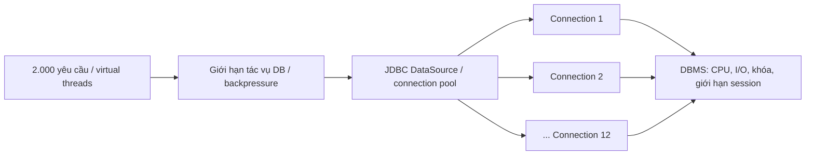
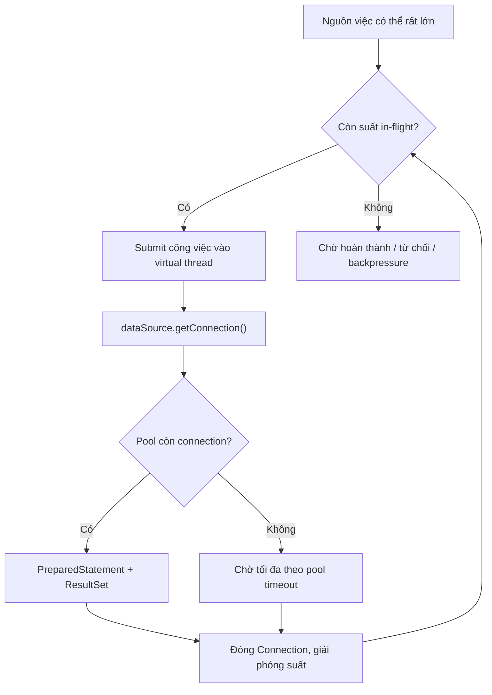
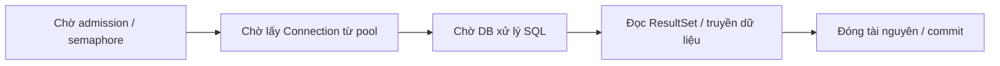

# Phối hợp luồng ảo Java 21 với giới hạn kết nối thực tế trong JDBC

## Mục tiêu học tập

**Luồng ảo (virtual thread)** được chuẩn hóa trong **Java 21**, giúp viết mã đồng bộ theo phong cách mỗi tác vụ một luồng mà không cần dành một luồng hệ điều hành riêng cho mọi tác vụ đang chờ. Với ứng dụng truy cập cơ sở dữ liệu qua **JDBC**, đây là lợi thế khi nhiều yêu cầu phải chờ I/O. Tuy nhiên, một điều không đổi: **luồng ảo không tạo thêm kết nối vật lý mà database có thể phục vụ**.

Nếu một dịch vụ dùng `Executors.newVirtualThreadPerTaskExecutor()` để chạy hàng nghìn truy vấn cùng lúc, các tác vụ vẫn phải lấy `Connection` từ `DataSource`. Connection pool chỉ cho mượn số kết nối được cấu hình và DBMS còn có giới hạn session, bộ nhớ, CPU, khóa và tài nguyên riêng. Không có giới hạn đồng thời và cơ chế backpressure phù hợp, ứng dụng có thể chuyển vấn đề từ “thiếu thread” thành “hàng nghìn virtual thread chờ connection”, timeout và quá tải database.

Bài thuộc chương **Pool kết nối** giải thích cách phối hợp virtual threads của Java 21 với pool JDBC trong ứng dụng dùng `PreparedStatement`, `ResultSet`, CRUD và transaction.

Sau bài này, bạn có thể:

- Phân biệt số **virtual thread**, số **kết nối đang được mượn**, số **kết nối vật lý** và số **truy vấn database đang chạy**.
- Ước lượng giới hạn pool theo ngân sách kết nối DBMS, số instance và thời gian giữ connection.
- Dùng `Executors.newVirtualThreadPerTaskExecutor()` cùng cơ chế **giới hạn số tác vụ đang chờ/thực thi**, không sinh vô hạn truy vấn.
- Mở, sử dụng và trả `Connection` trong đúng phạm vi, thay vì chia sẻ connection giữa các virtual thread.
- Hiểu vai trò của timeout, hủy tác vụ, thread pinning, JFR và chỉ số của connection pool.
- Lựa chọn giá trị cấu hình qua benchmark trên DBMS/driver thực tế thay vì mặc định “nhiều thread hơn là nhanh hơn”.

## 1. Virtual thread không phải connection JDBC

Hãy hình dung một API nhận 2.000 yêu cầu đồng thời, mỗi yêu cầu muốn thực hiện một truy vấn SQL. Với Java 21, ứng dụng có thể tạo 2.000 virtual thread với chi phí thấp hơn nhiều so với việc tạo 2.000 platform thread. Nhưng nếu pool chỉ có 12 connection vật lý:

- Tại một thời điểm, tối đa khoảng **12 tác vụ** có thể đang mượn connection từ **pool đó**.
- Các tác vụ còn lại có thể **đợi trong cơ chế lấy connection** của pool, bị từ chối hoặc hết thời gian chờ.
- Database **không** tự được tăng năng lực thực thi chỉ nhờ Java có thêm virtual thread.
- Nếu một tác vụ giữ connection sau khi truy vấn xong để gọi HTTP, chờ người dùng hoặc xử lý dữ liệu lâu, nó vẫn chiếm một suất trong pool.



**Quy tắc:** virtual thread là cách **điều phối công việc ở phía JVM**; connection là **tài nguyên hữu hạn phía JDBC/DBMS**. Hai lớp này phải được giới hạn và đo riêng.

### 1.1. Những con số dễ bị nhầm

| Đại lượng | Ý nghĩa | Có tự tăng vì dùng virtual thread? |
| --- | --- | --- |
| **Virtual threads sống** | Số tác vụ Java đang chạy hoặc đang chờ | Có thể tăng rất lớn |
| **Platform/carrier threads** | Luồng hệ điều hành thực thi virtual thread khi nó được gắn (*mounted*) | Không tăng theo tỉ lệ 1:1 với virtual threads |
| **Pool maximum size** | Số connection mà pool cho phép duy trì/cấp trong pool đó | **Không** |
| **Active/borrowed connections** | Số connection đã cho mượn nhưng chưa trả | Bị giới hạn bởi pool và tình trạng DB |
| **Waiting connection requests** | Các yêu cầu `getConnection()` đang chờ pool | Có thể tăng nếu không giới hạn đầu vào |
| **DB sessions / queries active** | Session và câu SQL đang được DBMS xử lý | Phụ thuộc DBMS, cấu hình và workload |
| **Transactions đang mở** | Các phạm vi giao dịch chưa commit/rollback | Có thể tăng khi tác vụ giữ connection lâu |

Pool có thể duy trì idle connections, nên **số connection vật lý** không luôn bằng **số connection đang active**. Một connection cũng có thể thực thi nhiều câu SQL nối tiếp, và một transaction có thể trải qua nhiều statement. Không xem các chỉ số này là cùng một đại lượng.

## 2. Vì sao virtual thread vẫn hữu ích với JDBC?

JDBC cung cấp API đồng bộ: `DataSource.getConnection()`, `PreparedStatement.executeQuery()`, `ResultSet.next()` hoặc `Connection.commit()` có thể chặn luồng gọi trong khi chờ. Virtual threads cho phép mô hình “mỗi request/mỗi công việc một luồng” đọc dễ hiểu mà có thể sử dụng tài nguyên thread hiệu quả hơn khi phần chờ **được runtime/driver hỗ trợ phù hợp**.

Ví dụ service đồng bộ:

```java
public OrderSummary findOne(DataSource dataSource, long orderId)
        throws SQLException {
    String sql = "SELECT id, status FROM orders WHERE id = ?";

    try (Connection connection = dataSource.getConnection();
         PreparedStatement ps = connection.prepareStatement(sql)) {
        ps.setLong(1, orderId);

        try (ResultSet rs = ps.executeQuery()) {
            if (!rs.next()) {
                throw new SQLException("Không tìm thấy đơn hàng");
            }
            return new OrderSummary(
                rs.getLong("id"),
                rs.getString("status")
            );
        }
    }
}

public record OrderSummary(long id, String status) {}
```

Đây là mảnh minh họa trong một lớp Java có các `import` JDBC và `DataSource` tương ứng. Nếu được gọi từ virtual thread, mã **vẫn dùng đúng các API JDBC chuẩn**, không cần biến SQL thành API bất đồng bộ.

Tuy vậy, không thể giả định **mọi hoạt động của mọi JDBC driver đều unmount virtual thread khi chờ**. Các đoạn mã native hoặc đồng bộ hóa theo cơ chế gây *pinning* có thể giữ carrier thread trong thời gian chặn. Mức lợi ích phải được đo trên đúng JDK, driver và DBMS.

**Không phải tạo virtual thread để tăng tốc một truy vấn SQL đơn lẻ.** Lợi ích chính nằm ở khả năng xử lý nhiều tác vụ có thời gian chờ mà không sử dụng một platform thread riêng cho mỗi tác vụ, còn thời gian SQL vẫn phụ thuộc database và truy vấn.

## 3. Không tăng pool lên hàng nghìn chỉ vì virtual threads nhẹ

Một connection vật lý tới DBMS có chi phí riêng: session, bộ nhớ phía server, giao thức mạng, statement/cursor, transaction state và có thể cả tài nguyên cho thread/process của database. Tăng pool quá mức có thể:

- Làm database chuyển ngữ cảnh và tranh chấp CPU/I/O nhiều hơn.
- Tăng số transaction đồng thời, deadlock hoặc lock wait.
- Dùng hết số connection server cho phép, ảnh hưởng các ứng dụng khác.
- Tạo lượng truy vấn cùng lúc vượt khả năng xử lý, khiến p95/p99 latency xấu đi.
- Gia tăng áp lực bộ nhớ phía ứng dụng và DBMS.
- Làm lỗi lan rộng khi nhiều instance đồng loạt tăng kết nối hoặc retry.

### 3.1. Tính ngân sách kết nối theo toàn hệ thống

Giả sử DBMS cho phép tối đa **80 connection**, nhưng bạn phải dự phòng **20 connection** cho quản trị, công cụ migration và các ứng dụng khác. Dịch vụ có **5 instance** chạy đồng thời.

Giới hạn sơ bộ cho mỗi instance, nếu chia đều toàn bộ phần còn lại, là:

\[
P_{\max,\text{instance}}
\le
\left\lfloor
\frac{C_{\text{DB}} - C_{\text{reserve}}}
     {N_{\text{instances}}}
\right\rfloor
\]

\[
P_{\max,\text{instance}}
\le
\left\lfloor\frac{80-20}{5}\right\rfloor=12
\]

**12 chỉ là trần theo ngân sách kết nối của ví dụ, không phải kích thước pool tối ưu.** DBMS có thể đạt giới hạn CPU/I/O lâu trước khi đủ 80 sessions; nên benchmark và có thể chọn pool nhỏ hơn.

Khi tính thật, cần cộng thêm:

- Replica/instance được scale tự động ở thời điểm **cao nhất**, không chỉ số đang chạy lúc khảo sát.
- Các pool khác trong cùng ứng dụng (đọc/ghi, tenant riêng, batch job).
- Connection được dùng cho background workers, migration, health checks hoặc ứng dụng khác.
- Số connection dự phòng cho failover và dịch vụ quản trị.
- Giới hạn của proxy hoặc database connection broker nếu kiến trúc có thành phần trung gian.

Một service có 5 replica, mỗi replica đặt pool `maximum=30`, có thể tạo **tối đa 150 connection** cho riêng nhóm đó, dù ứng dụng chỉ thấy “30” trong một tệp cấu hình.

### 3.2. Thời gian giữ connection ảnh hưởng nhu cầu pool

Một ước lượng ban đầu dùng định luật Little:

\[
L \approx \lambda \times W
\]

Trong đó:

- `L`: số connection **đang được mượn trung bình** cho workload xét đến.
- `λ`: tốc độ các lần mượn connection (lượt/giây), không nhất thiết bằng số HTTP requests.
- `W`: thời gian giữ một connection từ lúc mượn tới lúc trả (giây).

Ví dụ giả định dịch vụ phát sinh **120 lần mượn connection/giây**, thời gian giữ trung bình **60 ms**:

\[
L \approx 120 \times 0.060 = 7.2
\]

Kết quả gợi ý nhu cầu **trung bình** khoảng 7,2 connection đang mượn. Nó **không** có nghĩa pool size 8 chắc chắn đủ cho đỉnh tải, cũng không phản ánh trực tiếp p95 latency, các burst, lock wait hoặc transaction dài. Hãy dùng số này để đặt giả thuyết, sau đó đo tải đại diện và chừa dự phòng trong ngân sách DBMS.

**Cải thiện thời gian giữ connection thường có lợi hơn tăng pool vô hạn.** Ví dụ đừng giữ `Connection` trong lúc gọi dịch vụ HTTP bên ngoài hoặc chờ ghi một response lớn đến client.

## 4. Giới hạn đồng thời ở hai tầng: tác vụ và connection

Khi ứng dụng có virtual threads, nên phân biệt ít nhất hai giới hạn:

1. **Giới hạn tác vụ đang bay (*in-flight*)**: số công việc có thể đồng thời chờ/thực hiện phần truy cập DB.
2. **Giới hạn connection vật lý**: cấu hình connection pool và giới hạn thực tế của DBMS.

Ví dụ `maxInFlight = 24` và pool size tối đa `12` nghĩa là nhiều nhất 24 tác vụ thuộc luồng công việc này đang chờ hoặc chạy, trong đó **nhiều nhất 12 tác vụ** mượn connection từ pool đó nếu không có tài nguyên khác chia sẻ. Các tác vụ còn lại chờ connection. Đây không phải lời khuyên rằng mọi hệ thống cần tỉ lệ 2:1; hãy đo connection acquisition wait và điều chỉnh.



**Pool size không phải cơ chế giới hạn số request đầu vào.** Pool có thể bảo vệ database bằng cách giữ số connection dưới trần, nhưng hàng nghìn virtual threads vẫn có thể chờ trong pool queue và hết hạn đồng loạt. Hãy hạn chế số tác vụ đang chờ trước khi đưa chúng tới bước lấy connection, nhất là với batch hoặc event consumer có khả năng tạo việc rất nhanh.

### 4.1. Ba cách thực hiện backpressure

| Cách | Nơi đặt | Lợi ích | Lưu ý |
| --- | --- | --- | --- |
| **Giới hạn công việc in-flight** | Trình điều phối batch, worker hoặc event consumer | Không tạo hàng nghìn tác vụ chờ DB | Cần xử lý hoàn thành, lỗi và hủy tác vụ |
| **Semaphore bảo vệ đoạn DB** | Trước `getConnection()` trong service | Giới hạn cạnh tranh của một loại workload | Nếu mọi request vẫn tạo virtual thread trước semaphore, còn phải giới hạn hàng đợi request |
| **Admission/rate limiting** | HTTP ingress, message consumer, job scheduler | Từ chối hoặc trì hoãn sớm khi quá tải | Trả tín hiệu retry hợp lý; không mất message |

Các tầng giới hạn này bổ sung cho pool, **không thay thế** pool. Chỉ dùng semaphore cục bộ trong một instance cũng không áp đặt giới hạn toàn cụm khi có nhiều replica; ngân sách kết nối của cả hệ thống vẫn phải tính tổng.

## 5. Ví dụ Java 21: virtual threads nhưng số tác vụ DB có giới hạn

Đây là một ví dụ hoàn chỉnh về xử lý danh sách ID đơn hàng. Mỗi tác vụ lấy một `Connection` từ `DataSource`, truy vấn bằng `PreparedStatement`, đọc `ResultSet` và trả connection ngay sau đó.

Lớp điều phối dùng `Executors.newVirtualThreadPerTaskExecutor()`, **nhưng không submit vô hạn**. Nó chỉ cho phép tối đa `maxInFlight` công việc chưa được thu kết quả cùng lúc thông qua `ExecutorCompletionService`.

```java
import java.sql.Connection;
import java.sql.PreparedStatement;
import java.sql.ResultSet;
import java.sql.SQLException;
import java.util.Objects;
import java.util.concurrent.CompletionService;
import java.util.concurrent.ExecutionException;
import java.util.concurrent.ExecutorCompletionService;
import java.util.concurrent.ExecutorService;
import java.util.concurrent.Executors;
import javax.sql.DataSource;

public final class VirtualThreadOrderReader {
    public record OrderView(long id, String status) {}

    public static void process(Iterable<Long> orderIds,
                               DataSource dataSource,
                               int maxInFlight)
            throws InterruptedException, ExecutionException {
        Objects.requireNonNull(orderIds, "orderIds");
        Objects.requireNonNull(dataSource, "dataSource");

        if (maxInFlight <= 0) {
            throw new IllegalArgumentException(
                "maxInFlight phải là số nguyên dương"
            );
        }

        // Java 21: mỗi công việc được submit có virtual thread riêng.
        try (ExecutorService executor =
                 Executors.newVirtualThreadPerTaskExecutor()) {

            CompletionService<OrderView> completed =
                new ExecutorCompletionService<>(executor);
            int inFlight = 0;

            try {
                for (Long boxedId : orderIds) {
                    long orderId = Objects.requireNonNull(boxedId);

                    // Chặn nguồn nạp việc khi còn đủ tác vụ chưa thu.
                    if (inFlight == maxInFlight) {
                        consume(completed.take().get());
                        inFlight--;
                    }

                    completed.submit(() -> loadOne(dataSource, orderId));
                    inFlight++;
                }

                while (inFlight > 0) {
                    consume(completed.take().get());
                    inFlight--;
                }
            } catch (InterruptedException | ExecutionException
                     | RuntimeException error) {
                // Báo hủy tới các tác vụ còn chạy; JDBC có thể
                // không dừng ngay khi bị interrupt.
                executor.shutdownNow();
                throw error;
            }
        }
    }

    private static OrderView loadOne(DataSource dataSource, long orderId)
            throws SQLException {
        String sql = """
            SELECT id, status
              FROM orders
             WHERE id = ?
            """;

        try (Connection connection = dataSource.getConnection();
             PreparedStatement ps = connection.prepareStatement(sql)) {
            ps.setLong(1, orderId);

            // Không phải mọi driver đều thực thi timeout y hệt nhau.
            ps.setQueryTimeout(10);

            try (ResultSet rs = ps.executeQuery()) {
                if (!rs.next()) {
                    throw new SQLException(
                        "Không tìm thấy đơn hàng id=" + orderId
                    );
                }
                return new OrderView(
                    rs.getLong("id"),
                    rs.getString("status")
                );
            }
        }
    }

    private static void consume(OrderView view) {
        // Chỉ là đầu ra minh họa; hệ thống thật nên chuyển sang
        // sink/handler đã được giới hạn tài nguyên.
        System.out.println(view.id() + ": " + view.status());
    }
}
```

Giả sử bảng `orders` đã tồn tại với cột `id` và `status`; `DataSource` là một **pool JDBC được cấu hình** trước bên ngoài ví dụ. `ExecutorCompletionService` trả kết quả theo **thứ tự hoàn thành**, không bảo đảm thứ tự ID đầu vào.

### 5.1. Vì sao ví dụ không tạo một Future cho mọi hàng?

Một cách triển khai không an toàn là duyệt 1 triệu ID và gọi `executor.submit(...)` 1 triệu lần, rồi mới duyệt danh sách `Future`. Dù mỗi virtual thread tương đối nhẹ, bạn vẫn có thể tạo:

- 1 triệu nhiệm vụ và đối tượng result/future cần theo dõi.
- Rất nhiều luồng chờ `getConnection()`.
- Áp lực heap, bộ nhớ stack của các virtual thread, log và timeout hàng loạt.
- Hàng đợi lớn không có chính sách ưu tiên hoặc hủy rõ ràng.

Ví dụ dùng `maxInFlight` để hạn chế số công việc chưa hoàn tất được giữ ở một thời điểm. Khi đạt ngưỡng, trình điều phối **chờ một kết quả hoàn thành** rồi mới submit thêm. Điều đó cũng tránh tích lũy một danh sách `Future` theo toàn bộ kích thước nguồn.

**Giới hạn tác vụ chưa hoàn tất** không đồng nghĩa tối ưu số truy vấn song song. Giá trị nên được lựa chọn theo pool, loại truy vấn, tốc độ DB, thời gian giữ kết nối và mục tiêu p95.

### 5.2. Tại sao dùng try-with-resources?

Mỗi tác vụ tự lấy connection:

```text
Virtual thread N
  -> dataSource.getConnection()
  -> prepareStatement(...)
  -> executeQuery()
  -> đọc ResultSet / tạo DTO
  -> ResultSet.close()
  -> PreparedStatement.close()
  -> Connection.close()  (thường trả về pool)
```

**Không** truyền cùng một đối tượng `Connection` cho nhiều virtual thread cùng gọi SQL. JDBC connection có trạng thái transaction, `autoCommit`, warning và tài nguyên statement; việc dùng đồng thời trên cùng connection không được mặc định là thread-safe. Pool cho phép nhiều tác vụ **mượn các connection riêng**, rồi trả về sau khi hoàn tất.

Nếu một nghiệp vụ có nhiều câu SQL cần nguyên tử, **một tác vụ** sở hữu **một connection** và điều khiển `commit()/rollback()` trong cùng phạm vi. Không tách hai nửa của một transaction local sang hai virtual thread mỗi thread lấy một connection khác nhau rồi mong có cùng transaction.

### 5.3. Rủi ro và giới hạn của ví dụ

- Lỗi SQL trong callable sẽ được `Future.get()` bao bằng `ExecutionException`. Tầng gọi cần xem `getCause()` để phân loại `SQLException`, không chỉ log thông điệp wrapper.
- `shutdownNow()` gửi tín hiệu hủy/interrupt. Nó **không đảm bảo** query đang chạy trên DBMS đã bị hủy hay connection lập tức được trả về.
- `ExecutorService.close()` trong Java 21 đợi executor hoàn tất theo ngữ nghĩa của nó. Nếu JDBC call bị kẹt và driver không xử lý cancellation, thời gian chờ vẫn có thể kéo dài. Cần timeout theo pool, query, network và deadline đầu-cuối của ứng dụng.
- `setQueryTimeout(10)` có thể yêu cầu driver giới hạn **thực thi statement**, không phải toàn bộ thời gian chờ lấy connection. Hỗ trợ và độ chính xác phụ thuộc driver.
- `consume(...)` ở ví dụ in ra stdout; hệ thống thật phải kiểm soát bộ nhớ và tốc độ của nơi nhận dữ liệu. Các tác vụ DB không nên giữ connection khi chờ sink chậm.
- Những tác vụ đã commit DML **không tự bị đảo ngược** nếu một tác vụ khác thất bại. Ví dụ chỉ đọc; để ghi dữ liệu, phải quyết định transaction/chunk/idempotency riêng.

## 6. Dùng Semaphore khi mỗi HTTP request là một virtual thread

Trong ứng dụng Java 21, framework HTTP có thể đã tự tạo virtual thread cho mỗi request. Bạn không cần mở thêm executor cho từng request chỉ để gọi JDBC. Khi đó, có thể dùng một **Semaphore chia sẻ trong service** để giới hạn số tác vụ đi vào đoạn database.

```java
import java.sql.Connection;
import java.sql.PreparedStatement;
import java.sql.ResultSet;
import java.sql.SQLException;
import java.sql.SQLTransientConnectionException;
import java.util.concurrent.Semaphore;
import java.util.concurrent.TimeUnit;
import javax.sql.DataSource;

public final class LimitedOrderLookup {
    private final DataSource dataSource;
    private final Semaphore dbSlots;

    public LimitedOrderLookup(DataSource dataSource, int maxDbOperations) {
        if (maxDbOperations <= 0) {
            throw new IllegalArgumentException("maxDbOperations phải dương");
        }
        this.dataSource = java.util.Objects.requireNonNull(dataSource);
        this.dbSlots = new Semaphore(maxDbOperations);
    }

    public String findStatus(long orderId)
            throws SQLException, InterruptedException {

        // Giới hạn chờ permit: không xếp hàng vô thời hạn.
        if (!dbSlots.tryAcquire(2, TimeUnit.SECONDS)) {
            throw new SQLTransientConnectionException(
                "Dịch vụ DB đang quá tải; không lấy được suất xử lý"
            );
        }

        try {
            String sql = "SELECT status FROM orders WHERE id = ?";

            try (Connection c = dataSource.getConnection();
                 PreparedStatement ps = c.prepareStatement(sql)) {
                ps.setLong(1, orderId);
                ps.setQueryTimeout(10);

                try (ResultSet rs = ps.executeQuery()) {
                    return rs.next() ? rs.getString("status") : null;
                }
            }
        } finally {
            dbSlots.release();
        }
    }
}
```

Điểm đáng chú ý:

- `tryAcquire(timeout)` có cơ chế đợi hữu hạn. Khi hết hạn, ứng dụng **từ chối/trì hoãn** thao tác thay vì tiếp tục chờ không giới hạn.
- Permit chỉ được giải phóng sau khi `Connection.close()` trong khối `try-with-resources` kết thúc.
- Nếu bị interrupt **trong khi chờ semaphore**, `InterruptedException` được truyền lên; semaphore không bị mất permit vì việc lấy permit chưa thành công.
- Semaphore chỉ kiểm soát **tầng ứng dụng này**; pool và DBMS vẫn là những giới hạn độc lập.
- Nếu hàng trăm nghìn request vẫn được nhận và mỗi request có một virtual thread đang đợi semaphore, hệ thống vẫn có thể tích lũy tác vụ. Cần thêm **admission control** ở HTTP ingress hoặc hệ thống điều phối phía trước.
- Chọn `maxDbOperations` không vượt ngân sách công việc DB của instance, có xét những service khác cùng dùng pool. Không tự coi nó là bản sao bắt buộc của `maximumPoolSize`.

Ví dụ trả `null` khi không tìm thấy hàng; API thật nên định nghĩa rõ cách chuyển thành HTTP 404 hoặc `Optional<String>`. `SQLTransientConnectionException` ở đây là loại lỗi ứng dụng chủ động dùng để báo quá tải; **không tự đảm bảo client được phép retry** nếu nghiệp vụ ghi có kết quả chưa xác định.

### Semaphore và pool có thể cùng tạo hàng đợi

Nếu semaphore cho phép 40 tác vụ vào đoạn DB nhưng pool chỉ có 10 connection, 30 tác vụ có thể chờ `getConnection()`. Vẫn có hai hàng đợi: ở semaphore và trong pool. Khi thấy `connection acquisition p95` tăng, hãy xem lại số permit, giới hạn request và thời gian giữ connection, không chỉ tăng timeout.

## 7. Timeout và hủy tác vụ: cần nhiều lớp, không chỉ Future.cancel

Trong một request JDBC, thời gian có thể trôi ở nhiều giai đoạn:



| Khoảng thời gian | Cơ chế có thể dùng | Lưu ý |
| --- | --- | --- |
| Chờ semaphore | `tryAcquire(timeout, unit)` | Chủ động từ chối khi quá tải |
| Chờ pool cấp connection | **Acquisition/connection timeout của pool** | Đây thường là cấu hình riêng của pool, không phải chung một thuộc tính JDBC |
| Chạy statement | `Statement.setQueryTimeout(seconds)` | Phụ thuộc driver; không bao trùm mọi bước |
| I/O mạng của driver | Socket/network timeout theo driver; một số API JDBC như `setNetworkTimeout(...)` | Hỗ trợ, đơn vị và hiệu lực khác nhau theo DBMS/driver |
| Chờ `Future` | `future.get(timeout, unit)` | Timeout ở caller không chứng minh query phía DB đã dừng |
| Tổng thời gian request | Deadline ở API/service và cơ chế huỷ phối hợp | Cần đồng bộ với timeout của các tầng trên |

Nếu virtual thread bị interrupt trong khi đợi pool hoặc đọc dữ liệu, hành vi của driver/pool có thể khác nhau. Một số thao tác có thể thoát sớm, một số không. `Statement.cancel()` có thể hỗ trợ ngắt truy vấn nhưng không đảm bảo cancellation tức thì ở mọi DBMS. Khi timeout xảy ra, vẫn cần đóng tài nguyên và đánh giá transaction còn hợp lệ không.

Đặc biệt với lệnh **ghi** và `Connection.commit()`: nếu lỗi mạng xuất hiện đúng lúc commit, kết quả có thể **chưa xác định**. Không kết luận rằng interrupt hoặc timeout đồng nghĩa rollback thành công; cần idempotency và đối soát bằng mã yêu cầu ổn định.

### 7.1. Không dùng timeout như cơ chế tăng thông lượng

Tăng connection timeout từ 2 giây lên 60 giây có thể làm giảm lỗi tức thời nhưng cũng cho phép nhiều request giữ hàng đợi lâu hơn. Nếu pool liên tục bão hòa, cần đánh giá SQL chậm, transaction dài, thiếu index, DB CPU, nhu cầu scale và cấu hình pool, thay vì chỉ nới thời gian chờ.

## 8. Pinning của virtual thread và ảnh hưởng JDBC driver

Trong Java 21, một virtual thread thường có thể **unmount** khỏi carrier khi gặp một số thao tác chặn được runtime hỗ trợ. Tuy vậy, nó có thể bị **pinned** khi chặn trong những bối cảnh nhất định, ví dụ đang ở trong khối/phương thức `synchronized` hoặc thao tác native/foreign theo cơ chế của Java 21.

Nếu driver hoặc thư viện xung quanh JDBC giữ monitor rồi chặn lâu khi giao tiếp database, virtual thread có thể giữ carrier thread, làm giảm lợi ích concurrency. Nhưng **không được khẳng định mọi JDBC driver đều pin virtual thread**. Cần quan sát.

### 8.1. Phân biệt hai nguyên nhân chậm

| Hiện tượng | Bằng chứng thường thấy | Hướng xử lý |
| --- | --- | --- |
| Nhiều virtual thread chờ pool | Active connections gần maximum, pending acquisition tăng, pool timeout | Tối ưu thời gian giữ connection, giới hạn in-flight, xem lại pool/DB budget |
| Carrier bị pin khi thao tác JDBC chặn | JFR ghi `jdk.VirtualThreadPinned`, stack trace chỉ vị trí blocking/pinning | Kiểm tra driver/JDK, tránh giữ monitor bao quanh I/O dài, thử phiên bản phù hợp |
| Database chậm thật | Query latency, lock wait, CPU/I/O phía DB tăng | Tối ưu SQL, index, transaction và schema |
| Caller/sink chậm | Connection hold time lớn nhưng SQL execute time nhỏ | Tách phần xử lý chậm ra sau khi trả connection |
| Vô hạn việc đang chờ | Virtual thread count/heap tăng, không nhất thiết pool active tăng | Bounded task submission và admission control |

### 8.2. Quan sát pinning trên Java 21

Các phương án có ích:

- **Java Flight Recorder (JFR)**: quan sát sự kiện `jdk.VirtualThreadPinned` cùng stack trace, so với khoảng thời gian DB I/O chậm. Sự kiện có ngưỡng ghi nhận nên **không có event không chứng minh hoàn toàn không có pinning**.
- Trong môi trường thử nghiệm Java 21, có thể sử dụng tùy chọn `-Djdk.tracePinnedThreads=full` để in stack trace khi pinning phù hợp xảy ra. Đây là công cụ chẩn đoán, không nên bật vô điều kiện trong production vì có thể gây nhiễu log.
- Đối chiếu với metrics pool: nếu số connection đang active bị giới hạn ở 8 nhưng hàng nghìn virtual thread chờ, đó trước tiên là vấn đề **admission/pool contention**; JFR mới giúp phân biệt thêm pinning.
- So sánh cùng workload trên đúng **JDK 21, driver version, DBMS version**; tránh kết luận từ benchmark giả lập chỉ dùng `Thread.sleep()`.

Không nhất thiết phải “chuyển tất cả `synchronized` thành `ReentrantLock`”. Chỉ điều tra những đoạn monitor thật sự có blocking dài hoặc tạo pinning quan sát được; không thay cơ chế đồng bộ nếu không có bằng chứng và kiểm thử.

## 9. Transaction và quyền sở hữu Connection trong virtual threads

Luồng ảo **không đổi quy tắc JDBC transaction**. Với local transaction, một phạm vi nghiệp vụ cần các SQL cùng tham gia **một `Connection`**. Vì vậy:

- Một virtual thread xử lý một nghiệp vụ có thể mượn connection, gọi `setAutoCommit(false)`, thực hiện DML cần thiết, rồi `commit()` hoặc `rollback()` trước khi trả connection.
- Không tách “trừ tiền” sang virtual thread A và “cộng tiền” sang virtual thread B nếu mỗi bên tự mượn connection, rồi giả định `rollback()` ở A sẽ hủy B.
- Không đặt `Connection` vào biến toàn cục hoặc `ThreadLocal` mặc định cho mỗi virtual thread. Với số virtual thread lớn, việc giữ connection theo tuổi thọ thread có thể làm pool cạn và khó kiểm soát.
- Không để service/repository tự đổi `autoCommit` hoặc commit một connection do tầng khác đang quản lý.
- Với connection pool, `close()` thường là **trả logical connection về pool**, không phải đóng socket vật lý; phải kiểm tra chính sách reset, rollback transaction còn mở và trạng thái session của pool.

### 9.1. Ví dụ khung transaction ngắn

```java
try (Connection connection = dataSource.getConnection()) {
    connection.setAutoCommit(false);
    try {
        // Các PreparedStatement của một nghiệp vụ dùng connection này.
        updateFirstTable(connection);
        updateSecondTable(connection);
    } catch (SQLException | RuntimeException error) {
        try {
            connection.rollback();
        } catch (SQLException rollbackError) {
            error.addSuppressed(rollbackError);
        }
        throw error;
    }

    // Không coi lỗi ngay tại commit() là bằng chứng chắc chắn rollback.
    connection.commit();
}
```

Đây là **mảnh minh họa** giả định `updateFirstTable` và `updateSecondTable` tồn tại, cùng ném `SQLException` khi cần. Ranh giới `catch` cố ý xử lý lỗi xảy ra **trước commit**, còn lỗi tại `commit()` cần đánh giá trạng thái chưa xác định. Thao tác cleanup/pool reset phải tuân theo contract của pool và driver.

**Không đặt `setAutoCommit(true)` vô điều kiện vào `finally`** khi transaction chưa biết đã kết thúc an toàn, vì đổi từ manual sang auto-commit có thể làm commit các thay đổi còn treo.

### 9.2. Đừng giữ connection khi làm việc không cần DB

Mẫu bất lợi:

```java
try (Connection connection = dataSource.getConnection()) {
    OrderView order = loadOrder(connection, id);
    remoteApiCall(order);       // Có thể mất vài giây.
    expensiveFormatting(order); // Không cần DB.
}
```

Nếu không có lý do giữ cùng transaction, hãy đọc dữ liệu thành DTO rồi đóng connection **trước** khi gọi API ngoài hoặc định dạng lớn. Với `ResultSet` streaming/LOB hoặc transaction cần tính nhất quán, phải đánh giá tradeoff: không thể đóng connection trước khi đọc xong, nên có thể cần xử lý bằng spool hoặc workflow khác.

Đồng thời, virtual threads không làm một lần gọi HTTP ngoài database tự tham gia transaction JDBC; nếu cần phối hợp nhiều hệ thống, dùng cơ chế outbox, idempotency hoặc bù trừ phù hợp.

## 10. Các chỉ số phải theo dõi khi chạy thực tế

Thay vì đặt pool maximum dựa trên số CPU hay số virtual thread một cách máy móc, hãy đặt một tập đo lường:

| Chỉ số | Câu hỏi được trả lời |
| --- | --- |
| **Pool active/idle/max** | Bao nhiêu connection đang mượn, còn dư hay đã chạm trần? |
| **Pending/awaiting connection** | Có bao nhiêu tác vụ đang chờ pool? |
| **Connection acquisition p50/p95/p99** | Mất bao lâu từ khi xin đến khi được cấp connection? |
| **Connection usage/hold time** | Tác vụ giữ connection trong bao lâu, có giữ qua HTTP/CPU work không? |
| **DB session count** | Toàn bộ replica và các dịch vụ khác có sắp vượt DB budget không? |
| **Query latency, locks, deadlocks** | DBMS bị giới hạn bởi thực thi SQL hay tranh chấp dữ liệu? |
| **Transaction duration và rollback rate** | Có transaction dài hoặc nhiều lần thử lại? |
| **Virtual thread count và JFR pinning** | Việc tạo việc có kiểm soát và runtime có bị pinning không? |
| **Heap/GC và pending tasks** | Việc chờ có tích lũy trong bộ nhớ không? |
| **Request error/timeout/retry rates** | Người dùng có nhận lỗi và retry dồn dập khi pool bão hòa không? |

### 10.1. Phân biệt chờ pool và chờ database

Giả sử p95 request tăng từ 80 ms lên 3 giây. Chỉ nhìn thời gian `executeQuery()` không đủ. Hãy đo riêng:

```text
Thời gian request
  = chờ admission / queue
  + chờ pool cấp Connection
  + thực thi SQL và đọc ResultSet
  + phần việc khác
  + chi phí đóng tài nguyên/transaction
```

Nếu `getConnection()` mất 2,5 giây nhưng truy vấn chỉ 20 ms, cần ưu tiên xem pool contention, connection leak hoặc thời gian giữ connection. Nếu `getConnection()` luôn nhanh nhưng SQL chậm, tăng pool có thể làm DBMS quá tải hơn.

**Connection leak** ở đây thường là một lời mượn không được trả, không nhất thiết là leak socket Java. Nhiều pool có công cụ phát hiện giữ connection quá lâu; đó là gợi ý điều tra, không phải bằng chứng tuyệt đối rằng code đã quên `close()`.

## 11. Phương pháp benchmark và chọn cấu hình

Một phép thử hữu ích nên giữ ổn định DBMS/driver/JDK, schema, indexes, latency mạng và khối lượng truy vấn. Có thể khảo sát nhiều tổ hợp thay vì chọn một con số theo cảm tính:

| Kịch bản giả định | Pool max/instance | In-flight DB tasks | Điều muốn đo |
| --- | ---: | ---: | --- |
| A | 8 | 8 | Baseline, ít chờ pool |
| B | 8 | 24 | Tác động của hàng đợi và burst |
| C | 12 | 12 | Pool lớn hơn có tăng throughput thật không? |
| D | 12 | 36 | Pool wait, timeout và bộ nhớ khi nạp việc nhiều |
| E | 16 | 16 | Có đụng DB connection budget hoặc lock contention không? |

Các con số **chỉ là ứng viên thử nghiệm giả định**, phải loại trước mọi cấu hình vượt ngân sách kết nối toàn cụm. Có thể benchmark cả platform threads và virtual threads để hiểu lợi ích thread scheduling; kết quả truy vấn/cơ sở dữ liệu vẫn là yếu tố độc lập.

### Các bước đo

1. Xác nhận ngân sách tối đa của DBMS, số replica cao nhất, pool khác và connection cần dự phòng.
2. Xác định API/workload đọc và ghi, thời gian giữ connection, kích thước `ResultSet` và tần suất transaction.
3. Bắt đầu từ pool tương đối nhỏ trong ngân sách, đặt giới hạn in-flight phù hợp.
4. Chạy warm-up, tăng tải từng mức và đo nhiều lần; không kết luận từ một lượt.
5. Ghi throughput **đã hoàn tất**, p95/p99 response, thời gian chờ pool, CPU/lock của DBMS và lỗi.
6. So sánh khi tăng pool: throughput có tăng tương ứng không, hay p95/lock wait chỉ xấu đi?
7. Kiểm tra virtual-thread pinning bằng JFR nếu hiệu năng thấp bất thường.
8. Chọn cấu hình có khoảng dự phòng cho burst và failover; thử lại khi scale số replica.

Ví dụ diễn giải: nếu pool từ 8 lên 16 nhưng throughput chỉ nhích nhẹ, trong khi CPU database và lock wait tăng gấp đôi, việc tiếp tục tăng pool **không phải** cách giải quyết. Ngược lại, nếu SQL nhẹ và pool chờ nhiều nhưng DBMS còn dư tài nguyên, tăng pool trong ngân sách có thể giúp.

## 12. Các sai lầm thường gặp

| Sai lầm | Tác động | Cách sửa |
| --- | --- | --- |
| “Virtual threads nhẹ nên đặt pool 1.000 connection.” | DBMS hết session/CPU/RAM, nhiều lock wait | Tính ngân sách connection và đo tải |
| Submit mọi ID vào virtual-thread executor ngay lập tức | Hàng đợi/future/virtual threads tích lũy, pool timeout | Giới hạn in-flight và backpressure |
| Chỉ tăng connection acquisition timeout | Che dấu quá tải, tăng tail latency | Đo pool wait/hold, giới hạn đầu vào |
| Tạo một connection rồi chia cho hàng trăm virtual thread | Transaction và trạng thái connection bị tranh chấp | Một task sở hữu connection riêng, trả đúng lúc |
| Gắn connection vào `ThreadLocal` của virtual thread | Khó trả kết nối, tiêu tốn pool theo tuổi thọ tác vụ | Try-with-resources và scope ngắn |
| Giữ connection qua HTTP call chậm | Pool active bão hòa dù SQL nhanh | Tách phần ngoài DB ra sau khi đóng connection |
| Coi `future.cancel(true)` là đã hủy SQL | Truy vấn có thể vẫn chạy, transaction chưa rõ | Driver cancel/timeout và cleanup, đối soát |
| Cho mỗi virtual thread tự tăng pool size | Tổng kết nối vượt hạn mức toàn cluster | Quản lý cấu hình tập trung theo replica |
| Không đo pinning nhưng kết luận JDBC luôn nonblocking | Có thể lãng phí carrier threads ở driver cụ thể | JFR, profiling theo phiên bản |
| Đọc rất nhiều hàng/LOB khi giữ connection | Connection hold time dài và heap lớn | Streaming có kiểm soát, phân trang/spool |
| Gọi `commit()` ở virtual thread riêng trên connection của task khác | Ranh giới giao dịch không rõ, concurrency sai | Một chủ sở hữu connection/transaction |
| Retry vô hạn khi DB bận | Tạo retry storm và tăng tải | Bounded retry, backoff và admission |
| Benchmark chỉ một instance | Không thấy giới hạn connection toàn cụm | Thử đủ replica, failover và workload khác |

## 13. Bài luyện tập

**Bài 1 — Ngân sách pool.** DBMS có giới hạn 100 connection, cần để riêng 28 cho các dịch vụ khác/quản trị. Dịch vụ Java chạy tối đa 6 replica. Trần pool trên mỗi replica nếu chia đều là bao nhiêu?

*Đáp án:* `floor((100 - 28) / 6) = 12` connection/replica. Đây là **trần theo ngân sách kết nối**, chưa phải kích thước tối ưu.

**Bài 2 — Số luồng ảo.** Một service có 5.000 virtual thread đang sống và pool max 16. Nó có thể đồng thời mượn 5.000 connection từ pool đó không?

*Đáp án:* Không; số connection đang mượn từ pool bị giới hạn bởi cấu hình và trạng thái pool/DBMS. Nhiều virtual thread có thể đang chờ.

**Bài 3 — Little's Law.** Một instance tạo 80 lượt mượn connection/giây, thời gian giữ trung bình là 75 ms. Ước tính số connection mượn trung bình?

*Đáp án:* `80 × 0,075 = 6`. Cần đo burst, p95/p99, DB CPU/locks để chọn pool max.

**Bài 4 — Bounded submission.** Tại sao sử dụng `newVirtualThreadPerTaskExecutor()` không có nghĩa nên submit 1 triệu việc truy vấn ngay?

*Đáp án:* Số connection vật lý vẫn hữu hạn, còn task/future/virtual-thread state/queue vẫn dùng tài nguyên. Cần hạn chế in-flight, xử lý kết quả dần.

**Bài 5 — Timeout.** Một virtual thread gọi `future.get(1, SECONDS)` và hết hạn. Có thể khẳng định SQL phía DBMS đã bị hủy chưa?

*Đáp án:* Chưa. Timeout ở caller không bảo đảm lệnh JDBC hay transaction phía database đã dừng.

**Bài 6 — Pinning.** p95 tăng mạnh, JFR xuất hiện nhiều `jdk.VirtualThreadPinned` với stack trong driver. Hướng điều tra tiếp theo?

*Gợi ý:* Xác định đoạn blocking dưới monitor/native, so sánh phiên bản JDK/driver, quan sát carrier utilization và pool wait; chỉ thay cơ chế đồng bộ khi có bằng chứng.

**Bài 7 — Transaction.** Một nghiệp vụ gồm hai UPDATE cần cùng commit. Có nên chạy mỗi UPDATE trên một virtual thread riêng, mỗi thread tự gọi `getConnection()` rồi gọi `rollback()` ở một thread khi lỗi?

*Đáp án:* Không. Hai connection thường tạo hai local transaction riêng; một rollback không hủy transaction khác. Dùng cùng connection trong một phạm vi điều phối hoặc transaction manager thích hợp.

## Kết luận

**Luồng ảo Java 21 giúp tăng khả năng điều phối tác vụ chờ I/O, nhưng không làm database có thêm connection hay tăng năng lực thực thi SQL miễn phí.** Với JDBC, hãy giữ một ranh giới rõ: virtual thread sở hữu công việc; `DataSource`/pool cấp số connection hữu hạn; DBMS quyết định giới hạn vật lý và chi phí truy vấn. Tính pool max từ ngân sách toàn cụm, giới hạn số việc DB **in-flight**, dùng `try-with-resources` trả connection nhanh, đặt timeout và cơ chế từ chối khi quá tải, rồi theo dõi acquisition wait, hold time, DB CPU/lock và pinning trên Java 21. Khi các giới hạn và trách nhiệm này được quản lý riêng, virtual threads có thể giúp ứng dụng Java giữ phong cách JDBC đồng bộ đơn giản mà vẫn bảo vệ cơ sở dữ liệu trước tải đồng thời lớn.
