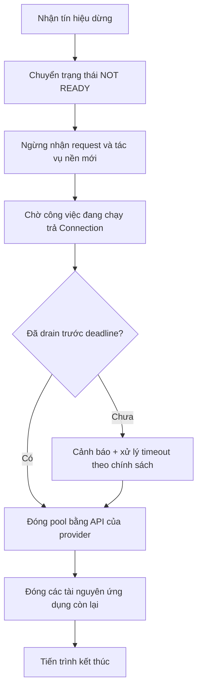

# Dừng pool có kiểm soát khi ứng dụng kết thúc

Một ứng dụng Java truy cập cơ sở dữ liệu qua **JDBC** thường dùng `DataSource` có **connection pool** để tái sử dụng kết nối. Khi ứng dụng đang phục vụ hàng trăm request, không thể coi việc kết thúc tiến trình chỉ là gọi `System.exit()` hay `DataSource.close()`: có thể còn `PreparedStatement` đang thực thi, `ResultSet` đang được đọc, transaction chưa `commit()` và tác vụ nền đang đợi một connection rảnh. Đóng pool quá sớm có thể làm các thao tác đó thất bại; không đóng pool có thể để lại thread, socket và tài nguyên DB tồn tại cho đến khi tiến trình bị hủy.

Bài thuộc chương **Pool kết nối** của module **JDBC**. Mục tiêu là thiết kế một quy trình **graceful shutdown**: ngừng nhận công việc mới, cho công việc đang chạy kết thúc trong thời hạn có kiểm soát, đóng tài nguyên ở cấp request, trả connection về pool, cuối cùng mới đóng **chính pool**. Bài cũng giải thích khác biệt giữa đóng **logical Connection** và đóng **pool**, giới hạn của `DataSource` chuẩn, khởi tạo/tắt trong framework hoặc container, xử lý SIGTERM, timeout, lỗi rollback, đo lường và kiểm thử.

Các đoạn code dùng API chuẩn Java/JDBC nơi có thể. Phần ví dụ HikariCP minh họa **một implementation phổ biến**, không có ý nói JDBC chuẩn quy định `HikariDataSource` hoặc bắt buộc dùng thư viện đó.

## 1. Phân biệt vòng đời connection, pool và ứng dụng

Trong mô hình pooling có ít nhất ba vòng đời:

| Đối tượng | Bên sở hữu | Cách kết thúc đúng | Điều không được nhầm |
| --- | --- | --- | --- |
| `ResultSet` / `PreparedStatement` | Một thao tác DAO/service | `try-with-resources` ngay khi đọc/ghi xong | Không để cursor sống cùng toàn bộ ứng dụng |
| `Connection` lấy từ pool | Request, transaction hoặc một đơn vị công việc | `Connection.close()` trong `try-with-resources` | `close()` thường **trả logical connection về pool**, không tắt pool |
| Connection pool / `DataSource` triển khai pool | Thành phần khởi tạo ở phạm vi ứng dụng/container | Gọi **API shutdown của chính pool** một lần, đúng giai đoạn | `javax.sql.DataSource` không định nghĩa phương thức `close()` |
| Tiến trình ứng dụng | Runtime/container/orchestrator | Dừng ingress, drain tác vụ, tắt tài nguyên | Tiến trình biến mất không tương đương với rollback đã xác nhận |

Đường đi bình thường:

```text
Ứng dụng khởi động
   |
   +-- Tạo pool (sở hữu các physical connections)
   |
   +-- Request A: borrow Connection A ---> SQL ---> close() ---> trả pool
   +-- Request B: borrow Connection B ---> SQL ---> close() ---> trả pool
   |
Nhận tín hiệu dừng
   |
   +-- Không nhận request/job mới
   +-- Đợi A/B hoàn tất (có deadline)
   +-- Đóng pool: không cho borrow mới, dọn physical connections
   +-- Tiến trình kết thúc
```

Một số pool khởi tạo physical connection sớm, pool khác tạo theo nhu cầu. Khi gọi `connection.close()` trên connection được pool quản lý, implementation thường đưa nó về nhóm idle để tái sử dụng; việc socket vật lý có bị đóng hay không do pool quyết định. Vì vậy, **đóng connection sau mỗi request là điều bắt buộc ngay cả khi dùng pool**, nhưng nó không thay thế thao tác shutdown pool.

## 2. Vì sao thứ tự dừng quan trọng?

Giả sử tiến trình có API đặt hàng và một job gửi dữ liệu vào DB:

1. Request đang giữ connection và đã thực thi một phần transaction.
2. Tín hiệu shutdown đến.
3. Một thread gọi đóng pool ngay lập tức.
4. Request còn lại cố `commit()` hoặc tác vụ khác thử `getConnection()`.

Hậu quả tùy pool/driver: thao tác mới có thể bị từ chối, connection đang dùng có thể bị đóng/hủy, transaction có thể rollback hoặc kết quả `commit()` trở nên **không xác định** khi mất kết nối. Không được suy luận rằng “pool đã đóng” chứng minh tất cả giao dịch đều rollback.

Thứ tự thường an toàn hơn:



Các bước có thể cần phối hợp theo framework. Chẳng hạn, readiness chuyển sang không sẵn sàng để load balancer ngừng gửi traffic; server từ chối request mới; scheduler/job consumer dừng tạo công việc; service đang chạy được cho thời gian hoàn tất; rồi **chủ sở hữu pool** gọi shutdown.

Không nên dùng một `Thread.sleep(5000)` cố định thay cho cơ chế theo dõi công việc: ngủ 5 giây không cho biết còn transaction nào chưa kết thúc, và có thể quá dài khi đã drain hoặc quá ngắn khi DB đang chậm.

## 3. Tắt pool không phải một phương thức chung của DataSource

`javax.sql.DataSource` chuẩn định nghĩa `getConnection()` và các đặc tính liên quan, **không có `close()` hay `shutdown()`** trong interface. Tên API tắt phụ thuộc pool:

| Nguồn connection | API và quyền sở hữu | Lưu ý |
| --- | --- | --- |
| `HikariDataSource` của HikariCP | `close()` trên đối tượng sở hữu pool | Đây là API thư viện, không phải `DataSource.close()` chuẩn |
| `BasicDataSource` của Apache Commons DBCP 2 | `close()` của implementation | Chỉ đóng instance do ứng dụng sở hữu |
| Pool do application server/Jakarta EE quản lý | Lifecycle của container | Ứng dụng chỉ mượn `DataSource`, **không tự tắt** |
| Pool do Spring application context quản lý | Bean destruction/lifecycle theo cấu hình | Tránh hai nơi cùng gọi close hoặc tắt bean trước worker |
| `DataSource` bọc/proxy bởi framework | Tùy contract của wrapper và bean | Không cast mù sang một implementation |

Ví dụ sai ở mức kiểu:

```java
DataSource ds = obtainDataSource();
ds.close(); // LỖI biên dịch: DataSource không có close().
```

Ép kiểu `((AutoCloseable) ds).close()` cũng không phải giải pháp tổng quát: không phải mọi `DataSource` đều implements `AutoCloseable`, và ngay cả khi có, **quyền được đóng** vẫn phải thuộc thành phần tạo pool. Với pooled `DataSource` nhận từ container, một service repository thường **không có quyền** shutdown instance dùng chung.

Hãy định nghĩa rõ **ownership** trong kiến trúc: “Ai tạo pool thì người đó quản lý việc đóng pool”. DAO chỉ đóng `Connection` mà DAO mượn; nó không tự đóng nguồn `DataSource`.

## 4. Một bảng thời hạn shutdown có thể đo được

Việc graceful shutdown không nên đợi vô hạn. Một quy trình dừng có **deadline tổng** và ngân sách thời gian cho các bước. Ví dụ đối với container được cho 60 giây trước khi bị kill:

| Bước | Ngân sách minh họa | Cần theo dõi |
| --- | --- | --- |
| Đánh dấu not ready, ngừng phân phối traffic | 5 giây | Request mới có tiếp tục đến không? |
| Dừng scheduler, queue consumer, timer công việc | 5 giây | Worker mới có còn tạo JDBC operations không? |
| Chờ request/transaction đang chạy | 35 giây | Số request, số connection đang active, thời gian giữ |
| Đóng pool và những tài nguyên còn lại | 10 giây | Thao tác close hoàn tất, lỗi close |
| Dự phòng | 5 giây | Thời gian cho logging/termination |

Các con số **chỉ để minh họa**. Thời hạn thực tế phải phù hợp với request timeout, transaction timeout, thời gian xử lý của job, chính sách của orchestrator và hành vi close của pool. Nếu DB thường mất 2 phút để hoàn tất một transaction, không thể hứa shutdown thành công trong 10 giây mà không có cơ chế hủy/tiếp tục công việc.

Đặc biệt, còn **connection đang được chờ cấp**: thời gian đợi trong `DataSource.getConnection()` cũng thuộc thời gian sống của request. Khi bắt đầu dừng, cần ngừng nhận các request mới và có deadline để những request đã vào hàng đợi không giữ shutdown mãi.

## 5. Điều kiện drain: chờ công việc hay chờ connection?

Có hai chỉ số khác nhau:

- **In-flight work**: số request/job đã được chấp nhận nhưng chưa hoàn tất xử lý (bao gồm lúc đang chờ borrow connection).
- **Active connections**: số logical connection đang được mượn ra khỏi pool.

`activeConnections == 0` là tín hiệu tốt trước khi tắt pool, nhưng **chưa đủ** để chứng minh ứng dụng không còn công việc: một request đang tính toán có thể vừa trả connection và chuẩn bị borrow lần nữa. Ngược lại, có các tác vụ cố tình giữ connection mở xuyên một phiên xử lý dài; điều đó ngăn drain kể cả khi HTTP request đã trả.

Vì vậy, quy trình dừng nên:

1. Chặn **đơn vị công việc mới** tại ingress/scheduler/consumer.
2. Đếm công việc đang chạy ở cùng ranh giới mà ứng dụng thực sự mượn connection.
3. Chờ công việc trả connection và hoàn tất trong thời hạn cho phép.
4. Dùng số liệu pool (`active`, `idle`, `pending`) để **xác minh/quan sát**, không coi đó là bộ đếm công việc duy nhất.

Nếu một thư viện khác giữ connection nhưng không đi qua bộ theo dõi in-flight của ứng dụng, việc drain theo bộ đếm ấy sẽ không biết nó. Cần thống kê mọi nơi mượn connection (HTTP, async worker, scheduled task, migration, event consumer) và quyết định ranh giới sở hữu. Đây là lý do quản lý pooling ở **lifecycle của ứng dụng**, thay vì trong từng repository.

## 6. Ví dụ Java: chặn công việc mới và đợi công việc đang chạy

Mẫu sau chỉ sử dụng **Java chuẩn + JDBC**. Nó nhận một `DataSource` và một callback đóng pool, vì chính interface `DataSource` không có `close()`. Ví dụ dùng Java 17+ để dễ triển khai.

```java
import java.sql.Connection;
import java.sql.SQLException;
import java.time.Duration;
import java.util.Objects;
import java.util.concurrent.RejectedExecutionException;
import java.util.concurrent.atomic.AtomicBoolean;
import java.util.concurrent.locks.Condition;
import java.util.concurrent.locks.ReentrantLock;
import javax.sql.DataSource;

public final class GracefulJdbcPool {
    @FunctionalInterface
    public interface SqlWork<T> {
        T run(Connection connection) throws SQLException;
    }

    @FunctionalInterface
    public interface PoolCloser {
        void closePool() throws Exception;
    }

    private final DataSource dataSource;
    private final PoolCloser poolCloser;
    private final ReentrantLock lock = new ReentrantLock();
    private final Condition noActiveWork = lock.newCondition();
    private final AtomicBoolean shutdownStarted = new AtomicBoolean();
    private boolean accepting = true;
    private int inFlight = 0;

    public GracefulJdbcPool(DataSource dataSource, PoolCloser poolCloser) {
        this.dataSource = Objects.requireNonNull(dataSource);
        this.poolCloser = Objects.requireNonNull(poolCloser);
    }

    // Không để Connection hoặc ResultSet thoát khỏi callback này.
    public <T> T withConnection(SqlWork<T> work) throws SQLException {
        Objects.requireNonNull(work);
        registerWork();
        try (Connection con = dataSource.getConnection()) {
            return work.run(con);
        } finally {
            unregisterWork();
        }
    }

    private void registerWork() {
        lock.lock();
        try {
            if (!accepting) {
                throw new RejectedExecutionException(
                        "Ứng dụng đang dừng, không nhận JDBC work mới");
            }
            inFlight++;
        } finally {
            lock.unlock();
        }
    }

    private void unregisterWork() {
        lock.lock();
        try {
            inFlight--;
            if (inFlight == 0) {
                noActiveWork.signalAll();
            }
        } finally {
            lock.unlock();
        }
    }

    private void stopAccepting() {
        lock.lock();
        try {
            accepting = false;
            if (inFlight == 0) {
                noActiveWork.signalAll();
            }
        } finally {
            lock.unlock();
        }
    }

    private boolean awaitDrained(Duration timeout)
            throws InterruptedException {
        long remainingNanos = timeout.toNanos();
        lock.lockInterruptibly();
        try {
            while (inFlight > 0) {
                if (remainingNanos <= 0) {
                    return false;
                }
                remainingNanos =
                        noActiveWork.awaitNanos(remainingNanos);
            }
            return true;
        } finally {
            lock.unlock();
        }
    }

    // Chỉ lifecycle owner gọi, đúng một lần.
    // true: mọi work đi qua wrapper đã kết thúc trước deadline.
    public boolean shutdown(Duration drainTimeout) throws Exception {
        Objects.requireNonNull(drainTimeout);
        if (drainTimeout.isNegative()) {
            throw new IllegalArgumentException("Timeout phải không âm");
        }
        if (!shutdownStarted.compareAndSet(false, true)) {
            throw new IllegalStateException("Shutdown đã bắt đầu");
        }

        stopAccepting();
        boolean drained = false;
        InterruptedException interrupted = null;
        try {
            drained = awaitDrained(drainTimeout);
        } catch (InterruptedException e) {
            interrupted = e;
        }

        // Dù drain bị timeout hoặc thread bị interrupt,
        // lifecycle owner vẫn thử đóng pool.
        try {
            poolCloser.closePool();
        } catch (Exception | Error closeFailure) {
            if (interrupted != null) {
                interrupted.addSuppressed(closeFailure);
            } else {
                throw closeFailure;
            }
        }

        if (interrupted != null) {
            Thread.currentThread().interrupt();
            throw interrupted;
        }
        return drained;
    }
}
```

### Mẫu giải quyết những bài toán gì?

- `registerWork()` và `stopAccepting()` dùng chung lock nên không có khoảng trống giữa “đã kiểm tra còn nhận việc” và “tăng bộ đếm in-flight”. Khi shutdown chặn work mới, những work đã đăng ký sẽ được tính vào quá trình drain.
- Bộ đếm bao gồm cả công việc đang **chờ `dataSource.getConnection()`**, không chỉ connection đã borrow. Điều này ngăn trường hợp bộ đếm pool bằng 0 nhưng còn thread sắp mượn connection.
- `withConnection` dùng `try-with-resources` để trả connection về pool kể cả khi `executeUpdate()` hoặc mapper ném `SQLException`. `finally` giảm bộ đếm sau khi việc đóng connection hoàn tất.
- `awaitDrained` đợi bằng `Condition` và timeout, không dùng `Thread.sleep` dò trạng thái. Kết quả `true` chỉ bảo đảm những công việc **đi qua wrapper này** đã kết thúc.
- `shutdown` thử đóng pool ngay cả khi deadline drain hết hoặc thread bị interrupt; nếu bị interrupt và đóng pool cũng lỗi, lỗi đóng được gắn vào exception đầu tiên qua `addSuppressed()`.
- `AtomicBoolean` tránh hai luồng cùng khởi động quy trình close. API này chủ động ném `IllegalStateException` khi shutdown được gọi lần thứ hai để lỗi điều phối không bị che. Trong framework cần gọi lifecycle đúng một lần.

### Giới hạn quan trọng

Mẫu là **bộ đếm công việc có chủ sở hữu rõ ràng**, không tự chặn HTTP server, message broker hoặc scheduler. Tầng ingress vẫn phải dừng nhận request/job mới. Tất cả đường code dùng `DataSource` liên quan cần đi qua cơ chế quản lý giống vậy; nếu có thư viện mượn connection trực tiếp, bộ đếm không biết.

Không trả một `Connection`, `PreparedStatement` hay `ResultSet` ra ngoài callback `withConnection`: khi callback trả về, connection đã bị đóng/trả pool. Nếu một thư viện bắt đầu công việc bất đồng bộ trong callback rồi trả về trước khi công việc hoàn tất, bộ đếm sẽ kết thúc quá sớm. Khi đó phải quản lý lifecycle **đến lúc tác vụ async thật sự hoàn thành**.

Khi `shutdown()` trả `false`, điều đó có nghĩa deadline đã hết nhưng **vẫn còn công việc đang chạy**, không phải chúng đã rollback hoặc connection đã được trả. Pool đóng trong tình huống này có thể làm một phần work thất bại; mã gọi phải log cảnh báo, đánh dấu trạng thái kết quả không rõ nếu liên quan đến commit và có kế hoạch tiếp tục/đối soát.

Với timeout quá lớn có thể làm `Duration.toNanos()` tràn số; ví dụ giả định timeout do vận hành cấu hình trong miền nhỏ hợp lý (vài giây hoặc phút). Khi sản xuất, nên validate giới hạn timeout và dùng một deadline tổng được cấu hình.

## 7. Kết nối mẫu với HikariCP: ai gọi close?

HikariCP là một thư viện pool phổ biến trong Java. `HikariDataSource` vừa cung cấp `getConnection()`, vừa có `close()` theo API của **HikariCP**. Mẫu dùng `GracefulJdbcPool` có thể được khởi tạo từ một pool ứng dụng thực sự sở hữu:

```java
import com.zaxxer.hikari.HikariConfig;
import com.zaxxer.hikari.HikariDataSource;
import java.time.Duration;

HikariConfig config = new HikariConfig();
config.setJdbcUrl(System.getenv("JDBC_URL"));
config.setUsername(System.getenv("JDBC_USER"));
config.setPassword(System.getenv("JDBC_PASSWORD"));
config.setMaximumPoolSize(10);
config.setConnectionTimeout(10_000); // Milliseconds khi borrow.

HikariDataSource hikari = new HikariDataSource(config);
GracefulJdbcPool managed = new GracefulJdbcPool(
        hikari,
        hikari::close);

// ... Khởi động HTTP server / job consumer,
// ... các thao tác dùng managed.withConnection(...).
// Khi lifecycle owner đã dừng ingress và scheduler:
boolean drained = managed.shutdown(Duration.ofSeconds(30));
if (!drained) {
    System.err.println("Pool đã đóng khi vẫn còn JDBC work");
}
```

Đây là mảnh code đặt ở **application bootstrap/shutdown**, không phải code chạy trong từng HTTP request. Để biên dịch phải có dependency HikariCP và driver JDBC tương ứng. Các biến môi trường chỉ là ví dụ; ứng dụng phải kiểm tra thiếu cấu hình và bảo mật credential. `setConnectionTimeout(10_000)` kiểm soát thời gian borrow từ pool theo ngữ nghĩa của HikariCP, **không thay thế thời gian thực thi SQL, transaction timeout hoặc tổng deadline shutdown**.

Không được vừa để framework tự sở hữu/tắt bean `HikariDataSource`, vừa gọi `managed.shutdown()` từ một shutdown hook khác mà không điều phối. Hai nơi cùng đóng pool có thể dẫn đến trạng thái race hoặc đóng trước khi worker của framework đã dừng. Nếu dùng container hoặc framework đã quản lý lifecycle, hãy gắn thao tác drain vào lifecycle của framework và để **một chủ sở hữu duy nhất** thực hiện close.

### Sử dụng DataSource trong một thao tác

```java
long changed = managed.withConnection(con -> {
    String sql = "UPDATE orders SET status = ? WHERE id = ?";
    try (PreparedStatement ps = con.prepareStatement(sql)) {
        ps.setString(1, "CONFIRMED");
        ps.setLong(2, 42L);
        return (long) ps.executeUpdate();
    }
});
```

Đoạn code nằm trong phương thức có `throws SQLException` và import `PreparedStatement`; các connection do wrapper sở hữu nên đóng sau callback. Nếu đây là một trong nhiều câu SQL phải commit nguyên tử, callback cần tự quản lý một transaction rõ ràng; ví dụ chỉ minh họa thao tác đơn. Một connection có `autoCommit=true` thường commit lệnh DML theo chế độ mặc định, nhưng không được dùng mặc định đó để giả định nhiều lệnh riêng biệt cùng nguyên tử.

## 8. Transaction đang chạy phải tự kết thúc trước khi pool đóng

Graceful shutdown không thể thay thế xử lý transaction đúng tại service. Một đơn vị công việc nhiều bước cần cùng connection và các nhánh `commit()/rollback()` rõ ràng:

```java
managed.withConnection(con -> {
    boolean previous = con.getAutoCommit();
    boolean started = false;
    boolean ended = false;
    Throwable original = null;

    try {
        con.setAutoCommit(false);
        started = true;

        try (PreparedStatement debit = con.prepareStatement(
                "UPDATE accounts SET balance = balance - ? "
              + "WHERE id = ? AND balance >= ?")) {
            debit.setBigDecimal(1, amount);
            debit.setLong(2, fromId);
            debit.setBigDecimal(3, amount);
            if (debit.executeUpdate() != 1) {
                throw new SQLException("Tài khoản nguồn không đủ số dư");
            }
        }

        try (PreparedStatement credit = con.prepareStatement(
                "UPDATE accounts SET balance = balance + ? WHERE id = ?")) {
            credit.setBigDecimal(1, amount);
            credit.setLong(2, toId);
            if (credit.executeUpdate() != 1) {
                throw new SQLException("Tài khoản đích không tồn tại");
            }
        }

        con.commit();
        ended = true;
        return null;

    } catch (SQLException | RuntimeException | Error failure) {
        original = failure;
        if (started) {
            try {
                con.rollback();
                ended = true;
            } catch (SQLException | RuntimeException | Error rollbackFailure) {
                if (rollbackFailure != failure) {
                    failure.addSuppressed(rollbackFailure);
                }
            }
        }
        throw failure;
    } finally {
        if (started && ended) {
            try {
                con.setAutoCommit(previous);
            } catch (SQLException | RuntimeException | Error resetFailure) {
                if (original != null) {
                    if (resetFailure != original) {
                        original.addSuppressed(resetFailure);
                    }
                } else {
                    throw resetFailure;
                }
            }
        }
    }
});
```

Các tên `amount` (`BigDecimal`), `fromId` và `toId` thuộc đầu vào của phương thức nghiệp vụ; đoạn minh họa cần import `SQLException`, `PreparedStatement`, `BigDecimal` và sử dụng một schema `accounts` tương ứng. Đây không phải thiết kế chuyển tiền production đầy đủ: còn cần kiểm soát concurrency, idempotency, đối soát và giới hạn thời gian.

Điểm liên quan đến shutdown: **in-flight chỉ giảm sau khi callback và `Connection.close()` hoàn tất**. Nếu shutdown chờ đủ lâu, transaction được kết thúc theo nhánh code này trước khi pool đóng. Nếu bị timeout, pool có thể đóng khi `commit()` còn đang chạy; không được khẳng định transaction chắc chắn thất bại chỉ vì caller nhận lỗi kết nối. Cần khóa request ổn định hoặc cơ chế đối soát để quyết định retry.

Đặc biệt **không trông cậy vào `Connection.close()` để tự rollback mọi thay đổi đang chờ**. Hành vi khi đóng connection có transaction còn hoạt động phụ thuộc driver/DB/pool; service phải gọi `rollback()` rõ ràng trong nhánh lỗi và chỉ trả connection về pool ở trạng thái an toàn.

## 9. Phối hợp với thread pool, server HTTP và scheduler

Để drain thực sự, ngăn **nguồn tạo việc** trước:

1. Chuyển readiness thành “không nhận traffic mới” nếu ứng dụng có health/readiness endpoint.
2. Ngừng nhận request mới ở HTTP listener hoặc gateway, nhưng cho những request đã vào xử lý hoàn tất theo deadline.
3. Dừng poll và dispatch thêm message ở queue consumer; tránh nhận thêm event rồi giữ nó không được ack.
4. Dừng scheduler/timer và không enqueue job mới.
5. Cho executor đang xử lý công việc tồn tại chạy nốt, theo dõi `awaitTermination(...)` với thời gian hữu hạn.
6. Đợi connection được trả về pool và tắt pool; cuối cùng tắt logger/telemetry/tracing khi đã ghi được thông tin shutdown.

Ví dụ riêng với một `ExecutorService` thuộc sở hữu ứng dụng:

```java
import java.util.concurrent.ExecutorService;
import java.util.concurrent.TimeUnit;

executor.shutdown(); // Không nhận thêm tác vụ mới.
boolean finished = executor.awaitTermination(20, TimeUnit.SECONDS);
if (!finished) {
    // Đã quá thời hạn: cân nhắc cancel theo chính sách nghiệp vụ.
    // executor.shutdownNow() chỉ yêu cầu interrupt, KHÔNG bảo đảm
    // JDBC driver ngắt SQL hoặc transaction đã rollback.
}
// Sau đó, lifecycle owner đợi JDBC work và đóng pool.
```

`executor.shutdown()` chỉ chặn công việc được gửi vào **executor đó**. HTTP server, queue consumer hay các executor khác vẫn có thể tiếp tục mượn connection. Nếu application có nhiều loại worker, cần một bộ điều phối shutdown ở cấp ứng dụng.

`shutdownNow()` có thể trả về danh sách công việc chưa chạy và gửi tín hiệu interrupt tới worker, nhưng không bảo đảm câu SQL đang chạy lập tức bị hủy. Có thể cần `Statement.setQueryTimeout(...)`, deadline ứng dụng, transaction timeout và tính năng cancel/abort của driver theo hợp đồng thực tế. Không vội đóng pool khi chưa hiểu hậu quả nghiệp vụ của việc hủy công việc.

## 10. Shutdown hook: dùng khi tự quản lý lifecycle

Ứng dụng Java chạy độc lập có thể dùng shutdown hook để cố gắng dọn tài nguyên khi JVM nhận tín hiệu dừng thông thường:

```java
Runtime.getRuntime().addShutdownHook(new Thread(() -> {
    try {
        // Đây chỉ là phòng tuyến cuối.
        // Nên dừng ingress/scheduler bằng lifecycle orchestration trước.
        boolean drained = managed.shutdown(Duration.ofSeconds(20));
        if (!drained) {
            System.err.println("Hết hạn drain JDBC trước khi dừng");
        }
    } catch (Exception e) {
        e.printStackTrace(); // Trong app thật: logging phù hợp.
    }
}, "jdbc-pool-shutdown"));
```

**Giới hạn của shutdown hook:**

- Hook không được bảo đảm chạy khi process bị cưỡng bức `SIGKILL`/`kill -9`, JVM crash, mất nguồn điện hoặc runtime không còn khả năng thực thi.
- Khi JVM đang shutdown, hook phải kết thúc trong thời gian mà OS/container cho phép. Một hook đợi vô hạn có thể bị hệ điều hành cưỡng bức hủy.
- Các shutdown hook của JVM có thể chạy đồng thời và không có thứ tự phụ thuộc như một lifecycle orchestrator. Không dùng các hook rời rạc để tự giả định HTTP server sẽ dừng trước pool.
- Nếu framework/server đã sở hữu pool và đăng ký shutdown hook riêng, đừng thêm hook này rồi đóng pool lần thứ hai.
- Không gọi `System.exit()` từ trong shutdown hook, không tạo nhiệm vụ nền mới phụ thuộc pool và không giả định có thể mở lại ứng dụng sau khi pool đã đóng.

Với ứng dụng sử dụng Spring, Jakarta EE, Quarkus, Micronaut hoặc container tương tự, ưu tiên cơ chế lifecycle chính thức của môi trường. **Thứ tự hủy bean/resource cụ thể phải đối chiếu với framework**, không suy luận từ tên annotation; shutdown hook thủ công chỉ phù hợp khi thật sự làm chủ vòng đời và không bị framework quản lý chồng chéo.

## 11. SIGTERM, readiness và deadline trong container

Trong môi trường container/orchestrator, một lần dừng thường diễn ra theo chuỗi:

```text
Pod/instance bắt đầu termination
     |
     +-- Được đánh dấu không còn sẵn sàng nhận traffic
     +-- Ứng dụng nhận tín hiệu dừng (thường SIGTERM)
     +-- HTTP server / queue consumer dừng nhận công việc mới
     +-- Công việc đang chạy có thời gian hoàn tất
     +-- Pool được đóng bằng lifecycle owner
     +-- Tiến trình tự kết thúc trước deadline
     |
     +-- Nếu vượt deadline: runtime có thể kill cưỡng bức
```

Quy trình chính xác phụ thuộc nền tảng triển khai và cấu hình (chẳng hạn `terminationGracePeriodSeconds`, `preStop`, readiness và hành vi của load balancer trong Kubernetes). Không phải cứ đổi readiness là **mọi** request tức thì ngừng tới; có độ trễ cập nhật trạng thái và connection giữ sẵn ở upstream. Vì vậy, tại ứng dụng vẫn cần cơ chế không nhận công việc JDBC mới như `stopAccepting()` hoặc dừng listener.

Deadline nên bao gồm **thời gian drain + thời gian close pool + biên dự phòng**, và không vượt quá giới hạn termination do môi trường cấp. Nếu một shutdown callback bị chặn bởi DB vô thời hạn, kết quả cuối có thể là kill cưỡng bức, không có log hoặc rollback cuối cùng.

Ở hệ thống có nhiều instance, rolling update nên giữ đủ instance đang sẵn sàng phục vụ trong khi một instance drain. Không đóng pool của một instance từ instance khác chỉ vì cùng kết nối tới một DB.

## 12. Hết thời hạn chờ: nên làm gì với connection còn active?

Graceful shutdown có thể thất bại một phần khi công việc treo hoặc xử lý lâu. Khi deadline hết, không có phương án vạn năng:

| Trạng thái | Rủi ro nếu đóng pool ngay | Hướng xử lý |
| --- | --- | --- |
| Truy vấn chỉ đọc đang chạy | Query có thể bị ngắt, request thất bại | Trả lỗi/timeout; không cần retry DML |
| Transaction ghi chưa commit | Rollback có thể xảy ra hoặc DB chưa rõ trạng thái | Cố rollback theo chính sách; nếu mất kết nối cần đối soát |
| `commit()` đã gửi nhưng không nhận ack | Có thể đã commit | Không retry mù; dùng request ID/idempotency |
| Job lấy dữ liệu theo từng chunk | Có thể mất tiến trình chưa ghi checkpoint | Ghi checkpoint bền vững sau mỗi đơn vị hoàn tất |
| Worker đã phát tác động ngoài DB | Transaction DB không thể tự thu hồi email/payment | Outbox/idempotency/saga hoặc xử lý bù |
| Connection do code khác giữ quá hạn | Drain counter ứng dụng không thấy đủ | Quan sát metrics pool, tìm leak và call site |

Ở thời điểm hết hạn:

1. Ghi nhận còn bao nhiêu work/connection và khoảng thời gian đã đợi.
2. Dừng phát sinh work mới, kích hoạt cancellation nếu luồng nghiệp vụ cho phép.
3. Đóng pool theo API provider trong giới hạn thời gian còn lại; **không khẳng định pool luôn đợi tất cả active connections tự trả về** vì hành vi khác nhau giữa các implementation.
4. Ghi kết quả `COMPLETED`, `TIMED_OUT` hoặc `FAILED` của shutdown vào log/metric, không tráo với kết quả transaction.
5. Với dữ liệu/side effect đang ở trạng thái không chắc chắn, để lại đầu mối đối soát khi instance khác khởi động.

Lệnh `Connection.abort(Executor)` của JDBC nhằm yêu cầu hủy connection vật lý trong những tình huống đặc biệt; nó **không phải thao tác shutdown pool chuẩn dùng đại trà** và có thể không thích hợp với logical connection đang do pool quản lý. Chỉ sử dụng cơ chế cưỡng bức do chính pool/driver tài liệu hóa, với hiểu biết về tác động đến transaction.

## 13. Connection leak và giới hạn của pool metrics

Nếu không có code đóng connection đúng, shutdown có thể bị treo hoặc phải đóng cưỡng bức. Các phản mẫu:

```java
// Sai: nhận Connection nhưng không có close() ở mọi nhánh.
Connection con = dataSource.getConnection();
PreparedStatement ps = con.prepareStatement(sql);
ResultSet rs = ps.executeQuery();
return map(rs); // ps, rs, con có thể còn mở.
```

Mẫu nên dùng:

```java
try (Connection con = dataSource.getConnection();
     PreparedStatement ps = con.prepareStatement(sql)) {
    try (ResultSet rs = ps.executeQuery()) {
        return map(rs);
    }
}
```

Trong đó `map(rs)` trả về **dữ liệu Java độc lập với cursor** (record/DTO), không trả chính `ResultSet` ra ngoài. Khi mapper ném lỗi, `try-with-resources` vẫn đóng tài nguyên; lỗi từ `close()` được Java gắn dưới dạng suppressed nếu đã có ngoại lệ chính.

Khi giám sát pool, những chỉ số thường hữu ích:

| Metric | Câu hỏi |
| --- | --- |
| Active connections | Có bao nhiêu connection đang được mượn? |
| Idle connections | Còn connection nhàn rỗi để cấp không? |
| Pending/awaiting borrow | Bao nhiêu request đang chờ lấy connection? |
| Borrow duration | Thao tác `getConnection()` chờ bao lâu? |
| Connection usage duration | Connection được giữ bao lâu trước `close()`? |
| Connection timeout count | Có yêu cầu mượn connection thất bại do hết thời gian chờ? |
| Leak detection warning | Có connection được giữ bất thường? |
| In-flight work lúc shutdown | Công việc mới đã bị chặn và phần còn lại có về 0 không? |
| Shutdown duration / outcome | Dừng pool hoàn tất trong deadline hay không? |

Tên metric, cách đo và cách phân biệt active/idle/pending **phụ thuộc implementation**. Leak detection thường là cơ chế cảnh báo khi connection được mượn quá ngưỡng; nó không tự đóng connection và có thể cảnh báo nhầm với truy vấn hợp lệ chạy lâu.

## 14. Đừng nhầm đóng pool với đóng Database

Shutdown một connection pool thường chỉ **giải phóng tài nguyên client** và các session JDBC mà nó sở hữu. Nó **không** đồng nghĩa với:

- Ra lệnh tắt database server cho các ứng dụng khác.
- Xóa dữ liệu hoặc chạy migration.
- Bắt buộc rollback tất cả transaction mà ứng dụng đã gửi trước đó.
- Hủy một transaction trên **connection thuộc ứng dụng khác**.
- Kết thúc ngay tất cả câu SQL ở server khi network/driver bị lỗi.

DB có thể tiếp tục xử lý một yêu cầu đã nhận, hoặc cleanup session khi phát hiện connection đã mất. Nếu xảy ra timeout trong `commit()`, kết quả có thể không xác định đối với client. Việc thiết kế **idempotency key**, transaction log và truy vấn đối soát vì vậy quan trọng cả khi ứng dụng có graceful shutdown rất tốt.

Phân tách trách nhiệm: ứng dụng đóng pool **của ứng dụng**, bộ quản trị DB giữ DB server, và một hệ điều phối deployment kiểm soát vòng đời của các instance. Không dùng `SHUTDOWN` của hệ quản trị DB như một cách thay thế cho việc đóng HikariCP/DBCP.

## 15. Một lần đóng, lỗi đóng và quyền sở hữu

**Chủ sở hữu pool** cần có một đường close duy nhất. Ví dụ:

```text
ApplicationBootstrap (tạo pool)
  ├── HTTP/API service -------- borrow/close logical Connection
  ├── Scheduled jobs ---------- borrow/close logical Connection
  ├── Message consumers ------- borrow/close logical Connection
  └── ApplicationLifecycle ---- stop ingress, drain, pool.close()
```

Không thiết kế `CustomerRepository.close()` gọi `pool.close()`: nhiều repository dùng chung pool, repository A đóng sẽ làm repository B hỏng. Cũng không truyền một pool owned bởi framework vào component khác rồi cho phép component ấy gọi close trong `@PreDestroy` một cách độc lập.

Lỗi đóng pool cũng phải được xử lý:

- Nếu chưa có lỗi trước đó, lỗi `close` có thể được báo là lỗi shutdown chính; log đầy đủ, không nuốt.
- Nếu đang xử lý một lỗi shutdown khác (ví dụ thread drain bị interrupt), gắn lỗi close làm **suppressed**, bảo toàn nguyên nhân ban đầu.
- Nếu framework cung cấp lifecycle quản lý bean, để framework ghi nhận và báo lỗi của bước destroy theo cơ chế của nó.
- Không cố mở lại một pool đã đóng mà chưa định nghĩa rõ quy trình start mới; cách bình thường là tạo một instance pool mới ở lần khởi động ứng dụng kế tiếp.

Trong ví dụ `GracefulJdbcPool.shutdown()`, nếu drain bị timeout thì vẫn đóng pool và trả `false` khi close thành công; nếu chính close ném exception, ngoại lệ được đưa lên caller. **Kết quả `false` không có nghĩa close thất bại**, và ngoại lệ close không có nghĩa mọi SQL đã rollback. Cần log riêng “drain outcome”, “pool close outcome” và “transaction outcome”.

## 16. Những phản mẫu cần tránh

| Phản mẫu | Rủi ro | Thay thế |
| --- | --- | --- |
| Gọi `DataSource.close()` vì nghĩ thuộc JDBC chuẩn | Không biên dịch hoặc ép kiểu không an toàn | Dùng API close của provider do chủ sở hữu biết |
| Đóng pool ngay khi nhận SIGTERM | Làm hỏng request/transaction đang chạy | Stop ingress → drain → close |
| Dựa vào `Thread.sleep(5000)` để drain | Không biết công việc đã xong chưa | Đếm in-flight, executor termination, deadline |
| Chỉ đợi pool active = 0 | Request vẫn có thể sắp borrow connection | Chặn work mới và theo dõi in-flight ở ranh giới request/job |
| Không đóng Connection vì nghĩ pool tự xử lý | Pool cạn, shutdown không drain | `try-with-resources` cho từng lần borrow |
| DAO/repository tự shutdown pool dùng chung | Các service khác mất khả năng truy cập DB | Lifecycle owner đóng pool một lần |
| Đóng pool của application server | Vi phạm quyền sở hữu tài nguyên | Để container quản lý pool |
| Vừa shutdown hook vừa framework destroy cùng đóng | Race và đóng trước thời điểm mong muốn | Chọn một lifecycle và thứ tự rõ ràng |
| Chờ vô hạn tất cả transaction | Runtime bị kill trước khi đóng/log | Deadline và chính sách timeout |
| `shutdownNow()` rồi tin SQL đã rollback | Interrupt không chứng minh DB rollback | Xác minh kết quả và idempotency |
| `commit()` timeout rồi retry đơn hàng mới | Có thể ghi trùng | Request ID ổn định, đối soát |
| Trả Connection/ResultSet từ callback đã đóng | Resource không còn hợp lệ | Trả DTO, giữ vòng đời JDBC trong callback |
| Dùng pool idle = 0 như dấu hiệu pool cần đóng | Có thể là tải bình thường, không phải shutdown | Dùng trạng thái lifecycle riêng |
| Coi đóng pool là dừng DB server | Sai ranh giới trách nhiệm | Tách lifecycle ứng dụng và DB |

## 17. Kiểm thử graceful shutdown

Nên kiểm thử ở **ba mức**: unit test điều phối trạng thái, integration test với pool/driver thật, và thử nghiệm dừng instance trong môi trường giống production. Không chỉ kiểm tra “`pool.close()` được gọi” mà còn xem thứ tự, deadline, số lượng connection và trạng thái dữ liệu.

### Ma trận unit test

| Tình huống | Điều phải kiểm tra |
| --- | --- |
| Không có in-flight work | Shutdown kết thúc nhanh, close gọi một lần |
| Một work đang chạy | Shutdown chờ công việc xong trước khi close |
| Work đã đăng ký nhưng đang chờ borrow | Vẫn được tính trong drain |
| Work mới đến sau `stopAccepting()` | Bị từ chối, không gọi `DataSource.getConnection()` |
| Work ném `SQLException` | Connection đóng, in-flight giảm, ngoại lệ giữ nguyên |
| Work ném `RuntimeException` | In-flight vẫn giảm và tài nguyên được đóng |
| `Connection.close()` ném lỗi | In-flight cuối cùng vẫn giảm, lỗi được báo |
| Hết timeout khi work chưa xong | Shutdown trả `false` nếu pool close thành công |
| Thread shutdown bị interrupt | Vẫn thử close; bảo toàn `InterruptedException` và suppressed close |
| Close pool ném lỗi | Caller nhận lỗi, không báo thành công giả |
| Hai thread cùng gọi shutdown | Chỉ một thread bắt đầu close, thread khác nhận trạng thái/lỗi rõ ràng |

Khi unit test, có thể dùng fake `DataSource`/`Connection` và `CountDownLatch` để chặn/release một callback tại thời điểm kiểm soát được; **không dùng sleep với kỳ vọng thread chạy đúng thứ tự**. Một fake close callback ghi nhận số lần gọi giúp xác nhận close chỉ chạy sau khi work về 0 trong nhánh bình thường.

### Ma trận integration test

| Ca thử | Xác minh thực tế |
| --- | --- |
| Ứng dụng dùng pool thật, nhiều request đồng thời | Không chấp nhận borrow mới sau khi dừng ingress |
| Một transaction ghi ngắn trước shutdown | Có đủ thời gian commit, dữ liệu cuối đúng |
| Một transaction lỗi trước shutdown | Rollback được gọi và connection được trả pool |
| Query đọc lâu hơn deadline | Shutdown kết thúc/cảnh báo theo policy, không treo vô hạn |
| Pool có connection idle | Physical connections được dọn theo contract provider |
| Pool có connection active quá hạn | Hành vi của provider được xác minh, không giả định “close luôn chờ” |
| DB tạm thời không phản hồi khi shutdown | Log/metric thể hiện lỗi đóng hoặc timeout, process có đường thoát |
| SIGTERM trên container | Readiness, request drain, pool close theo đúng thứ tự và deadline |
| Rolling restart nhiều instance | Instance khác tiếp tục phục vụ, không tắt DB hoặc pool của instance khác |
| Framework sở hữu bean DataSource | Không gọi shutdown chồng chéo, hủy sau worker cần DB |

**Kịch bản ưu tiên:** tạo hai request, để request A giữ transaction với một latch; gửi tín hiệu stop; xác nhận request B mới bị từ chối và `pool.close()` **chưa** được gọi; thả latch; xác nhận A hoàn tất, connection được trả, sau đó close gọi một lần. Lặp lại với A treo quá deadline để kiểm tra nhánh timed out, log và tác động DB thực tế.

Với tác vụ ghi có tiền/đơn hàng, khi thử kịch bản commit mất phản hồi phải dùng DB test hoặc sandbox, xác minh bằng khóa idempotency và tuyệt đối không thử gây đứt kết nối trên DB production.

## 18. Bài tập thực hành

**Bài 1 — Phân vai chủ sở hữu.** Một ứng dụng có `CustomerDao`, `OrderService` và `ScheduledReportJob` cùng dùng HikariCP. Thiết kế vị trí duy nhất gọi `HikariDataSource.close()` và minh họa nơi các component phải gọi `Connection.close()`.

**Bài 2 — Sắp xếp shutdown.** Tại thời điểm SIGTERM, còn 12 HTTP requests đang chạy, 3 worker đang chờ lấy connection và 2 job đang thực thi SQL. Mô tả thứ tự dừng ingress/scheduler, đợi in-flight, theo dõi metrics và đóng pool. Tại sao đợi pool active về 0 một lần chưa đủ?

**Bài 3 — Timeout.** Một container có 45 giây grace period. Đề xuất phân bổ ngân sách cho readiness, dừng các producer, drain, close và log. Nếu một transaction chưa thể commit trước deadline, cần báo trạng thái và xử lý retry như thế nào?

**Bài 4 — Tạo thử race.** Dùng `CountDownLatch` test trường hợp một thread bắt đầu `withConnection` ngay khi thread kia gọi `shutdown()`. Chứng minh hoặc work được đăng ký và chờ drain, hoặc bị từ chối; không có work “lọt qua” nhưng không được đếm.

**Bài 5 — Lỗi cleanup.** Một transaction ném `SQLException A`; rollback ném `SQLException B`; `Connection.close()` ném `SQLException C`. Thiết kế luồng giữ A làm lỗi chính và B/C trong `getSuppressed()`. Vì sao log chỉ C là không đủ?

**Bài 6 — Framework lifecycle.** Ứng dụng đang dùng một `DataSource` do container cung cấp và đã có bước destroy bean. Giải thích tại sao thêm shutdown hook tự cast `DataSource` để gọi `close()` là không phù hợp, và nêu cách đưa drain vào lifecycle chính thức.

## 19. Checklist trước khi triển khai

1. [ ] Đã xác định ai tạo và sở hữu pool, ai chỉ mượn `Connection`?
2. [ ] Từng `Connection`, `PreparedStatement` và `ResultSet` được đóng bằng `try-with-resources` trong phạm vi công việc?
3. [ ] Đã dừng ingress, queue consumer và scheduler trước khi drain?
4. [ ] Có bộ đếm in-flight bao gồm cả công việc đang chờ borrow, không chỉ kết nối active?
5. [ ] Có timeout/deadline tổng, không chờ vô hạn?
6. [ ] Chỉ một lifecycle owner gọi API shutdown của pool đúng một lần?
7. [ ] Nếu framework/container sở hữu `DataSource`, không tự đóng pool từ DAO/service?
8. [ ] Transaction có `commit()/rollback()` rõ ràng; không trông chờ `close()` tự rollback?
9. [ ] Với `commit()` không rõ kết quả, có idempotency key và đường đối soát?
10. [ ] Đã xác minh cách pool xử lý active connections khi shutdown quá hạn?
11. [ ] Đã xem xét thứ tự shutdown hook, lifecycle callbacks, SIGTERM và orchestrator grace period?
12. [ ] Log/metric cho in-flight, active/idle/pending, duration, timeout và shutdown outcome được thu thập?
13. [ ] Có test concurrency bằng latch và integration test với pool/driver thật?
14. [ ] Không nhầm đóng pool client với tắt DB server?

**Dừng pool có kiểm soát** là một giao thức của toàn ứng dụng, không phải chỉ một lời gọi `close()`. Với JDBC, quy trình đáng tin cậy là **ngừng tạo công việc mới → chờ transaction đang chạy hoàn tất có giới hạn → trả mọi logical connection → đóng pool do mình sở hữu → kết thúc tiến trình**. Khi thời gian không đủ hoặc DB mất kết nối, không có shutdown nào bảo đảm phép ghi đang dở đã rollback: hệ thống vẫn cần SQL tham số hóa, transaction rõ ràng, idempotency, giám sát và đối soát để khởi động lại an toàn.
