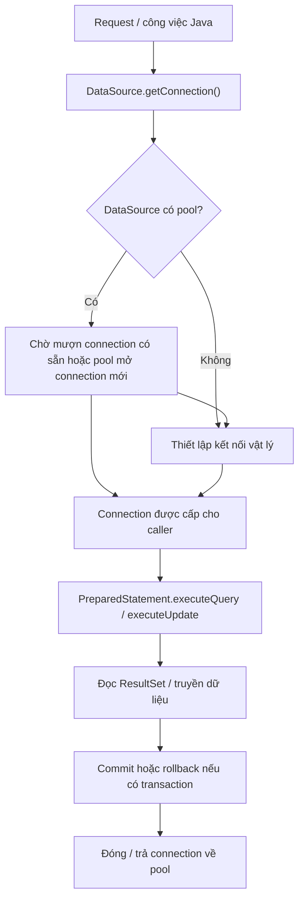

# Cấu hình thời gian chờ đăng nhập phù hợp với DataSource trong JDBC

## 1. Bối cảnh: chờ lấy kết nối không giống chờ chạy câu SQL

Ứng dụng Java dùng **JDBC** thường lấy kết nối từ `javax.sql.DataSource` rồi tạo `PreparedStatement` để chạy câu SQL tham số hóa, đọc `ResultSet`, thực hiện CRUD hoặc bắt đầu transaction. Nếu database không phản hồi, đường mạng có vấn đề hoặc pool cạn kết nối, một lời gọi tưởng như đơn giản:

```java
Connection connection = dataSource.getConnection();
```

có thể mất nhiều thời gian hoặc thất bại. Trong một ứng dụng web, chờ quá lâu ở bước này có thể làm request vượt thời hạn, giữ worker thread và làm giảm năng lực phục vụ các request khác.

JDBC cung cấp **login timeout** để giới hạn thời gian chờ trong quá trình **thiết lập kết nối tới cơ sở dữ liệu**, thông qua hai phương thức thuộc API của `DataSource`:

```java
void setLoginTimeout(int seconds) throws SQLException;
int getLoginTimeout() throws SQLException;
```

Điểm cần nắm ngay: **login timeout không phải query timeout**. Nếu `getConnection()` trả về kết nối thành công rồi một truy vấn chạy 30 giây, cấu hình `setLoginTimeout(5)` không tự dừng truy vấn ở giây thứ 5.

Bài thuộc chương **Timeout và hủy** của module **JDBC**. Phạm vi bao gồm driver, `DataSource`, `Connection`, `PreparedStatement`, `ResultSet`, SQL tham số hóa, thời hạn chờ, hủy thao tác và xử lý lỗi, hiệu năng bằng API JDBC chuẩn.

Sau bài này, bạn có thể:

1. Cấu hình `DataSource.setLoginTimeout(int)` và hiểu cách đọc `getLoginTimeout()`.
2. Phân biệt thời gian chờ đăng nhập với **thời gian mượn kết nối từ pool**, thời gian thiết lập TCP/TLS, query timeout và network timeout.
3. Đặt ngân sách thời gian hợp lý cho request mà không nhầm đơn vị giây và mili giây.
4. Viết code JDBC quản lý tài nguyên, transaction và lỗi kết nối an toàn.
5. Kiểm thử hành vi timeout thực tế trên **đúng DataSource, pool, driver và database** mà hệ thống sử dụng.

> **Tư tưởng chính:** `setLoginTimeout` là một cơ chế cấu hình tiêu chuẩn JDBC, nhưng hiệu lực và phạm vi thực tế phụ thuộc implementation của `DataSource` và driver. Không chỉ đọc một giá trị cấu hình rồi kết luận mọi lần `getConnection()` sẽ kết thúc chính xác sau số giây đó.

## 2. DataSource login timeout là gì?

### 2.1. Phương thức chuẩn và đơn vị đo

`javax.sql.DataSource` có `setLoginTimeout(int seconds)` và `getLoginTimeout()`, kế thừa từ hợp đồng API dữ liệu JDBC. Ý nghĩa:

- `setLoginTimeout(seconds)`: đề nghị giới hạn thời gian chờ trong lúc DataSource cố thiết lập kết nối tới database.
- `getLoginTimeout()`: đọc giá trị login timeout mà DataSource báo đang được cấu hình.
- Đơn vị của cả hai là **giây** (*seconds*), không phải mili giây.
- Giá trị `0` mang nghĩa dùng thời hạn chờ mặc định của hệ thống nếu có, nếu không có thì không có thời hạn chờ theo cơ chế login timeout đó. Trong một ứng dụng vận hành, **không nên coi 0 là lựa chọn an toàn** nếu hệ thống cần giới hạn thời gian thực tế.
- Những giá trị âm không nên dùng khi chưa có hợp đồng rõ ràng của implementation. Ví dụ bài thực hành sẽ chỉ chấp nhận số giây dương.

Ví dụ:

```java
dataSource.setLoginTimeout(5); // 5 giây
int configuredSeconds = dataSource.getLoginTimeout();
```

Đây là **cấu hình cho đối tượng DataSource**, không phải việc ngủ 5 giây hoặc một đồng hồ hẹn giờ mà Java tự khởi chạy trong code gọi.

### 2.2. Đặt cấu hình trước khi ứng dụng bắt đầu lấy connection

Một trình tự khuyến nghị:

```text
Tạo DataSource theo cấu hình ứng dụng
          |
          v
setLoginTimeout(5) và cấu hình driver/pool tương thích
          |
          v
Kiểm tra getLoginTimeout(), chạy connectivity check có kiểm soát
          |
          v
Đưa DataSource vào service/repository
          |
          v
Service gọi getConnection() theo nhu cầu
```

Nên cấu hình **một lần lúc khởi tạo** thay vì thay đổi login timeout trước mỗi request. Đối tượng `DataSource` thường được dùng chung giữa nhiều luồng, và việc thay cấu hình trong lúc ứng dụng hoạt động có thể tạo hiệu ứng không rõ ràng tùy driver/pool.

Một số pool cần cấu hình thông qua **thuộc tính riêng và vòng đời khởi tạo riêng**. Việc gọi setter sau khi pool đã bắt đầu sử dụng có thể không tác động tới kết nối đang tồn tại hoặc không được hỗ trợ. Luôn kiểm tra tài liệu của implementation.

### 2.3. API chuẩn không bảo đảm mọi implementation hỗ trợ đầy đủ

Lời gọi `setLoginTimeout` có thể ném `SQLException`, bao gồm `SQLFeatureNotSupportedException` nếu DataSource/driver không hỗ trợ tính năng tương ứng.

```java
try {
    dataSource.setLoginTimeout(5);
} catch (SQLFeatureNotSupportedException unsupported) {
    // Quyết định rõ ràng: cấu hình cơ chế tương đương của driver/pool,
    // hoặc báo lỗi khởi động. Không bỏ qua âm thầm.
}
```

Cần import `java.sql.SQLFeatureNotSupportedException` và bảo đảm `dataSource` đã được tạo. Một số implementation báo lỗi bằng kiểu `SQLException` khác; chương trình phải nhận biết và xử lý tương ứng.

**Không nên nuốt exception rồi ghi log “Đã bật login timeout”**. Việc cấu hình thất bại có thể khiến ứng dụng không có bất kỳ giới hạn chờ nào ở giai đoạn thiết lập kết nối.

## 3. Bản đồ các tầng timeout: chính xác thời gian nào đang được giới hạn?

Một request đi từ ứng dụng đến DB có thể trải qua nhiều giai đoạn:



Các khoảng chờ có thể liên quan những cấu hình hoàn toàn khác nhau:

| Cơ chế | Phạm vi thời gian | API/thuộc tính điển hình | Đơn vị thường gặp |
|---|---|---|---|
| **Login timeout** | Thiết lập kết nối tới DB do `DataSource` thực hiện | `DataSource.setLoginTimeout(int)` | **Giây** |
| **Pool acquisition/borrow timeout** | Chờ một connection có thể sử dụng được từ pool | Thuộc tính **riêng của thư viện pool** | Thường **mili giây**, nhưng phải xem tài liệu |
| **Driver connect timeout** | Kết nối mạng tới địa chỉ DB, tùy giai đoạn và driver | Thuộc tính của JDBC driver/URL/DataSource cụ thể | Tùy driver |
| **Socket/read timeout** | Chờ đọc/ghi trên kết nối mạng đã có | Thuộc tính driver hoặc cấu hình socket | Tùy driver |
| **Statement/query timeout** | Chờ lệnh SQL thực thi | `Statement.setQueryTimeout(int)` | **Giây** |
| **Network timeout trên Connection** | Một số thao tác mạng của connection hiện hữu | `Connection.setNetworkTimeout(Executor, int)` | **Mili giây** |
| **Kiểm tra kết nối còn sống** | Khoảng chờ cho phép xác minh `Connection` | `Connection.isValid(int timeout)` | **Giây** |
| **Deadline request tổng thể** | Toàn bộ xử lý HTTP/công việc, gồm cả DB và tác vụ khác | Framework hoặc cơ chế deadline của ứng dụng | Tùy API |

**Đừng gộp tất cả thành một thông số gọi là “database timeout”.** Một hệ thống có thể có login timeout 5 giây nhưng vẫn chờ 20 giây mượn connection vì pool hết tài nguyên, hoặc lấy connection trong 2 mili giây nhưng một `SELECT` chạy 40 giây.

### 3.1. Khi DataSource không có pool

Với một `DataSource` tạo kết nối vật lý mỗi lần gọi, `getConnection()` thường bao gồm quá trình tìm địa chỉ server, kết nối mạng, thương lượng giao thức/TLS và xác thực. Login timeout hướng đến quá trình thiết lập đó; các chi tiết riêng của DNS, socket, xác thực hoặc retry nội bộ có thể có giới hạn khác nhau.

`setLoginTimeout(5)` **không bảo đảm** mọi đoạn DNS/TCP/TLS trong mọi driver bị hủy đúng tại 5,000 giây. Đó là lý do cần cấu hình thêm timeout kết nối/mạng nếu driver hỗ trợ và kiểm thử bằng các tình huống hỏng mạng khác nhau.

### 3.2. Khi DataSource là một connection pool

Với pool, `getConnection()` có thể:

1. Trả một connection đã mở và còn hợp lệ.
2. Chờ connection đang được mượn bởi request khác được trả về.
3. Thử tạo connection vật lý mới khi pool cho phép mở rộng.
4. Kiểm tra tính hợp lệ của connection trước khi cấp.

**Login timeout không đồng nghĩa thời gian chờ mượn connection từ pool.** Pool thường có thuộc tính riêng để giới hạn thời gian người gọi chờ khi không có connection khả dụng. Một số pool có thể ánh xạ hoặc bỏ qua `DataSource.setLoginTimeout`; không thể suy ra hành vi từ tên API chung.

Nếu pool đã có sẵn connection, `getConnection()` có thể không thực hiện bước đăng nhập mới, nên login timeout hầu như không phải yếu tố chi phối thời gian gọi đó. Ngược lại, nếu pool phải tạo kết nối mới, phải quan sát mối quan hệ giữa timeout của pool và driver.

## 4. Cấu hình DataSource ở thời điểm khởi tạo

### 4.1. Ví dụ Java 17+ có thể tái sử dụng

`DataSource` là giao diện, không thể trực tiếp `new DataSource()`. Trong ứng dụng thực tế, đối tượng `DataSource` có thể được tạo bởi container/JNDI, framework, connection pool hoặc factory dành riêng cho JDBC driver.

Đoạn mã sau **không phụ thuộc** vào một driver cụ thể: nhận DataSource đã được khởi tạo và cấu hình ngay trước khi đưa vào các repository.

```java
import javax.sql.DataSource;
import java.sql.SQLException;
import java.util.Objects;

public final class JdbcDataSourceSetup {
    private JdbcDataSourceSetup() {}

    /**
     * Cấu hình thời gian chờ thiết lập kết nối.
     * Yêu cầu của ứng dụng: một số giây dương.
     */
    public static DataSource configureLoginTimeout(
            DataSource dataSource,
            int loginTimeoutSeconds
    ) throws SQLException {
        Objects.requireNonNull(dataSource, "dataSource");

        if (loginTimeoutSeconds <= 0) {
            throw new IllegalArgumentException(
                    "loginTimeoutSeconds phải lớn hơn 0");
        }

        // Thực hiện trước khi các service bắt đầu mượn kết nối.
        dataSource.setLoginTimeout(loginTimeoutSeconds);

        // Kiểm tra dữ liệu cấu hình mà implementation báo lại.
        int reportedSeconds = dataSource.getLoginTimeout();

        // Mismatch nên được quan sát và xử lý theo chính sách triển khai.
        // reportedSeconds không tự chứng minh timeout được thực thi
        // đúng trong mọi tình huống mất mạng.
        if (reportedSeconds != loginTimeoutSeconds) {
            throw new SQLException(
                    "DataSource báo login timeout không khớp: yêu cầu "
                    + loginTimeoutSeconds + " giây, thực tế "
                    + reportedSeconds + " giây");
        }

        return dataSource;
    }
}
```

Code minh họa chọn chính sách **fail-fast** khi DataSource không nhận đúng giá trị cấu hình mà ứng dụng yêu cầu. Một ứng dụng khác có thể chấp nhận giá trị điều chỉnh của provider khi có tài liệu và thử nghiệm chứng minh phù hợp, nhưng phải làm điều đó có chủ đích.

Lưu ý: phương thức `getLoginTimeout()` giúp xác minh **giá trị được báo**, không phải một phép đo giới hạn thời gian chờ thực tế. Chỉ kiểm thử tích hợp với driver/DB và mạng thực tế mới quan sát được hành vi khi kết nối chậm hoặc thất bại.

### 4.2. Cách đưa vào ứng dụng

Giả sử tầng cấu hình đã tạo được một DataSource bằng driver hoặc pool của dự án:

```java
DataSource raw = buildDataSourceFromConfiguration();

DataSource configured = JdbcDataSourceSetup.configureLoginTimeout(
        raw,
        5   // thời gian chờ đăng nhập do ứng dụng yêu cầu: 5 giây
);

CustomerRepository repository = new CustomerRepository(configured);
```

`buildDataSourceFromConfiguration()` là factory **do ứng dụng tự định nghĩa**, không phải API có sẵn của JDK. `CustomerRepository` được minh họa ở mục 5. Cách triển khai thực tế phải cung cấp URL, credentials và các thuộc tính driver/pool qua một hệ thống quản lý bí mật/cấu hình phù hợp.

Nếu `setLoginTimeout` ném `SQLException`, quá trình khởi tạo không nên coi cấu hình đã thành công. Trong môi trường cần đảm bảo SLA, có thể dừng khởi động với lỗi cấu hình rõ ràng thay vì âm thầm để DataSource chạy không giới hạn.

### 4.3. Vì sao không cấu hình login timeout trong mỗi repository?

Một mẫu không nên dùng:

```java
public Customer findCustomer(long id) throws SQLException {
    dataSource.setLoginTimeout(5); // Không đặt lại trong mỗi request.
    try (Connection connection = dataSource.getConnection()) {
        // ...
    }
}
```

Vấn đề:

- DataSource có thể được chia sẻ giữa các request và luồng.
- Thay đổi cấu hình động có thể bị từ chối hoặc có tác dụng không đồng đều.
- Code nghiệp vụ bị gắn chặt với cấu hình hạ tầng, khó kiểm soát.
- Nếu một request thay timeout thành 1 giây còn request khác thay thành 10 giây, hành vi có thể không còn rõ ràng.

Đúng hơn là cấu hình DataSource khi xây dựng dependency, sau đó repository chỉ **mượn kết nối** và tự đóng tài nguyên nó tạo.

## 5. Phân biệt bằng ví dụ: login timeout 5 giây, query timeout 3 giây

Giả sử ứng dụng cần tra tên khách hàng. DataSource đã được cấu hình login timeout **5 giây** trong quá trình khởi tạo. Mỗi statement lại có thời hạn thực thi riêng:

```java
import javax.sql.DataSource;
import java.sql.Connection;
import java.sql.PreparedStatement;
import java.sql.ResultSet;
import java.sql.SQLException;
import java.util.Objects;
import java.util.Optional;

public final class CustomerRepository {
    private final DataSource dataSource;

    public CustomerRepository(DataSource dataSource) {
        this.dataSource = Objects.requireNonNull(dataSource);
    }

    public Optional<String> findName(long customerId)
            throws SQLException {
        String sql = """
                SELECT display_name
                FROM customers
                WHERE id = ?
                """;

        // Login timeout có hiệu lực ở giai đoạn lấy/thiết lập
        // connection theo khả năng và cách triển khai DataSource.
        try (Connection connection = dataSource.getConnection();
             PreparedStatement statement =
                     connection.prepareStatement(sql)) {
            statement.setLong(1, customerId);

            // Query timeout riêng: 3 giây.
            statement.setQueryTimeout(3);

            try (ResultSet rs = statement.executeQuery()) {
                if (!rs.next()) {
                    return Optional.empty();
                }
                return Optional.ofNullable(
                        rs.getString("display_name"));
            }
        }
    }
}
```

Hai mốc thời gian có **phạm vi khác nhau**:

```text
dataSource.getConnection()
    |---- login/borrow/connect ----|   [vượt thời hạn ở đây
                                       tùy DataSource/driver/pool]

connection.prepareStatement(...)
statement.setQueryTimeout(3)
statement.executeQuery()
    |------ SQL execution --------|   [query timeout ở đây
                                       theo hỗ trợ driver]

ResultSet processing
    |------ đọc dữ liệu ----------|   [có thể cần giới hạn mạng/
                                       ứng dụng riêng]

connection.close() / pool return
```

Một điểm quan trọng: `setQueryTimeout(3)` thường giới hạn **thời gian thực thi câu lệnh** theo driver, không phải một deadline bảo đảm bao trùm mọi bước xử lý từ khi tạo statement đến khi đọc toàn bộ `ResultSet`. Nó cũng không thay thế login timeout.

Nếu driver không hỗ trợ query timeout hoặc cơ chế hủy query, các phương thức tương ứng có thể ném `SQLException` hoặc không đạt hành vi mong muốn; phải kiểm thử với DB cụ thể.

## 6. DriverManager.setLoginTimeout khác DataSource.setLoginTimeout

JDBC có một API khác dễ gây nhầm:

```java
java.sql.DriverManager.setLoginTimeout(5);
```

`DriverManager` là lớp quản lý thiết lập kết nối qua `DriverManager.getConnection(...)`; timeout của nó là cấu hình **toàn cục tĩnh** trên `DriverManager`. Trong khi đó:

```java
dataSource.setLoginTimeout(5);
```

là yêu cầu cấu hình cho **đối tượng DataSource cụ thể**.

| Tiêu chí | `DataSource.setLoginTimeout(...)` | `DriverManager.setLoginTimeout(...)` |
|---|---|---|
| Đối tượng cấu hình | Một DataSource (và cơ chế triển khai phía sau) | `DriverManager` ở phạm vi lớp tĩnh |
| Cách lấy connection tương ứng | `dataSource.getConnection()` | `DriverManager.getConnection(url, ...)` |
| Phạm vi thường cần cân nhắc | Driver/pool/ứng dụng sở hữu DataSource đó | Những phần code dùng DriverManager trong cùng tiến trình |
| Đơn vị | Giây | Giây |
| Tính độc lập | Không giả định được gán tự động sang DriverManager | Không giả định cấu hình tác động tới mọi DataSource |
| Thực hành nên chọn | Ưu tiên khi ứng dụng quản lý DB qua DataSource | Dùng khi code thật sự lấy kết nối qua DriverManager |

**Không nên gọi `DriverManager.setLoginTimeout(5)` rồi kết luận rằng DataSource do connection pool tạo sẽ tuân thủ 5 giây.** Pool có thể dùng driver/cơ chế riêng và có thời hạn chờ mượn kết nối độc lập.

Trong hệ thống nhiều DataSource (ví dụ DB nghiệp vụ và DB báo cáo), hai đối tượng có thể cần timeout khác nhau. Cấu hình trên từng DataSource hoặc cấu hình do từng pool quản lý phù hợp hơn việc thay một biến tĩnh ở `DriverManager` cho toàn ứng dụng.

## 7. Login timeout, connect timeout và network timeout phối hợp ra sao?

### 7.1. Timeout của JDBC driver là lớp cấu hình độc lập

Ngoài API chuẩn, nhiều JDBC driver cung cấp thuộc tính liên quan:

- **Connect timeout** cho một bước hoặc toàn bộ thiết lập kết nối mạng tới server, theo định nghĩa của driver.
- **Socket/read timeout** giới hạn thời gian chờ dữ liệu từ server trên một kết nối đang sử dụng.
- **SSL/TLS handshake timeout**, DNS, cơ chế failover hoặc danh sách nhiều host, khi driver hỗ trợ.
- **Login/authentication timeout** do chính driver hoặc DataSource implementation định nghĩa.

Tên thuộc tính, đơn vị, mặc định và mức hỗ trợ **khác nhau giữa driver và phiên bản**. Không truyền bừa số `5000` cho một thuộc tính chưa xác định là giây hay mili giây. Nếu hệ thống dùng nhiều host hoặc failover, một thời hạn có thể được áp dụng theo từng nỗ lực kết nối thay vì toàn bộ chuỗi, tùy driver.

Hãy lập bảng cấu hình riêng cho từng tổ hợp:

| Thông tin cần ghi nhận | Ví dụ cách ghi |
|---|---|
| Loại DataSource | Simple DataSource do driver cung cấp hay wrapper connection pool |
| Tên thuộc tính | Tên chính xác từ tài liệu driver/pool |
| Đơn vị | Giây, mili giây hoặc loại khác |
| Giai đoạn áp dụng | Mượn pool, DNS/TCP/TLS, authentication, đọc socket |
| Hành vi khi hết hạn | Kiểu exception, có hủy attempt không, có loại connection khỏi pool không |
| Khả năng thay đổi sau khởi tạo | Có tác dụng ngay, cần khởi động lại pool hay không |

Không nên cố đặt mọi timeout bằng nhau một cách máy móc; cấu hình phụ thuộc thứ tự xử lý, nguồn kết nối, khả năng fallback và deadline của nghiệp vụ.

### 7.2. Connection.setNetworkTimeout là API khác

JDBC 4.1 có:

```java
connection.setNetworkTimeout(executor, 4_000);
```

Phương thức này dùng **mili giây** và áp dụng cho các thao tác mạng trên **Connection đã tồn tại**, theo hỗ trợ của driver. Nó **không** cấu hình việc lấy Connection ban đầu qua `DataSource.getConnection()`. Khi một thao tác mạng vượt thời hạn, driver có thể đánh dấu connection không còn dùng được, nên tầng quản lý cần xử lý kết nối và transaction tương ứng.

Ví dụ chỉ minh họa kiểu đối số:

```java
import java.sql.Connection;
import java.sql.SQLException;
import java.util.concurrent.Executor;

static void applyNetworkTimeout(
        Connection connection,
        Executor executor
) throws SQLException {
    connection.setNetworkTimeout(executor, 4_000); // 4 giây
}
```

Executor cần được quản lý bởi ứng dụng/pool; không tạo một thread pool mới cho **mỗi query** rồi bỏ quên. Một số driver không hỗ trợ `setNetworkTimeout` và có thể ném `SQLFeatureNotSupportedException`. Nếu Connection được pool quản lý, việc tự thay network timeout có thể ảnh hưởng tới các lần mượn sau hoặc va chạm cấu hình pool; cần tuân theo chính sách pool và khôi phục trạng thái nếu phù hợp.

### 7.3. Statement.cancel không phải login timeout

`Statement.cancel()` yêu cầu driver cố hủy việc thực thi một statement đang chạy; `setQueryTimeout(int)` có thể kích hoạt cơ chế hủy khi quá thời gian. Đây là cơ chế **sau khi đã có connection**, không dùng để giải quyết một lời gọi `getConnection()` đang chờ lấy kết nối.

Tương tự, hủy `Future` ở Java hoặc ngắt thread chờ không bảo đảm driver luôn hủy được tác vụ I/O hoặc hoàn tác tác động SQL đã thực hiện. Trong hệ thống nghiêm ngặt, cần kiểm thử cơ chế cancellation của driver và có chính sách dọn dẹp tài nguyên khi deadline tổng thể hết.

## 8. Chọn mức login timeout theo mục tiêu vận hành

### 8.1. Bắt đầu từ ngân sách thời gian của request

Giả sử dịch vụ có thời hạn xử lý tổng thể **8 giây** cho một request. Các con số dưới đây chỉ là **ví dụ lập ngân sách**, không phải giá trị chuẩn cho mọi ứng dụng:

| Giai đoạn | Ngân sách dự kiến | Cơ chế quản lý |
|---|---:|---|
| Chờ mượn connection từ pool | 0,5 giây | Cấu hình timeout mượn connection của pool |
| Thiết lập kết nối vật lý khi cần | 3 giây | DataSource login timeout + driver connect timeout được kiểm thử |
| Thực thi query chính | 3 giây | `Statement.setQueryTimeout(3)` và hạn chế truy vấn |
| Mapping/đọc kết quả, logic nghiệp vụ | 1 giây | Deadline của ứng dụng, kiểm soát kích thước dữ liệu |
| Phần dự phòng, dọn dẹp, overhead | 0,5 giây | Deadline tổng và monitoring |

**Không cộng các cột như thể mọi giai đoạn luôn độc lập và xảy ra liên tiếp.** Thời gian mượn pool có thể bao gồm bước mở connection vật lý; query timeout có thể không bao trùm toàn bộ thời gian đọc kết quả; một request có thể chạy nhiều câu SQL. Ngân sách trên là công cụ giúp đặt giới hạn, phải xác nhận bằng trace thực tế.

Nếu deadline HTTP chỉ còn 1 giây, một connection attempt được phép chờ 5 giây là không hợp lý đối với request đó; cần cơ chế truyền deadline tới các lớp hoặc timeout ngắn hơn để không tiếp tục công việc đã quá hạn.

### 8.2. Các câu hỏi để chọn thời hạn hợp lý

1. **Database là local hay qua mạng?** Latency, DNS, TLS và topology ảnh hưởng thời gian thiết lập connection bình thường.
2. **Có connection pool không?** Nếu có, thời gian chờ pool là phần rất quan trọng; cấu hình login timeout đơn lẻ là chưa đủ.
3. **Connection mới được tạo thường xuyên không?** Pool ổn định có thể chủ yếu trả connection cũ, trong khi tác vụ batch hoặc cold start cần tạo nhiều connection mới.
4. **SLA/request deadline là bao nhiêu?** Timeout phải cho phép dừng và báo lỗi trước khi các tầng trên từ bỏ request.
5. **Có failover nhiều host không?** Driver có thể thử lần lượt nhiều địa chỉ; tổng thời gian và số attempt cần giới hạn.
6. **Khi hạ tầng chập chờn, retry thế nào?** Một timeout quá ngắn cộng retry dồn dập có thể làm DB đang yếu càng quá tải.
7. **Lỗi login có làm mất an toàn dữ liệu không?** Nếu việc kết nối thất bại trước khi có transaction, rủi ro khác với việc mất mạng ngay khi commit một câu ghi.

### 8.3. Một số lựa chọn thường gặp

| Bối cảnh | Hướng lựa chọn |
|---|---|
| API người dùng cần phản hồi nhanh | Login timeout hữu hạn; pool borrow timeout ngắn và phù hợp request deadline |
| Job batch dài chạy nền | Có thể chờ kết nối lâu hơn API tương tác, nhưng vẫn cần giới hạn và retry/backoff |
| Nhiều database có SLA khác nhau | Cấu hình mỗi DataSource/pool riêng; không dùng một timeout toàn cục |
| Database thường phải khởi động lạnh | Có thể tăng ngân sách khởi tạo ở startup, nhưng giới hạn request runtime vẫn cần cân nhắc |
| Hệ thống có failover | Kết hợp driver connect timeout, tổng deadline và số host/attempt thay vì chỉ tăng login timeout |
| DB dùng kết nối qua proxy | Kiểm tra login timeout ở cả client/pool/proxy; độ trễ có thể nằm ở tầng khác |

Không có giá trị “luôn đúng” như 3, 5 hoặc 30 giây cho mọi dự án. Số cụ thể phải được đo trong môi trường tương đương production và điều chỉnh dựa trên quan sát (latency phân vị, failure rate, số thread chờ, độ bão hòa pool).

## 9. Xử lý lỗi khi getConnection bị timeout

### 9.1. Các exception có thể gặp

`DataSource.getConnection()` có thể ném `SQLException`. Tùy driver/pool, nguyên nhân có thể được biểu diễn thành:

| Exception hoặc tín hiệu | Cách hiểu | Lưu ý |
|---|---|---|
| `SQLTimeoutException` | Một thao tác JDBC vượt thời hạn chờ theo cơ chế liên quan | Có thể xuất hiện ở kết nối hoặc câu lệnh, không chỉ login |
| `SQLTransientConnectionException` | Driver báo lỗi kết nối có tính tạm thời | Chỉ là tín hiệu phân loại; **không đủ** để chứng minh mọi retry an toàn |
| `SQLNonTransientConnectionException` | Lỗi kết nối không kỳ vọng hết chỉ nhờ thử lại tức thì | Có thể là cấu hình, môi trường hoặc lỗi không tạm thời |
| `SQLFeatureNotSupportedException` | Tính năng JDBC không được hỗ trợ | Có thể gặp khi cấu hình login/network/query timeout |
| `SQLException` khác | Thông điệp, `SQLState` và vendor code do driver cung cấp | Không giả định một subclass cố định cho mọi timeout |

Các mã `SQLState` thường được xem cùng với kiểu exception và bối cảnh. Class `08` liên quan lỗi kết nối, nhưng timeout từ pool, DB hoặc driver có thể dùng mã khác hoặc trả `null`. Không viết logic chỉ kiểm tra `SQLState.startsWith("08")` rồi kết luận chắc chắn lỗi login timeout.

### 9.2. Ghi log thời gian lấy connection thực tế

Để chẩn đoán, nên đo thời gian `getConnection()` riêng với thời gian SQL:

```java
import javax.sql.DataSource;
import java.sql.Connection;
import java.sql.SQLException;
import java.util.concurrent.TimeUnit;

public final class ConnectionTiming {
    private final DataSource dataSource;

    public ConnectionTiming(DataSource dataSource) {
        this.dataSource = dataSource;
    }

    public void verifyConnection() throws SQLException {
        long startedNanos = System.nanoTime();

        try (Connection connection = dataSource.getConnection()) {
            long elapsedMillis = TimeUnit.NANOSECONDS.toMillis(
                    System.nanoTime() - startedNanos);

            System.out.println(
                    "Đã lấy connection trong " + elapsedMillis + " ms");

            // Đã có connection, có thể kiểm tra có kiểm soát tại đây.
        } catch (SQLException failure) {
            long elapsedMillis = TimeUnit.NANOSECONDS.toMillis(
                    System.nanoTime() - startedNanos);

            System.err.printf(
                    "getConnection thất bại sau %d ms,"
                    + " SQLState=%s, vendorCode=%d%n",
                    elapsedMillis,
                    failure.getSQLState(),
                    failure.getErrorCode());

            throw failure;
        }
    }
}
```

Đây là code học tập; môi trường production nên dùng logger/metrics thay vì `System.out` hoặc `System.err`, đồng thời không log URL chứa credentials, password hay thông tin truy cập nhạy cảm.

**`System.nanoTime()`** phù hợp để đo khoảng thời gian đã trôi qua; không dùng `System.currentTimeMillis()` cho phép đo latency có độ tin cậy cao vì đồng hồ hệ thống có thể bị điều chỉnh.

Nếu việc lấy connection mất 7 giây dù login timeout được báo là 5 giây, điều cần làm là **xác định giai đoạn nào đang chờ** (pool, DNS, network, retry driver, xác thực), không mặc định `DataSource.setLoginTimeout` bị Java bỏ qua trong mọi tình huống.

### 9.3. Có nên retry khi timeout?

Không nên retry trong một vòng lặp vô hạn:

```java
// Không nên: retry ngay liên tục gây áp lực lên DB/pool.
while (true) {
    try {
        return dataSource.getConnection();
    } catch (SQLException ignored) {
        // Tệ: nuốt mọi nguyên nhân.
    }
}
```

Nếu lỗi xảy ra **trước khi có connection và trước khi thực thi bất kỳ SQL nào**, có thể thử lấy lại connection sau một khoảng backoff, với số lần thử giới hạn và deadline tổng. Nhưng nếu một lớp service bắt đầu một transaction trước đó, hoặc lỗi xảy ra ở bước ghi/commit, cần kiểm tra trạng thái nghiệp vụ trước khi thực hiện lại toàn bộ công việc.

Đối với mất kết nối ở thời điểm `COMMIT`, kết quả transaction có thể chưa rõ: retry thao tác tạo đơn hàng hoặc chuyển tiền mà không có idempotency có thể ghi trùng. Đừng đưa ra quyết định retry chỉ từ lớp exception là `SQLTransientException`.

## 10. Khi DataSource nằm trong một transaction

### 10.1. Login timeout chỉ có ý nghĩa khi cần lấy connection

Một transaction JDBC tường minh thường có dạng:

```text
getConnection()  <-- login/borrow/connect timeout có thể phát sinh tại đây
      |
setAutoCommit(false)
      |
PreparedStatement.executeUpdate()
      |
PreparedStatement.executeUpdate()
      |
commit()/rollback()
      |
close()
```

Sau khi đã có `Connection`, `DataSource.setLoginTimeout` không phải “đồng hồ tổng” cho các `UPDATE` hoặc `COMMIT` trên connection đó. Để kiểm soát các bước tiếp theo, cần các cơ chế timeout khác, deadline ứng dụng và chính sách transaction phù hợp.

### 10.2. Không giữ connection trong lúc chờ công việc ngoài DB

Một anti-pattern:

```java
try (Connection connection = dataSource.getConnection()) {
    // Thời gian chờ HTTP chậm không bị giới hạn bởi login timeout.
    String remotePayload = callSlowRemoteService();
    // Sau đó mới chạy SQL.
}
```

Đây là đoạn minh họa; `callSlowRemoteService()` do ứng dụng tự định nghĩa. Nếu không cần transaction đang mở để đọc dịch vụ khác, nên gọi và xác thực dữ liệu bên ngoài trước khi lấy connection. Việc giữ connection nhàn rỗi trong lúc chờ mạng bên ngoài làm tăng nguy cơ pool cạn, từ đó nhiều request khác lại bị block ở `getConnection()`.

Khi thao tác DB nhiều bước phải nguyên tử, tầng điều phối transaction nên truyền **cùng một Connection** vào các repository; repository không tự mở kết nối mới hoặc thay timeout login trong mỗi bước.

## 11. Lỗi cấu hình thường gặp

| Sai lầm | Hậu quả | Cách sửa |
|---|---|---|
| Coi `setLoginTimeout(5000)` là 5 giây | Thực tế là **5000 giây** theo đơn vị API | Truyền `5` khi muốn 5 giây |
| Coi `setLoginTimeout(0)` luôn là “vô hạn” | Bỏ qua khả năng timeout mặc định của hệ thống | Hiểu giá trị 0 theo hợp đồng; chọn số dương khi cần giới hạn |
| Cấu hình `DriverManager.setLoginTimeout` nhưng ứng dụng dùng pool DataSource | Có thể không tác động tới DataSource | Cấu hình đúng DataSource và pool |
| Chỉ cấu hình login timeout, bỏ qua pool wait | Hết connection có thể khiến request chờ lâu | Đặt timeout mượn kết nối riêng theo API của pool |
| Chỉ cấu hình query timeout để tránh treo khi lấy connection | `setQueryTimeout` chưa có hiệu lực trước khi tạo statement | Giới hạn bước lấy kết nối riêng |
| Coi `getLoginTimeout() == 5` là đảm bảo stop ở đúng 5 giây | Driver/pool/network có hành vi khác | Đo thời gian thực và thử lỗi mạng |
| Gọi `setLoginTimeout` ở mỗi request | Cấu hình chia sẻ có thể bị thay đổi đồng thời | Cấu hình một lần trước khi sử dụng |
| Nuốt `SQLFeatureNotSupportedException` | Cơ chế timeout có thể chưa được cấu hình | Fail-fast hoặc cấu hình thay thế có kiểm chứng |
| Quên đóng Connection khi thử kết nối | Rò rỉ connection, pool dễ cạn | Dùng `try-with-resources` |
| Không đóng connection sau timeout ở query | Giữ connection ở trạng thái lỗi hoặc chiếm pool | Đóng/dọn theo hợp đồng driver và transaction |
| Đọc nhầm đơn vị của driver connect timeout | Ngắn/quá dài ngoài dự kiến | Ghi rõ tên thuộc tính và đơn vị của từng driver |
| Retry mọi SQLException liên tục | Tăng tải, làm trầm trọng outage | Phân loại lỗi, giới hạn retry và backoff |
| Dùng timeout như cơ chế phân quyền | Không giải quyết lỗi credentials/quyền | Kiểm soát bí mật và quyền DB độc lập |
| Kéo dài timeout để “giấu” query chậm | Query chậm và cạn tài nguyên vẫn còn | Phân tích SQL, index, pool, concurrency và trace |

Đặc biệt, một con số login timeout lớn hơn có thể khiến hệ thống giữ request thread lâu hơn chứ không khắc phục nguyên nhân DB quá tải. Cần xem lại giới hạn pool, số lượng request đồng thời, query chậm, cấu hình mạng và tình trạng server.

## 12. Kiểm thử login timeout trên DataSource thực tế

Không nên coi một bài unit test chỉ kiểm tra setter/getter là đủ. Cần **kiểm thử tích hợp** với loại DataSource, driver, connection pool và database tương ứng môi trường triển khai.

### 12.1. Ma trận kiểm thử

| Tình huống | Cách tạo điều kiện có kiểm soát | Điều quan sát |
|---|---|---|
| Cấu hình hợp lệ | `setLoginTimeout(5)` và `getLoginTimeout()` | Giá trị được báo, exception nếu không hỗ trợ |
| Đường kết nối bình thường | DB sẵn sàng, cấu hình chuẩn | `getConnection()` nhanh hơn ngưỡng vận hành dự kiến |
| Database không lắng nghe ở địa chỉ đích | Môi trường thử nghiệm với port không có service | Loại lỗi và thời gian; có thể từ chối ngay thay vì chờ đủ timeout |
| Kết nối bị treo khi thiết lập mạng | Mô phỏng packet drop/firewall theo hạ tầng thử nghiệm | Giới hạn thực tế của login/connect timeout |
| Xác thực thất bại | Credentials sai trong DB thử nghiệm | Lỗi quyền/xác thực; không coi là login timeout đơn thuần |
| Pool cạn | Mượn hết connection trong môi trường test, yêu cầu thêm | Pool borrow timeout, không quy hết vào login timeout |
| Kết nối sẵn trong pool | Pool có idle connection hợp lệ | Thời gian mượn rất ngắn, không cần login mới |
| Pool mở connection vật lý mới | Tăng tải đến lúc pool tạo thêm connection | Tương tác pool timeout và driver connect/login timeout |
| DB chậm trong query | `SELECT` có độ trễ kiểm soát | Query timeout khác login timeout |
| `ResultSet` đọc lâu | Trả dữ liệu lớn hoặc mạng chậm | Cần đánh giá socket/network/deadline, không chỉ login timeout |
| Cấu hình sau khi pool khởi động | Thử trong môi trường riêng | Setter có tác dụng, bị từ chối hoặc không ảnh hưởng tới connection cũ |
| Driver không hỗ trợ setter | Dùng test double hoặc implementation phù hợp | Khởi tạo thất bại rõ ràng hoặc fallback có kiểm chứng |
| Startup nhiều DataSource | Cấu hình khác nhau cho DB A và DB B | Mỗi DataSource nhận timeout dự kiến; không tác động chéo |
| Mất kết nối quanh commit | Fault injection vào transaction thử nghiệm | Không retry ghi mù; có khả năng đối soát |

**Không yêu cầu thời gian đo phải đúng 5,000 giây ± vài mili giây.** Scheduling, DNS, network, pool và driver khác nhau làm thời gian dao động; điều cần xác nhận là thời gian nằm trong giới hạn vận hành có chừa dung sai phù hợp và exception được phân loại/ghi nhận chính xác.

### 12.2. Unit test và integration test kiểm tra những gì?

- **Unit test:** xác nhận code truyền **số giây đúng**, cấu hình trước khi gọi repository, không nuốt exception từ setter, không log secrets và nhận biết khi `getLoginTimeout()` không khớp.
- **Integration test:** xác nhận driver/pool thực hiện giới hạn chờ trong một tình huống kết nối chậm, pool cạn hoặc kết nối bị gián đoạn. Quan sát thời gian lấy connection, trạng thái pool, số thread chờ, loại `SQLException` và khả năng khôi phục sau đó.
- **Load test:** đo khi số request đồng thời vượt khả năng cấp connection, bảo đảm không có retry storm và request timeout phù hợp.

Không cố tình chặn mạng production để thử timeout. Dùng môi trường cô lập và công cụ fault injection được kiểm soát để không làm ảnh hưởng người dùng.

### 12.3. Ví dụ bài tập thực hành

Chuẩn bị một `DataSource` từ driver hoặc connection pool trong dự án:

1. Gọi `JdbcDataSourceSetup.configureLoginTimeout(ds, 5)` ở bước startup và ghi nhận kết quả `getLoginTimeout()`.
2. Viết một repository lấy kết nối qua `ds.getConnection()`, có `try-with-resources`, và một `PreparedStatement` dùng `setQueryTimeout(3)`.
3. Đo riêng thời gian `getConnection()` và `executeQuery()` bằng `System.nanoTime()`; so sánh tình huống bình thường.
4. Dùng môi trường DB thử nghiệm tạo tình huống kết nối bị từ chối ngay; quan sát tại sao lời gọi có thể thất bại **trước** 5 giây.
5. Tạo tình huống mạng không phản hồi theo kịch bản an toàn; kiểm tra timeout thực tế và nhận diện giới hạn của setter.
6. Nếu dùng pool, giữ hết connection và thử mượn thêm. Ghi nhận timeout của pool và phân biệt nó với login timeout.
7. Thử một truy vấn chậm sau khi đã có connection: xác minh query timeout và login timeout **không phải cùng một cơ chế**.
8. Kiểm tra lỗi khi driver không hỗ trợ một API timeout; xác định cách fail-fast hoặc phương án cấu hình driver được tài liệu hóa.
9. Với một transaction thử nghiệm, quan sát việc rollback và đóng connection khi `SQLException` xảy ra; không giả định timeout ở giai đoạn commit đồng nghĩa rollback chắc chắn.

## 13. Checklist triển khai và kết luận

Trước khi đưa cấu hình login timeout vào ứng dụng JDBC thật, hãy xác nhận:

- **Đúng API:** hệ thống dùng `DataSource` hay `DriverManager`? Với DataSource, cấu hình bằng `setLoginTimeout(int seconds)` tại đúng đối tượng có hiệu lực.
- **Đúng đơn vị:** setter chuẩn dùng **giây**; không nhầm với mili giây của thuộc tính pool/driver hoặc `Connection.setNetworkTimeout(...)`.
- **Đúng thời điểm:** cấu hình trước khi lấy connection và trước khi khởi động pool nếu implementation yêu cầu.
- **Đúng phạm vi:** có timeout mượn pool, connect/socket timeout của driver, query timeout và deadline request riêng khi cần.
- **Đúng khả năng hỗ trợ:** kiểm tra `SQLException`/`SQLFeatureNotSupportedException`, đọc `getLoginTimeout()`, sau đó kiểm thử tình huống thực.
- **Đúng quản lý tài nguyên:** dùng `try-with-resources`, không giữ connection lâu hơn cần thiết, không bỏ sót rollback khi thao tác nhiều bước lỗi.
- **Đúng chính sách lỗi:** phân biệt lỗi lấy connection trước SQL với lỗi mất kết nối sau khi đã gửi lệnh ghi hoặc lúc commit.
- **Đúng khả năng quan sát:** đo latency, SQLState, vendor code, mức bão hòa pool và tình trạng retry; tuyệt đối không log credentials.
- **Đúng yêu cầu nghiệp vụ:** timeout nên ngắn hơn ngân sách thời gian của request nhưng đủ cho hành vi kết nối bình thường của môi trường.

**Ghi nhớ:** `DataSource.setLoginTimeout` là điểm bắt đầu chuẩn JDBC để giới hạn thời gian chờ **thiết lập kết nối**, nhưng không phải “công tắc timeout cho mọi thao tác database”. Cấu hình tốt luôn kết hợp đúng lớp timeout của **DataSource, connection pool, driver, statement và deadline ứng dụng**, sau đó xác nhận hành vi trên hệ thống triển khai thực tế.
