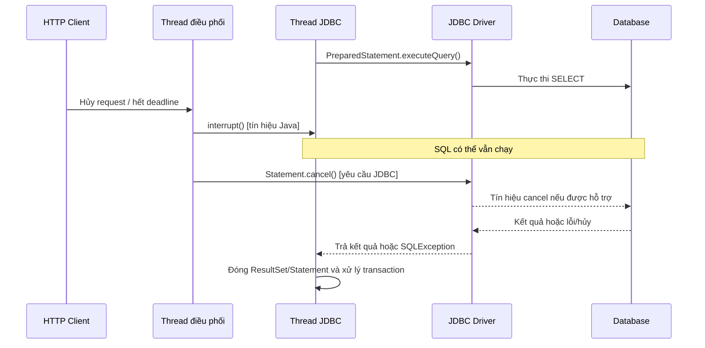
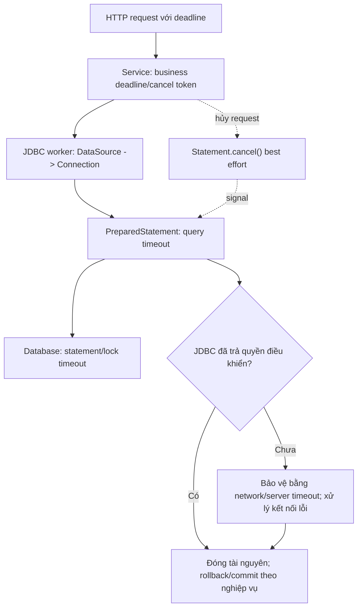

# Phân biệt ngắt luồng Java và hủy thao tác JDBC

## 1. Một yêu cầu đã hết thời gian, nhưng SQL còn chạy?

Trong ứng dụng Java truy cập cơ sở dữ liệu quan hệ bằng **JDBC**, một yêu cầu HTTP có thể bị người dùng hủy, một tác vụ `Future` bị timeout hoặc thread xử lý bị yêu cầu ngắt. Tại thời điểm đó, `PreparedStatement.executeQuery()`, `executeUpdate()` hay `ResultSet.next()` vẫn có thể đang chờ kết quả từ database.

Sai lầm dễ gặp là nghĩ rằng gọi `Thread.interrupt()` hoặc `Future.cancel(true)` sẽ lập tức dừng câu SQL trên server. **Không có bảo đảm JDBC chung như vậy.** Thread interruption là cơ chế phối hợp của Java; việc hủy một lệnh SQL cần cơ chế JDBC/driver và khả năng phản hồi của database.

JDBC cung cấp `Statement.cancel()` để **yêu cầu hủy việc thực thi statement đang chạy**. Nó có thể được gọi từ một thread khác thread đang chạy câu lệnh. Tuy nhiên, `cancel()` là yêu cầu *best effort*: câu SQL có thể đã hoàn tất, driver có thể không hỗ trợ đầy đủ, tín hiệu hủy có thể đến muộn hoặc tình trạng kết nối có thể chưa rõ.

Tình huống minh họa:

```text
T0  Worker A: gọi PreparedStatement.executeQuery()
T1  Server DB: đang thực thi truy vấn nặng
T2  HTTP request hết hạn; thread điều phối yêu cầu hủy
T3  Worker A: có thể vẫn kẹt trong JDBC I/O
T4  Statement.cancel(): gửi yêu cầu hủy qua driver nếu được hỗ trợ
T5  Worker A: executeQuery() trả kết quả hoặc ném SQLException
T6  Ứng dụng: giải phóng ResultSet/Statement/Connection,
               rollback nếu cần và xác định kết quả nghiệp vụ
```

Trong bài này, ta phân biệt **ngắt luồng Java**, **hủy statement JDBC**, **timeout ở các tầng**, và **hoàn tác transaction**, sau đó xây dựng cách phối hợp an toàn khi truy vấn lâu, ứng dụng hết thời gian hoặc người dùng bấm “Hủy”.

Sau bài học, bạn có thể:

- Giải thích tại sao `Thread.interrupt()`, `Future.cancel(true)` và `Statement.cancel()` không đồng nghĩa.
- Thiết lập `setQueryTimeout()`, hiểu `SQLTimeoutException` và giới hạn của driver.
- Phối hợp một tín hiệu hủy từ thread khác với `PreparedStatement`/`ResultSet` mà không giữ kết nối vô hạn.
- Phân biệt hủy thực thi với `Connection.rollback()` và xử lý kết quả transaction không chắc chắn.
- Đặt deadline ở nhiều tầng, phân loại lỗi và kiểm thử hành vi hủy trên database thật.

## 2. Hai cơ chế khác nhau: Java interruption và JDBC cancellation

### 2.1. `Thread.interrupt()` là một tín hiệu cộng tác

Khi thread A gọi:

```java
workerThread.interrupt();
```

JVM đặt trạng thái interrupt của thread đích. Với các thao tác Java **có hỗ trợ ngắt** như `Thread.sleep()`, `Object.wait()` hoặc một số thao tác blocking của `java.util.concurrent`, thread có thể nhận `InterruptedException`. Với mã tính toán thông thường, ứng dụng cần tự kiểm tra `Thread.currentThread().isInterrupted()` để dừng hợp tác.

Nhưng không thể giả định một lời gọi JDBC đang chờ socket sẽ ném `InterruptedException` hoặc database tự dừng khi thread bị interrupt. Driver có thể xử lý ngắt theo cách riêng, bỏ qua nó cho tới khi thao tác I/O kết thúc hoặc chuyển thành một loại lỗi JDBC. **Đặc tả Java thread interruption không thay thế hợp đồng hủy truy vấn của driver.**

```java
try {
    // Một tác vụ Java có khả năng ném InterruptedException.
    queue.take();
} catch (InterruptedException interrupted) {
    Thread.currentThread().interrupt(); // Khôi phục cờ interrupt.
    return;                              // Kết thúc tác vụ hợp tác.
}
```

`queue` ở đây là một `BlockingQueue` đã được khai báo; đoạn mã chỉ minh họa quy tắc xử lý `InterruptedException`. Không áp đặt quy tắc `catch (InterruptedException)` cho `executeQuery()` vì API JDBC đó thông thường ném `SQLException`, không khai báo `InterruptedException`.

### 2.2. `Future.cancel(true)` không xác nhận SQL đã dừng

`Future.cancel(true)` yêu cầu hủy tác vụ và cho phép ngắt thread đang thực thi. Khi trả `true`, `Future` chuyển sang trạng thái canceled theo hợp đồng của `Future`; **không phải xác nhận rằng câu SQL trên database đã bị hủy và mọi tài nguyên đã được giải phóng**.

```java
import java.util.concurrent.Future;

// Giả sử task là Future<?> đã nhận từ ExecutorService.submit(...).
boolean cancelAccepted = task.cancel(true);

// cancelAccepted chỉ phản ánh trạng thái hủy của Future.
// Không kết luận server DB đã ngừng thực thi SQL.
```

Một request HTTP bị timeout cũng có thể chỉ kết thúc việc **chờ kết quả** ở tầng web; câu truy vấn ở worker và database có thể tiếp tục chạy. Nếu không giới hạn thời gian và tài nguyên, các tác vụ “mồ côi” có thể chiếm JDBC connection pool, thread, CPU và khóa DB.

### 2.3. `Statement.cancel()` yêu cầu driver hủy câu SQL

Với `Statement` và các lớp con như `PreparedStatement`, có thể gọi:

```java
// Từ thread điều phối khác với thread đang executeQuery():
statement.cancel();
```

Theo API JDBC, `cancel()` có thể được một thread gọi để hủy statement do thread khác đang thực thi. Điều đó **không đồng nghĩa sử dụng cùng `Connection` hoặc `ResultSet` tự do trên nhiều thread**: thông thường cần một thread sở hữu vòng đời connection và statement, thread khác chỉ nắm tham chiếu để gọi `cancel()` khi có yêu cầu.

`cancel()` trả kiểu `void`, không trả `boolean` báo “đã hủy thành công”. Nó có thể ném `SQLException`, và cách driver diễn giải yêu cầu hủy khác nhau. Lệnh SQL cũng có thể hoàn tất thành công ngay trước hoặc trong lúc tín hiệu hủy được xử lý.

### 2.4. Bảng so sánh nhanh

| API / tín hiệu | Đối tượng tác động trực tiếp | Bảo đảm điều gì? | Không bảo đảm điều gì? |
|---|---|---|---|
| `Thread.interrupt()` | Cờ interrupt của một Java thread | Thread nhận tín hiệu ngắt | JDBC I/O hoặc SQL trên DB sẽ dừng ngay |
| `Future.cancel(true)` | Trạng thái tác vụ `Future`, có thể interrupt worker | Tác vụ được đánh dấu canceled nếu `cancel` thành công | Statement đã dừng, transaction đã rollback |
| `Statement.cancel()` | Statement JDBC đang thực thi | Gửi yêu cầu hủy tới driver khi được hỗ trợ | Lệnh chắc chắn chưa ghi dữ liệu hoặc đã rollback |
| `Statement.setQueryTimeout(seconds)` | Giới hạn thực thi do driver áp dụng cho statement | Yêu cầu driver timeout câu lệnh theo số giây cấu hình | Một deadline chính xác tuyệt đối trên mọi DB |
| `Connection.rollback()` | Transaction hiện tại trên connection | Yêu cầu hoàn tác các thay đổi chưa commit theo hợp đồng DB | Hủy được thao tác bên ngoài DB hoặc hoàn tác một commit đã hoàn tất |
| `Connection.abort(executor)` | Connection | Yêu cầu chấm dứt kết nối, tài nguyên liên quan | Một transaction đa hệ thống chắc chắn được rollback ngay |

Tách biệt **yêu cầu dừng công việc** với **bằng chứng kết quả nghiệp vụ** là nguyên tắc cốt lõi.

## 3. Hình dung đường đi của một yêu cầu bị hủy



Sơ đồ mô tả một trường hợp có đường hủy riêng. Đôi khi `interrupt()` được xử lý trực tiếp bởi driver; đôi khi `cancel()` không thành công, hoặc việc đọc dữ liệu còn chậm vì socket/network. Do đó, **hủy nhiều lớp** không có nghĩa “gọi cả ba API bất kể hoàn cảnh”, mà phải chọn cơ chế phù hợp theo hợp đồng của database, connection pool và deadline ứng dụng.

## 4. `setQueryTimeout()`: giới hạn thời gian thực thi câu SQL

API JDBC:

```java
import java.sql.PreparedStatement;

// Statement đã được tạo từ Connection.
statement.setQueryTimeout(10); // Đơn vị giây.
int configuredSeconds = statement.getQueryTimeout();
```

`setQueryTimeout(int seconds)` quy định số giây tối đa mà driver nên chờ statement hoàn thành. Theo JDBC, `0` thường có nghĩa **không giới hạn bởi query timeout của statement**. Giá trị âm không hợp lệ; driver có thể ném `SQLException` khi cấu hình không phù hợp, hoặc `SQLFeatureNotSupportedException` nếu không hỗ trợ tính năng.

Khi timeout xảy ra, JDBC có loại ngoại lệ `SQLTimeoutException`. Tuy nhiên, không nên giả định **mọi** timeout đều được driver báo bằng đúng lớp này: tùy DB/driver và đường lỗi, có thể nhận các `SQLException` khác, thậm chí lỗi kết nối. Xem `SQLState` và vendor error code để phân loại thêm.

Ví dụ một truy vấn được tham số hóa:

```java
import java.sql.Connection;
import java.sql.PreparedStatement;
import java.sql.ResultSet;
import java.sql.SQLException;
import java.sql.SQLTimeoutException;
import javax.sql.DataSource;

public static long countOrders(DataSource dataSource, long tenantId)
        throws SQLException {
    String sql = """
            SELECT COUNT(*)
            FROM orders
            WHERE tenant_id = ? AND status = 'PENDING'
            """;

    try (Connection connection = dataSource.getConnection();
         PreparedStatement ps = connection.prepareStatement(sql)) {
        ps.setLong(1, tenantId);
        ps.setQueryTimeout(8); // Yêu cầu timeout thực thi sau 8 giây.

        try (ResultSet rs = ps.executeQuery()) {
            if (!rs.next()) {
                throw new SQLException("COUNT query returned no row");
            }
            return rs.getLong(1);
        }
    } catch (SQLTimeoutException timeout) {
        // Giữ nguyên lỗi để tầng nghiệp vụ quyết định phản hồi/retry.
        throw timeout;
    }
}
```

Đoạn mã trên minh họa một thao tác `SELECT` độc lập, không tự quản lý transaction. Khi `executeQuery()` trả kết quả, `ResultSet` và statement được đóng qua `try-with-resources`. Nếu driver không thể hủy ngay, thời gian chờ thực tế có thể lớn hơn tám giây; và việc driver áp dụng timeout trong lúc đọc từng hàng của `ResultSet` cũng có khác biệt.

**Không dùng query timeout thay cho timeout mở kết nối hoặc đọc mạng.** Chúng tác động đến các giai đoạn khác nhau của một thao tác JDBC.

## 5. Các lớp timeout khác nhau và cách phối hợp

Một lời gọi JDBC thường có nhiều giai đoạn: mượn connection từ pool, thiết lập kết nối tới DB nếu cần, gửi câu SQL, chờ DB xử lý, nhận result set, đọc dòng/LOB và cuối cùng commit transaction.

| Giai đoạn | Cơ chế | Đơn vị | Điều cần nhớ |
|---|---|---|---|
| Mượn connection từ pool | Pool acquisition/borrow timeout | Thường ms | Tùy thư viện pool; không phải API `Statement` chuẩn. |
| Đăng nhập / tạo kết nối | `DataSource.setLoginTimeout()` hoặc `DriverManager.setLoginTimeout()` | Giây | Phạm vi hỗ trợ và hành vi phụ thuộc DataSource/driver. |
| Thực thi statement | `Statement.setQueryTimeout()` | Giây | Áp dụng cho statement; không nhất thiết bao phủ mọi I/O và fetch. |
| Giao tiếp mạng của connection | `Connection.setNetworkTimeout(executor, ms)` | Mili giây | Cơ chế JDBC mức connection; hỗ trợ tùy driver, có thể làm connection không dùng lại được. |
| Giới hạn phía database | Statement/lock timeout của DB | Tùy DB | Có thể có hiệu lực ngay cả khi application mất kết nối. |
| Deadline request/tác vụ | `Future`, framework hoặc cancellation token | Tùy API | Chỉ quản lý thời gian chờ/tác vụ Java nếu không nối với việc hủy JDBC. |

### 5.1. Login timeout

`DataSource` có:

```java
dataSource.setLoginTimeout(5);
int loginTimeoutSeconds = dataSource.getLoginTimeout();
```

Cấu hình này liên quan đến thời gian chờ thiết lập kết nối theo hợp đồng DataSource. Một connection pool có thể có giới hạn **mượn connection** khác với login timeout, ví dụ khi pool đã đầy. Đừng dựa vào một giá trị login timeout để bảo đảm request không bao giờ bị kẹt khi chờ pool.

### 5.2. Network timeout

JDBC có `Connection.setNetworkTimeout(Executor, int)` với thời gian theo mili giây:

```java
import java.sql.Connection;
import java.sql.SQLException;
import java.util.concurrent.Executor;

// Executor do ứng dụng quản lý, không sinh ra một thread pool
// riêng cho từng câu SQL.
Executor networkExecutor = managedExecutor;

try (Connection connection = dataSource.getConnection()) {
    int previousTimeoutMs = connection.getNetworkTimeout();
    connection.setNetworkTimeout(networkExecutor, 15000);
    // Thực hiện thao tác JDBC trong giới hạn phù hợp.
    // Khôi phục cấu hình ở tầng quản lý connection nếu connection còn tốt.
}
```

`managedExecutor` là một `Executor` được khai báo ở tầng ứng dụng. `setNetworkTimeout()` có thể ném `SQLFeatureNotSupportedException` hoặc `SQLException`; driver sử dụng executor để hoàn thành tác vụ nội bộ liên quan timeout. Theo JDBC, nếu network timeout xảy ra, connection có thể bị đóng/không còn sử dụng được; không mặc định trả connection đó về pool như một kết nối lành mạnh. Với connection pool hoặc framework, nên cấu hình network timeout ở nơi sở hữu kết nối và dùng đúng hợp đồng của pool; không tự ý thay đổi trạng thái connection do transaction khác quản lý.

Network timeout thường là giới hạn **giao tiếp mạng đang chờ**, không thay thế việc database tự giới hạn thời gian CPU thực thi hoặc chờ khóa. Một query timeout ngắn hơn và một network timeout dài hơn có thể là cấu hình hợp lý, nhưng phải đo trên môi trường thật.

### 5.3. Tính deadline theo ngân sách còn lại

Giả sử request có deadline 12 giây, nhưng đã tốn 4 giây ở các bước xác thực và xử lý trước JDBC. Đặt `setQueryTimeout(12)` có thể khiến tổng thời gian vượt deadline của request. Cách tốt hơn là tính thời gian còn lại rồi truyền mức timeout thực tế phù hợp:

```java
long started = System.nanoTime();
long budgetNanos = java.util.concurrent.TimeUnit.SECONDS.toNanos(12);

// Sau các bước nghiệp vụ trước DB:
long elapsed = System.nanoTime() - started;
long remaining = budgetNanos - elapsed;
if (remaining <= 0) {
    throw new java.util.concurrent.CancellationException(
            "Request deadline exceeded");
}

// setQueryTimeout nhận số giây nguyên và có độ phân giải giây.
// Khi ngân sách còn < 1 giây, cần cơ chế deadline khác
// thay vì làm tròn lên và tưởng rằng đó là giới hạn cứng.
int seconds = (int) Math.min(
        30L,
        Math.max(1L, java.util.concurrent.TimeUnit.NANOSECONDS
                .toSeconds(remaining)));
statement.setQueryTimeout(seconds);
```

Đây là ví dụ quy đổi thời gian cho câu SQL, **không phải bộ thực thi deadline tuyệt đối**. Với các tác vụ phải dừng ở cấp mili giây, cần cơ chế ứng dụng/driver/server bổ sung. Dùng `System.nanoTime()` để đo thời lượng tương đối, không lấy `currentTimeMillis()` làm đồng hồ đơn điệu cho deadline.

## 6. Hủy truy vấn đang chạy từ một thread khác

`Statement.cancel()` hữu ích khi ứng dụng có nút “Hủy truy vấn” hoặc request HTTP không còn cần kết quả. Để minh họa an toàn, ví dụ sau tạo **một đối tượng cho một lần tìm kiếm**, không dùng lại nó giữa nhiều request. Worker là chủ sở hữu `Connection`, còn thread điều phối chỉ gửi tín hiệu hủy tới statement đã được công bố.

```java
import java.sql.Connection;
import java.sql.PreparedStatement;
import java.sql.ResultSet;
import java.sql.SQLException;
import java.util.ArrayList;
import java.util.List;
import java.util.Objects;
import java.util.concurrent.CancellationException;
import java.util.concurrent.atomic.AtomicBoolean;
import java.util.concurrent.atomic.AtomicReference;
import javax.sql.DataSource;

record OrderSummary(long id, String status) {}

public final class CancelableOrderSearch {
    private final DataSource dataSource;
    private final AtomicBoolean cancelRequested = new AtomicBoolean(false);
    private final AtomicReference<PreparedStatement> running =
            new AtomicReference<>();

    public CancelableOrderSearch(DataSource dataSource) {
        this.dataSource = Objects.requireNonNull(dataSource);
    }

    // Worker JDBC gọi đúng một lần trên đối tượng này.
    public List<OrderSummary> search(long tenantId) throws SQLException {
        if (cancelRequested.get()) {
            throw new CancellationException("Canceled before execution");
        }

        String sql = """
                SELECT id, status
                FROM orders
                WHERE tenant_id = ?
                ORDER BY id
                """;

        try (Connection connection = dataSource.getConnection();
             PreparedStatement ps = connection.prepareStatement(sql)) {
            ps.setLong(1, tenantId);
            ps.setQueryTimeout(15);

            running.set(ps); // Công bố statement để thread khác cancel().
            try {
                if (cancelRequested.get()) {
                    ps.cancel();
                    throw new CancellationException(
                            "Canceled before executeQuery");
                }

                List<OrderSummary> rows = new ArrayList<>();
                try (ResultSet rs = ps.executeQuery()) {
                    while (rs.next()) {
                        if (cancelRequested.get()) {
                            throw new CancellationException(
                                    "Canceled while reading results");
                        }
                        rows.add(new OrderSummary(
                                rs.getLong("id"),
                                rs.getString("status")));
                    }
                }

                if (cancelRequested.get()) {
                    throw new CancellationException(
                            "Canceled before returning results");
                }
                return List.copyOf(rows);
            } finally {
                running.compareAndSet(ps, null);
            }
        }
    }

    // Thread điều phối có thể gọi khi người dùng hủy yêu cầu.
    public void requestCancel() throws SQLException {
        cancelRequested.set(true); // Nhớ yêu cầu ngay cả khi chưa có ps.
        PreparedStatement statement = running.get();
        if (statement != null) {
            statement.cancel(); // Best effort; có thể ném SQLException.
        }
    }
}
```

**Các ranh giới của ví dụ:**

1. `AtomicReference` dùng để công bố tham chiếu `PreparedStatement` giữa hai thread; `AtomicBoolean` giúp nhớ yêu cầu hủy khi statement chưa được tạo hoặc đã kết thúc. Mỗi instance chỉ phục vụ **một tác vụ**; không tái dùng `cancelRequested` cho nhiều lượt tìm kiếm.
2. Chỉ worker thực hiện `executeQuery()`, `ResultSet.next()` và `close()`. Thread khác không truy cập trực tiếp `Connection` hoặc duyệt `ResultSet`; nó chỉ gọi `cancel()` trên statement.
3. Có **race** giữa việc kiểm tra cờ và bắt đầu `executeQuery()`. Nếu lệnh vừa hoàn thành hoặc chưa thực sự chạy, `cancel()` có thể không hủy được phần công việc. Kiểm tra cờ trong lúc duyệt và trước khi trả kết quả giúp không công bố kết quả mà ứng dụng biết đã bị hủy, nhưng không cung cấp bảo đảm thời gian cứng.
4. `ps.cancel()` có thể ném `SQLException`. Mã gọi `requestCancel()` phải xử lý/truyền lỗi và ghi nhận việc hủy không được xác nhận; không tuyên bố “DB đã hủy” chỉ vì cờ Java đã đổi.
5. Khi worker thoát, `try-with-resources` đóng `ResultSet`, `PreparedStatement` và `Connection`. Việc đóng tài nguyên chỉ diễn ra **sau khi thao tác blocking trả quyền điều khiển**; nếu driver tiếp tục kẹt, cần các timeout mạng/server đã kiểm chứng.
6. Nếu phép đọc trả lỗi JDBC do việc cancel, SQLState/vendor code có thể giúp phân loại nhưng không có một mã chung áp dụng cho mọi DB. Không chuyển mọi `SQLException` thành “canceled”.
7. Đây là ví dụ **SELECT**; không có transaction ghi. Nếu hủy một lệnh DML, không thể suy luận trạng thái commit bằng quy trình hủy này.

Trong ứng dụng thật, phía điều phối thường có một mapping giữa request ID nội bộ và đối tượng quản lý truy vấn để gọi `requestCancel()`. Mapping cần được dọn khi tác vụ kết thúc; tránh lưu `Statement` trong bộ nhớ toàn cục không có vòng đời.

## 7. Khi `Future.cancel(true)` được gọi cùng `Statement.cancel()`

Một hệ thống có thể dùng `ExecutorService` để chạy truy vấn và một đối tượng hủy như mục 6:

```java
import java.util.List;
import java.util.concurrent.ExecutorService;
import java.util.concurrent.Future;

// Giả sử workers là ExecutorService được ứng dụng quản lý,
// dataSource và tenantId đã được khai báo ở tầng gọi.
CancelableOrderSearch query = new CancelableOrderSearch(dataSource);

Future<List<OrderSummary>> future =
        workers.submit(() -> query.search(tenantId));

// Khi deadline hết hoặc người dùng yêu cầu hủy:
try {
    query.requestCancel(); // Gửi tín hiệu hủy JDBC best effort.
} finally {
    future.cancel(true);   // Đánh dấu Future canceled và interrupt worker.
}

// Không suy từ trạng thái future rằng server SQL đã dừng.
// ExecutorService do ứng dụng quản lý, không shutdown mỗi request.
```

Đoạn mã là cấu trúc minh họa, giả định `workers`, `dataSource` và `tenantId` đã được định nghĩa. Đây **không phải** lời khuyên luôn gọi cả hai API theo một thứ tự cố định: việc `cancel()` có thể block hoặc ném lỗi, còn worker có thể kết thúc trước khi điều phối gọi đến. Thời gian thực tế phải được kiểm chứng với driver.

Đừng dùng `future.get()` sau khi hủy để “chờ JDBC chắc chắn kết thúc”: với một `Future` đã bị canceled, `get()` có thể ném `CancellationException` ngay, dù luồng xử lý JDBC còn đang dọn tài nguyên hoặc vẫn kẹt trong driver. Nếu cần chứng cứ worker đã thực sự kết thúc, phải theo dõi riêng vòng đời tác vụ/connection.

Khi bắt `InterruptedException` ở luồng **điều phối** đang đợi `Future.get()`, khôi phục cờ interrupt bằng `Thread.currentThread().interrupt()` và chuyển yêu cầu hủy theo hợp đồng của hệ thống. Không nuốt ngắt rồi tiếp tục chờ vô hạn.

## 8. Hủy SQL không đồng nghĩa rollback transaction

Giả sử một nghiệp vụ gồm ba lệnh trong một transaction:

```text
BEGIN TRANSACTION
    A: UPDATE inventory SET available_qty = available_qty - 1 ...
    B: INSERT INTO orders ...
    C: UPDATE reports ...        (chạy rất lâu)
    -> C bị yêu cầu hủy
ROLLBACK?
```

Khi `Statement.cancel()` hủy `C` thành công, điều đó **không tự động** khẳng định:

- Các thay đổi `A` và `B` đã bị hoàn tác.
- Transaction vẫn còn ở trạng thái có thể tiếp tục.
- Statement `C` chắc chắn chưa có tác động nào.
- Connection vẫn khỏe để sử dụng tiếp.
- Nếu một lệnh `COMMIT` đã được gửi thì transaction chắc chắn chưa commit.

Ứng dụng cần chủ động kiểm tra và thực hiện chính sách transaction. Với một nghiệp vụ đòi hỏi **all-or-nothing**, khi một bước bị timeout hoặc hủy, thường cần `rollback()` toàn bộ transaction sau khi driver trả quyền điều khiển. Một số DB đánh dấu transaction là lỗi và chỉ cho phép rollback; một số DB cho phép tiếp tục sau lỗi nhất định. Không giả định chung.

### Ví dụ: rollback khi truy vấn ghi thất bại hoặc bị hủy

```java
import java.sql.Connection;
import java.sql.PreparedStatement;
import java.sql.SQLException;
import java.util.concurrent.CancellationException;
import javax.sql.DataSource;

public static void reserveStock(
        DataSource dataSource, long productId, int quantity)
        throws SQLException {
    if (quantity <= 0) {
        throw new IllegalArgumentException("Quantity must be positive");
    }

    try (Connection connection = dataSource.getConnection()) {
        boolean originalAutoCommit = connection.getAutoCommit();
        if (!originalAutoCommit) {
            throw new SQLException(
                    "Example expects an unmanaged auto-commit connection");
        }
        connection.setAutoCommit(false);
        boolean transactionEnded = false;

        try {
            String sql = """
                    UPDATE inventory
                    SET available_qty = available_qty - ?
                    WHERE product_id = ?
                      AND available_qty >= ?
                    """;

            try (PreparedStatement ps = connection.prepareStatement(sql)) {
                ps.setInt(1, quantity);
                ps.setLong(2, productId);
                ps.setInt(3, quantity);
                ps.setQueryTimeout(6);

                if (ps.executeUpdate() != 1) {
                    throw new SQLException(
                            "Stock row missing or insufficient quantity");
                }
            }

            // Có thể còn những bước bắt buộc khác trong transaction.
            connection.commit();
            transactionEnded = true;

        } catch (SQLException | CancellationException error) {
            try {
                connection.rollback();
                transactionEnded = true;
            } catch (SQLException rollbackFailure) {
                error.addSuppressed(rollbackFailure);
            }
            throw error;
        } finally {
            // Không bật lại auto-commit nếu rollback không thành công.
            if (transactionEnded) {
                connection.setAutoCommit(originalAutoCommit);
            }
        }
    }
}
```

Đoạn mã mô tả một phương thức tự sở hữu transaction trên connection mới; với transaction manager, phải để tầng quản lý transaction sở hữu commit/rollback. Trong thực tế cần xác định quy tắc xử lý `SQLTimeoutException`, lỗi connection và trạng thái commit ở lớp dịch vụ.

Nếu timeout xảy ra **trong lúc `commit()`**, tình huống đặc biệt nguy hiểm: database có thể đã commit nhưng response không tới ứng dụng. Một lời gọi `rollback()` sau đó không chứng minh đã hoàn tác. Với lệnh ghi có thể thực thi lặp, hãy dùng định danh yêu cầu/idempotency, khóa nghiệp vụ, kiểm tra trạng thái và đối soát trước khi thử lại. Không retry mù quáng thao tác chuyển tiền hoặc tạo đơn chỉ dựa trên lỗi timeout.

### Auto-commit làm việc hoàn tác khó hơn

Nếu connection ở `autoCommit = true`, một câu `UPDATE` có thể đã commit khi `executeUpdate()` hoàn thành, ngay cả khi request sau đó bị hủy ở tầng Java. Ném `CancellationException` sau khi có kết quả không tự hoàn tác dữ liệu đã commit.

Với transaction nhiều câu SQL hoặc nghiệp vụ có rủi ro cao, nên xác định rõ **ranh giới commit** và kết quả có thể kiểm chứng; `Statement.cancel()` không thay thế ranh giới đó.

## 9. Đừng dùng đóng connection hoặc `abort()` như thay thế thông thường cho cancel

`Connection.close()` đóng kết nối logic; với connection pool, đây thường là hành động trả connection về pool. Nếu một thread đang thực thi câu SQL và thread khác tùy tiện gọi `close()` trên connection, trạng thái driver/statement và transaction có thể phụ thuộc implementation. **Không nên sử dụng `close()` đồng thời như cơ chế hủy chính** nếu pool không có hợp đồng rõ ràng cho hành vi này.

`Connection.abort(Executor)` là API mạnh hơn: yêu cầu chấm dứt connection và giải phóng tài nguyên liên quan theo khả năng driver. Nó có thể phù hợp trong tình huống kết nối bị treo/không còn tin cậy, nhưng:

- Không mặc định được hỗ trợ hoặc có tác dụng tức thì.
- Khi connection bị abort, các statement và ResultSet gắn với nó không còn sử dụng được.
- Không thể coi abort là bằng chứng một transaction đã rollback hay commit theo nghĩa nghiệp vụ phân tán.
- Với pool, cần tuân thủ cách **evict/invalidate connection** do pool cung cấp; không trực tiếp abort một connection đang được chia sẻ bởi transaction khác.

Thứ tự quyết định thường có ý nghĩa hơn “cố gọi mọi API”: đặt query timeout và deadline từ đầu, yêu cầu `cancel()` khi cần, đợi driver hoàn trả quyền điều khiển, rollback nếu transaction còn kiểm soát được và loại bỏ kết nối không còn lành mạnh. Nếu đường hủy thất bại, áp dụng cơ chế timeout network/server đã thiết kế sẵn.

## 10. Phân loại lỗi và log an toàn

Các tình huống có thể quan sát:

| Tình huống | Tín hiệu có thể nhận | Hành động phù hợp |
|---|---|---|
| Statement vượt query timeout | `SQLTimeoutException` hoặc `SQLException` theo driver | Dừng xử lý hiện tại; rollback nếu cần, phân loại lỗi và trạng thái kết nối. |
| Người dùng hủy request | Cờ cancel/`CancellationException` ở Java; có thể có lỗi JDBC từ `cancel()` | Không trả kết quả lỗi thời; dọn tài nguyên, quyết định transaction. |
| Đứt mạng khi đọc `ResultSet` | `SQLException` lớp kết nối, SQLState thường thuộc nhóm `08` | Không tái dùng kết nối hỏng, đối soát kết quả ghi nếu có. |
| DB báo deadlock/serialization failure | `SQLException` nhóm transaction; mã theo DB | Rollback transaction và cân nhắc retry **toàn bộ nghiệp vụ** khi an toàn. |
| `cancel()` trả về bình thường nhưng query vẫn hoàn tất | `executeQuery()` có thể trả ResultSet | Kiểm tra cờ hủy ở application trước khi sử dụng kết quả. |
| Driver không hỗ trợ cancel/timeout | `SQLException` hoặc `SQLFeatureNotSupportedException` | Chọn cơ chế DB/network/server khác; không tuyên bố đã hủy thành công. |

Với `SQLException`, các trường hữu ích là `getSQLState()`, `getErrorCode()`, lớp exception và chuỗi `getNextException()`. Đặt mã định danh thao tác cố định như `orders.list-pending.v1`, thời gian chờ, timeout đã cấu hình và giai đoạn transaction để theo dõi.

Ví dụ một bản ghi sự kiện log có cấu trúc:

```text
jdbc.cancel op=orders.list-pending.v1
    reason=request-deadline
    queryTimeoutSeconds=8
    cancelRequested=true
    queryTerminated=UNKNOWN
    transactionOutcome=NOT_APPLICABLE
```

`queryTerminated=UNKNOWN` là kết quả thận trọng nếu chỉ biết đã gửi yêu cầu hủy, chưa xác minh worker/statement hoàn tất. Đối với DML, có thể cần `transactionOutcome=UNKNOWN` khi commit/rollback không rõ kết quả.

Tránh ghi dữ liệu nhạy cảm trong SQL đã gắn giá trị, tham số `PreparedStatement`, token, URL kết nối hoặc exception message nguyên văn. Timeout/cancel thường là tình huống phát sinh dưới tải cao, nên log quá lớn có thể làm vấn đề hiệu năng nặng hơn.

## 11. Kiến trúc deadline và hủy có kiểm soát

Một thiết kế thực tế nên xác định **ai sở hữu** từng tài nguyên:

- Tầng HTTP/gateway quản lý thời hạn yêu cầu và tín hiệu hủy từ client.
- Tầng service quyết định còn cần kết quả hay không, có được retry không và xử lý phản hồi nghiệp vụ.
- Worker JDBC sở hữu connection, prepared statement, result set và ranh giới transaction.
- Thread điều phối chỉ giữ **handle hủy có vòng đời ngắn** hoặc cancellation token; không tự ý điều khiển connection đang dùng cho thao tác khác.
- Driver/DB thực hiện ngắt câu SQL theo khả năng; timeout phía server và timeout mạng là lớp bảo vệ bổ sung.
- Connection pool quản lý cấp phát, lấy lại và loại bỏ kết nối không lành mạnh.



Các quyết định thiết kế nên được ghi thành chính sách:

1. **Giới hạn số tác vụ JDBC đồng thời** phù hợp kích thước pool và tải DB. Một request đã hủy vẫn có thể chiếm connection; không tạo vô hạn worker để bù.
2. **Đặt timeout trước khi execute.** Nếu đợi tới khi query đã quá chậm mới bắt đầu tìm Statement để cancel, có thể không còn thời gian xử lý rollback.
3. **Không chia sẻ Connection giữa các tác vụ không liên quan.** Tác vụ hủy không được làm gián đoạn giao dịch của request khác.
4. **Dùng statement/handle riêng cho mỗi tác vụ.** Hủy request A không bao giờ được tác động statement của request B do tái sử dụng sai.
5. **Tách retry của truy vấn đọc và thao tác ghi.** SELECT có thể dễ thử lại hơn DML, nhưng vẫn xét deadline và consistency; DML cần idempotency.
6. **Có cơ chế quan sát trạng thái kết thúc thực tế.** Một `Future` canceled không phải bằng chứng worker đã dừng. Theo dõi hoàn thành của task và thời gian giữ connection.
7. **Kiểm thử dưới tải với đúng driver, DB và connection pool.** Bất kỳ giả định nào về interrupt, cancel hoặc network timeout cần được thực nghiệm.

## 12. Các lỗi triển khai thường gặp

| Sai lầm | Hậu quả | Cách khắc phục |
|---|---|---|
| Gọi `Future.cancel(true)` rồi nói “SQL đã hủy” | DB có thể vẫn chạy, giữ khóa hoặc chiếm connection | Gắn deadline với `Statement.cancel()` và quan sát hoàn thành thực tế |
| Tin `Thread.interrupt()` luôn ném `InterruptedException` từ JDBC | Worker có thể tiếp tục block | Cấu hình query/network/server timeout và dùng cancel khi hỗ trợ |
| Gọi `cancel()` sau khi kết quả đã commit rồi mong rollback | Tác động DB đã bền vững | Thiết kế transaction và idempotency, phân biệt giai đoạn commit |
| Không đặt query timeout | Một truy vấn lỗi có thể chờ quá lâu | Dùng `setQueryTimeout()` phù hợp từng truy vấn |
| Đặt timeout ở HTTP nhưng không đặt timeout JDBC | HTTP dừng chờ nhưng worker/DB tiếp tục chạy | Truyền deadline xuống tầng thực thi SQL |
| Dùng login timeout để giới hạn mọi truy vấn | Login timeout không điều khiển statement execution | Dùng đúng loại timeout cho từng giai đoạn |
| `setQueryTimeout(0)` và tưởng rằng “0 giây” | Theo JDBC, 0 nghĩa không giới hạn query timeout | Dùng giá trị giây dương khi cần giới hạn |
| Một thread gọi `close()` trên connection của thread khác | Driver/pool có thể rơi vào trạng thái khó đoán | Chỉ dùng API hủy được hỗ trợ và quản lý vòng đời connection |
| Nuốt mọi `SQLException` từ `cancel()` | Che dấu tình huống driver không hủy được | Ghi metadata lỗi đã kiểm soát, báo trạng thái chưa xác nhận |
| Đánh dấu transaction thành công ngay sau `executeUpdate() == 1` | Commit còn có thể thất bại, rollback hoặc không rõ kết quả | Chỉ xác nhận sau ranh giới transaction phù hợp |
| Retry DML tự động sau lỗi network/timeout | Có thể tạo đơn/trừ tiền hai lần | Dùng idempotency và đối soát trạng thái trước retry |
| Trả connection có lỗi timeout network về pool mà không kiểm tra | Các request sau gặp lỗi hoặc transaction còn bẩn | Dùng health check/eviction theo pool và xử lý connection lỗi |

## 13. Bài thực hành tự kiểm chứng

**Chuẩn bị:** Dùng database thử nghiệm và JDBC driver được dự án hỗ trợ. Tạo bảng `orders` và `inventory` giả, cấu hình `DataSource` có connection pool. Tuyệt đối không chạy các câu tạo tải nặng trên hệ thống đang phục vụ người dùng.

### Thực hành A — Chỉ interrupt worker

1. Chạy một câu `SELECT` có thời gian thực thi đủ dài trong worker.
2. Gọi `Future.cancel(true)` mà không gọi `Statement.cancel()`.
3. Ghi lại thời điểm `Future` chuyển canceled và thời điểm worker thực sự thoát `executeQuery()`/đóng connection.
4. Kiểm tra câu SQL trên DB có còn chạy không. Không giả định mọi driver phản ứng giống nhau.

### Thực hành B — Gọi `Statement.cancel()`

1. Dùng một `CancelableOrderSearch` cho một tác vụ.
2. Khi worker đang ở `executeQuery()`, thread điều phối gọi `requestCancel()`.
3. Ghi nhận `SQLException`, SQLState/vendor code, thời điểm worker kết thúc và việc connection được giải phóng.
4. Lặp lại khi cancel xảy ra **trước** lúc tạo statement và **ngay sau** lúc query hoàn tất để quan sát race.

### Thực hành C — Query timeout và network timeout

1. Đặt `setQueryTimeout(2)` trên statement rồi chạy câu SQL dài; quan sát xem driver trả `SQLTimeoutException` hay loại lỗi khác.
2. Thử mạng chậm/ngắt kết nối trong môi trường kiểm thử được kiểm soát để phân biệt network timeout và query timeout.
3. Đo thời gian thực tế thay vì giả định thời hạn chính xác tuyệt đối.
4. Kiểm tra trạng thái connection khi timeout mạng xảy ra và cách pool loại bỏ nó.

### Thực hành D — Transaction có bước bị hủy

1. Mở transaction với `autoCommit = false`; chạy một lệnh `UPDATE` nhỏ rồi tới câu lệnh chậm.
2. Hủy câu lệnh chậm. Khi driver trả quyền điều khiển, gọi `rollback()` nếu còn kiểm soát được connection.
3. Truy vấn lại dữ liệu trên connection khác, xác nhận thay đổi đầu không bị commit trong trường hợp rollback thành công.
4. Tạo thử tình huống lỗi commit/đứt mạng trong môi trường test và xây dựng chính sách `UNKNOWN` + đối soát thay vì retry mù quáng.

### Câu hỏi tự đánh giá

- Vì sao `Future.cancel(true)` trả `true` không chứng minh database đã ngừng chạy SQL?
- API JDBC nào được thiết kế để một thread yêu cầu hủy statement do thread khác thực thi?
- `setQueryTimeout()` khác `setNetworkTimeout()` ở mục tiêu và đơn vị như thế nào?
- Nếu `cancel()` được gọi sau khi câu `UPDATE` đã commit, có thể dùng nó để đảo ngược dữ liệu không?
- Vì sao `SQLTimeoutException` không nên được xem là bằng chứng mọi thay đổi đã được rollback?
- Khi request bị timeout trong lúc `commit()`, điều gì khiến retry DML trở nên nguy hiểm?
- Nếu worker bị hủy nhưng `ResultSet.next()` còn đang chờ mạng, những lớp bảo vệ nào cần được cân nhắc?

### Ghi nhớ

**Ngắt Java thread và hủy JDBC là hai cơ chế khác nhau.** `Thread.interrupt()` và `Future.cancel(true)` quản lý tín hiệu/trạng thái của tác vụ Java, còn `Statement.cancel()` là yêu cầu driver hủy câu SQL đang chạy; **không cơ chế nào tự bảo đảm transaction đã rollback**. `Statement.setQueryTimeout()` giới hạn thời gian thực thi theo khả năng driver, trong khi login/network/server timeout bảo vệ các giai đoạn khác. Hãy quản lý vòng đời `DataSource`, `Connection`, `PreparedStatement` và `ResultSet` rõ ràng; phối hợp cancellation token với cancel và timeout; rollback transaction khi phù hợp; và xác minh trạng thái commit trước khi retry tác vụ ghi. Kiểm thử trên DB/driver thật là bước bắt buộc để đánh giá hiệu quả của việc hủy.
