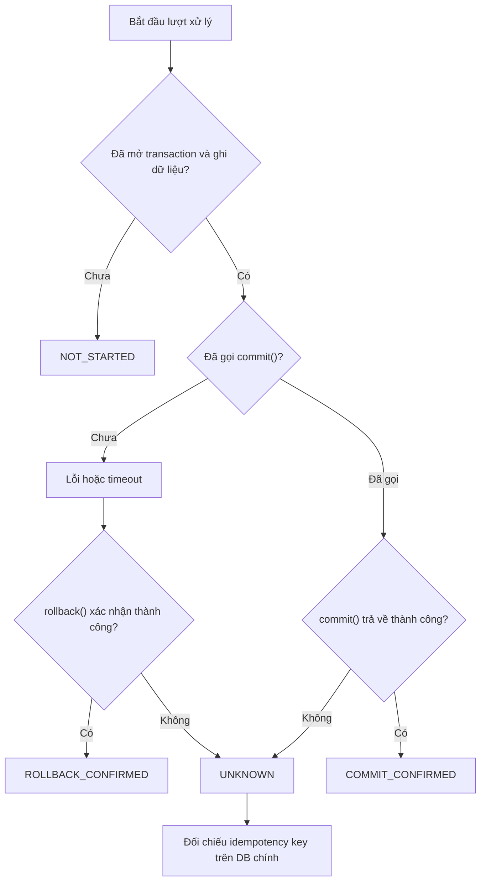
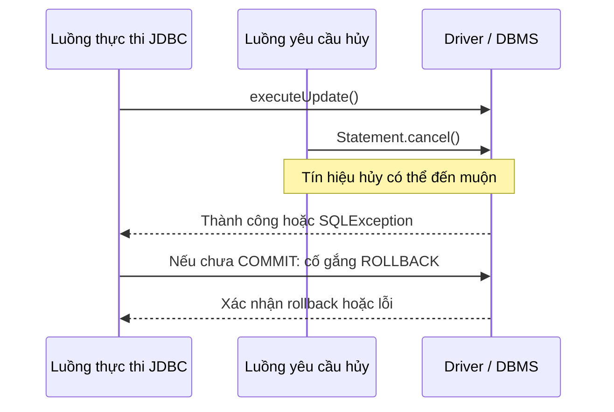

# Xác định trạng thái kết nối và giao dịch sau timeout

## 1. Timeout không đồng nghĩa câu SQL đã thất bại và được rollback

Trong ứng dụng Java sử dụng **JDBC**, timeout thường được xem như một lỗi đơn giản: câu lệnh chạy quá lâu, driver ném `SQLException`, ứng dụng đóng kết nối và thử lại. Nhưng đối với nghiệp vụ có ghi dữ liệu, cách hiểu này có thể dẫn đến **xử lý trùng** hoặc giữ transaction ở trạng thái không thể sử dụng.

Xét thao tác chuyển 25.00 giữa hai tài khoản:

```text
Ứng dụng                            DBMS
    |                                 |
    | UPDATE tài khoản nguồn          |
    | UPDATE tài khoản đích           |
    | INSERT mã yêu cầu               |
    | COMMIT                          |
    | ------------------------------> |
    |                    Commit có thể đã thành công
    |       X phản hồi bị mất          |
    | SQLException / socket timeout   |
    |                                 |
    | Thử lại ngay? Có thể chuyển thêm 25.00.
```

Một timeout ở `executeUpdate()` **khác** timeout ở `commit()`, và timeout khi chờ `DataSource.getConnection()` lại càng khác. Có trường hợp chỉ câu lệnh bị hủy; có trường hợp transaction phải rollback; có trường hợp connection đã hỏng; cũng có trường hợp **không biết transaction đã commit hay chưa**.

Để phản ứng đúng, cần xác định **ba trục trạng thái riêng biệt**:

1. **Trạng thái thao tác:** câu SQL/cancellation đã hoàn thành, bị từ chối hay chưa thể xác nhận?
2. **Trạng thái transaction:** chưa bắt đầu, đang mở, rollback đã xác nhận, commit đã xác nhận hay kết quả chưa rõ?
3. **Trạng thái connection:** handle còn mở, phiên với DBMS có thể giao tiếp hay đã đứt/hỏng, có an toàn để tái sử dụng không?

**Một câu lệnh ném `SQLTimeoutException` không trả lời được cả ba câu hỏi này.** Đây là nền tảng để thiết kế chính sách timeout, cancellation và retry an toàn.

## 2. Các lớp timeout trong đường đi của JDBC

Giới hạn thời gian có thể được thực thi bởi ứng dụng, pool, driver, DBMS hoặc mạng. Cùng được gọi là “timeout” nhưng chúng chặn những giai đoạn khác nhau:

| Lớp | API/cấu hình thường gặp | Đối tượng chịu ảnh hưởng | Có chứng minh transaction rollback không? |
| --- | --- | --- | --- |
| **Mượn từ pool** | HikariCP `connectionTimeout` | Chờ `DataSource.getConnection()` | **Không**; riêng lượt mượn thất bại chưa thực thi SQL của lượt này |
| **Câu lệnh JDBC** | `Statement.setQueryTimeout(seconds)` | Thời gian thực thi statement theo driver | **Không**; JDBC yêu cầu driver cố gắng hủy nhưng transaction phụ thuộc DBMS |
| **Hủy chủ động** | `Statement.cancel()` | Yêu cầu driver hủy statement đang thực thi | **Không**; đây là yêu cầu, không phải xác nhận rollback |
| **Mạng của JDBC** | `Connection.setNetworkTimeout(executor, millis)` | Thao tác chờ phản hồi mạng theo hỗ trợ driver | **Không**; khi vượt ngưỡng, connection có thể không còn dùng được |
| **Socket/driver** | Các thuộc tính như `socketTimeout`, `readTimeout` (tên tùy driver) | Chờ đọc/ghi socket hoặc phản hồi | **Không**; trạng thái thao tác phía DBMS có thể chưa rõ |
| **DBMS statement** | PostgreSQL `statement_timeout`; cơ chế tương ứng của DBMS khác | Lệnh chạy tại máy chủ | **Không bảo đảm** toàn transaction bị rollback trên mọi hệ |
| **DBMS lock wait** | `lock_timeout`, `innodb_lock_wait_timeout`, v.v. | Thời gian đợi khóa | **Không bảo đảm** toàn transaction bị hủy |
| **Timeout transaction/phiên** | Giới hạn transaction, phiên nhàn rỗi có transaction | Phiên hoặc toàn transaction | Phải kiểm tra quy tắc cụ thể của DBMS |
| **Deadline ứng dụng** | HTTP request timeout, `Future`, cancellation token | Thời gian phục vụ của request | **Không**; hết deadline ứng dụng không tự kết thúc giao dịch DB |

Hai đơn vị thời gian dễ nhầm:

```java
statement.setQueryTimeout(3); // 3 GIÂY: theo JDBC.

// Trong driver hỗ trợ, Connection.setNetworkTimeout nhận MILLI-GIÂY:
// connection.setNetworkTimeout(executor, 2_000);
```

`setQueryTimeout` không phải lệnh SQL tiêu chuẩn để cài đặt timeout của DBMS; driver có thể dùng giao thức cancellation, timeout riêng của DBMS hoặc cơ chế khác. `setNetworkTimeout` cũng không thay thế deadline nghiệp vụ và không bảo đảm bao phủ mọi thao tác của mọi driver.

**Lưu ý:** ví dụ PostgreSQL hay MySQL dưới đây chỉ mang tính DBMS-specific. Không sao chép nguyên các câu `SET` sang hệ quản trị khác.

## 3. Xác định kết quả transaction thay vì suy từ ngoại lệ

Một mô hình kết quả hữu ích cho ứng dụng là:

| Kết quả nghiệp vụ của lần thử | Ý nghĩa | Có thể thực hiện lại? |
| --- | --- | --- |
| **`NOT_STARTED`** | Không gửi bất kỳ thay đổi nào của lần thử này đến DBMS | Có thể thử lại nếu nguyên nhân tạm thời |
| **`ROLLBACK_CONFIRMED`** | Transaction chứa thao tác đã được DBMS xác nhận rollback, chưa gọi commit | Có điều kiện: chạy lại **toàn bộ** transaction mới |
| **`COMMIT_CONFIRMED`** | `commit()` đã trả thành công | Không áp dụng lại thay đổi, kể cả nếu cleanup sau đó báo lỗi |
| **`UNKNOWN`** | Đã bắt đầu làm việc nhưng không xác minh được rollback hoặc kết quả `commit()` | Không retry mù quáng; đối chiếu dữ liệu bền vững |

Đây là các nhãn **ứng dụng tự định nghĩa**, không phải các hằng trong JDBC. Trong đó `UNKNOWN` là trạng thái quan trọng nhất cần giữ lại, nhất là khi timeout xảy ra gần `commit()`.



**Quan trọng:** gọi `rollback()` **sau khi `commit()` đã báo lỗi** không tạo ra bằng chứng chắc chắn rằng commit chưa được DBMS thực hiện. Nếu đã bước vào pha commit mà không nhận được xác nhận, vẫn phải xem kết quả là `UNKNOWN` cho đến khi đối chiếu đủ.

Ngược lại, nếu lỗi xảy ra trước khi gọi `commit()`, ứng dụng rollback trên **chính connection của transaction đó** và nhận được xác nhận thành công, có cơ sở để kết luận các thay đổi trong transaction đã được hoàn tác, miễn là không có tác dụng phụ bên ngoài transaction.

## 4. Trạng thái connection khác trạng thái transaction

Sau timeout, developer hay thử:

```java
boolean closed = connection.isClosed();
boolean valid = connection.isValid(2);
boolean autoCommit = connection.getAutoCommit();
```

Các phương thức này trả lời **các câu hỏi khác**:

| Kiểm tra | Cho biết | **Không cho biết** |
| --- | --- | --- |
| `isClosed()` | JDBC `Connection` đã được đánh dấu đóng ở phía driver/handle chưa | DBMS còn đang thực thi câu lệnh hay transaction đã commit không |
| `isValid(timeoutSeconds)` | Driver xác định connection có thể sử dụng theo phép kiểm tra hợp lệ của nó | Transaction trước đã rollback/commit, trạng thái business đã an toàn để retry |
| `getAutoCommit()` | Chế độ auto-commit đang cấu hình (nếu đọc được) | Transaction đã kết thúc chưa hoặc lệnh cuối đã commit chưa |
| `getTransactionIsolation()` | Mức cô lập được cấu hình | Có tồn tại transaction chưa hoàn tất hay không |
| `getWarnings()` | Chuỗi `SQLWarning` được driver báo | Timeout đã hoàn tác dữ liệu hoặc DBMS vẫn đang xử lý không |

Ví dụ `isClosed() == false` **không chứng minh** socket còn hoạt động. `isValid(2) == true` có thể chỉ xác nhận một truy vấn kiểm tra mới chạy thành công, không thể khôi phục kết quả của `commit()` trước đó.

Nếu driver hoặc DBMS đã đặt transaction trong trạng thái **failed/aborted**, connection có thể vẫn còn mở và còn giao tiếp được nhưng **không thực thi tiếp SQL nghiệp vụ trong transaction đó** cho đến khi rollback. Điển hình là PostgreSQL: sau lỗi SQL trong transaction, những lệnh tiếp theo có thể bị từ chối với `25P02` cho tới khi `ROLLBACK`.

**Không thực hiện kiểm tra liveness giữa một transaction chưa rõ rồi tiếp tục dùng nó để ghi tiếp**, như thể phép `isValid` đã dọn sạch trạng thái. Thứ tự hợp lý là xử lý/khôi phục ranh giới transaction trước, sau đó mới quyết định có giữ lại connection hay không.

## 5. Phân biệt trạng thái câu SQL trước và sau timeout

Khi một câu `UPDATE` bị timeout, cần hỏi:

1. Timeout xảy ra **trước khi driver gửi câu lệnh**, trong lúc đợi server hay sau khi server xử lý xong nhưng trước khi phản hồi đến Java?
2. Server đã hủy **câu lệnh** hay vẫn đang xử lý?
3. Các lệnh khác trong **cùng transaction** có còn nguyên trạng không?
4. `autoCommit` có đang bật không? Nếu bật, một câu DML có thể đã commit riêng ngay khi DBMS hoàn tất dù Java không nhận được kết quả.

Hai trường hợp đáng phân biệt:

**Transaction thủ công (`autoCommit=false`):**

```text
BEGIN
UPDATE account_a -- thành công
UPDATE account_b -- timeout

Nếu CHƯA gọi COMMIT:
  thử rollback trên cùng Connection.
  - rollback xác nhận: toàn transaction bị hoàn tác.
  - rollback thất bại/mất kết nối: trạng thái chưa chắc chắn,
    connection có thể không an toàn để tái sử dụng.
```

**Auto-commit (`autoCommit=true`):**

```text
UPDATE wallets SET balance = balance - 25 WHERE account_id = 1;
-- Driver timeout trong khi chờ phản hồi.

Không thể mặc định câu UPDATE chưa được DBMS thực hiện hoặc commit.
Một rollback() chạy sau đó không phải là cách đảo ngược
auto-commit đã hoàn thành.
```

Nếu thao tác có tác dụng phụ quan trọng, hãy dùng transaction có ranh giới rõ, khóa lũy đẳng và cơ chế đối chiếu. Cấu hình timeout **không biến UPDATE thành thao tác tự động an toàn để retry**.

## 6. `setQueryTimeout()` và `SQLTimeoutException`

`Statement.setQueryTimeout(int seconds)` thiết lập ngưỡng thời gian cho việc thực thi câu lệnh theo JDBC driver. Nếu driver xác định ngưỡng bị vượt, nó có thể ném `SQLTimeoutException` — một nhánh của `SQLException`.

```java
import java.sql.Connection;
import java.sql.PreparedStatement;
import java.sql.ResultSet;
import java.sql.SQLException;
import java.sql.SQLTimeoutException;
import javax.sql.DataSource;

public final class SlowQueryReader {
    private final DataSource dataSource;

    public SlowQueryReader(DataSource dataSource) {
        this.dataSource = dataSource;
    }

    public void showCustomer(long customerId) throws SQLException {
        String sql = """
                SELECT customer_id, full_name
                FROM customers
                WHERE customer_id = ?
                """;

        try (Connection c = dataSource.getConnection();
             PreparedStatement ps = c.prepareStatement(sql)) {
            ps.setLong(1, customerId);
            ps.setQueryTimeout(3); // Giây.

            try (ResultSet rs = ps.executeQuery()) {
                if (rs.next()) {
                    System.out.println(rs.getString("full_name"));
                }
            }
        } catch (SQLTimeoutException timedOut) {
            // Mẫu là SELECT thuần đọc; không tự động suy rằng
            // một transaction ghi khác đã rollback.
            System.err.println(
                    "Truy vấn quá thời gian: " + timedOut.getSQLState());
            throw timedOut;
        }
    }
}
```

Đoạn mã yêu cầu Java 17+ (SQL text block) và giả định bảng `customers(customer_id, full_name)` có sẵn. `setQueryTimeout(0)` thường có nghĩa **không giới hạn timeout tại API đó**, không có nghĩa toàn bộ stack mạng/DBMS không thể timeout.

Các điểm quan trọng:

- Timeout của JDBC là **cơ chế yêu cầu/giám sát do driver thực thi**, không phải đồng hồ bảo đảm statement kết thúc đúng một mili giây cố định.
- Khi timeout được xác định, driver phải cố gắng hủy statement theo khả năng của nó; thời điểm server nhận và hoàn tất hủy không nhất thiết trùng với lúc client nhận ngoại lệ.
- Không phải mọi timeout đều được trả chính xác dưới dạng `SQLTimeoutException`; có driver trả `SQLException` chung hoặc `SQLTransientConnectionException`/`SQLNonTransientConnectionException` tùy lỗi.
- Không xem `SQLTimeoutException` là chứng cứ rằng **toàn transaction đã rollback**.
- Với một `SELECT` thuần đọc, retry thường ít rủi ro tác dụng phụ hơn, nhưng vẫn phải cân nhắc lock, transaction đang mở, deadline và tải DBMS.

## 7. `Statement.cancel()` là yêu cầu hủy, không phải `rollback()`

JDBC cho phép gửi yêu cầu hủy một statement đang thực thi:

```java
// Từ một luồng điều khiển khác, trong khi statement đang chạy:
statement.cancel();
```

`Statement.cancel()` được thiết kế để một luồng có thể yêu cầu hủy statement đang được luồng khác thực thi, **nếu DBMS và driver hỗ trợ**. Nhưng API không phải một protocol hai giai đoạn xác nhận “statement chưa có tác dụng phụ”; `cancel()` có thể ném lỗi, không được hỗ trợ, đến sau khi statement đã hoàn tất hoặc làm luồng thực thi nhận ngoại lệ.



Các quy tắc thực tế:

1. **Không dùng `cancel` thay cho `rollback`.** Khi câu lệnh bị hủy, transaction có thể vẫn mở, bị đánh dấu lỗi hoặc vẫn còn các thay đổi từ câu lệnh trước.
2. **Không chia sẻ `Connection` giữa nhiều luồng nghiệp vụ.** Việc một luồng gọi `Statement.cancel()` trên statement đã biết khác với cho nhiều luồng đồng thời chạy SQL tùy ý trên một connection.
3. **Không reuse statement/connection khi chưa xử lý trạng thái sau hủy.** Tùy driver, cancel có thể ảnh hưởng protocol của phiên hoặc cursor đang mở.
4. **Đừng hủy rồi lập tức chạy lại với request ID mới.** Với DML và commit gần đó, phải đối chiếu trạng thái trước.
5. **Tôn trọng deadline request.** Nếu HTTP client đã ngắt, ứng dụng vẫn phải bảo đảm dọn transaction/kết nối thích hợp; ngắt luồng Java không đồng nghĩa DBMS đã dừng làm việc.

Với một `Future.cancel(true)`, cờ ngắt luồng (`interrupt`) chỉ yêu cầu hủy công việc Java theo cơ chế của executor. Nó **không bảo đảm** driver JDBC hoặc DBMS tự dừng SQL. Cần thiết kế cancellation qua đúng API/driver và giải phóng tài nguyên.

## 8. Mã lỗi giúp phân loại nguyên nhân, không xác nhận outcome

`SQLException` có nhiều thông tin chẩn đoán:

```java
catch (SQLException error) {
    System.err.printf(
            "type=%s, SQLState=%s, vendorCode=%d%n",
            error.getClass().getSimpleName(),
            error.getSQLState(),
            error.getErrorCode());

    for (SQLException next = error.getNextException();
         next != null;
         next = next.getNextException()) {
        System.err.println("next SQLState=" + next.getSQLState());
    }
    throw error;
}
```

Đây là đoạn minh họa đặt trong một khối `try/catch` có ngữ cảnh. Nên log thêm **request ID, tên nghiệp vụ, bước đang thực thi** và elapsed time; tránh ghi thông tin đăng nhập, SQL chứa dữ liệu nhạy cảm hay số tài khoản thật.

| Mã/nhóm ví dụ | Nơi thường gặp | Ý nghĩa và giới hạn |
| --- | --- | --- |
| `08` (nhóm SQLState) | Nhiều JDBC driver | Lỗi kết nối; **không** suy trạng thái commit chỉ từ mã này |
| `40001` | PostgreSQL và một số DBMS | Serialization failure; có thể thử lại transaction sau khi bảo đảm transaction trước đã kết thúc |
| `40P01` | PostgreSQL | Deadlock; transaction bị hủy theo ngữ nghĩa PostgreSQL |
| `57014` | PostgreSQL | Truy vấn bị hủy, có thể do statement timeout hoặc yêu cầu cancel |
| `25P02` | PostgreSQL | Transaction đã ở trạng thái lỗi, thường cần rollback trước khi chạy SQL tiếp |
| `55P03` | PostgreSQL | Lock không khả dụng hoặc lock timeout tùy tình huống |
| `1205` (vendor error code) | MySQL InnoDB | Lock wait timeout; mặc định có thể chỉ rollback statement, không tự rollback toàn transaction |
| `1213` (vendor error code) | MySQL InnoDB | Deadlock victim; phải xác nhận transaction đã được rollback theo DBMS |
| `1205` (vendor error code) | SQL Server | Deadlock victim; **cùng số nhưng khác ý nghĩa** với MySQL `1205` |
| `ORA-01013` | Oracle Database | Thao tác bị hủy; không tự chứng minh toàn transaction đã được hoàn tác |
| `HYT00`/`HYT01` | Một số driver và môi trường ODBC | Thông báo timeout theo quy ước driver, không phải chứng nhận commit/rollback |

Không phải mọi driver đều điền `SQLState` hoặc vendor code theo cùng cách. Khi phân loại cần **đồng thời** xét DBMS, driver, pha transaction và mã lỗi. Thông báo text thay đổi theo phiên bản/locale nên không nên dùng so khớp chuỗi như cơ sở duy nhất.

### PostgreSQL và MySQL có thể khác nhau sau statement timeout

Trong PostgreSQL, khi một câu SQL thất bại bên trong transaction thường làm transaction đi vào trạng thái *aborted*; ứng dụng phải `ROLLBACK` hoặc sử dụng savepoint theo thiết kế trước khi tiếp tục. Trong MySQL InnoDB, một **lock wait timeout** mặc định có thể chỉ làm thất bại statement hiện tại, giữ transaction và những thay đổi trước đó; cấu hình máy chủ có thể thay đổi hành vi.

Do vậy câu trả lời cho “timeout có rollback transaction không?” luôn phải dựa trên **đúng loại timeout, đúng DBMS và cấu hình**. Chính sách an toàn chung cho một đơn vị nghiệp vụ nhiều DML là **chủ động rollback toàn transaction nếu còn có thể** rồi mới quyết định retry.

## 9. Mẫu JDBC: ghi lại kết quả transaction có thể xác minh

Ví dụ tiếp theo minh họa **cách theo dõi pha commit và kết quả rollback** trong một lần thử chuyển tiền nội bộ. Nó không che trạng thái chưa chắc chắn bằng một `SQLException` chung. Giả sử dùng PostgreSQL và schema:

```sql
CREATE TABLE wallet_accounts (
    account_id BIGINT PRIMARY KEY,
    balance DECIMAL(18,2) NOT NULL,
    CONSTRAINT ck_wallet_nonnegative CHECK (balance >= 0)
);

CREATE TABLE wallet_transfers (
    request_id VARCHAR(64) PRIMARY KEY,
    source_id BIGINT NOT NULL REFERENCES wallet_accounts(account_id),
    destination_id BIGINT NOT NULL REFERENCES wallet_accounts(account_id),
    amount DECIMAL(18,2) NOT NULL CHECK (amount > 0),
    CONSTRAINT ck_accounts_distinct CHECK (source_id <> destination_id)
);

INSERT INTO wallet_accounts (account_id, balance)
VALUES (1, 100.00), (2, 40.00);
```

Ý tưởng: ghi một `request_id` **duy nhất** cùng transaction với hai lệnh cập nhật số dư. Nếu commit thành công, số dư sẽ là 75.00 và 65.00; đồng thời tồn tại bản ghi `wallet_transfers`.

### 9.1. Một lần thử có bốn loại kết quả

Ví dụ Java 17+ dưới đây sử dụng `DataSource`, `PreparedStatement`, `BigDecimal` và tự quản lý `Connection`. Hàm trả một record chứa kết quả đã biết cùng ngoại lệ để chẩn đoán. **Nó cố ý không tự retry.**

```java
import java.math.BigDecimal;
import java.math.RoundingMode;
import java.sql.Connection;
import java.sql.PreparedStatement;
import java.sql.SQLException;
import javax.sql.DataSource;

public final class TransferAttemptService {
    public enum Outcome {
        NOT_STARTED,
        ROLLBACK_CONFIRMED,
        COMMIT_CONFIRMED,
        UNKNOWN
    }

    public record Attempt(Outcome outcome, SQLException error) {}

    private final DataSource dataSource;

    public TransferAttemptService(DataSource dataSource) {
        this.dataSource = dataSource;
    }

    public Attempt transferOnce(
            String requestId, long sourceId, long destinationId,
            BigDecimal inputAmount) {

        if (requestId == null || requestId.isBlank()
                || requestId.length() > 64
                || sourceId == destinationId
                || inputAmount == null || inputAmount.signum() <= 0) {
            throw new IllegalArgumentException("Yêu cầu không hợp lệ");
        }
        BigDecimal amount =
                inputAmount.setScale(2, RoundingMode.UNNECESSARY);

        Outcome outcome = Outcome.NOT_STARTED;
        SQLException failure = null;
        Connection connection = null;

        try {
            connection = dataSource.getConnection();
            boolean oldAutoCommit = connection.getAutoCommit();
            if (!oldAutoCommit) {
                throw new SQLException(
                        "Ví dụ yêu cầu Connection chưa có transaction");
            }

            connection.setAutoCommit(false);
            outcome = Outcome.UNKNOWN; // Bắt đầu pha có thể thay đổi dữ liệu.
            boolean commitInvoked = false;
            boolean transactionEnded = false;

            try {
                insertRequest(
                        connection, requestId, sourceId,
                        destinationId, amount);

                if (debit(connection, sourceId, amount) != 1) {
                    throw new SQLException(
                            "Tài khoản nguồn không có hoặc không đủ tiền");
                }
                if (credit(connection, destinationId, amount) != 1) {
                    throw new SQLException(
                            "Tài khoản đích không tồn tại");
                }

                commitInvoked = true;
                connection.commit();
                transactionEnded = true;
                outcome = Outcome.COMMIT_CONFIRMED;
            } catch (SQLException error) {
                failure = error;

                if (!commitInvoked) {
                    try {
                        connection.rollback();
                        transactionEnded = true;
                        outcome = Outcome.ROLLBACK_CONFIRMED;
                    } catch (SQLException rollbackFailure) {
                        error.addSuppressed(rollbackFailure);
                        // Giữ UNKNOWN: rollback không xác nhận được.
                    }
                }
                // Sau khi đã gọi commit, không suy từ rollback
                // rằng commit trước đó chắc chắn không xảy ra.
            } finally {
                // Chỉ reset autoCommit khi đã xác nhận transaction kết thúc.
                if (transactionEnded) {
                    try {
                        connection.setAutoCommit(oldAutoCommit);
                    } catch (SQLException resetFailure) {
                        if (failure == null) {
                            failure = resetFailure;
                        } else {
                            failure.addSuppressed(resetFailure);
                        }
                        // Giữ nguyên outcome đã xác nhận.
                    }
                }
            }
        } catch (SQLException beforeOrOutsideTransaction) {
            if (failure == null) {
                failure = beforeOrOutsideTransaction;
            } else {
                failure.addSuppressed(beforeOrOutsideTransaction);
            }
        } finally {
            if (connection != null) {
                try {
                    connection.close(); // Đóng handle, trả về pool nếu có.
                } catch (SQLException closeFailure) {
                    if (failure == null) {
                        failure = closeFailure;
                    } else {
                        failure.addSuppressed(closeFailure);
                    }
                    // Cleanup lỗi không xóa bằng chứng commit/rollback trước đó.
                }
            }
        }

        return new Attempt(outcome, failure);
    }

    private static void insertRequest(
            Connection c, String id, long sourceId,
            long destinationId, BigDecimal amount) throws SQLException {
        String sql = """
                INSERT INTO wallet_transfers
                    (request_id, source_id, destination_id, amount)
                VALUES (?, ?, ?, ?)
                """;
        try (PreparedStatement ps = c.prepareStatement(sql)) {
            ps.setString(1, id);
            ps.setLong(2, sourceId);
            ps.setLong(3, destinationId);
            ps.setBigDecimal(4, amount);
            if (ps.executeUpdate() != 1) {
                throw new SQLException("Không tạo được request_id");
            }
        }
    }

    private static int debit(
            Connection c, long id, BigDecimal amount) throws SQLException {
        try (PreparedStatement ps = c.prepareStatement("""
                UPDATE wallet_accounts
                SET balance = balance - ?
                WHERE account_id = ? AND balance >= ?
                """)) {
            ps.setBigDecimal(1, amount);
            ps.setLong(2, id);
            ps.setBigDecimal(3, amount);
            ps.setQueryTimeout(3);
            return ps.executeUpdate();
        }
    }

    private static int credit(
            Connection c, long id, BigDecimal amount) throws SQLException {
        try (PreparedStatement ps = c.prepareStatement("""
                UPDATE wallet_accounts
                SET balance = balance + ?
                WHERE account_id = ?
                """)) {
            ps.setBigDecimal(1, amount);
            ps.setLong(2, id);
            ps.setQueryTimeout(3);
            return ps.executeUpdate();
        }
    }
}
```

Ví dụ sử dụng:

```java
TransferAttemptService service = new TransferAttemptService(dataSource);

TransferAttemptService.Attempt result = service.transferOnce(
        "PAY-001", 1L, 2L, new BigDecimal("25.00"));

switch (result.outcome()) {
    case COMMIT_CONFIRMED ->
            System.out.println("Đã chuyển tiền (đã xác nhận commit)");
    case ROLLBACK_CONFIRMED ->
            System.out.println("Đã rollback; kiểm tra lỗi trước khi retry");
    case NOT_STARTED ->
            System.out.println("Chưa thực hiện thay đổi từ yêu cầu này");
    case UNKNOWN ->
            System.out.println("Chưa rõ kết quả; phải đối chiếu PAY-001");
}
```

### 9.2. Tại sao mã mẫu không đóng kết nối rồi tự nhận đã rollback?

Một số chi tiết có chủ ý:

- `commitInvoked` được đặt **ngay trước `commit()`**. Nếu lời gọi `commit()` lỗi hoặc timeout, lần thử giữ kết quả `UNKNOWN`, kể cả khi connection đã mất.
- Khi lỗi xảy ra **trước `commit()`**, mã cố rollback và chỉ ghi nhận `ROLLBACK_CONFIRMED` khi `rollback()` trả thành công.
- Nếu `commit()` trả thành công, `COMMIT_CONFIRMED` được giữ ngay cả khi bước khôi phục thuộc tính `autoCommit` hoặc `close()` sau đó báo lỗi.
- Nếu `connection.setAutoCommit(false)` thất bại **trước khi gửi DML**, trạng thái nghiệp vụ của lần thử vẫn `NOT_STARTED`; connection có thể cần bị bỏ vì trạng thái phiên không rõ.
- `setQueryTimeout(3)` được áp dụng cho hai lệnh cập nhật. `INSERT` và `COMMIT` không tự thừa hưởng giới hạn này. Timeout phải được thiết kế toàn diện cho các giai đoạn nếu nghiệp vụ yêu cầu.
- Mẫu chỉ minh họa **một transaction JDBC** và cách phân biệt kết quả; nó chưa thiết kế đầy đủ chính sách circuit breaker, retry budget, thay thế kết nối hỏng hoặc framework quản lý transaction.

Khi một connection có lỗi mạng hoặc trạng thái transaction chưa rõ, **đừng đưa nó trở lại luồng xử lý ghi dữ liệu**. Gọi `close()` trên handle là trách nhiệm của ứng dụng; việc pool loại bỏ **kết nối vật lý hỏng** hay không còn tùy khả năng phát hiện của driver/pool. Nếu cần, sử dụng cơ chế eviction của pool theo hợp đồng của thư viện — không tự giả định mọi lần `close()` đều tiêu hủy socket.

## 10. Đối chiếu khi commit hoặc kết quả câu lệnh chưa chắc chắn

Đối với một thao tác không lũy đẳng (ví dụ trừ tiền), **không** tạo `request_id` mới rồi chạy lại chỉ vì Java ném timeout.

Với schema ở mục 9, truy vấn đối chiếu trên **DB chính** bằng một kết nối mới:

```sql
SELECT source_id, destination_id, amount
FROM wallet_transfers
WHERE request_id = ?;
```

Quy trình xử lý:

1. Sử dụng **cùng request ID ổn định** mà client đã gửi lần đầu.
2. Nếu tìm thấy bản ghi đã commit, so sánh chính xác tài khoản nguồn, đích và số tiền. Nếu trùng, kết quả yêu cầu đã được áp dụng; nếu khác, báo **xung đột idempotency key**.
3. Nếu chưa thấy bản ghi, **không mặc định** transaction đầu đã thất bại. Nó có thể chưa commit xong, chưa visible trên replica hoặc lần đọc đang dùng snapshot cũ.
4. Chỉ retry khi chính sách đã giải quyết đủ tình huống chưa rõ, hoặc cơ chế unique key + transaction nguyên tử bảo đảm xử lý trùng được an toàn và đã xét khả năng còn transaction đồng thời đang chạy.
5. Nếu không thể xác minh, trả trạng thái tương ứng như `PENDING_RECONCILIATION` và sử dụng quy trình đối soát có kiểm soát. Không báo “đã thất bại chắc chắn” chỉ dựa trên timeout.

Với cùng `request_id`, ràng buộc `PRIMARY KEY` trong `wallet_transfers` chặn việc hai transaction **cùng commit một mã yêu cầu**, với điều kiện ghi key và mọi thay đổi nghiệp vụ thuộc cùng transaction. Nếu trùng key, rollback lần thử đang lỗi, đọc bản ghi đã commit và so sánh payload; không chuyển sang key khác để “vượt qua lỗi”.

Nếu tác vụ liên quan email, queue hoặc API thanh toán ngoài DB, transaction JDBC không thể rollback những tác dụng phụ đó. Hãy dùng idempotency của dịch vụ bên ngoài và mô hình như **transactional outbox** khi phù hợp.

## 11. Quy trình xử lý timeout trong production

Một runbook theo pha transaction sẽ đáng tin cậy hơn việc “catch exception rồi retry”:

| Thời điểm timeout | Quy trình đề nghị |
| --- | --- |
| **Đang chờ mượn connection** | Lượt request chưa có connection để chạy SQL; xem pending/active của pool, giới hạn chờ, khả năng DBMS. Không tăng pool mù quáng |
| **Trong truy vấn SELECT thuần đọc, chưa mở transaction ghi** | Đóng tài nguyên; retry truy vấn nếu có ích trong deadline và không tăng tải bất thường |
| **Trong DML với `autoCommit=true`** | Không biết chắc câu SQL đã commit hay chưa; đối chiếu bằng khóa nghiệp vụ/định danh |
| **Trong DML với `autoCommit=false`, chưa gọi commit** | Cố `rollback()` trên cùng connection; chỉ khi xác nhận rollback mới cân nhắc retry toàn transaction |
| **Rollback thất bại hoặc connection mất** | Không reuse transaction; outcome UNKNOWN, loại bỏ/khoanh vùng connection theo pool và đối chiếu |
| **Sau khi gọi `commit()` nhưng chưa nhận success** | Outcome UNKNOWN; không chạy lại side effects; đọc trạng thái bền vững trên DB chính |
| **Commit thành công, nhưng đóng statement/connection bị lỗi** | Transaction đã commit; không biến cleanup failure thành lý do chạy lại DML |
| **Lệnh bị `cancel()` bởi người dùng** | Kiểm tra có DML/transaction không; cancel không tự rollback; dọn transaction và trả trạng thái phù hợp |

Một luồng kiểm soát phổ biến:

```text
1. Gắn request ID trước khi chạy.
2. Ghi nhận pha hiện tại:
   NOT_STARTED -> EXECUTING -> COMMIT_INVOKED -> COMMIT_CONFIRMED
3. Khi timeout:
   a. Nếu chưa commit: rollback và đánh dấu đã rollback nếu xác nhận.
   b. Nếu commit đã được gọi: giữ UNKNOWN khi không có xác nhận.
4. Không dùng lại Connection chưa rõ trạng thái.
5. Đối chiếu DB chính bằng request ID; kiểm tra payload.
6. Nếu retry được: tạo Connection + transaction mới, retry toàn đơn vị,
   có maxAttempts/backoff/deadline.
7. Log, đo timeout theo từng tầng; không log thông tin nhạy cảm.
```

## 12. Timeout, connection pool và tính hợp lệ của phiên

Với `DataSource` có pooling, `Connection.close()` thường trả **handle logic** về pool. Nó không nhất thiết đóng socket ngay. Cần phân biệt:

- **Pool acquisition timeout:** không lấy được handle trong thời gian chờ; `getConnection()` có thể ném `SQLException`. Đây là vấn đề năng lực pool, không phải `Statement` đã chạy quá lâu.
- **Validation failure:** pool phát hiện một kết nối vật lý không còn hoạt động và có thể loại bỏ nó.
- **Network timeout sau khi đã mượn:** một lệnh hoặc commit có thể ở trạng thái không rõ; pool không biết kết quả nghiệp vụ.
- **Connection vẫn active nhưng im lặng:** app giữ handle/transaction trong lúc chờ HTTP; keepalive cho connection **idle trong pool** thường không áp dụng.

Nếu connection gặp lỗi nghiêm trọng, framework/pool có thể có quy tắc vô hiệu hóa kết nối vật lý. Không dùng `Connection.isValid(...)` như một phép “làm sạch transaction”; ngay cả một connection valid vẫn có thể có transaction bị aborted hoặc dữ liệu trước đó đã commit.

Khi xảy ra tăng đột biến timeout, hãy đo **số connection active/idle/pending**, thời gian mượn, độ trễ SQL, lock wait, network error, validation failure và mã lỗi JDBC. Tăng `connectionTimeout` không làm truy vấn SQL nhanh hơn; tăng `setQueryTimeout` cũng không sửa một connection leak.

## 13. Retry chỉ an toàn khi có đủ bằng chứng

Sau timeout, ứng dụng thường muốn retry. Một chính sách đúng cần xét:

- **Transient?** Deadlock, serialization failure hay lỗi mạng tạm thời có thể phục hồi, nhưng syntax error hoặc constraint violation không nên retry nguyên dữ liệu.
- **Transaction outcome?** `ROLLBACK_CONFIRMED`, `COMMIT_CONFIRMED` hay `UNKNOWN`? Cùng `SQLException` có thể có hậu quả khác nhau tùy pha.
- **Idempotent?** Yêu cầu có khóa lũy đẳng duy nhất ghi cùng transaction, và đối chiếu được payload không?
- **Còn ngân sách?** Có giới hạn `maxAttempts`, backoff có jitter và deadline chung của request không?
- **Có side effects ngoài DB?** Nếu có, cần deduplication/outbox riêng.

Ví dụ tham số chính sách minh họa:

| Tham số | Ví dụ | Ý nghĩa |
| --- | --- | --- |
| `maxAttempts` | 3, bao gồm lần đầu | Tránh retry vô hạn |
| `initialBackoff` | 50 ms | Tránh dồn request ngay sau lỗi |
| `maxBackoff` | 500 ms | Chặn độ trễ tăng không kiểm soát |
| `deadline` | Theo SLA của API | Không retry khi đã hết ngân sách thời gian |
| `idempotencyKey` | `PAY-001` dùng xuyên suốt | Đối chiếu và chống áp dụng trùng |

Nếu `ROLLBACK_CONFIRMED` và lỗi có thể phục hồi, **thử lại toàn bộ transaction** trên connection mới là lựa chọn có điều kiện. Nếu `COMMIT_CONFIRMED`, phải trả thành công hoặc trạng thái kết thúc đúng nghiệp vụ; nếu `UNKNOWN`, hãy đối chiếu trước.

Một số môi trường dùng transaction manager hoặc framework có chính sách retry riêng. Không đặt thêm một vòng retry JDBC bên trong vòng retry của framework mà không thống nhất **ranh giới transaction**, tránh retry chồng nhau và nhân số lần thực thi.

## 14. Kiểm thử những thời điểm dễ suy sai nhất

Không chỉ test một câu `SELECT` ngủ lâu; nên chủ động tạo lỗi ở các thời điểm khác nhau bằng DBMS/driver thật và hai kết nối độc lập khi cần:

| Ca kiểm thử | Kết quả cần xác minh |
| --- | --- |
| Pool hết connection, `getConnection()` timeout | Không có DML thuộc request mới chạy; không kết luận transaction khác trong hệ thống đã rollback |
| `setQueryTimeout` với `SELECT` chậm | Driver trả lỗi hoặc hủy theo hợp đồng, đóng đúng tài nguyên |
| DML thứ hai bị statement timeout, rollback thành công | Cả DML thứ nhất và thứ hai đều không commit; kết quả `ROLLBACK_CONFIRMED` |
| DML thứ hai bị timeout, rollback cũng thất bại | Ghi `UNKNOWN` và không reuse connection |
| Driver/DBMS báo transaction aborted | Chỉ tiếp tục sau rollback hợp lệ; không chạy tiếp UPDATE trong transaction lỗi |
| Timeout khi `autoCommit=true` | Không retry UPDATE thiếu idempotency khi chưa đối chiếu |
| Mất phản hồi ngay sau khi gửi `COMMIT` | Có thể đã commit; chỉ một dòng `request_id`, số dư không đổi lần hai |
| `commit()` thành công nhưng `close()` ném lỗi | Vẫn nhận diện `COMMIT_CONFIRMED`, không retry tác dụng phụ |
| `Statement.cancel()` đến muộn | Câu lệnh có thể đã hoàn tất; không coi cancel là rollback |
| MySQL lock wait timeout | Phân biệt statement rollback với transaction rollback theo cấu hình |
| PostgreSQL statement timeout trong transaction | Nhận biết tình trạng transaction aborted/rollback |
| Hai yêu cầu cùng `request_id` đồng thời | Ràng buộc unique và logic đối chiếu ngăn áp dụng trùng |
| Timeout mạng khi gọi `Connection.isValid` | Không kết luận transaction outcome từ liveness test |

Trong test đồng thời, có thể dùng `CountDownLatch` hoặc barrier để xác định thứ tự hai transaction đã bắt đầu, giữ khóa và tiến tới commit. Không chỉ dựa vào `Thread.sleep` rồi giả định server đã kịp thực hiện lệnh. Khi mô phỏng lỗi mạng ở thời điểm commit, phải xác minh dữ liệu **từ một kết nối mới đến DB chính**, không tin riêng ngoại lệ phía client.

### Những điều cần đo trong log và metrics

Lưu lại ít nhất: request ID, pha transaction (`EXECUTING`, `COMMIT_INVOKED`...), loại timeout, thời gian thực thi, SQLState, vendor error code, kết quả `rollback` và tình trạng connection có bị loại bỏ hay không. Không ghi toàn bộ SQL với tham số bí mật hoặc dữ liệu cá nhân.

Điểm cần theo dõi ở cấp vận hành là **tỷ lệ outcome UNKNOWN, số lần retry, số request được đối chiếu thành công, lượng lock wait, số timeout theo từng tầng** và kết nối pool bị loại bỏ. Một ứng dụng liên tục trả timeout nhưng không phát hiện trùng tác dụng phụ có thể tạo rủi ro nghiệp vụ lớn hơn một truy vấn đơn thuần chậm.

## 15. Checklist xử lý sau timeout

1. **Định danh nguồn timeout:** pool acquisition, JDBC query, DB lock/statement, network, transaction hay deadline request?
2. **Biết thời điểm:** `executeQuery`, `executeUpdate`, `cancel`, `rollback`, `commit` hay `close`?
3. **Không suy trạng thái từ mỗi `isClosed/isValid/getAutoCommit`.** Các API này không cho biết transaction đã commit hay rollback.
4. **Nếu chưa commit và còn connection:** cố rollback transaction, chỉ kết luận thành công khi có xác nhận.
5. **Nếu đã gọi commit nhưng thiếu phản hồi:** giữ `UNKNOWN`, đừng coi timeout là commit thất bại chắc chắn.
6. **Không dùng lại connection/transaction hỏng:** đóng handle, để driver/pool xử lý việc loại bỏ vật lý theo hợp đồng; tìm cách mark broken/evict khi cần.
7. **Chống áp dụng trùng:** có idempotency key, unique constraint và dữ liệu đủ để đối chiếu payload sau sự cố.
8. **Retry có điều kiện:** chỉ retry toàn bộ nghiệp vụ trên transaction mới khi an toàn, có backoff, deadline và giới hạn.
9. **Phân biệt DBMS:** PostgreSQL, MySQL InnoDB, SQL Server, Oracle có hành vi lỗi/rollback/cancel khác nhau.
10. **Kiểm thử đúng pha lỗi:** đặc biệt là timeout ngay trước/sau `COMMIT` và lỗi cleanup sau commit thành công.

**Ghi nhớ:** Sau timeout JDBC, phải tách bạch **tình trạng kết nối**, **kết quả câu SQL** và **trạng thái transaction**. `Connection.isValid()` chỉ giúp kiểm tra phiên có thể giao tiếp, còn `SQLTimeoutException` và `Statement.cancel()` không phải lời xác nhận rollback. Nếu rollback được xác nhận trước commit, có thể cân nhắc retry; nếu commit đã xác nhận, không chạy lại; nếu kết quả còn **UNKNOWN**, đối chiếu bằng request ID bền vững trước khi thực hiện tác dụng phụ thêm một lần nữa.
