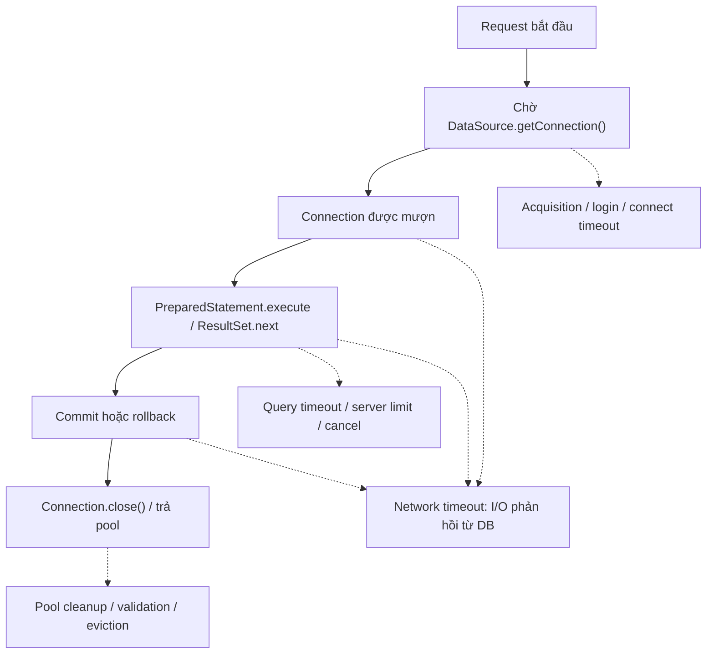

# Xử lý kết nối bị treo hoặc không còn khả năng sử dụng

> **Chương:** Timeout và hủy  
> **Bối cảnh:** Ứng dụng Java dùng **JDBC** với driver, `DataSource`, `Connection`, `PreparedStatement` và `ResultSet` để chạy CRUD, transaction, batching và xử lý lỗi trên cơ sở dữ liệu quan hệ.

Một request đang thực hiện `UPDATE` thì database ngừng phản hồi. Thread Java vẫn chờ ở `executeUpdate()`. Một request khác đã gửi `COMMIT` nhưng mất kết nối trước khi nhận phản hồi. Request thứ ba mượn được connection từ pool, tuy nhiên socket vật lý đã bị firewall cắt trong lúc nhàn rỗi. Cả ba đều liên quan đến **connection bị treo hoặc không còn khả năng sử dụng**, nhưng cách xử lý không giống nhau.

Mục tiêu là **ngừng chờ một cách có kiểm soát, không tái sử dụng connection đáng ngờ, không làm mất lỗi ban đầu và không retry ghi dữ liệu một cách mù quáng**. Bài này phân biệt timeout lấy connection, timeout thực thi câu lệnh, network timeout và thao tác hủy; sau đó xây dựng mẫu JDBC phòng thủ, quy trình phục hồi cùng kiểm thử lỗi thật.

**Nguyên tắc:** timeout và `cancel()` là **tín hiệu giới hạn hoặc yêu cầu dừng**, không phải bằng chứng rằng database chắc chắn chưa thực thi SQL hoặc transaction chắc chắn đã rollback.

## 1. Phân loại vấn đề trước khi xử lý

| Tình huống | Giai đoạn lỗi | Dấu hiệu | Hành động ưu tiên |
|---|---|---|---|
| Pool hết connection trống | `DataSource.getConnection()` | Request chờ mượn, có thể hết acquisition timeout | Kiểm tra active/idle/pending, leak, transaction dài; không gọi `Statement.cancel()` vì chưa có statement |
| DBMS không kết nối được | Mở socket, TLS, authentication | `getConnection()` ném `SQLException` | Kiểm tra driver, URL, connect/login timeout, mạng và DB availability |
| Query bị khóa/chạy lâu | `Statement.execute...()` hoặc `ResultSet.next()` | Thread chờ SQL/đọc kết quả | Dùng query/server deadline phù hợp, xem lock wait và kế hoạch truy vấn |
| Mạng im lặng hoặc socket hỏng | Trong statement, fetch, rollback hoặc commit | Có thể bị block lâu, nhận lỗi I/O/SQLState nhóm `08` | Giới hạn network timeout nếu driver hỗ trợ; coi connection đáng ngờ, đóng/loại bỏ |
| Query bị yêu cầu hủy | `Statement.cancel()`, query timeout | Driver báo lỗi hủy hoặc timeout, đôi khi trả kết quả khác | Không mặc định SQL chưa chạy; kết thúc transaction theo quy tắc của DBMS |
| `commit()` mất phản hồi | Ranh giới commit | `SQLException` nhưng server có thể đã commit | Đối soát theo request ID/idempotency key trước khi retry |
| Cleanup cũng bị treo/lỗi | `rollback()`, `close()`, state reset | Exception phụ hoặc thời gian giữ connection bất thường | Giữ lỗi chính, báo pool/observability, không dùng lại handle không chắc chắn |

Các loại lỗi không loại trừ lẫn nhau: truy vấn chậm có thể hết query timeout, sau đó driver thử hủy nhưng chính thao tác hủy cũng bị treo vì mạng đã đứt.

### Đường đi request và điểm đặt giới hạn



Đừng cấu hình một timeout duy nhất rồi cho rằng **toàn bộ** request đã có hạn cuối. Mỗi giới hạn áp dụng cho một giai đoạn và thường có độ chính xác, điều kiện hỗ trợ khác nhau.

## 2. Các API timeout trong JDBC: phạm vi và đơn vị

| API / cấu hình | Đơn vị | Phạm vi chính | Giới hạn |
|---|---|---|---|
| `DataSource.setLoginTimeout(int seconds)` | Giây | Thời gian cố gắng thiết lập kết nối theo hợp đồng DataSource | Implementation có thể không hỗ trợ đầy đủ; **không** là timeout chờ pool chung |
| `DriverManager.setLoginTimeout(int seconds)` | Giây | Thời gian login khi dùng `DriverManager` | Có tính chất quản lý phía DriverManager, không thay thế timeout của pool |
| Tham số driver như connect/socket timeout | Tùy driver | Mở socket, đọc/ghi mạng | **Không chuẩn hóa tên và đơn vị** giữa PostgreSQL, MySQL, SQL Server… |
| Acquisition timeout của pool | Thường mili giây, tùy thư viện | Chờ một connection rảnh từ pool | Không giới hạn thời gian query sau khi đã mượn |
| `Statement.setQueryTimeout(int seconds)` | Giây | Giới hạn chờ thực thi statement theo hỗ trợ driver | Không bảo đảm deadline tuyệt đối; `0` nghĩa không đặt giới hạn qua API này |
| `Connection.setNetworkTimeout(Executor, int milliseconds)` | Mili giây | Giới hạn chờ phản hồi database trong hoạt động mạng theo driver | Không phải acquisition/query timeout; có thể không hỗ trợ |
| `Connection.isValid(int timeoutSeconds)` | Giây | Thử xác nhận connection còn dùng được | Là kiểm tra tại **một thời điểm**, không loại bỏ race condition |
| `Statement.cancel()` | Không có tham số thời gian | Yêu cầu hủy statement đang chạy nếu driver/DBMS hỗ trợ | Không có cam kết dừng tức thì |
| `Connection.abort(Executor)` | Không nhận timeout | Yêu cầu chấm dứt connection qua executor | Có thể không hỗ trợ; cần phối hợp với pool, không phải lệnh rollback an toàn |

Lưu ý quan trọng: `setQueryTimeout(2)` nhận **2 giây**, còn `setNetworkTimeout(executor, 2_000)` nhận **2.000 mili giây**. Nhầm đơn vị có thể biến hạn chờ dự kiến vài giây thành rất dài, hoặc ngược lại.

### Ví dụ đọc các giá trị JDBC

```java
try (Connection connection = dataSource.getConnection();
     PreparedStatement statement =
         connection.prepareStatement("SELECT id FROM products")) {

    statement.setQueryTimeout(5); // Giây.
    System.out.println(statement.getQueryTimeout());

    System.out.println("Network timeout (ms): "
        + connection.getNetworkTimeout());
}
```

Các API này báo **cấu hình/hợp đồng mà Java nhìn thấy**, không chứng minh driver sẽ thực hiện ở độ chính xác đúng một mili giây. Cần kiểm tra behavior với driver và database thực.

## 3. Kết nối treo khác kết nối đã đóng

Một số phương thức thường bị dùng sai để đánh giá “connection còn sống”:

- `connection.isClosed()` cho biết connection đã được đóng theo trạng thái của handle/JDBC driver. **`false` không chứng minh socket hay DB session còn hoạt động**.
- `connection.isValid(timeoutSeconds)` yêu cầu driver kiểm tra connection; `false` cho biết connection không hợp lệ tại thời điểm kiểm tra. Việc kiểm tra vẫn có thể ném `SQLException` và cũng không ngăn lỗi xảy ra ngay sau đó.
- `connection.getAutoCommit()`, `connection.getMetaData()`, `connection.createStatement()` không phải phép health check an toàn chung; một số thao tác có thể thực hiện I/O hoặc thất bại.
- `SQLException.getSQLState()` có thể giúp nhận biết lỗi liên quan kết nối, nhưng SQLState có thể `null` hoặc khác nhau theo DBMS/driver.

### Ví dụ kiểm tra trước khi dùng connection

```java
import java.sql.Connection;
import java.sql.SQLException;
import javax.sql.DataSource;

static void checkConnection(DataSource dataSource) throws SQLException {
    try (Connection connection = dataSource.getConnection()) {
        if (connection.isClosed()) {
            throw new SQLException("Connection handle is closed");
        }

        // 2 giây theo JDBC. Phép kiểm tra không bảo đảm
        // câu SQL kế tiếp sẽ không bị mất kết nối.
        if (!connection.isValid(2)) {
            throw new SQLException("Connection failed validation", "08006");
        }

        // Query có thể vẫn lỗi sau dòng isValid().
    }
}
```

`"08006"` ở đây do ví dụ chủ động đặt làm mã cho tình huống connection failure; **không phải mã mà mọi driver bắt buộc trả** khi validation thất bại.

Với pool, kiểm tra health thường nên nằm ở **tầng pool** (mượn connection, validation, eviction và idle checks) thay vì mỗi DAO tự chạy `isValid()` trước từng câu SQL. Kiểm tra quá thường xuyên tạo round-trip, không bảo đảm loại trừ lỗi giữa check và use, và có thể tăng thời gian giữ connection.

**Không gọi `isValid()` cùng lúc với một statement khác đang chạy trên cùng connection.** JDBC connection đang mang transaction không nên được chia sẻ tùy ý qua nhiều thread.

## 4. Dùng `setQueryTimeout()` cho statement chậm

Một mẫu JDBC phổ biến:

```java
import java.sql.Connection;
import java.sql.PreparedStatement;
import java.sql.ResultSet;
import java.sql.SQLException;

String sql = """
    SELECT id, total_amount
    FROM orders
    WHERE customer_id = ?
    ORDER BY id
    """;

try (Connection connection = dataSource.getConnection();
     PreparedStatement statement = connection.prepareStatement(sql)) {

    statement.setLong(1, customerId);
    statement.setQueryTimeout(5); // Giây.

    try (ResultSet rows = statement.executeQuery()) {
        while (rows.next()) {
            long orderId = rows.getLong("id");
            // Đọc dữ liệu phục vụ nghiệp vụ.
        }
    }
}
```

`setQueryTimeout()` là một **yêu cầu của JDBC driver về giới hạn thời gian**. Khi vượt ngưỡng, driver thường phát sinh `SQLTimeoutException` hoặc một `SQLException` phù hợp. Nhưng thời điểm hết hạn, việc hủy tại server, ảnh hưởng tới fetch, giao thức mạng và trạng thái transaction **phụ thuộc driver/DBMS**.

Không kết luận rằng query được hủy đã **không hề cập nhật hàng nào**. Ví dụ một câu `UPDATE` có thể đã làm thay đổi các hàng trong transaction rồi gặp timeout/hủy; hoặc server thực thi xong nhưng client chưa nhận kết quả. Trong transaction thủ công, hãy quyết định rollback và kiểm tra connection theo tình trạng thực tế.

### Không dùng query timeout để chữa mọi truy vấn chậm

Nếu query bị lock wait lâu, cần kiểm tra khóa, thứ tự giao dịch, deadlock và mức isolation. Nếu SQL scan quá nhiều hàng, cần tối ưu index, filter, execution plan hoặc phân trang. `setQueryTimeout()` chỉ giới hạn một phần tác động khi sự cố xảy ra; nó **không làm SQL chạy nhanh hơn**.

Khi truy vấn đọc hàng triệu hàng, thời gian dành cho `ResultSet.next()`, mạng, mapping dữ liệu và ghi file/HTTP có thể chiếm đáng kể. Không giả định query timeout luôn bao trùm toàn bộ thời gian xử lý Java sau khi database đã trả kết quả.

## 5. `Statement.cancel()`: yêu cầu hủy, không phải rollback

JDBC cho phép gọi `Statement.cancel()` khi cả driver và DBMS hỗ trợ việc hủy một câu SQL đang thực thi.

```java
// Điều phối ở một luồng khác đang nắm tham chiếu statement.
// Đây chỉ là ví dụ phần gọi hủy, không phải chương trình đầy đủ.
void requestCancellation(PreparedStatement inFlight) {
    try {
        inFlight.cancel();
    } catch (SQLFeatureNotSupportedException unsupported) {
        // Driver không hỗ trợ API hủy.
    } catch (SQLException cancellationFailure) {
        // Ghi nhận thất bại hủy: chưa biết query đã dừng hay chưa.
    }
}
```

Import `java.sql.PreparedStatement`, `java.sql.SQLException` và `java.sql.SQLFeatureNotSupportedException` như khi viết code Java thật.

Điều phối cần quản lý vòng đời statement cẩn thận:

1. Thread thực thi đăng ký **statement hiện đang chạy** cho bộ điều phối request.
2. Khi hết thời gian hoặc người dùng yêu cầu hủy, bộ điều phối gọi `cancel()` trên statement đó (nếu có thể).
3. Thread đang chạy nhận exception/kết quả theo driver, **tự xử lý transaction và đóng resource** của nó.
4. Sau khi kết thúc, xóa tham chiếu statement để tránh một yêu cầu hủy cũ tác động lên statement của request mới.

`cancel()` có thể được dùng từ thread điều phối khác, nhưng không vì vậy mà coi toàn bộ `Connection` là thread-safe cho nhiều truy vấn đồng thời. **Không có cam kết chuẩn rằng `cancel()` sẽ giải phóng thread đang block ngay lập tức.** Một driver có thể phải gửi tín hiệu hủy qua kết nối phụ, chờ server phản hồi hoặc không hỗ trợ hủy trong một số giai đoạn.

### Cần phân biệt ba thao tác

| Thao tác | Mục tiêu | Điều không được suy ra |
|---|---|---|
| `statement.cancel()` | Yêu cầu dừng một statement | Không cam kết transaction đã rollback |
| `connection.rollback()` | Yêu cầu hoàn tác transaction chưa commit | Có thể thất bại hoặc bị treo khi connection đã hỏng |
| `connection.abort(executor)` | Yêu cầu kết thúc connection | Không phải commit/rollback giao dịch nghiệp vụ; không chứng minh DB chưa commit |

**`Future.cancel(true)` chỉ gửi tín hiệu interrupt tới thread thực hiện Java task.** Driver JDBC không bắt buộc xử lý interruption như cơ chế hủy SQL chắc chắn. Không viết một hệ thống “timeout 1 giây” chỉ dựa vào `Future.get(timeout)` và `future.cancel(true)` rồi giả định câu SQL đã dừng trên database.

## 6. `Connection.setNetworkTimeout()`: giới hạn chờ phản hồi mạng

`Connection.setNetworkTimeout(Executor, int)` được thêm vào JDBC 4.1 để điều khiển khoảng chờ tối đa đối với hoạt động liên quan phản hồi từ database theo hợp đồng driver. Khi timeout mạng hết hạn, connection thường bị xem là không còn dùng được và driver phải xử lý trạng thái phù hợp; **không nên tiếp tục chạy SQL trên connection đã gặp network timeout**.

Ví dụ cấu hình ở **ranh giới hạ tầng**, trước khi chạy transaction:

```java
import java.sql.Connection;
import java.sql.SQLFeatureNotSupportedException;
import java.sql.SQLException;
import java.util.concurrent.Executor;
import javax.sql.DataSource;

// Executor được quản lý suốt vòng đời ứng dụng, không tạo mới
// rồi bỏ quên cho mỗi request.
void configureNetworkTimeout(
        DataSource dataSource,
        Executor timeoutExecutor
) throws SQLException {
    try (Connection connection = dataSource.getConnection()) {
        try {
            connection.setNetworkTimeout(timeoutExecutor, 8_000);
            System.out.println(
                "Configured network timeout: "
                + connection.getNetworkTimeout() + " ms"
            );
        } catch (SQLFeatureNotSupportedException unsupported) {
            // Driver không hỗ trợ: dùng cấu hình connect/socket
            // timeout của driver và chính sách pool phù hợp.
        }
    }
}
```

**Chú ý phạm vi:** ví dụ này chỉ cấu hình *connection vừa mượn*, sau đó đóng/trả nó. Nó **không cấu hình toàn bộ pool** và không đảm bảo những connection mượn sau đó kế thừa giá trị. Trong ứng dụng thật, cấu hình timeout tại bootstrap/pool hoặc trên **từng connection được mượn theo quy ước**.

Không phải mọi driver đều hỗ trợ API này. `Executor` là thành phần mà driver dùng cho thao tác liên quan timeout/abort theo hợp đồng; cần quản lý lifecycle và tránh dùng executor đã shutdown. Với connection pooled, một số pool tự cấu hình hoặc phục hồi network timeout; thay đổi tùy ý trong DAO có thể làm lệch chính sách chung. **Ưu tiên cơ chế cấu hình được pool và driver hỗ trợ**, kiểm chứng qua test.

### Network timeout khác query timeout

- **Query timeout:** hạn thực thi câu SQL do `Statement`/driver điều khiển.
- **Network timeout:** hạn chờ liên quan phản hồi database ở mức connection/driver.
- **Socket timeout của driver:** thông số riêng do driver định nghĩa, đôi khi ảnh hưởng trực tiếp đến read timeout.
- **HTTP request deadline:** hạn toàn bộ use case ngoài JDBC; cần phối hợp các lớp trên và cleanup.

Ví dụ một query chạy 30 giây mà driver/server vẫn truyền dữ liệu hoặc phản hồi ở các giai đoạn khác nhau; network timeout **không nhất thiết tương đương tổng query time**. Ngược lại, một query đã hoàn tất phía DB nhưng phản hồi bị mất có thể gây lỗi mạng và để lại trạng thái kết quả không chắc chắn.

## 7. `Connection.abort(Executor)` và connection không thể phục hồi

Khi connection đã thực sự mất khả năng sử dụng, một số implementation hỗ trợ `Connection.abort(Executor)` để yêu cầu chấm dứt connection và giải phóng resource thông qua một executor:

```java
import java.sql.Connection;
import java.sql.SQLFeatureNotSupportedException;
import java.sql.SQLException;
import java.util.concurrent.Executor;

static void abortBrokenConnection(
        Connection broken,
        Executor abortExecutor
) {
    try {
        broken.abort(abortExecutor);
    } catch (SQLFeatureNotSupportedException unsupported) {
        // Không hỗ trợ: chuyển cho logic đóng/evict theo pool.
    } catch (SQLException abortFailure) {
        // Lưu lỗi abort để chẩn đoán; không coi connection đã an toàn.
    }
}
```

**Không gọi `abort()` trên mọi timeout một cách máy móc.** Có timeout chỉ làm một statement bị hủy, connection vẫn có thể dùng được **sau khi transaction được xử lý đúng**. Ngược lại, khi transport/socket bị hỏng hoặc driver xác nhận connection không còn usable, không cố mượn tiếp cùng handle.

Các giới hạn cần biết:

- `abort()` không phải thao tác rollback nghiệp vụ và không bảo đảm xử lý commit đang không rõ kết quả.
- Hành vi cụ thể của `abort()` trên logical connection của **pool** phụ thuộc implementation. Nếu pool có cơ chế eviction/invalidate riêng, nên dùng chính sách tích hợp của pool thay vì tự ý hủy physical connection từ DAO.
- `abort()` không cho phép đưa connection cũ vào một transaction mới. Sau khi abort, coi handle là không sử dụng được.
- Việc hủy thông qua `Executor` có thể có tính bất đồng bộ; không suy ra lời gọi trả về đồng nghĩa database đã kết thúc mọi việc.
- Nếu driver không hỗ trợ `abort()` hoặc executor đã shutdown, phải có đường xử lý lỗi và cleanup phù hợp; không bỏ qua trạng thái nghi ngờ chỉ vì không thể abort.

Nếu mục tiêu là ngắt một request bị treo, cách tổ chức an toàn thường là: **request/transaction owner** xử lý lỗi và đóng các resource của nó, còn **infrastructure/pool** quyết định cách loại bỏ connection vật lý không dùng được. Không tự ý chia sẻ connection đang có transaction cho một “watchdog thread” chạy SQL kiểm tra song song.

## 8. Nhận diện `SQLException` của lỗi kết nối

`SQLException` mang một số thông tin giúp phân loại:

```java
SQLException failure = ...;
String state = failure.getSQLState();
int vendorCode = failure.getErrorCode();
Throwable cause = failure.getCause();

for (SQLException next = failure.getNextException();
     next != null;
     next = next.getNextException()) {
    // Ghi nhận thông tin liên kết do driver cung cấp.
}
```

Đây là **đoạn minh họa**, không phải code tự chạy vì `failure` phải là exception thật.

Một số subclass có ích:

| Loại exception | Gợi ý ý nghĩa | Lưu ý |
|---|---|---|
| `SQLTimeoutException` | Hết thời hạn của thao tác JDBC | Không nhất thiết connection hỏng; trạng thái SQL/transaction vẫn cần kiểm tra |
| `SQLTransientConnectionException` | Lỗi kết nối có tính tạm thời theo phân loại JDBC | Có thể thử lại **ở connection mới** theo chính sách; không tự retry write không idempotent |
| `SQLNonTransientConnectionException` | Lỗi kết nối không được kỳ vọng tự biến mất chỉ bằng chạy lại ngay | Kiểm tra cấu hình, quyền, mạng, sự cố DB |
| `SQLRecoverableException` | Có thể cần phục hồi trạng thái bên ngoài và lấy connection mới | Đừng tiếp tục dùng handle cũ |
| `SQLException` có SQLState class `08` | Thường liên quan lỗi kết nối | Driver có thể trả SQLState `null` hoặc mã riêng; **không phải tiêu chí duy nhất** |
| `SQLException` class `40` | Thường liên quan rollback/serialization/deadlock | Transaction có thể cần retry toàn bộ; phải xét DBMS và isolation |

Cần log cả **SQLState, vendor code, cause, next exceptions và suppressed exceptions** với giới hạn kích thước, kèm request/trace ID. Không dùng `getMessage()` để so chuỗi như `"connection reset"` rồi suy ra trạng thái, vì thông báo không phải hợp đồng phân loại lỗi ổn định.

### Helper phân loại theo tín hiệu đáng tin cậy nhưng có giới hạn

```java
import java.sql.SQLException;
import java.sql.SQLNonTransientConnectionException;
import java.sql.SQLTransientConnectionException;
import java.sql.SQLRecoverableException;

static boolean signalsBrokenConnection(SQLException failure) {
    for (SQLException current = failure;
         current != null;
         current = current.getNextException()) {

        String state = current.getSQLState();

        if (current instanceof SQLTransientConnectionException
                || current instanceof SQLNonTransientConnectionException
                || current instanceof SQLRecoverableException
                || (state != null && state.startsWith("08"))) {
            return true;
        }
    }

    return false;
}
```

Helper này là **heuristic bảo thủ để quyết định nghi ngờ connection**, không phải chứng minh logic rằng mọi lỗi timeout đều làm kết nối hỏng hoặc mọi kết nối hỏng đều có class `08`. Với driver sản xuất, bổ sung quy tắc vendor-specific đã xác nhận, giới hạn duyệt chuỗi bất thường và theo dõi pool eviction. Không coi `false` là bằng chứng chắc chắn có thể tái sử dụng connection sau sự cố.

## 9. Mẫu đọc JDBC có query timeout và cleanup rõ ràng

Ví dụ một DAO chỉ đọc, **không cố tái sử dụng connection** khi truy vấn lỗi. Nó dùng `DataSource` để mượn connection mới, `PreparedStatement` để bind SQL, `setQueryTimeout()` và `try-with-resources` để giải phóng tài nguyên:

```java
import java.sql.Connection;
import java.sql.PreparedStatement;
import java.sql.ResultSet;
import java.sql.SQLException;
import java.sql.SQLTimeoutException;
import java.util.ArrayList;
import java.util.List;
import java.util.Objects;
import javax.sql.DataSource;

public final class ProductLookup {
    private final DataSource dataSource;

    public ProductLookup(DataSource dataSource) {
        this.dataSource = Objects.requireNonNull(dataSource);
    }

    public List<String> findNames(long categoryId) throws SQLException {
        String sql = """
            SELECT product_name
            FROM products
            WHERE category_id = ?
            ORDER BY product_id
            """;

        try (Connection connection = dataSource.getConnection();
             PreparedStatement statement =
                 connection.prepareStatement(sql)) {

            statement.setLong(1, categoryId);
            statement.setQueryTimeout(4);

            try (ResultSet result = statement.executeQuery()) {
                List<String> names = new ArrayList<>();

                while (result.next()) {
                    names.add(result.getString("product_name"));
                }
                return names;
            }

        } catch (SQLTimeoutException timeout) {
            // Chuyển tình huống timeout lên service; không âm thầm
            // trả danh sách thiếu hoặc lặp query trên handle cũ.
            throw timeout;
        }
    }
}
```

Đoạn này là Java 17+ hợp lệ khi có bảng `products(product_id, category_id, product_name)` và `DataSource` đã được cấu hình. Nó minh họa **timeout/query exception propagation**, không phải cam kết thời gian tối đa của toàn request. Với số lượng hàng rất lớn, nên phân trang hoặc stream kết quả thay vì gom toàn bộ `List` trong heap.

Dùng `try-with-resources` có một lợi thế khi lỗi: nếu `executeQuery()` thất bại và `statement.close()`/`connection.close()` cũng ném lỗi, Java giữ lỗi truy vấn làm **primary exception**, gắn lỗi cleanup vào `getSuppressed()`. Nếu lỗi chỉ xuất hiện **khi đóng** sau thao tác thành công, lỗi cleanup có thể trở thành exception chính; đừng quy kết nó là SQL đã thất bại.

## 10. Transaction bị lỗi: rollback nếu có thể, không tiếp tục trên connection đáng ngờ

Một quy trình ghi dữ liệu qua nhiều DAO trên cùng connection cần **một chủ transaction**. Service bắt đầu bằng `setAutoCommit(false)`, gọi SQL, commit sau khi hoàn tất; khi xảy ra exception, cố rollback nếu connection còn thực hiện được I/O.

Ví dụ minh họa giả định `DataSource` cấp connection sạch ở `autoCommit=true` và hai DAO nhận **cùng connection**:

```java
import java.sql.Connection;
import java.sql.SQLException;
import java.util.Objects;
import javax.sql.DataSource;

public final class InventoryReservationService {
    private final DataSource dataSource;

    public InventoryReservationService(DataSource dataSource) {
        this.dataSource = Objects.requireNonNull(dataSource);
    }

    public void reserve(long orderId, long productId, int quantity)
            throws SQLException {
        if (quantity <= 0) {
            throw new IllegalArgumentException("quantity must be positive");
        }

        try (Connection connection = dataSource.getConnection()) {
            if (!connection.getAutoCommit()) {
                throw new SQLException("Expected an idle auto-commit connection");
            }

            connection.setAutoCommit(false);
            boolean ended = false;
            Throwable primaryFailure = null;

            try {
                try (var debit = connection.prepareStatement("""
                        UPDATE products
                        SET stock = stock - ?
                        WHERE product_id = ? AND stock >= ?
                        """)) {
                    debit.setInt(1, quantity);
                    debit.setLong(2, productId);
                    debit.setInt(3, quantity);
                    debit.setQueryTimeout(5);

                    if (debit.executeUpdate() != 1) {
                        throw new IllegalStateException(
                            "Product missing or insufficient stock"
                        );
                    }
                }

                try (var audit = connection.prepareStatement("""
                        INSERT INTO stock_reservations (
                            order_id, product_id, quantity
                        ) VALUES (?, ?, ?)
                        """)) {
                    audit.setLong(1, orderId);
                    audit.setLong(2, productId);
                    audit.setInt(3, quantity);
                    audit.setQueryTimeout(5);

                    if (audit.executeUpdate() != 1) {
                        throw new SQLException("Could not record reservation");
                    }
                }

                connection.commit();
                ended = true;

            } catch (SQLException | RuntimeException failure) {
                primaryFailure = failure;

                // Không giả định rollback chắc chắn thành công khi
                // connection hỏng. Cần network timeout/infra policy.
                try {
                    connection.rollback();
                    ended = true;
                } catch (SQLException rollbackFailure) {
                    failure.addSuppressed(rollbackFailure);
                }

                throw failure;

            } finally {
                // Bật auto-commit trong transaction còn mở có thể COMMIT!
                if (ended) {
                    try {
                        connection.setAutoCommit(true);
                    } catch (SQLException resetFailure) {
                        if (primaryFailure != null) {
                            primaryFailure.addSuppressed(resetFailure);
                        } else {
                            throw resetFailure;
                        }
                    }
                }
            }
        }
    }
}
```

Ví dụ giả định schema có `products(product_id, stock)` và `stock_reservations(order_id, product_id, quantity)`. Các cột, ràng buộc `CHECK`, khóa ngoại và unique key phải được định nghĩa phù hợp khi triển khai thực tế.

**Giới hạn chủ ý của mẫu:**

- Khi `connection.rollback()` thành công theo JDBC, service có thể coi thao tác rollback đã được xác nhận ở mức driver; nếu rollback lỗi hoặc bị treo, **không kết luận mọi thay đổi đã được hoàn tác**.
- Nếu lỗi network xảy ra **ngay tại `commit()`**, ngay cả khi sau đó gọi rollback không lỗi, kết quả commit trước đó vẫn có thể **không xác định** từ client.
- Khi connection thật sự không còn usable, thao tác rollback hoặc `close()` cũng có thể block. Cần cấu hình timeout ở tầng driver/network, quản lý cancellation và pool invalidation thay vì chỉ dựa vào `finally`.
- Nếu rollback thất bại, `ended` vẫn `false`, nên code **không bật lại auto-commit** và trả connection cho cơ chế cleanup của pool qua `close()`. Pool phải có chính sách loại bỏ connection lỗi; không dùng lại handle trong service.
- Nếu `commit()` đã thành công nhưng việc phục hồi `autoCommit` hoặc `close()` thất bại, caller có thể nhận exception dù **dữ liệu đã commit**. Cần ID yêu cầu ổn định và đối soát thay vì mặc định retry write.

### Giữ nguyên lỗi ban đầu khi cleanup cũng thất bại

**Không viết:**

```java
catch (SQLException original) {
    connection.rollback();  // Có thể che original nếu ném lỗi.
    throw original;
}
```

**Nên viết:**

```java
catch (SQLException original) {
    try {
        connection.rollback();
    } catch (SQLException rollbackFailure) {
        original.addSuppressed(rollbackFailure);
    }
    throw original;
}
```

Khi thân `try-with-resources` đã ném exception, lỗi từ `close()` được Java gắn tiếp vào `getSuppressed()` theo ngữ nghĩa của ngôn ngữ. Không chỉ log thông báo cuối cùng rồi đánh mất SQLState và lỗi gây thất bại đầu tiên.

## 11. Khi nào phải coi connection là không dùng được?

Không có một dấu hiệu duy nhất áp dụng cho mọi driver. Một chính sách phòng thủ nên tách ba mức:

| Mức độ | Dấu hiệu | Hướng xử lý |
|---|---|---|
| **Statement thất bại, connection có thể còn sống** | Timeout của query, vi phạm constraint, deadlock; không có bằng chứng transport lỗi | Hoàn tất/rollback transaction theo DBMS; chỉ dùng tiếp nếu chính sách và driver xác nhận cho phép |
| **Connection đáng ngờ** | SQLState class `08`, transport error, read timeout, pool báo invalid, nhiều thao tác I/O liên tiếp lỗi | Ngừng dùng handle, cố cleanup theo thời hạn/chính sách; không trả nó vào luồng SQL nghiệp vụ tiếp |
| **Connection đã đóng/abort/invalidate** | `isClosed()` là true, `abort()` hoặc pool loại handle theo implementation | Không thực thi thêm SQL hay tạo transaction mới trên handle; lấy handle mới từ `DataSource` |

**Chỉ sau `SQLTimeoutException` không đủ để mặc định connection đã “chết”.** Một số DBMS sau hủy statement yêu cầu rollback transaction đang lỗi (ví dụ PostgreSQL có thể đánh dấu transaction aborted tới khi rollback), trong khi driver khác có thể cho phép chạy tiếp ở giao dịch mới. Phải tuân thủ hành vi của DBMS mục tiêu và hợp đồng transaction đang dùng.

Không thử “cứu” một `Connection` nghi đã mất socket bằng cách gọi `setAutoCommit(true)`, `createStatement()` và retry hết lệnh này đến lệnh khác. Khi session vật lý đã đứt, các lời gọi tiếp theo có thể gây lỗi mới, kéo dài thời gian treo và làm khó chẩn đoán.

## 12. Pool có vai trò gì với connection hỏng?

Trong ứng dụng thường gặp, `DataSource` được backed bởi connection pool (ví dụ HikariCP). Mã nghiệp vụ nhận một **logical `Connection` handle**; pool quản lý physical session với database.

```text
Request A
  |
  v
dataSource.getConnection()
  |
  v
logical handle A -> physical connection #17
  |
  +-- execute SQL: network timeout
  |
  +-- rollback/close (theo khả năng)
  v
pool nhận tín hiệu lỗi
  |
  +-- kiểm tra/loại physical #17 nếu không hợp lệ
  |
  +-- tạo/mượn physical connection khác cho request B
```

Một pool tốt cần có cơ chế:

- Kiểm tra tính hợp lệ khi cần trước khi cấp connection.
- Nhận diện exception gây mất kết nối theo driver hoặc SQLState.
- Loại bỏ physical connection hỏng thay vì tái sử dụng.
- Trả logical handle, phục hồi auto-commit, isolation, read-only/schema theo hợp đồng.
- Giới hạn số connection và thời gian chờ mượn để tránh request chờ vô hạn.
- Quan sát active/idle/pending, acquisition timeout, connection creation failure và leak.

**`connection.close()` trên pooled logical handle thường nghĩa trả quyền sử dụng về pool.** Nếu connection bị hỏng, pool cần có cơ chế không tái cấp physical session đó. Không nên từ DAO tự ý cast `Connection` thành class implementation để ép hủy socket, vì có thể phá trạng thái mà pool đang theo dõi.

### Nguy cơ pool “kẹt” khi mọi request cùng chờ

Ví dụ có 10 connection tối đa; 10 request đều giữ connection ở `executeQuery()` bị treo. Request thứ 11 chờ `getConnection()` rồi hết acquisition timeout. **Lỗi chờ pool chỉ là hậu quả**, còn nguyên nhân có thể là lock, query chậm, database bị treo hoặc lỗi network không được giới hạn.

Chỉ tăng pool size lên 30 có thể khiến 30 thread đồng thời treo, làm DB quá tải hơn. Cần kiểm tra:

1. Metrics pool: active, idle, pending, acquisition latency.
2. Database: active sessions, locks, CPU/I/O, slow queries, idle-in-transaction.
3. Network/driver: socket timeout, TCP reset, read timeout, connection validation failure.
4. Ứng dụng: request deadline, thời gian giữ connection, kết nối có đóng trên mọi nhánh lỗi không.

Không mặc định “getConnection timeout” nghĩa database không nhận kết nối; có thể đơn giản mọi connection đang bị ứng dụng giữ.

## 13. Deadline toàn request và điều phối hủy

Một API HTTP có mục tiêu trả lời trong khoảng thời gian nhất định phải phân bổ **ngân sách thời gian** cho các giai đoạn: chờ pool, thực thi SQL, xử lý kết quả, commit/rollback và ghi response. Không có API JDBC chuẩn duy nhất đảm bảo tất cả công đoạn này tuân theo một deadline tổng.

Ví dụ mục tiêu nghiệp vụ giả định **4 giây**:

| Giai đoạn | Ngân sách minh họa | Giới hạn cần phối hợp |
|---|---:|---|
| Chờ pool | 300 ms | Acquisition timeout theo thư viện pool |
| Query / lock wait | Khoảng 2.500 ms | Query/server timeout, hỗ trợ độ hạt giây của JDBC |
| Chuyển/mapping kết quả | Khoảng 500 ms | Giới hạn số hàng, fetch size, deadline ứng dụng |
| Commit/rollback/cleanup | Khoảng 700 ms dự phòng | Network timeout, xử lý trạng thái không chắc chắn |

Bảng là **thiết kế ngân sách**, không phải bảo đảm các timeout có thể cộng chính xác tới 4 giây. `setQueryTimeout` nhận giây nguyên và hành vi hủy có thể chậm; connection validation, cleanup hoặc bộ điều phối thread còn có overhead. Nếu latency SLA thực sự nghiêm ngặt, cần đo thực nghiệm, giới hạn số request đồng thời, tránh DB operation dài và có chính sách dừng/đối soát.

**Không giữ connection mở trong lúc chờ thao tác HTTP bên ngoài.** Một request đã hết deadline ở tầng web không có nghĩa thread JDBC chắc chắn đã dừng. Nếu không có cancellation/cooperative timeout thực sự, những worker cũ có thể tiếp tục chiếm connection và làm cạn pool.

## 14. Lỗi ở `commit()`: có thể không biết database đã ghi hay chưa

Đây là ranh giới nguy hiểm nhất khi retry.

```text
Java                         Database
 | -- UPDATE / INSERT -----> |
 | <------- OK -------------- |
 | -- COMMIT ---------------> |
 |                 COMMIT xong|
 | <---- phản hồi bị mất ---X |
 |                            |
Java thấy SQLException/timeout
nhưng dữ liệu CÓ THỂ đã commit.
```

Nếu caller tạo một `orderId` mới cho mỗi lần retry, database có thể lưu **hai đơn** dù người dùng chỉ gửi một yêu cầu.

Quy trình an toàn cho thao tác ghi:

1. Tạo **request ID/idempotency key ổn định** trước khi bắt đầu.
2. Lưu ID này vào một bảng/ràng buộc unique **trong cùng transaction** với thay đổi nghiệp vụ.
3. Khi lỗi gần thời điểm commit, **không retry mù ngay trên connection đã hỏng**.
4. Lấy connection mới từ pool, đọc dữ liệu theo ID và đối chiếu payload/kết quả đã lưu.
5. Nếu cùng request đã hoàn tất, trả lại kết quả cũ. Nếu ID tồn tại nhưng payload khác, báo xung đột.
6. Nếu không thấy kết quả, cân nhắc transaction trước vẫn đang xử lý, timeout quan sát và visibility/isolation; chỉ retry toàn use case theo chính sách giới hạn.

**Không phải mọi lỗi kết nối đều xảy ra ở commit.** Nếu lỗi được phát hiện trước khi gửi bất kỳ SQL nào và bạn biết chắc transaction chưa bắt đầu, hệ quả khác với lỗi sau khi database đã nhận `INSERT`. Hệ thống nên ghi nhận **giai đoạn thao tác** để biết mức độ chắc chắn và cách đối soát.

### Đọc và ghi có chiến lược retry khác nhau

| Loại thao tác | Khi connection lỗi | Điều kiện retry |
|---|---|---|
| Đọc idempotent không có side effect | Thường có thể tạo query mới trên connection khác | Query phù hợp, giới hạn retry/backoff, deadline còn đủ |
| Ghi có request ID và unique constraint | Tình trạng commit có thể không rõ | Đối soát theo ID trước, retry toàn transaction nếu thích hợp |
| Ghi không có khóa chống trùng | Có nguy cơ tạo dữ liệu kép | Không tự retry vô điều kiện; bổ sung hợp đồng idempotency |
| Dữ liệu ngoài DB (HTTP/email/payment) | JDBC rollback không hoàn tác được tác động ngoài | Cần outbox/saga hoặc giao thức idempotency của hệ ngoài |

## 15. Kiểm thử connection treo và hỏng đúng cách

Không nên làm đứt mạng hoặc dừng database của production chỉ để thử timeout. Dùng môi trường thử nghiệm với driver/DBMS/version cấu hình giống thực tế, fault injection hoặc proxy mạng được kiểm soát.

| Kịch bản | Cách tạo trong môi trường test | Điều cần quan sát |
|---|---|---|
| Query chạy lâu | SQL sleep/truy vấn nặng ở DB test | `setQueryTimeout()` có kích hoạt không, loại exception/SQLState gì |
| Lock wait | Transaction A khóa hàng, B thử update | Thời gian chờ, lock timeout, rollback và pool metrics |
| Query cancellation | Thread điều phối gọi `cancel()` trên statement test đang chạy | Statement có dừng không, độ trễ hủy, trạng thái transaction |
| Network bị “blackhole” | Proxy test ngừng chuyển gói nhưng không đóng socket | Driver/network timeout có giới hạn chờ hay không |
| Database restart | Restart DB test khi connection đang mượn | Exception, logical handle invalidation, pool tạo connection mới |
| Socket idle bị cắt | Đóng kết nối tại proxy/firewall test rồi mượn lại | Pool validation/eviction, không cấp session hỏng lâu dài |
| Transaction timeout | Timeout sau `UPDATE` trước commit | Không commit dữ liệu lỗi, rollback khi còn kết nối |
| Mất phản hồi quanh commit | Fault injection có kiểm soát | Đối soát bằng request ID; không tạo trùng |
| Rollback và close cùng lỗi | Mock/double resource ném exception phụ | Primary được giữ, cleanup nằm trong `suppressed` |
| Pool bị chiếm hết | Cấu hình pool nhỏ, giữ hết connection trong test | Acquisition timeout có giới hạn, trả connection được phục hồi |

### Ví dụ PostgreSQL riêng cho test query timeout

Nếu môi trường thử nghiệm sử dụng **PostgreSQL**, có thể dùng `pg_sleep()` để tạo truy vấn lâu:

```java
try (Connection connection = dataSource.getConnection();
     PreparedStatement statement =
         connection.prepareStatement("SELECT pg_sleep(?)")) {

    statement.setInt(1, 10);     // Yêu cầu server sleep 10 giây.
    statement.setQueryTimeout(2); // JDBC timeout 2 giây.

    statement.execute();
}
```

Đây là **ví dụ PostgreSQL**, không phải SQL chuẩn cho mọi hệ quản trị. Kết quả kỳ vọng là driver cố giới hạn thời gian chạy và báo lỗi/hủy nếu hỗ trợ, nhưng **loại exception, độ trễ thực tế và trạng thái transaction** phải đo bằng driver cụ thể. Trên PostgreSQL, hủy statement trong một transaction có thể khiến transaction rơi vào trạng thái lỗi và cần `ROLLBACK` trước khi dùng transaction mới. Không dùng truy vấn sleep này để kiểm thử tải trên production.

Có thể so sánh với thiết lập giới hạn phía server (ví dụ PostgreSQL `statement_timeout` trong môi trường test) để hiểu khác biệt: server-side timeout có thể tiếp tục hoạt động ngay cả khi thread Java không kịp gửi `cancel()`, nhưng vẫn không thay thế timeout socket/network và kiểm soát connection pool.

### Kiểm thử khôi phục sau lỗi

Sau khi gây lỗi trên một connection thử nghiệm:

1. Ghi lại exception chính và SQLState.
2. Kết thúc/đóng logical handle theo policy, không dùng tiếp handle nghi hỏng.
3. Lấy **một connection mới** từ pool.
4. Chạy một query nhỏ như `SELECT 1` để xác nhận hạ tầng đã phục hồi.
5. Kiểm tra metrics: connection vật lý hỏng có bị loại bỏ hay tái cấp nhầm?
6. Nếu test có thao tác ghi, tra cứu bằng ID ổn định để biết đã commit hay rollback, không chỉ dựa vào exception.

## 16. Những lỗi triển khai thường gặp

| Sai lầm | Vì sao nguy hiểm | Cách khắc phục |
|---|---|---|
| Xem `isClosed() == false` là connection khỏe | Socket có thể đã hỏng ngầm | Dựa vào validation/pool và xử lý SQLException thực tế |
| Chỉ dùng `setQueryTimeout()` để giới hạn mọi loại chờ | Không bao trùm acquisition, kết nối và cleanup | Thiết lập ngân sách nhiều tầng |
| `Future.cancel(true)` đồng nghĩa SQL đã dừng | JDBC driver không bắt buộc hủy I/O khi thread bị interrupt | Dùng API hủy/timeout được hỗ trợ, đo thực tế |
| Gọi `Statement.cancel()` rồi `commit()` ngay | Chưa biết câu SQL đã làm gì và transaction ở trạng thái nào | Nhận kết quả thread SQL, xử lý transaction và rollback khi cần |
| Retry `executeUpdate()` trên connection bị mất socket | Session/transaction cũ không chắc còn sống | Đóng/invalidate, lấy connection mới và đối soát |
| Bật `autoCommit=true` trong `finally` sau rollback thất bại | Có thể commit transaction chưa kết thúc | Chỉ reset khi transaction đã được xác nhận kết thúc |
| Retry write với ID mới sau `commit()` timeout | Có thể nhân đôi dữ liệu | Dùng idempotency key/unique constraint ổn định |
| Gọi `abort()` ở mọi SQL timeout | Có thể phá connection hợp lệ và can thiệp pool | Phân biệt timeout statement với connection hỏng |
| Tăng pool size khi query treo | Chỉ tạo thêm nhiều thread/connection treo | Điều tra database, network, lock và query |
| Đóng connection nhưng không rollback transaction | Semantics khác nhau theo driver/pool | Chủ động rollback khi có thể, giữ cleanup errors |
| Bỏ qua `getSuppressed()` và `getNextException()` | Mất thông tin rollback/close và lỗi SQL liên kết | Ghi log cấu trúc theo cause/next/suppressed |
| Chia sẻ một connection cho nhiều request | Race giữa cancel/rollback/close và SQL của request khác | Một owner cho connection/transaction theo scope |

## 17. Bài thực hành

1. **Phân loại timeout:** tạo bảng ghi chú sự cố cho bốn tình huống: không mượn được pool, không connect DB, query bị lock, mất phản hồi ở commit. Ghi timeout/API và trạng thái transaction tương ứng.
2. **Thử query timeout:** dùng PostgreSQL `SELECT pg_sleep(10)` hoặc một truy vấn chậm ở DBMS test, đặt `setQueryTimeout(2)`, log SQLState, loại exception và thời gian thực tế.
3. **Thử hủy từ luồng khác:** đăng ký `PreparedStatement` đang chạy với bộ điều phối test, gọi `cancel()`, xác minh đường kết thúc và cleanup. Thảo luận vì sao `Future.cancel(true)` không tự chứng minh server đã ngừng.
4. **Kiểm tra connection sau timeout:** phân biệt `isClosed()`, `isValid(2)` và tín hiệu SQLState `08`. Không coi `isValid()` là chứng cứ đủ để tiếp tục transaction cũ.
5. **Dùng một transaction nhiều DAO:** cho một lệnh `UPDATE` thành công rồi gây timeout/lỗi ở lệnh tiếp theo, cố rollback và kiểm tra dữ liệu thực tế sau khi kết thúc transaction.
6. **Đọc suppressed exceptions:** mô phỏng `rollback()` và `close()` thất bại sau SQL error; xác nhận lỗi đầu tiên vẫn được propagate và lỗi cleanup không bị mất.
7. **Pool bị treo:** đặt `maximumPoolSize=2` ở môi trường test, giữ hai connection với query lâu; đo thời gian chờ lấy connection thứ ba và quan sát active/pending metrics.
8. **Thử mạng lỗi:** dùng fault proxy cắt/chặn phản hồi trong test, kiểm tra `setNetworkTimeout()` và socket timeout của driver, xác định cách pool loại connection lỗi.
9. **Thiết kế retry idempotent:** giả lập mất phản hồi sau `commit()` và giải thích cách đối soát bằng `requestId` không tạo đơn hàng trùng.
10. **Định nghĩa SLA:** lập ngân sách tổng cho request, chờ pool, query, cleanup và retry; nêu các giới hạn không thể đảm bảo tuyệt đối chỉ bằng một timeout JDBC.

### Checklist trước khi triển khai

- [ ] Biết rõ timeout nào áp dụng cho mượn pool, connect, query, network, fetch và cleanup.
- [ ] Các đơn vị giây/mili giây đã được kiểm tra.
- [ ] `setQueryTimeout()` và `Statement.cancel()` đã được thử trên driver/DBMS mục tiêu.
- [ ] Mọi query dài có phương án giới hạn/giám sát và không giữ connection ngoài thời gian cần thiết.
- [ ] Không tái sử dụng connection bị đóng, abort hoặc được đánh giá là không còn usable.
- [ ] Rollback khi phù hợp; lỗi rollback/close được giữ dưới dạng suppressed.
- [ ] Không bật lại auto-commit khi chưa biết transaction đã kết thúc.
- [ ] Có cơ chế pool validation, eviction và quan sát active/idle/pending.
- [ ] Có ID yêu cầu ổn định và quy trình đối soát khi commit không rõ kết quả.
- [ ] Retry có giới hạn/backoff, phân biệt read với write và không tạo dữ liệu trùng.
- [ ] Có test xử lý DB restart, network blackhole, lock wait, query cancel và lỗi cleanup.

**Tiêu chí hoàn thành:** người học phân biệt được lỗi query timeout, acquisition timeout và mất kết nối; biết đánh giá `isClosed()`/`isValid()`, sử dụng `Statement.setQueryTimeout()`, `cancel()`, `Connection.setNetworkTimeout()` và `abort()` theo đúng vai trò; nhận diện connection không còn khả năng sử dụng, kết thúc/loại bỏ handle an toàn, giữ thông tin lỗi rollback/close, đồng thời thiết kế được retry/idempotency và kiểm thử phục hồi phù hợp với JDBC và connection pool.
