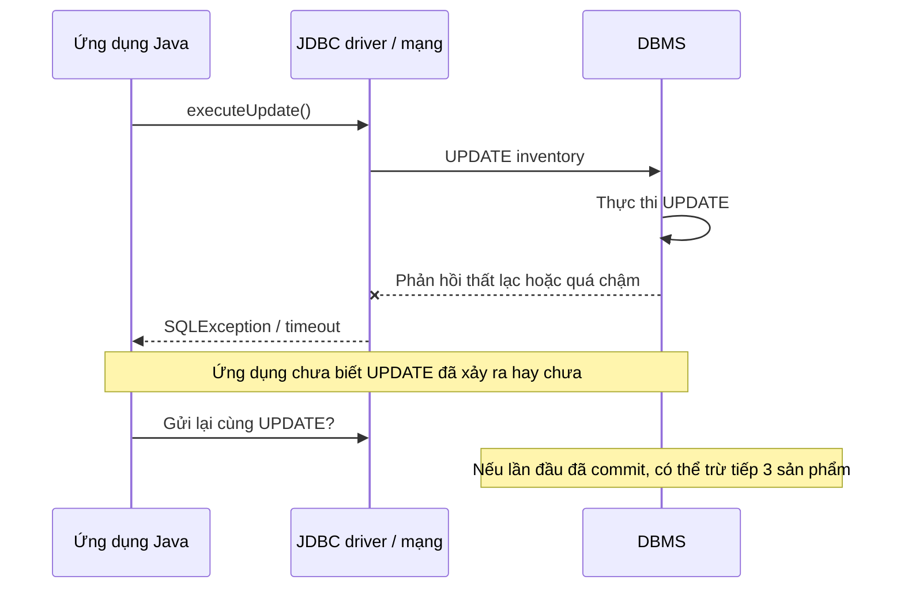

# Thử lại sau timeout khi chưa biết kết quả ghi

Một ứng dụng Java dùng **JDBC** gửi lệnh `INSERT`, `UPDATE` hoặc `DELETE`, nhưng hết thời gian chờ trước khi nhận phản hồi. Câu hỏi khó không chỉ là “có nên thử lại không?”, mà là **“lệnh trước đã được cơ sở dữ liệu thực hiện và commit hay chưa?”**. Nếu câu trả lời chưa rõ, thử lại một thao tác không có cơ chế chống trùng có thể gây trừ kho hai lần, tạo hai đơn hàng hoặc thực hiện lại một khoản thanh toán.

Trong chương **Timeout và hủy**, bài này tập trung vào chiến lược **thử lại sau timeout khi kết quả ghi chưa xác định** (*ambiguous/unknown write outcome*). Ta sẽ phân biệt timeout của `Statement`, mạng và transaction; phân tích ranh giới `commit()`/`rollback()`; thiết kế khóa idempotency và ràng buộc duy nhất; rồi triển khai ví dụ `DataSource`, `Connection`, `PreparedStatement`, `ResultSet` để **xác minh kết quả trước khi quyết định thử lại**.

> **Nguyên tắc cốt lõi:** Timeout là thông tin về **việc chờ/nhận phản hồi của ứng dụng hoặc driver**; không tự chứng minh thay đổi chưa xảy ra ở DBMS. Không tự động gửi lại một thao tác ghi có hiệu ứng cộng dồn nếu chưa có idempotency hoặc quy trình đối soát.

## 1. Vì sao một timeout có thể che giấu một lần ghi thành công?

Giả sử dịch vụ quản lý kho xử lý yêu cầu đặt trước 3 sản phẩm có mã `sku=81`:

```sql
UPDATE inventory
SET available = available - 3
WHERE sku = 81 AND available >= 3;
```

Có thể xảy ra chuỗi sự kiện:



Nếu `autoCommit=true`, mỗi statement được commit theo quy tắc hoàn tất lệnh của JDBC/DBMS. Tại thời điểm ứng dụng nhận timeout, thay đổi **có thể đã được commit**, vẫn chưa commit, bị hủy hoặc DB đang xử lý. Gửi lại `UPDATE available = available - 3` một cách mù quáng có thể thực hiện cùng ý định nghiệp vụ hai lần.

Với `autoCommit=false`, `executeUpdate()` thành công **chưa đồng nghĩa đã commit**. Ứng dụng thường có cơ hội gọi `rollback()` nếu lỗi xảy ra trước commit; nhưng nếu kết nối bị mất hoặc `commit()` đã được gửi đi mà phản hồi không đến, kết quả giao dịch vẫn có thể **không xác định**.

### Phân loại các mốc trong vòng đời ghi

| Mốc | Điều ứng dụng biết chắc | Điều chưa thể suy ra |
| --- | --- | --- |
| Chưa gửi câu SQL | Chưa yêu cầu DB thực hiện lệnh này. | Không áp dụng với các tác động khác đã xảy ra trước đó. |
| `executeUpdate()` trả số hàng thành công, `autoCommit=false` | Driver đã báo thực thi câu SQL thành công trong transaction. | Transaction chắc chắn đã commit. |
| `executeUpdate()` ném timeout | Ứng dụng không nhận kết quả bình thường của statement. | Lệnh chắc chắn không chạy hoặc chắc chắn đã rollback. |
| `rollback()` thành công trên transaction chưa commit | Thay đổi giao dịch có tính transactional đã bị hoàn tác. | Các hiệu ứng bên ngoài DB cũng được hoàn tác. |
| `commit()` trả thành công | DBMS/driver đã xác nhận giao dịch commit. | Không bảo đảm các dịch vụ ngoài DB đã hoàn tất. |
| `commit()` ném lỗi mất kết nối/timeout | Ứng dụng không có xác nhận commit đáng tin cậy. | Giao dịch chắc chắn thành công hay thất bại. |
| Nhận lỗi sau khi DB đã commit nhưng trước khi client thấy phản hồi HTTP | DB đã ghi, nhưng người gọi không biết kết quả. | Gửi lại HTTP với khóa mới có an toàn hay không. |

**Phân biệt “lệnh ghi thành công” và “ý định nghiệp vụ đã áp dụng đúng một lần”.** Một hệ thống có thể thấy SQL chạy thành công hai lần mà lại vi phạm yêu cầu đặt hàng đúng một lần.

## 2. Các loại timeout và cơ chế hủy trong JDBC

| API hoặc tình huống | Phạm vi chủ yếu | Lưu ý khi gặp lỗi |
| --- | --- | --- |
| `Statement.setQueryTimeout(int seconds)` | Giới hạn thời gian thực thi statement theo khả năng driver; `0` thông thường nghĩa là không đặt giới hạn. | Khi timeout, driver cố gắng hủy statement; hủy không đồng nghĩa transaction đã rollback. |
| `Statement.cancel()` | Yêu cầu driver hủy statement đang chạy. | Là **yêu cầu hủy**; không có bảo đảm chung rằng DB chưa thực thi một phần hoặc đã rollback transaction. |
| `Connection.setNetworkTimeout(Executor, int milliseconds)` | Giới hạn thời gian chờ các thao tác mạng của driver theo hợp đồng/hỗ trợ. | Có thể làm kết nối không còn dùng được; không xác định kết quả commit chỉ từ lỗi mạng. |
| Timeout chờ mượn connection của pool | Thời gian `DataSource.getConnection()` chờ khi pool thiếu connection. | Nếu chưa mượn được connection để bắt đầu thao tác, bản thân lần mượn thất bại chưa gửi SQL của thao tác đó. |
| Timeout mở kết nối/login | Thời gian thiết lập kết nối DB. | Khác timeout đang thực thi SQL và timeout commit. |
| Timeout transaction/lock do DBMS | DBMS chặn hoặc từ chối giao dịch khi vượt giới hạn riêng. | SQLState và ngữ nghĩa rollback phụ thuộc DBMS; cần kiểm tra transaction còn hợp lệ không. |
| Timeout ở HTTP client/API gateway | Người gọi ngừng đợi phản hồi của service. | Service có thể tiếp tục xử lý và commit sau khi client đã ngắt kết nối. |

`SQLTimeoutException` là lớp con của `SQLTransientException` và `SQLException`. Với query timeout, JDBC driver được kỳ vọng ít nhất **đã cố gắng hủy** statement khi thông báo `SQLTimeoutException`. Tuy nhiên, điều đó **không chứng minh hủy thành công** hoặc toàn bộ transaction đã rollback.

`SQLTransientException` mang ý nghĩa lỗi có khả năng khắc phục trong một lần thử sau, **không phải giấy phép retry mọi thao tác ghi**. Phải phân biệt khả năng thử lại về mặt kỹ thuật với khả năng **lặp lại an toàn về mặt nghiệp vụ**.

### Ví dụ đặt timeout trên PreparedStatement

```java
String sql = "UPDATE inventory "
           + "SET available = available - ? "
           + "WHERE sku = ? AND available >= ?";

try (PreparedStatement ps = connection.prepareStatement(sql)) {
    ps.setInt(1, 3);
    ps.setLong(2, 81L);
    ps.setInt(3, 3);
    ps.setQueryTimeout(5); // Giây; phạm vi hỗ trợ do driver quyết định.

    int changed = ps.executeUpdate();
    if (changed != 1) {
        throw new SQLException("Không có hàng đủ tồn kho");
    }
}
```

Đây là đoạn thân phương thức với `connection` do caller quản lý. `setQueryTimeout(5)` không tạo một **deadline toàn bộ** cho các lần retry, không giới hạn mặc định thời gian `commit()` và không thay thế việc kết thúc transaction. Với driver hoặc DBMS không hỗ trợ đầy đủ, thời điểm và ngoại lệ phát sinh có thể khác.

## 3. Ba trường hợp retry rất khác nhau

### Trường hợp A — thao tác chưa gửi đến DB

Ví dụ service không mượn được connection vì pool hết chỗ **trước khi bắt đầu bất kỳ SQL nào của yêu cầu này**. Lúc đó bản thân lần mượn thất bại chưa ghi dữ liệu. Có thể thử lại theo chính sách tải, nhưng phải tránh vòng lặp chờ vô hạn làm hệ thống thêm quá tải. Không áp dụng kết luận này nếu yêu cầu đã có các thao tác ghi khác ở bước trước.

### Trường hợp B — statement timeout trong transaction chưa commit

Nếu `autoCommit=false` và lỗi xảy ra trước khi gọi `commit()`, ứng dụng nên cố gắng `rollback()` để kết thúc transaction:

```java
connection.setAutoCommit(false);
try {
    performSqlWork(connection); // Các câu SQL; CHƯA gọi commit().
} catch (SQLException failure) {
    try {
        connection.rollback();
    } catch (SQLException rollbackError) {
        failure.addSuppressed(rollbackError);
    }
    throw failure;
}
// Chỉ chạy đến đây khi các câu SQL thành công.
// Nếu commit() lỗi, cần ĐỐI SOÁT; không gộp vào catch phía trên.
connection.commit();
```

Đây là **khung minh họa**: `performSqlWork(connection)` đại diện cho các câu SQL do ứng dụng định nghĩa, và caller vẫn phải quản lý vòng đời connection/transaction. Ví dụ thực tế ở mục 6 sẽ xử lý hai mốc chi tiết hơn. Nếu rollback thành công trước bất kỳ commit nào và DBMS hỗ trợ transaction đúng nghĩa, các thay đổi chưa commit của transaction đó đã được hoàn tác. Nếu rollback cũng thất bại do mất kết nối, **không được tuyên bố chắc chắn đã rollback**. Nếu `commit()` đã bắt đầu, rollback sau lỗi commit không thể xác nhận chắc kết quả commit trước đó.

### Trường hợp C — không rõ kết quả của commit

Ví dụ DBMS đã nhận `COMMIT`, ghi log bền vững và xác nhận nội bộ, nhưng socket bị cắt trước khi driver nhận phản hồi. Java thấy `SQLException`; dữ liệu vẫn có thể đã được commit.

Trong trường hợp này cần **đối soát trên một kết nối mới** và dùng cùng định danh yêu cầu (*idempotency key*) nếu phải thử lại. Không dựa vào `Connection.isClosed()`, `isValid()`, lỗi timeout hay trạng thái connection cũ để suy ra commit thành công hay thất bại.

## 4. Nền tảng của retry an toàn: idempotency key

**Idempotency** trong bài này có nghĩa: nhiều lần gửi **cùng một ý định nghiệp vụ** với **cùng một khóa yêu cầu** không được tạo thêm hiệu ứng ghi tương ứng. Khóa thường được tạo ở điểm bắt đầu yêu cầu (client/API hoặc hệ thống nhận job) và **được giữ nguyên qua mọi lần retry**.

Một chiến lược cho thao tác trừ tồn kho:

1. Sinh `request_id` duy nhất cho ý định “đặt trước 3 sản phẩm mã 81”.
2. Trong một transaction, **ghi nhận `request_id` vào bảng có ràng buộc `PRIMARY KEY` hoặc `UNIQUE`**.
3. Chỉ khi ghi nhận khóa mới thành công, thực hiện `UPDATE inventory SET available = available - 3 ...`.
4. Commit **cả bản ghi yêu cầu và thay đổi tồn kho trong cùng transaction**.
5. Khi timeout, dùng `request_id` để tra cứu trên nguồn đọc nhất quán; nếu đã có bản ghi hợp lệ nghĩa là giao dịch đã áp dụng, không trừ kho lần hai.
6. Khi retry và gặp khóa trùng, **đối soát payload**; khóa giống nhau nhưng `sku`/`quantity` khác phải được coi là xung đột, không trả thành công giả.

Mấu chốt là **ràng buộc duy nhất được DBMS cưỡng chế**, không phải câu `SELECT` kiểm tra trước rồi `INSERT` mà không có unique key. Hai luồng có thể cùng đọc “chưa có” và cùng ghi nếu DB không ràng buộc. Khi bản ghi đã được commit với cùng khóa, lần `INSERT` thứ hai không thể commit thêm một bản ghi trùng nếu ràng buộc duy nhất vẫn có hiệu lực.

### Lược đồ minh họa

```sql
CREATE TABLE inventory (
    sku BIGINT PRIMARY KEY,
    available INTEGER NOT NULL CHECK (available >= 0)
);

CREATE TABLE inventory_reservations (
    request_id VARCHAR(80) PRIMARY KEY,
    sku BIGINT NOT NULL,
    quantity INTEGER NOT NULL CHECK (quantity > 0),
    FOREIGN KEY (sku) REFERENCES inventory(sku)
);
```

Bảng `inventory_reservations` không đơn thuần là log: nó là **dấu vết giao dịch đã commit** của một yêu cầu đặt trước. Ta quy ước trong bài rằng mỗi hàng được ghi chỉ khi **cùng transaction** đã trừ tồn kho thành công. Bảng sẽ không có hàng cho thao tác trừ kho thất bại đã rollback.

Trong hệ thống nhiều tenant, khóa idempotency nên được **đặt trong phạm vi tenant/người dùng** (ví dụ khóa ghép `PRIMARY KEY (tenant_id, request_id)`) và phải kiểm tra quyền truy cập; không cho một khách hàng dùng khóa của khách hàng khác để dò kết quả. Có thể lưu thêm mã hash payload đã chuẩn hóa, loại thao tác và trạng thái để hỗ trợ phát hiện trùng/xung đột ở nhiều workflow khác nhau.

## 5. Tại sao chỉ SELECT kiểm tra sau timeout vẫn chưa đủ?

Giả sử `request_id=abc-123` được gửi từ kết nối A. Kết nối A đang chờ khóa hoặc đã gửi `COMMIT` nhưng phản hồi chưa đến. Kết nối B chạy:

```sql
SELECT sku, quantity
FROM inventory_reservations
WHERE request_id = ?;
```

Nếu B thấy bản ghi đã commit với payload đúng, có thể xác nhận thao tác ghi đã thành công **theo hợp đồng transactional của lược đồ trên**. Nếu B chưa thấy bản ghi, vẫn có nhiều khả năng:

- A chưa thực hiện xong transaction; bản ghi chưa commit nên B chưa được nhìn thấy.
- A đã rollback và thao tác thật sự thất bại.
- A đã commit nhưng B đọc qua **read replica bị trễ**, hoặc đang dùng một snapshot transaction cũ.
- Có lỗi mới trong lúc kiểm tra.

Vì vậy **“không tìm thấy bản ghi” không đồng nghĩa “lần đầu chắc chắn chưa thành công”**. Nếu cần đối soát, ưu tiên truy vấn trên **DB primary hoặc nguồn có tính nhất quán phù hợp**, qua một lần đọc mới, tránh tái sử dụng transaction snapshot cũ. Sau khi kiểm tra mà vẫn không thấy, giữ trạng thái **chưa xác minh** và chỉ cân nhắc thử lại với **cùng `request_id`**, giới hạn số lần, thời gian chờ và có unique constraint.

Nếu transaction A còn đang chạy, `INSERT` với cùng khóa ở lần thử sau có thể **bị chờ**, bị từ chối vì trùng khóa sau khi A commit, hoặc thành công nếu A rollback. Đây là hành vi mong muốn của cơ chế chống trùng, nhưng có thể phát sinh timeout hoặc lỗi khóa mới; không suy luận từ một lần nhìn thấy `0` hàng rằng khóa đã rảnh.

## 6. Ví dụ JDBC: thao tác ghi có khóa chống trùng và transaction

Ví dụ sau tạo một **đơn vị giao dịch** gồm:

1. `INSERT` một hàng `inventory_reservations` với `request_id` duy nhất.
2. `UPDATE` trừ tồn kho có điều kiện để không âm.
3. `commit()` cả hai thay đổi.

Nếu một thao tác trước `commit` thất bại, cố gắng `rollback`. Nếu **đã gọi `commit` và nhận lỗi**, không coi rollback sau đó là bằng chứng giao dịch chưa thực hiện; kết quả sẽ được kiểm tra bằng một kết nối khác.

```java
import java.sql.Connection;
import java.sql.PreparedStatement;
import java.sql.ResultSet;
import java.sql.SQLException;
import java.util.Objects;
import javax.sql.DataSource;

public final class InventoryReservationService {
    private final DataSource primaryDataSource;

    public InventoryReservationService(DataSource primaryDataSource) {
        // Phải truy cập DB primary/nguồn đọc nhất quán cho đối soát.
        this.primaryDataSource = Objects.requireNonNull(primaryDataSource);
    }

    public enum Observation {
        APPLIED,           // Đã thấy yêu cầu được commit với payload đúng.
        KEY_CONFLICT,      // Cùng key nhưng payload khác.
        NOT_YET_CONFIRMED  // Chưa thấy hàng, không đồng nghĩa đã thất bại.
    }

    private static void validate(String requestId, long sku, int quantity) {
        if (requestId == null || requestId.isEmpty()
                || requestId.length() > 80
                || sku <= 0 || quantity <= 0) {
            throw new IllegalArgumentException("Yêu cầu đặt kho không hợp lệ");
        }
    }

    public void reserveOnce(String requestId, long sku, int quantity)
            throws SQLException {
        validate(requestId, sku, quantity);

        // Chỉ kiểm soát transaction trong ví dụ khi không có framework
        // transaction manager đang sở hữu connection.
        try (Connection connection = primaryDataSource.getConnection()) {
            if (!connection.getAutoCommit()) {
                throw new SQLException(
                        "Ví dụ yêu cầu Connection có autoCommit=true ban đầu");
            }
            connection.setAutoCommit(false);

            boolean commitAttempted = false;
            boolean transactionFinished = false;
            Throwable primaryFailure = null;
            try {
                String claimSql = "INSERT INTO inventory_reservations "
                        + "(request_id, sku, quantity) VALUES (?, ?, ?)";
                try (PreparedStatement claim =
                             connection.prepareStatement(claimSql)) {
                    claim.setString(1, requestId);
                    claim.setLong(2, sku);
                    claim.setInt(3, quantity);
                    claim.setQueryTimeout(5);
                    if (claim.executeUpdate() != 1) {
                        throw new SQLException("Ghi nhận request thất bại");
                    }
                }

                String stockSql = "UPDATE inventory "
                        + "SET available = available - ? "
                        + "WHERE sku = ? AND available >= ?";
                try (PreparedStatement update =
                             connection.prepareStatement(stockSql)) {
                    update.setInt(1, quantity);
                    update.setLong(2, sku);
                    update.setInt(3, quantity);
                    update.setQueryTimeout(5);
                    if (update.executeUpdate() != 1) {
                        // Có thể thiếu hàng hoặc không tồn tại SKU;
                        // cả bản ghi request cũng phải rollback.
                        throw new SQLException("Không đủ hàng hoặc sai SKU");
                    }
                }

                commitAttempted = true;
                connection.commit();
                transactionFinished = true;
            } catch (SQLException | RuntimeException failure) {
                primaryFailure = failure;
                if (!commitAttempted) {
                    try {
                        connection.rollback();
                        transactionFinished = true;
                    } catch (SQLException rollbackError) {
                        failure.addSuppressed(rollbackError);
                    }
                }
                // Nếu commit() đã được gọi và lỗi: kết quả chưa chắc chắn.
                // Không dùng rollback ngay trên connection này như một
                // phép chứng minh giao dịch chưa được commit.
                throw failure;
            } finally {
                if (transactionFinished) {
                    // Không đổi autoCommit=true nếu còn transaction
                    // chưa rõ trạng thái: đổi có thể commit ngầm.
                    try {
                        connection.setAutoCommit(true);
                    } catch (SQLException resetError) {
                        if (primaryFailure != null) {
                            primaryFailure.addSuppressed(resetError);
                        } else {
                            throw resetError;
                        }
                    }
                }
                // Connection.close() sẽ gọi theo hợp đồng pool/driver;
                // production cần chính sách loại/reset kết nối lỗi.
            }
        }
    }

    public Observation observe(String requestId, long sku, int quantity)
            throws SQLException {
        validate(requestId, sku, quantity);
        String sql = "SELECT sku, quantity "
                   + "FROM inventory_reservations WHERE request_id = ?";

        // Mượn connection mới tới primary; không dùng snapshot cũ.
        try (Connection connection = primaryDataSource.getConnection()) {
            if (!connection.getAutoCommit()) {
                throw new SQLException(
                        "Đối soát yêu cầu một lần đọc mới với autoCommit=true");
            }
            try (PreparedStatement ps = connection.prepareStatement(sql)) {
                ps.setString(1, requestId);
                ps.setQueryTimeout(5);
                try (ResultSet rs = ps.executeQuery()) {
                    if (!rs.next()) {
                        return Observation.NOT_YET_CONFIRMED;
                    }
                    if (rs.getLong("sku") != sku
                            || rs.getInt("quantity") != quantity) {
                        return Observation.KEY_CONFLICT;
                    }
                    return Observation.APPLIED;
                }
            }
        }
    }
}
```

### Cách sử dụng và quyết định sau lỗi

```java
InventoryReservationService service =
        new InventoryReservationService(primaryDataSource);

String requestId = "reserve-2026-001"; // Giữ nguyên qua mọi lần retry.
long sku = 81L;
int quantity = 3;

try {
    service.reserveOnce(requestId, sku, quantity);
    System.out.println("Đã xác nhận đặt hàng trong DB");
} catch (SQLException failure) {
    // Ví dụ minh họa nhánh xử lý; không tự retry ngay.
    InventoryReservationService.Observation seen;
    try {
        seen = service.observe(requestId, sku, quantity);
    } catch (SQLException checkFailure) {
        failure.addSuppressed(checkFailure);
        throw failure; // Chưa xác minh; không coi là đã thất bại.
    }

    switch (seen) {
        case APPLIED:
            System.out.println("Lần trước đã commit, không ghi lại");
            break;
        case KEY_CONFLICT:
            throw new IllegalStateException(
                    "Idempotency key đã dùng cho payload khác", failure);
        case NOT_YET_CONFIRMED:
            // Không kết luận là đã rollback hay chưa hề thực thi.
            // Trả trạng thái chưa rõ hoặc retry CÙNG key với backoff,
            // giới hạn lần thử, sau khi phân loại lỗi và kiểm tra tải DB.
            throw failure;
    }
}
```

**Đây là ví dụ minh họa JDBC, không phải engine retry hoàn chỉnh.** Trạng thái `NOT_YET_CONFIRMED` phải được tầng điều phối xử lý theo chính sách nghiệp vụ; lỗi khi `observe()` cũng cần được bảo toàn và trả về trạng thái chưa xác minh, thay vì đổi thành “chưa ghi”. Mã giả định bảng `inventory` và `inventory_reservations` có đúng cấu trúc đã trình bày, cùng sử dụng transaction tại một DBMS hỗ trợ giao dịch.

**Các điểm an toàn trong thiết kế:**

1. **`request_id` được ghi trước thao tác trừ kho trong cùng transaction.** Nếu key đã commit, lần ghi lại không được đi tiếp đến `UPDATE inventory`; DBMS bảo vệ bằng `PRIMARY KEY`.
2. Nếu `UPDATE` trả `0`, chương trình rollback **cả key và thay đổi tồn kho**. Ví dụ coi đây là lỗi nghiệp vụ “không đủ hàng/SKU không tồn tại”; ở ứng dụng thật nên tách khỏi lỗi timeout/transient bằng một loại ngoại lệ nghiệp vụ riêng.
3. `commitAttempted` phân biệt lỗi **trước commit** với lỗi **sau khi bắt đầu gọi commit**. `commit()` ném lỗi không được coi là chắc chắn rollback, ngay cả khi connection bị đóng hoặc mất mạng.
4. `observe()` chỉ xác nhận `APPLIED` nếu hàng đã commit xuất hiện và `sku`/`quantity` **khớp đúng**. Một request key tái sử dụng với payload khác phải bị từ chối.
5. Nếu `INSERT` ở lần retry đụng khóa trùng, transaction của lần retry phải được kết thúc/rollback; **sau đó** tra cứu theo key để đối soát. Mã ví dụ `reserveOnce()` đã rollback khi lỗi xảy ra trước `commit`.
6. `close()` của connection pool **không phải bằng chứng đã rollback thành công**. Phải cấu hình/test pool để rollback hoặc loại bỏ kết nối không còn trạng thái đáng tin, đặc biệt sau network/commit failure.

Với giao dịch có ràng buộc khóa duy nhất, một lần retry đồng thời khi giao dịch trước chưa commit có thể **chờ khóa**, bị timeout tiếp hoặc gặp lỗi unique sau khi giao dịch trước commit. Cần backoff có jitter, giới hạn độ đồng thời và không giữ connection khi chờ.

## 7. Chính sách retry hữu hạn và có đối soát

Một thuật toán cấp service có thể mô tả như sau:

```text
Đầu vào: requestId cố định + payload đã chuẩn hóa
giới hạn: số lần thử / tổng deadline / backoff có jitter

Mỗi lần thử:
    thử giao dịch JDBC với cùng requestId và cùng payload
    nếu commit được xác nhận → thành công
    nếu lỗi nghiệp vụ chắc chắn → từ chối theo hợp đồng nghiệp vụ
    nếu lỗi SQL/timeout hoặc commit chưa rõ:
        đọc lại bằng Connection mới tới primary
        nếu có key với payload đúng → xác nhận đã áp dụng
        nếu có key với payload khác → trả lỗi xung đột
        nếu chưa thấy / không đọc được:
            không coi là đã rollback
            nếu lỗi có thể retry và còn ngân sách:
                trả Connection, chờ backoff rồi thử LẠI CÙNG key
            ngược lại:
                trả trạng thái "chưa xác minh", cần đối soát tiếp
```

Các nguyên tắc quan trọng:

| Quy tắc | Lý do |
| --- | --- |
| **Một khóa cho một ý định nghiệp vụ** | Không tạo khóa mới cho mỗi lần retry vì sẽ bỏ qua ràng buộc chống trùng. |
| **Giữ nguyên payload** | Một key có hai payload khác nhau không phải cùng một yêu cầu. |
| **Ràng buộc UNIQUE/PRIMARY KEY ở DB** | `SELECT` kiểm tra trước không ngăn được race condition. |
| **Giữ khóa idempotency đủ lâu** | Xóa bản ghi chống trùng trước khi hết cửa sổ retry có thể khiến yêu cầu cũ được áp dụng lần nữa. |
| **Không dùng lại connection đã gặp lỗi không rõ transaction** | Trạng thái session, transaction hoặc mạng có thể không đáng tin. |
| **Đọc từ primary/nguồn nhất quán** | Read replica chậm có thể che giấu commit đã xảy ra. |
| **Giới hạn số lần và tổng deadline** | Thử lại vô hạn làm tăng nghẽn, đụng khóa, cạn pool và quá tải DB. |
| **Backoff ngoài transaction/Connection** | Không chiếm connection trong lúc chờ retry. |
| **Phân loại lỗi và khả năng khôi phục** | Vi phạm dữ liệu cố định, quyền truy cập hay SQL sai cú pháp sẽ không tự hết khi retry. |
| **Không chỉ dựa vào loại SQLTransientException** | “Có thể thử lại” về driver không đồng nghĩa được phép lặp lại tác động nghiệp vụ. |
| **Lưu thông tin để điều tra** | Correlation ID, request ID, SQLState, vendor code, mốc commit và trạng thái đối soát hữu ích hơn log SQL nhạy cảm. |

Một số tình huống phù hợp để retry có điều kiện gồm lỗi kết nối tạm thời, deadlock/serialization failure **sau khi transaction trước đã được xác nhận rollback** hoặc commit chưa rõ nhưng thao tác có idempotency. Không tự động retry lỗi `NOT NULL`/khóa ngoại sai, request key dùng với payload khác hoặc lỗi nghiệp vụ như “không đủ hàng” nếu không có thay đổi trạng thái/ý định mới.

Nếu phải retry transaction vì serialization failure, retry **toàn bộ transaction** với dữ liệu đầu vào được kiểm tra lại, không chỉ retry câu SQL cuối trong transaction hỏng. Với commit không rõ kết quả, **đối soát trước**; key idempotent bảo vệ ngay cả khi việc đọc lại chưa bắt được bản ghi do transaction trước còn đang chạy.

## 8. Auto-commit và batch làm bài toán khó hơn thế nào?

### Khi autoCommit=true

`PreparedStatement.executeUpdate()` có thể tự tạo ranh giới commit cho một statement. Nếu timeout xảy ra sau khi DB đã áp dụng và commit nhưng trước khi Java nhận kết quả, `rollback()` sau đó **không thể hoàn tác transaction đã commit**. Do vậy không dùng `autoCommit=true` cho quy trình cần ghép nhiều SQL và idempotency key thành một lần ghi nguyên tử.

### Khi autoCommit=false

Bạn kiểm soát ranh giới `commit()` rõ hơn:

```java
connection.setAutoCommit(false);
// INSERT request_id và UPDATE dữ liệu nghiệp vụ cùng transaction.
// Kiểm tra số hàng được báo bởi executeUpdate().
connection.commit();
```

Nhưng **mất kết nối khi `commit`** vẫn là trạng thái bất định. Sử dụng `setAutoCommit(false)` không tự giải quyết tất cả timeout; nó cho phép xây thiết kế transactional và đối soát có cơ sở.

### Khi dùng executeBatch()

`BatchUpdateException.getUpdateCounts()` mô tả kết quả từng lệnh mà driver báo cáo, bao gồm `Statement.SUCCESS_NO_INFO` và `Statement.EXECUTE_FAILED` khi thích hợp. **Mảng số đếm không xác nhận những lệnh nào đã được commit**. Nếu batch nhiều lần trong một transaction chưa commit thì rollback thường có thể hoàn tác cả batch; nếu mỗi batch được commit riêng, retry phải có checkpoint và khóa idempotency cho từng chunk hoặc từng hàng tùy nghiệp vụ.

## 9. Tránh lặp lại hiệu ứng ngoài cơ sở dữ liệu

Giả sử transaction ghi đơn hàng rồi ứng dụng **gửi email**, **gọi cổng thanh toán** hoặc **phát sự kiện**. Ngay cả khi dùng idempotency key trong bảng đơn hàng, transaction DB **không bao bọc được** một yêu cầu HTTP hoặc email đã gửi. Sau timeout, gửi lại có thể tạo hiệu ứng bên ngoài hai lần.

Hai thiết kế thường được cân nhắc:

- **Transactional outbox:** trong cùng transaction DB, ghi dữ liệu nghiệp vụ và một hàng `outbox` với khóa sự kiện duy nhất. Worker đọc sự kiện đã commit rồi gửi ra ngoài. Worker vẫn có thể gửi lặp khi mất phản hồi, nên bên nhận cần dedupe/idempotency hoặc xử lý trùng an toàn.
- **Idempotency ở hệ thống đích:** nếu API thanh toán hỗ trợ `Idempotency-Key`, dùng **cùng khóa** cho mọi lần retry của cùng khoản thanh toán. Kiểm tra hợp đồng lưu key, thời hạn giữ, cách so sánh payload và chính sách xử lý request đang chạy của nhà cung cấp; không giả định mọi dịch vụ có cùng bảo đảm.

Một câu `UPDATE status='PAID'` được gửi lại có thể tạo ra cùng giá trị cuối, nhưng trigger, log, notification hoặc các thao tác khác vẫn có thể lặp. Vì vậy **“SQL có vẻ idempotent” không đồng nghĩa cả workflow idempotent**.

## 10. Kiểm thử các thời điểm lỗi khác nhau

Để kiểm chứng retry an toàn, hãy thử trên **DBMS, driver và pool** mà hệ thống thực sự dùng. Đừng tạo lỗi chỉ bằng cách đoán `Thread.sleep()` là đủ; có thể dùng công cụ fault injection, proxy mạng thử nghiệm, chặn khóa có kiểm soát và các điểm đồng bộ rõ ràng.

| Thời điểm lỗi | Điều cần xác minh |
| --- | --- |
| Timeout chờ mượn connection, chưa gửi SQL | Không có thay đổi DB từ thao tác chưa bắt đầu; có chính sách backpressure/retry phù hợp. |
| Timeout khi `INSERT request_id` chưa trả kết quả | Rollback được cố gắng, không commit nửa transaction; lần thử cùng key không nhân đôi tác động. |
| Timeout khi `UPDATE inventory` đang chờ khóa | Xử lý SQLState/lock timeout đúng, rollback trước khi tái sử dụng kết nối. |
| Kết nối mất **trước** `commit` và rollback thất bại | Không đánh dấu chắc chắn rollback; đối soát và kiểm tra pool loại kết nối lỗi. |
| DB đã commit nhưng phản hồi `commit` bị mất | Đọc lại key xác nhận `APPLIED`, không trừ kho lần nữa. |
| Retry khi giao dịch đầu còn đang chạy | Unique constraint chặn việc cả hai giao dịch cùng commit cho cùng key; không chờ vô hạn. |
| Cùng key nhưng payload khác | Báo `KEY_CONFLICT`, không trả thành công giả. |
| Đọc lại qua replica chậm | Không coi hàng chưa xuất hiện là chưa commit; đối soát qua primary/nguồn nhất quán. |
| Retry vượt ngân sách | Trả trạng thái chưa xác minh và lưu thông tin đối soát, không tiếp tục tạo tải vô hạn. |
| DB commit xong, sự kiện gửi ra ngoài bị timeout | Kiểm chứng outbox và idempotency ở bên nhận, tránh gửi hai lần có tác động. |

### Quan sát và vận hành

Nên đo **số timeout theo từng loại**, số lỗi kết nối, số giao dịch rollback thành công/thất bại, commit không rõ kết quả, số lần đối soát ra `APPLIED`, số key conflict, tỷ lệ retry và độ trễ từ lúc yêu cầu bắt đầu đến khi được xác nhận. Không ghi toàn bộ dữ liệu thẻ thanh toán, token, nội dung nhạy cảm hoặc SQL đã nội suy tham số vào log.

Khi `commit()` hoặc I/O mạng không xác nhận được, **không đưa connection đó trở lại phục vụ request mới nếu trạng thái không đáng tin**. Cơ chế loại bỏ/khởi tạo lại connection vật lý tùy thư viện pool/driver; cần kiểm tra khả năng đó bằng thử nghiệm thay vì dựa vào `close()` như một phép xác nhận rollback.

## 11. Những sai lầm điển hình

| Sai lầm | Hệ quả | Cách xử lý |
| --- | --- | --- |
| Bắt `SQLTimeoutException` rồi gọi lại `UPDATE balance=balance-?` với key mới. | Có thể trừ tiền/kho hai lần nếu lần đầu đã commit. | Giữ key cũ, dùng unique constraint và đối soát. |
| Xem `Statement.cancel()` là bằng chứng chưa ghi. | Hủy có thể quá muộn, không thành công hoặc không rollback transaction. | Xác minh transaction và kết quả qua DB. |
| Cho rằng `executeUpdate() == 1` nghĩa là đã commit. | Nhầm kết quả statement với kết quả transaction. | Chỉ xác nhận sau `commit()` thành công hoặc đối soát dữ liệu đã commit. |
| `commit()` ném lỗi thì cứ `rollback()` rồi retry ngay. | Rollback không chứng minh commit trước đó chưa xảy ra. | Đối soát bằng key, không reuse connection không rõ trạng thái. |
| `SELECT` không thấy key rồi tạo **key mới**. | Transaction cũ có thể đang chạy; hai ý định ghi có thể cùng commit. | Retry cùng key dưới ràng buộc duy nhất. |
| Chỉ dùng `SELECT WHERE request_id=?` trước khi `INSERT`. | Race condition giữa hai request đồng thời. | Đặt `PRIMARY KEY`/`UNIQUE` ở DB. |
| Dùng read replica để quyết định retry tức thì. | Replication lag che khuất thay đổi đã commit. | Đọc primary/nguồn nhất quán cho đối soát. |
| Lặp lại cùng key nhưng không kiểm tra payload. | Trả kết quả của yêu cầu khác hoặc che giấu lỗi client. | So sánh payload/tenant/loại thao tác. |
| Retry không giới hạn trên connection đang mở. | Cạn pool, kéo dài transaction và tăng tranh chấp. | Backoff ngoài Connection, có giới hạn thời gian/lần thử. |
| Tin rằng transaction JDBC bao bọc email/API ngoài DB. | Side effect có thể bị thực hiện hai lần. | Outbox và idempotency của hệ thống đích. |

## 12. Bài tập thực hành

Một service JDBC nhận yêu cầu **trừ 2 sản phẩm** với `sku=50`. Client gửi `request_id='R-777'`, service mở transaction, ghi request ID vào bảng duy nhất và trừ tồn kho. Lúc gọi `commit()`, mạng bị ngắt. Client timeout rồi gửi lại.

1. Tại sao không thể kết luận lệnh đầu tiên thất bại chỉ vì `commit()` ném `SQLException`?
2. Client nên gửi lại `request_id='R-777'` hay tạo khóa mới? Vì sao?
3. Một kết nối mới đọc thấy `R-777` với `sku=50` và `quantity=2`. Có nên thực hiện thêm một `UPDATE inventory SET available = available - 2` không?
4. Kết nối mới **chưa thấy** `R-777`. Có thể kết luận chắc chắn transaction cũ đã rollback không? Điều gì có thể xảy ra nếu transaction cũ vẫn đang chờ?
5. Nếu đọc thấy `R-777` nhưng `quantity=3` thì phản hồi nào hợp lý?
6. Nếu lần đầu đã gửi email xác nhận **ngoài transaction** rồi mất phản hồi, idempotency của bảng inventory có đủ tránh email gửi hai lần không?

**Đáp án định hướng:**

1. DB có thể đã commit nhưng phản hồi bị mất trên đường về; lỗi Java không đủ để suy ra trạng thái bền vững của giao dịch.
2. Dùng **cùng `R-777`** vì đây là cùng một ý định nghiệp vụ. Khóa mới sẽ mất khả năng chống trùng.
3. Không. Bản ghi đã commit với payload đúng là dấu vết xác nhận thao tác trong thiết kế transactional; trả kết quả thành công đã có.
4. Không. Giao dịch trước có thể chưa commit hoặc kết nối đọc không nhất quán; retry cùng key có thể chờ, đụng unique constraint hoặc thành công nếu giao dịch trước rollback.
5. Báo **xung đột idempotency key**; không tự coi hai payload khác nhau là một yêu cầu.
6. Không. Cần outbox và/hoặc idempotency/dedupe ở bên gửi/nhận email theo hợp đồng hệ thống.

**Ghi nhớ:** **Timeout không đồng nghĩa rollback**. Hãy phân biệt timeout statement, mạng và commit; dùng transaction JDBC đúng ranh giới; ghi **idempotency key** cùng thay đổi nghiệp vụ dưới `UNIQUE`/`PRIMARY KEY`; khi chưa rõ kết quả, **đối soát bằng kết nối mới đến nguồn nhất quán** rồi mới cân nhắc retry **cùng key**, có backoff và giới hạn. Một phép kiểm tra không thấy bản ghi không chứng minh thao tác cũ chắc chắn thất bại, và transaction DB không tự bao bọc các hiệu ứng bên ngoài.
