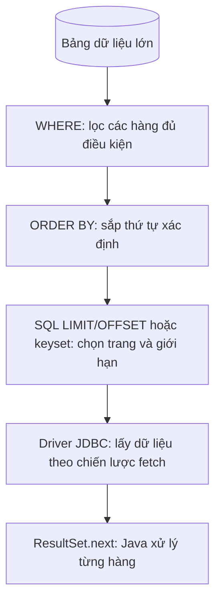

# Phân biệt phân trang, giới hạn kết quả và chia khối truyền dữ liệu trong JDBC

## 1. Vì sao cần phân biệt ba kỹ thuật?

Khi một ứng dụng Java dùng **JDBC (Java Database Connectivity)** truy vấn cơ sở dữ liệu quan hệ, một bảng có thể chứa hàng triệu bản ghi. Nếu ứng dụng yêu cầu tất cả dữ liệu trong một lần, nó có thể gặp thời gian phản hồi dài, truyền nhiều byte qua mạng, sử dụng quá nhiều bộ nhớ hoặc giữ kết nối cơ sở dữ liệu quá lâu.

Ba kỹ thuật thường xuất hiện trong cùng một bài toán nhưng giải quyết **ba câu hỏi khác nhau**:

1. **Phân trang (pagination):** Trong toàn bộ tập dữ liệu thỏa điều kiện, người dùng hoặc tác vụ đang cần **phần nào**? Ví dụ, trang thứ 3 gồm 50 đơn hàng.
2. **Giới hạn kết quả (result limiting):** Mỗi truy vấn được phép trả về **tối đa bao nhiêu hàng**? Ví dụ, một yêu cầu chỉ nhận tối đa 100 đơn hàng.
3. **Chia khối truyền dữ liệu (fetching in batches/chunks):** Khi duyệt một `ResultSet`, driver JDBC **lấy các hàng từ cơ sở dữ liệu theo những đợt lớn nhỏ ra sao**? Ví dụ, gợi ý lấy khoảng 200 hàng trong một đợt.

Phân trang và giới hạn kết quả thường được diễn đạt bằng **SQL**. Chia khối truyền dữ liệu thường được điều chỉnh bằng **`Statement.setFetchSize(int)`** trong JDBC. Các thao tác này có thể dùng cùng nhau, nhưng không thay thế lẫn nhau.



Sơ đồ mô tả vai trò logic của từng bước. Trình tối ưu hóa cơ sở dữ liệu có thể thực thi các toán tử vật lý theo cách khác để tiết kiệm tài nguyên; không nên coi sơ đồ là một kế hoạch thực thi SQL cố định.

## 2. Bảng so sánh nhanh

| Tiêu chí | Phân trang | Giới hạn kết quả | Chia khối truyền dữ liệu |
| --- | --- | --- | --- |
| Câu hỏi chính | Cần nhóm bản ghi nào? | Có tối đa bao nhiêu bản ghi trong kết quả? | Driver lấy dữ liệu theo từng đợt như thế nào? |
| Công cụ phổ biến | `LIMIT ... OFFSET ...`, `OFFSET ... FETCH`, keyset/cursor | `LIMIT`, `FETCH FIRST`, `Statement.setMaxRows` | `Statement.setFetchSize`, `ResultSet.setFetchSize` |
| Có chọn vị trí trang? | Có | Không, nếu chỉ đặt số hàng tối đa | Không |
| Có thể giảm số hàng mà truy vấn trả về? | Có, khi SQL chọn một trang | Có | Không tự thay đổi tổng số hàng của truy vấn |
| Có thể ảnh hưởng số lần truyền qua mạng? | Gián tiếp, vì ít hàng hơn | Gián tiếp, vì ít hàng hơn | Có thể, tùy driver và chế độ cursor |
| Cần `ORDER BY` ổn định? | **Có**, nếu muốn các trang nhất quán | Nên có khi cần xác định những hàng được giữ | Không dùng để quyết định thứ tự |
| Tác dụng chính | Điều hướng dữ liệu | Kiểm soát kích thước kết quả | Điều chỉnh tài nguyên và cách trao đổi dữ liệu |

Một quy tắc dễ nhớ: **`LIMIT 100`** nói rằng chỉ lấy tối đa 100 hàng; **`OFFSET 200 LIMIT 100`** nói rằng bỏ qua 200 hàng đầu theo thứ tự đã chọn rồi lấy tối đa 100; còn **`setFetchSize(100)`** chỉ gợi ý cách driver đọc dữ liệu từ `ResultSet`, không có nghĩa truy vấn chỉ trả về 100 hàng.

## 3. Phân trang: chọn một phần có thứ tự của tập kết quả

### 3.1. Phân trang bằng `LIMIT` và `OFFSET`

Giả sử bảng `orders` có khóa chính `id`, trạng thái `status` và nhiều đơn hàng. Giao diện hiển thị 20 đơn hàng mỗi trang, với chỉ số trang bắt đầu từ `0`.

```sql
-- Ví dụ cú pháp phổ biến trong PostgreSQL/MySQL.
SELECT id, status, total_amount
FROM orders
WHERE status = 'PAID'
ORDER BY id DESC
LIMIT 20 OFFSET 40;
```

Với các hàng đã lọc và sắp xếp, truy vấn trên lấy **trang thứ 3**: bỏ qua 40 hàng đầu, sau đó trả về tối đa 20 hàng. Công thức chung:

```text
offset = pageIndex * pageSize
pageIndex: 0, 1, 2, ...
pageSize:  số hàng tối đa mỗi trang
```

`ORDER BY id DESC` tạo thứ tự xác định vì `id` là duy nhất. Nếu chỉ sắp xếp theo một cột có giá trị trùng nhau, chẳng hạn `created_at`, nên thêm khóa duy nhất để phá hòa: `ORDER BY created_at DESC, id DESC`. Không có `ORDER BY` ổn định, một bản ghi có thể xuất hiện ở trang khác nhau ngay cả khi dữ liệu hầu như không thay đổi.

Một phương án theo cú pháp SQL khác là:

```sql
SELECT id, status, total_amount
FROM orders
WHERE status = 'PAID'
ORDER BY id DESC
OFFSET 40 ROWS FETCH NEXT 20 ROWS ONLY;
```

Khả năng hỗ trợ `LIMIT`, `OFFSET ... FETCH`, cách gắn tham số và tối ưu hóa phụ thuộc hệ quản trị cơ sở dữ liệu. JDBC không tự chuyển mọi phương ngữ phân trang SQL thành cú pháp dùng chung cho tất cả driver.

### 3.2. Ví dụ JDBC với `PreparedStatement`

Khi `pageIndex`, `pageSize` và `status` thay đổi theo request, dùng tham số để không ghép dữ liệu đầu vào vào chuỗi SQL:

```java
import java.sql.Connection;
import java.sql.PreparedStatement;
import java.sql.ResultSet;
import java.sql.SQLException;

public class OrderPageReader {
    public static void printPage(Connection connection,
                                 String status,
                                 int pageIndex,
                                 int pageSize) throws SQLException {
        if (pageIndex < 0 || pageSize < 1 || pageSize > 200) {
            throw new IllegalArgumentException("Tham số phân trang không hợp lệ");
        }

        long offset = (long) pageIndex * pageSize;

        // Ví dụ dành cho hệ quản trị hỗ trợ LIMIT/OFFSET với tham số JDBC.
        String sql = """
            SELECT id, status, total_amount
            FROM orders
            WHERE status = ?
            ORDER BY id DESC
            LIMIT ? OFFSET ?
            """;

        try (PreparedStatement statement = connection.prepareStatement(sql)) {
            statement.setString(1, status);
            statement.setInt(2, pageSize);
            statement.setLong(3, offset);

            try (ResultSet rows = statement.executeQuery()) {
                while (rows.next()) {
                    long id = rows.getLong("id");
                    System.out.println("Đơn hàng: " + id);
                }
            }
        }
    }
}
```

Đoạn mã nhận `Connection` đã mở, giả định bảng và cột đúng như SQL. Phép nhân chuyển sang `long` trước khi tính offset, giúp tránh tràn số của phép nhân `int`. Giới hạn `pageSize <= 200` là ví dụ về quy tắc của ứng dụng; giá trị thực tế phải do nhu cầu sản phẩm và tài nguyên hệ thống quyết định.

**Phân trang không có nghĩa tải tất cả hàng về Java rồi bỏ qua.** Đoạn mã đúng gửi ranh giới trang vào SQL để cơ sở dữ liệu quyết định các hàng thuộc trang đó.

### 3.3. Mặt hạn chế của trang sâu

`OFFSET` dễ dùng cho trang 1, 2, 3, nhưng `OFFSET 500000 LIMIT 20` có thể buộc cơ sở dữ liệu duyệt, sắp xếp hoặc bỏ qua số lượng lớn hàng trước khi cung cấp 20 hàng cần thiết. Mức độ ảnh hưởng phụ thuộc chỉ mục, kế hoạch thực thi, điều kiện lọc và hệ quản trị.

Ngoài hiệu năng, dữ liệu thay đổi giữa các yêu cầu cũng có thể làm các trang `OFFSET` bị **trùng hoặc thiếu hàng**. Chẳng hạn, một đơn hàng mới xuất hiện ở đầu danh sách trước khi người dùng tải trang tiếp theo, khiến các vị trí còn lại dịch xuống.

## 4. Phân trang theo khóa (keyset/cursor pagination)

Với danh sách rất dài được cuộn liên tục, có thứ tự theo khóa ổn định, **keyset pagination** thường phù hợp hơn so với OFFSET lớn.

Giả sử danh sách sắp xếp `id DESC`, và hàng cuối cùng của trang trước có `id = 8700`. Để lấy trang tiếp theo:

```sql
SELECT id, status, total_amount
FROM orders
WHERE status = 'PAID' AND id < 8700
ORDER BY id DESC
LIMIT 20;
```

Điểm đánh dấu (`8700`) xác định **ranh giới giá trị khóa**, thay vì số hàng phải bỏ qua. Khi dùng JDBC, giá trị `8700`, trạng thái và kích thước trang nên được cung cấp bằng `PreparedStatement`.

Với thứ tự ghép `created_at DESC, id DESC`, điều kiện sang trang cũng phải dùng **cùng các khóa và cùng chiều sắp xếp**:

```sql
SELECT id, created_at, status
FROM orders
WHERE status = ?
  AND (created_at < ? OR (created_at = ? AND id < ?))
ORDER BY created_at DESC, id DESC
LIMIT ?;
```

Ứng dụng gắn dấu thời gian của hàng cuối trang trước vào cả tham số `created_at`, gắn `id` cuối trang vào tham số tiếp theo và gắn kích thước trang vào tham số cuối. Ví dụ giả định `created_at` **không NULL** và `id` duy nhất; các điều kiện liên quan `NULL` hoặc chiều sắp xếp khác cần viết tương ứng.

Ưu điểm thường gặp của keyset là khả năng tận dụng chỉ mục phù hợp và tránh phải bỏ qua một offset khổng lồ. Keyset cũng giảm một số hiện tượng trang bị dịch do dữ liệu mới chèn ở phía trước ranh giới. Tuy nhiên, nếu bản ghi bị xóa, thay đổi giá trị sắp xếp, hoặc điều kiện lọc thay đổi, tập trang vẫn có thể khác nhau giữa các request; keyset **không tự cung cấp snapshot nhất quán**.

| Tiêu chí | OFFSET pagination | Keyset pagination |
| --- | --- | --- |
| Điều hướng đến trang số 50 | Thuận tiện | Cần có cursor/ràng buộc khóa đến vị trí tương ứng |
| Duyệt liên tục về phía sau | Dễ dùng nhưng trang sâu có thể tốn kém | Thường hiệu quả khi có chỉ mục phù hợp |
| Dữ liệu mới chèn ở đầu danh sách | Có thể làm dịch vị trí các trang | Thường ít bị dịch trước cursor |
| Yêu cầu về sắp xếp | Thứ tự xác định, nên có khóa phá hòa | Thứ tự xác định và cursor có đủ giá trị khóa |
| Trường hợp điển hình | Bảng quản trị có số trang | Feed, lịch sử giao dịch, đọc tiếp theo cursor |

## 5. Giới hạn kết quả: đặt trần số hàng được trả về

Giới hạn kết quả có thể chỉ dùng để bảo vệ API hoặc tránh tải một lượng dữ liệu vượt quá khả năng xử lý. Nếu không cần chọn một trang cụ thể, có thể dùng cú pháp SQL giới hạn số hàng:

```sql
SELECT id, status
FROM orders
WHERE status = 'PAID'
ORDER BY id DESC
LIMIT 100;
```

Truy vấn chỉ trả về tối đa 100 hàng đầu theo thứ tự yêu cầu. Khi thêm `OFFSET`, giới hạn này trở thành thành phần của phân trang.

### 5.1. `Statement.setMaxRows(int)`

JDBC cũng cung cấp giới hạn ở mức đối tượng `Statement`:

```java
try (Statement statement = connection.createStatement()) {
    statement.setMaxRows(100);

    try (ResultSet rows = statement.executeQuery(
            "SELECT id, status FROM orders ORDER BY id DESC")) {
        while (rows.next()) {
            System.out.println(rows.getLong("id"));
        }
    }
}
```

`setMaxRows(100)` yêu cầu `ResultSet` do `Statement` tạo ra chứa tối đa 100 hàng; `setMaxRows(0)` bỏ giới hạn này. Khi có nguy cơ vượt giới hạn `int`, JDBC còn có `setLargeMaxRows(long)` trên driver/API hỗ trợ.

Điểm cần phân biệt: JDBC đặt ra **hợp đồng về số hàng của kết quả**, nhưng việc driver chuyển giới hạn thành SQL trên máy chủ, dùng giao thức riêng hay xử lý trong driver là chi tiết triển khai. Do đó, `setMaxRows` **không phải cam kết** rằng cơ sở dữ liệu chỉ đọc hoặc xử lý tối đa 100 hàng. Với mục tiêu tối ưu truy vấn ở phía máy chủ, nên dùng cú pháp giới hạn của SQL phù hợp và xem kế hoạch thực thi khi cần.

Ví dụ, nếu SQL đã yêu cầu `LIMIT 50` nhưng code gọi `statement.setMaxRows(30)`, kết quả JDBC có thể bị chặn ở 30 hàng. Cấu hình lệch nhau khiến trang hiển thị thiếu hàng; hãy thống nhất nguồn quyết định kích thước trang.

### 5.2. Giới hạn hàng không giống giới hạn thời gian hay dung lượng

Một truy vấn trả về 10 hàng vẫn có thể phải tổng hợp hàng triệu bản ghi, sắp xếp một bảng lớn hoặc chạy lâu. Tương tự, 10 hàng chứa các cột BLOB lớn có thể chiếm nhiều bộ nhớ. Vì vậy, giới hạn số hàng cần đi kèm với lựa chọn cột phù hợp, chỉ mục, timeout, kiểm soát dung lượng nội dung và quyền truy cập khi bài toán yêu cầu.

## 6. Chia khối truyền dữ liệu: `setFetchSize` có tác dụng gì?

Trong JDBC, code thường duyệt `ResultSet` bằng `next()`. Nhưng **mỗi lần gọi `next()` không có nghĩa driver sẽ gửi một yêu cầu mạng để lấy đúng một hàng**. Driver có thể tải trước nhiều hàng, dùng cursor phía máy chủ hoặc đọc toàn bộ kết quả tùy cấu hình.

`Statement.setFetchSize(int)` là một **gợi ý** cho driver về số hàng nên lấy khi cần bổ sung dữ liệu cho `ResultSet`:

```java
import java.sql.Connection;
import java.sql.PreparedStatement;
import java.sql.ResultSet;
import java.sql.SQLException;

public class OrderScanner {
    public static void scanPaidOrders(Connection connection)
            throws SQLException {
        String sql = """
            SELECT id, status
            FROM orders
            WHERE status = ?
            ORDER BY id
            """;

        try (PreparedStatement statement = connection.prepareStatement(
                sql, ResultSet.TYPE_FORWARD_ONLY, ResultSet.CONCUR_READ_ONLY)) {
            statement.setString(1, "PAID");
            statement.setFetchSize(200);

            try (ResultSet rows = statement.executeQuery()) {
                while (rows.next()) {
                    long orderId = rows.getLong("id");
                    processOrder(orderId);
                }
            }
        }
    }

    private static void processOrder(long id) {
        // Ví dụ: xử lý ngay từng ID thay vì lưu mọi hàng vào List.
        System.out.println(id);
    }
}
```

Ví dụ trên **không phân trang** vì SQL chưa có điều kiện chọn trang; nó cũng **không giới hạn tổng số hàng**. Nếu có 250.000 đơn hàng đã thanh toán, ứng dụng vẫn có thể duyệt 250.000 hàng. Giá trị `200` chỉ thể hiện gợi ý về cách lấy dữ liệu theo khối.

Các điểm cần nhớ:

- `setFetchSize(200)` **không giới hạn kết quả ở 200 hàng**, không tự thêm `LIMIT 200` và không làm thành trang số 1.
- Tùy driver, chế độ `autoCommit`, kiểu cursor và tính năng của DBMS, fetch size có thể được áp dụng, được điều chỉnh hoặc bị bỏ qua. Một số driver yêu cầu điều kiện bổ sung để kích hoạt cursor/streaming thực sự.
- Fetch size nhỏ có thể giảm số hàng được giữ trong mỗi đợt nhưng tăng số lần trao đổi mạng; fetch size lớn có thể giảm lượt trao đổi nhưng tăng lượng dữ liệu đệm. Không có một con số tối ưu chung.
- `ResultSet.setFetchSize(int)` cũng có thể đặt gợi ý trên một `ResultSet` cụ thể. `fetchSize = 0` thường nghĩa là driver tự chọn giá trị mặc định theo hợp đồng JDBC; không đồng nghĩa với việc ép lấy từng hàng.
- Duyệt bằng `ResultSet.next()` và xử lý từng hàng giúp **mã Java không tự tích lũy tất cả vào bộ nhớ**, nhưng chưa chứng minh driver không đệm toàn bộ kết quả. Cần kiểm chứng hành vi thực tế của driver.

### 6.1. Minh họa tính độc lập của fetch size

Giả sử truy vấn SQL đã giới hạn 1.000 hàng, và ta gọi `setFetchSize(200)`:

```java
String sql = "SELECT id FROM orders ORDER BY id LIMIT 1000";

try (Statement statement = connection.createStatement()) {
    statement.setFetchSize(200);
    try (ResultSet rows = statement.executeQuery(sql)) {
        while (rows.next()) {
            // Xử lý tối đa 1.000 hàng theo kết quả SQL.
        }
    }
}
```

**SQL xác định trần 1.000 hàng; JDBC gợi ý cách lấy theo đợt 200 hàng.** Không thể khẳng định chắc chắn có chính xác 5 lượt mạng, vì driver có thể chọn cơ chế đệm, truyền hoặc tối ưu hóa khác.

Nếu xóa `LIMIT 1000` nhưng giữ `setFetchSize(200)`, tổng số hàng có thể trở thành toàn bộ kết quả truy vấn. Nếu giữ `LIMIT 1000` nhưng bỏ `setFetchSize(200)`, giới hạn 1.000 hàng vẫn còn hiệu lực; chiến lược lấy dữ liệu do driver quyết định.

## 7. Cùng một hệ thống dùng cả ba như thế nào?

Giả sử một dịch vụ cần đọc trang thứ 6 của lịch sử đơn hàng, mỗi trang tối đa 50 hàng. Đường truyền có độ trễ đáng kể, nên ta thử gợi ý fetch size 25:

```java
int pageIndex = 5; // Đếm từ 0.
int pageSize = 50;

String sql = """
    SELECT id, created_at, total_amount
    FROM orders
    ORDER BY created_at DESC, id DESC
    LIMIT ? OFFSET ?
    """;

try (PreparedStatement statement = connection.prepareStatement(sql)) {
    statement.setInt(1, pageSize);
    statement.setLong(2, (long) pageIndex * pageSize);

    statement.setFetchSize(25);

    try (ResultSet rows = statement.executeQuery()) {
        while (rows.next()) {
            System.out.println(rows.getLong("id"));
        }
    }
}
```

Trong ví dụ, mỗi cơ chế phụ trách một việc:

| Thành phần | Giá trị | Ý nghĩa |
| --- | --- | --- |
| `ORDER BY created_at DESC, id DESC` | Thứ tự có khóa phá hòa | Xác định vị trí hàng một cách nhất quán trong tập dữ liệu hiện tại |
| `OFFSET 250` | Bỏ qua 250 hàng đầu | Chọn trang thứ 6 |
| `LIMIT 50` | Tối đa 50 hàng | Giới hạn kích thước trang trong SQL |
| `setFetchSize(25)` | Gợi ý lấy 25 hàng mỗi đợt | Điều chỉnh chiến lược đọc dữ liệu của driver; không thay đổi trang |

Không cần đặt `setMaxRows(50)` nếu SQL và ứng dụng đã kiểm soát `LIMIT 50`, trừ khi có lý do cụ thể để đặt thêm một giới hạn ở mức JDBC và đã thử nghiệm hành vi của driver.

## 8. Khi nào nên dùng phân trang, khi nào nên duyệt theo khối?

### 8.1. API hiển thị danh sách

Với màn hình danh sách giao dịch, truy vấn thường cần trả về **một trang nhỏ**, kèm thông tin `hasNext` hoặc `nextCursor`. Phân trang bằng SQL là cơ chế chính. Chỉ cần điều chỉnh fetch size nếu đã đo được lợi ích trên driver và truy vấn thực tế.

Nếu giao diện chỉ cần biết **còn trang tiếp theo hay không**, có thể yêu cầu `pageSize + 1` hàng rồi chỉ hiển thị tối đa `pageSize` hàng:

```sql
-- pageSize = 20: xin tối đa 21 hàng để xác định hasNext.
SELECT id, status
FROM orders
WHERE status = 'PAID'
ORDER BY id DESC
LIMIT 21;
```

Nếu thực tế nhận được 21 hàng, `hasNext = true` và hàng thứ 21 **không** nằm trong trang hiển thị. Cách này thường tránh phải chạy `COUNT(*)` cho mọi request chỉ để biết còn hàng tiếp. Nếu sản phẩm cần tổng số trang chính xác, vẫn cần chiến lược đếm phù hợp với dữ liệu và tải hệ thống.

### 8.2. Xuất báo cáo lớn hoặc xử lý hàng loạt

Nếu tác vụ phải xử lý toàn bộ một tập lớn, ví dụ xuất danh sách 2 triệu đơn hàng sang tệp, một trang UI nhỏ không đủ. Có hai hướng phổ biến:

1. **Duyệt `ResultSet` theo luồng** với forward-only/read-only và fetch size đã cấu hình đúng cho driver, xử lý từng hàng ngay khi đọc.
2. **Chia tác vụ thành nhiều truy vấn keyset**, mỗi lần đọc một khối có giới hạn và lưu cursor/checkpoint, rồi lặp đến khi hết hàng.

Hướng thứ nhất có thể giảm logic truy vấn nhưng có nguy cơ giữ cursor, kết nối hoặc giao dịch lâu. Hướng thứ hai cho phép chủ động kiểm soát kích thước từng truy vấn, checkpoint và khởi động lại, nhưng ứng dụng phải định nghĩa rõ ranh giới dữ liệu, thứ tự khóa và quy tắc xử lý khi dữ liệu thay đổi. `setFetchSize` chỉ liên quan đến **cách driver truyền dữ liệu của một truy vấn**; nó không tự tạo checkpoint nghiệp vụ hoặc chia tác vụ thành nhiều SQL.

## 9. Những yếu tố quyết định hiệu năng thực tế

### 9.1. Chỉ mục, thứ tự và điều kiện lọc

SQL có `LIMIT` nhỏ vẫn có thể chậm nếu database phải lọc hoặc sắp xếp lượng dữ liệu rất lớn. Với truy vấn thường gặp:

```sql
SELECT id, status, total_amount
FROM orders
WHERE status = 'PAID'
ORDER BY id DESC
LIMIT 50;
```

Chỉ mục thích hợp trên các cột lọc và sắp xếp (ví dụ cặp `status`, `id` nếu phù hợp DBMS và tải ghi) **có thể** giúp truy vấn chọn hàng nhanh hơn. Cần dùng công cụ như `EXPLAIN`/execution plan của chính hệ quản trị để xác minh; không nên kết luận chỉ mục luôn được dùng chỉ từ tên cột.

### 9.2. Độ rộng hàng và thao tác xử lý

Lấy 50 hàng nhưng có nhiều cột văn bản dài hoặc BLOB vẫn có thể đắt. Nên chọn cột cần thiết thay vì mặc định `SELECT *`. Trong quá trình đọc số lượng lớn, xử lý và ghi đầu ra theo từng hàng/nhóm nhỏ thay vì gom toàn bộ vào một `List` lớn nếu nghiệp vụ không yêu cầu.

### 9.3. Kết nối, timeout và giao dịch

Cursor/streaming có thể giữ tài nguyên phía cơ sở dữ liệu trong suốt thời gian duyệt. Một số driver yêu cầu cấu hình transaction riêng để thực sự fetch theo đợt; đổi `autoCommit` mà không hiểu quyền sở hữu giao dịch có thể ảnh hưởng đến các thao tác khác trên cùng kết nối. Hãy bảo đảm `ResultSet`, `Statement` và `Connection` được đóng đúng vòng đời, đồng thời đặt timeout và xử lý hủy tác vụ phù hợp với môi trường.

### 9.4. Tính nhất quán khi dữ liệu đang thay đổi

Khi đọc nhiều trang qua nhiều giao dịch, dữ liệu có thể được chèn, sửa hoặc xóa giữa các lần đọc. `ORDER BY` xác định thứ tự nhưng **không khóa ảnh chụp dữ liệu**. Nếu quy trình yêu cầu cùng một tập bản ghi từ đầu đến cuối, cần thiết kế snapshot/điều kiện cố định, watermark theo thời điểm hoặc giao dịch có mức cô lập phù hợp; lựa chọn này phải cân nhắc thời gian giữ kết nối và chi phí của DBMS.

## 10. Các nhầm lẫn thường gặp

| Cách hiểu sai | Giải thích đúng |
| --- | --- |
| `setFetchSize(100)` chính là lấy trang 100 hàng | Fetch size chỉ gợi ý cho driver; SQL mới xác định trang và tổng hàng |
| Mỗi `ResultSet.next()` tạo một request mạng | Driver thường có thể đệm/lấy trước nhiều hàng; hành vi tùy driver |
| `LIMIT 20` bảo đảm truy vấn chạy rất nhanh | DBMS vẫn có thể phải đọc, lọc hoặc sắp xếp nhiều dữ liệu |
| Dùng `setMaxRows(100)` tương đương chắc chắn với `LIMIT 100` ở server | Số hàng nhận được bị giới hạn, nhưng vị trí và cách driver áp dụng có thể khác |
| `OFFSET` lớn luôn có chi phí nhỏ vì cuối cùng chỉ nhận 20 hàng | Có thể phải duyệt hoặc bỏ qua rất nhiều hàng trên server |
| Không cần `ORDER BY` vì lần trước cơ sở dữ liệu trả về đúng thứ tự | Thứ tự không được bảo đảm nếu SQL không quy định |
| Chỉ cần keyset là có snapshot nhất quán | Thay đổi dữ liệu và giao dịch vẫn có thể làm khác kết quả giữa các lần truy vấn |
| Tăng fetch size lên tối đa luôn tốt | Có thể tăng bộ nhớ và thời gian giữ dữ liệu đệm, tùy driver |
| Duyệt từng hàng trong Java chắc chắn dùng ít bộ nhớ | Driver vẫn có thể đệm toàn bộ kết quả nếu streaming không thực sự được bật |

## 11. Hướng lựa chọn theo mục tiêu

| Nhu cầu | Cơ chế chính | Gợi ý thực hiện |
| --- | --- | --- |
| Màn hình hiển thị 20–100 bản ghi/trang | SQL pagination | Sắp xếp theo khóa xác định; giới hạn `pageSize` |
| Danh sách cuộn liên tục có nhiều trang sâu | Keyset/cursor pagination | Dùng điều kiện khóa và chỉ mục phù hợp |
| API chỉ được trả tối đa N hàng | SQL result limit; có thể thêm `setMaxRows` khi cần | Không nhầm với fetch size |
| Truy vấn có hàng triệu kết quả phải xử lý hết | Streaming/cursor với fetch size phù hợp, hoặc nhiều truy vấn keyset | Kiểm tra hành vi driver và quản lý tài nguyên |
| Đồng bộ dữ liệu định kỳ, cần tiếp tục sau lỗi | Chia tác vụ theo keyset và checkpoint | Ghi cursor sau khi xử lý thành công một khối |
| Truy vấn trả ít hàng nhưng vẫn chậm | Tối ưu SQL, điều kiện lọc và chỉ mục | Đo execution plan, không chỉ giảm fetch size |

## 12. Câu hỏi tự kiểm tra

**Câu 1.** Truy vấn trả 10.000 hàng, `statement.setFetchSize(100)` được gọi trước `executeQuery`. Java sẽ đọc tối đa bao nhiêu hàng? **Trả lời:** Vẫn có thể đọc đủ 10.000 hàng; fetch size không đặt trần số hàng.

**Câu 2.** `LIMIT 50 OFFSET 100` có nghĩa gì? **Trả lời:** Sau khi áp dụng lọc và thứ tự SQL, bỏ qua 100 hàng đầu và lấy tối đa 50 hàng tiếp theo. Để trang ổn định cần `ORDER BY` xác định.

**Câu 3.** Nếu đặt `setMaxRows(30)` nhưng câu SQL có `LIMIT 50`, ứng dụng có được bảo đảm nhận đủ 50 hàng không? **Trả lời:** Không. Giới hạn ở mức `Statement` có thể khiến `ResultSet` chỉ có tối đa 30 hàng.

**Câu 4.** Khi trang 10.000 chậm, tăng `setFetchSize` có thay được tối ưu `OFFSET` không? **Trả lời:** Không. Fetch size ảnh hưởng cách driver lấy kết quả; chi phí tìm và bỏ qua các hàng trước trang nằm ở phía truy vấn/database. Nên xem execution plan và cân nhắc keyset.

**Câu 5.** Cần xử lý toàn bộ đơn hàng nhưng chỉ muốn dùng một lượng bộ nhớ tương đối ổn định. Làm gì? **Trả lời:** Xử lý từng hàng hoặc từng khối nhỏ; dùng cursor/fetch size với điều kiện driver hỗ trợ, hoặc dùng nhiều truy vấn keyset giới hạn số hàng và checkpoint. Đo bộ nhớ và giữ tài nguyên thật để xác minh.

## 13. Ghi nhớ cốt lõi

**Phân trang** quyết định *đang xem phần nào* của tập kết quả; **giới hạn kết quả** quyết định *trả về tối đa bao nhiêu hàng*; **fetch size** quyết định *gợi ý driver chuyển dữ liệu theo đợt như thế nào*. Trong JDBC, ba cơ chế có thể phối hợp: SQL chọn đúng trang và giới hạn số hàng, còn driver có thể tối ưu cách cung cấp `ResultSet` cho Java. Với truy vấn quy mô lớn, hiệu năng và tính đúng đắn còn phụ thuộc vào chỉ mục, thứ tự ổn định, hành vi driver, vòng đời giao dịch và dữ liệu thay đổi trong khi đọc.
