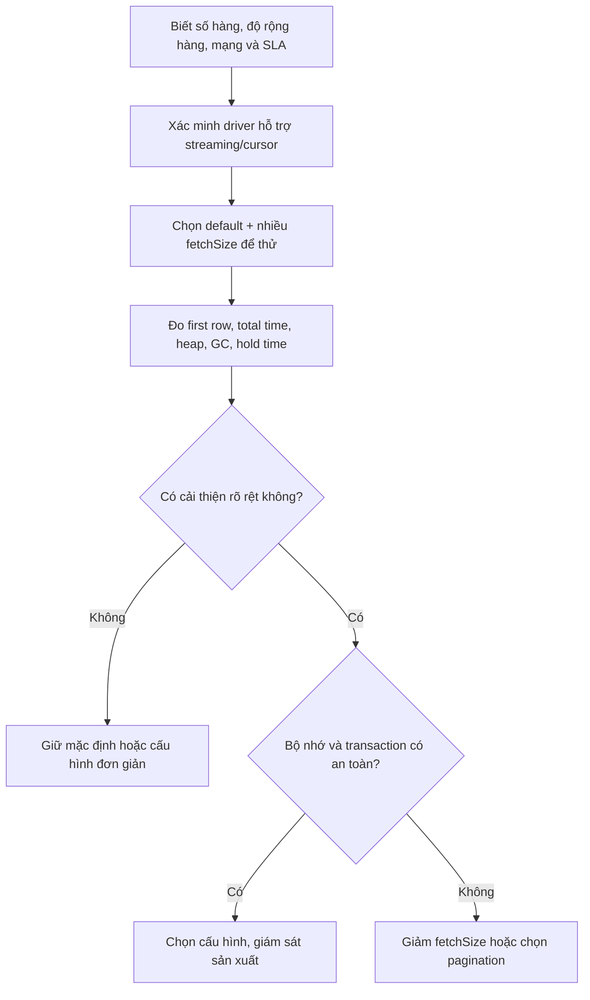

# Lựa chọn fetchSize theo đặc điểm dữ liệu và mạng trong JDBC

Trong một ứng dụng **JDBC**, truy vấn có thể trả về vài hàng hoặc hàng triệu hàng. Với kết quả lớn, không chỉ bản thân câu SQL mà cả **cách driver nhận dữ liệu từ DBMS**, số lần trao đổi mạng, kích thước từng hàng, cách ứng dụng xử lý `ResultSet` và thời gian giữ `Connection` đều ảnh hưởng tới hiệu năng.

`Statement.setFetchSize(int rows)` là API tiêu chuẩn giúp ứng dụng **gợi ý số hàng nên lấy trong một đợt** khi driver đọc kết quả. Nó cũng dùng được trên `PreparedStatement` vì `PreparedStatement` kế thừa `Statement`. Nhưng `fetchSize` **không phải câu lệnh phân trang**, không giới hạn tổng số hàng của truy vấn, không hứa chắc driver sẽ dùng bộ đệm đúng số hàng đã đặt và không bảo đảm rằng kết quả luôn được streaming từ server.

Bài thuộc chương **Truy vấn quy mô lớn** của module **JDBC**. Ta sẽ lựa chọn `fetchSize` dựa trên **số hàng, kích thước mỗi hàng, độ trễ và băng thông mạng, bộ nhớ ứng dụng, hành vi driver và mục tiêu độ trễ**, rồi kiểm thử bằng `DataSource`, `Connection`, `PreparedStatement` và `ResultSet`.

## 1. Hiểu đúng `fetchSize` trước khi tối ưu

Hãy hình dung một kết quả gồm 100.000 hàng. Một driver có thể nhận dữ liệu theo nhiều đợt:

```text
Ứng dụng Java              JDBC driver                  DBMS
       |                         |                         |
       |--- executeQuery() ----->|---- thực thi SELECT --->|
       |                         |                         |
       |<-- ResultSet -----------|<--- nhóm hàng đầu ------|
       |--- rs.next() ---------> |                         |
       |       ...               |                         |
       |--- rs.next() ---------> |---- cần thêm hàng ------>|
       |                         |<--- nhóm hàng kế --------|
       |       ...               |                         |
       |--- rs.close() --------> |---- giải phóng cursor? ->|
```

Sơ đồ chỉ là **mô hình khả dĩ**. Trên thực tế, một số driver lấy toàn bộ kết quả ngay khi thực thi câu SQL; một số hỗ trợ cursor phía server; một số dùng bộ đệm từng đợt hoặc tự điều chỉnh cách tải. Vì vậy, **`setFetchSize(500)` không đồng nghĩa mỗi 500 lần gọi `next()` chắc chắn có đúng một lượt mạng**.

### API cơ bản

```java
try (Connection connection = dataSource.getConnection();
     PreparedStatement ps = connection.prepareStatement(
             "SELECT event_id, event_type FROM event_log ORDER BY event_id")) {

    ps.setFetchSize(500);       // Gợi ý lấy khoảng 500 hàng mỗi đợt.
    int hint = ps.getFetchSize();
    System.out.println("Fetch size được báo: " + hint);

    try (ResultSet rs = ps.executeQuery()) {
        while (rs.next()) {
            long id = rs.getLong("event_id");
            String type = rs.getString("event_type");
            // Xử lý hàng ngay, không đưa mọi hàng vào một List khổng lồ.
        }
    }
}
```

Đoạn mã giả định đã có `DataSource` và bảng `event_log`. `getFetchSize()` đọc **cấu hình mà đối tượng statement công bố**, **không đo kích thước fetch thực tế** của driver.

Ba ý quan trọng:

1. **Đơn vị là hàng** (*rows*), không phải byte, kilobyte hay kích thước gói TCP.
2. `fetchSize` là **gợi ý** (*hint*) mà driver có thể điều chỉnh hoặc bỏ qua theo cơ chế thực thi.
3. Cấu hình này mô tả **cách chuyển dữ liệu**, không thay đổi số hàng đúng ra phải có trong kết quả SQL.

## 2. Phân biệt fetchSize, LIMIT, maxRows và batchSize

Các thuật ngữ này dễ bị nhầm vì đều liên quan tới “số hàng”.

| Cơ chế | Mục đích | Có giới hạn số hàng kết quả không? |
|---|---|---|
| `Statement.setFetchSize(n)` | Gợi ý số hàng driver nên lấy trong mỗi đợt khi đọc `ResultSet`. | **Không.** Có thể vẫn đọc toàn bộ 100.000 hàng. |
| `ResultSet.setFetchSize(n)` | Gợi ý fetch size cho chính ResultSet, nếu driver hỗ trợ. | **Không.** |
| `Statement.setMaxRows(n)` | Giới hạn số hàng tối đa một ResultSet được trả về theo hợp đồng JDBC. | **Có**, trong phạm vi được driver hỗ trợ. |
| SQL `LIMIT` / `OFFSET` / `FETCH FIRST` | Giới hạn tập kết quả ngay trong SQL theo dialect DBMS. | **Có**, theo điều kiện và cú pháp SQL. |
| `PreparedStatement.addBatch()` / `executeBatch()` | Gom nhiều bộ tham số hoặc thao tác ghi SQL. | Không liên quan trực tiếp tới cách fetch các hàng `SELECT`. |
| `Statement.setQueryTimeout(seconds)` | Giới hạn thời gian thực thi câu SQL theo cơ chế driver. | Không giới hạn số hàng; không phải fetch size. |

Ví dụ:

```sql
SELECT event_id, event_type
FROM event_log
ORDER BY event_id;
```

Nếu query trả 100.000 hàng, `setFetchSize(500)` **không** làm nó chỉ trả 500 hàng. Trường hợp muốn hiển thị trang đầu tiên của bảng dữ liệu trên UI, hãy dùng **phân trang tại SQL** và chọn số hàng trả về phù hợp; tăng/giảm fetch size chỉ điều chỉnh đường truyền nhận dữ liệu.

**Khuyến nghị thực tế:** trước khi tinh chỉnh `fetchSize`, hãy chắc chắn ứng dụng **thực sự cần đọc toàn bộ tập kết quả**. Nếu chỉ cần 20 hàng để hiển thị, sửa câu SQL thường mang lại lợi ích lớn hơn đặt `fetchSize(20)` rồi để truy vấn trả hàng triệu dòng.

## 3. Những yếu tố quyết định nên chọn fetchSize bao nhiêu

### 3.1. Tổng số hàng của kết quả

Với truy vấn trả 30 hàng, việc chọn `fetchSize = 5.000` thường không có nhiều ý nghĩa. Nếu cần duyệt hàng trăm nghìn hàng, số đợt có thể ảnh hưởng đáng kể tới thời gian truyền dữ liệu, nhất là khi truy vấn đi qua mạng có độ trễ cao.

Giả sử **driver thật sự fetch theo đợt có đúng `n` hàng**. Số đợt xấp xỉ:

\[
\text{số đợt} \approx \left\lceil \frac{\text{số hàng}}{\text{fetchSize}} \right\rceil
\]

Đây là **mô hình định hướng**, không phải bảo đảm của API.

| Tổng số hàng | fetchSize 100 | fetchSize 1.000 | fetchSize 5.000 |
|---:|---:|---:|---:|
| 10.000 | Khoảng 100 đợt | Khoảng 10 đợt | Khoảng 2 đợt |
| 100.000 | Khoảng 1.000 đợt | Khoảng 100 đợt | Khoảng 20 đợt |
| 500.000 | Khoảng 5.000 đợt | Khoảng 500 đợt | Khoảng 100 đợt |

Nếu driver tải toàn bộ kết quả một lần hoặc thực hiện adaptive buffering khác, bảng trên **không phản ánh số lượt mạng thực tế**.

### 3.2. Độ rộng hàng và kiểu dữ liệu

Một hàng chỉ gồm `BIGINT` và mã trạng thái ngắn khác rất xa một hàng chứa `VARCHAR(8000)`, JSON lớn, `BLOB` hoặc `CLOB`.

Ước lượng thô:

\[
\text{dữ liệu cho một nhóm} \approx \text{fetchSize} \times \text{kích thước trung bình mỗi hàng}
\]

Ví dụ dưới đây chỉ tính **payload minh họa**, chưa kể metadata, object Java, mã hóa ký tự, bộ đệm driver và chi phí mạng:

| Trung bình mỗi hàng | fetchSize 100 | fetchSize 1.000 | fetchSize 5.000 |
|---|---:|---:|---:|
| 200 byte | 20 KB | 200 KB | 1 MB |
| 2 KB | 200 KB | 2 MB | 10 MB |
| 20 KB | 2 MB | 20 MB | 100 MB |

Một cấu hình `fetchSize = 5.000` có thể phù hợp với hàng rất nhỏ nhưng gây áp lực bộ nhớ khi mỗi hàng chứa nội dung XML, JSON hoặc LOB lớn. **Không đặt fetch size chỉ dựa vào số dòng**; cần đo kích thước dữ liệu thực tế và cách driver đệm dữ liệu.

### 3.3. Round-trip time (RTT) và băng thông mạng

Hai ứng dụng đọc cùng dữ liệu nhưng có đặc điểm mạng khác nhau:

- **Ứng dụng và DBMS cùng vùng mạng, RTT thấp:** số lượt gọi mạng không nhất thiết là nút thắt lớn; batch quá lớn có thể chỉ tăng bộ nhớ và độ trễ nhận những hàng đầu tiên.
- **Ứng dụng và DBMS ở các vùng xa nhau, RTT cao:** nếu driver thực sự fetch theo đợt, quá nhiều đợt nhỏ có thể làm tăng đáng kể thời gian chờ mạng.
- **Băng thông thấp hoặc cạnh tranh mạng:** tăng fetch size không làm tổng byte dữ liệu biến mất. Đợt quá lớn có thể làm tắc đường truyền hoặc tăng độ trễ cho request khác.
- **Kết nối mạng không ổn định:** đợt lớn không tự giải quyết mất kết nối; ứng dụng vẫn cần xử lý lỗi và phương án resume công việc dài.

Để đơn giản hóa, một mô hình thời gian đọc có thể viết:

\[
T \approx T_{\text{SQL}} + T_{\text{đợt mạng}} + T_{\text{truyền byte}} + T_{\text{xử lý Java}}
\]

Trong đó `T_đợt mạng` phụ thuộc số lần cần liên lạc và RTT, **nhưng không phải mỗi lần fetch luôn tốn nguyên một RTT riêng biệt**; triển khai driver có thể pipelining hoặc đệm trước.

### 3.4. Bộ nhớ, CPU và cách xử lý hàng

`fetchSize` không thể bảo vệ heap nếu ứng dụng tự gom mọi hàng:

```java
List<String> all = new ArrayList<>();

while (rs.next()) {
    all.add(rs.getString("payload"));
}

// all vẫn giữ toàn bộ payload đã đọc trong bộ nhớ.
```

Dù đặt `fetchSize(100)`, đoạn trên vẫn tăng bộ nhớ theo số hàng. Với xử lý hàng loạt, cần tiêu thụ **từng hàng, từng nhóm nhỏ hoặc ghi ra đích khác** ngay khi nhận dữ liệu.

Tương tự, nếu mỗi hàng phải gọi HTTP hay xử lý CPU rất lâu, nút thắt có thể nằm ở downstream, không phải quá ít hàng trong mỗi fetch. Không giữ `Connection` và transaction mở khi chờ I/O ngoài DB nếu có thể thiết kế công việc theo các lô độc lập.

### 3.5. Độ trễ nhận hàng đầu và tổng thời gian hoàn tất

Có ít nhất hai mục tiêu hiệu năng:

- **Time to first row:** ứng dụng nhận được hàng đầu tiên nhanh đến đâu? Quan trọng đối với streaming trực tiếp hoặc màn hình tương tác.
- **Time to last row:** ứng dụng xử lý hết kết quả nhanh đến đâu? Quan trọng đối với export, đồng bộ hoặc job nền.

Fetch size lớn có thể giúp tổng throughput ở mạng có RTT cao, nhưng cũng có thể tăng lượng dữ liệu driver cần nhận/đệm trước khi ứng dụng xử lý hàng đầu tiên. Hãy đo cả hai chỉ số thay vì chỉ đo thời gian gọi `executeQuery()`.

## 4. Ví dụ số: lựa chọn giữa 100, 1.000 và 5.000

Giả sử một tác vụ cần quét **200.000 hàng**, trung bình mỗi hàng có khoảng **500 byte payload**, và driver hỗ trợ fetch theo những đợt đã yêu cầu.

| fetchSize | Số đợt gần đúng | Payload mỗi đợt gần đúng | Đánh đổi |
|---:|---:|---:|---|
| 100 | 2.000 | 50 KB | Nhóm nhỏ, ít áp lực bộ nhớ mỗi đợt; nhiều lượt lấy dữ liệu hơn. |
| 1.000 | 200 | 500 KB | Cân bằng giữa lượng dữ liệu mỗi đợt và số đợt. |
| 5.000 | 40 | 2,5 MB | Ít đợt hơn; tăng khả năng đệm và độ trễ cho mỗi đợt. |

Không thể từ bảng này kết luận **1.000 là tốt nhất**. Cần biết thêm RTT, throughput mạng, giới hạn heap, khả năng driver thực sự fetch theo đợt, kích thước hàng p95/p99 và thời gian xử lý mỗi hàng.

Đây là những **mốc thử nghiệm**, không phải tham số JDBC mặc định hay khuyến nghị bắt buộc cho sản xuất.

## 5. Điều kiện quyết định: driver có thật sự streaming hay không?

API `setFetchSize` chuẩn hóa **cách đưa ra gợi ý**, không chuẩn hóa hoàn toàn cách driver truyền dữ liệu. Hai driver có thể cùng cho `getFetchSize() == 500` nhưng khác xa nhau về sử dụng bộ nhớ và truy cập mạng.

### 5.1. PostgreSQL JDBC

Với **PostgreSQL JDBC**, cơ chế đọc kết quả bằng server-side cursor/fetch theo đợt thường yêu cầu những điều kiện như:

- Connection đang ở **`autoCommit = false`**.
- Statement hoặc ResultSet có loại cursor phù hợp, thường là **`TYPE_FORWARD_ONLY`**.
- `fetchSize` dương.
- Truy vấn và cách gọi đáp ứng các giới hạn của driver đang sử dụng.

Nếu kết nối để auto-commit bật, driver có thể đọc toàn bộ kết quả thay vì dùng cursor phía server, dù đã đặt `setFetchSize(500)`. Vì vậy, **không đủ** khi chỉ thêm một dòng `setFetchSize(...)` mà bỏ qua cách thiết lập transaction.

Đây là đặc điểm cần **kiểm tra theo phiên bản PostgreSQL JDBC**; không nên áp dụng điều kiện `autoCommit=false` như một yêu cầu chung cho mọi DBMS.

### 5.2. MySQL Connector/J

Với **MySQL Connector/J**, cơ chế cursor fetching/streaming còn phụ thuộc các thuộc tính kết nối và cách dùng prepared statement. Một số cấu hình cần bật **`useCursorFetch`**, sử dụng server-prepared statements và fetch size dương; một số chế độ streaming cũ có cách kích hoạt khác.

Hãy đọc tài liệu driver tương ứng với **phiên bản đang chạy**, rồi thử đo heap và số đợt nhận dữ liệu. **Không coi `setFetchSize(500)` đơn lẻ là chứng cứ rằng MySQL không tải toàn bộ ResultSet vào RAM.** Không đưa những “mẹo” như giá trị âm đặc biệt vào mã JDBC portable trừ khi đã chấp nhận phụ thuộc driver và thử nghiệm đầy đủ.

### 5.3. Oracle, SQL Server và các DBMS khác

Các driver có thể có cơ chế row prefetch, adaptive buffering, server cursor hoặc tham số cấu hình mạng riêng. `fetchSize` có thể tương tác với thiết lập mặc định hoặc hint riêng của driver.

Đối với **LOB**, một số driver xử lý kích thước và streaming theo cơ chế khác với hàng thông thường. Không chuyển một kết luận hiệu năng từ PostgreSQL sang Oracle/SQL Server hoặc MySQL chỉ vì cùng dùng `PreparedStatement.setFetchSize()`.

### Ma trận kiểm tra tính năng

| Câu hỏi | Cách xác minh |
|---|---|
| Driver có chấp nhận `setFetchSize(n)` không? | Chạy thử API, xử lý `SQLException` hoặc `SQLFeatureNotSupportedException`. |
| Giá trị cấu hình có được lưu không? | `getFetchSize()`, nhưng chỉ xác nhận hint. |
| Driver có dùng cursor/stream không? | Tài liệu driver, trace/network capture được cho phép, heap profile và thí nghiệm dữ liệu lớn. |
| Có cần auto-commit tắt? | Tài liệu phiên bản driver và kiểm thử hai chế độ. |
| Có giữ khóa hoặc snapshot lâu không? | Theo dõi transaction, lock, MVCC và connection hold time trên DBMS. |
| Tăng fetch size có cải thiện throughput không? | Benchmark cùng SQL, dữ liệu, tải và mạng; đo time-to-first-row/total. |

## 6. Ví dụ đầy đủ: đọc ResultSet tuần tự với PreparedStatement

Giả sử bảng `event_log` lưu nhật ký sự kiện nghiệp vụ:

```sql
CREATE TABLE event_log (
    event_id BIGINT PRIMARY KEY,
    occurred_at TIMESTAMP NOT NULL,
    event_type VARCHAR(40) NOT NULL,
    payload VARCHAR(2000)
);

CREATE INDEX idx_event_log_time_id
    ON event_log (occurred_at, event_id);
```

Cú pháp DDL và ngữ nghĩa `TIMESTAMP` có thể khác theo DBMS; không chạy script này trên môi trường sản xuất nếu chưa review schema. Index là ví dụ phù hợp với điều kiện thời gian và thứ tự sắp xếp, nhưng vẫn cần kiểm tra execution plan trên dữ liệu thực.

Mẫu code dưới đây:

- Dùng `DataSource` để mượn kết nối.
- Dùng `PreparedStatement` với tham số `?` để tránh ghép dữ liệu vào SQL.
- Đặt `fetchSize` trên statement **trước `executeQuery()`**.
- Chọn kiểu `TYPE_FORWARD_ONLY` và `CONCUR_READ_ONLY`.
- Duyệt từng hàng, **không giữ toàn bộ kết quả trong một List**.
- Tắt auto-commit để có thể thử cơ chế server-side cursor của những driver yêu cầu transaction, đồng thời **kết thúc transaction tường minh** trước khi trả kết nối.

```java
import java.sql.Connection;
import java.sql.PreparedStatement;
import java.sql.ResultSet;
import java.sql.SQLException;
import java.sql.Timestamp;
import java.time.Instant;
import java.util.Objects;
import java.util.function.Consumer;
import javax.sql.DataSource;

public final class EventReader {
    private EventReader() {
    }

    public static final class EventRow {
        public final long id;
        public final Instant occurredAt;
        public final String type;

        public EventRow(long id, Instant occurredAt, String type) {
            this.id = id;
            this.occurredAt = occurredAt;
            this.type = type;
        }
    }

    public static long streamSince(
            DataSource dataSource,
            Instant fromInclusive,
            int fetchSize,
            Consumer<EventRow> consumer
    ) throws SQLException {

        Objects.requireNonNull(dataSource, "dataSource");
        Objects.requireNonNull(fromInclusive, "fromInclusive");
        Objects.requireNonNull(consumer, "consumer");

        if (fetchSize <= 0) {
            throw new IllegalArgumentException(
                    "Ví dụ này yêu cầu fetchSize dương");
        }

        String sql = "SELECT event_id, occurred_at, event_type "
                + "FROM event_log WHERE occurred_at >= ? "
                + "ORDER BY occurred_at, event_id";

        try (Connection connection = dataSource.getConnection()) {
            // Hữu ích khi thử server-side cursor trên một số driver,
            // đặc biệt PostgreSQL JDBC; không phải yêu cầu phổ quát.
            connection.setAutoCommit(false);

            try {
                long rowCount = 0;

                try (PreparedStatement ps = connection.prepareStatement(
                        sql,
                        ResultSet.TYPE_FORWARD_ONLY,
                        ResultSet.CONCUR_READ_ONLY)) {

                    ps.setFetchSize(fetchSize);
                    ps.setTimestamp(1, Timestamp.from(fromInclusive));

                    try (ResultSet rs = ps.executeQuery()) {
                        while (rs.next()) {
                            Timestamp occurred = rs.getTimestamp("occurred_at");

                            EventRow row = new EventRow(
                                    rs.getLong("event_id"),
                                    occurred.toInstant(),
                                    rs.getString("event_type")
                            );

                            // Consumer nên xử lý nhanh và không giữ mọi hàng.
                            consumer.accept(row);
                            rowCount++;
                        }
                    }
                }

                // Kết thúc transaction chỉ đọc trước khi trả Connection.
                connection.commit();
                return rowCount;

            } catch (SQLException | RuntimeException failure) {
                try {
                    connection.rollback();
                } catch (SQLException rollbackError) {
                    failure.addSuppressed(rollbackError);
                }
                throw failure;
            }
        }
    }
}
```

Cách gọi:

```java
long scanned = EventReader.streamSince(
        dataSource,
        java.time.Instant.parse("2026-01-01T00:00:00Z"),
        500,
        row -> {
            // Chỉ xử lý thông tin cần thiết ở mỗi hàng.
            // Tránh cộng dồn mọi row trong bộ nhớ.
            System.out.println(row.id + " " + row.type);
        }
);
System.out.println("Số hàng đã duyệt: " + scanned);
```

**Lưu ý về ví dụ:** `TIMESTAMP` không tự có ngữ nghĩa UTC trên mọi CSDL. Khi cần mốc thời gian tuyệt đối, phải chọn loại cột thời gian, múi giờ phiên và cách ánh xạ JDBC phù hợp với DBMS; ví dụ dùng `Instant`/`Timestamp` chỉ minh họa luồng truy vấn. `occurred_at` được khai báo `NOT NULL` nên `getTimestamp(...)` được kỳ vọng không trả null. Nếu consumer làm I/O chậm, kết nối sẽ bị giữ lâu; khi đó có thể cần kiến trúc xuất dữ liệu theo checkpoint hoặc truyền qua một pipeline giới hạn dung lượng.

### Vì sao dùng auto-commit false dù chỉ SELECT?

Với PostgreSQL JDBC, server cursor thường yêu cầu transaction còn mở trong lúc lấy các đợt dữ liệu. Nhưng nếu công việc kéo dài 30 phút, transaction đọc dài cũng có chi phí: giữ snapshot, ảnh hưởng vacuum/cleanup của MVCC ở một số DBMS, chiếm connection pool và có thể tăng tài nguyên phía server.

Vì vậy, **không tắt auto-commit một cách máy móc cho mọi truy vấn**. Hãy xác minh driver có cần nó hay không, đồng thời cân nhắc giữa streaming một ResultSet lớn và chia công việc thành **nhiều trang theo khóa ổn định**. Khi có transaction manager/framework bao ngoài, không tự ý commit một transaction do manager đang sở hữu.

### Cần đảm bảo Consumer không “giữ hết dữ liệu”

Dù vòng lặp chỉ tạo một `EventRow` tại một thời điểm, nếu consumer là:

```java
List<EventReader.EventRow> allEvents = new ArrayList<>();
row -> allEvents.add(row);
```

thì bộ nhớ vẫn tăng theo toàn bộ số hàng. Mẫu lambda trên chỉ minh họa ý tưởng, không phải hai câu liên tiếp có thể đặt nguyên như vậy trong một khối Java. Trong trường hợp cần lưu dữ liệu để xử lý theo nhóm, hãy giới hạn kích thước hàng đợi/nhóm và giải phóng từng phần sau khi dùng.

## 7. Cài đặt fetchSize trên Statement hay ResultSet?

Có hai API liên quan:

```java
ps.setFetchSize(500);  // Gợi ý ở Statement, trước executeQuery().
```

Và sau khi tạo kết quả:

```java
try (ResultSet rs = ps.executeQuery()) {
    rs.setFetchSize(500); // Gợi ý ở ResultSet nếu driver hỗ trợ.
    System.out.println(rs.getFetchSize());
    // Duyệt kết quả...
}
```

`Statement.setFetchSize(int)` thường là điểm cấu hình thuận tiện cho tất cả `ResultSet` do statement tạo ra; `ResultSet.setFetchSize(int)` có thể điều chỉnh trực tiếp hint cho kết quả cụ thể. Nhưng không nên suy rằng việc thay đổi `fetchSize` giữa chừng sẽ lập tức đổi giao thức của một cursor đã mở. Driver có thể đệm sẵn dữ liệu hoặc không hỗ trợ thay đổi động.

`getFetchSize()` của `Statement` hoặc `ResultSet` giúp kiểm tra trạng thái hint, **không báo số hàng thực sự mỗi lần nhận qua mạng**.

### `fetchSize = 0` và giá trị âm

Theo JDBC, `setFetchSize(0)` thường có nghĩa **để driver tự quyết định** kích thước fetch. Đây không phải yêu cầu “đọc 0 hàng”. Với `setFetchSize(n)` thông thường, `n` phải không âm; giá trị âm không hợp lệ theo hợp đồng chuẩn và có thể gây `SQLException`.

Một số driver có cơ chế riêng dùng giá trị đặc biệt để kích hoạt streaming, nhưng đó là **phụ thuộc vendor**, không phải cách viết JDBC portable. Tài liệu này ưu tiên các giá trị dương và kiểm tra driver thực tế.

### `setFetchDirection` có liên quan không?

`setFetchDirection(ResultSet.FETCH_FORWARD)` là một hint về hướng fetch, không phải kích thước. Khi đọc tập kết quả lớn, `TYPE_FORWARD_ONLY` và hướng `FETCH_FORWARD` thường phù hợp hơn một cursor cuộn ngược nhiều lần, nhưng driver vẫn có quyền xử lý hint tùy hỗ trợ.

```java
ps.setFetchDirection(ResultSet.FETCH_FORWARD);
ps.setFetchSize(500);
```

Không được coi việc đặt `FETCH_FORWARD` là bằng chứng đã bật streaming. Hãy dùng tài liệu driver và benchmark để xác minh.

## 8. Với BLOB/CLOB hoặc payload rất lớn, giảm fetchSize có đủ không?

Không. Một hàng có `BLOB` vài chục MB có thể lớn hơn toàn bộ bộ đệm mà ứng dụng mong muốn, dù `fetchSize = 1`. Khi chứa cột lớn, cần kết hợp:

1. **Projection hợp lý:** chỉ `SELECT` những cột thực sự dùng. Nếu chỉ cần ID và trạng thái, đừng lấy cả cột payload.
2. **Streaming dữ liệu cột:** dùng `ResultSet.getBinaryStream(...)` hoặc `getCharacterStream(...)` khi driver hỗ trợ để xử lý nội dung tuyến tính.
3. **Không giữ toàn bộ vào RAM:** tránh `rs.getBytes(...)` và `rs.getString(...)` với cột rất lớn nếu giới hạn heap là mối quan tâm.
4. **Giới hạn song song:** nhiều request cùng đọc LOB có thể làm tăng đáng kể memory pressure và băng thông dù fetch size nhỏ.
5. **Đo driver thực tế:** streaming LOB và streaming hàng không nhất thiết là cùng một cơ chế.

Ví dụ chỉ đọc một cột nhị phân từ hàng hiện tại:

```java
// rs đã có hàng hiện tại, cột content_data chứa BLOB/bytea phù hợp.
try (java.io.InputStream input =
             rs.getBinaryStream("content_data")) {

    if (input != null) {
        byte[] buffer = new byte[8192];
        int n;
        while ((n = input.read(buffer)) != -1) {
            // Gửi buffer[0..n) tới nơi tiêu thụ theo luồng.
            // Không giữ tất cả byte trong một List hay ByteArrayOutputStream.
        }
    }
}
```

Đoạn ví dụ là **mảnh mã** trong phương thức khai báo hoặc xử lý `IOException` và `SQLException`. Đọc stream ngay khi `ResultSet/Connection` còn mở rồi đóng stream trước khi chuyển sang hàng tiếp theo. Không trả một `InputStream` gắn với cursor ra ngoài khi DAO sắp đóng kết nối.

## 9. fetchSize không thay thế phân trang theo khóa

Với hàng triệu bản ghi, một ResultSet duy nhất có thể giữ connection và transaction rất lâu. Nếu công việc hỗ trợ **chia đoạn**, có thể đọc từng trang SQL:

```sql
-- Ví dụ dialect hỗ trợ LIMIT ? (PostgreSQL/MySQL và một số DBMS).
SELECT event_id, occurred_at, event_type
FROM event_log
WHERE event_id > ?
ORDER BY event_id
LIMIT ?;
```

Ứng dụng lưu `last_seen_id` sau khi xử lý một trang thành công, rồi truy vấn trang tiếp theo. Đây là một dạng **keyset pagination** và khác với `fetchSize`:

| Đặc điểm | Một ResultSet + fetchSize | Phân trang bằng khóa ổn định |
|---|---|---|
| Số hàng mỗi câu SQL | Có thể là toàn bộ tập kết quả. | Chỉ số hàng theo giới hạn trang của SQL. |
| Vòng đời connection | Thường giữ mở suốt lượt quét. | Có thể mượn/trả giữa các trang. |
| Resume khi lỗi | Khó nếu chỉ dựa vào vị trí cursor. | Có thể lưu checkpoint khóa đã xử lý. |
| Tính nhất quán toàn lượt quét | Có thể có snapshot theo transaction/isolation. | Mỗi trang có thể thấy trạng thái DB khác nhau. |
| Hiệu năng | Có thể rất tốt với streaming driver và mạng. | Thêm nhiều câu SQL; cần index và quản lý checkpoint. |

**Không được hiểu** keyset pagination tự đảm bảo snapshot nhất quán của toàn bộ dữ liệu. Với dữ liệu thay đổi đồng thời, hàng mới có khóa thấp hơn checkpoint có thể bị bỏ qua, còn hàng có khóa cao hơn có thể xuất hiện trong lượt quét tùy quy tắc nghiệp vụ. Muốn kết quả “as of” một thời điểm, phải xác định watermark, khóa bất biến, isolation hoặc snapshot được DBMS hỗ trợ.

Cú pháp `LIMIT ?` không portable cho mọi DBMS; SQL Server, Oracle hoặc các hệ khác có cách giới hạn hàng riêng. Ánh xạ `event_id` tăng dần cũng không đồng nghĩa thứ tự nghiệp vụ của `occurred_at`. Chọn khóa phân trang theo mục tiêu thực tế.

### Khi nào nên chọn phân trang thay streaming?

Cân nhắc phân trang nếu:

- Job có thể chạy hàng giờ, cần restart từ checkpoint.
- Thời gian giữ một kết nối trong pool phải được giới hạn.
- Mỗi nhóm hàng phải được gửi đến dịch vụ khác có latency cao.
- Cần tránh giữ một transaction đọc dài trên DBMS có cơ chế MVCC.
- Cần phân chia công việc cho nhiều worker theo vùng khóa hoặc thời gian.

Ngược lại, nếu cần đọc tuần tự nhanh một snapshot lớn trong môi trường hỗ trợ cursor, một `ResultSet` streaming có thể hiệu quả hơn nhiều câu truy vấn phân trang. Hãy thử hai cách với dữ liệu thật.

## 10. Fetch size và transaction, khóa, timeout

### Transaction đọc có chi phí

Để driver duy trì server-side cursor, có thể cần một transaction mở cho tới khi xử lý hết `ResultSet`. Trong thời gian đó:

- Một kết nối từ pool đang được mượn, không phục vụ request khác.
- DBMS có thể duy trì snapshot, cursor và tài nguyên phiên.
- Ở một số mức isolation/kiểu truy vấn, có thể giữ khóa lâu hơn.
- Nếu ứng dụng xử lý mỗi hàng chậm, thời gian giữ transaction tăng đáng kể.

Do đó, kết thúc việc đọc đúng lúc, đóng `ResultSet`/`PreparedStatement` và commit/rollback trước khi trả `Connection`. **`setFetchSize` không tự giải phóng connection** khi một nhóm hàng đã được lấy.

### Query timeout có giới hạn toàn bộ quá trình đọc không?

Không nên giả định. `Statement.setQueryTimeout(seconds)` hướng tới thời gian thực thi statement theo driver; thời gian gọi `ResultSet.next()` khi fetch các đợt sau hoặc xử lý CPU trong Java có thể được tính hoặc không tùy triển khai. Một ứng dụng có thể mất nhiều phút đọc và xử lý kết quả dù `executeQuery()` trả về khá nhanh.

Nếu cần giới hạn tổng thời gian job, hãy dùng deadline ở tầng ứng dụng, chủ động xử lý hủy (`Statement.cancel()` khi hỗ trợ), kết thúc transaction và dùng checkpoint để phục hồi. Cần phối hợp với timeout của connection pool và DBMS, không chỉ đặt `queryTimeout`.

### Không trộn fetchSize với isolation level

`setFetchSize(...)` **không thay đổi** `READ_COMMITTED`, `REPEATABLE_READ` hay `SERIALIZABLE`. Mức isolation quyết định những thay đổi đồng thời nào có thể nhìn thấy và cách DBMS xử lý xung đột; fetch size chủ yếu gợi ý cách tải dữ liệu.

Nếu cần snapshot nhất quán cho cả lượt quét, phải thiết kế transaction/isolation phù hợp với DBMS. Đừng dựa vào kích thước fetch để suy ra dữ liệu “được chụp” cùng một thời điểm.

## 11. Benchmark fetchSize thế nào để có kết luận đáng tin?

Một thử nghiệm tốt cần giữ **các yếu tố khác gần như không đổi** để so sánh tác động của fetch size.

### Bước 1: xác định workload

Chọn một truy vấn thực tế có số lượng hàng, kích thước hàng và bộ lọc đại diện cho sản xuất. Ghi lại:

- Số hàng trung bình và số hàng lớn nhất cần xử lý.
- Kích thước hàng trung bình, p95/p99; có LOB/JSON/XML lớn không.
- RTT mạng và băng thông giữa ứng dụng và DBMS.
- Mức concurrency: bao nhiêu tác vụ quét cùng lúc.
- Thời gian SQL phía DBMS, khả năng dùng index, khối lượng sort/join.

### Bước 2: thử một tập giá trị

Ví dụ thử `fetchSize` **100, 500, 1.000, 2.000 và 5.000**. Giá trị nhỏ hoặc lớn hơn có thể hợp lý nếu dữ liệu đặc biệt. Nên có thêm nhóm **driver default (`0`)** làm đường cơ sở nếu driver cho phép.

Chú ý giữ nguyên SQL, tham số, tập dữ liệu, isolation, cấu hình driver và số tác vụ đồng thời. Nếu lần đầu phải tải dữ liệu từ disk/cache, hãy warm up rồi chạy lặp lại để giảm nhiễu.

### Bước 3: đo nhiều hơn một chỉ số

| Chỉ số | Vì sao cần đo? |
|---|---|
| Thời gian tới hàng đầu tiên | Đánh giá độ trễ khởi đầu/streaming thực tế. |
| Thời gian duyệt hết hàng | Đo throughput toàn lượt xử lý. |
| Số hàng đã xử lý | Xác nhận các lần chạy có cùng khối lượng, không lén bỏ hàng. |
| Heap peak, GC pause | Phát hiện fetch size gây đệm quá lớn hoặc object churn. |
| Connection hold time | Đánh giá ảnh hưởng tới pool và request khác. |
| Query time phía DBMS | Phân biệt SQL chậm với network/fetch chậm. |
| Số byte truyền và network RTT | Phát hiện bottleneck truyền dữ liệu. |
| Lỗi timeout, lock wait và OOM | Đánh giá tính ổn định chứ không chỉ tốc độ trung bình. |

`Statement.getFetchSize()` không cung cấp số round trip thực tế; muốn đo có thể dùng công cụ giám sát của driver, DBMS hoặc môi trường mạng được phép. Không dựa vào việc getter trả đúng số đã đặt để khẳng định streaming đã được kích hoạt.

### Bước 4: cân bằng throughput và chi phí tài nguyên

Đừng chỉ chọn cấu hình có tổng thời gian nhanh nhất trong **một** lần chạy. Nếu fetch size 5.000 nhanh hơn 3% nhưng memory peak tăng gấp nhiều lần, trong tải đồng thời nó có thể làm hệ thống kém ổn định hơn. Cấu hình hợp lý là **điểm cân bằng** giữa độ trễ, memory, throughput, pool saturation và độ tin cậy.



### Mẫu đo thời gian tối thiểu trong Java

```java
// Ví dụ chèn trong phạm vi JDBC đã tạo ps và rs tương ứng.
long started = System.nanoTime();

try (ResultSet rs = ps.executeQuery()) {
    long firstRowNs = -1;
    long rows = 0;

    while (rs.next()) {
        if (rows == 0) {
            firstRowNs = System.nanoTime() - started;
        }

        // Đọc và xử lý đúng các cột cần dùng.
        rs.getLong(1);
        rows++;
    }

    long totalNs = System.nanoTime() - started;
    System.out.println("rows=" + rows);
    System.out.println("firstRowMs="
            + (firstRowNs < 0 ? "none" : firstRowNs / 1_000_000.0));
    System.out.println("totalMs=" + totalNs / 1_000_000.0);
}
```

Đây là phép đo tối thiểu trong phạm vi ứng dụng; nó chưa tách thời gian server, network, GC và thời gian xử lý nghiệp vụ. Với `ResultSet` trống, `firstRowNs` vẫn là `-1` và đoạn mã in `none`. Để so sánh nghiêm túc, lặp lại nhiều lần, dùng cùng processor và kiểm soát số hàng đọc thực tế.

## 12. Các sai lầm phổ biến

| Sai lầm | Hậu quả | Cách xử lý |
|---|---|---|
| Nghĩ `setFetchSize(100)` chỉ trả 100 hàng | Vẫn xử lý toàn bộ kết quả SQL, có thể nhiều triệu hàng. | Dùng SQL pagination hoặc `setMaxRows` khi cần giới hạn tổng hàng. |
| Nghĩ `fetchSize` tính bằng byte | Ước lượng bộ đệm sai khi hàng rất rộng. | Tính theo số hàng và kích thước mỗi hàng. |
| Cài `fetchSize` thật lớn vì “lần mạng càng ít càng tốt” | Có thể gây heap pressure, tăng thời gian chờ đợt đầu hoặc tải mạng. | Benchmark với nhiều kích thước và mức concurrency. |
| Đặt `setFetchSize(500)` và cho rằng mọi driver đều streaming | Driver có thể bỏ qua hint hoặc đệm toàn bộ kết quả. | Xác minh từng DBMS/driver, transaction và cấu hình cursor. |
| Dùng `autoCommit=true` nhưng kỳ vọng PostgreSQL server-side cursor | Driver có thể tải toàn bộ kết quả. | Xem điều kiện riêng của PostgreSQL JDBC và thử `autoCommit=false` khi phù hợp. |
| Đưa mọi hàng vào `ArrayList` | Bộ nhớ tăng theo tổng số hàng dù fetch size nhỏ. | Xử lý tuyến tính hoặc theo nhóm bị giới hạn kích thước. |
| Đọc cột BLOB lớn bằng `getBytes()` vô điều kiện | Một giá trị có thể rất lớn, vượt ngân sách RAM. | Chỉ lấy cột cần thiết; dùng stream LOB nếu được driver hỗ trợ. |
| Để transaction mở suốt tác vụ có nhiều lời gọi HTTP | Chiếm connection, giữ snapshot/khóa lâu. | Tách công việc, dùng checkpoint hoặc xử lý downstream có giới hạn. |
| Coi `setFetchSize` là tối ưu SQL | Không sửa được sort/join/index kém hoặc query plan xấu. | Xem execution plan, projection và predicate trước. |
| Chỉ đo thời gian `executeQuery()` | Một số driver trả nhanh rồi fetch chậm trong `next()`. | Đo time-to-first-row và total iteration time. |
| Giả định `getFetchSize()` cho biết số đợt mạng | Getter chỉ phản ánh hint, không mô tả wire protocol. | Dùng profiler/driver trace phù hợp. |
| Đặt fetchSize âm như một “mẹo” dùng mọi DB | Vi phạm hợp đồng JDBC portable, có thể ném `SQLException`. | Chỉ dùng hành vi riêng khi tài liệu driver cho phép và kiểm thử rõ. |
| Giữ một ResultSet lớn mà không đóng khi xảy ra lỗi | Rò rỉ cursor, connection, memory, làm pool cạn. | Dùng try-with-resources và commit/rollback thích hợp. |
| Tin rằng fetchSize bảo đảm snapshot nhất quán | Dữ liệu nhìn thấy còn phụ thuộc isolation và transaction. | Thiết kế isolation, keyset, watermark theo yêu cầu. |

## 13. Thực hành từng bước

Các bài thực hành nên chạy với **CSDL kiểm thử**, bộ dữ liệu đủ lớn và cùng driver sẽ dùng trong môi trường triển khai. Không gây tải quét hàng triệu dòng trên DB sản xuất khi chưa được phép.

### Bài 1 — Thay fetchSize, giữ nguyên SQL

1. Tạo bảng `event_log` và đủ bản ghi để truy vấn trả ít nhất vài chục nghìn hàng.
2. Chạy một `SELECT` có cùng điều kiện và `ORDER BY` với `fetchSize=0` (driver default), rồi 100, 500, 1.000 và 5.000.
3. Đếm số hàng qua vòng `rs.next()`; kết quả phải bằng nhau khi dữ liệu không đổi và mỗi lượt quét thành công.
4. Đo thời gian tới hàng đầu, thời gian tổng, heap và thời gian giữ connection.
5. Giải thích vì sao giá trị nhanh nhất phụ thuộc mạng và kích thước hàng.

### Bài 2 — Hàng nhỏ và hàng rộng

So sánh:

```sql
-- Hàng hẹp:
SELECT event_id, event_type
FROM event_log
ORDER BY event_id;

-- Hàng rộng hơn:
SELECT event_id, event_type, payload
FROM event_log
ORDER BY event_id;
```

Với cùng fetch size, quan sát memory peak và byte truyền. Không mặc định driver sẽ cấp một vùng nhớ bằng đúng tích `fetchSize × row size`; đây chỉ là ước lượng.

### Bài 3 — Ảnh hưởng độ trễ mạng

Nếu có môi trường test được phép tạo network latency, lặp benchmark với RTT thấp và RTT cao. Ghi nhận liệu fetch size lớn hơn có cải thiện tổng thời gian hay không. Nếu driver không thực sự fetch từng đợt, thay đổi RTT có thể thể hiện theo cách khác; điều đó là tín hiệu cần xem lại cơ chế driver.

### Bài 4 — Xác minh streaming theo driver

1. Ghi phiên bản JDBC driver và DBMS.
2. Đọc tài liệu tương ứng về fetch size, server-side cursor và auto-commit.
3. Với PostgreSQL JDBC, so sánh `autoCommit=true` và `autoCommit=false` khi các điều kiện cursor phù hợp.
4. Với MySQL Connector/J, thử cấu hình cursor fetching đúng tài liệu rồi so sánh heap/latency.
5. Không lấy một driver làm quy tắc tuyệt đối cho driver khác.

### Bài 5 — Consumer gom toàn bộ vào List

Dùng `EventReader.streamSince(...)` nhưng truyền consumer thêm từng `EventRow` vào một `ArrayList`. Đo heap và giải thích vì sao đặt `fetchSize=100` vẫn không giúp bộ nhớ giữ nguyên khi xử lý hàng triệu dòng. Sửa consumer thành ghi tuần tự hoặc giữ nhóm nhỏ giới hạn dung lượng.

### Bài 6 — Streaming và keyset pagination

Đọc cùng một bộ dữ liệu bất biến theo hai cách:

- Một ResultSet dùng fetch size đã chọn.
- Nhiều câu `SELECT` phân trang theo `event_id` ổn định.

So sánh throughput, thời gian giữ connection, chi phí SQL lặp lại và khả năng tiếp tục từ checkpoint. Sau đó thử khi dữ liệu thay đổi đồng thời, nhận diện vấn đề snapshot/watermark chứ không khẳng định hai cách luôn trả cùng tập hàng.

### Bài 7 — Tài nguyên khi phát sinh lỗi

Cho `Consumer<EventRow>` cố ý ném ngoại lệ sau một số hàng. Xác nhận `ResultSet`, `PreparedStatement` và `Connection` đều được đóng, nhánh `catch` cố rollback transaction đọc, và pool trở về mức active ban đầu sau khi phương thức kết thúc.

## 14. Câu hỏi tự kiểm tra

**1. `Statement.setFetchSize(500)` có khiến SQL chỉ trả 500 hàng không?**

Không. Nó gợi ý số hàng lấy mỗi đợt; tập kết quả vẫn do câu SQL và những giới hạn kết quả khác xác định.

**2. Vì sao fetchSize 5.000 có thể tốt với hàng nhỏ nhưng xấu với hàng chứa LOB lớn?**

Vì khối lượng dữ liệu có thể được driver giữ/nhận mỗi đợt tăng theo độ rộng hàng. Nhóm 5.000 hàng chứa dữ liệu lớn có thể gây áp lực heap và mạng đáng kể.

**3. `getFetchSize() == 500` có chứng minh driver đã thực hiện từng đợt 500 hàng không?**

Không. Getter cho biết hint mà API công bố, không phải số lượt mạng hay cơ chế buffering thực tế.

**4. Vì sao đặt fetchSize có thể chưa đủ để streaming khi dùng PostgreSQL JDBC?**

Vì server-side cursor thường còn yêu cầu transaction mở (`autoCommit=false`), ResultSet forward-only và các điều kiện khác của driver.

**5. Khi nào nên dùng phân trang bằng keyset thay vì một ResultSet lớn?**

Khi cần checkpoint/resume, giới hạn thời gian mượn connection, xử lý từng phần độc lập hoặc tránh transaction đọc quá dài; phải chấp nhận chi phí truy vấn nhiều trang và thiết kế nhất quán dữ liệu.

**6. Nếu JDBC chỉ lấy 100 hàng mỗi đợt, vì sao ứng dụng vẫn có thể OOM?**

Vì ứng dụng có thể tự giữ tất cả hàng trong List, từng hàng chứa LOB rất lớn, nhiều request chạy đồng thời hoặc driver có buffering riêng.

**7. Tại sao phải đo cả time-to-first-row và total read time?**

Vì driver có thể đệm trước hoặc fetch theo đợt: thời gian nhận hàng đầu và tổng thời gian đọc có thể phản ánh hai loại đánh đổi khác nhau.

**8. `fetchSize` có thay đổi mức isolation, timeout hoặc transaction không?**

Không. Đây là hint về việc fetch hàng; isolation, timeout và transaction thuộc các API/cơ chế khác, dù chúng có thể ảnh hưởng hiệu năng chung.

## 15. Checklist đưa vào thực tế

- Đã xác nhận ứng dụng **cần tất cả hàng** hay chỉ cần một trang SQL?
- Đã biết tổng hàng, kích thước hàng trung bình và p95/p99, có cột LOB/JSON/XML lớn không?
- Driver thực tế có hỗ trợ **streaming/server cursor** hay chỉ đệm toàn bộ kết quả? Có cần cấu hình đặc thù hoặc `autoCommit=false`?
- `setFetchSize(n)` được đặt trên đúng `Statement/PreparedStatement` **trước executeQuery()`; code không cho rằng đây là số hàng tối đa?
- Có thử driver default và vài giá trị dương hợp lý, đo first-row latency, total time, heap/GC, network và connection hold time?
- Với ResultSet lớn, mã có xử lý **từng hàng** hoặc nhóm giới hạn dung lượng thay vì tạo List giữ toàn bộ kết quả?
- SQL đã tối ưu projection, index, điều kiện lọc và `ORDER BY`, tránh truyền những cột không cần thiết?
- Nếu transaction phải mở suốt việc fetch, có kiểm soát thời gian giữ transaction, snapshot và tài nguyên connection pool?
- Có dùng `try-with-resources` để đóng `ResultSet`, `PreparedStatement`, `Connection` và kết thúc transaction theo trách nhiệm của ứng dụng?
- Nếu job cần chạy lại sau lỗi, đã cân nhắc keyset pagination, checkpoint, watermark/idempotency và consistency khi dữ liệu thay đổi chưa?
- Các giả định về hiệu năng đã được kiểm chứng trên chính **DBMS, driver, mạng và workload** sẽ triển khai?

**Ghi nhớ:** `fetchSize` là một **gợi ý về số hàng nhận theo đợt**, không phải giới hạn số hàng và không bảo đảm streaming. Cách chọn đúng phụ thuộc **độ rộng hàng, tổng dữ liệu, RTT/băng thông, bộ nhớ, yêu cầu độ trễ, thời gian giữ transaction và cơ chế driver**. Hãy bắt đầu từ SQL và nhu cầu dữ liệu thực tế, kiểm tra khả năng driver, thử nhiều giá trị, đo tác động và chỉ giữ cấu hình mang lại lợi ích rõ ràng trong điều kiện vận hành của ứng dụng.
