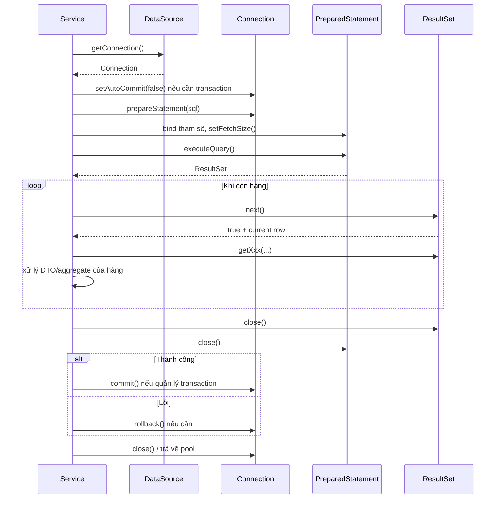

# Giữ kết nối và giao dịch trong suốt thời gian tiêu thụ kết quả trong JDBC

## 1. Bài toán: truy vấn trả hàng triệu bản ghi nhưng ứng dụng phải xử lý từng hàng

Giả sử một ứng dụng Java cần xuất dữ liệu của 5 triệu đơn hàng để tính tổng, xây dựng báo cáo hoặc chuyển sang một hệ thống phân tích. Nếu gọi `PreparedStatement.executeQuery()` rồi dùng `ResultSet.next()`, ứng dụng có thể **xử lý từng hàng** mà không phải chủ động tạo `List<Order>` chứa toàn bộ kết quả. Cách làm này đặc biệt quan trọng trong chương **Truy vấn quy mô lớn**.

Tuy nhiên, một thiết kế tưởng chừng hợp lý có thể gây lỗi:

```java
// SAI: ResultSet được trả ra sau khi Connection và Statement đã đóng.
ResultSet findOrders(DataSource dataSource) throws SQLException {
    try (Connection connection = dataSource.getConnection();
         PreparedStatement statement = connection.prepareStatement(
                 "SELECT order_id, total_amount FROM orders");
         ResultSet rows = statement.executeQuery()) {
        return rows;
    }
}
```

Đối tượng `ResultSet` được trả về về mặt cú pháp, nhưng khối `try-with-resources` đã đóng nó và các tài nguyên liên quan. Caller không còn một tập kết quả hợp lệ để đọc.

Ngay cả khi bỏ `ResultSet` ra khỏi khối `try`, việc đóng `Statement` hoặc `Connection` quá sớm vẫn có thể đóng cursor trên DB. Nếu chỉ dựa vào việc một driver tình cờ đã nạp toàn bộ dữ liệu vào bộ nhớ để tiếp tục đọc được, chương trình sẽ phụ thuộc vào hành vi triển khai không ổn định.

**Nguyên tắc trung tâm của bài học:**

> Với một tập kết quả được tiêu thụ dần qua JDBC, phải duy trì `ResultSet`, `Statement`, `Connection` và — khi cursor/đặc tính nhất quán yêu cầu — **transaction** ở trạng thái phù hợp **cho tới khi kết thúc việc duyệt và xử lý dữ liệu**.

Bài thuộc module **JDBC**: dùng driver, `DataSource`, `PreparedStatement`, `ResultSet`, SQL tham số hóa, quản lý kết nối, transaction, batching, lỗi và hiệu năng. Sau bài này, bạn sẽ biết khi nào cần giữ transaction mở, cách viết một API tiêu thụ dữ liệu theo từng hàng, tránh rò rỉ connection và cân bằng giữa truy vấn lớn với giới hạn tài nguyên.

## 2. Vòng đời của một truy vấn tiêu thụ tuần tự

Một truy vấn có kết quả lớn thường trải qua các bước:



Các điểm cần hiểu:

- `executeQuery()` trả `ResultSet`, nhưng **không bảo đảm** tất cả các hàng đã được chuyển từ DB sang JVM vào thời điểm phương thức trả về. Driver có thể lấy dữ liệu từng đợt, sử dụng server cursor hoặc đệm toàn bộ tùy cấu hình.
- `ResultSet.next()` có thể phát sinh I/O và ném `SQLException` ngay ở hàng thứ 10.000, dù `executeQuery()` đã thành công.
- `Statement.close()` thường đóng các `ResultSet` do statement tạo; `Connection.close()` có thể làm các result set và cursor liên quan mất hiệu lực.
- Khi có transaction tường minh, thao tác `commit()` hoặc `rollback()` có thể khiến cursor bị đóng, phụ thuộc **holdability** và driver.
- Với `DataSource` có pool, `Connection.close()` thường trả kết nối logic về pool, nhưng **không** có nghĩa dữ liệu của `ResultSet` đã được tách rời khỏi kết nối đó.

### 2.1. Đọc theo từng hàng không đồng nghĩa driver luôn streaming

Hai mẫu sau khác nhau về **bộ nhớ do code ứng dụng sử dụng**:

```java
// Tích lũy toàn bộ hàng tại Java.
List<OrderRow> rows = new ArrayList<>();
while (rs.next()) {
    rows.add(mapOrder(rs));
}

// Xử lý từng hàng, không giữ toàn bộ DTO.
while (rs.next()) {
    process(mapOrder(rs));
}
```

Mẫu thứ hai có thể giữ số lượng DTO đang dùng rất nhỏ, nhưng driver vẫn **có thể đệm dữ liệu**. Muốn biết query thực sự dùng server-side cursor/fetch theo từng đợt hay không, cần xem driver và cấu hình, đo bộ nhớ, lưu lượng mạng và cách hoạt động của DB.

`mapOrder` và `process` trong đoạn trên là các hàm minh họa do ứng dụng định nghĩa.

## 3. Mối quan hệ giữa ResultSet, Connection và transaction

### 3.1. Auto-commit mặc định và thời điểm kết thúc giao dịch

Theo JDBC, `Connection` mới thường ở chế độ `autoCommit=true`. Trong chế độ này, một statement được commit khi hoàn thành theo hợp đồng JDBC. Với statement trả `ResultSet`, việc hoàn thành có liên quan đến thời điểm **đã lấy hết kết quả hoặc đóng ResultSet**; tuy nhiên cách cursor được giữ và việc driver đệm dữ liệu có thể khác nhau.

Đối với truy vấn chỉ đọc có kết quả nhỏ, chế độ auto-commit mặc định thường đủ. Nhưng một số driver cần **transaction tường minh** để hỗ trợ cursor lấy hàng từng đợt. Ví dụ điển hình là cấu hình cursor-based fetching của PostgreSQL JDBC, thường yêu cầu connection không ở auto-commit cùng với fetch size dương và loại result set phù hợp.

**Không suy ra quy tắc này áp dụng cho mọi DB**: MySQL Connector/J, SQL Server JDBC, Oracle JDBC và các driver khác có cơ chế đọc lớn, tính chất fetch và điều kiện streaming riêng.

### 3.2. Transaction phải sống tới đâu?

Khi cần cursor gắn với transaction, trình tự an toàn là:

```text
getConnection()
    |
setAutoCommit(false)
    |
prepareStatement(... TYPE_FORWARD_ONLY, CONCUR_READ_ONLY)
    |
executeQuery()
    |
  next() -> xử lý
  next() -> xử lý
  ...
  next() -> false   (đã tiêu thụ hết)
    |
close(ResultSet)
close(PreparedStatement)
    |
commit() hoặc rollback()
    |
khôi phục trạng thái nếu cần
close(Connection)
```

Tuyệt đối tránh:

```text
executeQuery()
commit()
  |
next(), next(), ...
```

Sau `commit()`, cursor có thể không còn hợp lệ. Dù driver hỗ trợ `HOLD_CURSORS_OVER_COMMIT`, dùng đặc tính đó **không phải lý do mặc định** để commit giữa chừng: hành vi giữ cursor, bộ nhớ và tính nhất quán dữ liệu vẫn cần được chứng minh.

**Phân biệt:** “Giữ connection” và “giữ transaction” là hai quyết định liên quan nhưng không đồng nhất. Có truy vấn chỉ cần connection còn mở; có kiểu cursor cần cả transaction còn sống. Hãy chọn theo yêu cầu của driver và tính nhất quán nghiệp vụ.

### 3.3. Một connection không thể tự do được chia sẻ cho nhiều luồng

`Connection`, `PreparedStatement` và `ResultSet` có trạng thái. Khi một thread đang duyệt `rs.next()`, thread khác không nên đồng thời commit/rollback/đóng cùng connection hoặc điều khiển chính statement đó theo cách không được driver bảo đảm.

Trong ứng dụng xử lý song song, đừng gửi một `ResultSet` cho nhiều worker thread để cùng đọc. Nếu cần phân chia công việc, có thể biến mỗi hàng thành DTO rồi chuyển sang một queue **có giới hạn** hoặc phân chia truy vấn thành các vùng khóa với transaction riêng, nhưng phải kiểm soát tính nhất quán và thứ tự.

## 4. Chuẩn bị ví dụ: quét đơn hàng theo thứ tự khóa

Giả sử bảng có cấu trúc logic:

```sql
CREATE TABLE orders (
    order_id      BIGINT PRIMARY KEY,
    total_amount  DECIMAL(18, 2) NOT NULL,
    status        VARCHAR(20) NOT NULL
);
```

DDL trên là ví dụ khái quát; cú pháp và giới hạn kiểu có thể thay đổi theo DB. Ứng dụng cần quét mọi đơn hàng có khóa lớn hơn một giá trị đầu vào:

```sql
SELECT order_id, total_amount
FROM orders
WHERE order_id > ?
ORDER BY order_id
```

Hai lý do lựa chọn SQL này:

1. `WHERE order_id > ?` cho phép giới hạn phạm vi và dùng `PreparedStatement.setLong(...)` thay vì nối trực tiếp giá trị vào SQL.
2. `ORDER BY order_id` làm thứ tự duyệt xác định trong một lần truy vấn. Khi phân chia dữ liệu theo khóa ở các giai đoạn khác, đây cũng là cơ sở để tránh phụ thuộc vào thứ tự trả ngẫu nhiên của DB.

Không thêm `SELECT *` khi chỉ cần hai cột: các cột BLOB/CLOB hoặc chuỗi dài không cần thiết làm tăng lượng dữ liệu truyền và bộ nhớ.

## 5. Ví dụ Java đầy đủ: tiêu thụ từng hàng bên trong transaction

Đây là một mẫu **callback**: API bên ngoài cung cấp hàm xử lý mỗi hàng, còn tầng JDBC sở hữu hoàn toàn vòng đời của connection và transaction. Nhờ vậy, caller không bao giờ nhận một `ResultSet` đã đóng.

### 5.1. Triển khai với DataSource và PreparedStatement

Ví dụ Java 17+, JDBC chuẩn:

```java
import javax.sql.DataSource;
import java.math.BigDecimal;
import java.sql.Connection;
import java.sql.PreparedStatement;
import java.sql.ResultSet;
import java.sql.SQLException;
import java.sql.SQLFeatureNotSupportedException;
import java.util.Objects;

public final class OrderScanner {
    private static final String SQL = """
            SELECT order_id, total_amount
            FROM orders
            WHERE order_id > ?
            ORDER BY order_id
            """;

    public record OrderRow(long id, BigDecimal totalAmount) {}

    @FunctionalInterface
    public interface RowHandler {
        void accept(OrderRow order) throws SQLException;
    }

    private final DataSource dataSource;

    public OrderScanner(DataSource dataSource) {
        this.dataSource = Objects.requireNonNull(dataSource);
    }

    /**
     * Đọc từng hàng trong một transaction tường minh.
     * Caller xử lý DTO đồng bộ và không giữ lại ResultSet.
     */
    public long scanAfter(
            long lastSeenId, RowHandler handler
    ) throws SQLException {
        Objects.requireNonNull(handler, "handler");

        try (Connection connection = dataSource.getConnection()) {
            // Runner này tự sở hữu transaction.
            // Nếu caller đã mở transaction, phải dùng một overload
            // nhận Connection do caller sở hữu thay vì mở ở đây.
            if (!connection.getAutoCommit()) {
                throw new SQLException(
                        "DataSource trả Connection đang manual transaction");
            }
            connection.setAutoCommit(false);

            boolean resolved = false;
            Throwable primaryFailure = null;

            try {
                long consumed = 0;

                try (PreparedStatement ps = connection.prepareStatement(
                        SQL,
                        ResultSet.TYPE_FORWARD_ONLY,
                        ResultSet.CONCUR_READ_ONLY)) {

                    // Đây là hint; driver có thể xử lý khác nhau.
                    ps.setFetchSize(200);

                    // Áp dụng cho thực thi statement theo hỗ trợ
                    // của driver; không phải deadline tổng cho vòng duyệt.
                    ps.setQueryTimeout(60);

                    ps.setLong(1, lastSeenId);

                    try (ResultSet rs = ps.executeQuery()) {
                        while (rs.next()) {
                            long id = rs.getLong("order_id");
                            if (rs.wasNull()) {
                                throw new SQLException(
                                        "order_id không được NULL");
                            }

                            BigDecimal amount =
                                    rs.getBigDecimal("total_amount");
                            if (amount == null) {
                                throw new SQLException(
                                        "total_amount không được NULL");
                            }

                            // DTO chỉ chứa giá trị, không giữ JDBC resources.
                            handler.accept(new OrderRow(id, amount));
                            consumed++;
                        }
                    }
                }

                // Chỉ commit sau khi ResultSet/Statement đã đóng
                // và toàn bộ callback hoàn tất.
                connection.commit();
                resolved = true;
                return consumed;
            } catch (SQLException | RuntimeException | Error failure) {
                primaryFailure = failure;

                try {
                    connection.rollback();
                    resolved = true;
                } catch (SQLException rollbackFailure) {
                    failure.addSuppressed(rollbackFailure);
                }

                throw failure;
            } finally {
                // Chỉ khôi phục autoCommit nếu commit/rollback
                // đã thành công; bật autoCommit khi transaction còn
                // mở có thể gây commit ngoài ý muốn.
                if (resolved) {
                    try {
                        connection.setAutoCommit(true);
                    } catch (SQLException restoreFailure) {
                        if (primaryFailure != null) {
                            primaryFailure.addSuppressed(restoreFailure);
                        } else {
                            throw restoreFailure;
                        }
                    }
                }
            }
        }
    }
}
```

**Giải thích các điểm thiết kế:**

- `Connection` được mở **trước** khi tạo statement và sống đến **sau** lần `rs.next()` cuối cùng.
- `setAutoCommit(false)` tạo ngữ cảnh transaction tường minh, phù hợp với những driver yêu cầu giao dịch để giữ server cursor.
- `TYPE_FORWARD_ONLY` và `CONCUR_READ_ONLY` nói rõ yêu cầu chỉ tiến tới trước và chỉ đọc. Chúng không tự bảo đảm driver sẽ streaming.
- `setFetchSize(200)` là **gợi ý kích thước lấy hàng**; không phải giới hạn tổng số hàng và không phải cam kết giới hạn bộ nhớ 200 DTO.
- `setQueryTimeout(60)` là một cơ chế thời hạn của statement; ở một số driver, nó không giới hạn toàn bộ thời gian xử lý dữ liệu ở Java hoặc từng lần gọi `ResultSet.next()`.
- `ResultSet` và `PreparedStatement` đóng **trước** `commit()`, tránh dựa vào cursor còn sống sau commit.
- Nếu getter, `next()` hoặc `handler.accept(...)` ném lỗi, tầng sở hữu transaction sẽ thử rollback. Khi rollback cũng thất bại, lỗi thứ hai được gắn vào exception ban đầu bằng `addSuppressed(...)`.
- Nếu `commit()` báo lỗi kết nối, trạng thái commit có thể **chưa chắc chắn**; việc thử rollback không chứng minh transaction chưa được commit trước khi kết nối đứt.
- `try-with-resources` đóng hoặc trả connection về pool kể cả khi callback thất bại. Trong môi trường pooled connection, phải tuân theo chính sách cấu hình và reset trạng thái của pool.

Đoạn mã giả định DataSource cấp connection có `autoCommit=true`. Nếu ứng dụng dùng framework transaction manager hoặc cấu hình pool mặc định `autoCommit=false`, **không được mở một transaction lồng mới tùy tiện**. Khi đó nên chuyển phần quét dữ liệu thành phương thức nhận `Connection` do transaction owner cấp và để owner quyết định commit/rollback.

Một số driver có thể ném `SQLFeatureNotSupportedException` cho `setFetchSize`, `setQueryTimeout` hoặc tổ hợp kiểu result set được yêu cầu. Cần xác định chính xác tính năng được hỗ trợ; không bắt mọi `SQLException` rồi âm thầm coi như thành công.

### 5.2. Gọi scanner mà không xây List hàng triệu phần tử

Ví dụ tính tổng tiền và đếm hàng bằng accumulator nhỏ:

```java
import java.math.BigDecimal;

final class SummaryAccumulator {
    long rows = 0;
    BigDecimal total = BigDecimal.ZERO;
}

SummaryAccumulator summary = new SummaryAccumulator();

long scanned = scanner.scanAfter(0L, order -> {
    summary.rows++;
    summary.total = summary.total.add(order.totalAmount());
});

// Khi scanAfter trả về bình thường, ResultSet đã tiêu thụ,
// transaction đã kết thúc và Connection đã đóng/trả về pool.
System.out.println(
        "Scanned=" + scanned
        + ", rows=" + summary.rows
        + ", total=" + summary.total);
```

`scanner` là `OrderScanner` đã được tạo bằng `DataSource` phù hợp; `SummaryAccumulator` là một kiểu nội bộ nhỏ. Ví dụ lưu **một số đếm và một số tổng**, thay vì giữ toàn bộ các đơn hàng trong một collection.

Có thể thực hiện tổng ngay trong SQL bằng `SUM(total_amount)` nếu chỉ cần kết quả tổng và DB có thể làm hiệu quả hơn. Ví dụ quét từng hàng được chọn ở đây để minh họa trường hợp **nghiệp vụ thật sự cần xử lý riêng từng bản ghi**, chẳng hạn biến đổi, kiểm tra hoặc xuất dữ liệu.

### 5.3. Vì sao callback phải xử lý đồng bộ?

Không nên viết:

```java
scanner.scanAfter(0L, order -> {
    executor.submit(() -> doSlowWork(order));
});
```

Mẫu trên không làm DB xử lý song song một cách an toàn; nó chỉ đẩy công việc tới executor và có thể tích lũy hàng triệu task trong bộ nhớ. Scanner sẽ kết thúc/đóng connection khi đã gọi hết callback, trong khi các tác vụ chưa chắc đã hoàn thành.

Một callback có thể đưa **DTO bất biến** vào hàng đợi có backpressure, nhưng nếu việc xử lý downstream cần là một phần của chính transaction, phải hoàn tất và kiểm tra kết quả trước khi commit. Nếu downstream là HTTP, message broker hoặc file, rollback JDBC **không hoàn tác** những tác động bên ngoài đó.

## 6. Các anti-pattern về vòng đời tài nguyên

### 6.1. Trả ResultSet ra ngoài khối try-with-resources

```java
ResultSet load() throws SQLException {
    try (Connection connection = dataSource.getConnection();
         PreparedStatement ps = connection.prepareStatement(SQL)) {
        return ps.executeQuery(); // Sai: ps/connection sắp đóng.
    }
}
```

`ResultSet` phụ thuộc statement và connection. Giải pháp: **ánh xạ dữ liệu và gọi callback bên trong phạm vi tài nguyên đang mở**, rồi trả DTO, tổng hợp hoặc kết quả độc lập.

### 6.2. Trả Java Stream lười rồi đóng Connection

```java
Stream<OrderRow> streamOrders() throws SQLException {
    try (Connection connection = dataSource.getConnection();
         PreparedStatement ps = connection.prepareStatement(SQL);
         ResultSet rs = ps.executeQuery()) {
        return createLazyStream(rs); // Sai về vòng đời.
    }
}
```

Một `Stream` lười không xử lý dữ liệu tại thời điểm trả về. Khi caller thực hiện `stream.forEach(...)`, `ResultSet` đã đóng.

Nếu thực sự cần API lazy, phải thiết kế một đối tượng `AutoCloseable` sở hữu **cả Connection, Statement, ResultSet** và buộc caller dùng `try-with-resources`. Ngoài ra còn cần cách đóng khi duyệt hết, khi callback lỗi, khi caller hủy giữa chừng và khi stream không được tiêu thụ. Mô hình callback ở mục 5 tránh phần lớn rủi ro đó.

### 6.3. Commit ngay sau executeQuery rồi mới duyệt

```java
connection.setAutoCommit(false);
ResultSet rs = ps.executeQuery();

connection.commit(); // Sai nếu cursor cần transaction còn sống.

while (rs.next()) {
    // Driver có thể báo cursor đã bị đóng.
}
```

Giải pháp: xử lý hết hàng, đóng `ResultSet`/`PreparedStatement` rồi commit. Đối với các DB có holdable cursor, vẫn phải kiểm tra ngữ nghĩa và chi phí, không dựa vào đó làm mặc định.

### 6.4. Đóng Connection trong repository con

Một API scanner đang dùng transaction của service không thể để hàm xử lý từng hàng tự gọi `connection.close()`. Repository con cũng không được tự `commit()` hay `rollback()` trên connection của caller. Một chủ sở hữu phải quản lý ranh giới transaction, các tầng còn lại chỉ **mượn** connection nếu cần.

### 6.5. Gọi getConnection() cho mỗi hàng

```java
while (rs.next()) {
    try (Connection other = dataSource.getConnection()) {
        // Thêm một connection và query phụ cho từng hàng...
    }
}
```

Đây là dạng N+1 query, tiêu thụ pool và tăng round-trip. Nếu số hàng lớn, hãy thiết kế SQL JOIN hoặc xử lý dữ liệu thành các nhóm, hoặc dùng một chiến lược phân lô riêng. Không giữ hàng triệu vòng lặp mượn connection mới trong khi một cursor lớn đang mở nếu không có lý do và giới hạn rõ ràng.

## 7. Tương tác với fetch size, cursor và driver

### 7.1. Fetch size là gợi ý chứ không phải cam kết

`Statement.setFetchSize(int rows)` hoặc `ResultSet.setFetchSize(int rows)` đưa ra gợi ý số hàng nên lấy từ DB khi cần thêm dữ liệu:

```java
ps.setFetchSize(200);
```

Không nhầm:

| Thuộc tính | Ý nghĩa |
|---|---|
| `setFetchSize(200)` | Gợi ý **mỗi đợt** lấy bao nhiêu hàng; driver có thể bỏ qua hoặc diễn giải riêng |
| `setMaxRows(200)` | Đặt giới hạn **tổng số hàng** mà ResultSet có thể chứa theo hợp đồng API |
| `setQueryTimeout(60)` | Thời hạn chạy câu lệnh theo driver, dùng **giây** |
| `DataSource.setLoginTimeout(5)` | Thời gian chờ **thiết lập kết nối**, không giới hạn vòng đọc |
| `ResultSet.TYPE_FORWARD_ONLY` | Định hướng con trỏ chỉ tiến tới trước, **không tự kích hoạt server cursor** |

Một driver có thể trả kết quả theo từng đợt ngay cả khi `setFetchSize` không được gọi, hoặc đệm toàn bộ dù có hint. Với dữ liệu lớn, cần kiểm thử driver và đo bộ nhớ/throughput thực tế.

### 7.2. Các hệ quản trị không có cùng điều kiện streaming

| Hệ thống / driver | Điều cần kiểm tra |
|---|---|
| PostgreSQL JDBC | Cursor-based fetch thường cần `autoCommit=false`, fetch size dương, ResultSet kiểu forward-only và điều kiện query phù hợp |
| MySQL Connector/J | Có các cơ chế và tùy chọn fetch/cursor riêng theo phiên bản, không nhất thiết chỉ gọi `setFetchSize(200)` là đủ |
| Microsoft SQL Server JDBC | Cách driver quản lý server cursor và buffering khác; cần xem cấu hình/result set cụ thể |
| Oracle JDBC | Cơ chế prefetch/fetch size và vòng đời cursor cần xác minh theo driver |
| DB/driver khác | Không suy ra từ API chuẩn rằng RAM được giới hạn cứng hoặc cursor sẽ sống sau commit |

Thông tin trên là **định hướng kiểm chứng**, không phải bảo đảm cho mọi phiên bản và cấu hình. Một số loại SQL, `ResultSet` cuộn được hoặc cấu hình pooling có thể khiến driver thực hiện theo cách khác với một `SELECT` forward-only đơn giản.

### 7.3. Những yếu tố cần đo khi chọn fetch size

Giả sử query trả hàng triệu bản ghi, mỗi hàng trung bình 200 byte (chỉ là ví dụ). Fetch size 200 gợi ý mỗi đợt có khoảng 40 KB dữ liệu hàng chưa tính protocol/metadata. Nhưng **không được suy ra heap chỉ dùng 40 KB**: driver có bộ đệm riêng, đối tượng Java có overhead, và callback có thể tạo thêm dữ liệu.

Mức fetch size nhỏ có thể tạo nhiều lượt đi/về DB; mức lớn có thể tăng bộ nhớ và thời gian nhận một đợt. Hãy thử `100`, `500`, `1000` (chỉ là các ứng viên đo) trên dữ liệu thực để so sánh:

- Số hàng/giây và tổng thời gian quét.
- Peak heap và allocation rate của ứng dụng.
- Round-trip/độ trễ network và mức tải DB.
- Thời gian connection bị giữ trong pool.
- Độ trễ khi hủy và khi có lỗi giữa vòng đọc.
- Cách driver phản ứng khi callback cố tình chậm.

Không có một fetch size luôn tối ưu cho mọi hệ thống.

## 8. Transaction dài: đảm bảo đúng dữ liệu nhưng có chi phí

### 8.1. Transaction chỉ đọc vẫn có thể tiêu thụ tài nguyên

Một truy vấn chỉ đọc rất dài có thể giữ connection và cursor trong nhiều phút hoặc nhiều giờ, và tùy DB/isolation còn giữ snapshot, tài nguyên MVCC, bộ nhớ server, khóa hoặc khả năng giải phóng phiên bản dữ liệu cũ.

Do đó, việc giữ transaction mở cho tới khi kết quả được tiêu thụ là **điều kiện kỹ thuật khi cần cursor**, không phải lời khuyên “càng dài càng tốt”. Cần giảm thời gian quét, tránh những công việc không liên quan ở trong callback và cân nhắc phân đoạn truy vấn khi dữ liệu quá lớn.

### 8.2. Isolation level ảnh hưởng tính nhất quán

Các hằng JDBC:

- `Connection.TRANSACTION_READ_COMMITTED`.
- `Connection.TRANSACTION_REPEATABLE_READ`.
- `Connection.TRANSACTION_SERIALIZABLE`.

Có thể ảnh hưởng cách dữ liệu được nhìn thấy trong transaction dài, nhưng ngữ nghĩa cụ thể khác nhau giữa DB. Không nên khẳng định rằng `REPEATABLE_READ` luôn bảo đảm cùng một kết quả cho mọi câu truy vấn tiếp theo hoặc rằng `READ_COMMITTED` luôn đủ để xuất một snapshot báo cáo cố định.

Nếu cần snapshot nhất quán giữa nhiều câu SQL hoặc trong một luồng quét dài, phải chọn isolation và ranh giới transaction theo hành vi của DB thực tế. Tầng sở hữu connection thiết lập isolation vào thời điểm hợp lệ, khôi phục trước khi trả vào pool nếu chính sách yêu cầu; repository con không tự ý thay isolation giữa khi quét.

### 8.3. Holdability: commit có giữ ResultSet không?

JDBC có:

- `ResultSet.CLOSE_CURSORS_AT_COMMIT`.
- `ResultSet.HOLD_CURSORS_OVER_COMMIT`.

Có thể kiểm tra `connection.getHoldability()`, `rs.getHoldability()` và metadata về hỗ trợ holdability. Chúng mô tả liệu cursor có được giữ qua commit theo khả năng driver/DB.

**Không xem holdability là giải pháp mặc định cho long-running export**: nếu cần giữ snapshot nhất quán hoặc driver không hỗ trợ, commit giữa chừng có thể gây lỗi hoặc thay đổi ngữ nghĩa. Trong code mục 5, mọi hàng được tiêu thụ và result set đã đóng trước khi commit, nên không phụ thuộc vào holdability.

## 9. Khi người tiêu thụ chậm hơn nguồn dữ liệu

### 9.1. Không làm I/O chậm tùy ý trong callback

Ví dụ:

```java
scanner.scanAfter(0L, order -> {
    slowHttpClient.send(order); // Không nên gọi mạng chậm mỗi hàng
});
```

Đây là đoạn minh họa ý tưởng; `slowHttpClient` do ứng dụng cung cấp. Trong mô hình này, connection và transaction sẽ **bị giữ** cho tới khi mọi request HTTP kết thúc. Nếu phải gửi một triệu hàng và mỗi lần gọi mạng mất 50 ms, việc giữ cursor sẽ trở nên không phù hợp. Ngoài ra, rollback JDBC không thể hủy các request HTTP đã gửi.

Tương tự, việc chờ người dùng tương tác, gọi API ngoài, tải file từ mạng hay sleep trong callback có thể khiến connection pool bị thiếu và thời gian giữ snapshot tăng.

### 9.2. Bounded queue và backpressure

Nếu cần tách bước đọc DB và bước xử lý:

1. Tầng JDBC đọc hàng và ánh xạ thành DTO.
2. Đưa DTO vào một hàng đợi **có sức chứa giới hạn**.
3. Consumer xử lý DTO, giải phóng chỗ trong queue.
4. Producer phải chờ khi queue đầy để không giữ hàng triệu DTO.
5. Nếu consumer lỗi hoặc bị hủy, producer phải biết và đóng `ResultSet`/`Connection`, rollback nếu đang ở transaction.

Nhưng backpressure có nghĩa producer bị chậm, **và connection vẫn có thể phải mở trong suốt thời gian chờ**. Đây là đánh đổi có chủ đích, không phải cách tự động giải quyết mọi vấn đề của giao dịch dài. Muốn rút ngắn thời gian dùng connection, có thể ghi dữ liệu vào tệp tạm hoặc xử lý theo các trang độc lập.

### 9.3. Xuất CSV/file: tài nguyên ngoài DB không nằm trong transaction

Giả sử đang đọc ResultSet và ghi từng dòng ra `Writer`. Nếu dòng thứ 500.000 làm driver lỗi, rollback transaction JDBC **không thu hồi** những dòng CSV đã viết ra file hoặc HTTP response.

Với file xuất báo cáo cần trọn vẹn, một cách thiết kế là:

- Viết tạm vào file ở cùng vùng lưu trữ đích.
- Đọc hết dữ liệu, đóng statement, commit/rollback transaction và hoàn tất/đóng file tạm theo thứ tự thích hợp.
- Chỉ công bố/đổi tên file tạm thành kết quả cuối khi đã xác minh tất cả bước đều thành công.
- Nếu lỗi, xóa hoặc đánh dấu file tạm không hoàn chỉnh; giữ nguyên kết quả cũ.

Đổi tên file **không phải** một commit nguyên tử chung với transaction DB. Nếu yêu cầu tính nguyên tử giữa DB và file/message broker, cần một giao thức hoặc thiết kế nghiệp vụ riêng như outbox và đối soát.

Với HTTP streaming, sau khi header/body đã gửi một phần, không thể “rollback” các byte client đã nhận. API cần hợp đồng về response bị ngắt, checksum/trailer hoặc cách tạo export trước rồi cung cấp URL tải xuống.

## 10. Timeout, hủy và lỗi trong lúc đọc hàng

### 10.1. Query timeout không phải deadline cho toàn bộ callback

`PreparedStatement.setQueryTimeout(int seconds)` thiết lập thời hạn chờ thực thi statement theo cơ chế JDBC/driver. Nhưng không mặc định nó giới hạn **mọi lần `rs.next()`, chi phí mapping và callback Java**.

```java
ps.setQueryTimeout(60);
try (ResultSet rs = ps.executeQuery()) {
    while (rs.next()) {
        processRow(rs);
    }
}
```

Nếu `processRow` mất 10 phút, `setQueryTimeout(60)` không có nhiệm vụ tự động ngắt đoạn code Java đó. Ngoài ra, socket timeout/network timeout và deadline của request/job có thể là cơ chế khác, với đơn vị và hành vi riêng.

### 10.2. Cancellation là yêu cầu, không phải bảo đảm rollback

JDBC có `Statement.cancel()` để yêu cầu hủy câu lệnh đang thực thi, nhưng mức hỗ trợ và cách nó tương tác với thread/connection là **phụ thuộc driver**. Một timeout có thể làm statement thất bại; sau đó ứng dụng vẫn phải:

- Đóng result set và statement.
- Xem transaction còn dùng được hay đã bị DB đánh dấu thất bại.
- Thử rollback ở tầng sở hữu transaction nếu có lỗi.
- Không trả connection không rõ trạng thái cho hoạt động tiếp theo.
- Ghi rõ liệu công việc đã xử lý những tác động ngoài DB (file/HTTP/message) nào.

Nếu dùng thread interruption hoặc `Future.cancel(true)` để hủy job, không suy ra JDBC driver chắc chắn dừng I/O ngay lập tức. Hãy dùng timeout được driver hỗ trợ và kiểm thử fault injection.

### 10.3. Lỗi xảy ra ở hàng thứ N

`ResultSet.next()`, getter hoặc callback có thể ném lỗi sau khi đã xử lý hàng nghìn phần tử. Ví dụ:

```java
long seen = 0;
try (ResultSet rs = ps.executeQuery()) {
    while (rs.next()) {
        seen++;
        // Lỗi chuyển đổi ở hàng thứ 100_000 vẫn có thể xảy ra.
        OrderRow order = mapOrder(rs);
        process(order);
    }
}
```

Với code ứng dụng chỉ đọc từ DB, rollback có thể giải phóng snapshot và cursor, nhưng những sự kiện bên ngoài đã xuất ra không tự mất đi. Khi retry, cần biết nơi bắt đầu, tính ổn định của snapshot và yêu cầu idempotency. Không nên chỉ ghi “quét được 100.000 hàng” rồi tự tiếp tục từ vị trí thứ 100.001 nếu dữ liệu nền có thể thay đổi thứ tự.

Ghi nhận **khóa chính cuối cùng đã xử lý thành công**, request/job ID, version/snapshot nếu có, số hàng, thời gian bắt đầu và nguyên nhân lỗi sẽ giúp thiết kế resume an toàn hơn.

## 11. Kết nối và transaction của những truy vấn con

### 11.1. N+1 query trong lúc một ResultSet lớn đang mở

Nếu với mỗi đơn hàng, ứng dụng lấy thêm chi tiết khách hàng bằng một query:

```java
while (rs.next()) {
    long customerId = rs.getLong("customer_id");
    Customer customer = customerRepository.findById(customerId);
    // ...
}
```

Repository có thể tự mở connection mới. Cách này tạo N+1 query, tăng round-trip, chiếm pool và có thể khiến hai query đọc dữ liệu từ **hai transaction khác nhau** với mức nhất quán không mong muốn.

Các phương án:

- Dùng SQL `JOIN` để trả các cột thật sự cần, lưu ý cardinality và tránh nhân bản hàng do join 1–N.
- Nạp thông tin tra cứu có kích thước nhỏ vào map trước khi bắt đầu quét, với giới hạn bộ nhớ.
- Chia truy vấn thành batch ID, lấy dữ liệu liên quan theo nhóm.
- Với nghiệp vụ cần một snapshot nhất quán, giữ các query thuộc cùng transaction/connection theo đúng hợp đồng driver, nhưng không tự mở nhiều active result set trên một connection nếu driver không hỗ trợ.

Không giả định có thể mở một `PreparedStatement` khác để chạy SQL trong khi một server cursor của connection đang được duyệt: driver và DB có thể không cho phép các result set đồng thời hoặc có thể làm thay đổi cách buffering.

## 12. Khi nào nên chia truy vấn thành từng trang thay vì giữ một transaction dài?

Đối với dữ liệu rất lớn hoặc callback chậm, **keyset pagination** thường là lựa chọn cần xem xét. Ví dụ theo khóa duy nhất `order_id`:

```sql
-- Ví dụ cú pháp PostgreSQL/MySQL; LIMIT không phải SQL chung mọi DB.
SELECT order_id, total_amount
FROM orders
WHERE order_id > ?
ORDER BY order_id
LIMIT ?;
```

Quy trình:

1. Bắt đầu `lastSeenId` từ một giá trị phù hợp với miền khóa hoặc bookmark đã lưu.
2. Query tối đa `pageSize` hàng theo `order_id > lastSeenId`.
3. Tiêu thụ/ghi nhận kết quả trang khi `ResultSet`, statement và connection vẫn mở.
4. Đóng tài nguyên hoặc kết thúc transaction của trang.
5. Cập nhật `lastSeenId` thành **khóa cuối đã xử lý thành công** và mở trang tiếp theo.
6. Dừng khi trang trả ít hàng hơn page size, hoặc theo điều kiện kết thúc được thiết kế.

**Lợi ích:** connection và transaction được giữ cho từng trang thay vì toàn bộ hàng triệu bản ghi; có thể checkpoint để resume và đặt timeout theo trang.

**Đánh đổi:** các trang được truy vấn ở **các thời điểm khác nhau**. Nếu có hàng được chèn/xóa/cập nhật giữa các trang, kết quả không nhất thiết tương đương với một snapshot duy nhất. Với khóa tăng dần, có thể chốt `maxId` đầu kỳ và dùng điều kiện `order_id <= maxId` để tránh một số bản ghi mới có ID cao hơn, nhưng điều đó **không** giải quyết mọi thay đổi (update/delete, chèn ID thấp, thay đổi thuộc tính lọc). Nếu yêu cầu xuất chính xác snapshot tại một thời điểm, cần chiến lược snapshot/isolation hay cơ chế xuất được DB hỗ trợ.

### 12.1. Keyset khác OFFSET

Với `OFFSET` lớn, DB có thể phải đi qua nhiều hàng trước đó để lấy trang tiếp theo. Keyset với `WHERE order_id > ?` thường có thể tận dụng index hiệu quả hơn khi khóa sắp xếp phù hợp. Nhưng performance cần đo trên schema, index và workload thật.

Không bao giờ dùng `ORDER BY` không duy nhất để làm bookmark duy nhất; nếu cần sắp theo `created_at`, dùng khóa tổng hợp như `(created_at, order_id)` và điều kiện phân trang tương ứng với dialect DB.

### 12.2. Đặt ranh giới commit theo mục đích

| Yêu cầu | Hướng chọn |
|---|---|
| Cần snapshot duy nhất trong suốt quét | Một transaction/cursor nhất quán theo DB; đo chi phí transaction dài |
| Cần xử lý mọi bản ghi nhưng cho phép thay đổi giữa các đợt | Keyset pagination và checkpoint có kiểm chứng |
| Cần chạy batch xử lý ghi dữ liệu | Chia phạm vi và transaction ghi rõ ràng; tránh giữ transaction đọc mở vô hạn |
| Cần trả HTTP response streaming ngay | Xem deadline, backpressure, hủy và khả năng response dở dang |
| Cần xuất file trọn vẹn | Ghi file tạm, xác minh, chỉ công bố khi thành công; DB snapshot theo yêu cầu |
| Cần dữ liệu chỉ một lần và tập nhỏ | `List<DTO>` có giới hạn đôi khi đơn giản hơn cursor streaming |

Không có một lựa chọn chung tối ưu mọi tình huống. Giữ transaction đúng **trong thời gian cần thiết**, nhưng cân nhắc thay đổi kiến trúc nếu thời gian đó vượt giới hạn hạ tầng.

## 13. Giám sát khả năng cạn pool và xử lý sự cố

Một ResultSet được tiêu thụ trong 2 phút sẽ giữ connection khoảng 2 phút (thường dài hơn do thời gian thiết lập, cleanup, transaction). Nếu có 30 job cùng lúc và pool chỉ cho phép 20 connection, các request khác có thể phải chờ mượn connection.

Các chỉ số nên theo dõi:

| Chỉ số | Cho biết điều gì? |
|---|---|
| Thời gian `DataSource.getConnection()` | Pool wait, kết nối vật lý hoặc lỗi hạ tầng theo cấu hình |
| Số connection active/idle/pending | Mức bão hòa pool |
| Thời gian giữ connection/transaction | Mức chiếm dụng tài nguyên và nguy cơ transaction dài |
| Số hàng đã đọc/giây | Throughput vòng lặp |
| Thời gian `executeQuery()` và tổng thời gian `ResultSet.next()` | Tách thời gian khởi chạy query và lấy dữ liệu |
| Peak heap và GC | Có thực sự xử lý theo luồng hay đang giữ nhiều DTO/buffer |
| Số lần timeout, cancellation, connection reset | Độ ổn định driver/network |
| Thời gian callback trên mỗi hàng | Bước tiêu thụ có đang làm chậm việc giải phóng connection? |
| Last processed key và job ID | Khả năng đối soát/resume sau lỗi |

Đừng ghi toàn bộ dữ liệu đơn hàng hay các trường nhạy cảm vào log. Ưu tiên tên operation, số hàng, độ trễ, `SQLException.getSQLState()`, vendor code, request/job ID và một số khóa tương quan được phép ghi.

Một số connection pool có cảnh báo **leak detection** theo ngưỡng thời gian giữ connection. Một job quét hợp lệ nhưng rất dài có thể kích hoạt cảnh báo; không nên tắt toàn bộ cảnh báo chỉ vì quét lớn, mà cần phân biệt long-running work hợp lệ với leak thật và giới hạn số job đồng thời.

## 14. Kiểm thử tích hợp cho ResultSet lớn

Nên kiểm thử với đúng DB/driver và connection pool gần production, vì mock `ResultSet` không xác nhận được cursor, fetch size hay thời điểm đóng kết nối thật.

| Tình huống | Cách kiểm thử | Kỳ vọng |
|---|---|---|
| Tập kết quả rỗng | `WHERE` không khớp hàng nào | Callback không chạy, `scanAfter` trả 0, tài nguyên đóng |
| Tập nhỏ | 3–10 hàng đúng thứ tự | Mỗi hàng xử lý một lần, DTO và thứ tự đúng |
| Tập lớn | Hàng trăm nghìn hoặc triệu hàng thử nghiệm | Heap giữ mức phù hợp; không tạo `List` toàn bộ |
| Driver dùng fetch theo đợt | Cấu hình fetch size và transaction thích hợp | Quan sát hành vi và chi phí thực tế |
| Callback ném lỗi ở hàng N | Handler ném `SQLException` sau một số hàng | Dừng quét, đóng ResultSet/Statement, rollback transaction |
| Getter lỗi giữa chừng | Dữ liệu/driver giả lập lỗi đọc | Không rò connection; ngoại lệ được báo |
| Hủy job | Yêu cầu dừng giữa vòng đọc qua cơ chế hỗ trợ | Dọn statement/connection, xử lý transaction |
| Query timeout | DB chạy truy vấn chậm | Quan sát timeout thực tế, phân biệt với thời gian callback |
| Client đọc rất chậm | Export ra nguồn output có backpressure | Connection bị giữ bao lâu; có kế hoạch ngắt và cleanup |
| Pool nhỏ | Chạy nhiều job song song | Quan sát thời gian chờ connection, không vượt ngân sách |
| Commit trước khi hết hàng | Thử riêng trong môi trường kiểm soát | Quan sát holdability và khả năng cursor đóng |
| Isolation và thay đổi đồng thời | Transaction khác sửa dữ liệu trong lúc quét | Kết quả phù hợp mức nhất quán DB cung cấp |
| Mất mạng ở hàng N | Fault injection trong test DB | Kết quả job dở dang được ghi nhận, không tự retry tác động ngoài DB |
| Commit báo lỗi kết nối | Giả lập lỗi ở thời điểm commit | Không khẳng định chắc rollback/commit nếu outcome không rõ |
| Trang keyset | Vài trang và bản ghi thay đổi giữa trang | Nắm rõ trade-off tính nhất quán và bookmark |

### Bài tập tự thực hành

Hãy tạo bảng `orders` và viết một service xuất danh sách đơn hàng:

1. Dùng `PreparedStatement` với placeholder `?` và `ORDER BY order_id`; thử quét 100, 10.000 và 1.000.000 hàng.
2. Thiết kế callback xử lý `OrderRow` như mục 5, chỉ giữ số đếm và tổng, không giữ danh sách toàn bộ.
3. Cấu hình `TYPE_FORWARD_ONLY`, `CONCUR_READ_ONLY` và vài giá trị `setFetchSize`; đo total runtime, heap và round-trip nếu công cụ cho phép.
4. Với driver hỗ trợ cursor-based fetch khi `autoCommit=false`, thử quét trong transaction tường minh, xác minh `ResultSet` còn sống cho tới khi kết thúc duyệt.
5. Cố tình đóng `Connection` hoặc `PreparedStatement` trước khi `rs.next()`; quan sát loại lỗi thật trong DB/driver thử nghiệm.
6. Cho handler ném `SQLException` tại hàng thứ 50; kiểm tra transaction rollback và pool không còn connection bị mượn sau khi kết thúc.
7. Đưa một bước xử lý chậm có giới hạn vào callback, theo dõi thời gian connection bị giữ; đề xuất phiên bản sử dụng keyset pagination.
8. Viết export ra tệp tạm, giả lập lỗi sau khi đã ghi một phần, xác minh file kết quả cuối không bị công bố khi export thất bại.
9. Thử chạy 10 job quét cùng lúc với pool nhỏ và quan sát request khác bị ảnh hưởng như thế nào.

## 15. Tổng kết và checklist

- **Phải giữ `Connection`, `PreparedStatement` và `ResultSet` còn mở tới khi tiêu thụ kết quả hoàn tất**; không trả `ResultSet` hoặc `Stream` lười ra ngoài phạm vi đã đóng tài nguyên.
- **Một số driver cần transaction tường minh để dùng cursor/fetch theo đợt.** Khi đó commit/rollback **sau** khi duyệt và đóng ResultSet, không commit giữa chừng theo thói quen.
- **`setFetchSize` là gợi ý**, không phải bảo đảm RAM nhỏ, giới hạn tổng số hàng hoặc cơ chế bật streaming thống nhất giữa mọi driver.
- **Dùng callback đồng bộ hoặc đối tượng sở hữu tài nguyên rõ ràng**; chỉ đưa DTO tách khỏi JDBC sang tầng xử lý khác.
- **Tránh callback quá chậm**, truy vấn N+1 và hàng đợi không giới hạn khi connection còn đang bị giữ.
- **Transaction dài có giá phải trả:** connection pool, snapshot, cursor, khóa và khả năng phục hồi; dùng keyset pagination/chunking nếu tính nhất quán nghiệp vụ cho phép.
- **Xử lý lỗi ngay cả khi đã đọc được nhiều hàng:** rollback, cleanup, logging, idempotency và đối soát dữ liệu hoặc tác động ngoài DB.
- **Kiểm thử driver, DB và pool thực tế:** quan sát tài nguyên, timeout, holdability, isolation và hiệu năng trước khi tin rằng quét hàng triệu hàng an toàn.
