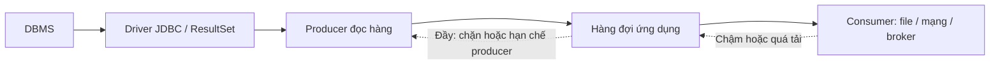
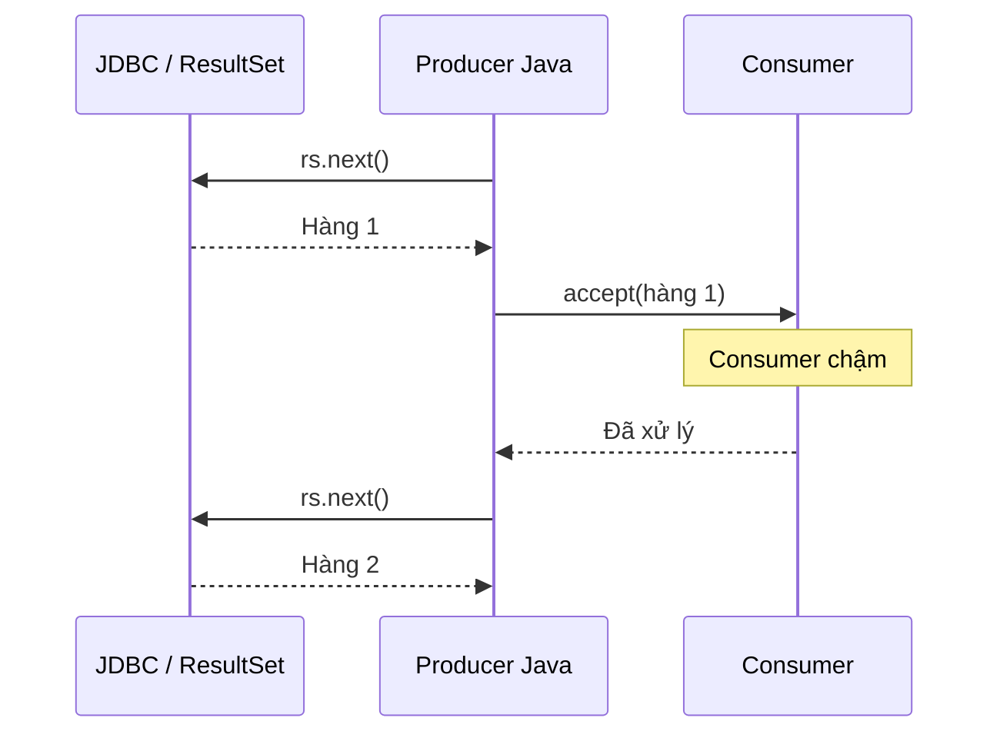
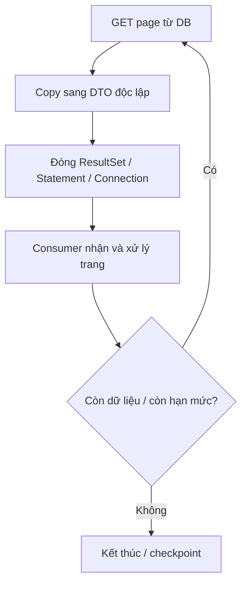

# Xử lý người tiêu thụ chậm và áp lực ngược trong truy vấn JDBC quy mô lớn

## Mục tiêu học tập

Trong **JDBC**, một chương trình Java có thể đọc hàng triệu bản ghi từ cơ sở dữ liệu quan hệ qua `DataSource`, `Connection`, `PreparedStatement` và `ResultSet`. Vấn đề không chỉ là lấy dữ liệu nhanh từ DBMS: dữ liệu còn phải được **người tiêu thụ (*consumer*)** xử lý, chẳng hạn mã hóa thành CSV, ghi tệp, gửi qua HTTP, đưa vào message broker hoặc biến đổi rồi chuyển sang một dịch vụ khác. Nếu database/driver cung cấp hàng nhanh hơn tốc độ consumer xử lý, hệ thống có thể tích lũy hàng trong bộ nhớ, kéo dài thời gian giữ connection và làm tăng độ trễ cho những request khác.

**Áp lực ngược (*backpressure*)** là cơ chế khiến phía tạo dữ liệu (*producer*) **giảm tốc, tạm chờ hoặc bị giới hạn số phần tử đang bay** khi phía tiêu thụ chưa theo kịp. Với JDBC, áp lực ngược cần được thiết kế ở nhiều tầng: vòng lặp `ResultSet.next()`, bộ đệm của driver, hàng đợi trong JVM, kết nối đang mượn từ pool và khả năng tiếp nhận dữ liệu của hệ thống đích.

Bài thuộc chương **Truy vấn quy mô lớn** hướng dẫn cách xử lý consumer chậm bằng các API JDBC tiêu chuẩn, quản lý connection/transaction, giới hạn bộ nhớ và xây dựng pipeline có backpressure rõ ràng.

Sau bài này, bạn có thể:

- Phân biệt **streaming theo JDBC**, **fetch size**, **phân trang truy vấn**, **hàng đợi có giới hạn** và **backpressure**.
- Hiểu vì sao `setFetchSize(...)` không bảo đảm driver chỉ giữ từng ấy hàng trong bộ nhớ.
- Thiết kế luồng đọc **đồng bộ theo nhu cầu** và luồng **producer–consumer có queue hữu hạn**.
- Tránh giữ JDBC connection hoặc transaction trong lúc consumer chậm vì mạng, đĩa hoặc xử lý CPU.
- Chọn kích thước batch/page, số phần tử chờ và giới hạn đồng thời theo ngân sách RAM, pool và DBMS.
- Xử lý timeout, hủy tác vụ, lỗi giữa luồng, checkpoint và retry mà không nhầm “đã đọc” với “đã xử lý bền vững”.

## 1. Người tiêu thụ chậm xuất hiện ở đâu?

Hãy hình dung một job xuất 10 triệu sự kiện thành các tệp nén. Database có thể đọc 30.000 hàng/giây, nhưng thao tác nén và ghi object storage chỉ duy trì 8.000 hàng/giây. Nếu producer cứ đọc và thêm vào `List` hoặc một queue không giới hạn, lượng dữ liệu chưa xử lý tăng liên tục.

Các ví dụ consumer chậm:

| Consumer | Nguyên nhân chậm | Tác động có thể thấy |
| --- | --- | --- |
| HTTP client tải file | Băng thông thấp, client tạm dừng đọc, backpressure của TCP | Kết nối JDBC bị giữ khi ứng dụng ghi response trực tiếp |
| Ghi tệp hoặc object storage | I/O đĩa, upload mạng hoặc retry từ hệ đích | Queue tăng hoặc thời gian giữ connection dài |
| Xử lý JSON/CSV/nén | CPU và tạo nhiều đối tượng Java | Tăng heap, GC và độ trễ |
| Gửi message broker | Broker throttling, giới hạn partition hoặc xác nhận chậm | Producer dồn việc chưa được xác nhận |
| Gọi API khác cho từng hàng | Latency mạng và rate limit của dịch vụ ngoài | Mỗi hàng phải chờ lâu; connection dễ bị giữ quá thời gian cần thiết |
| UI/ứng dụng phân trang | Người dùng không yêu cầu trang tiếp theo ngay | Không nên duy trì cursor và transaction vô hạn |

Dùng `ResultSet` không tự giải quyết mọi trường hợp trên. **Cần chọn ranh giới sở hữu dữ liệu**: ứng dụng có thể giữ con trỏ database đang mở rồi đọc dần, hoặc đọc một trang vào DTO độc lập, trả connection, sau đó mới chuyển trang cho consumer.



Nếu hàng đợi có dung lượng hữu hạn, việc nó đầy tạo tín hiệu để producer **ngừng lấy thêm dữ liệu** hoặc không phát thêm công việc. Nếu hàng đợi không giới hạn, sự khác biệt tốc độ dễ chuyển thành áp lực RAM thay vì áp lực ngược được kiểm soát.

## 2. Phân biệt các loại giới hạn

| Cơ chế | Giới hạn điều gì? | Không bảo đảm điều gì? |
| --- | --- | --- |
| `Statement.setFetchSize(n)` | **Gợi ý** cho driver số hàng nên lấy mỗi lượt từ DBMS | Không phải giới hạn tổng kết quả, heap hoặc số hàng cần xử lý |
| `Statement.setMaxRows(n)` | Giới hạn số hàng tối đa trong `ResultSet` theo hợp đồng API | Không bảo đảm phân trang tối ưu hay mọi driver lấy dữ liệu theo streaming |
| `LIMIT/FETCH FIRST` hoặc cú pháp tương đương | Số hàng SQL trả ở truy vấn một trang | Không mặc định có snapshot nhất quán giữa các trang |
| `ArrayBlockingQueue<>(q)` | Số phần tử/page chờ trong **queue của ứng dụng** | Không giới hạn buffer nội bộ driver hay số connection từ pool |
| Semaphore/admission control | Số job truy vấn được phép hoạt động đồng thời | Không làm database nhanh hơn hay thay thế pool |
| Connection pool maximum | Số connection có thể được cấp đồng thời từ pool | Không giới hạn số virtual thread/request đang chờ lấy connection |
| Timeout/deadline | Khoảng thời gian cho phép một bước xử lý | Không bảo đảm SQL đã bị hủy hoặc transaction đã rollback |
| Kích thước page theo byte | Ngân sách dữ liệu ứng dụng giữ ở một trang | Không thay thế giới hạn theo hàng, đặc biệt với dữ liệu phân phối không đều |

**Fetch size không phải backpressure cuối-cuối (*end-to-end*).** Driver có thể lấy dữ liệu theo cụm, ứng dụng vẫn có thể đưa hàng vào queue vô hạn. Ngược lại, một queue rất nhỏ không giải quyết được tình trạng driver đã tải toàn bộ `ResultSet` trước khi producer nhận hàng đầu tiên.

### 2.1. Một cách đọc đúng về setFetchSize

```java
try (PreparedStatement ps = connection.prepareStatement(
        "SELECT event_id, event_type FROM audit_events ORDER BY event_id",
        ResultSet.TYPE_FORWARD_ONLY,
        ResultSet.CONCUR_READ_ONLY)) {

    ps.setFetchSize(256); // Hint cho driver, không phải hard memory cap.

    try (ResultSet rs = ps.executeQuery()) {
        while (rs.next()) {
            long id = rs.getLong("event_id");
            String type = rs.getString("event_type");
            // Xử lý từng hàng hoặc chuyển tới consumer có giới hạn.
        }
    }
}
```

Đây là mảnh mã minh họa trong phạm vi đã có `Connection connection`. `TYPE_FORWARD_ONLY` phù hợp với đường đọc tuần tự. Driver/DBMS có thể:

- Thực sự dùng cursor và fetch từng nhóm hàng.
- Đệm nhiều hàng hơn `fetchSize`.
- Bỏ qua gợi ý hoặc yêu cầu cấu hình đặc thù để bật cursor/streaming.

Ví dụ, với một số cấu hình PostgreSQL JDBC, cơ chế cursor-based fetching đòi hỏi transaction phù hợp (thường không phải auto-commit mặc định). Driver MySQL và các DBMS khác có điều kiện streaming/cursor riêng. **Không áp dụng một thiết lập chung cho mọi driver**; cần kiểm tra tài liệu phiên bản đang dùng và quan sát heap, network và hành vi thực tế.

## 3. Áp lực ngược trực tiếp: chỉ gọi ResultSet.next() khi consumer sẵn sàng

Trong JDBC đồng bộ, một cách đơn giản để có backpressure ở **tầng ứng dụng** là:

1. Gọi `rs.next()` để lấy một hàng.
2. Chuyển các cột cần thiết thành DTO.
3. Gọi consumer **đồng bộ** để xử lý xong hàng đó.
4. Chỉ khi consumer trả về, mới gọi `rs.next()` lần tiếp theo.



Cách này tránh **tích lũy hàng trong một queue của ứng dụng**: producer không lấy hàng tiếp theo khi consumer còn bận. Tuy nhiên, nó vẫn có hai giới hạn đáng kể:

- **Connection và cursor vẫn đang mở trong lúc consumer chậm.** Với HTTP hoặc object storage chậm, thời gian mượn connection có thể bằng thời gian truyền toàn bộ dữ liệu.
- **Driver có thể đã prefetch** hoặc đệm trước nhiều hàng. Backpressure ở vòng lặp Java không mặc nhiên điều khiển bộ đệm trong driver/server.

### 3.1. Ví dụ Java đọc tuần tự và ghi CSV

Ví dụ bảng `audit_events(event_id BIGINT, event_type VARCHAR(...), summary VARCHAR(...))`. Hàm dưới đây ghi từng hàng vào `Writer` do caller cung cấp, không tạo `List` chứa toàn bộ kết quả.

```java
import java.io.IOException;
import java.io.Writer;
import java.sql.Connection;
import java.sql.PreparedStatement;
import java.sql.ResultSet;
import java.sql.SQLException;
import javax.sql.DataSource;

public final class StreamingCsvExporter {
    private final DataSource dataSource;

    public StreamingCsvExporter(DataSource dataSource) {
        this.dataSource = dataSource;
    }

    public long export(Writer output) throws SQLException, IOException {
        String sql = """
            SELECT event_id, event_type, summary
              FROM audit_events
             ORDER BY event_id
            """;

        try (Connection connection = dataSource.getConnection()) {
            // Một số driver cần transaction để giữ server-side cursor.
            connection.setAutoCommit(false);
            long written = 0;

            try {
                try (PreparedStatement ps = connection.prepareStatement(
                        sql,
                        ResultSet.TYPE_FORWARD_ONLY,
                        ResultSet.CONCUR_READ_ONLY)) {
                    ps.setFetchSize(256);

                    try (ResultSet rs = ps.executeQuery()) {
                        while (rs.next()) {
                            long id = rs.getLong("event_id");
                            String type = rs.getString("event_type");
                            String summary = rs.getString("summary");

                            // Hàm CSV phải escape quote/newline đúng chuẩn.
                            output.write(id + ","
                                + csv(type) + ","
                                + csv(summary) + "\n");
                            written++;
                        }
                    }
                }
            } catch (SQLException | IOException | RuntimeException error) {
                try {
                    connection.rollback();
                } catch (SQLException rollbackError) {
                    error.addSuppressed(rollbackError);
                }
                throw error;
            }

            // Giao dịch chỉ đọc trong ví dụ; kết thúc sau khi đóng cursor.
            connection.rollback();
            return written;
        }
    }

    private static String csv(String value) {
        if (value == null) {
            return ""; // Chính sách ví dụ cho SQL NULL.
        }
        return "\"" + value.replace("\"", "\"\"") + "\"";
    }
}
```

Mã dùng Java 15+ vì text block; có thể thay bằng chuỗi thường ở phiên bản Java cũ. Cần gọi hàm với `Writer` có charset rõ ràng (chẳng hạn UTF-8) và có cơ chế giới hạn kích thước output. Hàm **không đóng `output`** vì `Writer` thuộc caller.

**Ưu điểm:** không xây danh sách hàng khổng lồ trong Java, nhịp `rs.next()` theo tốc độ ghi. **Nhược điểm:** nếu output chậm, một connection và transaction đọc có thể bị giữ trong suốt thời gian ghi. Lựa chọn này phù hợp hơn với đích ghi nhanh/ổn định hoặc tác vụ được giới hạn đồng thời, và khi tính nhất quán snapshot của một truy vấn dài là yêu cầu quan trọng.

**Lưu ý lỗi truyền:** `output.write(...)` có thể đã gửi một phần kết quả trước khi ném `IOException`; `connection.rollback()` **không thể thu hồi** những byte đã gửi cho client/tệp. Với file xuất cần nguyên vẹn, cân nhắc ghi vào file tạm, hoàn thành, kiểm tra rồi mới công bố.

## 4. Khi consumer chậm: tách connection khỏi thời gian tiêu thụ

Một lựa chọn khác là **phân trang theo khóa (*keyset pagination*)**:

1. Mượn connection, chạy SQL lấy một trang nhỏ có thứ tự ổn định.
2. Đọc đủ trang vào DTO độc lập rồi **đóng `ResultSet`, `PreparedStatement` và `Connection`**.
3. Đưa trang cho consumer. Consumer có thể chậm mà **không giữ connection của trang đó**.
4. Chỉ sau khi trang đã được xử lý hoặc chuyển vào queue hữu hạn, lấy trang tiếp theo.



### 4.1. Vì sao ưu tiên keyset so với OFFSET sâu?

Với một khóa tăng ổn định `event_id`, truy vấn có thể là:

```sql
-- Ví dụ dùng LIMIT; DBMS khác có thể cần FETCH FIRST/cú pháp riêng.
SELECT event_id, event_type, summary
  FROM audit_events
 WHERE event_id > ?
   AND event_id <= ?
 ORDER BY event_id
 LIMIT ?;
```

Tham số lần lượt là:

- `lastSeenId`: ID cuối của trang trước.
- `highWatermark`: ID cao nhất được chọn lúc bắt đầu export, nếu muốn loại các ID lớn được thêm sau đó.
- `pageSize`: số hàng cao nhất trong trang.

Dùng `ORDER BY event_id` với một khóa **duy nhất, ổn định và có index phù hợp** giúp tránh chi phí duyệt offset sâu. Nếu sort theo `created_at` không duy nhất, cần thêm khóa phụ như `(created_at, id)` và điều kiện keyset nhất quán. Không đưa tên cột hoặc `ORDER BY` từ input của người dùng vào SQL mà không có whitelist.

**High watermark không phải snapshot tuyệt đối.** Giả sử `MAX(event_id)` được đọc đầu job, một transaction khác có thể commit muộn hàng với ID nhỏ hơn high watermark; các trang sau vẫn có thể quan sát dữ liệu mới đó. Hàng có thể bị cập nhật hoặc xóa giữa hai trang. Nếu báo cáo cần một snapshot nhất quán tuyệt đối tại một thời điểm, phải dùng chiến lược snapshot/isolation/export phù hợp với DBMS hoặc mô hình dữ liệu bất biến; keyset đơn thuần chỉ tạo cách đi qua tập dữ liệu có giới hạn.

### 4.2. Ví dụ Java: đóng connection trước khi gọi consumer

Trong ví dụ, bảng `audit_events` có khóa `event_id` là số **dương**, duy nhất, không bị thay đổi và có index. Giá trị `summary` được giả định vừa phải; với LOB rất lớn cần dùng streaming và ngân sách byte riêng.

```java
import java.sql.Connection;
import java.sql.PreparedStatement;
import java.sql.ResultSet;
import java.sql.SQLException;
import java.util.ArrayList;
import java.util.List;
import java.util.Objects;
import javax.sql.DataSource;

public final class KeysetPageReader {
    public record AuditRow(long id, String type, String summary) {}

    @FunctionalInterface
    public interface PageConsumer {
        void accept(List<AuditRow> page) throws Exception;
    }

    private final DataSource dataSource;

    public KeysetPageReader(DataSource dataSource) {
        this.dataSource = Objects.requireNonNull(dataSource);
    }

    public void exportPages(int pageSize, PageConsumer consumer)
            throws Exception {
        if (pageSize <= 0) {
            throw new IllegalArgumentException("pageSize phải dương");
        }
        Objects.requireNonNull(consumer, "consumer");

        long upperId = maxEventId();
        long lastSeenId = 0L;

        while (lastSeenId < upperId) {
            List<AuditRow> page = fetchPage(
                lastSeenId, upperId, pageSize
            );

            if (page.isEmpty()) {
                break;
            }

            // fetchPage() đã đóng Connection trước khi trả về.
            consumer.accept(page);

            // Cập nhật cursor CHỈ sau khi consumer trả về thành công.
            lastSeenId = page.get(page.size() - 1).id();
        }
    }

    private long maxEventId() throws SQLException {
        try (Connection c = dataSource.getConnection();
             PreparedStatement ps = c.prepareStatement(
                 "SELECT MAX(event_id) FROM audit_events");
             ResultSet rs = ps.executeQuery()) {
            if (!rs.next()) {
                return 0L;
            }
            long value = rs.getLong(1);
            return rs.wasNull() ? 0L : value;
        }
    }

    public List<AuditRow> fetchPage(
            long afterId, long upperId, int pageSize)
            throws SQLException {

        String sql = """
            SELECT event_id, event_type, summary
              FROM audit_events
             WHERE event_id > ? AND event_id <= ?
             ORDER BY event_id
             LIMIT ?
            """;

        List<AuditRow> values = new ArrayList<>(pageSize);

        try (Connection c = dataSource.getConnection();
             PreparedStatement ps = c.prepareStatement(sql)) {

            ps.setLong(1, afterId);
            ps.setLong(2, upperId);
            ps.setInt(3, pageSize);

            try (ResultSet rs = ps.executeQuery()) {
                while (rs.next()) {
                    values.add(new AuditRow(
                        rs.getLong("event_id"),
                        rs.getString("event_type"),
                        rs.getString("summary")
                    ));
                }
            }
        }
        // ResultSet, Statement và Connection đã được đóng.
        return values;
    }
}
```

**Điểm mấu chốt:** `consumer.accept(page)` được gọi **sau** khi `fetchPage()` đã trả connection về pool. Nếu consumer ghi object storage mất 3 giây, connection không bị giữ trong 3 giây đó.

Ví dụ có **backpressure trực tiếp theo trang**: chưa xử lý xong trang hiện tại thì chưa đọc trang tiếp theo. `PageConsumer` có thể ghi file, nén dữ liệu hoặc gửi tới dịch vụ khác, nhưng cần bảo đảm **định nghĩa rõ “trả về thành công”**. Nếu consumer chỉ đưa việc vào queue không giới hạn rồi trả về ngay, áp lực ngược sẽ bị mất ở tầng sau.

### 4.3. Giới hạn riêng cho kích thước trang theo byte

`pageSize=500` không đủ để bảo đảm bộ nhớ ổn định nếu `summary` có thể từ 100 byte đến hàng megabyte. Một trang 500 hàng rất rộng vẫn có thể tiêu tốn nhiều RAM.

Nên kết hợp:

- Giới hạn số hàng/trang.
- Ngưỡng dung lượng dữ liệu thực tế hoặc **ước tính** cho trang/queue.
- Giới hạn độ dài cột hoặc chính sách riêng cho BLOB/CLOB.
- Giới hạn số tác vụ đang giữ trang và số consumer song song.

Trong ví dụ, `new ArrayList<>(pageSize)` chỉ ấn định sức chứa ban đầu, **không có khả năng tự áp ngưỡng byte**. Nếu dữ liệu có phần tử cực lớn, có thể thay bằng đọc nhiều trang nhỏ, tách payload sang đường streaming LOB, hoặc spool dữ liệu sang tệp trước khi đóng connection.

## 5. Hàng đợi hữu hạn giữa producer và consumer

Đôi khi producer cần chuẩn bị trang tiếp theo trong lúc consumer đang xử lý trang hiện tại, ví dụ đọc từ DBMS và nén dữ liệu đồng thời. Khi đó có thể đặt một `BlockingQueue` **hữu hạn** giữa hai bên.

```text
Reader [fetch page]  --put(page)-->  BoundedQueue(capacity=3)
                                        |
                                        v
                               Consumer [take -> xử lý]
```

Nếu queue có sức chứa 3 trang:

- Producer có thể đọc trước tối đa 3 trang đang nằm trong queue, ngoài trang producer/consumer hiện đang giữ.
- Khi queue đầy, `put(...)` **chặn producer** cho đến khi consumer lấy bớt trang.
- Nếu producer đọc từng trang bằng connection ngắn như phần 4, nó sẽ **đóng connection trước khi chờ `put(...)`**, tránh giữ tài nguyên DB trong lúc queue đầy.
- Nếu đọc cursor dài rồi chặn ở `put(...)` ngay giữa một `ResultSet`, connection và transaction **vẫn bị giữ** khi consumer chậm.

### 5.1. Ví dụ Java 21: producer virtual thread và queue hữu hạn

Ví dụ dưới đây sử dụng lại `KeysetPageReader.fetchPage(...)` và `maxEventId()` cần được điều chỉnh quyền truy cập trong cùng lớp (chẳng hạn dùng `private` khi hai hàm ở chung lớp). Để tránh phụ thuộc vào chi tiết truy cập, phần dưới thể hiện một **lớp điều phối nằm cùng lớp `KeysetPageReader`**, dùng các phương thức `maxEventId()` và `fetchPage()` đã định nghĩa ở phần trước.

```java
// Các import bổ sung trong KeysetPageReader:
import java.util.concurrent.ArrayBlockingQueue;
import java.util.concurrent.BlockingQueue;
import java.util.concurrent.TimeUnit;
import java.util.concurrent.atomic.AtomicBoolean;
import java.util.concurrent.atomic.AtomicReference;

// Phương thức đặt TRONG class KeysetPageReader đã định nghĩa ở phần 4.
public void exportWithBoundedQueue(
        int pageSize, int queueCapacity, PageConsumer consumer)
        throws Exception {

    if (pageSize <= 0 || queueCapacity <= 0) {
        throw new IllegalArgumentException("Các ngưỡng phải dương");
    }
    Objects.requireNonNull(consumer, "consumer");

    BlockingQueue<List<AuditRow>> queue =
        new ArrayBlockingQueue<>(queueCapacity);
    AtomicBoolean producerDone = new AtomicBoolean(false);
    AtomicReference<Throwable> producerFailure = new AtomicReference<>();

    // Virtual thread chỉ giúp điều phối I/O; không tăng DB connections.
    Thread producer = Thread.ofVirtual().start(() -> {
        try {
            long upperId = maxEventId();
            long lastSeenId = 0L;

            while (lastSeenId < upperId
                    && !Thread.currentThread().isInterrupted()) {
                List<AuditRow> page = fetchPage(
                    lastSeenId, upperId, pageSize
                );
                if (page.isEmpty()) {
                    break;
                }

                // fetchPage() đã trả Connection về pool.
                // put() bị chặn nếu queue đầy: backpressure.
                queue.put(page);
                lastSeenId = page.get(page.size() - 1).id();
            }
        } catch (Throwable failure) {
            // Truyền cả lỗi ngoài SQLException tới caller.
            producerFailure.set(failure);
        } finally {
            producerDone.set(true);
        }
    });

    try {
        // Thoát khi producer kết thúc và các trang chờ đã được xử lý.
        while (!producerDone.get() || !queue.isEmpty()) {
            List<AuditRow> page = queue.poll(
                200, TimeUnit.MILLISECONDS
            );
            if (page != null) {
                consumer.accept(page);
            }
        }

        Throwable failure = producerFailure.get();
        if (failure instanceof Exception error) {
            throw error;
        }
        if (failure instanceof Error error) {
            throw error;
        }
    } finally {
        // Khi consumer thất bại/hủy: báo producer dừng.
        // Driver JDBC có thể không dừng tức thời vì interrupt.
        producer.interrupt();
        producer.join();
    }
}
```

Đoạn ví dụ dùng **Java 21** cho `Thread.ofVirtual()` và Java 17+ cho `record`. Đây là mẫu giáo dục về hàng đợi hữu hạn; ứng dụng thật cần chính sách deadline/cancellation toàn tiến trình, giám sát lỗi, xử lý trạng thái `InterruptedException` và cơ chế dừng/hủy phù hợp với driver. Không nên bắt `Throwable` để **bỏ qua lỗi nghiêm trọng**; ở đây nó được chuyển về luồng gọi sau khi queue đã thoát, và các loại `Error` không bị cố ý nuốt.

**Ưu điểm của thiết kế này:** producer chỉ mượn connection bên trong `fetchPage()`, đóng connection trước khi gọi `queue.put(page)`. Khi consumer chậm, queue đầy làm producer dừng đọc thêm **mà không giữ connection**.

**Giới hạn quan trọng:** các trang đã xử lý trước khi producer báo lỗi có thể đã được gửi ra bên ngoài. Đây là một pipeline có khả năng **hoàn tất một phần**, không phải transaction nguyên tử của toàn bộ export. `producer.join()` có thể chờ lâu khi JDBC call chưa phản ứng với interrupt; cần timeout/driver cancellation khi triển khai production.

### 5.2. Tính ngân sách queue

Nếu:

- `Q` = số trang tối đa trong queue.
- `P` = số hàng tối đa/trang.
- `R` = kích thước trung bình ước tính của một hàng DTO.

Bộ nhớ dữ liệu **chỉ riêng queue** xấp xỉ:

\[
M_{\text{queue}} \approx Q \times P \times R
\]

Ví dụ với 3 trang × 200 hàng/trang × 2 KiB/hàng, dữ liệu DTO ước tính khoảng **1,17 MiB** trước overhead Java, `String`/`List`, các page producer/consumer đang giữ và buffer driver.

Đây là **ước lượng**, không phải hard memory cap. Khi hàng biến thiên lớn, dùng kích thước ở percentile cao và thêm ngưỡng byte thực tế. Hệ thống có 10 pipeline chạy đồng thời còn phải tính tổng queue, pool, thread, network và output buffer.

## 6. Mô hình tốc độ: producer nhanh hơn consumer thì chuyện gì xảy ra?

Gọi:

- `λ_p`: tốc độ producer tạo hàng (hàng/giây).
- `λ_c`: tốc độ consumer thực sự hoàn thành hàng (hàng/giây).
- `B`: số hàng đang chờ trong các bộ đệm của ứng dụng.

Nếu không giới hạn queue và tốc độ trung bình lâu dài `λ_p > λ_c`, backlog có thể tăng gần như:

\[
\frac{dB}{dt} \approx \lambda_p - \lambda_c
\]

Ví dụ producer cung cấp 15.000 hàng/giây, consumer chỉ xử lý 5.000 hàng/giây: backlog tăng khoảng 10.000 hàng mỗi giây khi producer không bị chặn, trước khi tài nguyên cạn hoặc hệ thống phải giảm tải.

Với queue hữu hạn, backlog trong queue không tăng vô hạn. Thay vào đó producer sẽ phải **chờ**, giảm tốc trung bình xuống mức mà consumer và giới hạn hệ thống cho phép. Điều này bảo vệ RAM nhưng có thể tăng thời gian xử lý tổng thể. Để hoàn thành nhanh hơn, cần cải thiện consumer hoặc tăng năng lực một cách có kiểm soát, không chỉ nâng giới hạn queue.

### Các chiến lược khi consumer liên tục chậm

| Chiến lược | Dùng khi | Cần đánh đổi |
| --- | --- | --- |
| Chặn producer / không fetch trang tiếp theo | Dữ liệu không được phép mất | Công việc lâu hơn, producer chờ |
| Giảm page size và queue capacity | Bộ nhớ biến động hoặc có LOB | Nhiều round trip/chi phí quản lý hơn |
| Tăng consumer workers có giới hạn | Xử lý độc lập, thứ tự không quan trọng hoặc có thể khôi phục | Tăng CPU/I/O tải trên sink, có thể đảo thứ tự |
| Spool ra file/kho trung gian | Sink chậm nhưng cần trả connection DB sớm | Tốn đĩa, cần cleanup, quota và phục hồi |
| Giới hạn admission/job chạy đồng thời | Pool/DBMS hoặc sink đang quá tải | Tăng thời gian chờ hoặc từ chối job mới |
| Hủy export quá hạn | Yêu cầu bị hủy hoặc SLA không còn phù hợp | Cần cleanup, trạng thái chưa hoàn tất và retry |
| Bỏ bớt dữ liệu có kiểm soát | Chỉ với dữ liệu được phép mất (ví dụ telemetry lấy mẫu) | Không phù hợp với audit, tài chính hay export phải đủ |

**Không sử dụng cơ chế drop khi dữ liệu phải đầy đủ.** Với sự kiện nghiệp vụ hoặc xuất báo cáo cần chính xác, xử lý chậm phải được giải quyết bằng backpressure, tăng năng lực đích hoặc lưu trung gian bền vững, không bằng cách làm mất hàng.

## 7. Connection pool và transaction khi consumer chậm

Giả sử pool có 10 connection, 20 HTTP request đồng thời xuất dữ liệu. Nếu mỗi request giữ một `ResultSet` streaming trong 30 giây để chờ client tải, tối đa khoảng 10 request có thể mượn connection, còn các request khác chờ pool hoặc timeout.

### 7.1. Hai thiết kế đối chiếu

| Thiết kế | Thời gian giữ connection | Tính nhất quán dữ liệu | Bộ nhớ |
| --- | --- | --- | --- |
| Cursor dài + consumer trực tiếp | Có thể bằng cả thời gian truyền | Có thể giữ một snapshot/cursor theo semantics DBMS | Có thể nhỏ ở ứng dụng, phụ thuộc driver |
| Keyset pages + xử lý từng trang | Chỉ trong từng lần đọc trang | Có thể thay đổi giữa các trang | Giới hạn theo trang |
| Keyset pages + queue hữu hạn | Ngắn cho mỗi trang; producer có thể prefetch | Có thể thay đổi giữa các trang | Giới hạn theo trang × queue và overhead |
| Đọc sang file tạm rồi phục vụ client | Connection được trả sau giai đoạn spool | Snapshot theo cách đọc/spool được thiết kế | Dùng đĩa thay vì giữ toàn bộ RAM |
| Bản snapshot được DBMS tạo riêng | Phụ thuộc tính năng DBMS | Có thể đảm bảo đồng nhất cao hơn | Chi phí DBMS/snapshot và lưu trữ |

Không có lựa chọn tối ưu cho mọi hệ thống. Nếu yêu cầu **snapshot nhất quán** quan trọng, một transaction đọc kéo dài có thể hợp lý nhưng phải tính chi phí giữ cursor, connection và phiên bản dữ liệu trong DBMS. Nếu ưu tiên pool availability và consumer chậm, page ngắn hoặc spool thường dễ kiểm soát hơn.

### 7.2. Tránh kéo dài transaction chỉ để chờ sink

Trong transaction thủ công, `Connection.setAutoCommit(false)` và `ResultSet` server-side cursor có thể giữ transaction đang mở cho tới khi query được tiêu thụ và `commit()/rollback()`. Dù không ghi dữ liệu, transaction đọc dài vẫn có thể tiêu thụ tài nguyên DBMS hoặc ảnh hưởng việc dọn phiên bản dữ liệu, tùy hệ quản trị.

Không chuyển `setAutoCommit(true)` giữa lúc đang đọc cursor để “giải phóng” transaction, vì đổi chế độ có thể kết thúc transaction và làm cursor/locator không còn hợp lệ. Hãy hoàn tất và đóng `ResultSet`/statement rồi kết thúc transaction theo contract.

### 7.3. Giới hạn số export đồng thời

Giới hạn queue trong **mỗi job** không đủ nếu có hàng trăm job chạy cùng lúc. Cần thêm semaphore/admission control trên số job:

```java
java.util.concurrent.Semaphore exportSlots =
    new java.util.concurrent.Semaphore(4);

if (!exportSlots.tryAcquire()) {
    throw new IllegalStateException("Quá nhiều export đang hoạt động");
}

try {
    // Gọi exportPages(...) hoặc exportWithBoundedQueue(...).
} finally {
    exportSlots.release();
}
```

Đây là ví dụ điều phối trong một instance. Giới hạn 4 chỉ là số minh họa; nên chọn theo ngân sách pool, tài nguyên DBMS, sink và số replica. Nếu toàn cụm có nhiều instance, semaphore cục bộ không tạo giới hạn toàn cụm.

## 8. Timeout, cancellation và kết quả chưa hoàn tất

Một request có thể hết hạn khi đang:

1. Chờ suất xử lý hoặc connection pool.
2. Chờ `executeQuery()`.
3. Đọc `ResultSet.next()`.
4. Chờ `queue.put(...)` hoặc `queue.take()/poll()`.
5. Chờ consumer ghi tệp/network.
6. Đóng tài nguyên, kết thúc transaction hoặc báo trạng thái.

Các timeout có phạm vi khác nhau:

| Cơ chế | Phạm vi | Điều không được kết luận |
| --- | --- | --- |
| Pool acquisition timeout | Thời gian chờ cấp connection | Query đã chạy hay chưa nếu request đã qua bước khác |
| `Statement.setQueryTimeout(...)` | Thời gian thực thi statement mà driver cố gắng áp dụng | Toàn bộ pipeline/output sẽ dừng đúng hạn |
| Socket/network timeout của driver | I/O giao tiếp database | Consumer HTTP/tệp đã hoàn tất |
| Timeout của queue/semaphore | Chờ tài nguyên trong JVM | Thao tác SQL phía database bị hủy |
| Interrupt/cancel virtual thread | Yêu cầu tác vụ chấm dứt | Driver/DBMS đã lập tức ngừng lệnh SQL |
| Deadline toàn job | Thời hạn nghiệp vụ | Output dở dang tự được thu hồi |

Nếu consumer thất bại, cần báo producer dừng, giải phóng `ResultSet`, `PreparedStatement` và `Connection`. Khi một driver không phản ứng nhanh với interrupt, có thể phải dùng `Statement.cancel()`, network timeout hoặc các cơ chế riêng của pool/driver để giới hạn thời gian dừng. **Không cam kết cancellation tức thời**.

### 8.1. Dữ liệu đầu ra đã gửi không rollback bằng JDBC

Khi export đã gửi 70% file tới client rồi lỗi, `rollback()` của transaction đọc không thu hồi được phần nội dung đã truyền. Một cách vận hành an toàn là:

- Đưa kết quả vào **file tạm** rồi chỉ publish sau khi hoàn chỉnh.
- Sử dụng trạng thái job (`PENDING`, `RUNNING`, `COMPLETED`, `FAILED`) và chỉ công bố đường dẫn khi hoàn tất.
- Với response streaming trực tiếp, trả tín hiệu thất bại phù hợp và bảo đảm client không coi file thiếu là đầy đủ.
- Nếu yêu cầu toàn vẹn nội dung, cung cấp kích thước kỳ vọng hoặc checksum khi thiết kế cho phép.

Với pipeline **ghi** vào sink khác, cần định nghĩa transaction/idempotency riêng. Không tự coi việc `consumer.accept(page)` trả về là bằng chứng dữ liệu đã bền vững nếu consumer chỉ enqueue một việc chưa được xác nhận.

## 9. Checkpoint và retry khi truy vấn nhiều trang

Khi export hàng triệu bản ghi có thể kéo dài, retry từ đầu có thể tốn kém hoặc tạo bản sao output. Với keyset pagination, `lastSeenId` có thể làm **cursor tiến độ**, nhưng chỉ nên ghi checkpoint sau khi trang trước đã được sink xác nhận theo hợp đồng.

```text
Bước 1: đọc page có id từ 101 đến 200
Bước 2: consumer xử lý page, ghi ra đích
Bước 3: đích xác nhận theo mức độ bền vững đã định
Bước 4: lưu checkpoint lastCommittedId = 200
Bước 5: đọc tiếp WHERE event_id > 200
```

Nếu checkpoint được ghi **trước** khi consumer hoàn tất, một lần crash có thể làm mất trang chưa kịp ghi. Nếu consumer ghi xong nhưng chương trình crash **trước** checkpoint, trang đó có thể được xử lý lại khi restart.

Để giảm sai lệch:

- Dùng ID bất biến và thứ tự ổn định.
- Lưu checkpoint cùng metadata export, filter và high watermark đã chọn.
- Thiết kế sink idempotent hoặc có khả năng phát hiện trang đã ghi; nếu cần exactly-once, phải có giao thức phối hợp phù hợp thay vì chỉ dựa vào `lastSeenId`.
- Không giữ `ResultSet`/connection từ lần chạy cũ để tiếp tục sau restart.
- Đánh giá lại snapshot và những cập nhật/xóa xảy ra trong lúc job đang chạy.

**Keyset cursor là tiến độ duyệt, không phải bằng chứng exactly-once.** Đọc mỗi hàng đúng một lần ở mức câu lệnh SQL chưa bảo đảm sink đã ghi mỗi bản ghi đúng một lần sau sự cố.

## 10. Tham số hóa và tối ưu SQL cho luồng đọc lớn

Backpressure ở ứng dụng chỉ kiểm soát luồng dữ liệu sau khi DBMS đã chuẩn bị kết quả. Nếu truy vấn chậm vì scan/sort lớn, quá nhiều cột hoặc thiếu index, một queue nhỏ không giải quyết nguyên nhân.

Các thực hành hữu ích:

- Chỉ chọn **những cột cần dùng**; tránh `SELECT *` trong export lớn nếu không cần toàn bộ payload.
- Dùng `WHERE` chọn phạm vi phù hợp và `ORDER BY` trên khóa có index.
- Với keyset, dùng điều kiện tiến trang đúng với bộ khóa sắp xếp; nếu có nhiều cột sort, xây điều kiện tie-breaker đúng.
- Sử dụng `PreparedStatement` cho giá trị động; không nối giá trị người dùng vào SQL.
- Không để consumer chậm quyết định việc tăng fetch size vô hạn.
- Đọc LOB lớn theo stream với vòng đời connection rõ ràng, thay vì materialize tất cả trong page/queue.
- Giữ transaction ngắn nếu không cần snapshot dài; đo tác động của isolation và server-side cursor.
- Không đọc mọi bản ghi vào `List` trước khi gọi consumer; hãy dùng page/buffer hữu hạn.

### Keyset với khóa tổng hợp

Nếu sắp xếp theo thời điểm có thể trùng nhau, cách duyệt ổn định có thể cần:

```sql
SELECT event_id, created_at, event_type
  FROM audit_events
 WHERE created_at > ?
    OR (created_at = ? AND event_id > ?)
 ORDER BY created_at, event_id
 LIMIT ?;
```

Đây là ví dụ cú pháp dạng `LIMIT`; khi áp dụng, cần giữ đúng điều kiện filter khác, index phù hợp và quy tắc xử lý `NULL`, timestamp/time zone. Tránh vừa dùng `ORDER BY created_at` không duy nhất vừa lưu mỗi timestamp làm cursor, vì có thể bỏ sót các hàng cùng thời điểm.

## 11. Đo đạc backpressure trong production

Một pipeline có backpressure hoạt động tốt khi tốc độ producer **tự giảm** khi consumer chậm, bộ nhớ không tăng vô hạn và connection pool vẫn phục vụ được những nhu cầu khác.

| Chỉ số | Giúp phát hiện | Câu hỏi chẩn đoán |
| --- | --- | --- |
| Queue depth và thời gian queue đầy | Consumer không theo kịp | Bao nhiêu phần trăm thời gian producer bị chặn? |
| Tốc độ producer (hàng/s) | Năng lực lấy dữ liệu | Có thật sự cần lấy nhanh hơn không? |
| Tốc độ consumer **đã xác nhận** (hàng/s) | Nút cổ chai phía đích | Dữ liệu đã được ghi bền vững hay chỉ enqueue? |
| Thời gian `queue.put/take` | Backpressure tại ranh giới producer/consumer | Queue đầy thường xuyên hay đang thiếu dữ liệu? |
| Kích thước page theo hàng và byte | Bộ nhớ và phân phối dữ liệu | Có hàng lớn bất thường không? |
| Heap / GC pause | Đệm quá mức, giữ tham chiếu | Bộ nhớ tăng theo số job/queue? |
| Active/idle/waiting connections | Connection pool bị giữ lâu | Có nhiều cursor chờ consumer không? |
| Connection hold time p95/p99 | Liên quan tới chậm HTTP/sink | Đã đóng connection trước khi chờ output chưa? |
| Query latency, lock waits, DB CPU | Nút cổ chai phía DBMS | Cần tối ưu SQL/index hay giới hạn export? |
| Job duration, cancellation và retry | Độ tin cậy vận hành | Job bị chậm, bị hủy hay thực thi lại? |
| Checkpoint lag | Tiến độ được công nhận | Có đang đọc nhanh hơn tốc độ hoàn tất thực tế? |

### 11.1. Ví dụ phân tích số liệu

Các con số sau chỉ là **dữ liệu giả định để minh họa**, không phải benchmark JDBC:

| Cấu hình | Pool active p95 | Queue depth p95 | Heap tăng thêm | Tốc độ hoàn tất |
| --- | ---: | ---: | ---: | ---: |
| Cursor dài, ghi trực tiếp ra HTTP | 10/10 | Không có queue | 25 MiB | 5.000 hàng/s |
| Cursor dài + queue 1.000 trang | 10/10 | 995 trang | 1,8 GiB | 5.100 hàng/s |
| Keyset page 200, queue 3 trang | 2/10 | 3 trang | 40 MiB | 5.000 hàng/s |
| Keyset page 200 + sink tối ưu | 3/10 | 1 trang | 45 MiB | 11.000 hàng/s |

Bảng thể hiện một bài học: **tăng queue không tự tăng tốc consumer**. Khi đích vẫn chỉ xử lý 5.000 hàng/giây, queue lớn chủ yếu biến chênh lệch tốc độ thành áp lực RAM. Tách connection ra khỏi thời gian tiêu thụ và giới hạn queue có thể giữ thông lượng tương đương nhưng bảo vệ pool và bộ nhớ tốt hơn.

## 12. Các lỗi thiết kế thường gặp

| Sai lầm | Hậu quả | Cách sửa |
| --- | --- | --- |
| Gọi `rs.next()` liên tục rồi thêm mọi hàng vào `List` | Dùng RAM theo toàn bộ kết quả | Consumer đồng bộ, paging hoặc queue hữu hạn |
| Coi `setFetchSize(100)` là hard cap 100 hàng trong heap | Driver có thể đệm nhiều hơn | Kiểm thử trên driver thật và giám sát heap |
| Dùng queue không giới hạn giữa DB reader và sink chậm | Backlog và OOM | `ArrayBlockingQueue`/bounded flow, giới hạn byte |
| Chặn `queue.put()` khi cursor/connection còn mở | Connection pool bị giữ do sink chậm | Đóng connection trước khi enqueue (đọc theo trang) |
| Phân trang `OFFSET` rất sâu không đo chi phí | DBMS scan/sort nhiều | Keyset theo khóa ổn định, có index |
| Dùng keyset nhưng không có khóa tie-breaker | Bỏ sót/đọc trùng các hàng cùng khóa sort | Điều kiện theo tổ hợp khóa có thứ tự |
| Xem high watermark là snapshot tuyệt đối | Có thể thấy dữ liệu cập nhật/commit muộn | Snapshot DBMS hoặc mô hình bất biến nếu cần |
| Tăng page size/queue khi consumer yếu | Heap tăng nhưng throughput không tăng | Tìm nút cổ chai consumer, giới hạn phát |
| Gửi LOB vào queue dưới dạng `byte[]` cực lớn | Page không còn bounded theo byte | Stream LOB/spool riêng, giới hạn kích thước |
| Hủy `Future` rồi coi query đã dừng | Driver có thể chưa ngừng I/O | Cancel/timeout/close và đối soát |
| Coi trang đã được đọc là đã hoàn tất | Checkpoint sớm, mất dữ liệu khi crash | Checkpoint sau khi sink xác nhận |
| Giả định rollback JDBC thu hồi output đã gửi | File/HTTP đích có thể dở dang | File tạm, trạng thái job và checksum |
| Chỉ giới hạn queue từng job, không giới hạn job đồng thời | Tổng heap/pool vẫn bị quá tải | Admission toàn instance/cụm |
| Tối ưu chỉ theo throughput truy vấn | Consumer, pool và tail latency có thể xấu đi | Đo throughput đã hoàn tất và tài nguyên toàn pipeline |

## 13. Bài luyện tập

**Bài 1 — Backlog không giới hạn.** Producer tạo 12.000 hàng/giây, consumer xử lý 4.000 hàng/giây. Nếu không có backpressure, backlog tăng khoảng bao nhiêu hàng mỗi giây?

*Đáp án:* Khoảng 8.000 hàng/giây, nếu tốc độ trung bình duy trì và không có giới hạn khác.

**Bài 2 — Fetch size.** `ps.setFetchSize(200)` có đảm bảo ứng dụng chỉ dùng bộ nhớ cho 200 hàng trong mọi driver không?

*Đáp án:* Không. Đây là hint về fetch, driver có thể đệm khác; các DTO/queue/output buffer còn tiêu thụ bộ nhớ riêng.

**Bài 3 — Connection hold time.** Một API giữ `ResultSet` streaming trong lúc ghi vào HTTP response chậm. Vì sao pool 10 connection có thể đầy dù mỗi truy vấn chỉ cần vài chục mili giây để đọc một khối?

*Đáp án:* Connection đang bị giữ trong thời gian client chậm; tổng thời gian sở hữu connection không chỉ gồm thời gian thực thi SQL.

**Bài 4 — Queue hữu hạn.** Một queue có 4 trang, mỗi trang nhiều nhất 250 hàng, mỗi DTO trung bình 1 KiB. Dữ liệu DTO ước tính trong queue là bao nhiêu, trước overhead?

*Đáp án:* 4 × 250 × 1 KiB = 1.000 KiB, xấp xỉ 0,98 MiB. Chưa tính trang đang xử lý/đang tạo và bộ nhớ driver.

**Bài 5 — Keyset consistency.** Export ghi nhận `MAX(event_id)=10.000` rồi đọc từng trang theo ID. Có chắc đó là snapshot chính xác của database ở thời điểm lấy max không?

*Đáp án:* Không. Hàng có ID thấp hơn có thể được commit muộn hoặc sửa/xóa trong lúc export, tùy isolation và mô hình dữ liệu.

**Bài 6 — Checkpoint.** Consumer đã enqueue page vào một hàng đợi bên ngoài nhưng chưa nhận xác nhận ghi bền vững. Có nên lưu checkpoint của page đó chưa?

*Đáp án:* Chưa nếu hợp đồng hoàn tất yêu cầu sink đã xác nhận dữ liệu. Ghi checkpoint sớm có thể bỏ mất page khi hệ thống đích hoặc job gặp lỗi.

**Bài 7 — Hủy tác vụ.** `producer.interrupt()` được gọi trong lúc driver đang chờ database. Có chắc JDBC statement đã dừng và connection lập tức được trả về pool?

*Đáp án:* Không. Cần quan sát khả năng hủy của driver, áp dụng timeout/cancel/cleanup và kiểm tra trạng thái connection/transaction.

## Kết luận

**Xử lý người tiêu thụ chậm trong JDBC là bài toán kiểm soát toàn bộ đường đi của dữ liệu, không chỉ chỉnh `fetchSize`.** Áp lực ngược có thể bắt đầu bằng việc chỉ gọi `ResultSet.next()` khi consumer sẵn sàng, nhưng cách đó có thể giữ connection lâu. Với hệ thống xuất dữ liệu quy mô lớn, phân trang theo khóa, **đóng connection trước khi giao trang cho consumer** và sử dụng queue hữu hạn giúp kiểm soát bộ nhớ và giảm thời gian chiếm pool, đổi lại phải xử lý nhất quán dữ liệu giữa các trang. Hãy phân biệt fetch size, page size, queue capacity, connection limit và số job đang chạy; đặt timeout/cancellation, checkpoint sau khi đích đã xác nhận và đo throughput hoàn tất cùng heap, GC, queue depth và connection hold time. Khi các giới hạn này được thiết kế theo năng lực của cả DBMS lẫn hệ thống đích, pipeline JDBC có thể xử lý dữ liệu lớn một cách ổn định mà không để consumer chậm kéo sập dịch vụ.
