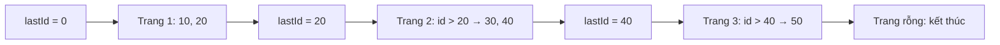

# Xử lý dữ liệu thay đổi trong lúc đọc nhiều trang

## 1. Vì sao đọc nhiều trang lại khó khi dữ liệu liên tục thay đổi?

Trong ứng dụng Java sử dụng **JDBC** để truy cập cơ sở dữ liệu quan hệ, tầng truy cập dữ liệu thường nhận `Connection` từ `DataSource`, chuẩn bị SQL bằng `PreparedStatement` rồi chuyển từng hàng của `ResultSet` thành đối tượng Java. Khi bảng chỉ có vài trăm hàng, ta có thể đọc toàn bộ kết quả. Nhưng với hàng triệu đơn hàng, giao dịch, sự kiện hoặc bản ghi xuất báo cáo, ứng dụng thường phải **đọc theo nhiều trang** để giới hạn bộ nhớ, thời gian giữ kết nối và tải lên cơ sở dữ liệu.

Vấn đề phát sinh khi các trang không được đọc tại cùng một thời điểm:

1. Ứng dụng đọc trang thứ nhất.
2. Người dùng khác chèn, xóa hoặc chỉnh sửa các hàng.
3. Ứng dụng đọc trang thứ hai dựa trên vị trí của trang đầu.
4. Tiến trình tổng hợp hoặc xuất dữ liệu nhận **hàng trùng, hàng bị bỏ sót, hoặc các giá trị thuộc những thời điểm khác nhau**.

Đây không chỉ là vấn đề hiệu năng của SQL. Nó là một vấn đề **tính nhất quán trong quá trình quét dữ liệu**. Để giải quyết đúng, trước tiên cần biết ứng dụng cần cam kết điều gì:

- **Duyệt danh sách cho người dùng:** một hàng có thể đổi trạng thái giữa các lần chuyển trang; mục tiêu thường là không lặp không cần thiết và phản hồi nhanh.
- **Xuất báo cáo tại một thời điểm:** cần một tập dữ liệu nhất quán, tránh trộn nhiều phiên bản hoặc bỏ sót các hàng thuộc cùng snapshot.
- **Tác vụ xử lý nền có thể tiếp tục sau lỗi:** cần checkpoint và idempotency để không tạo tác dụng phụ hai lần khi xử lý lại.
- **Đồng bộ các thay đổi phát sinh liên tục:** có thể cần luồng sự kiện, bảng thay đổi hoặc CDC (*change data capture*), chứ không chỉ đọc lại một bảng bằng SQL.

**Mục tiêu bài học:** hiểu các sai lệch do `OFFSET`, thiết kế keyset pagination với thứ tự ổn định, sử dụng mốc giới hạn và transaction isolation một cách đúng đắn, phân tích những thay đổi của khóa sắp xếp/bộ lọc, đồng thời áp dụng JDBC, checkpoint và đối soát để quét dữ liệu lớn an toàn.

## 2. Cách phân trang bằng OFFSET có thể bỏ sót hoặc lặp hàng

Giả sử bảng `orders` có các ID được sắp xếp:

```text
Ban đầu: [10, 20, 30, 40, 50]
Mỗi trang: 2 hàng
```

Hai câu SQL thường được dùng:

```sql
-- Trang 1:
SELECT id FROM orders ORDER BY id ASC LIMIT 2 OFFSET 0;

-- Trang 2:
SELECT id FROM orders ORDER BY id ASC LIMIT 2 OFFSET 2;
```

Nếu **không có thay đổi**, trang 1 trả `[10, 20]`, trang 2 trả `[30, 40]`.

### 2.1. Xóa hàng ở trước vị trí OFFSET

Giữa hai lần đọc, một transaction khác xóa hàng `10`:

```text
Trang 1 đã đọc:       [10, 20]
Dữ liệu sau khi xóa:  [20, 30, 40, 50]
Trang 2 OFFSET 2:     [40, 50]
                         ↑
                       Bỏ sót 30
```

`OFFSET 2` nghĩa là **bỏ qua hai hàng đầu của kết quả tại thời điểm truy vấn thứ hai**, không phải “bắt đầu từ hàng tiếp theo của snapshot trang 1”. Sau khi xóa, vị trí của `30` đã dịch chuyển.

### 2.2. Chèn hàng trước vị trí OFFSET

Giữa hai trang, một giao dịch chèn ID `15`:

```text
Trang 1 đã đọc:      [10, 20]
Dữ liệu sau khi chèn:[10, 15, 20, 30, 40, 50]
Trang 2 OFFSET 2:    [20, 30]
                       ↑
                     Lặp lại 20
```

Các thao tác cập nhật **cột dùng trong `ORDER BY`** cũng có thể làm vị trí hàng dịch chuyển và gây lỗi tương tự.

### 2.3. Không ORDER BY còn khó kiểm soát hơn

```sql
SELECT id, status FROM orders LIMIT 100 OFFSET 100;
```

Khi thiếu `ORDER BY`, cơ sở dữ liệu không phải cam kết thứ tự trả hàng ổn định. Ngay cả khi không có người khác sửa dữ liệu, kế hoạch thực thi và thứ tự quét có thể thay đổi. **Luôn dùng thứ tự xác định** khi phân trang, và bổ sung một cột duy nhất để giải quyết trường hợp nhiều hàng có cùng giá trị sắp xếp.

`OFFSET` không phải lúc nào cũng sai: nó thuận tiện cho giao diện yêu cầu “trang số 12”, kết quả tương đối tĩnh hoặc khi các trang đều đọc trên cùng một snapshot giao dịch phù hợp. Nhưng với tập dữ liệu thay đổi liên tục và nhiều trang lớn, nó không phải cơ chế đáng tin cậy để duyệt đúng một lần.

## 3. Keyset pagination: dùng khóa của hàng cuối thay vì vị trí

**Keyset pagination** (còn gọi là seek pagination hoặc cursor pagination) chọn trang tiếp theo theo **giá trị khóa sắp xếp cuối cùng đã đọc**, thay vì đếm và bỏ qua `OFFSET` hàng.

Với khóa `id` duy nhất và **không thay đổi**, câu SQL có dạng:

```sql
-- Trang đầu, last_id = 0 (giả sử tất cả id > 0):
SELECT id, status
FROM orders
WHERE id > ?
ORDER BY id ASC
LIMIT ?;

-- Trang tiếp theo, last_id = id cuối của trang trước:
SELECT id, status
FROM orders
WHERE id > ?
ORDER BY id ASC
LIMIT ?;
```

Nếu trang đầu đã đọc `[10, 20]` và hàng `10` bị xóa, điều kiện `id > 20` vẫn chọn `[30, 40]`. Nếu chèn ID `15`, hàng `20` không xuất hiện lại. Đây là lợi thế quan trọng so với `OFFSET`.



### Điều kiện để kết quả đáng tin cậy

- Thứ tự phải **xác định**: `ORDER BY id ASC` với `id` duy nhất, hoặc một bộ khóa có phần tử cuối duy nhất.
- Cột được dùng làm vị trí cursor nên **bất biến** trong suốt thời gian quét. Nếu hàng đổi khóa sắp xếp và chuyển từ phía trước sang phía sau cursor, nó có thể được đọc hai lần.
- Điều kiện lọc quan trọng phải được giữ **giống nhau ở mọi trang**, ví dụ `tenant_id`, quyền truy cập và tiêu chí thời gian.
- Không đổi hướng sắp xếp giữa các trang; với `DESC` phải đổi phép so sánh cho phù hợp.
- Keyset giảm sai lệch do dịch chuyển vị trí, nhưng **không tự tạo snapshot cố định**: một hàng bị xóa trước khi đến lượt vẫn không được đọc; một hàng mới đủ điều kiện phía sau cursor có thể xuất hiện.

| Thuộc tính | `OFFSET` | Keyset |
|---|---|---|
| Định vị trang kế tiếp | Số hàng phải bỏ qua | Khóa cuối đã đọc |
| Ảnh hưởng khi chèn/xóa trước trang hiện tại | Dễ dịch vị trí, dẫn đến trùng/bỏ sót | Không dịch vị trí theo số lượng hàng trước cursor |
| Đi đến “trang 500” trực tiếp | Tự nhiên hơn | Thường cần đi theo chuỗi cursor hoặc chỉ mục bổ sung |
| Truy vấn rất sâu | DB có thể phải duyệt/bỏ qua nhiều hàng | Có thể seek qua chỉ mục phù hợp |
| Tính nhất quán snapshot | Không tự bảo đảm | Không tự bảo đảm |
| Yêu cầu khóa sắp xếp | Thứ tự ổn định vẫn cần thiết | Bắt buộc có khóa sắp xếp rõ ràng và cursor tương ứng |

## 4. Thứ tự nhiều cột phải có tie-breaker duy nhất

Nhiều ứng dụng sắp xếp theo `created_at` hoặc `updated_at`. Tuy nhiên, hai bản ghi có thể mang cùng timestamp, nên:

```sql
ORDER BY created_at ASC
```

chưa tạo thứ tự xác định. Nên dùng:

```sql
ORDER BY created_at ASC, id ASC
```

Sau khi đọc hàng cuối với `created_at = :lastCreatedAt` và `id = :lastId`, trang tiếp theo phải lấy hàng **lớn hơn theo thứ tự từ điển**:

```sql
-- Minh họa cú pháp LIMIT của PostgreSQL/MySQL.
SELECT id, created_at, status
FROM audit_events
WHERE tenant_id = ?
  AND (
        created_at > ?
        OR (created_at = ? AND id > ?)
      )
ORDER BY created_at ASC, id ASC
LIMIT ?;
```

Ánh xạ tham số lần lượt là `tenantId`, `lastCreatedAt`, `lastCreatedAt`, `lastId` và `pageSize`. Khi dùng `PreparedStatement`, cả hai vị trí timestamp phải nhận **cùng giá trị** từ hàng cuối; `id` giải quyết các bản ghi cùng thời điểm.

| Thời điểm tạo | ID | Sau cursor `(10:00, 21)`? |
|---|---:|---|
| 09:59 | 90 | Không |
| 10:00 | 19 | Không |
| 10:00 | 21 | Không, đã đọc |
| 10:00 | 22 | Có |
| 10:01 | 2 | Có |

Một số DB cho phép so sánh tuple, ví dụ `(created_at, id) > (?, ?)`, nhưng cú pháp và hành vi tối ưu hóa có thể khác giữa hệ quản trị. Biểu thức `OR` phía trên thể hiện điều kiện rõ ràng và dễ kiểm tra.

**Chú ý kiểu dữ liệu:**

- `created_at` nên `NOT NULL` hoặc phải có quy tắc phân trang dành riêng cho `NULL`. So sánh `NULL` bằng `>`/`=` không hoạt động như giá trị thông thường.
- Với timestamp, cần giữ nguyên **độ chính xác và quy ước múi giờ** khi lấy và bind lại cursor. Tránh chuyển qua chuỗi thiếu precision khiến các hàng cùng microsecond bị bỏ sót.
- `updated_at` thường **thay đổi** sau mỗi lần ghi. Dùng nó làm khóa phân trang có thể khiến hàng nhảy qua cursor hoặc xuất hiện lần thứ hai. Nếu mục tiêu là duyệt mỗi bản ghi một lần, nên dùng khóa ổn định hoặc cơ chế ghi nhận thay đổi chuyên biệt.
- Nếu sắp xếp giảm dần theo cả hai cột, dùng phép so sánh `<` tương ứng, không chỉ đảo `ORDER BY`.

## 5. Cố định ranh giới trên: high-water mark

Keyset đơn thuần sẽ tiếp tục nhìn thấy các hàng mới có khóa lớn hơn cursor. Với một tác vụ cần “quét tới tập dữ liệu tại lúc bắt đầu” nhưng không muốn giữ transaction dài, có thể ghi nhận **mốc khóa trên** (*high-water mark*).

Ví dụ khóa chính `id` số dương và tăng khi tạo:

```sql
SELECT COALESCE(MAX(id), 0)
FROM work_orders
WHERE tenant_id = ?;
```

Giả sử mốc ban đầu là `upperId = 5000`. Mỗi trang:

```sql
SELECT id, status, version
FROM work_orders
WHERE tenant_id = ?
  AND id > ?
  AND id <= ?
ORDER BY id ASC
LIMIT ?;
```

Tham số: `tenantId`, `lastId`, `upperId`, `pageSize`. Các hàng mới có ID lớn hơn `5000` không vào lần quét này, nên tác vụ có điểm kết thúc hữu hạn.

Nhưng **high-water mark không phải snapshot**:

1. Một hàng `id = 2500` có thể bị xóa trước khi cursor tới, nên sẽ không được nhìn thấy.
2. Hàng `id = 3200` vẫn tồn tại nhưng `status` có thể khác lúc bắt đầu; ta nhận **phiên bản mới hơn**.
3. Nếu ID được cấp trước khi transaction chèn commit, có thể xảy ra **late commit** của một hàng `id <= upperId` sau khi cursor đã đi qua vị trí đó; lần quét vẫn bỏ sót.
4. Nếu cho phép chèn dữ liệu backfill với ID nhỏ hơn mốc, hoặc thay đổi khóa chính, điều kiện `id <= upperId` cũng không đóng băng tập kết quả.
5. Một hàng đang ở ngoài bộ lọc khi cursor đi qua, sau đó trở thành đủ điều kiện, có thể bị bỏ sót dù `id` không đổi.

Do đó, high-water mark phù hợp để **giới hạn phạm vi và thời lượng của lần quét best-effort**, hoặc những hệ thống có quy ước cấp phát/commit ID phù hợp đã được kiểm chứng. Không quảng bá nó thành bảo đảm “mọi hàng tồn tại tại thời điểm T” trên mọi DB.

## 6. Mô hình dữ liệu và ví dụ JDBC phân trang bằng ID

Giả sử ứng dụng dùng bảng:

```sql
CREATE TABLE work_orders (
    id         BIGINT PRIMARY KEY,
    tenant_id  BIGINT NOT NULL,
    status     VARCHAR(24) NOT NULL,
    version    BIGINT NOT NULL DEFAULT 0
);

-- Chỉ mục hữu ích nếu truy vấn thực tế lọc tenant và sắp xếp ID:
CREATE INDEX idx_work_orders_tenant_id
    ON work_orders (tenant_id, id);
```

Cú pháp `CREATE TABLE` và hỗ trợ kiểu dữ liệu có thể khác giữa RDBMS. Các ví dụ phân trang sau sử dụng `LIMIT ?` như PostgreSQL/MySQL; trên SQL Server, Oracle hoặc DB khác, đổi thành cú pháp lấy N hàng tương ứng và giữ nguyên điều kiện keyset.

### 6.1. Repository dùng DataSource, PreparedStatement và ResultSet

```java
import java.sql.Connection;
import java.sql.PreparedStatement;
import java.sql.ResultSet;
import java.sql.SQLException;
import java.util.ArrayList;
import java.util.List;
import java.util.Objects;
import javax.sql.DataSource;

public final class WorkOrderPager {
    private static final String UPPER_SQL = """
            SELECT COALESCE(MAX(id), 0)
            FROM work_orders
            WHERE tenant_id = ?
            """;

    private static final String PAGE_SQL = """
            SELECT id, status, version
            FROM work_orders
            WHERE tenant_id = ?
              AND id > ?
              AND id <= ?
            ORDER BY id ASC
            LIMIT ?
            """;

    public record OrderRow(long id, String status, long version) {}

    public record Page(List<OrderRow> rows, long lastId) {
        public Page {
            rows = List.copyOf(rows);
        }
    }

    private final DataSource dataSource;

    public WorkOrderPager(DataSource dataSource) {
        this.dataSource = Objects.requireNonNull(dataSource);
    }

    // Độc lập: mỗi lần lấy một Connection mới.
    public long currentUpperBound(long tenantId) throws SQLException {
        try (Connection connection = dataSource.getConnection()) {
            return upperBound(connection, tenantId);
        }
    }

    // Dùng lại một Connection nếu tầng gọi quản lý snapshot transaction.
    public long upperBound(Connection connection, long tenantId)
            throws SQLException {
        if (tenantId <= 0) {
            throw new IllegalArgumentException("Invalid tenantId");
        }
        try (PreparedStatement ps = connection.prepareStatement(UPPER_SQL)) {
            ps.setLong(1, tenantId);
            ps.setQueryTimeout(15);

            try (ResultSet rs = ps.executeQuery()) {
                if (!rs.next()) {
                    throw new SQLException("MAX(id) returned no result row");
                }
                return rs.getLong(1); // COALESCE trả 0 khi không có hàng.
            }
        }
    }

    // Độc lập: mỗi trang là một truy vấn trên Connection mới.
    public Page nextPage(long tenantId, long lastId,
                         long upperId, int pageSize) throws SQLException {
        try (Connection connection = dataSource.getConnection()) {
            return nextPage(connection, tenantId, lastId, upperId, pageSize);
        }
    }

    // Nhận Connection của tầng transaction nếu cần cùng snapshot.
    public Page nextPage(Connection connection, long tenantId, long lastId,
                         long upperId, int pageSize) throws SQLException {
        if (tenantId <= 0 || lastId < 0 || upperId < 0 ||
                lastId > upperId || pageSize < 1 || pageSize > 1000) {
            throw new IllegalArgumentException("Invalid page arguments");
        }

        List<OrderRow> rows = new ArrayList<>(pageSize);
        try (PreparedStatement ps = connection.prepareStatement(PAGE_SQL)) {
            ps.setLong(1, tenantId);
            ps.setLong(2, lastId);
            ps.setLong(3, upperId);
            ps.setInt(4, pageSize);
            ps.setFetchSize(pageSize);   // Gợi ý cho driver, không bắt buộc.
            ps.setQueryTimeout(15);

            try (ResultSet rs = ps.executeQuery()) {
                while (rs.next()) {
                    rows.add(new OrderRow(
                            rs.getLong("id"),
                            rs.getString("status"),
                            rs.getLong("version")
                    ));
                }
            }
        }
        long nextLastId = rows.isEmpty()
                ? lastId
                : rows.get(rows.size() - 1).id();
        return new Page(rows, nextLastId);
    }
}
```

Các tính chất kỹ thuật của ví dụ:

- `Connection` được đóng qua `try-with-resources` ở các phương thức độc lập. Với overload nhận `Connection`, **tầng gọi sở hữu connection**; repository chỉ đóng `PreparedStatement` và `ResultSet`.
- Không đưa giá trị `tenantId`, `lastId`, `upperId` trực tiếp vào chuỗi SQL; `PreparedStatement` dùng bind tham số để tránh SQL injection.
- `setFetchSize(pageSize)` là **gợi ý** cho driver về số hàng đọc mỗi đợt. Nó không thay `LIMIT` và không bảo đảm truyền dữ liệu theo từng đợt trên mọi driver.
- `Page` chứa tối đa `pageSize` bản ghi trong bộ nhớ. Vì chỉ chọn `id/status/version`, tránh kéo theo các cột lớn không cần thiết.
- Cursor được tính từ **hàng cuối thực sự đọc**; khi trang rỗng, `lastId` không tăng. Vòng lặp phải **dừng khi trang rỗng** để tránh lặp vô hạn.
- `MAX(id)` có thể là `0` trên bảng rỗng; ví dụ giả định các ID đều dương và không bị tái sử dụng/đổi khóa.

### 6.2. Duyệt lần lượt nhiều trang

```java
WorkOrderPager pager = new WorkOrderPager(dataSource);
long tenantId = 7L;
long upperId = pager.currentUpperBound(tenantId);
long lastId = 0L;
long scannedRows = 0L;

while (true) {
    WorkOrderPager.Page page =
            pager.nextPage(tenantId, lastId, upperId, 250);
    if (page.rows().isEmpty()) {
        break;
    }

    for (WorkOrderPager.OrderRow row : page.rows()) {
        // Chỉ minh họa việc duyệt; không log dữ liệu nghiệp vụ nhạy cảm.
        scannedRows++;
    }

    lastId = page.lastId();
}
```

Với các phương thức tự mở connection, mỗi trang có thể nhìn thấy một trạng thái DB khác nhau. Vì thế `scannedRows` là **số hàng thực tế đã quan sát** trong lần quét, không nhất thiết bằng số hàng tại một thời điểm cố định. `upperId` hạn chế quét các ID lớn hơn mốc, không khóa tập dữ liệu.

Ứng dụng thật nên đặt giới hạn số trang, thời gian tổng, timeout, phân quyền tenant, xử lý `SQLException` và chiến lược retry. Nếu cần một báo cáo nhất quán tại một thời điểm, hãy xem transaction snapshot ở mục 8.

## 7. Các kiểu thay đổi làm lệch kết quả ngay cả với keyset

Keyset với `id` bất biến ngăn một số lỗi dịch `OFFSET`, nhưng nó không triệt tiêu mọi biến động:

| Thay đổi giữa hai trang | `OFFSET` | Keyset theo ID bất biến | Ý nghĩa |
|---|---|---|---|
| Chèn hàng có ID phía trước vị trí đã đọc | Có thể làm trang kế tiếp lặp hàng | Không đọc lại hàng đã qua, nhưng có thể bỏ qua bản ghi mới | Cần quyết định hàng mới có thuộc kỳ quét không |
| Xóa hàng đã đọc | Có thể làm dịch vị trí và bỏ sót hàng khác | Không dịch cursor | Nội dung lịch sử của hàng đã đọc không bị hồi tố |
| Xóa hàng chưa đọc | Có thể bỏ qua hàng | Hàng đó không còn để đọc | Không còn đầy đủ tập dữ liệu ban đầu |
| Cập nhật `status` trên hàng chưa đọc | Có thể thấy giá trị mới | Cũng có thể thấy giá trị mới | Tập kết quả không nhất thiết là một snapshot |
| Cập nhật cột dùng trong bộ lọc | Có thể làm hàng xuất hiện/biến mất | Có thể xuất hiện/biến mất, kể cả phía sau cursor | Keyset không bảo vệ điều kiện lọc biến động |
| Thay đổi cột sắp xếp `updated_at` | Có thể dịch vị trí | Nếu dùng `updated_at` làm keyset, hàng có thể nhảy qua cursor | Dùng khóa bất biến hoặc cơ chế ghi thay đổi |
| Chèn hàng ID lớn hơn high-water mark | Có thể xuất hiện ở trang sau | Bị loại nếu có `id <= upperId` | Hạn chế hàng phát sinh sau mốc theo khóa |
| Late commit của hàng có ID thấp | Có thể gây dịch trang | Có thể không xuất hiện nếu cursor đã qua | Mốc MAX(id) không bảo đảm snapshot |

### Thay đổi điều kiện lọc dễ bị bỏ sót

Giả sử cần xử lý tất cả đơn hàng có `status = 'PENDING'`:

```sql
SELECT id, status
FROM work_orders
WHERE tenant_id = ?
  AND status = 'PENDING'
  AND id > ?
ORDER BY id ASC
LIMIT ?;
```

Trang đầu đã đi qua `id = 100`. Sau đó một transaction đổi `id = 80` từ `DRAFT` sang `PENDING`. Lần quét này **không bao giờ quay lại ID 80**, nên không xử lý một hàng vừa trở thành đủ điều kiện. Ngược lại, một hàng `PENDING` chưa đến lượt có thể chuyển sang `DONE` và biến mất khỏi truy vấn.

Nếu yêu cầu là **xử lý mọi lần chuyển sang PENDING**, giải pháp không phải chỉ đổi `OFFSET` thành keyset. Cần mô hình phát hiện **sự kiện thay đổi**, ví dụ:

- Bảng sự kiện/outbox được ghi cùng transaction khi trạng thái đổi.
- CDC từ transaction log với offset/position được quản lý.
- Một trường hoặc bảng version/change sequence tăng theo sự kiện và được tiêu thụ có checkpoint.
- Job quét lại có đối soát, chấp nhận độ trễ và có idempotency, nếu yêu cầu cho phép.

Mỗi cách có hợp đồng riêng về thứ tự commit, lặp sự kiện và khả năng phục hồi; không tự coi `updated_at` là một change log hoàn chỉnh.

## 8. Khi cần snapshot nhất quán: transaction isolation

Một báo cáo cần nói “trạng thái của tất cả đơn hàng tại cùng một thời điểm” khác với danh sách cập nhật liên tục. Nếu DB cung cấp snapshot nhất quán cho nhiều câu SELECT trong cùng transaction, có thể đặt **mọi trang trong một transaction trên cùng một `Connection`**.

### 8.1. Các mức isolation liên quan

| Mức JDBC | Điều thường xảy ra khi đọc nhiều trang | Giới hạn cần hiểu |
|---|---|---|
| `TRANSACTION_READ_COMMITTED` | Nhiều DB cho mỗi statement một ảnh nhìn đã commit mới; trang sau có thể thấy thay đổi mới | Không mặc định có snapshot cố định xuyên suốt nhiều SELECT |
| `TRANSACTION_REPEATABLE_READ` | Nhiều hệ DB dùng snapshot ổn định cho các lần đọc trong một transaction | Ngữ nghĩa MVCC/khóa và phantom khác nhau giữa các DB; phải xác minh |
| `TRANSACTION_SERIALIZABLE` | DB hướng đến lịch thực thi tương đương tuần tự | Có thể chặn, deadlock hoặc báo serialization failure; cần chính sách retry toàn transaction |
| `TRANSACTION_NONE` | Không hỗ trợ transaction | Không đáp ứng yêu cầu snapshot nhiều câu lệnh |

Kiểm tra khả năng hỗ trợ:

```java
DatabaseMetaData metadata = connection.getMetaData();
boolean repeatableReadSupported =
        metadata.supportsTransactionIsolationLevel(
                Connection.TRANSACTION_REPEATABLE_READ);
```

**Không khẳng định tất cả DB ở `REPEATABLE_READ` đều tạo cùng một snapshot giống nhau.** Ví dụ, PostgreSQL hỗ trợ snapshot nhất quán của một transaction ở `REPEATABLE READ`; những DB khác có thể dùng khóa hoặc các quy tắc đọc riêng. Cần kiểm tra và thử tình huống chèn/xóa/update đồng thời với driver thực tế.

### 8.2. Ví dụ đọc các trang trên cùng một Connection

Ví dụ sau dùng `WorkOrderPager` ở mục 6. Không mở connection mới cho từng trang, và đặt mức cô lập **trước** các câu SELECT của transaction:

```java
import java.sql.Connection;
import java.sql.DatabaseMetaData;
import java.sql.SQLException;
import javax.sql.DataSource;

public static long countInOneTransaction(
        DataSource dataSource, long tenantId) throws SQLException {
    WorkOrderPager pager = new WorkOrderPager(dataSource);

    try (Connection connection = dataSource.getConnection()) {
        if (!connection.getAutoCommit()) {
            throw new SQLException(
                    "Example expects a connection outside another transaction");
        }
        DatabaseMetaData metadata = connection.getMetaData();
        if (!metadata.supportsTransactions() ||
                !metadata.supportsTransactionIsolationLevel(
                        Connection.TRANSACTION_REPEATABLE_READ)) {
            throw new SQLException("Required transaction isolation unavailable");
        }

        int previousIsolation = connection.getTransactionIsolation();
        connection.setTransactionIsolation(
                Connection.TRANSACTION_REPEATABLE_READ);
        connection.setAutoCommit(false);
        boolean ended = false;

        try {
            long upperId = pager.upperBound(connection, tenantId);
            long lastId = 0L;
            long count = 0L;

            while (true) {
                WorkOrderPager.Page page =
                        pager.nextPage(connection, tenantId, lastId, upperId, 250);
                if (page.rows().isEmpty()) {
                    break;
                }
                count += page.rows().size();
                lastId = page.lastId();
            }

            // Kết thúc transaction chỉ đọc theo cơ chế DB.
            connection.commit();
            ended = true;
            return count;
        } catch (SQLException | RuntimeException failure) {
            try {
                connection.rollback();
                ended = true;
            } catch (SQLException rollbackFailure) {
                failure.addSuppressed(rollbackFailure);
            }
            throw failure;
        } finally {
            // Chỉ khôi phục trạng thái sau khi transaction đã kết thúc.
            // Nếu rollback thất bại, không bật auto-commit
            // vì có thể dẫn đến commit ngoài ý muốn.
            if (ended) {
                connection.setAutoCommit(true);
                connection.setTransactionIsolation(previousIsolation);
            }
        }
    }
}
```

Lưu ý:

1. **Cùng `Connection`** là điều kiện bắt buộc để các statement tham gia cùng transaction JDBC thông thường. Không gọi phiên bản `pager.nextPage(tenantId, ...)` tự mở connection ở giữa.
2. Nếu DB thực sự cung cấp snapshot ổn định ở isolation đã chọn, các trang có thể đọc từ một ảnh nhìn nhất quán, hạn chế sự lệch do transaction khác chèn/xóa/sửa.
3. `commit()` ở cuối kết thúc transaction đọc; nó không có nghĩa đã ghi dữ liệu nghiệp vụ.
4. Với truy vấn lớn, transaction kéo dài có thể giữ snapshot/phiên bản cũ trong MVCC, duy trì khóa, tăng tài nguyên và chiếm một connection lâu. Không dùng cách này mặc định cho hàng triệu bản ghi chạy nhiều giờ.
5. `supportsTransactionIsolationLevel()` chỉ báo khả năng; cần xác minh ngữ nghĩa snapshot thực tế. Một số DB chỉ cho snapshot ổn định ở chế độ riêng, có yêu cầu khởi tạo transaction hoặc cách xử lý lỗi đặc thù.
6. `SERIALIZABLE` có thể buộc ứng dụng retry **toàn transaction** sau lỗi đồng thời; không retry một trang riêng trong một transaction đã bị DB đánh dấu lỗi.

Đối với xuất báo cáo rất dài, có thể cân nhắc tạo **bản chụp vật lý/bảng kết quả có version**, công cụ snapshot/export của DB, hoặc kho dữ liệu phân tích thay vì giữ một transaction trực tuyến quá lâu.

## 9. Keyset cùng high-water mark hay snapshot: chọn theo mục tiêu

| Mục tiêu | Cách tiếp cận thường phù hợp | Cam kết thực tế |
|---|---|---|
| Người dùng xem danh sách hoạt động | Keyset theo khóa bất biến, mỗi trang truy vấn mới | Tránh drift do OFFSET, nhưng dữ liệu có thể thay đổi giữa các trang |
| Job quét tập ID đến mốc giới hạn | Keyset + upperId, checkpoint | Phạm vi hữu hạn theo ID, **không phải snapshot hoàn toàn** |
| Xuất dữ liệu nhất quán tại một thời điểm | Snapshot transaction đã kiểm thử hoặc công cụ export snapshot của DB | Dữ liệu nhất quán theo ngữ nghĩa isolation/snapshot |
| Xử lý mọi thay đổi trạng thái | Event log/outbox/CDC với offset | Theo dõi sự kiện thay đổi thay vì đoán từ snapshot hiện tại |
| Báo cáo cực lớn, chạy lâu | Snapshot materialized hoặc hệ phân tích, xuất theo phần | Tránh transaction đọc kéo dài và giảm tải DB giao dịch |
| Chấp nhận dữ liệu gần thời gian thực | Keyset + tái quét/đối soát | Đơn giản hơn, cần chịu được dữ liệu đến muộn và xử lý lặp |

Sự khác biệt quan trọng là **một tập ID giới hạn** không đồng nghĩa **một tập bản ghi được chụp lại tại thời điểm T**. Nếu yêu cầu liên quan tài chính, kiểm toán hoặc báo cáo mang tính pháp lý, phải viết rõ hợp đồng thời điểm và kiểm chứng bằng dữ liệu thử có thay đổi đồng thời.

## 10. Checkpoint để tiếp tục sau lỗi mà không xử lý lặp sai

Khi một job cần đọc hàng triệu bản ghi, nó thường không thể hoàn tất trong một request hoặc một transaction. Nếu job bị lỗi sau trang thứ 2000, việc quét lại từ đầu có thể đắt và nguy hiểm nếu mỗi hàng tạo một tác dụng phụ.

Một checkpoint thường lưu:

- `job_id`: định danh lần chạy, dùng để đối soát hoặc kiểm soát worker.
- `tenant_id` và bộ lọc truy vấn đã cố định: không để job khôi phục với phạm vi khác.
- `upper_id`: mốc trên của lần quét, giữ nguyên sau khi khôi phục.
- `last_processed_id`: ID cuối cùng **đã xử lý thành công theo hợp đồng**, không chỉ là ID cuối được fetch.
- `status`, `updated_at`, thông tin lần thử và lỗi kỹ thuật đã chuẩn hóa.

Ví dụ lược đồ:

```sql
CREATE TABLE scan_checkpoints (
    job_id             VARCHAR(80) PRIMARY KEY,
    tenant_id          BIGINT NOT NULL,
    upper_id           BIGINT NOT NULL,
    last_processed_id  BIGINT NOT NULL DEFAULT 0,
    job_status         VARCHAR(20) NOT NULL,
    updated_at         TIMESTAMP NOT NULL
);
```

**Quy tắc tiến độ:** chỉ tăng `last_processed_id` sau khi tác dụng của các hàng trước đó đã được xác nhận. Nếu lưu cursor ngay sau `SELECT` nhưng trước khi hoàn tất xử lý trang, crash có thể khiến các hàng chưa xử lý bị bỏ qua vĩnh viễn khi job tiếp tục.

### 10.1. Tình huống dễ gây mất hoặc lặp công việc

```text
Checkpoint trước khi chạy: last_processed_id = 100
Trang tiếp theo:         [120, 130, 150]

Cách sai:
  1. Lưu checkpoint = 150.
  2. Gửi sự kiện cho 120 thành công.
  3. Crash trước khi gửi cho 130 và 150.
  4. Khởi động lại từ id > 150.
=> Mất xử lý 130 và 150.

Cách an toàn hơn:
  1. Xử lý và xác nhận từng hàng hoặc cả trang.
  2. Lưu checkpoint sau phần việc đã xác nhận.
  3. Khi crash giữa phần xử lý và lưu checkpoint,
     một số hàng có thể được chạy lại.
=> Cần idempotency/deduplication cho tác dụng phụ.
```

Nếu tác dụng phụ và checkpoint đều là thay đổi **trong cùng một database**, có thể dùng một transaction JDBC để ghi chúng cùng lúc. Nếu tác dụng phụ là gửi HTTP, email hoặc ghi sang hệ thống ngoài, `commit()` của DB không bao trùm hệ thống đó; cân nhắc outbox, idempotency key và cơ chế đối soát.

### 10.2. Checkpoint có kiểm soát worker cạnh tranh

Khi nhiều worker có thể cập nhật cùng checkpoint, đừng chỉ ghi đè `last_processed_id` không điều kiện. Có thể dùng câu cập nhật dạng compare-and-set:

```sql
UPDATE scan_checkpoints
SET last_processed_id = ?,
    updated_at = CURRENT_TIMESTAMP
WHERE job_id = ?
  AND last_processed_id = ?
  AND job_status = 'RUNNING';
```

Tham số lần lượt là `newLastProcessedId`, `jobId`, `expectedOldId`. `executeUpdate() == 1` chứng tỏ điều kiện checkpoint tại thời điểm ghi đã khớp; `0` báo có thể worker khác đã cập nhật hoặc job không còn chạy. Tuy nhiên, cách này **chưa đủ** để bảo đảm chỉ một worker tạo tác dụng phụ; cần thêm cơ chế lease/fencing hoặc khóa nghiệp vụ nếu muốn điều phối độc quyền.

Nếu chọn checkpoint theo composite cursor `(created_at, id)`, phải lưu **đủ hai giá trị** cùng thứ tự và độ chính xác của timestamp; chỉ lưu `id` sẽ không thể khôi phục chính xác vị trí.

## 11. Chính xác một lần hay xử lý ít nhất một lần?

Giả sử tiến trình đọc đơn hàng và gửi yêu cầu lập hóa đơn tới dịch vụ ngoài. Worker gửi yêu cầu thành công rồi bị lỗi **trước** khi cập nhật checkpoint. Khi chạy lại, cùng một đơn được gửi lần nữa.

Để xử lý an toàn:

1. Tạo **idempotency key** từ nghiệp vụ, ví dụ `invoice:create:order-101:v2`, thay vì dựa vào số thứ tự trang.
2. Bên nhận hoặc hệ thống xuất hóa đơn cần từ chối/tái sử dụng kết quả cho yêu cầu trùng khóa theo hợp đồng của nó.
3. Nếu vừa thay đổi DB vừa gửi sự kiện, dùng outbox trong cùng transaction; một worker riêng chuyển sự kiện và xử lý lặp.
4. Lưu checkpoint **sau** khi phần việc được xác nhận, chấp nhận khả năng retry và bảo vệ khỏi tác dụng phụ trùng.
5. Theo dõi trạng thái các hàng thất bại riêng; không đẩy cursor vượt một hàng cần xử lý lại trừ khi có cơ chế dead-letter/đối soát được phê duyệt.

Đừng gọi keyset pagination hoặc `OFFSET` là cơ chế **exactly once**. Chúng chỉ quyết định **thứ tự và cửa sổ dữ liệu được đọc**. Cam kết xử lý đúng một lần còn phụ thuộc transaction, trạng thái checkpoint, định danh tác vụ, khả năng retry và hệ thống nhận kết quả.

### Tập dữ liệu thay đổi khi khôi phục

Nếu job đang dùng `upperId` và `lastProcessedId` rồi tạm dừng vài giờ, khi khôi phục nó vẫn quét phần còn lại của bảng **ở thời điểm mới**. Một số hàng cũ có thể đã bị xóa, sửa `status` hoặc đổi điều kiện lọc. Vì vậy, checkpoint + high-water mark không thể tạo lại snapshot của lần chạy ban đầu.

Để tái tạo chính xác báo cáo từ một thời điểm, cần sử dụng dữ liệu bất biến, lưu bản snapshot/export, hoặc cơ chế lịch sử/versioning của DB phù hợp. Nếu mục tiêu chỉ là xử lý những bản ghi vẫn còn hợp lệ, có thể chấp nhận cập nhật tại thời điểm xử lý và ghi rõ hợp đồng này.

## 12. Hiệu năng: chỉ mục, kích thước trang và giới hạn vận hành

Keyset pagination thường hiệu quả khi DB có chỉ mục khớp **bộ lọc và thứ tự**:

```sql
-- Truy vấn WHERE tenant_id = ? AND id > ?
-- ORDER BY id, LIMIT ...
CREATE INDEX idx_work_orders_tenant_id
    ON work_orders (tenant_id, id);

-- Nếu duyệt theo thời gian bất biến và ID:
CREATE INDEX idx_audit_events_tenant_created_id
    ON audit_events (tenant_id, created_at, id);
```

Đây là các chỉ mục **minh họa cho từng bảng**. Không tạo trùng chỉ mục nếu schema đã có cấu trúc phù hợp. Tùy DB, primary key và cách tổ chức dữ liệu có thể đã đáp ứng một phần hoặc toàn bộ truy vấn. Dùng `EXPLAIN` hoặc công cụ plan của DB để xác nhận.

### Đừng chọn pageSize chỉ bằng cảm giác

| Chỉ số | Để đánh giá |
|---|---|
| `pageSize` | Số hàng tối đa mỗi lần đọc; tác động lượng SQL round-trip và RAM |
| P95/P99 thời gian đọc một trang | Trang quá lớn có thể vượt timeout hoặc làm chậm request khác |
| Tổng thời gian quét | Bao gồm cả xử lý nghiệp vụ, checkpoint và retry |
| Lượng dữ liệu mỗi hàng | Hàng có CLOB/BLOB lớn có thể khiến trang nhỏ vẫn chiếm nhiều bộ nhớ |
| Thời gian giữ connection/transaction | Ảnh hưởng pool, khóa, MVCC retention và các request khác |
| Thời gian đọc trang sâu | `OFFSET` cao có thể tốn công bỏ qua nhiều hàng; keyset có thể seek qua index |
| Số hàng trùng/bỏ sót được phát hiện | Có ích khi kiểm tra chiến lược retry, trạng thái thay đổi và đối soát |
| Tỷ lệ lỗi/serialization/deadlock | Quan trọng nếu giữ snapshot transaction hoặc có worker ghi đồng thời |

**Đọc thêm hàng không đồng nghĩa tối ưu.** Chọn thử các mức như 100, 250, 500 hoặc 1000 hàng/trang theo kích thước bản ghi và khả năng DB. Tránh `SELECT *` khi chỉ cần `id` và một vài trường; dùng query timeout, bảo vệ memory và backpressure cho consumer.

`PreparedStatement.setFetchSize(n)` chỉ gợi ý số hàng driver lấy từ DB mỗi đợt. Nó **khác `LIMIT n`** (số hàng tối đa thuộc trang) và khác `OFFSET` (số hàng bỏ qua). Một driver có thể đệm toàn bộ `ResultSet` dù đã đặt fetch size; phải kiểm tra với driver thật.

### Cursor của một ResultSet và phân trang bằng nhiều truy vấn

Giữ một `ResultSet` mở lâu để đọc từng hàng có thể tránh việc tái thực thi nhiều câu SELECT, nhưng lại giữ `Connection` và đôi khi transaction/khóa trong suốt thời gian quét. Phân trang nhiều truy vấn cho phép đóng connection giữa các trang và checkpoint dễ hơn, song xuất hiện vấn đề snapshot ở trên. Lựa chọn phụ thuộc thời lượng xử lý, khả năng stream của driver và yêu cầu nhất quán.

## 13. Thiết kế cursor cho API nhiều trang

Với API HTTP trả `nextCursor`, thông tin tối thiểu có thể gồm:

```text
lastId = 250
upperId = 5000
sort = "id_asc"
filterVersion = "tenant-7/work-orders-v1"
```

Đây chỉ là minh họa cấu trúc nội bộ, **không phải token sẵn sàng để đưa ra Internet**. Nếu client được phép truyền cursor về server:

- Xác thực và **gắn tenant/quyền** từ ngữ cảnh đáng tin cậy; không lấy `tenantId` do client sửa để vượt phân quyền.
- Kiểm tra cursor có khớp bộ lọc, hướng sắp xếp và phiên bản API của truy vấn không.
- Giới hạn `pageSize`, độ dài cursor và thời hạn hiệu lực; tránh token làm lộ ID hoặc metadata nhạy cảm nếu không cần thiết.
- Có thể ký (HMAC) hoặc mã hóa token nếu kiến trúc yêu cầu chống sửa đổi/che nội dung, nhưng việc ký không thay thế kiểm tra quyền.
- Không dùng `totalCount` của lần gọi trước để kết luận tập hàng hiện tại vẫn giữ nguyên; tổng có thể thay đổi đồng thời.
- Nếu cursor hết hạn hoặc dataset thay đổi mà API yêu cầu snapshot, trả lỗi phù hợp hoặc yêu cầu khách bắt đầu lại; không âm thầm diễn giải cursor cũ theo truy vấn mới.

Với người dùng bấm “Trang tiếp”, keyset thường dễ hiểu. Với yêu cầu chuyển ngẫu nhiên đến trang 320, cần thiết kế khác như offset trên snapshot cố định, mốc chỉ mục đã lưu, hoặc giao diện tìm kiếm theo điều kiện thay vì nhảy theo số trang.

## 14. Lỗi triển khai thường gặp

| Sai lầm | Hậu quả | Cách sửa |
|---|---|---|
| Phân trang không có `ORDER BY` | Thứ tự không được DB bảo đảm | Dùng thứ tự rõ ràng, có tie-breaker duy nhất |
| Dùng `OFFSET` cho job quét dữ liệu liên tục thay đổi | Có thể đọc trùng/bỏ sót hàng | Dùng keyset và làm rõ yêu cầu snapshot |
| Dùng `ORDER BY created_at` khi timestamp trùng | Cursor có thể bỏ qua hàng cùng thời điểm | Thêm `id` và so sánh composite cursor |
| Dùng `updated_at` làm cursor và cho phép nó đổi | Hàng có thể nhảy qua cursor hoặc được đọc lại | Chọn khóa bất biến hoặc dùng change log |
| Gọi `MAX(id)` một lần rồi tuyên bố có snapshot | Late commit, xóa và sửa vẫn làm kết quả khác | Ghi rõ high-water chỉ giới hạn phạm vi; dùng snapshot transaction khi cần |
| Thay `tenant_id` hoặc bộ lọc giữa các trang | Cursor không còn cùng tập dữ liệu | Gắn cursor với phạm vi và kiểm tra quyền mỗi lần |
| Lưu last ID ngay sau `SELECT` trước khi xử lý | Crash có thể bỏ qua dữ liệu chưa xử lý | Checkpoint sau phần việc được xác nhận |
| Xử lý tác vụ ngoài DB không có idempotency | Retry có thể tạo tác dụng phụ trùng | Dùng định danh nghiệp vụ, outbox hoặc deduplication |
| Tự mở connection mới khi tin rằng còn cùng snapshot | Các trang không còn chung transaction | Dùng cùng connection và isolation phù hợp hoặc snapshot materialized |
| Giữ transaction snapshot quá lâu mà không theo dõi | Pool cạn, tăng chi phí MVCC/khóa | Giới hạn thời gian; cân nhắc export snapshot |
| `setFetchSize()` được coi là `LIMIT` | Có thể nhận rất nhiều hàng hoặc đệm dữ liệu lớn | Giới hạn ở SQL và kiểm tra driver |
| Dùng `SELECT *` trên bảng có payload lớn | Tăng I/O, RAM, độ trễ | Chỉ chọn cột cần xử lý |
| Bỏ qua `SQLException` rồi tiếp tục cursor | Transaction/trang có thể không hoàn tất | Rollback khi cần, phân loại retry theo SQLState và nghiệp vụ |
| Coi mọi hàng đã đọc là cùng một thời điểm | Báo cáo có thể trộn nhiều phiên bản | Dùng hợp đồng snapshot hoặc lịch sử dữ liệu |

## 15. Bài thực hành tự kiểm chứng

### Thực hành A — Chèn/xóa giữa hai trang

1. Tạo dữ liệu ID `10, 20, 30, 40, 50`, page size `2`.
2. Đọc trang đầu bằng `ORDER BY id LIMIT 2 OFFSET 0`.
3. Xóa hàng `10`, đọc trang hai bằng `OFFSET 2`; xác nhận có thể bỏ sót `30`.
4. Khôi phục dữ liệu ban đầu, đọc trang đầu, rồi chèn `15`; trang hai có thể lặp `20`.
5. Lặp lại với keyset `WHERE id > lastId` và đối chiếu.

### Thực hành B — Keyset với high-water mark

1. Tạo bảng `work_orders` và các hàng tenant 7, với ID dương tăng.
2. Gọi `currentUpperBound(7)`, sau đó duyệt `nextPage(...)` theo `lastId`.
3. Trong lúc duyệt, chèn một hàng có ID **lớn hơn upperId**; xác nhận không thuộc kỳ quét.
4. Đổi `status` của một hàng chưa đọc rồi xác nhận trang sau có thể nhìn thấy giá trị mới.
5. Giả lập một hàng có ID nhỏ commit muộn hoặc một hàng bị xóa; thảo luận vì sao mốc trên không tạo snapshot.

### Thực hành C — Snapshot transaction

1. Kiểm tra `supportsTransactions()` và `supportsTransactionIsolationLevel(...)`.
2. Dùng `countInOneTransaction(...)` và mở transaction khác để chèn/xóa hàng trong lúc quét.
3. Ghi lại hành vi ở `READ_COMMITTED` và `REPEATABLE_READ`; quan sát xem DB đang dùng snapshot, lock hay báo xung đột.
4. Đo thời gian giữ connection và chi phí transaction nếu quét nhiều trang.
5. Kiểm thử lại sau khi thay driver/DB: không mặc định ngữ nghĩa isolation giống nhau.

### Thực hành D — Checkpoint và lỗi giữa trang

1. Tạo checkpoint `last_processed_id = 100`, `upper_id = 1000`.
2. Xử lý các hàng `120, 130, 150` và giả lập lỗi sau `120`.
3. So sánh trường hợp lưu checkpoint trước xử lý (bỏ sót) và sau xử lý (có thể lặp).
4. Thêm idempotency key hoặc bảng ghi nhận đã xử lý; chạy lại và kiểm tra không tạo tác dụng phụ kép.
5. Thử cập nhật checkpoint qua `WHERE last_processed_id = ?` khi hai worker cạnh tranh.

### Câu hỏi tự đánh giá

- Vì sao xóa một hàng trước vị trí `OFFSET` có thể khiến trang kế tiếp bỏ sót dữ liệu?
- Keyset với `WHERE id > lastId` giải quyết vấn đề nào, và **không** giải quyết vấn đề nào?
- Tại sao `ORDER BY created_at` chưa đủ khi nhiều hàng có cùng thời điểm tạo?
- `upperId = MAX(id)` có chứng minh mọi hàng `id <= upperId` đều đã commit trước khi bắt đầu quét không?
- Tại sao một hàng đã nằm trong vùng khóa đi qua, sau đó đổi trạng thái từ `DRAFT` sang `PENDING`, có thể bị bỏ sót?
- Khi nào các trang nên được đọc trên cùng một `Connection` và transaction?
- Vì sao checkpoint cần lưu **hàng đã xử lý thành công**, không chỉ hàng cuối vừa fetch?
- Có thể hứa “exactly once” chỉ nhờ `PreparedStatement` và keyset pagination không?

### Ghi nhớ

**Đọc nhiều trang trên dữ liệu thay đổi** cần cả chiến lược định vị và hợp đồng nhất quán. `LIMIT/OFFSET` dễ bị dịch vị trí khi chèn/xóa; keyset dùng khóa sắp xếp ổn định cùng tie-breaker duy nhất để tránh nhiều lỗi trùng/bỏ sót do vị trí. High-water mark giúp giới hạn phạm vi nhưng **không tạo snapshot**; nếu cần dữ liệu tại một thời điểm, hãy dùng transaction isolation/snapshot hoặc phương án lưu snapshot được DB hỗ trợ và kiểm thử. Với job dài, checkpoint chỉ nên tiến sau khi xử lý được xác nhận, đồng thời phải có idempotency, đối soát và quản lý lỗi. Qua JDBC, dùng `DataSource`, `PreparedStatement`, `ResultSet`, transaction và chỉ mục phù hợp để thực hiện mỗi trang hiệu quả, nhưng luôn phân biệt **đã đọc hàng**, **đã xử lý hàng** và **đã commit kết quả nghiệp vụ**.
