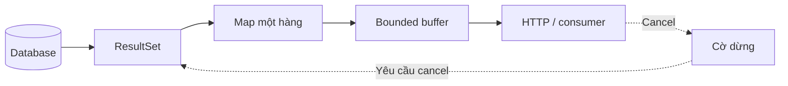

# Hủy quá trình đọc và đóng tài nguyên khi bên gọi dừng sớm

Một truy vấn **JDBC** có thể trả hàng trăm nghìn hoặc hàng triệu hàng. Ứng dụng Java thường duyệt `ResultSet` và xử lý từng hàng thay vì nạp tất cả vào `List`. Nhưng điều gì xảy ra khi người dùng đóng trang tải báo cáo, client HTTP ngắt kết nối, một tác vụ chỉ cần 100 hàng đầu tiên, hoặc bộ xử lý phát hiện dữ liệu không hợp lệ ngay ở hàng thứ 7?

Nếu không được thiết kế trước, vòng lặp đọc có thể tiếp tục đến cuối tập kết quả, giữ `Connection` từ pool, `PreparedStatement`, cursor phía server, bộ nhớ đệm và các tài nguyên mạng. Ở tải cao, nhiều thao tác bị bỏ dở có thể khiến pool cạn dù chẳng còn ai chờ kết quả. Ngược lại, nếu một thread tự ý đóng connection mà thread JDBC khác đang dùng, lỗi có thể lan sang transaction đang chạy và làm kết quả `commit()` trở nên khó xác định.

Bài này thuộc chương **Truy vấn quy mô lớn** của module **JDBC**. Mục tiêu là xây dựng **quyền sở hữu tài nguyên rõ ràng, đường dừng sớm và đường hủy có kiểm soát** qua `DataSource`, `Connection`, `PreparedStatement`, `ResultSet`; phân biệt thoát vòng lặp với `Statement.cancel()`, kết hợp timeout và tín hiệu hủy, tránh rò rỉ connection, bảo toàn ngoại lệ, và kiểm thử tình huống người gọi không còn cần dữ liệu.

## 1. Ba tình huống “dừng sớm” khác nhau

Không phải mọi yêu cầu dừng đều cần gọi cùng một API.

| Tình huống | Ví dụ | Mục tiêu đúng | Công cụ chủ đạo |
| --- | --- | --- | --- |
| **Dừng tiêu thụ bình thường** | Chỉ cần hàng đầu tiên khớp điều kiện, hoặc caller muốn tối đa 100 hàng | Thoát vòng lặp và giải phóng cursor/statement/connection | `break` hoặc `return` **bên trong** `try-with-resources` |
| **Yêu cầu hủy từ bên ngoài** | Client HTTP disconnect khi worker còn đang đọc | Báo cho worker dừng và, nếu đang bị chặn trong JDBC, yêu cầu driver hủy lệnh | Tín hiệu cancellation + `Statement.cancel()` (nếu hỗ trợ) + cleanup |
| **Vượt deadline hoặc sự cố** | Truy vấn chạy quá lâu, network treo, request timeout | Giới hạn thời gian và giải phóng tài nguyên ngay khi có thể | `setQueryTimeout()`, deadline, cancel, timeout mạng/driver phù hợp |

**Không gọi `cancel()` cho mọi lần `break` một cách máy móc.** Một lần dừng đọc có chủ đích có thể chỉ cần đóng `ResultSet`; `cancel()` dành cho tình huống cần yêu cầu hủy một statement đang thực thi hoặc đang bị chặn, và driver có thể phản ứng bằng một lỗi SQL. Đồng thời **không cho rằng `ResultSet.close()` luôn cắt đứt ngay truy vấn đang chạy trên server**: hành vi và độ trễ hủy phụ thuộc DB/driver.

## 2. Vòng đời tài nguyên khi duyệt một tập kết quả lớn

Các tài nguyên JDBC tạo thành chuỗi sở hữu:

```text
DataSource / connection pool
  └─ mượn Connection
       └─ tạo PreparedStatement
            └─ thực thi và lấy ResultSet
                 └─ duyệt từng hàng
                      └─ kết thúc / dừng sớm / lỗi / yêu cầu hủy

Đóng theo thứ tự ngược:
ResultSet.close() -> PreparedStatement.close() -> Connection.close()
```

`Connection.close()` với connection do pool quản lý thường **trả logical connection về pool** chứ không tắt cả pool. Việc đóng `PreparedStatement` thường đóng `ResultSet` đang gắn với nó, nhưng vẫn nên khai báo **từng tài nguyên** trong `try-with-resources` để code thể hiện rõ quyền sở hữu và đảm bảo đóng trong cả đường lỗi.

Phân biệt các thao tác:

| Thao tác | Tác dụng chính | Không nên suy luận |
| --- | --- | --- |
| `break` / `return` | Ngừng vòng lặp Java | Tự động đóng cursor/connection nếu không có scope quản lý tài nguyên |
| `ResultSet.close()` | Giải phóng tài nguyên JDBC liên quan đến result set | Bảo đảm đã hủy mọi công việc DB trên server lập tức |
| `Statement.close()` | Đóng statement và các result set gắn với nó | Một cách portable để hủy statement đang chạy trong thread khác |
| `Connection.close()` | Kết thúc vòng đời connection logic của caller | Bảo đảm transaction chưa commit sẽ rollback theo mọi pool/driver |
| `Statement.cancel()` | Yêu cầu hủy thực thi statement, khi driver/DB hỗ trợ | Bảo đảm hủy tức thì, đã rollback transaction hoặc có thể dùng lại statement |
| `Thread.interrupt()` | Đặt tín hiệu interrupt của thread Java | Driver JDBC đang block chắc chắn dừng |
| `Statement.setQueryTimeout(seconds)` | Đặt giới hạn thời gian thực thi statement theo khả năng driver | Deadline tuyệt đối bao phủ toàn bộ quá trình stream/serialize dữ liệu |

Nguyên tắc quan trọng: **thread sở hữu vòng đời phải kết thúc scope `try-with-resources`**. Thread nhận tín hiệu hủy có thể gọi `cancel()` vào statement đang chạy như một cơ chế đặc biệt của JDBC, nhưng không nên tự ý đọc hoặc đóng `ResultSet` thay cho worker khi chưa có một giao thức đồng bộ/ownership được kiểm chứng.

## 3. Mẫu căn bản: dừng ở hàng N và tự động đóng tài nguyên

Ví dụ tìm tối đa 100 đơn hàng có `id` lớn hơn một mốc. Sử dụng tham số `?` thay vì nối dữ liệu đầu vào vào SQL:

```sql
CREATE TABLE orders (
    id BIGINT PRIMARY KEY,
    customer_id BIGINT NOT NULL,
    amount NUMERIC(18, 2) NOT NULL,
    status VARCHAR(24) NOT NULL
);
```

```java
import java.math.BigDecimal;
import java.sql.Connection;
import java.sql.PreparedStatement;
import java.sql.ResultSet;
import java.sql.SQLException;
import javax.sql.DataSource;

public final class LimitedOrderReader {
    private LimitedOrderReader() {}

    public record OrderSummary(
            long id, long customerId, BigDecimal amount) {}

    @FunctionalInterface
    public interface OrderVisitor {
        // true: còn muốn đọc tiếp; false: đã đủ dữ liệu.
        boolean accept(OrderSummary order);
    }

    public static long readUntilStopped(
            DataSource source,
            long afterId,
            int maxRows,
            OrderVisitor visitor) throws SQLException {

        if (maxRows <= 0) {
            throw new IllegalArgumentException("maxRows phải > 0");
        }
        String sql = """
                SELECT id, customer_id, amount
                FROM orders
                WHERE id > ?
                ORDER BY id
                """;

        try (Connection con = source.getConnection();
             PreparedStatement ps = con.prepareStatement(
                     sql,
                     ResultSet.TYPE_FORWARD_ONLY,
                     ResultSet.CONCUR_READ_ONLY)) {

            ps.setLong(1, afterId);
            ps.setFetchSize(256);    // Hint, không phải cam kết streaming.
            ps.setQueryTimeout(30);  // Số giây, tùy driver/DB.

            try (ResultSet rs = ps.executeQuery()) {
                long consumed = 0;
                while (consumed < maxRows && rs.next()) {
                    OrderSummary row = new OrderSummary(
                            rs.getLong("id"),
                            rs.getLong("customer_id"),
                            rs.getBigDecimal("amount"));
                    consumed++;
                    if (!visitor.accept(row)) {
                        break;
                    }
                }
                return consumed;
            }
        }
    }
}
```

Caller có thể dùng:

```java
long count = LimitedOrderReader.readUntilStopped(
        dataSource, 0L, 100, order -> {
            System.out.println(order.id() + ": " + order.amount());
            return order.amount().signum() >= 0;
        });
```

**Vì sao mẫu này an toàn hơn việc trả `ResultSet`?**

1. `ResultSet`, `PreparedStatement` và `Connection` đều được khai báo trong `try-with-resources`.
2. Khi `visitor` trả `false` hoặc đã đọc đủ `maxRows`, `break`/`return` vẫn đi qua cleanup của tất cả tài nguyên.
3. Khi mapper/callback ném `RuntimeException` hoặc getter ném `SQLException`, cleanup vẫn chạy; lỗi `close()` bổ sung được Java gắn bằng `getSuppressed()` nếu đã có lỗi chính.
4. `OrderSummary` là Java record độc lập với JDBC; callback không cần giữ `ResultSet` hay connection sau khi hàm trả.
5. `PreparedStatement` chỉ đọc các cột cần thiết và có `ORDER BY id` để kết quả dễ dự đoán.

**Giới hạn:** đây là dừng tiêu thụ ở tầng Java; driver có thể đã tải trước hoặc đệm nhiều hàng trước lần `break`. `setFetchSize(256)` chỉ là gợi ý, không phải bảo đảm mỗi lần lấy đúng 256 hàng hoặc chỉ giữ 256 hàng trong RAM. Nếu caller biết trước chỉ cần 100 hàng, nên thêm **`LIMIT ?`/`FETCH FIRST ... ROWS ONLY` theo cú pháp của DB** để giới hạn công việc ngay trên server.

Đoạn code còn giả định callback là tác vụ **đồng bộ, ngắn hạn**. Không lưu `OrderSummary` chứa giá trị tham chiếu JDBC ngoài phạm vi, không bắt đầu một công việc async dùng lại `ResultSet`, và tránh gọi HTTP hoặc thực hiện tính toán rất chậm trong callback khi đang giữ connection.

## 4. Đưa giới hạn xuống SQL thay vì chỉ dừng ở vòng lặp Java

Cho hai câu truy vấn:

```sql
-- Tầng Java tự dừng sau 100 hàng:
SELECT id, customer_id, amount
FROM orders
WHERE id > ?
ORDER BY id;

-- PostgreSQL/MySQL, DB biết trước giới hạn:
SELECT id, customer_id, amount
FROM orders
WHERE id > ?
ORDER BY id
LIMIT ?;
```

Giới hạn ngay trong SQL giúp database có cơ hội chọn kế hoạch thực thi phù hợp và giảm lượng dữ liệu truyền tới client. Không phải mọi DB có cú pháp `LIMIT`; SQL chuẩn có `FETCH FIRST` theo phiên bản/hỗ trợ, còn SQL Server có `TOP` hoặc `OFFSET ... FETCH`. Chọn cú pháp đúng nhà cung cấp và **đặt giới hạn bằng bind parameter khi driver cho phép**.

Với dữ liệu quy mô lớn, ưu tiên **keyset pagination** khi duyệt nhiều lượt:

```sql
SELECT id, customer_id, amount
FROM orders
WHERE id > ?
ORDER BY id
LIMIT ?;
```

Sau khi xử lý thành công một trang, lưu `lastProcessedId` và dùng làm mốc trang tiếp. Cách này giảm phải bỏ qua hàng triệu bản ghi như khi `OFFSET` lớn, nhưng có các yêu cầu:

- `id` phải là khóa sắp xếp duy nhất, ổn định và có chỉ mục phù hợp; nếu sắp theo nhiều cột thì checkpoint phải gồm **đủ** các cột tạo thứ tự.
- Chỉ lưu checkpoint **sau khi đơn vị xử lý tương ứng hoàn tất**. Nếu đã gửi email hay ghi vào hệ thống khác trước checkpoint, phải có idempotency để tránh tác động lặp.
- Bản ghi mới được chèn, thay đổi hoặc xóa giữa các trang có thể làm phạm vi quét khác với snapshot ban đầu; quyết định isolation/snapshot theo nghiệp vụ.
- Khi caller dừng sớm, phải đóng ResultSet của trang hiện tại trước khi trả về, dù còn các trang chưa đọc.

Với chức năng “chỉ cần có hàng nào khớp không”, thay vì tải nhiều hàng rồi `break`, cân nhắc `SELECT EXISTS(...)` hoặc truy vấn lấy một hàng. Dừng sớm tốt nhất là **không yêu cầu server tạo quá nhiều kết quả ngay từ đầu**.

## 5. Khi nào thực sự cần `Statement.cancel()`?

`Statement.cancel()` là API JDBC để **yêu cầu hủy việc thực thi một SQL statement** nếu driver và DB hỗ trợ. Theo thiết kế JDBC, một thread có thể gọi `cancel()` lên statement đang được thread khác thực thi. Đây là ngoại lệ có mục đích đối với khuyến nghị chung “không dùng JDBC object đồng thời tùy tiện”.

Các tình huống thực tế:

- Worker đang bị chặn trong `ps.executeQuery()` vì DB đang chạy query nặng và caller hủy request.
- Worker bị chặn ở `rs.next()` khi driver đang fetch thêm dữ liệu và client đã ngắt kết nối.
- Một job đã vượt deadline và không thể chờ riêng vòng lặp Java tự kiểm tra cờ hủy.

Tuy nhiên, `cancel()` là **lời yêu cầu**, không phải một xác nhận rằng database đã ngừng tất cả công việc:

- Driver có thể không hỗ trợ, ném `SQLFeatureNotSupportedException` hoặc một `SQLException` khác.
- Lệnh hủy có thể đến **sau khi query đã hoàn thành**, hoặc quá sớm khi query chưa thực sự bắt đầu.
- Truy vấn đang chạy có thể trả lỗi SQL, thường với SQLState/vendor code riêng; không được suy luận mã lỗi giống nhau trên mọi driver.
- Statement/transaction sau khi hủy có thể không còn ở trạng thái phù hợp để tiếp tục; phải đánh giá lại connection và rollback khi cần.
- Tín hiệu hủy không chứng minh transaction ghi đã rollback hay `commit()` trước đó chưa thành công.

Nên phân tách:

```text
Caller ngừng cần dữ liệu
   |
   +-- Gửi tín hiệu "stop requested" cho worker
   |
   +-- Nếu có statement đang chạy:
   |      yêu cầu Statement.cancel() (best effort)
   |
   +-- Worker quan sát cờ dừng / lỗi cancel
          |
          +-- Thoát scope try-with-resources
                 -> close ResultSet
                 -> close PreparedStatement
                 -> close Connection
```

**Không** đóng cùng một `Connection` từ thread khác chỉ vì có tín hiệu cancel, trừ khi hệ thống có giao thức hủy/abort và pool/driver hỗ trợ rõ ràng. Nơi nhận cancel chỉ nên yêu cầu hủy; worker vẫn chịu trách nhiệm đóng tài nguyên mà nó đang sở hữu.

## 6. Ví dụ tín hiệu hủy từ thread khác

Mẫu dưới đây phân biệt **cờ dừng** với **statement đang hoạt động**. Nó dùng `AtomicBoolean` để lưu tín hiệu dừng và `AtomicReference<Statement>` để bên nhận cancel có thể gửi yêu cầu `Statement.cancel()`.

```java
import java.sql.SQLException;
import java.sql.Statement;
import java.util.concurrent.CancellationException;
import java.util.concurrent.atomic.AtomicBoolean;
import java.util.concurrent.atomic.AtomicReference;

public final class JdbcStopSignal {
    private final AtomicBoolean requested = new AtomicBoolean();
    private final AtomicReference<Statement> active = new AtomicReference<>();
    private final AtomicReference<SQLException> cancelFailure =
            new AtomicReference<>();

    // Có thể gọi từ thread xử lý HTTP disconnect hoặc timeout.
    public void requestStop() {
        requested.set(true);
        Statement statement = active.get();
        if (statement != null) {
            attemptCancel(statement);
        }
    }

    // Worker đăng ký Statement do chính nó tạo, trước executeQuery().
    public void attach(Statement statement) {
        active.set(statement);
        if (requested.get()) {
            attemptCancel(statement);
        }
    }

    // Worker gỡ tham chiếu trước khi rời scope/đóng Statement.
    public void detach(Statement statement) {
        active.compareAndSet(statement, null);
    }

    public void throwIfStopped() {
        if (requested.get()) {
            CancellationException cancelled =
                    new CancellationException("Caller đã dừng đọc");
            SQLException extra = cancelFailure.get();
            if (extra != null) {
                cancelled.addSuppressed(extra);
            }
            throw cancelled;
        }
    }

    public SQLException cancelFailure() {
        return cancelFailure.get();
    }

    private void attemptCancel(Statement statement) {
        try {
            statement.cancel();
        } catch (SQLException failure) {
            // Không ném SQLException trên thread phát tín hiệu.
            // Giữ lại để logging/giám sát ở tầng điều phối.
            cancelFailure.compareAndSet(null, failure);
        }
    }
}
```

Sau đó tích hợp với vòng lặp đọc:

```java
import java.sql.Connection;
import java.sql.PreparedStatement;
import java.sql.ResultSet;
import java.sql.SQLException;
import javax.sql.DataSource;

public static long scanUntilCancelled(
        DataSource source,
        long afterId,
        JdbcStopSignal stop,
        java.util.function.LongConsumer consumeId) throws SQLException {

    String sql = "SELECT id FROM orders WHERE id > ? ORDER BY id";
    try (Connection con = source.getConnection();
         PreparedStatement ps = con.prepareStatement(
                 sql,
                 ResultSet.TYPE_FORWARD_ONLY,
                 ResultSet.CONCUR_READ_ONLY)) {

        ps.setLong(1, afterId);
        ps.setFetchSize(256);
        ps.setQueryTimeout(30);

        stop.attach(ps);
        try {
            stop.throwIfStopped();
            try (ResultSet rs = ps.executeQuery()) {
                long rows = 0;
                while (true) {
                    stop.throwIfStopped();
                    if (!rs.next()) {
                        break;
                    }
                    stop.throwIfStopped();
                    consumeId.accept(rs.getLong("id"));
                    rows++;
                }
                return rows;
            }
        } finally {
            stop.detach(ps);
        }
    }
}
```

Hàm `scanUntilCancelled(...)` là một phương thức ví dụ cần đặt trong một lớp với các import tương ứng; tham số `JdbcStopSignal stop` là cùng đối tượng mà bên điều phối giữ để gọi `requestStop()`. `LongConsumer` chỉ chạy đồng bộ; nếu callback làm I/O lâu, nó cũng phải có đường dừng hoặc timeout riêng. Không truyền `ResultSet` hay `PreparedStatement` vào callback.

### Tại sao mã vẫn cần timeout?

`stop.throwIfStopped()` chỉ chạy khi thread Java **quay lại được** từ `executeQuery()` hoặc `rs.next()`. Nếu JDBC driver đang chờ mạng/DB và không tôn trọng `cancel()`, vòng lặp không thể kiểm tra cờ ngay. `setQueryTimeout(30)` là một lớp giới hạn bổ sung nhưng **khả năng timeout bao phủ lần fetch ở `rs.next()` hay không tùy driver**, vì thế cần cấu hình socket/network timeout thích hợp theo tài liệu driver/DB và deadline tổng của request.

Mã mẫu cũng có **race không tránh được chỉ bằng AtomicReference**: cancel có thể đến ngay trước lúc `executeQuery()` bắt đầu, khi `cancel()` chưa hủy được công việc nào, rồi query vẫn chạy. Một hệ thống đòi deadline nghiêm ngặt phải kết hợp driver timeout, deadline và chính sách loại bỏ connection khi không thể hủy; không được mô tả mẫu như một cơ chế hủy tức thời tuyệt đối.

Nếu `cancel()` được gọi sát lúc `Statement` được đóng, implementation có thể ném `SQLException`; mã lưu lỗi để chẩn đoán chứ không biến nó thành bằng chứng rằng truy vấn đang chạy thất bại. `cancelFailure()` là thông tin phụ: nếu truy vấn ném `SQLException` chính, giữ lỗi chính, gắn/log lỗi hủy phụ khi phù hợp.

## 7. Thread interrupt, Future cancellation và HTTP disconnect

Trong Java, các tín hiệu hủy phổ biến gồm:

- `Thread.currentThread().isInterrupted()` hoặc `Thread.interrupted()`: trạng thái interrupt của Java thread.
- `Future.cancel(true)`: yêu cầu hủy tác vụ và có thể interrupt thread đang chạy.
- Callback hủy request của HTTP framework, gRPC hoặc reactive subscriber.
- Deadline đã hết theo đồng hồ monotonic/timeout của ứng dụng.

**Chúng không tự đồng nghĩa với `Statement.cancel()`.** Nhiều JDBC driver không bảo đảm việc interrupt một thread đang block trong socket I/O sẽ lập tức kết thúc SQL. Trong `CompletableFuture`, `cancel(true)` cũng không thể được coi là giao thức chắc chắn để interrupt đúng thread JDBC.

Vì vậy kiến trúc thường là:

1. Khi request bắt đầu, tạo một **cancellation context** sở hữu cờ dừng và, nếu thích hợp, tham chiếu tạm thời tới statement đang chạy.
2. Worker kiểm tra cờ ở những điểm hợp lý trước/giữa các lần fetch.
3. Khi framework báo disconnect/cancel, callback gọi `requestStop()` và không giữ kết nối cho một request đã bị bỏ.
4. Nếu đang bị block, callback yêu cầu `Statement.cancel()`; worker khi thức dậy chịu trách nhiệm đóng `ResultSet`, `Statement`, `Connection`.
5. Deadline và chính sách driver bảo vệ tình huống `cancel()` không có tác dụng; hệ thống đo độ trễ release connection.

Đừng gắn mỗi request với một thread trơ trọi chạy mãi sau khi caller đã rời đi. Với API phục vụ dữ liệu từng phần, việc **ngừng gửi dữ liệu ra network** và việc **ngừng đọc DB** phải được nối với nhau: ngắt output stream không tự dừng thread JDBC nếu không có tín hiệu điều phối.

## 8. Timeout: query, network và deadline không phải một thứ

JDBC có một số công cụ giới hạn chờ:

| Giới hạn | API hoặc nơi cấu hình | Phạm vi và giới hạn |
| --- | --- | --- |
| Query timeout | `Statement.setQueryTimeout(int seconds)` | Driver áp dụng giới hạn thực thi statement; không mặc định bao phủ mọi lần fetch/serialize |
| Network timeout | `Connection.setNetworkTimeout(Executor, int milliseconds)` | Giới hạn chờ I/O mạng theo hợp đồng driver; có thể khiến connection bị đánh dấu không còn dùng được |
| Timeout khi mượn connection | Cấu hình pool, ví dụ `connectionTimeout` | Thời gian chờ lấy connection, **không** giới hạn thời gian chạy SQL |
| Socket/read timeout | Thuộc tính driver/vendor | Có thể cắt chờ mạng; phải kiểm tra tài liệu và failure mode |
| Deadline tổng | Request/job framework và ứng dụng | Gộp thời gian mượn connection, chạy SQL, fetch, xử lý và trả kết quả |

`setQueryTimeout(0)` theo JDBC có ý nghĩa **không đặt giới hạn thời gian**; không nên vô tình dùng `0` khi cần khống chế query lâu. Tùy driver, `SQLTimeoutException` hoặc `SQLException` khác có thể xuất hiện. `Connection.setNetworkTimeout(...)` cần một `Executor` phù hợp và driver hỗ trợ; không đặt bừa lên connection lấy từ pool rồi trả về mà không xem xét việc reset trạng thái.

**Không có một timeout đơn lẻ nào tự bảo đảm “đã hết deadline thì mọi tài nguyên được giải phóng ngay”.** Nếu DB mất mạng đúng lúc đang fetch, phải tính đến trình điều khiển socket, thông tin pool và đường cảnh báo. Cũng cần phân biệt timeout **trước khi chạy DML** với timeout xảy ra sau khi câu SQL ghi hoặc `commit()` có thể đã thành công.

## 9. Chọn fetchSize và hiểu giới hạn streaming của driver

`PreparedStatement.setFetchSize(n)` là một **hint** để driver điều chỉnh cách lấy hàng; nó không có nghĩa ResultSet chắc chắn chỉ giữ `n` hàng trong bộ nhớ. Có driver buffer kết quả, có driver dùng server-side cursor; một số yêu cầu cấu hình riêng.

Chẳng hạn với **PostgreSQL JDBC**, một mô hình server-side cursor thường cần `autoCommit=false`, result set phù hợp và `fetchSize > 0`. Ví dụ **chỉ minh họa các thao tác cần cân nhắc**, không phải code transaction production đầy đủ:

```java
Connection con = dataSource.getConnection();
con.setAutoCommit(false);
PreparedStatement ps = con.prepareStatement(
        "SELECT id FROM orders ORDER BY id",
        ResultSet.TYPE_FORWARD_ONLY,
        ResultSet.CONCUR_READ_ONLY);
ps.setFetchSize(500);
ResultSet rs = ps.executeQuery();
// Duyệt dữ liệu, đóng rs và ps, sau đó kết thúc transaction
// bằng commit/rollback đúng cách, khôi phục autoCommit nếu cần,
// cuối cùng đóng connection.
```

**Đoạn trên cố ý là pseudocode về cấu hình, không phải mẫu để copy nguyên xi**: thiếu `try-with-resources` và nhánh cleanup. Không sử dụng trực tiếp ở production. Với connection thực từ pool, phải quản lý transaction và rollback/restore trạng thái an toàn cả khi callback dừng sớm hoặc ném lỗi. Trường hợp driver/DB khác không có cùng yêu cầu `autoCommit=false`.

Lựa chọn:

- Nếu kết quả nhỏ hoặc được chặn bằng SQL `LIMIT`, query bình thường và `try-with-resources` có thể đã đủ.
- Nếu kết quả rất lớn và cần đọc tất cả, kiểm tra streaming thật trên **driver và DB đang deploy**, đo memory, số round-trip, cursor server và connection usage time.
- Nếu caller có thể dừng sớm thường xuyên, dùng SQL có giới hạn, keyset pagination hoặc tính năng cursor có khả năng đóng sớm; tránh dựa vào fetch size như một cơ chế cancel.
- Nếu giữ transaction đọc dài, xem xét isolation level, snapshot retention, tài nguyên MVCC, khóa và áp lực connection pool.

Khi một truy vấn đọc có `autoCommit=false` chỉ vì yêu cầu streaming, lúc dừng sớm vẫn phải **kết thúc transaction** đúng cách, không chỉ đóng `ResultSet` rồi để transaction treo. Nếu rollback thất bại, không tùy tiện bật lại `autoCommit(true)` để tránh vô tình commit phần công việc khác trên connection.

## 10. Đọc BLOB/CLOB hoặc stream lớn: đóng từng lớp

Đọc một hàng có cột dữ liệu lớn (BLOB/CLOB) có thể tạo thêm `InputStream`/`Reader` ngoài `ResultSet`. Ví dụ:

```java
import java.io.InputStream;
import java.io.OutputStream;
import java.sql.Connection;
import java.sql.PreparedStatement;
import java.sql.ResultSet;

public static void copyAttachment(
        DataSource source, long attachmentId, OutputStream out)
        throws Exception {

    String sql = "SELECT content FROM attachments WHERE id = ?";
    try (Connection con = source.getConnection();
         PreparedStatement ps = con.prepareStatement(sql)) {
        ps.setLong(1, attachmentId);

        try (ResultSet rs = ps.executeQuery()) {
            if (!rs.next()) {
                return;
            }
            try (InputStream input = rs.getBinaryStream("content")) {
                if (input == null) {
                    return; // Cột content là SQL NULL.
                }
                byte[] buffer = new byte[8192];
                for (int read; (read = input.read(buffer)) >= 0; ) {
                    if (read > 0) {
                        out.write(buffer, 0, read);
                    }
                }
            }
        }
    }
}
```

Ở đây `DataSource` có import `javax.sql.DataSource`, output stream do **caller sở hữu** nên helper không tự đóng `out`. Khi caller đóng kết nối HTTP, `out.write(...)` có thể ném `IOException`; `try-with-resources` vẫn đóng `InputStream`, `ResultSet`, `PreparedStatement`, `Connection` theo thứ tự.

Một số driver cho phép mở stream gắn với cột chỉ trong khi cursor còn ở hàng hiện tại. Không gọi `rs.next()` hoặc đóng `rs` trước khi đọc xong stream của hàng đó. Với stream hàng gigabyte, không dùng `getBytes()` để tải toàn bộ dữ liệu khi không có đủ bộ nhớ.

Mẫu trên thể hiện **cleanup khi output lỗi**, không có cơ chế cancel chủ động cho một `input.read(...)` đang block. Với API streaming ra mạng, cần kết hợp request cancellation, timeout và chính sách driver như các mục trước. Đừng tự ý tạo thread khác để `close()` input/ResultSet trong lúc worker đang đọc nếu driver không công bố hành vi đồng thời an toàn.

## 11. Tránh bẫy trả về Stream hoặc Iterable bọc ResultSet

Một API có vẻ tiện:

```java
// Phản mẫu: trả cursor JDBC ra khỏi phạm vi sở hữu.
public ResultSet findMany() throws SQLException {
    Connection con = dataSource.getConnection();
    PreparedStatement ps = con.prepareStatement("SELECT ...");
    return ps.executeQuery();
}
```

Caller chỉ nhận `ResultSet` mà không biết phải đóng cả `PreparedStatement` lẫn `Connection`. Khi caller dừng sớm, connection có thể bị mượn mãi. Trả `Iterator<T>` hoặc `Stream<T>` được tạo từ ResultSet cũng có nguy cơ tương tự.

Ví dụ:

```java
Stream<Order> orders = repository.streamOrders();
orders.limit(10).forEach(this::consume);
// Không có bảo đảm một terminal operation sẽ tự close Stream.
```

Java `Stream` có cơ chế `onClose(...)` và hỗ trợ `AutoCloseable`, nhưng **terminal operations như `findFirst()`, `limit(...).forEach(...)` không tự động gọi `close()`**. Nếu thật sự trả Stream, API repository phải sở hữu một close handler giải phóng **ResultSet → Statement → Connection**, định nghĩa hành vi khi stream không được tiêu thụ hết và yêu cầu caller viết:

```java
try (Stream<Order> orders = repository.streamOrders()) {
    orders.limit(10).forEach(this::consume);
} // Gọi Stream.close() để kích hoạt close handler.
```

Vẫn có rủi ro caller quên đóng. Với code nghiệp vụ chung, **mẫu callback `withRows(visitor)`** hoặc phương thức trả DTO/`List` có giới hạn như mục 3 thường ít rủi ro hơn vì vòng đời JDBC ở một scope.

Nếu cần đưa stream vào HTTP response, phải xác định ai chịu trách nhiệm gọi close khi response lỗi hoặc client disconnect. Không chỉ gắn `onClose` rồi giả định framework sẽ kích hoạt nó trong mọi đường hủy; hãy kiểm chứng contract và viết integration test tương ứng.

## 12. Ngoại lệ chính và lỗi cleanup: không được mất nguyên nhân

Giả sử `rs.next()` bị lỗi mạng (`SQLException A`), khi thoát scope thì `rs.close()` ném `SQLException B` và `con.close()` ném `SQLException C`. Với `try-with-resources`, **A được giữ làm ngoại lệ chính**, còn B/C nằm trong `A.getSuppressed()`.

```text
rs.next()                 -> SQLException A (lỗi chính)
ResultSet.close()         -> SQLException B
PreparedStatement.close() -> có thể thành công hoặc lỗi bổ sung
Connection.close()        -> SQLException C

Caller nhận A
  ├─ suppressed: B
  └─ suppressed: C
```

Không viết mã `finally` tự gọi `close()` và để lỗi đóng thay thế ngoại lệ ban đầu:

```java
// Không nên:
try {
    readRows();
} finally {
    connection.close(); // SQLException mới có thể che lỗi đọc.
}
```

Nếu tự gọi `cancel()` rồi nó ném `SQLException`, ứng dụng cần phân biệt lỗi hủy phụ và lỗi từ SQL chính. Đừng đổi mọi `SQLException` xảy ra sau yêu cầu dừng thành “canceled” mà không giữ `cause`, `SQLState` và `vendor error code`. Điều đó có thể che lỗi kết nối hoặc lỗi DB thực sự.

Ví dụ ghi log:

```java
import java.sql.SQLException;
import java.util.logging.Level;
import java.util.logging.Logger;

public static void logReadFailure(
        Logger logger, SQLException failure) {
    logger.log(Level.WARNING,
            "JDBC read failed; state=" + failure.getSQLState()
            + ", vendorCode=" + failure.getErrorCode(),
            failure);
    for (SQLException next = failure.getNextException();
         next != null; next = next.getNextException()) {
        logger.log(Level.WARNING,
                "Additional JDBC error, state=" + next.getSQLState(),
                next);
    }
}
```

Logger với throwable thường cho thấy stack trace, cause và suppressed; `getNextException()` là chuỗi lỗi SQL bổ sung cần xem riêng khi có. Không log dữ liệu người dùng, nội dung file, token hay mật khẩu từ connection string. Với hủy do caller ngừng bình thường, không nhất thiết ghi mức lỗi nghiêm trọng như với DB outage, nhưng vẫn nên lưu metric “cancel requested”, “cancel failed” và thời gian giải phóng connection.

## 13. Nếu transaction đang mở thì hủy đọc có ảnh hưởng gì?

Ngay cả một truy vấn chỉ đọc có thể đang nằm trong một transaction `autoCommit=false`:

- Đóng `ResultSet` **không đồng nghĩa kết thúc transaction**. Transaction có thể tiếp tục giữ snapshot/lock hoặc chờ commit/rollback.
- Nếu transaction chỉ đọc được ứng dụng mở riêng để stream, khi dừng sớm phải kết thúc transaction theo thiết kế (thường là `rollback()` hoặc `commit()` có kiểm soát), khôi phục trạng thái connection và trả về pool.
- Nếu cùng transaction có các câu ghi trước đó, yêu cầu dừng đọc **không tự cho phép commit** những thay đổi này; lớp transaction owner phải quyết định có rollback toàn bộ đơn vị công việc hay không.
- Một lệnh cancel có thể làm transaction chuyển sang trạng thái lỗi, tùy DB (ví dụ một số lỗi trên PostgreSQL khiến transaction không thể chạy tiếp trước khi rollback).
- Nếu `rollback()` thất bại, connection có thể không còn an toàn; không gọi `setAutoCommit(true)` một cách mù quáng vì việc chuyển chế độ có thể xác nhận những thay đổi còn chờ theo hợp đồng JDBC.

**Ví dụ về ý định quản lý transaction, không phải skeleton để bỏ qua lỗi:**

```text
borrow Connection
read oldAutoCommit
setAutoCommit(false)
try:
    execute query, consume rows
    if caller stopped early: stop reading
    close ResultSet + PreparedStatement
    finish read transaction (commit/rollback theo hợp đồng)
catch failure:
    rollback nếu transaction đã bắt đầu
    nếu rollback lỗi: thêm suppressed, connection cần được loại khi cần
finally:
    restore connection state chỉ khi transaction đã kết thúc an toàn
    close Connection (trả pool nếu an toàn)
```

Nếu thao tác là xuất báo cáo dài, thường an toàn và dễ vận hành hơn khi dùng các **trang/transaction ngắn**, thay vì giữ một transaction đọc hàng chục phút. Chọn isolation level và checkpoint để cân bằng snapshot consistency với áp lực DB.

**Không đồng nhất** `cancel()` của một truy vấn `SELECT` với việc hủy một API tạo đơn hàng hoặc ghi tiền. Nếu caller dừng sau khi `commit()` đã gửi đi và ứng dụng mất phản hồi, trạng thái dữ liệu có thể không xác định; cần idempotency và đối soát trước khi retry.

## 14. Backpressure: consumer chậm thì producer phải chậm

Nếu dữ liệu được đẩy từ ResultSet tới một HTTP stream hoặc queue, có hai nhịp:

1. **Producer:** DB/driver cung cấp hàng qua `rs.next()`.
2. **Consumer:** client nhận, serialize hoặc lưu một hàng.

Nếu producer chạy nhanh hơn consumer và ứng dụng tạo một queue không giới hạn, hàng triệu DTO có thể nằm trong bộ nhớ dù JDBC đang đọc theo fetch size nhỏ.



Các cách quản lý:

- Duyệt đồng bộ theo nhịp “đọc một hàng → serialize/gửi → đọc hàng tiếp”; khi output chậm, không đọc tiếp hoặc xử lý thêm khi không có nhu cầu.
- Nếu có queue bất đồng bộ, dùng **capacity giới hạn** và thao tác put/get tôn trọng cancellation; không dùng queue vô hạn.
- Kiểm tra tín hiệu dừng trước lần fetch tiếp theo và khi trả lại từ thao tác I/O.
- Đặt deadline và giải phóng connection khi client ngắt; không giữ DB cursor qua thời gian chờ người dùng.
- Khi chỉ cần một phần dữ liệu, ưu tiên SQL limit/keyset pagination để giảm việc tạo dữ liệu thừa.

Trong framework reactive, dùng `Flux`/`Publisher` không tự biến driver JDBC đồng bộ thành non-blocking I/O. Nếu áp dụng adapter vào worker pool, phải định nghĩa rõ cancel signal sẽ dừng vòng lặp JDBC và ai đóng tài nguyên. Không chạy I/O JDBC blocking tùy tiện trên event-loop của HTTP framework.

## 15. Theo dõi những gì để phát hiện đọc bị bỏ dở

Một hệ thống có connection pooling nên theo dõi ít nhất:

| Metric / log | Ý nghĩa |
| --- | --- |
| `jdbc_read_started`, `jdbc_read_finished` | Truy vấn bắt đầu và kết thúc đúng vòng đời |
| `jdbc_read_rows_consumed` | Số hàng thực sự được xử lý, **không** phải số hàng DB đã quét |
| `jdbc_read_stop_early` | Caller ngừng cần dữ liệu khi chưa đọc hết |
| `jdbc_cancel_requested` / `jdbc_cancel_failed` | Tần suất hủy và lỗi khi yêu cầu hủy |
| `jdbc_read_close_duration_ms` | Thời gian dọn `ResultSet`/`Statement`/`Connection` |
| `jdbc_read_total_duration_ms` | Thời gian borrow + query + fetch + xử lý |
| Pool active / idle / pending | Số connection đang mượn, rảnh và chờ cấp |
| Connection usage duration | Một connection bị giữ lâu sau khi caller đã dừng chưa? |
| DB active query / open cursors | Truy vấn trên server có tiếp tục sau request cancel không? |
| SQLState/vendor code | Phân biệt timeout, cancel, mất kết nối và lỗi truy vấn |

Khi metric “caller canceled” tăng nhưng pool active không giảm, có thể worker đang block trong `next()`, adapter không chuyển cancellation, callback không thoát, hoặc connection leak. Cần kiểm tra stack/thread dump, query đang chạy trên DB (theo quyền truy cập phù hợp), số cursor và thời gian giữ connection.

Đừng suy từ “HTTP response đã đóng” rằng JDBC đã giải phóng tài nguyên. Hai vòng đời phải được **liên kết bằng cơ chế dừng và cleanup**.

## 16. Các phản mẫu cần tránh

| Phản mẫu | Hậu quả | Cách thay thế |
| --- | --- | --- |
| `return rs` từ repository và quên statement/connection | Không rõ ai phải đóng, pool bị giữ | Callback scoped hoặc Stream có `close` bắt buộc |
| `break` khỏi vòng lặp nhưng không có `try-with-resources` | Cursor/connection có thể còn mở | Đóng đầy đủ ResultSet, Statement, Connection |
| Caller disconnect nhưng worker tiếp tục `while (rs.next())` | Lãng phí DB/network, pool cạn | Nối cancellation từ caller vào worker |
| Chỉ dùng `Future.cancel(true)` để dừng JDBC | Interrupt có thể không hủy blocking SQL | Kết hợp `Statement.cancel()`, timeout và cleanup |
| Gọi `Connection.close()` từ thread nhận cancel | Race với thread đang dùng connection | Chỉ gửi tín hiệu và `Statement.cancel()` khi hỗ trợ |
| Coi `cancel()` luôn thành công và đồng bộ | Dẫn tới tài nguyên còn hoạt động sau deadline | Timeout/monitor, xử lý lỗi cancel và điều kiện driver |
| Coi `setFetchSize(100)` là tải tối đa 100 hàng | Driver có thể buffer tất cả | SQL `LIMIT`, keyset, kiểm thử streaming |
| Đọc hàng triệu hàng vào `List` rồi mới lọc 10 hàng | OOM, lãng phí xử lý | Giới hạn SQL hoặc xử lý từng hàng |
| `Stream.limit(10)` nhưng không đóng Stream chứa JDBC | Terminal không tự gọi `close()` | `try (Stream<T> ... )` hoặc API scoped |
| Bọc callback async rồi thoát khỏi scope JDBC | Async dùng tài nguyên đã đóng | Xử lý đồng bộ trong scope hoặc quản lý lifetime rõ |
| `SELECT *` với BLOB lớn không dùng đến | Tải dữ liệu dư thừa | Chọn cột cần thiết, đọc stream trong scope |
| Đóng ResultSet rồi giả định transaction đã kết thúc | Snapshot/lock còn giữ | Kết thúc commit/rollback đúng policy |
| `cancel()` xong tự retry DML | Có thể ghi trùng hoặc transaction ở trạng thái lạ | Phân loại lỗi, idempotency/đối soát |
| Nuốt `SQLException` khi đọc, trả list rỗng | Che lỗi DB thành “không có dữ liệu” | Giữ và báo lỗi chính, suppressed cleanup |
| Dùng queue vô hạn để nối JDBC với HTTP stream | Producer làm tràn bộ nhớ khi consumer chậm | Backpressure/bounded queue và cancel |

## 17. Kiểm thử tình huống dừng sớm và lỗi đồng thời

Cần kiểm thử ở hai cấp: **unit test** cho giao thức đóng/ra tín hiệu, và **integration test** với driver, pool và DB thật để xác nhận `cancel`, streaming, transaction và release connection.

### 17.1. Ma trận unit test

| Kịch bản | Kết quả mong muốn |
| --- | --- |
| Truy vấn rỗng | `rs.next() == false`, mọi tài nguyên được đóng |
| Visitor trả false ở hàng 7 | Chỉ 7 hàng được chuyển cho visitor, đóng ResultSet/Statement/Connection |
| `maxRows = 100` và DB có nhiều hơn | Không gọi callback quá 100 lần, giải phóng connection |
| Visitor ném `RuntimeException A` | A là ngoại lệ chính, mọi tài nguyên đóng |
| `rs.next()` ném `SQLException A`, `rs.close()` lỗi B | Người gọi nhận A, B nằm trong suppressed |
| `Connection.close()` lỗi C khi đang xử lý A | A vẫn là ngoại lệ chính, C suppressed |
| Caller gửi stop **trước** khi attach statement | Worker thấy cờ và không thực thi SQL |
| Caller gửi stop khi `executeQuery()` đang block | `cancel()` được yêu cầu, worker đóng tài nguyên khi thoát |
| Caller gửi stop khi đang chờ `rs.next()` | Không tiếp tục duyệt sau khi nhận stop, có timeout dự phòng |
| `Statement.cancel()` ném `SQLException` | Lỗi được lưu/ghi nhận, không che nguyên nhân SQL chính |
| Caller gửi stop ngay khi statement đóng | Không crash/đóng lặp vô kiểm soát, giữ thông tin lỗi race |
| Callback output ném `IOException` | Input/resultset/statement/connection vẫn được đóng |
| Dừng sớm khi stream BLOB chưa đọc hết | Đóng input stream trước khi đóng ResultSet |
| Stop sau khi thao tác đã hoàn tất | Không làm hỏng tài nguyên của request khác |

Với mock/fake JDBC objects, có thể đếm số lần gọi `close()` và kiểm soát điểm block bằng `CountDownLatch`. **Không dùng `Thread.sleep()` để giả định thứ tự thread**; race giữa cancel và close rất khó lặp lại nếu test không có đồng bộ có chủ đích.

### 17.2. Ma trận integration test

| Kịch bản | Điều cần xác minh |
| --- | --- |
| Query trả rất nhiều hàng, visitor dừng ở hàng 10 | Pool active trở lại bình thường sau khi hàm trả |
| Query dài bị cancel từ thread khác | Driver phản ứng thế nào, mã lỗi gì, DB có dừng query không |
| `next()` phải fetch thêm hàng từ server | Cancel và timeout có tác dụng hay không trong lúc fetch |
| Đọc server-side cursor với `fetchSize > 0` | Memory, round-trip, `autoCommit`, cursor và transaction thực tế |
| Connection đứt mạng khi đang đọc | Không leak, phân loại SQLState, pool loại connection hỏng |
| HTTP client disconnect giữa stream | Response dừng và JDBC worker kết thúc theo deadline |
| Request canceled nhưng statement đã hoàn tất | Không cancel nhầm một statement được tái sử dụng cho request khác |
| Đóng BLOB stream giữa chừng | Driver giải phóng cursor/connection mà không kẹt |
| Rollback của transaction đọc thất bại | Lỗi chính/suppressed được giữ, connection không an toàn không phát lại |
| Large result với SQL `LIMIT` và keyset | Không tải dữ liệu không cần, checkpoint không bỏ sót/trùng theo policy |

Đo thời gian **từ lúc caller phát tín hiệu đến lúc pool active giảm**; chỉ đo thời gian hàm `requestStop()` trả về là chưa đủ. Các test gây mất kết nối hoặc hủy query dài phải chạy trong môi trường DB thử nghiệm, không làm gián đoạn hệ thống production.

## 18. Bài tập thực hành

**Bài 1 — Dừng sau N hàng.** Viết hàm dùng `DataSource` và `PreparedStatement` đọc `orders` theo `id` tăng dần. Visitor trả `false` ở hàng thứ 25. Dùng fake JDBC hoặc integration test xác nhận ba tài nguyên đều đóng, ngay cả khi visitor ném lỗi.

**Bài 2 — HTTP disconnect.** Một endpoint stream hàng triệu giao dịch tới client. Thiết kế đường chuyển tín hiệu disconnect vào `JdbcStopSignal` và worker đọc dữ liệu. Chỉ rõ vì sao `Future.cancel(true)` một mình chưa đủ.

**Bài 3 — Sửa API rò rỉ.** Repository đang trả về `Stream<Order>` bọc `ResultSet`; caller dùng `findFirst()` và không đóng stream. Viết lại thành API callback hoặc quy định `try-with-resources` với close handler, giải thích ai sở hữu tài nguyên.

**Bài 4 — Query timeout và fetch size.** Thử `setFetchSize(500)`, `setQueryTimeout(15)` trên driver thực tế. Đo sự khác nhau giữa timeout khi `executeQuery()` và timeout khi `rs.next()` đang fetch; ghi nhận giới hạn hỗ trợ thay vì suy đoán.

**Bài 5 — Đọc file lớn.** Viết hàm dùng `getBinaryStream` để truyền BLOB sang `OutputStream`. Cho output giả lập ném `IOException` sau 1 MiB. Xác nhận stream, resultset, statement và connection đều được đóng.

**Bài 6 — Transaction đọc.** Với PostgreSQL JDBC và server-side cursor, giải thích tại sao một cách cấu hình streaming có thể cần `autoCommit=false`; thiết kế cleanup khi caller dừng sớm mà không để transaction treo trong pool.

**Bài 7 — Race cancel và close.** Tạo test có hai thread, một thread đang đọc và thread còn lại gửi cancel đúng lúc statement sắp đóng. Trình bày những kết quả hợp lệ (cancel có hiệu lực, query đã xong, lỗi cancel do statement đóng) và cách code giữ nguyên lỗi SQL chính.

## 19. Checklist triển khai

- [ ] Có giới hạn lượng dữ liệu ở SQL khi biết trước yêu cầu (`LIMIT`/pagination) thay vì luôn quét toàn bộ?
- [ ] `ResultSet`, `PreparedStatement`, `Connection` được quản lý bằng `try-with-resources` theo đúng scope?
- [ ] Khi caller dừng sớm, đường `break`/`return` thực sự đi qua cleanup?
- [ ] Không trả ResultSet/Connection ra khỏi scope đã đóng hoặc dùng lại từ công việc async?
- [ ] Có tín hiệu cancellation tới worker, đặc biệt khi client HTTP ngắt kết nối?
- [ ] Có `Statement.cancel()` khi cần và driver hỗ trợ, nhưng không coi cancel là kết quả chắc chắn?
- [ ] Có query timeout, network timeout/driver timeout và deadline tổng phù hợp?
- [ ] Worker không chỉ dựa vào `Thread.interrupt()` để hủy một lời gọi JDBC blocking?
- [ ] `setFetchSize()` được xem là hint; streaming thực được kiểm thử trên DB/driver tương ứng?
- [ ] Đọc BLOB/CLOB bằng stream trong vòng đời của hàng và ResultSet, đóng stream đúng thứ tự?
- [ ] Nếu trả Stream, caller có `try-with-resources` và close handler đóng đầy đủ tài nguyên?
- [ ] Transaction của connection đọc được kết thúc rõ ràng, không để trạng thái transaction treo khi trả pool?
- [ ] Ngoại lệ SQL chính được giữ, lỗi close/cancel/rollback phụ không che mất nguyên nhân?
- [ ] Có metrics cho cancel, early-stop, thời gian giải phóng connection và các truy vấn còn chạy trên DB?
- [ ] Có integration test cho cancel trong `executeQuery()`, `rs.next()`, BLOB và trường hợp DB/network lỗi?

Trong **JDBC**, **dừng tiêu thụ dữ liệu** và **hủy công việc SQL đang thực thi** là hai hoạt động liên quan nhưng khác nhau. `break`/`return` trong `try-with-resources` xử lý việc ngừng đọc có chủ đích; `Statement.cancel()`, timeout và tín hiệu từ caller giúp xử lý công việc còn đang block; còn `ResultSet.close()`, `PreparedStatement.close()` và `Connection.close()` hoàn tất vòng đời tài nguyên. Khi thiết kế cả ba phần ngay từ đầu, ứng dụng có thể xử lý truy vấn quy mô lớn mà không giữ kết nối chỉ vì người gọi đã rời đi.
