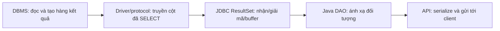

# Chọn cột cần thiết thay vì lấy dữ liệu không dùng

> **Chương:** Hiệu năng  
> **Phạm vi:** Ứng dụng Java truy cập cơ sở dữ liệu quan hệ bằng **JDBC**, `DataSource`, `PreparedStatement` và `ResultSet`. Ví dụ dùng Java 17+ và PostgreSQL để minh họa; nguyên tắc chọn cột áp dụng rộng rãi, còn kế hoạch thực thi và cách driver truyền dữ liệu phụ thuộc DBMS/phiên bản.

Trang danh sách sản phẩm chỉ cần **mã, tên và giá**. Tuy nhiên, câu truy vấn đang dùng `SELECT *` nên database có thể trả cả mô tả dài, thông tin nội bộ và một cột tài liệu PDF vài megabyte. DAO chỉ gọi ba getter trên `ResultSet`, nhưng điều đó **không đồng nghĩa** các cột còn lại chưa được truy vấn, chưa được truyền về hoặc không dùng tài nguyên.

Tối ưu đầu tiên không nhất thiết là thêm connection pool, tăng `fetchSize` hay viết code Java phức tạp. Hãy hỏi: **use case thực sự cần những cột nào?** Chọn đúng các cột đó trong SQL (*projection*) giúp giảm dữ liệu trung gian, giảm ràng buộc giữa tầng dữ liệu và schema, đồng thời tạo cơ hội để DBMS dùng kế hoạch truy vấn hiệu quả hơn.

Bài học đi từ cách đọc `ResultSet` đến thiết kế truy vấn list/detail/download, phân tích chi phí mạng–bộ nhớ–DBMS, đối chiếu với phân trang và batch, rồi xây dựng phép đo công bằng trước khi kết luận tối ưu.

## 1. Projection trong SQL: chọn hàng và chọn cột là hai việc khác nhau

Một câu truy vấn có ít nhất hai quyết định về lượng dữ liệu:

- **Chọn hàng:** `WHERE`, `LIMIT`, điều kiện theo khóa, join, phân trang. Ví dụ lấy 20 sản phẩm đang bán.
- **Chọn cột:** danh sách biểu thức sau `SELECT`. Ví dụ chỉ lấy `product_id`, `name` và `price`.

```sql
-- Lấy mọi cột của những hàng khớp điều kiện.
SELECT *
FROM product_catalog
WHERE active = TRUE
ORDER BY product_id
LIMIT 20;

-- Lấy đúng những cột màn hình danh sách sử dụng.
SELECT product_id, name, price
FROM product_catalog
WHERE active = TRUE
ORDER BY product_id
LIMIT 20;
```

Hai câu SQL cùng giới hạn **số hàng**, nhưng khác số cột và lượng dữ liệu mỗi hàng. Khi một hàng có cột rất lớn, sự khác biệt này quan trọng ngay cả với trang chỉ có 20 hàng.

**`SELECT *` không có nghĩa DBMS luôn đọc toàn bộ dữ liệu vật lý theo cùng cách ở mọi trường hợp.** DBMS có thể tối ưu lưu trữ, cache và biểu thức, còn driver có thể truyền/buffer theo chiến lược riêng. Điều đáng tin cậy là: câu `SELECT *` **yêu cầu mọi cột có thể xuất hiện trong kết quả**; nếu muốn không yêu cầu cột, phải bỏ nó khỏi danh sách `SELECT`.

### Không nhầm `SELECT *` với `COUNT(*)`

```sql
SELECT COUNT(*)
FROM product_catalog
WHERE active = TRUE;
```

`COUNT(*)` là biểu thức tổng hợp đếm **hàng**, không phải yêu cầu trả mọi cột cho mỗi hàng. Đây là cách dùng dấu `*` hợp lệ và hoàn toàn khác bài toán `SELECT *`. Không thay `COUNT(*)` bằng danh sách cột chỉ vì muốn tránh “star”.

## 2. Xây dựng schema để thấy vấn đề

Giả sử PostgreSQL có bảng sản phẩm:

```sql
CREATE TABLE product_catalog (
    product_id BIGINT GENERATED BY DEFAULT AS IDENTITY PRIMARY KEY,
    sku VARCHAR(80) NOT NULL UNIQUE,
    name VARCHAR(200) NOT NULL,
    price NUMERIC(12, 2) NOT NULL CHECK (price >= 0),
    stock INTEGER NOT NULL CHECK (stock >= 0),
    active BOOLEAN NOT NULL DEFAULT TRUE,
    description TEXT,
    internal_notes TEXT,
    manual_pdf BYTEA,
    updated_at TIMESTAMPTZ NOT NULL DEFAULT CURRENT_TIMESTAMP
);

INSERT INTO product_catalog (
    sku, name, price, stock, description, internal_notes
) VALUES
    ('JAVA-101', 'Sách Java', 199000.00, 20,
     'Sách nhập môn Java', 'Chỉ nhân viên quản trị'),
    ('JDBC-201', 'Sách JDBC', 249000.00, 15,
     'Thực hành truy cập cơ sở dữ liệu', 'Nguồn nhập nội bộ');
```

Trong dữ liệu thật, `description` có thể dài nhiều kilobyte, còn `manual_pdf` có thể chứa tài liệu rất lớn. Với trang danh sách, UI chỉ hiển thị:

| Trường trên giao diện | Cột cần đọc |
|---|---|
| ID liên kết đến trang chi tiết | `product_id` |
| Tên sản phẩm | `name` |
| Giá hiển thị | `price` |

Trường `internal_notes` là dữ liệu nội bộ, không nên xuất hiện trong phản hồi danh sách. `manual_pdf` chỉ cần khi khách hàng nhấn tải tài liệu; nó không thuộc luồng lấy danh sách.

**Hãy tách hợp đồng dữ liệu theo mục đích sử dụng:** danh sách, chi tiết sản phẩm và tải tài liệu là ba use case có dữ liệu cần thiết khác nhau.

## 3. Vì sao chọn thừa cột có thể làm chậm ứng dụng?

Chi phí có thể xuất hiện trên nhiều tầng:



| Tầng | Khi query yêu cầu nhiều cột hơn mức cần |
|---|---|
| **DBMS** | Có thể phải đọc dữ liệu cột lớn, xử lý TOAST/LOB hoặc materialize hàng rộng; kế hoạch truy vấn có thể cần nhiều I/O hơn |
| **Mạng DB ↔ Java** | Có thể chuyển thêm byte dù Java không gọi getter cho cột đó, tùy driver và giao thức |
| **Driver JDBC** | Có thể buffer nhiều dữ liệu/metadata hơn, gây tăng heap hoặc native memory |
| **DAO/mapper** | Nếu mapper thực sự lấy mọi cột, phát sinh thêm object, `String`, `byte[]` và GC |
| **API/UI** | Nếu phản hồi chứa các trường thừa, tăng JSON serialization, băng thông và thời gian tải trên client |
| **Schema và bảo mật** | Khó nhận biết dữ liệu nào được cho phép đưa ra ngoài; thêm cột mới có thể làm query rộng hơn mà code cũ không cần |

**Lưu ý về getter:** đoạn Java dưới đây *chỉ đọc ba cột từ API*:

```java
long id = rs.getLong("product_id");
String name = rs.getString("name");
BigDecimal price = rs.getBigDecimal("price");
```

Nhưng nếu SQL đang là `SELECT *`, việc Java không gọi `getBytes("manual_pdf")` **không phải bằng chứng** cột BLOB chưa được database/driver xử lý hoặc truyền qua mạng. Điều này phải được xác nhận theo DBMS, driver và cách thực thi.

### Ước lượng độ lớn để chọn ưu tiên tối ưu

Giả sử một đợt đọc **1.000 hàng**, mỗi hàng có tài liệu thô cỡ **512 KiB**. Nếu toàn bộ tài liệu được truyền, riêng payload tài liệu đã vào khoảng **500 MiB**, chưa kể các cột còn lại. Nếu trang danh sách chỉ cần tổng cộng khoảng 160 byte/hàng, dữ liệu thô tương ứng khoảng **156 KiB** trước khi tính giao thức/metadata.

Đây là **ước lượng minh họa** để thấy quy mô, không phải kết quả benchmark của PostgreSQL hay driver nào. Tỷ lệ thực tế còn phụ thuộc dữ liệu NULL, nén, lưu trữ LOB, giao thức, cache, chỉ mục và số hàng.

## 4. Ví dụ JDBC chưa tối ưu: `SELECT *` dù mapper chỉ dùng ba cột

```java
import java.math.BigDecimal;
import java.sql.Connection;
import java.sql.PreparedStatement;
import java.sql.ResultSet;
import java.sql.SQLException;
import java.util.ArrayList;
import java.util.List;
import javax.sql.DataSource;

record ProductCard(long id, String name, BigDecimal price) {}

List<ProductCard> listCardsWrong(DataSource dataSource) throws SQLException {
    String sql = """
        SELECT *
        FROM product_catalog
        WHERE active = TRUE
        ORDER BY product_id
        LIMIT 50
        """;

    try (Connection connection = dataSource.getConnection();
         PreparedStatement ps = connection.prepareStatement(sql);
         ResultSet rs = ps.executeQuery()) {

        List<ProductCard> cards = new ArrayList<>();
        while (rs.next()) {
            cards.add(new ProductCard(
                rs.getLong("product_id"),
                rs.getString("name"),
                rs.getBigDecimal("price")
            ));
        }
        return cards;
    }
}
```

Đoạn này có một số điểm tốt: dùng JDBC API chuẩn, giới hạn số hàng, đóng tài nguyên bằng `try-with-resources` và không đưa `internal_notes` vào object trả về. Nhưng **truy vấn vẫn yêu cầu toàn bộ cột**.

Với bảng có BLOB/LOB lớn, đây là lãng phí có thể đáng kể. Tối ưu không phải là “bỏ getter cho BLOB” vì mapper vốn đã không gọi getter đó; tối ưu là **sửa SQL projection**.

## 5. Viết repository chọn đúng cột cho từng use case

Thiết kế API tầng dữ liệu rõ nghĩa hơn khi trả về những kiểu dữ liệu tương ứng với mục đích sử dụng: `ProductCard` dành cho danh sách; `ProductDetail` dành cho màn hình chi tiết; phương thức stream PDF dành cho tải tài liệu.

### 5.1. Danh sách có phân trang: chỉ ID, tên và giá

```java
import java.math.BigDecimal;
import java.sql.Connection;
import java.sql.PreparedStatement;
import java.sql.ResultSet;
import java.sql.SQLException;
import java.util.ArrayList;
import java.util.List;
import java.util.Objects;
import javax.sql.DataSource;

record ProductCard(long id, String name, BigDecimal price) {}

public final class ProductCatalogRepository {
    private final DataSource dataSource;

    public ProductCatalogRepository(DataSource dataSource) {
        this.dataSource = Objects.requireNonNull(dataSource);
    }

    public List<ProductCard> listPage(long afterId, int pageSize)
            throws SQLException {

        if (afterId < 0) {
            throw new IllegalArgumentException("afterId must be >= 0");
        }
        if (pageSize < 1 || pageSize > 100) {
            throw new IllegalArgumentException(
                "pageSize must be between 1 and 100"
            );
        }

        String sql = """
            SELECT product_id, name, price
            FROM product_catalog
            WHERE active = TRUE AND product_id > ?
            ORDER BY product_id
            LIMIT ?
            """;

        try (Connection connection = dataSource.getConnection();
             PreparedStatement ps = connection.prepareStatement(
                 sql, ResultSet.TYPE_FORWARD_ONLY,
                 ResultSet.CONCUR_READ_ONLY
             )) {

            ps.setLong(1, afterId);
            ps.setInt(2, pageSize);

            try (ResultSet rs = ps.executeQuery()) {
                List<ProductCard> cards = new ArrayList<>(pageSize);

                while (rs.next()) {
                    cards.add(new ProductCard(
                        rs.getLong("product_id"),
                        rs.getString("name"),
                        rs.getBigDecimal("price")
                    ));
                }
                return cards;
            }
        }
    }
}
```

Ví dụ:

```java
ProductCatalogRepository repository =
    new ProductCatalogRepository(dataSource);

List<ProductCard> firstPage = repository.listPage(0L, 20);

long nextAfterId = firstPage.isEmpty()
    ? 0L
    : firstPage.get(firstPage.size() - 1).id();

// Nếu trang đầy và người dùng yêu cầu xem tiếp:
List<ProductCard> secondPage = repository.listPage(nextAfterId, 20);
```

**Điểm chính:** SQL chỉ yêu cầu `product_id`, `name` và `price`, đúng với các getter và record. `WHERE` và `LIMIT` vẫn giới hạn số hàng. `product_id > ? ORDER BY product_id` là **keyset pagination** theo khóa tăng dần, phù hợp với việc xem trang tiếp theo.

Hạn chế: khi dữ liệu thay đổi giữa các lần tải trang, mỗi request có thể nhìn thấy snapshot khác; nếu yêu cầu một bản export nhất quán, cần thiết kế isolation/snapshot hoặc watermark tương ứng. Nếu ID không có tính dương hoặc không dùng khóa `BIGINT`, hãy thiết kế cursor/token thay cho `afterId = 0`.

### 5.2. Trang chi tiết: chọn thêm cột có ích, nhưng không tự lấy PDF

Dữ liệu cho màn hình chi tiết có thể cần `sku`, `description` và `stock`, nhưng vẫn chưa cần `manual_pdf` hoặc `internal_notes`.

Bổ sung một record:

```java
record ProductDetail(
    long id,
    String sku,
    String name,
    BigDecimal price,
    int stock,
    String description
) {}
```

Bổ sung phương thức trong `ProductCatalogRepository`:

```java
public Optional<ProductDetail> findDetail(long productId)
        throws SQLException {

    String sql = """
        SELECT product_id, sku, name, price, stock, description
        FROM product_catalog
        WHERE product_id = ? AND active = TRUE
        """;

    try (Connection connection = dataSource.getConnection();
         PreparedStatement ps = connection.prepareStatement(sql)) {

        ps.setLong(1, productId);

        try (ResultSet rs = ps.executeQuery()) {
            if (!rs.next()) {
                return Optional.empty();
            }

            return Optional.of(new ProductDetail(
                rs.getLong("product_id"),
                rs.getString("sku"),
                rs.getString("name"),
                rs.getBigDecimal("price"),
                rs.getInt("stock"),
                rs.getString("description")
            ));
        }
    }
}
```

Import `java.util.Optional` cho phương thức này. Bảng mẫu quy định `stock NOT NULL`, nên `getInt("stock")` không cần `wasNull()`. Nếu schema cho phép NULL, nên dùng `getObject(..., Integer.class)` khi driver hỗ trợ hoặc kiểm tra `rs.wasNull()` sau getter.

**Không cần một DTO duy nhất có mọi cột của bảng** rồi trả một phần trường cho UI. Hai projection/record khác nhau giúp ranh giới dữ liệu hiển nhiên hơn, hạn chế vô tình truy cập dữ liệu nhạy cảm hoặc LOB.

### 5.3. Download PDF: chỉ chọn cột BLOB khi người dùng yêu cầu

Chỉ khi khách hàng yêu cầu tải manual, mới chạy một truy vấn khác để lấy `manual_pdf`:

```java
import java.io.IOException;
import java.io.InputStream;
import java.io.OutputStream;
import java.sql.Connection;
import java.sql.PreparedStatement;
import java.sql.ResultSet;
import java.sql.SQLException;

public boolean writeManual(long productId, OutputStream destination)
        throws SQLException, IOException {

    Objects.requireNonNull(destination, "destination");

    String sql = """
        SELECT manual_pdf
        FROM product_catalog
        WHERE product_id = ? AND active = TRUE
        """;

    try (Connection connection = dataSource.getConnection();
         PreparedStatement ps = connection.prepareStatement(sql)) {

        ps.setLong(1, productId);

        try (ResultSet rs = ps.executeQuery()) {
            if (!rs.next()) {
                return false;
            }

            try (InputStream source =
                     rs.getBinaryStream("manual_pdf")) {

                if (source == null) {
                    return false; // Không có tài liệu đính kèm.
                }

                byte[] buffer = new byte[64 * 1024];
                int n;

                while ((n = source.read(buffer)) != -1) {
                    destination.write(buffer, 0, n);
                }
                return true;
            }
        }
    }
}
```

Phương thức này dự kiến được đặt **bên trong `ProductCatalogRepository`**. Nó **không đóng `destination`** vì `OutputStream` thuộc caller/HTTP framework, nhưng đóng `InputStream`, `ResultSet`, `PreparedStatement` và `Connection` theo scope.

**Cảnh báo:** `getBinaryStream()` tránh việc ứng dụng gọi `getBytes()` để giữ một mảng lớn, nhưng không bảo đảm driver không buffer toàn bộ BLOB ở phía trong. Khi tải tài liệu hàng trăm MB, cần kiểm thử memory và có thể chọn giải pháp LOB/object storage riêng. Nếu `destination.write()` thất bại giữa chừng, dữ liệu đã gửi ra ngoài không được rollback bởi JDBC; caller phải xử lý tệp/HTTP response dở.

## 6. Chọn cột cũng giúp giảm rủi ro thay đổi schema

Giả sử phiên bản đầu bảng có 8 cột. Sau đó migration thêm `supplier_contract BYTEA` hoặc `internal_cost NUMERIC`.

Với:

```sql
SELECT * FROM product_catalog;
```

kết quả của query tự động mở rộng theo schema. Những tác động có thể gồm:

- Payload nhiều hơn, thời gian truyền hoặc heap tăng.
- Mapper dựa vào **vị trí cột** (`rs.getString(3)`) bị lệch khi cấu trúc/cách query thay đổi.
- Thư viện “map mọi cột thành JSON” có thể vô tình xuất dữ liệu nội bộ mới.
- Cùng một query có latency thay đổi dù màn hình không dùng trường mới.
- Kiểm thử và hợp đồng API khó xác định cột nào là thiết yếu.

Với:

```sql
SELECT product_id, name, price
FROM product_catalog
WHERE active = TRUE;
```

projection của câu truy vấn không tự thay đổi chỉ vì bảng được bổ sung cột khác. Điều này giúp ổn định hợp đồng dữ liệu, **nhưng không miễn nhiễm với mọi migration**: đổi tên/xóa cột đang chọn, đổi kiểu hoặc chính sách quyền vẫn có thể làm SQL lỗi.

### Tránh ánh xạ bằng vị trí khi không cần

```java
// Dễ đọc hơn nếu query được chỉnh sửa cột hoặc thêm join.
long id = rs.getLong("product_id");
String name = rs.getString("name");
BigDecimal price = rs.getBigDecimal("price");
```

Đọc theo **column label** thay vì ordinal giúp tránh nhầm khi thứ tự danh sách `SELECT` thay đổi. Nhưng dùng label cũng có yêu cầu: cột được chọn phải có label rõ ràng và **không bị trùng**.

Ví dụ join:

```sql
SELECT p.product_id AS product_id,
       p.name AS product_name,
       c.name AS category_name
FROM product_catalog AS p
JOIN categories AS c ON c.category_id = p.category_id;
```

Câu SQL trên là ví dụ khi schema mở rộng thêm `categories` và `category_id`; bảng mẫu ở mục 2 **chưa có** hai đối tượng này. Điểm cần học là dùng alias khác nhau cho hai cột cùng tên `name`. Với `SELECT p.*, c.*`, kết quả có thể có label trùng, khiến `rs.getString("name")` khó đoán đang lấy cột nào.

## 7. Tối ưu database: projection có thể mở cơ hội dùng index-only scan

Chọn ít cột có thể cho phép database đáp ứng query chỉ từ chỉ mục, nếu các cột được chọn và điều kiện truy vấn được chỉ mục bao phủ, cùng các điều kiện của DBMS.

Ví dụ trong PostgreSQL:

```sql
CREATE INDEX idx_product_active_id_cover
ON product_catalog (active, product_id)
INCLUDE (name, price);
```

Query list:

```sql
SELECT product_id, name, price
FROM product_catalog
WHERE active = TRUE AND product_id > ?
ORDER BY product_id
LIMIT ?;
```

Về mặt cấu trúc, chỉ mục trên chứa các cột liên quan đến điều kiện, thứ tự và giá trị trả về. PostgreSQL **có thể** chọn một **index-only scan** nếu điều kiện visibility/map, thống kê, kích thước dữ liệu và cost model cho phép. Tuy nhiên:

- **Không có bảo đảm** tạo covering index thì truy vấn luôn index-only. PostgreSQL có thể vẫn cần heap fetch để xác nhận visibility của tuple.
- Chỉ mục với `INCLUDE` làm tăng dung lượng lưu và chi phí cập nhật/insert, đặc biệt nếu chứa cột rộng.
- Không nên thêm `description`/`manual_pdf` vào chỉ mục chỉ nhằm phục vụ một query ít gặp; kích thước và giới hạn index key/tuple của DBMS có thể thành vấn đề.
- Lợi ích còn phụ thuộc số hàng lọc, bộ nhớ cache, lượng bản ghi và cách optimizer chọn kế hoạch.

Với `SELECT *`, chỉ mục nhỏ chỉ chứa vài cột có thể **không đủ để tạo toàn bộ hàng kết quả**. Nhưng bỏ `*` không tự động làm query nhanh hơn: phải đo thực tế.

### Đọc kế hoạch trên database thử nghiệm

```sql
EXPLAIN (ANALYZE, BUFFERS)
SELECT product_id, name, price
FROM product_catalog
WHERE active = TRUE AND product_id > 0
ORDER BY product_id
LIMIT 20;
```

So sánh với:

```sql
EXPLAIN (ANALYZE, BUFFERS)
SELECT *
FROM product_catalog
WHERE active = TRUE AND product_id > 0
ORDER BY product_id
LIMIT 20;
```

`EXPLAIN (ANALYZE, BUFFERS)` là cú pháp **PostgreSQL**; nó thực thi truy vấn để thu số liệu runtime. Trong ví dụ `SELECT` là read-only, nhưng không chạy `EXPLAIN ANALYZE` tùy tiện với DML trên production. Ghi nhận scan type, actual rows, heap fetches, buffer hits/reads, execution time và thay đổi kế hoạch; các con số thay đổi theo kích thước dữ liệu và cache.

## 8. Giảm byte truyền và giảm heap là hai phép đo khác nhau

Nếu một truy vấn `SELECT *` lấy 20 hàng, driver có thể tải nhiều byte qua mạng nhưng DAO chỉ map ba trường. Heap có thể tăng ít hơn hoặc nhiều hơn tùy implementation. Ngược lại, query chỉ chọn ba cột nhưng ứng dụng lưu cả triệu kết quả vào `List` vẫn có thể dùng rất nhiều heap.

Cần tách ít nhất bốn loại chi phí:

| Chi phí | Ví dụ phép đo | Đừng suy diễn |
|---|---|---|
| **DBMS** | `EXPLAIN ANALYZE`, buffers, I/O, CPU, query latency | Bớt cột luôn giảm CPU bằng cùng một tỷ lệ |
| **Mạng DB–Java** | Byte nhận, network throughput, driver metrics/packet capture trong test | Không gọi getter đồng nghĩa không có byte truyền |
| **JVM** | Allocation, peak heap, GC, JFR/profiler | `TYPE_FORWARD_ONLY` luôn đảm bảo streaming |
| **End-to-end** | p50/p95 latency, thời gian render API, kích thước JSON, pool occupancy | Query nhanh hơn luôn khiến tổng request nhanh hơn tương ứng |

Trong JDBC, `Statement.setFetchSize(n)` chỉ là **gợi ý** cách fetch hàng, không phải giới hạn số cột, số hàng tối đa hay byte tải. `setMaxRows(n)` hoặc `LIMIT` giới hạn **số hàng**, còn projection giới hạn **cột**. Ba cách giải quyết các chiều khác nhau của khối lượng dữ liệu.

**Chiến lược đầy đủ:** chọn đúng hàng, chọn đúng cột, đóng resource đúng hạn, và chỉ sau đó điều chỉnh fetch size/pooling dựa trên đo lường.

## 9. Đừng chọn quá ít cột rồi tạo N+1 query

Projection cần cân bằng với số lần round-trip tới database.

Ví dụ cách không nên làm:

```text
SELECT product_id, name FROM product_catalog ... LIMIT 50
  ↓
50 sản phẩm
  ↓
Với mỗi sản phẩm: SELECT price FROM product_catalog WHERE product_id = ?
  ↓
51 query để hiển thị một danh sách cần cả name và price
```

Ở đây việc chỉ chọn `product_id, name` ban đầu **không phù hợp yêu cầu** vì trang còn cần `price`. Nên lấy `product_id, name, price` **trong cùng query**.

Nếu cần dữ liệu liên quan từ bảng khác cho tất cả 50 hàng, cân nhắc join đúng mục tiêu hoặc một truy vấn batch theo danh sách ID, thay vì N+1 câu SQL. Tuy nhiên join có quan hệ một-nhiều có thể nhân số hàng và lặp lại dữ liệu; đo tổng số hàng và số byte trả về trước khi chọn.

**Nguyên tắc:** chọn **đủ cột cần dùng cho một use case trong số lượt truy vấn hợp lý**, không phải cố tối thiểu hóa số cột của từng câu SQL bất kể hậu quả.

### List → detail → attachment là cách tách theo nhu cầu

```text
GET /products
    -> SELECT id, name, price ... LIMIT 20

GET /products/{id}
    -> SELECT id, sku, name, price, stock, description ...

GET /products/{id}/manual
    -> SELECT manual_pdf ...
```

Sơ đồ là ý tưởng thiết kế endpoint, không phải hợp đồng HTTP cố định. Nếu người dùng chỉ xem danh sách, ứng dụng không hề cần yêu cầu BLOB. Nếu click detail, phần mô tả chỉ được tải lúc đó. Nếu không tải PDF, SQL không đọc nó cho mục đích này.

Điểm đánh đổi là thêm một lượt database khi người dùng chuyển từ list sang detail, nhưng **không tải trước tất cả dữ liệu ít sử dụng của mọi hàng**. Quyết định thực tế phụ thuộc tỷ lệ người dùng mở detail/download, latency mạng, cache và yêu cầu UI.

## 10. Projection và an toàn dữ liệu

Một query trả về cột nội bộ không đồng nghĩa nó đã lộ cho client, vì DAO có thể không serialize trường đó. Tuy nhiên yêu cầu **dữ liệu tối thiểu cần dùng** vẫn hữu ích:

- Hạn chế đưa `internal_notes`, token, email, cost hoặc dữ liệu nhạy cảm tới những tầng không cần.
- Giảm nguy cơ debug log/mapper tự động/serialization vô tình ghi lại trường mới.
- Làm code review dễ thấy use case đang đọc những trường nào.
- Hỗ trợ tách quyền đọc cột hoặc view ở DBMS nếu yêu cầu bảo mật cần bảo đảm mạnh hơn.

**Projection không thay thế ủy quyền.** Một người không có quyền đọc giá nội bộ vẫn cần được kiểm soát bằng authentication, authorization, database privileges hoặc view/policy phù hợp. Chỉ bỏ một trường khỏi câu SQL ở một endpoint không bảo đảm nó không thể bị truy cập qua endpoint khác.

### Tên cột động không được bind như giá trị

`PreparedStatement` tham số hóa **giá trị**, không phải tên cột hoặc một mảnh SQL tùy ý:

```java
// Sai về mục đích: '?' không thay thế được định danh cột.
String sql = "SELECT ? FROM product_catalog";
```

Nếu UI cho phép chọn trường tìm kiếm/sắp xếp, phải dùng **danh sách cho phép**:

```java
String orderColumn = switch (requestedSort) {
    case "name" -> "name";
    case "price" -> "price";
    default -> "product_id";
};

String sql = """
    SELECT product_id, name, price
    FROM product_catalog
    WHERE active = ?
    ORDER BY
    """ + orderColumn + " ASC LIMIT ?";

try (PreparedStatement ps = connection.prepareStatement(sql)) {
    ps.setBoolean(1, true);
    ps.setInt(2, 50);
    // executeQuery()...
}
```

Ở ví dụ này, `requestedSort` là một `String` đã nhận từ tầng giao diện. Các giá trị SQL nối vào query chỉ lấy từ **hằng do ứng dụng kiểm soát**, không đưa nguyên văn input vào SQL. Với kết quả cần phân trang ổn định, phải bổ sung tie-breaker duy nhất (ví dụ `ORDER BY name, product_id` hoặc `ORDER BY price, product_id`) và cơ chế cursor tương ứng.

Mặc dù nội dung chính của bài là chọn cột, nguyên tắc allowlist cũng áp dụng khi xây **projection động**. Không dùng danh sách tên cột do client gửi rồi nối thẳng vào `SELECT`.

## 11. Đo hiệu năng: so sánh `SELECT *` với projection công bằng

Một tuyên bố “projection nhanh hơn 10 lần” chỉ có ý nghĩa nếu xác định **đo cái gì**, dùng data/driver nào và điều kiện benchmark ra sao.

### 11.1. Giữ nguyên điều kiện ngoài danh sách cột

So sánh hai SQL:

```sql
-- A: lấy thừa cột.
SELECT *
FROM product_catalog
WHERE active = TRUE AND product_id > ?
ORDER BY product_id
LIMIT ?;
```

```sql
-- B: chỉ cột cho card.
SELECT product_id, name, price
FROM product_catalog
WHERE active = TRUE AND product_id > ?
ORDER BY product_id
LIMIT ?;
```

Cùng filter, cùng `ORDER BY`, cùng page size, cùng record count. Mapper Java trong cả hai trường hợp **chỉ đọc ba cột mà giao diện thực sự sử dụng**, để so đúng sự khác biệt do **SQL projection**. Nếu phiên bản A đọc thêm PDF vào `byte[]` còn phiên bản B không làm vậy, bạn đã thay đổi **hai yếu tố**: query lẫn cách mapping.

### 11.2. Khung benchmark đọc hết `ResultSet`

```java
import java.sql.Connection;
import java.sql.PreparedStatement;
import java.sql.ResultSet;
import java.sql.SQLException;
import java.util.Objects;

record QuerySample(long rows, long elapsedNanos) {}

static QuerySample scanCards(
        Connection connection,
        String trustedSql,
        long afterId,
        int pageSize
) throws SQLException {
    Objects.requireNonNull(connection);
    Objects.requireNonNull(trustedSql);

    long started = System.nanoTime();
    long rows = 0;

    try (PreparedStatement ps = connection.prepareStatement(
             trustedSql,
             ResultSet.TYPE_FORWARD_ONLY,
             ResultSet.CONCUR_READ_ONLY
         )) {

        ps.setLong(1, afterId);
        ps.setInt(2, pageSize);

        try (ResultSet rs = ps.executeQuery()) {
            while (rs.next()) {
                // Giữ workload mapper tương đương ở cả hai SQL.
                long id = rs.getLong("product_id");
                String name = rs.getString("name");
                BigDecimal price = rs.getBigDecimal("price");

                consumeCard(id, name, price);
                rows++;
            }
        }
    }

    return new QuerySample(
        rows, System.nanoTime() - started
    );
}
```

`consumeCard(...)` là hàm ứng dụng dùng để xử lý kết quả, nên có công việc giống nhau cho hai phép đo và không giữ toàn bộ dữ liệu trong heap nếu muốn đo query+mapping. Có thể thay bằng việc tính một checksum hoặc ghi ra sink kiểm thử, nhưng tránh để JIT tối ưu bỏ hoàn toàn phần xử lý khi benchmark.

`trustedSql` chỉ được cung cấp từ hai chuỗi SQL **hằng do developer định nghĩa**; không xây SQL tùy ý từ input người dùng. Import bổ sung `java.math.BigDecimal`.

**Quan trọng:** đồng hồ bắt đầu trước `prepareStatement()` và kết thúc sau khi đóng result set/statement. Như vậy phép đo bao gồm chuẩn bị statement, thực thi, fetch, mapping và đóng statement trong cùng connection, nhưng **không** bao gồm thời gian lấy `Connection` từ pool. Nếu muốn đo end-to-end HTTP request, phải đo riêng ở tầng gọi.

### 11.3. Quy trình đo đáng tin hơn

1. Chuẩn bị bảng có số hàng/cỡ BLOB tương tự workload sản xuất. Chỉ một vài dòng mẫu sẽ không thể hiện ảnh hưởng của payload rộng.
2. Dùng **cùng JDBC driver, database, machine và connection configuration**.
3. Chạy warm-up cả hai cách, sau đó đổi thứ tự chạy để giảm bias do JIT, cache và DB buffer.
4. Đảm bảo query cùng filter, thứ tự, phân trang và số hàng.
5. Đo nhiều lần: median, p95/p99 nếu đủ mẫu, phân phối latency và số byte nhận qua mạng nếu có công cụ hỗ trợ.
6. Ghi peak heap/allocation/GC bằng JFR/profiler; xem execution plan và DB buffers.
7. Kiểm tra dữ liệu trả về giống nhau ở ba trường card và không phát sinh N+1 query.
8. Kiểm tra hiệu năng khi tỷ lệ PDF NULL cao/thấp, dữ liệu có/không cache, cold/warm runs và dưới tải đồng thời.

**Không kết luận từ một lần `System.nanoTime()`.** CPU scheduler, network, pool, cache, checkpoint và query plan có thể tạo dao động đáng kể. Cũng không dùng heap usage trước/sau đơn lẻ để suy ra peak allocation; Java GC có thể chạy ở thời điểm bất kỳ.

## 12. `ResultSetMetaData`: phát hiện query trả nhiều cột hơn mong đợi

Trong test, có thể dùng metadata để xác minh shape của câu truy vấn:

```java
import java.sql.ResultSetMetaData;
import java.sql.SQLException;

static void assertCardColumns(ResultSet rs) throws SQLException {
    ResultSetMetaData meta = rs.getMetaData();

    if (meta.getColumnCount() != 3) {
        throw new SQLException(
            "Card query should return exactly 3 columns, actual="
            + meta.getColumnCount()
        );
    }

    String[] expected = {"product_id", "name", "price"};

    for (int i = 1; i <= expected.length; i++) {
        if (!expected[i - 1].equalsIgnoreCase(meta.getColumnLabel(i))) {
            throw new SQLException(
                "Unexpected column label at index " + i
            );
        }
    }
}
```

Gọi `assertCardColumns(rs)` ngay sau `executeQuery()` trong integration test để phát hiện code vô tình đổi query thành `SELECT *` hoặc thêm trường không thuộc hợp đồng card. Đây là **test về projection/schema**, không phải benchmark trực tiếp.

Các lưu ý:

- Vị trí cột trong `ResultSetMetaData` bắt đầu từ **1**.
- `getColumnLabel(i)` chịu ảnh hưởng alias `AS`; có thể khác `getColumnName(i)`.
- Việc so chính xác 3 nhãn cột là chính sách của **API card cụ thể**, không phải yêu cầu chung của mọi query.
- Metadata không tự chứng minh không bị lộ dữ liệu ở endpoint khác và không đo lượng byte thực sự truyền.

## 13. Các trường hợp nên hoặc có thể dùng `SELECT *`

Không cần biến `SELECT *` thành điều cấm tuyệt đối. Nó có thể hợp lý trong:

- Truy vấn tương tác để **khám phá schema** tại môi trường phát triển.
- Công cụ migration, sao lưu hoặc kiểm thử có yêu cầu lấy **mọi cột** của một quan hệ, với quyền và giới hạn rõ.
- Một bảng rất nhỏ, schema ổn định, query ít gọi và **mọi cột đều cần dùng**.
- Đoạn kiểm thử chủ động xác nhận hình dạng toàn bộ hàng, không phải API production.

Dù vậy, khi viết **DAO phục vụ một màn hình/API có hợp đồng trường rõ ràng**, danh sách cột tường minh thường tốt hơn. `SELECT *` kết hợp với join nhiều bảng, BLOB lớn và mapper trả JSON tự động là dấu hiệu đáng xem xét.

### Có khi projection không cải thiện đáng kể?

Có. Nếu bảng chỉ ba cột nhỏ và màn hình cần cả ba, `SELECT *` và `SELECT id, name, price` có thể gần tương đương về payload. Nếu thời gian chủ yếu là network round-trip, lock wait hoặc I/O của predicate không dùng chỉ mục, lợi ích giảm vài byte trên mỗi hàng có thể không đáng kể.

Vẫn có lý do dùng projection tường minh cho **tính ổn định schema và khả năng review**, nhưng **không nên quảng cáo chắc chắn cải thiện latency** khi chưa đo.

## 14. Checklist review một truy vấn JDBC

| Câu hỏi | Tín hiệu cần kiểm tra |
|---|---|
| Use case thật sự hiển thị/trả về trường gì? | DTO/record/API contract |
| SQL có `SELECT *`, `alias.*` hoặc nhiều cột không được mapper dùng không? | Danh sách `SELECT` đối chiếu các getter |
| Cột nào chứa `TEXT`, `BYTEA`, `BLOB`, JSON lớn hoặc dữ liệu nội bộ? | Schema và phân phối kích thước thực tế |
| Có giới hạn số **hàng** và thứ tự ổn định không? | `WHERE`, `ORDER BY`, `LIMIT`/keyset |
| Query dùng `PreparedStatement` bind giá trị chưa? | Không nối trực tiếp giá trị người dùng vào SQL |
| Có N+1 query do projection quá hẹp không? | Query count theo một request, trace/metrics |
| Kết quả có được trả thành DTO chỉ chứa dữ liệu cần thiết? | Không đưa raw `ResultSet`/`Map` mọi cột lên API |
| Mọi `ResultSet`/statement/connection được đóng đúng scope? | `try-with-resources` và transaction ownership |
| Driver có buffer LOB dù mapper không đọc không? | Integration benchmark, network/heap measurement |
| Có cơ hội index-only scan không, và giá phải trả? | `EXPLAIN`, heap fetch, kích thước chỉ mục và write cost |
| Khi thêm cột mới, projection và API có ổn định không? | Contract test/`ResultSetMetaData` |
| Tối ưu đã được đo trong workload đại diện chưa? | p50/p95, network bytes, allocation, DB buffers |

## 15. Bài thực hành

1. **Tạo dữ liệu:** chuẩn bị bảng `product_catalog` như mục 2. Nạp thêm dữ liệu mô phỏng cho `description` và `manual_pdf` ở môi trường test, với giới hạn kích thước phù hợp tài nguyên.
2. **So sánh projection:** chạy `SELECT *` và `SELECT product_id, name, price` với cùng `WHERE`/`ORDER BY`/`LIMIT`. Dùng `ResultSetMetaData` để so số cột, rồi đo kích thước dữ liệu và latency.
3. **Cải tiến DAO:** thay `listCardsWrong()` bằng `ProductCatalogRepository.listPage()`. Chứng minh UI vẫn nhận đúng ID, tên và giá mà không cần trường thừa.
4. **List/detail/manual:** cài đặt ba phương thức lấy danh sách, lấy chi tiết và stream tài liệu. Xác nhận query list không yêu cầu `manual_pdf`/`internal_notes`.
5. **N+1 anti-pattern:** ban đầu chỉ lấy `id, name` rồi query giá từng hàng; đo số lần gọi SQL và sửa lại bằng projection đủ `id, name, price` trong một lần.
6. **Schema evolution:** thêm cột `supplier_contract BYTEA` bằng migration thử nghiệm. So sánh số cột của `SELECT *` với query projection; viết contract test để bảo vệ DTO card.
7. **Index-only scan:** thử chỉ mục có `INCLUDE (name, price)` của PostgreSQL, so sánh `EXPLAIN (ANALYZE, BUFFERS)` cho projection và `SELECT *`. Nêu vì sao index-only scan không được bảo đảm và chỉ mục làm tăng chi phí ghi.
8. **Benchmark:** dùng `scanCards()` trên ít nhất hai kích thước dữ liệu; ghi driver, DBMS, số hàng, số lần đo, warm-up, p50/p95, peak heap và các yếu tố có thể gây sai lệch.
9. **Bảo mật:** xác minh `internal_notes` không được yêu cầu trong query list và không có trong response; giải thích vì sao vẫn cần authorization riêng.
10. **Tối ưu tổng thể:** so sánh lợi ích của giảm cột, giảm hàng (pagination), giảm lượt query (tránh N+1) và xử lý streaming BLOB. Chọn thứ tự triển khai dựa trên kết quả đo.

**Tiêu chí hoàn thành:** người học giải thích được vì sao `SELECT *` có thể tạo chi phí không cần thiết khi ứng dụng chỉ dùng vài cột; biết chọn projection theo từng use case, viết DAO JDBC và mapper khớp danh sách cột, tách dữ liệu lớn khỏi truy vấn danh sách; phân biệt giảm cột với giảm hàng/fetch size, tránh N+1 và lộ dữ liệu; đồng thời thiết kế được benchmark và kiểm thử schema/driver để xác minh lợi ích hiệu năng trước khi đưa vào production.
