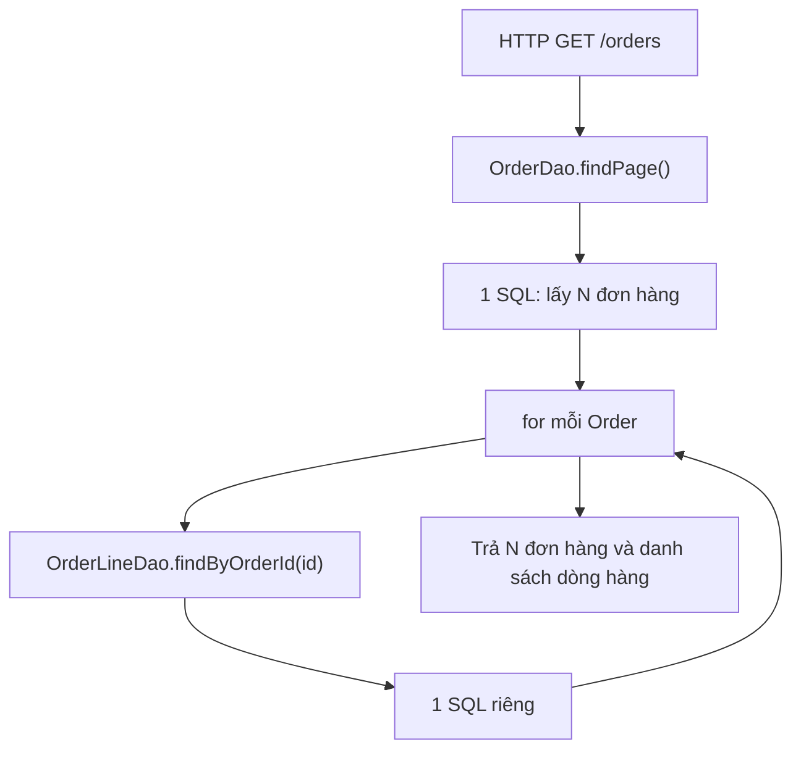
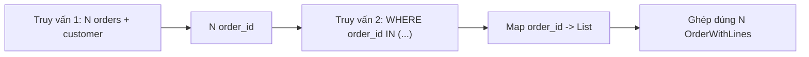

# Tránh mô hình truy vấn N+1 trong DAO

## 1. N+1 là gì và vì sao làm ứng dụng JDBC chậm?

Trong ứng dụng Java sử dụng **JDBC**, tầng **DAO** (*Data Access Object*) thường dùng `DataSource`, `Connection`, `PreparedStatement` và `ResultSet` để truy vấn cơ sở dữ liệu quan hệ, ánh xạ dữ liệu thành đối tượng Java rồi trả cho service. Nếu DAO tải một danh sách bản ghi và sau đó **chạy thêm một truy vấn riêng cho mỗi bản ghi** để lấy dữ liệu liên quan, chương trình có thể rơi vào mô hình **N+1 queries**.

Ví dụ một trang hiển thị **50 đơn hàng**, mỗi đơn có danh sách dòng hàng (*order lines*):

```text
SELECT danh sách 50 đơn hàng                  -> 1 truy vấn
for (mỗi đơn hàng) {
    SELECT các dòng hàng WHERE order_id = ?   -> 1 truy vấn/đơn
}

Tổng số câu SQL = 1 + 50 = 51 truy vấn.
```

Khi có 500 đơn hàng, số lượt SQL có thể tăng thành **501**, dù thao tác người dùng vẫn chỉ là “xem một danh sách”. Vấn đề không phải câu SQL riêng lẻ nhất thiết chậm, mà là **quá nhiều lượt trao đổi với cơ sở dữ liệu**, nhiều lần chuẩn bị và thực thi statement, phân bổ tài nguyên, truyền dữ liệu và theo dõi transaction.

Một ví dụ độ trễ để hình dung: nếu mỗi lượt hỏi-đáp với DBMS có phần overhead trung bình **10 ms**, riêng 51 lượt tuần tự đã có thể tốn khoảng **510 ms** overhead, chưa kể thời gian thực thi, truyền hàng, ánh xạ và các thao tác khác. Hai truy vấn có thể giảm phần overhead lý tưởng đó còn **20 ms**. Đây là phép minh họa, **không phải một dự báo benchmark**; hiệu quả thực tế phụ thuộc mạng, DBMS, kích thước dữ liệu và query plan.

**Mục tiêu của bài:** phát hiện N+1 ở DAO viết bằng JDBC thuần, lựa chọn giữa `JOIN`, truy vấn theo nhóm bằng `IN`, tổng hợp dữ liệu và phân trang; từ đó giảm số lần trao đổi với DBMS **mà không phá vỡ tính đúng đắn của kết quả**.

## 2. N+1 hình thành như thế nào trong DAO?

N+1 thường xuất hiện khi phương thức thao tác danh sách tái sử dụng một DAO chỉ biết lấy một đối tượng đơn lẻ:



Với dữ liệu quan hệ, các liên kết phổ biến dẫn đến mẫu này gồm:

- **Một-nhiều (`1:N`):** một đơn hàng có nhiều dòng hàng; một khách hàng có nhiều địa chỉ.
- **Nhiều-một (`N:1`):** danh sách đơn hàng, mỗi đơn gọi DAO lấy thông tin khách hàng.
- **Tổng hợp:** với mỗi sản phẩm, lại truy vấn `COUNT(*)` số đơn hoặc tổng tồn kho.
- **Dữ liệu phân cấp:** đọc một cấp rồi gọi DAO lấy con cho từng nút.
- **Lớp mapper/helper:** một phương thức `mapRow(...)` âm thầm gọi repository khác để bổ sung thông tin, khiến N+1 không xuất hiện trực tiếp trong vòng lặp ở service.

N+1 **không chỉ là vấn đề của ORM hoặc lazy loading**. DAO viết hoàn toàn bằng `PreparedStatement` vẫn có thể tạo N+1 nếu thuật toán đọc dữ liệu thực hiện truy vấn theo từng hàng.

## 3. Ví dụ cơ sở dữ liệu: đơn hàng và dòng hàng

Các ví dụ chạy với **PostgreSQL**; một số câu SQL như `LIMIT ?` cũng có trên MySQL, nhưng không nên giả định toàn bộ ví dụ chạy nguyên xi trên SQL Server hoặc Oracle. Ta có ba bảng:

```sql
CREATE TABLE customers (
    customer_id BIGINT PRIMARY KEY,
    full_name VARCHAR(200) NOT NULL
);

CREATE TABLE orders (
    order_id BIGINT PRIMARY KEY,
    customer_id BIGINT NOT NULL
        REFERENCES customers(customer_id),
    created_at TIMESTAMP NOT NULL
);

CREATE TABLE order_lines (
    line_id BIGINT PRIMARY KEY,
    order_id BIGINT NOT NULL REFERENCES orders(order_id),
    product_name VARCHAR(200) NOT NULL,
    quantity INTEGER NOT NULL CHECK (quantity > 0),
    unit_price DECIMAL(18,2) NOT NULL CHECK (unit_price >= 0)
);

CREATE INDEX idx_order_lines_order_line
    ON order_lines (order_id, line_id);

INSERT INTO customers (customer_id, full_name)
VALUES (1, 'Minh'), (2, 'Lan');

INSERT INTO orders (order_id, customer_id, created_at)
VALUES
    (101, 1, TIMESTAMP '2026-01-01 09:00:00'),
    (102, 2, TIMESTAMP '2026-01-02 10:00:00'),
    (103, 1, TIMESTAMP '2026-01-03 11:00:00');

INSERT INTO order_lines
    (line_id, order_id, product_name, quantity, unit_price)
VALUES
    (1001, 101, 'Bàn phím', 1, 250.00),
    (1002, 101, 'Chuột', 2, 100.00),
    (1003, 102, 'Màn hình', 1, 1200.00);
```

Đơn `101` có hai dòng, `102` có một dòng, còn `103` **chưa có dòng nào**. Trường hợp danh sách con rỗng này quan trọng: giải pháp chống N+1 phải vẫn trả đơn `103`, không được vô ý biến truy vấn thành `INNER JOIN` loại bỏ nó.

Trong tầng ứng dụng, dữ liệu trả ra có thể có dạng:

```text
OrderWithLines(101, "Minh", [Bàn phím, Chuột])
OrderWithLines(102, "Lan",  [Màn hình])
OrderWithLines(103, "Minh", [])
```

## 4. DAO dễ viết nhưng gây N+1

Một cách tổ chức rất phổ biến là tách:

- `OrderDao.findPage(...)` tải danh sách đơn hàng.
- `OrderLineDao.findByOrderId(orderId)` tải các dòng cho **một** đơn.
- Service gọi `findByOrderId` cho từng đơn trong danh sách.

```java
// Ví dụ cấu trúc gây N+1, các DAO/DTO đã được định nghĩa ở nơi khác.
List<OrderHeader> orders = orderDao.findPage(lastSeenId, 50);

List<OrderWithLines> result = new ArrayList<>();
for (OrderHeader order : orders) {
    List<OrderLine> lines =
            orderLineDao.findByOrderId(order.id());
    result.add(new OrderWithLines(
            order.id(), order.customerName(), lines));
}
```

Mỗi lần gọi `findByOrderId` thường thực thi:

```sql
SELECT line_id, order_id, product_name, quantity, unit_price
FROM order_lines
WHERE order_id = ?
ORDER BY line_id;
```

Số câu SQL cho trang có `N` đơn:

\[
Q(N) = 1 + N
\]

Nếu `findByOrderId` còn mở `DataSource.getConnection()` rồi đóng connection riêng cho từng đơn, chương trình tạo thêm nhiều lượt **mượn/trả kết nối**. Connection pool có thể giảm chi phí mở kết nối vật lý, nhưng **không làm biến mất 50 lượt SQL**.

Ngay cả khi tái sử dụng **một `Connection` và một `PreparedStatement`** trong vòng lặp, thuật toán vẫn là N+1: một statement chuẩn bị sẵn nhưng `executeQuery()` nhiều lần vẫn tạo nhiều lần tương tác với DBMS.

## 5. Cách 1: dùng `JOIN` để lấy dữ liệu trong một truy vấn

Với các quan hệ có thể ghép trực tiếp, SQL `JOIN` là lựa chọn cần xem xét đầu tiên:

```sql
SELECT
    o.order_id,
    c.full_name,
    l.line_id,
    l.product_name,
    l.quantity,
    l.unit_price
FROM orders AS o
JOIN customers AS c
    ON c.customer_id = o.customer_id
LEFT JOIN order_lines AS l
    ON l.order_id = o.order_id
WHERE o.order_id > ?
ORDER BY o.order_id, l.line_id;
```

Ở đây:

- `JOIN customers` lấy tên khách trong cùng truy vấn, tránh thêm một truy vấn cho từng đơn.
- `LEFT JOIN order_lines` giữ cả đơn **không có dòng hàng**; các cột `l.*` khi ấy bằng SQL `NULL`.
- Một đơn có nhiều dòng sẽ xuất hiện nhiều lần trong `ResultSet`, **mỗi dòng kết quả tương ứng một cặp đơn và dòng hàng**.

Với dữ liệu mẫu, `ResultSet` có bốn dòng:

| `order_id` | `full_name` | `line_id` | `product_name` |
| --- | --- | --- | --- |
| 101 | Minh | 1001 | Bàn phím |
| 101 | Minh | 1002 | Chuột |
| 102 | Lan | 1003 | Màn hình |
| 103 | Minh | `NULL` | `NULL` |

Lúc ánh xạ, phải **gom các dòng cùng `order_id` vào một đối tượng cha**. Một cách dùng `LinkedHashMap<Long, MutableOrder>` để giữ thứ tự và thêm con theo từng dòng:

```java
// Mã minh họa bên trong vòng lặp ResultSet;
// MutableOrder là class gom dữ liệu cha + danh sách con của ứng dụng.
Map<Long, MutableOrder> grouped = new LinkedHashMap<>();

while (rs.next()) {
    long orderId = rs.getLong("order_id");
    String customerName = rs.getString("full_name");

    MutableOrder order = grouped.computeIfAbsent(
            orderId,
            id -> new MutableOrder(id, customerName));

    long lineId = rs.getLong("line_id");
    if (!rs.wasNull()) {  // LEFT JOIN có thể không có dòng con.
        order.addLine(new OrderLine(
                lineId,
                orderId,
                rs.getString("product_name"),
                rs.getInt("quantity"),
                rs.getBigDecimal("unit_price")));
    }
}
```

Đoạn trên minh họa **thuật toán gom nhóm**, không phải một class Java độc lập: `MutableOrder` và `OrderLine` cần được khai báo trong mã ứng dụng. Cố ý đọc `full_name` **trước lambda** vì getter JDBC ném checked `SQLException`, không thể gọi trực tiếp trong `computeIfAbsent` mà không xử lý ngoại lệ.

Điểm cần nhớ: `JOIN` tránh N+1 **nhưng làm lặp dữ liệu cha trên từng dòng của `ResultSet`**. Truy vấn trả ít lượt SQL hơn có thể vẫn rất nặng nếu quan hệ một-nhiều có số con lớn.

### Cảnh báo: phân trang trên `JOIN` một-nhiều

Đây là lỗi dễ gây sai dữ liệu:

```sql
-- KHÔNG dùng làm "10 đơn hàng" nếu JOIN có nhiều order_lines!
SELECT o.order_id, l.line_id
FROM orders o
LEFT JOIN order_lines l ON l.order_id = o.order_id
ORDER BY o.order_id
LIMIT 10;
```

`LIMIT 10` ở đây giới hạn **10 dòng sau JOIN**, không phải **10 đơn hàng**. Nếu một đơn có 10 dòng hàng, trang có thể chỉ chứa **một đơn** và còn có thể cắt dở danh sách con.

Với PostgreSQL, có thể **chọn trang đơn hàng trước**, rồi mới JOIN dòng hàng:

```sql
WITH selected_orders AS (
    SELECT o.order_id, c.full_name
    FROM orders o
    JOIN customers c ON c.customer_id = o.customer_id
    WHERE o.order_id > ?
    ORDER BY o.order_id
    LIMIT ?
)
SELECT p.order_id, p.full_name,
       l.line_id, l.product_name, l.quantity, l.unit_price
FROM selected_orders p
LEFT JOIN order_lines l ON l.order_id = p.order_id
ORDER BY p.order_id, l.line_id;
```

Cách này chỉ chọn **`pageSize` đơn cha** trước khi mở rộng thành các dòng con. Tuy vậy, lượng dữ liệu trả về có thể vẫn lớn khi một đơn chứa rất nhiều dòng hàng. Ngoài ra, hiệu quả của CTE và kế hoạch thực thi phụ thuộc DBMS/phiên bản; hãy xem `EXPLAIN` thực tế.

## 6. Cách 2: đọc cha và con bằng **hai truy vấn** theo nhóm

Đối với danh sách có phân trang và một quan hệ một-nhiều, kỹ thuật **batch fetch bằng `IN`** thường dễ kiểm soát:

1. Truy vấn 1 lấy **tối đa N đơn cha**, có `JOIN` tới khách hàng vì quan hệ nhiều-một không gây nhân số đơn.
2. Gom các `order_id` của trang thành danh sách.
3. Truy vấn 2 lấy **tất cả dòng hàng của các đơn này** bằng điều kiện `WHERE order_id IN (?, ?, ...)`.
4. Gom dòng hàng theo `order_id` trong một `Map`, gắn vào đúng đơn; đơn không có dòng nhận danh sách rỗng.



Ở trường hợp này, số câu SQL **không phụ thuộc trực tiếp vào N**:

\[
Q(N) =
\begin{cases}
1 & N = 0 \\
2 & N > 0 \text{ và vừa giới hạn danh sách ID}
\end{cases}
\]

Nếu vượt giới hạn tham số của DBMS/driver và phải chia thành `k` nhóm, tổng trở thành `1 + k`, vẫn thường thấp hơn `1 + N` khi kích thước nhóm hợp lý.

## 7. Code JDBC hoàn chỉnh: DAO tránh N+1 với phân trang khóa

Ví dụ sau dùng **Java 17+**, `DataSource` đã cấu hình driver PostgreSQL, schema mục 3 và `PreparedStatement` tham số hóa. Nó chọn trang đơn theo `order_id > lastSeenOrderId` (*keyset pagination*) và chỉ gọi SQL lấy dòng hàng **một lần** cho trang có dữ liệu.

```java
import java.math.BigDecimal;
import java.sql.Connection;
import java.sql.PreparedStatement;
import java.sql.ResultSet;
import java.sql.SQLException;
import java.util.ArrayList;
import java.util.Collections;
import java.util.HashMap;
import java.util.List;
import java.util.Map;
import javax.sql.DataSource;

public final class OrderPageDao {
    public record OrderLine(
            long lineId,
            long orderId,
            String productName,
            int quantity,
            BigDecimal unitPrice) {}

    public record OrderWithLines(
            long orderId,
            String customerName,
            List<OrderLine> lines) {}

    private record OrderHeader(long id, String customerName) {}

    private final DataSource dataSource;

    public OrderPageDao(DataSource dataSource) {
        this.dataSource = dataSource;
    }

    public List<OrderWithLines> findNextPage(
            long lastSeenOrderId, int pageSize) throws SQLException {
        if (lastSeenOrderId < 0) {
            throw new IllegalArgumentException("lastSeenOrderId phải >= 0");
        }
        if (pageSize < 1 || pageSize > 200) {
            throw new IllegalArgumentException(
                    "pageSize phải nằm trong khoảng 1..200");
        }

        // Cùng một Connection cho cả hai truy vấn.
        try (Connection connection = dataSource.getConnection()) {
            List<OrderHeader> headers =
                    loadHeaders(connection, lastSeenOrderId, pageSize);

            if (headers.isEmpty()) {
                // Không thực hiện truy vấn IN () rỗng.
                return List.of();
            }

            Map<Long, List<OrderLine>> linesByOrder =
                    loadLinesForPage(connection, headers);

            List<OrderWithLines> result =
                    new ArrayList<>(headers.size());

            // Duy trì thứ tự đơn cha của trang.
            for (OrderHeader order : headers) {
                result.add(new OrderWithLines(
                        order.id(),
                        order.customerName(),
                        List.copyOf(linesByOrder.get(order.id()))));
            }
            return List.copyOf(result);
        }
    }

    private static List<OrderHeader> loadHeaders(
            Connection connection, long lastSeenId, int limit)
            throws SQLException {
        String sql = """
                SELECT o.order_id, c.full_name
                FROM orders o
                JOIN customers c
                    ON c.customer_id = o.customer_id
                WHERE o.order_id > ?
                ORDER BY o.order_id
                LIMIT ?
                """;

        List<OrderHeader> headers = new ArrayList<>();
        try (PreparedStatement ps =
                     connection.prepareStatement(sql)) {
            ps.setLong(1, lastSeenId);
            ps.setInt(2, limit);

            try (ResultSet rs = ps.executeQuery()) {
                while (rs.next()) {
                    headers.add(new OrderHeader(
                            rs.getLong("order_id"),
                            rs.getString("full_name")));
                }
            }
        }
        return headers;
    }

    private static Map<Long, List<OrderLine>> loadLinesForPage(
            Connection connection, List<OrderHeader> headers)
            throws SQLException {
        // Placeholder SQL có số lượng lấy từ headers.size().
        // KHÔNG ghép trực tiếp order_id vào câu SQL.
        String placeholders = String.join(
                ",", Collections.nCopies(headers.size(), "?"));

        String sql = "SELECT line_id, order_id, product_name, "
                + "quantity, unit_price FROM order_lines "
                + "WHERE order_id IN (" + placeholders + ") "
                + "ORDER BY order_id, line_id";

        Map<Long, List<OrderLine>> grouped = new HashMap<>();
        for (OrderHeader order : headers) {
            grouped.put(order.id(), new ArrayList<>());
        }

        try (PreparedStatement ps =
                     connection.prepareStatement(sql)) {
            for (int i = 0; i < headers.size(); i++) {
                ps.setLong(i + 1, headers.get(i).id());
            }

            try (ResultSet rs = ps.executeQuery()) {
                while (rs.next()) {
                    long orderId = rs.getLong("order_id");

                    List<OrderLine> destination =
                            grouped.get(orderId);
                    if (destination == null) {
                        throw new SQLException(
                                "Dòng hàng không thuộc trang đã chọn");
                    }

                    destination.add(new OrderLine(
                            rs.getLong("line_id"),
                            orderId,
                            rs.getString("product_name"),
                            rs.getInt("quantity"),
                            rs.getBigDecimal("unit_price")));
                }
            }
        }
        return grouped;
    }
}
```

**Lưu ý mã tạo chuỗi `IN`:** Chuỗi SQL động chỉ ghép các dấu `?` do chương trình tự sinh, **không ghép giá trị `orderId` từ dữ liệu**. Toàn bộ giá trị ID được truyền qua `PreparedStatement.setLong(...)`, giúp tránh SQL injection và lỗi định dạng tham số. Với các danh sách có kích thước khác nhau, chuỗi SQL tạo ra có số dấu `?` khác nhau; cần đặt giới hạn trang để tránh quá nhiều biến thể và vượt số bind parameters của DBMS.

Ví dụ gọi:

```java
OrderPageDao dao = new OrderPageDao(dataSource);

List<OrderPageDao.OrderWithLines> page =
        dao.findNextPage(0L, 50);

for (OrderPageDao.OrderWithLines order : page) {
    System.out.printf(
            "Order %d, customer=%s, lineCount=%d%n",
            order.orderId(), order.customerName(), order.lines().size());
}
// Dữ liệu mẫu:
// Order 101, customer=Minh, lineCount=2
// Order 102, customer=Lan,  lineCount=1
// Order 103, customer=Minh, lineCount=0
```

Với trang gồm ba đơn và dữ liệu mẫu, DAO thực thi **hai `executeQuery()`**, không phải bốn. Nếu trang rỗng thì chỉ chạy truy vấn danh sách cha, không tạo `WHERE order_id IN ()` vốn là cú pháp không hợp lệ trên nhiều DBMS.

### Vì sao ví dụ dùng một `Connection`?

- Hai truy vấn thuộc cùng một lần phục vụ nghiệp vụ, nên tránh mượn/trả kết nối không cần thiết giữa chúng.
- Nếu cần đảm bảo **snapshot nhất quán**, có thể tổ chức cả hai trong một read-only transaction với mức cô lập phù hợp; một `Connection` đơn lẻ **không tự tạo snapshot ổn định** khi auto-commit bật.
- Có thể tái sử dụng kết nối ở tầng service nếu ranh giới transaction do service/transaction manager kiểm soát; khi đó DAO nên có overload nhận `Connection` thay vì mỗi repository tự mở một kết nối.

**Không mặc định rằng việc dùng cùng connection đã sửa mọi race condition.** Ở PostgreSQL `READ COMMITTED`, hai câu SELECT có thể thấy các snapshot khác nhau khi dữ liệu được commit giữa chúng. Nếu một dòng hàng mới được thêm sau truy vấn cha nhưng trước truy vấn con, nó có thể xuất hiện ở trang trả về. Khi ứng dụng cần một bộ dữ liệu bất biến, phải xác định mức cô lập và thời điểm chụp dữ liệu theo đúng DBMS.

## 8. Chọn `JOIN` hay truy vấn theo nhóm?

Không có một lời giải SQL tốt nhất cho mọi quan hệ:

| Chiến lược | Số truy vấn điển hình | Điểm mạnh | Đánh đổi |
| --- | --- | --- | --- |
| **Một `JOIN`** với quan hệ nhiều-một | 1 | Không nhân bản mỗi đơn nếu FK đúng; mapping đơn giản | Cần chọn đúng loại join và index |
| **Một `LEFT JOIN`** cho đơn và dòng hàng | 1 | Có thể lấy mọi dữ liệu trong một lượt | Lặp thông tin cha trên từng dòng; khó phân trang trực tiếp sau join |
| **Truy vấn cha + `IN` lấy con** | 2 cho trang không rỗng | Phân trang cha dễ, không lặp cột cha trên mỗi dòng con | Hai lượt DB; danh sách placeholder, nhóm dữ liệu trong Java |
| **Truy vấn cha + `k` nhóm con** | 1 + k | Giới hạn kích thước `IN`, kiểm soát bộ nhớ/driver | Tăng round-trip khi trang rất lớn |
| **SQL tổng hợp `COUNT/SUM`** | 1 hoặc 2 | Chỉ chuyển dữ liệu ứng dụng thực sự cần | Không lấy chi tiết từng dòng con |
| **Mỗi cha một truy vấn con** | 1 + N | Mã dễ viết nếu chỉ có vài cha | Thường tạo N+1 và độ trễ tăng theo trang |

**Một câu JOIN không phải luôn rẻ hơn hai truy vấn.** Nếu một đơn có hàng nghìn dòng hoặc join nhiều quan hệ một-nhiều, số dòng trả về có thể rất lớn và các cột cha bị lặp. Mục tiêu tối ưu là **giảm tổng chi phí** của SQL, network, memory và mapping, không chỉ giảm số câu SQL cho đẹp.

### Tránh “cartesian explosion” khi nối nhiều tập con

Giả sử một đơn có:

- **8** dòng hàng;
- **6** phiếu giảm giá;
- **5** bản ghi giao hàng.

Một `JOIN` đồng thời ba tập một-nhiều theo `order_id` có thể tạo **8 × 6 × 5 = 240** dòng trung gian cho **một đơn**, mặc dù tổng bản ghi con riêng lẻ chỉ là **19**.

Các giải pháp:

- Tách thành những truy vấn theo nhóm cho từng quan hệ: đơn, dòng hàng, coupon, giao hàng.
- Chỉ join các quan hệ một-một/nhiều-một có số dòng kết quả được kiểm soát.
- Nếu chỉ cần thống kê, tổng hợp ở SQL trước khi join: `GROUP BY` theo `order_id` hoặc subquery/CTE đã tổng hợp.

## 9. Nếu chỉ cần số lượng hoặc tổng tiền, đừng tải tất cả dòng con

Trang liệt kê đơn hàng đôi khi chỉ hiển thị **số dòng hàng** và **tổng giá trị**, không cần chi tiết. Khi đó một truy vấn tổng hợp có thể rẻ hơn lấy mọi dòng:

```sql
SELECT
    o.order_id,
    c.full_name,
    COALESCE(t.line_count, 0) AS line_count,
    COALESCE(t.total_amount, 0) AS total_amount
FROM orders o
JOIN customers c ON c.customer_id = o.customer_id
LEFT JOIN (
    SELECT
        order_id,
        COUNT(*) AS line_count,
        SUM(quantity * unit_price) AS total_amount
    FROM order_lines
    GROUP BY order_id
) t ON t.order_id = o.order_id
WHERE o.order_id > ?
ORDER BY o.order_id
LIMIT ?;
```

Đây là truy vấn PostgreSQL minh họa, trả một dòng cho mỗi đơn trong trang. Tuy nhiên DBMS có thể phải tổng hợp nhiều dòng hàng **ngoài trang** trước khi join, tùy query plan. Với dữ liệu lớn, có thể chọn trang đơn trước trong CTE, rồi chỉ tổng hợp order lines liên quan đến trang đó; kiểm tra `EXPLAIN (ANALYZE, BUFFERS)` trong môi trường kiểm thử có dữ liệu đại diện.

Nếu nghiệp vụ thường xuyên cần những số tổng hợp và cập nhật theo đơn, một cột tổng có ràng buộc cập nhật nhất quán hoặc một bảng tổng hợp riêng có thể hữu ích, nhưng phải đánh đổi với công việc duy trì tính đúng đắn khi ghi dữ liệu.

## 10. Giới hạn tham số và kích thước `IN`

Giải pháp truy vấn thứ hai bằng `IN (?, ?, ...)` phải xử lý các ràng buộc thực tế:

1. **Số bind parameters tối đa** phụ thuộc DBMS/driver và giao thức. Không giả định mọi hệ quản trị chấp nhận hàng chục nghìn `?`.
2. Một số DBMS có giới hạn riêng của biểu thức `IN` hoặc kích thước statement SQL.
3. Truy vấn có quá nhiều ID cũng có thể khiến parse/optimize tốn thời gian hoặc trả quá nhiều dòng con vào heap.
4. Cần tránh SQL `IN ()` khi trang rỗng.

Ví dụ chia danh sách ID thành những nhóm tối đa 500 phần tử (minh họa; chọn kích thước theo DBMS và đo thực tế):

```java
int chunkSize = 500;
for (int from = 0; from < orderIds.size(); from += chunkSize) {
    int to = Math.min(from + chunkSize, orderIds.size());
    List<Long> ids = orderIds.subList(from, to);

    // Gọi DAO batch-fetch một lần cho nhóm ids.
    // Không gọi một truy vấn riêng cho từng id.
}
```

Với PostgreSQL, đôi khi có thể dùng `WHERE order_id = ANY (?)` và truyền `java.sql.Array` qua `Connection.createArrayOf(...)`, hoặc dùng bảng tạm khi danh sách rất lớn. Những phương án đó **phụ thuộc dialect/driver**; không nên ép API `ARRAY` vào MySQL/SQL Server nếu hệ quản trị không hỗ trợ như nhau.

Với một trang tối đa 200 đơn như ví dụ mục 7, giới hạn tham số đã được **khống chế ở tầng API**. Nếu phải nạp hàng trăm nghìn đơn, nên xử lý từng trang thay vì tạo một `IN` khổng lồ.

## 11. Phân trang, thứ tự và dữ liệu thay đổi

Giảm số query là một chuyện; trả đúng danh sách cha và con lại là chuyện khác.

### 11.1. Phân trang theo khóa

Mẫu ở mục 7 dùng:

```sql
SELECT ...
FROM orders o
WHERE o.order_id > ?
ORDER BY o.order_id
LIMIT ?;
```

Đây là *keyset pagination*. Để lấy trang sau, truyền `lastSeenOrderId` là **ID của đơn cuối trong trang trước**, không phải số lượng dòng con đã đọc. Nếu khóa sắp xếp không duy nhất, phải dùng khóa phụ ổn định trong `ORDER BY` và predicate cursor tương ứng.

### 11.2. Trang cha không được mất khi không có dòng con

Nếu đơn `103` không có dòng hàng, DAO phải trả `lines = []`. Với một SQL JOIN, dùng `LEFT JOIN` và kiểm tra `line_id` có SQL `NULL`. Với hai truy vấn, khởi tạo danh sách rỗng cho **mọi ID của trang** trước khi thêm dòng con.

### 11.3. Tính nhất quán giữa hai truy vấn

Hai truy vấn độc lập có thể nhìn thấy trạng thái khác nhau nếu một transaction khác thay đổi dữ liệu trong lúc đó. Nếu cần snapshot, có thể dùng một transaction read-only với mức cô lập phù hợp, chẳng hạn `REPEATABLE READ` trên PostgreSQL:

```java
int oldIsolation = connection.getTransactionIsolation();
boolean oldAutoCommit = connection.getAutoCommit();

// Mẫu nguyên tắc: đặt isolation trước khi chạy SQL của transaction.
connection.setTransactionIsolation(
        Connection.TRANSACTION_REPEATABLE_READ);
connection.setReadOnly(true);
connection.setAutoCommit(false);

try {
    // SELECT trang cha và SELECT nhóm con trên CÙNG Connection.
    connection.commit();
} catch (SQLException | RuntimeException failure) {
    try {
        connection.rollback();
    } catch (SQLException rollbackFailure) {
        failure.addSuppressed(rollbackFailure);
    }
    throw failure;
} finally {
    // Trong mã production phải khôi phục trạng thái connection/pool
    // có kiểm soát, chỉ sau khi đã biết transaction kết thúc.
}
```

Đoạn trên diễn giải **nguyên tắc transaction**, không phải một phương thức hoàn chỉnh: ứng dụng phải khôi phục `readOnly`, `isolation` và `autoCommit` về giá trị trước khi mượn từ pool, đồng thời xử lý lỗi commit chưa xác định và lỗi cleanup. Không sao chép đoạn đó vào production mà bỏ qua các bước này. Mức `REPEATABLE READ` và snapshot có ngữ nghĩa phụ thuộc DBMS; PostgreSQL chỉ cho phép thay đổi một số đặc tính khi transaction chưa bắt đầu thực hiện truy vấn.

Với các trang được đọc ở **những transaction khác nhau**, ngay cả keyset pagination cũng không tự bảo đảm snapshot bất biến xuyên suốt toàn bộ việc xuất báo cáo. Nếu cần một kết quả chốt tại một thời điểm, phải có cơ chế snapshot/export/versioning tương ứng.

## 12. `fetchSize`, connection pool và batch DML có giải quyết N+1 không?

Một số tối ưu JDBC rất hữu ích, nhưng **không thay thế thay đổi thuật toán truy vấn**:

| Kỹ thuật | Giúp gì? | Có xóa N+1 không? |
| --- | --- | --- |
| `Statement.setFetchSize(100)` | Gợi ý số hàng fetch mỗi lượt của **một `ResultSet`** | **Không**; vẫn còn N lần `executeQuery()` |
| `DataSource` có connection pooling | Giảm chi phí tạo kết nối vật lý và kiểm soát kết nối đồng thời | **Không**; vẫn còn N câu SQL |
| `PreparedStatement` tái sử dụng | Tránh tạo statement nhiều lần, có thể giúp parse/plan theo driver/DBMS | **Không** nếu vẫn execute từng ID |
| `PreparedStatement.addBatch()/executeBatch()` | Gom các thao tác ghi/cập nhật theo nhóm | **Không tự động** dùng được để gộp các `SELECT` trả nhiều `ResultSet` |
| `JOIN` hoặc `IN` batch fetch | Lấy quan hệ bằng một/few lần truy vấn | **Có**, khi thiết kế đúng |
| SQL aggregate | Tính toán ở DBMS thay vì tải mọi dòng liên quan | **Có thể**, nếu màn hình chỉ cần kết quả tổng |

Chẳng hạn `ps.setFetchSize(50)` có thể giảm bộ nhớ khi đọc một `ResultSet` rất lớn trên driver phù hợp. Nhưng nếu vòng lặp mở 50 `ResultSet` riêng, mỗi `ResultSet` chỉ có vài dòng, `fetchSize` không chữa được N+1.

`addBatch` chủ yếu dành cho lặp `INSERT`/`UPDATE`/`DELETE`, không phải một công cụ portable để gom nhiều lần `SELECT` thành một tập kết quả có nhóm theo ID.

## 13. Đo lường và chứng minh đã loại bỏ N+1

Một thay đổi hiệu năng nên được xác nhận bằng **số query thực tế** và **kết quả nghiệp vụ**, không chỉ quan sát thời gian một lần chạy trên máy phát triển.

### 13.1. Đếm câu SQL theo một request

Với trang `N` đơn:

| Số đơn cha | DAO N+1 | DAO hai truy vấn |
| ---: | ---: | ---: |
| 0 | 1 | 1 |
| 1 | 2 | 2 |
| 10 | 11 | 2 |
| 50 | 51 | 2 |
| 200 | 201 | 2 |

Những con số giả định mỗi lần fetch con chỉ có một SQL, không có các truy vấn phụ ẩn khác. Hãy đo bằng log statement, proxy giám sát JDBC, metric tầng DAO hoặc công cụ theo dõi DBMS.

**Dấu hiệu N+1 rõ nhất:** số `SELECT` tăng gần tuyến tính với số đơn cha. Nếu tăng page size từ 10 lên 100 khiến số statement từ 11 lên 101, thuật toán cần được xem xét.

### 13.2. Đo độ trễ và mức tiêu thụ tài nguyên

Nên theo dõi:

- Số SQL statement và số lần `executeQuery()` cho một request.
- Độ trễ **p50/p95/p99** khi kích thước trang tăng.
- Số round-trip tới DBMS, thời gian server thực thi, CPU và I/O.
- Số dòng trả về, số byte truyền qua mạng, bộ nhớ heap để materialize dữ liệu.
- Số connection `active/pending`, thời gian mỗi request giữ kết nối.
- Kế hoạch truy vấn và hiệu quả chỉ mục trên FK (`order_lines.order_id`).

`EXPLAIN` / `EXPLAIN ANALYZE` của DBMS giúp tìm nguyên nhân SQL chậm, nhưng phải kết hợp với quan sát tầng ứng dụng: **50 truy vấn nhanh** có thể vẫn gây p95 cao vì tổng overhead mạng và pool.

Đừng kết luận chỉ bằng một phép đo: cần warm-up, dữ liệu đại diện, độ đồng thời và môi trường kết nối mạng gần production. Một truy vấn JOIN rất rộng có thể ít round-trip hơn nhưng tốn CPU/memory DBMS hơn; hãy so sánh tổng chi phí.

## 14. Kiểm thử tính đúng đắn khi tối ưu DAO

Sửa N+1 thành batch fetch có thể thay đổi thứ tự hoặc làm mất quan hệ nếu mapping không cẩn thận. Bộ kiểm thử tích hợp nên bao gồm:

| Trường hợp | Kỳ vọng |
| --- | --- |
| Trang rỗng | Một truy vấn cha, không gọi `IN ()`, trả `[]` |
| Một đơn không có dòng | Trả đơn với `lines=[]` |
| Một đơn có nhiều dòng | Không nhân bản đối tượng đơn, các dòng đúng thứ tự |
| Nhiều đơn có dòng khác nhau | Không gắn dòng của đơn A cho đơn B |
| Cùng khách xuất hiện ở nhiều đơn | Tên đúng, không cần query khách hàng theo từng đơn |
| Dòng có tiền thập phân | `BigDecimal` chính xác, không chuyển qua `double` |
| Trang vượt giới hạn API | Báo input không hợp lệ, không tạo `IN` quá lớn |
| Trang 1 và trang 2 | Không trùng/hụt bản ghi vì mapping join/cursor sai |
| Dữ liệu đổi giữa hai SELECT | Kết quả phù hợp isolation đã chọn |
| Truy vấn JOIN một-nhiều có `LIMIT` | Test phát hiện cắt dở tập dòng con |
| Đếm SQL khi `N = 1, 10, 50` | Với DAO hai truy vấn, số SQL không tăng thành `1 + N` |
| SQL exception ở truy vấn con | Kết nối/statement/result set đóng đúng cách, không trả kết quả thiếu như thành công |

Mức kiểm tra cuối cùng là **so sánh toàn bộ cấu trúc dữ liệu** giữa phương pháp cũ và mới trên một tập dữ liệu cố định, đồng thời xác nhận số câu SQL giảm đúng mục tiêu. Dùng integration test với DBMS thật để kiểm tra plan, giới hạn tham số và hành vi transaction/driver.

## 15. Những lỗi tối ưu N+1 thường gặp

| Sai lầm | Hậu quả | Cách sửa |
| --- | --- | --- |
| Ghép danh sách ID trực tiếp vào SQL | Rủi ro SQL injection, lỗi format và khó quản lý plan | Sinh đúng số dấu `?`, truyền ID bằng `setLong` |
| `INNER JOIN` khi con có thể vắng mặt | Mất các đơn chưa có dòng | `LEFT JOIN` hoặc fetch con theo nhóm |
| `LIMIT` ngay sau JOIN một-nhiều | Cắt danh sách con, giảm số cha trên một trang | Phân trang cha trước khi JOIN |
| Dùng `DISTINCT` để “xóa N+1” | Không giảm số query trong vòng lặp, có thể che lỗi mapping | Thay đổi chiến lược fetch, không chỉ thêm `DISTINCT` |
| JOIN nhiều quan hệ `1:N` cùng lúc | Tích số lượng dòng trung gian | Tách batch fetch từng quan hệ |
| Không khởi tạo danh sách rỗng cho mỗi cha | Trả `null` hoặc bỏ mất cha không có con | `Map` có khóa đủ mọi cha, mặc định `[]` |
| Dùng một `IN` khổng lồ | Vượt giới hạn tham số hoặc gây query plan kém | Phân trang/nhóm ID hoặc giải pháp DB-specific |
| Đổi sang batch nhưng mở kết nối mới trong mỗi nhóm con | Tăng connection churn, có thể mất consistency | Tổ chức cùng connection/transaction phù hợp |
| Cho rằng một connection là một snapshot | Dữ liệu có thể đổi giữa hai SELECT | Chọn isolation rõ khi cần |
| Chỉ tăng `fetchSize` hoặc pool size | Không giảm N lần execute SQL | Tối ưu cấu trúc truy vấn trước |
| Lấy toàn bộ dòng con khi chỉ cần tổng | Truyền dữ liệu thừa và tăng heap | Tổng hợp bằng SQL và chỉ chọn cột cần |

## 16. Checklist triển khai

Trước khi coi một DAO JDBC đã giải quyết N+1:

1. **Xác định đúng đơn vị tải dữ liệu:** một màn hình/API cần những quan hệ và trường nào?
2. **Đếm query thực tế:** khi số bản ghi cha tăng, số SQL có tăng thành `1 + N` không?
3. **Kiểm tra vòng lặp và mapper:** có lệnh `executeQuery()` hoặc DAO call ẩn bên trong `for` không?
4. **Chọn chiến lược thích hợp:** `JOIN` cho quan hệ không nhân dòng nhiều; `LEFT JOIN` hoặc batch fetch cho một-nhiều; aggregate nếu chỉ cần số tổng.
5. **Bảo vệ phân trang cha:** không giới hạn số dòng sau JOIN một-nhiều một cách vô tình.
6. **Tham số hóa `IN`:** chỉ ghép dấu `?`, không ghép giá trị; xử lý trang rỗng và giới hạn số tham số.
7. **Ánh xạ đầy đủ:** cha không có con vẫn tồn tại, con được gắn đúng cha và sắp xếp có chủ đích.
8. **Giữ transaction nhất quán theo nhu cầu:** cùng `Connection` chưa đủ nếu cần snapshot qua nhiều `SELECT`.
9. **Kiểm tra index và kế hoạch:** nhất là FK/điều kiện lọc của bảng con.
10. **Đo nhiều chiều:** số SQL, p95, DB CPU, mạng, heap và thời gian giữ connection; tránh tối ưu chỉ một chỉ số.
11. **Kiểm thử dữ liệu cạnh và concurrency:** trang rỗng, một-nhiều lớn, nhiều relation, update giữa các SELECT.

**Ghi nhớ:** N+1 trong JDBC xuất hiện khi DAO đọc **một danh sách cha rồi truy vấn con riêng cho từng cha**. Connection pool, tái sử dụng `PreparedStatement` và `fetchSize` không thay đổi bản chất `1 + N`. Hãy thiết kế truy vấn theo **tập dữ liệu**: `JOIN` đúng loại, fetch con theo `IN` cho toàn bộ trang, hoặc tổng hợp ngay ở DBMS; đồng thời bảo vệ phân trang, tính đúng đắn của mapping và mức cô lập giao dịch. Hiệu năng tốt là giảm tổng chi phí **mà vẫn trả đúng dữ liệu**.
