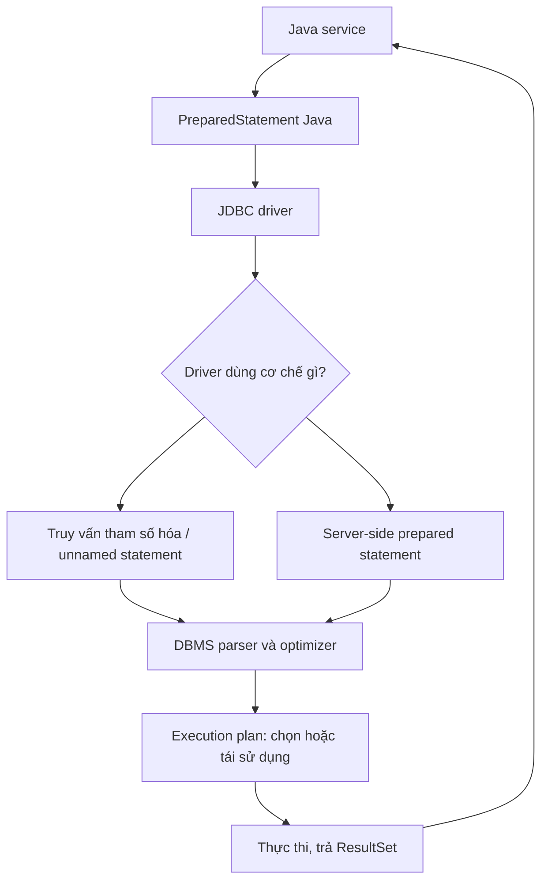

# Phân biệt tái sử dụng câu lệnh và lưu kế hoạch thực thi trong JDBC

## 1. Cùng là “prepare” nhưng không phải cùng một tối ưu

Khi dùng **JDBC** để ứng dụng Java truy cập cơ sở dữ liệu quan hệ, lập trình viên thường dùng `DataSource`, `Connection`, `PreparedStatement` và `ResultSet`. Một lời khuyên phổ biến là **tái sử dụng câu lệnh đã chuẩn bị để tăng hiệu năng**. Lời khuyên này đúng trong một số tình huống, nhưng dễ dẫn đến kết luận sai rằng **cứ tạo `PreparedStatement` là DBMS đã lưu một kế hoạch thực thi và luôn dùng lại kế hoạch đó**.

Trên thực tế phải phân biệt ít nhất hai câu hỏi:

1. **Tái sử dụng câu lệnh ở phía ứng dụng:** Có giữ và dùng lại cùng đối tượng `PreparedStatement` trong vòng đời một `Connection`, hay mỗi lần truy vấn lại tạo đối tượng mới?
2. **Lưu kế hoạch thực thi ở phía DBMS:** DBMS có giữ lại kết quả phân tích/biên dịch câu SQL hoặc kế hoạch truy cập dữ liệu để dùng ở lần sau không? Nó có thể chọn kế hoạch khác dựa trên dữ liệu thống kê, kiểu tham số và chi phí thực thi không?

Hai cơ chế có liên quan nhưng **không đồng nhất**. Một driver có thể gửi truy vấn theo giao thức tham số hóa mà chưa tạo server-side prepared statement. Ngược lại, DBMS có thể tái sử dụng kế hoạch cho các câu SQL giống nhau ngay cả khi ứng dụng đã đóng và tạo một đối tượng JDBC mới, tùy engine và chính sách cache.

Ví dụ nghiệp vụ cần đọc 100 lần danh sách đơn hàng của các khách hàng khác nhau. Có hai mục tiêu riêng:

- Tránh lặp lại công việc tạo/chuẩn bị statement phía Java và driver nếu nhiều lần gọi nằm trên **cùng connection**.
- Giảm công việc parse/plan phía DBMS nếu nó có cơ chế **server prepare** hoặc **plan cache** phù hợp.

Đo thời gian truy vấn thành công không đủ để biết cơ chế nào đang hoạt động. Bài học tập trung vào ranh giới giữa những tầng này, cách viết JDBC an toàn và cách **kiểm chứng tối ưu bằng bằng chứng thực tế** thay vì suy đoán.

## 2. Bốn tầng dễ bị gộp nhầm vào một “cache”

| Tầng | Đối tượng hoặc cơ chế | Phạm vi điển hình | Có phải cache kế hoạch thực thi? |
| --- | --- | --- | --- |
| **1. Ứng dụng Java** | Dùng lại cùng `PreparedStatement` sau khi đổi tham số. | Trong vòng đời `Connection` đang mở, thường một đơn vị công việc. | **Không nhất thiết.** Đây là tái sử dụng API JDBC và trạng thái statement. |
| **2. Driver/pool phía client** | Driver có thể cache thông tin statement hoặc handle khi statement được đóng. | Theo driver, connection vật lý, cấu hình và giới hạn cache. | **Không nhất thiết.** Cache client khác bộ nhớ kế hoạch phía server. |
| **3. Prepared statement phía server** | DBMS nhận lệnh/giao thức prepare, giữ thông tin câu SQL và tham số. | Thường theo session/kết nối phía server; có ngoại lệ theo DBMS. | Có thể hỗ trợ reuse parse/plan, nhưng không bảo đảm **một plan cố định**. |
| **4. Bộ nhớ kế hoạch của DBMS** | Cached/compiled execution plan, plan cache hoặc lựa chọn lại plan. | Theo cơ chế riêng của engine, workload và trạng thái cache. | **Đúng là cơ chế liên quan kế hoạch**, nhưng có thể bị loại, biên dịch lại hoặc thay đổi. |

Một **plan** mô tả cách DBMS dự định đọc dữ liệu: index scan, sequential scan, join algorithm, sort, ước lượng số hàng và chi phí. Một **câu SQL đã được prepare** không đồng nghĩa luôn có một plan duy nhất tồn tại vĩnh viễn; một số DBMS có thể chọn **custom plan** theo giá trị tham số hoặc **generic plan** để tái sử dụng.



**Điều gì là chuẩn JDBC?** `Connection.prepareStatement(sql)` tạo một đối tượng `PreparedStatement` để gửi SQL có placeholder. JDBC **không bắt buộc tất cả driver và DBMS phải có cùng thuật toán cache kế hoạch**, cùng ngưỡng server prepare hay cùng cách invalidation cache. Cần phân biệt hợp đồng API với tối ưu nội bộ.

## 3. Tách chi phí prepare, execute và fetch

Một truy vấn JDBC có thể phát sinh nhiều khoản chi phí. Bảng sau là mô hình để đo, **không phải cam kết rằng driver nào cũng làm đúng theo thứ tự này**:

| Giai đoạn | Ví dụ thao tác | Chi phí có thể phát sinh |
| --- | --- | --- |
| **Mượn kết nối** | `dataSource.getConnection()` | Chờ pool, validation, có thể tạo physical connection mới. |
| **Tạo statement** | `connection.prepareStatement(sql)` | Tạo đối tượng Java; một số driver có thể trao đổi với server ngay hoặc trì hoãn. |
| **Bind tham số** | `setLong()`, `setString()`, `setObject()` | Chuyển đổi kiểu, serialize dữ liệu, cập nhật trạng thái binding. |
| **Execute** | `executeQuery()` hoặc `executeUpdate()` | Round-trip, parse, lập/chọn plan, thực thi và chờ lock. |
| **Fetch và mapping** | `ResultSet.next()` và getter | Đọc kết quả qua mạng, giải mã kiểu, tạo đối tượng Java. |
| **Dọn tài nguyên** | `ResultSet.close()`, `PreparedStatement.close()` | Giải phóng tài nguyên statement; driver/pool có thể cache một phần. |
| **Trả kết nối** | `Connection.close()` khi dùng pool | Trả logical handle; physical connection có thể ở lại pool. |

Nếu thực thi SQL mất 500 ms vì quét nhiều hàng, tiết kiệm vài microsecond cho việc tạo statement thường không giải quyết vấn đề chính. Ngược lại, với truy vấn rất ngắn được gọi cực nhiều lần, chi phí parse, round-trip và driver có thể đáng quan tâm.

**Phân biệt thời gian đo:** Nếu đo từ `getConnection()` tới sau `ResultSet` được đọc hết, đó là **độ trễ đầu-cuối phía ứng dụng**, không phải riêng thời gian compile execution plan. Muốn biết DBMS có đang dùng cache hoặc lập kế hoạch lại hay không, cần công cụ/metadata riêng của DBMS và phép đo có kiểm soát.

## 4. SQL ví dụ: một cấu trúc truy vấn, nhiều bộ tham số

Giả sử ứng dụng có bảng PostgreSQL:

```sql
CREATE TABLE sales_orders (
    order_id BIGINT GENERATED ALWAYS AS IDENTITY PRIMARY KEY,
    customer_id BIGINT NOT NULL,
    status VARCHAR(24) NOT NULL,
    created_at TIMESTAMPTZ NOT NULL,
    total_amount NUMERIC(12, 2) NOT NULL
);

CREATE INDEX idx_orders_customer_status_time
    ON sales_orders (
        customer_id, status, created_at DESC, order_id DESC
    );
```

Service cần đọc các đơn mới nhất với cùng hình dạng SQL nhưng khác giá trị `customer_id`:

```sql
SELECT order_id, created_at, total_amount
FROM sales_orders
WHERE customer_id = ?
  AND status = ?
ORDER BY created_at DESC, order_id DESC
LIMIT ?;
```

Ba dấu `?` là **tham số dữ liệu**, không phải chỗ để ghép tên bảng, tên cột hoặc mã SQL. Với cùng cấu trúc câu SQL, có thể gán:

| Lần thực thi | `customer_id` | `status` | `LIMIT` |
| --- | ---: | --- | ---: |
| 1 | 42 | `PAID` | 10 |
| 2 | 57 | `PAID` | 10 |
| 3 | 99 | `CANCELLED` | 10 |

Việc tham số hóa là kỹ thuật **đúng đắn và bảo mật** (tránh đưa dữ liệu đầu vào thành cú pháp SQL). Nó cũng tạo cơ hội sử dụng lại SQL đã phân tích hoặc kế hoạch trong một số engine. Nhưng **tham số hóa không bảo đảm** chi phí thực thi luôn thấp hoặc tất cả lần chạy dùng cùng index: độ chọn lọc của `customer_id` và `status` có thể rất khác nhau.

## 5. Dùng lại một `PreparedStatement` trên cùng `Connection`

Đây là cách **tái sử dụng câu lệnh theo đúng nghĩa ở tầng Java**. Một phương thức mượn connection từ `DataSource`, tạo `PreparedStatement` một lần, thay tham số rồi thực thi nhiều lần:

```java
import javax.sql.DataSource;
import java.math.BigDecimal;
import java.sql.Connection;
import java.sql.PreparedStatement;
import java.sql.ResultSet;
import java.sql.SQLException;
import java.time.Instant;
import java.util.ArrayList;
import java.util.Collections;
import java.util.LinkedHashMap;
import java.util.List;
import java.util.Map;
import java.util.Objects;

public final class OrderReadService {
    private final DataSource dataSource;

    public OrderReadService(DataSource dataSource) {
        this.dataSource = Objects.requireNonNull(dataSource);
    }

    public record OrderSummary(
        long orderId, Instant createdAt, BigDecimal totalAmount
    ) {}

    public Map<Long, List<OrderSummary>> latestOrders(
            List<Long> customerIds, String status, int maxPerCustomer)
            throws SQLException {
        Objects.requireNonNull(customerIds, "customerIds");
        if (status == null || status.isBlank()) {
            throw new IllegalArgumentException("status không hợp lệ");
        }
        if (maxPerCustomer < 1 || maxPerCustomer > 100) {
            throw new IllegalArgumentException(
                "maxPerCustomer phải trong khoảng 1..100");
        }

        List<Long> ids = List.copyOf(customerIds);
        for (long id : ids) {
            if (id <= 0) {
                throw new IllegalArgumentException("customerId không hợp lệ");
            }
        }

        String sql = """
            SELECT order_id, created_at, total_amount
            FROM sales_orders
            WHERE customer_id = ? AND status = ?
            ORDER BY created_at DESC, order_id DESC
            LIMIT ?
            """;

        Map<Long, List<OrderSummary>> results = new LinkedHashMap<>();
        try (Connection connection = dataSource.getConnection();
             PreparedStatement statement =
                 connection.prepareStatement(sql)) {

            // Một PreparedStatement, nhiều bộ binding/execute.
            for (long customerId : ids) {
                statement.clearParameters(); // Phòng quên binding cũ.
                statement.setLong(1, customerId);
                statement.setString(2, status);
                statement.setInt(3, maxPerCustomer);

                List<OrderSummary> orders = new ArrayList<>();
                try (ResultSet rows = statement.executeQuery()) {
                    while (rows.next()) {
                        orders.add(new OrderSummary(
                            rows.getLong("order_id"),
                            rows.getTimestamp("created_at").toInstant(),
                            rows.getBigDecimal("total_amount")
                        ));
                    }
                }

                results.put(customerId, List.copyOf(orders));
            }
        }
        return Collections.unmodifiableMap(results);
    }
}
```

Cách gọi khi đã cấu hình `DataSource`:

```java
OrderReadService service = new OrderReadService(dataSource);
Map<Long, List<OrderReadService.OrderSummary>> byCustomer =
    service.latestOrders(List.of(42L, 57L, 99L), "PAID", 10);

byCustomer.forEach((customerId, orders) ->
    System.out.println(customerId + " -> " + orders.size() + " orders"));
```

**Ý nghĩa về hiệu năng và an toàn:**

- `connection.prepareStatement(sql)` được gọi **một lần**; đối tượng đó thực thi nhiều lần trên **cùng connection** với các bộ tham số khác nhau.
- Mỗi vòng lặp gán **đầy đủ ba dấu `?`**. `clearParameters()` là hàng rào phòng lỗi, không phải `clearBatch()`. Trong ví dụ này **không dùng batch**: mỗi `executeQuery()` trả một `ResultSet` riêng.
- `ResultSet` được **đóng trước lần execute tiếp theo**. Không giữ `ResultSet` của một lần chạy rồi đổi tham số để chạy lại cùng statement.
- `PreparedStatement` và `Connection` được đóng trong `try-with-resources`; nếu dùng pool, `close()` thường trả logical handle về pool.
- Service không giữ `PreparedStatement` ở field hoặc singleton và không cho nhiều thread cùng sử dụng một instance. Một statement gắn với connection và trạng thái execution cụ thể.
- Phần mapping tạo `List` nhỏ cho từng khách hàng nhờ giới hạn `LIMIT`; nếu không giới hạn, chi phí dữ liệu về Java có thể áp đảo lợi ích statement reuse.
- SQL có index minh họa nhưng hiệu năng thật còn phụ thuộc thống kê và phân bố dữ liệu.

**Cần chú ý:** Đoạn mã thực thi **N câu SELECT cho N khách hàng**. Tái sử dụng statement không xóa chi phí **N lần round-trip/execute**. Nếu `customerIds` có hàng nghìn phần tử, có thể tốt hơn khi viết một query theo tập, join, window function hoặc cách đọc khác phù hợp nghiệp vụ, thay vì mặc định lặp N lần. Đây là khác biệt giữa **tối ưu vi mô của JDBC** và **thiết kế truy vấn tổng thể**.

## 6. Khi nào cần tạo `PreparedStatement` mới?

Việc sử dụng lại object chỉ phù hợp khi có **nhiều lần thực thi trên một connection còn mở** và các lời gọi thuộc cùng phạm vi nghiệp vụ. Trong một API request chỉ cần chạy một SELECT, mẫu sau hoàn toàn đúng:

```java
try (Connection connection = dataSource.getConnection();
     PreparedStatement statement = connection.prepareStatement(
         "SELECT total_amount FROM sales_orders WHERE order_id = ?")) {

    statement.setLong(1, orderId);
    try (ResultSet rows = statement.executeQuery()) {
        if (rows.next()) {
            BigDecimal amount = rows.getBigDecimal(1);
            // Xử lý kết quả; không giữ rows sau try block.
        }
    }
}
```

Mỗi request có thể tạo `PreparedStatement` mới, nhưng driver có thể **cache metadata/statement hoặc thực hiện server prepare theo chính sách của nó**, và DBMS có thể có plan cache. Không cần phá ranh giới transaction và cố chia sẻ một statement toàn cục chỉ để “tránh prepare”.

**Không nên** lưu `PreparedStatement` trong biến `static` hoặc singleton khi nhiều request dùng pool: nó gắn với một connection cụ thể, có các tham số mutable, trạng thái thực thi/`ResultSet` và vòng đời không phù hợp dùng chung đa luồng. Nếu connection được trả về pool, statement cũ cũng không còn là handle an toàn để tiếp tục cho một request khác.

## 7. Driver-side statement cache và connection pool

Một số JDBC driver hỗ trợ **statement caching** hoặc **prepared statement caching**. Tùy driver, thao tác `PreparedStatement.close()` có thể trả một phần đối tượng/trạng thái statement vào cache để sử dụng lại khi `prepareStatement(sql)` sau này được gọi với những điều kiện tương thích.

Cần phân biệt:

- **Connection pool** giữ/tái sử dụng *kết nối vật lý*. Có pool **không tự cache PreparedStatement** vì việc đó đã được driver đảm nhiệm hiệu quả hơn; không được giả định pool nào cũng có cache statement.
- **Statement cache phía driver** có thể gắn với **connection vật lý**. Hai connection trong cùng pool không nhất thiết chia sẻ cùng handle statement đã chuẩn bị.
- **Server-side prepared statement** có thể được tạo sau một số lần dùng câu SQL, hoặc khi driver quyết định theo cơ chế/cấu hình. Driver có thể không tạo server-side statement cho mọi `PreparedStatement`.
- **Server plan cache** là cơ chế của engine, có thể có phạm vi, tuổi thọ và chính sách riêng, không đồng nhất với cache của driver.

Giả sử pool có 10 physical connections, mỗi connection dùng một query 10 lần. Một cache gắn theo connection có thể có tới **10 entry cho cùng một hình dạng SQL**, hoặc các entry tồn tại ở những thời điểm khác nhau. Không nên tính “ứng dụng gọi SQL 100 lần” rồi kết luận “server đã lập kế hoạch đúng một lần”.

### Khóa nhận dạng cache có thể khác nhau

Không phải chỉ văn bản SQL là đủ cho mọi engine. Một cơ chế cache có thể còn xét:

| Yếu tố | Vì sao có thể ảnh hưởng cache hoặc plan? |
| --- | --- |
| SQL text và chuẩn hóa SQL | Dấu cách, cấu trúc câu, literal, alias hoặc cách driver rewrite SQL có thể ảnh hưởng key. |
| Kiểu tham số | `BIGINT` khác `VARCHAR`, kiểu JSON/UUID riêng có thể đòi hỏi kế hoạch/ép kiểu khác. |
| Database/schema hiện hành | Cùng tên bảng nhưng ở schema khác có thể trỏ tới đối tượng khác. |
| Session settings | Search path, quyền, cấu hình optimizer, timezone hoặc thuộc tính môi trường theo engine. |
| Thay đổi DDL/thống kê | Index mới, đổi cấu trúc bảng hoặc cập nhật thống kê có thể làm plan cũ không còn phù hợp. |
| Trạng thái connection/session | Đóng session thật, transaction pooling hoặc failover có thể làm mất server prepared statement. |

Một lưu ý thực tế là **cache không miễn phí**: mỗi entry có thể chiếm bộ nhớ và tài nguyên phía client/server. Cache quá lớn trên nhiều connection có thể gây áp lực tài nguyên; cache quá nhỏ thì dễ *churn* và mất lợi ích reuse. Đừng tăng mọi giới hạn cache chỉ vì một truy vấn chậm.

### Dùng pool khác với giữ statement sống

Trong ứng dụng web, cách thường nên áp dụng là:

```text
Request A:
  lấy Connection từ DataSource
    -> tạo PreparedStatement
    -> bind / execute / đọc ResultSet
    -> close statement
  -> close logical Connection (trả về pool)

Request B:
  lấy Connection từ DataSource
    -> tạo PreparedStatement mới ở API JDBC
       (driver có thể reuse phần nào nếu trúng cache)
    -> execute / close
  -> trả connection về pool
```

Không lấy statement đã đóng ở Request A đem sang Request B. Nếu muốn kiểm tra cache có thực sự hoạt động, cần quan sát cơ chế/metrics của **driver và DBMS** chứ không căn cứ vào số lần `new` của Java hoặc identity của proxy connection.

## 8. Server-side prepare: ví dụ PostgreSQL

PostgreSQL cho phép tạo prepared statement theo session bằng lệnh SQL `PREPARE`. Đây là **ví dụ dùng để quan sát khái niệm ở DBMS**, không phải thao tác JDBC bắt buộc khi sử dụng `PreparedStatement`:

```sql
-- Chạy các lệnh trong CÙNG MỘT session PostgreSQL.
PREPARE recent_orders(bigint, varchar, integer) AS
SELECT order_id, created_at, total_amount
FROM sales_orders
WHERE customer_id = $1 AND status = $2
ORDER BY created_at DESC, order_id DESC
LIMIT $3;

EXECUTE recent_orders(42, 'PAID', 10);
EXECUTE recent_orders(57, 'PAID', 10);
EXECUTE recent_orders(99, 'CANCELLED', 10);

-- Quan sát thông tin statement trong session hiện tại.
SELECT name, statement, parameter_types, from_sql
FROM pg_prepared_statements
WHERE name = 'recent_orders';

DEALLOCATE recent_orders;
```

Giải thích:

- `PREPARE` đăng ký một câu SQL có tên và kiểu tham số trong **session PostgreSQL hiện tại**.
- `EXECUTE` truyền các giá trị tham số cho prepared statement đó.
- `pg_prepared_statements` hỗ trợ quan sát những prepared statement **còn tồn tại trong session mà câu lệnh đang chạy nhìn thấy**, không phải danh sách tổng quát của mọi session trên cả cluster.
- `DEALLOCATE` giải phóng prepared statement có tên. Nếu tạo lại `recent_orders` cùng tên trong một session mà chưa giải phóng, DBMS có thể báo lỗi trùng tên.

**Phân biệt hai cú pháp:** Trong Java, `connection.prepareStatement("... WHERE customer_id = ?")` nhận dấu hỏi JDBC `?`. Trong lệnh `PREPARE` SQL PostgreSQL ở trên, tham số xuất hiện dưới dạng `$1`, `$2`, `$3`. **Không tự thay dấu `?` của JDBC thành `$1` trong mã Java** chỉ vì đang dùng PostgreSQL; driver chịu trách nhiệm giao thức và cách biểu diễn tham số phía server.

Driver pgJDBC có thể sử dụng các bước prepare/bind/execute của giao thức PostgreSQL và có cấu hình về lúc chuyển sang server-side prepare. Việc gọi `Connection.prepareStatement()` **một lần** không bắt buộc có ngay một named prepared statement như ví dụ SQL `PREPARE`; chi tiết tùy **phiên bản driver, ngưỡng prepare, loại câu SQL và connection**.

### Server prepared statement không đồng nghĩa plan cố định

PostgreSQL có thể chọn một **custom plan** dựa trên giá trị tham số hoặc một **generic plan** có thể tái sử dụng giữa nhiều lần thực thi. Việc chọn cách nào phụ thuộc chính sách lập kế hoạch và điều kiện thực tế của hệ thống. Câu `PREPARE` xác định câu lệnh và kiểu tham số, **không bảo đảm rằng optimizer sẽ không lập plan lại**.

Để quan sát kế hoạch thực thi cho một lần `EXECUTE` trong môi trường thử nghiệm:

```sql
PREPARE recent_orders(bigint, varchar, integer) AS
SELECT order_id, created_at, total_amount
FROM sales_orders
WHERE customer_id = $1 AND status = $2
ORDER BY created_at DESC, order_id DESC
LIMIT $3;

EXPLAIN (ANALYZE, BUFFERS)
EXECUTE recent_orders(42, 'PAID', 10);

EXPLAIN (ANALYZE, BUFFERS)
EXECUTE recent_orders(57, 'PAID', 10);

DEALLOCATE recent_orders;
```

`EXPLAIN ANALYZE` **thực thi câu SELECT** để đo nên phải dùng dữ liệu/quyền phù hợp. Nó cho thấy kế hoạch và thống kê thực thi; **hai plan trông giống nhau không tự chứng minh cache hit**, và hai plan khác nhau có thể là optimizer lựa chọn hợp lý theo tham số. Các phiên bản PostgreSQL khác nhau cung cấp những trường thống kê về plan khác nhau; không phụ thuộc vào một cột hệ thống chưa xác nhận trên phiên bản triển khai.

Với DBMS khác, cú pháp `PREPARE`/`EXECUTE`, thời gian sống của plan và công cụ quan sát sẽ khác. Không copy `pg_prepared_statements` sang SQL Server, Oracle hoặc MySQL rồi cho rằng đó là API chung của JDBC.

## 9. “Parameter sniffing” và trường hợp cache plan làm truy vấn chậm

Không phải **tái sử dụng một kế hoạch** lúc nào cũng tốt. Giả sử `sales_orders` có hai khách hàng:

| Khách hàng | Hàng thỏa filter `status = 'PAID'` | Đặc điểm |
| --- | ---: | --- |
| A | 5 | Truy vấn rất chọn lọc. |
| B | 5.000.000 | Truy vấn có thể phải đọc nhiều dữ liệu. |

Một kế hoạch được tối ưu cho một tập tham số có thể không tối ưu cho tập khác. Các DBMS có cơ chế thống kê và lựa chọn kế hoạch khác nhau. Thuật ngữ **parameter sniffing** thường được dùng khi optimizer sử dụng giá trị tham số tại một thời điểm để lựa chọn kế hoạch, và kế hoạch được dùng lại có thể không phù hợp với các giá trị về sau.

Với PostgreSQL, nên nói chính xác hơn về **generic plan** so với **custom plan**; một generic plan đôi khi tốt cho hầu hết giá trị, đôi khi không phù hợp với phân bố dữ liệu lệch. Với DBMS khác, tên thuật ngữ và cách điều chỉnh có thể khác.

Biểu hiện thường gặp khi khảo sát hiệu năng:

- Cùng một SQL nhưng độ trễ biến thiên rất mạnh theo bộ tham số.
- Index scan, sequential scan, join strategy hoặc cardinality estimate khác nhau.
- Sau cập nhật thống kê, thêm index hoặc biên dịch lại, kế hoạch và độ trễ thay đổi.
- “Warm-up” làm câu SQL nhanh hơn nhưng không chứng minh nguyên nhân chỉ đến từ plan cache; data cache của DBMS/OS cũng có thể đã nóng.

**Hướng xử lý:** xem query plan và thống kê thực tế theo **nhiều nhóm tham số đại diện**, xác nhận index và phân bố dữ liệu, rồi mới cân nhắc điều chỉnh query, thống kê hoặc chính sách plan theo DBMS mục tiêu. Đừng ép mọi query dùng một kế hoạch cố định hay bật một tùy chọn driver trên toàn hệ thống mà chưa đo.

## 10. Tái sử dụng statement không thay thế thiết kế truy vấn tốt

Hai nhóm tối ưu khác nhau có thể cùng cần thiết:

| Vấn đề thực tế | Tái sử dụng `PreparedStatement` có giúp? | Biện pháp hiệu quả hơn có thể là |
| --- | --- | --- |
| Nhiều lần gọi câu SQL giống nhau trên một connection | Có thể giảm chi phí tạo/prepare ở client/driver. | Reuse theo phạm vi công việc, xem cache driver nếu cần. |
| SQL thiếu index, phải quét hàng triệu bản ghi | Thường không giải quyết nguyên nhân chính. | Index phù hợp, thay filter, `EXPLAIN`, tránh `SELECT *`. |
| Một request thực hiện N+1 queries | Không xóa N lần round-trip. | Thiết kế câu query theo tập, join, batch retrieval. |
| Kết quả quá lớn, tạo `List` hàng triệu phần tử | Không giảm kích thước dữ liệu về. | Pagination, streaming/fetch size phù hợp, giới hạn cột. |
| INSERT/UPDATE nhiều hàng | Reuse giúp bind nhiều lần nhưng vẫn có nhiều lệnh. | `addBatch()`/`executeBatch()` nếu driver hỗ trợ, transaction rõ ràng. |
| Pool thiếu kết nối, nhiều request chờ mượn | Không trực tiếp khắc phục. | Rút ngắn thời gian giữ connection, tối ưu query, cân đối pool và DBMS. |
| Plan được reuse nhưng không phù hợp một nhóm tham số | Có thể còn làm chậm nếu engine giữ plan kém phù hợp. | Xem plan theo phân bố tham số, thống kê và tùy chọn DBMS. |
| Phân tích SQL/plan tốn đáng kể ở truy vấn rất ngắn | Có thể có lợi gián tiếp qua server prepare/plan cache. | Kiểm chứng driver/server behavior và đo CPU/planning time. |

Với `PreparedStatement`, **đừng nhầm reuse SELECT với batching**. `addBatch()` thường dành cho các lệnh DML, và không nên suy rằng ghép nhiều `executeQuery()` vào một batch là cách JDBC chuẩn để nhận nhiều `ResultSet` tương ứng. Muốn đọc nhiều khách hàng một lượt, hãy cân nhắc query theo tập hoặc truy vấn trả kết quả gộp khi schema/DBMS cho phép.

## 11. Thí nghiệm Java: tạo statement mỗi lần so với dùng lại một object

Để phân biệt chi phí tạo statement ở tầng Java/driver, hãy giữ tương đối giống nhau những yếu tố khác: **cùng SQL, cùng connection vật lý, cùng dãy giá trị tham số, cùng cách đọc hết kết quả**, chỉ đổi cách cấp phát và đóng `PreparedStatement`.

Đây là một mẫu Java 17+ phục vụ kiểm tra trong môi trường thử nghiệm:

```java
import java.sql.Connection;
import java.sql.PreparedStatement;
import java.sql.ResultSet;
import java.sql.SQLException;

public final class StatementReuseExperiment {
    private static final String SQL = """
        SELECT order_id
        FROM sales_orders
        WHERE customer_id = ? AND status = ?
        ORDER BY created_at DESC, order_id DESC
        LIMIT 1
        """;

    private StatementReuseExperiment() {}

    public static long newStatementForEveryCall(
            Connection connection, long[] ids) throws SQLException {
        long checksum = 0L;

        for (long id : ids) {
            try (PreparedStatement ps = connection.prepareStatement(SQL)) {
                ps.setLong(1, id);
                ps.setString(2, "PAID");

                try (ResultSet rs = ps.executeQuery()) {
                    if (rs.next()) {
                        checksum += rs.getLong(1);
                    }
                }
            }
        }
        return checksum;
    }

    public static long reuseOneStatement(
            Connection connection, long[] ids) throws SQLException {
        long checksum = 0L;

        try (PreparedStatement ps = connection.prepareStatement(SQL)) {
            for (long id : ids) {
                ps.clearParameters();
                ps.setLong(1, id);
                ps.setString(2, "PAID");

                try (ResultSet rs = ps.executeQuery()) {
                    if (rs.next()) {
                        checksum += rs.getLong(1);
                    }
                }
            }
        }
        return checksum;
    }
}
```

Để chạy một vòng đo, caller tạo `long[] ids` và mượn một connection:

```java
try (Connection connection = dataSource.getConnection()) {
    long[] ids = {42L, 57L, 99L, 42L, 57L, 99L};

    // Chạy warm-up riêng trước khi lấy số đo chính thức.
    StatementReuseExperiment.reuseOneStatement(connection, ids);
    StatementReuseExperiment.newStatementForEveryCall(connection, ids);

    long t0 = System.nanoTime();
    long reused = StatementReuseExperiment.reuseOneStatement(
        connection, ids);
    long reuseNanos = System.nanoTime() - t0;

    long t1 = System.nanoTime();
    long created = StatementReuseExperiment.newStatementForEveryCall(
        connection, ids);
    long createNanos = System.nanoTime() - t1;

    if (reused != created) {
        throw new IllegalStateException("Hai cách trả kết quả không khớp");
    }
    System.out.printf(
        "reuse=%d ns, create-each-time=%d ns%n",
        reuseNanos, createNanos);
}
```

**Không coi một lượt đo như trên là benchmark đáng tin cậy.** Thứ tự đo có thể tạo lợi thế cho đường chạy sau vì JIT, cache dữ liệu, connection warm-up, prepared statement cache và hiệu ứng mạng. Dãy sáu ID còn quá nhỏ để kết luận hiệu năng production. Khi kiểm thử nghiêm túc, hãy:

1. Sử dụng dataset và phân bố tham số đại diện, ở môi trường không có workload lạ.
2. Giữ nguyên SQL, transaction, connection, isolation và cách tiêu thụ `ResultSet`.
3. Warm-up đủ lâu, chạy nhiều vòng; **đảo thứ tự** hai phương án giữa các vòng.
4. Đo trung vị và tail latency; quan sát cả CPU, network, DB planning/execution time.
5. Chạy thêm một cấu hình có **statement cache của driver tắt/bật nếu được hỗ trợ**, rồi so sánh. Đừng đồng nhất mọi khác biệt với server plan cache.
6. Xác nhận checksum hoặc dữ liệu trả về giống nhau để tránh tối ưu “nhanh” nhờ vô tình không đọc hết kết quả.

Ví dụ đơn giản ở trên đo **độ trễ toàn chuỗi thao tác phía client**, gồm cả các câu SQL và round-trip. Nó **không tách riêng** thời gian DBMS lập plan. Để đánh giá plan cache, cần thêm quan sát phía database (mục 12).

## 12. Đo thế nào để biết điều gì thực sự được tái sử dụng?

Một quy trình đo hiệu năng thực dụng nên kết hợp ít nhất ba góc nhìn:

| Góc nhìn | Điều cần ghi nhận | Không thể kết luận chỉ từ số liệu đó |
| --- | --- | --- |
| **Ứng dụng Java** | Số lần `prepareStatement()`, `executeQuery()`, thời gian mượn pool, độ trễ đầu-cuối, số hàng đọc. | DBMS chắc chắn đã reuse một execution plan. |
| **JDBC driver/pool** | Bật/tắt statement cache nếu hỗ trợ, số lần chuẩn bị ở server, cache hit/miss hoặc log protocol nếu có. | Một cache hit client nhất định là cache hit plan của DBMS. |
| **DBMS** | Plan/parse metrics, kế hoạch `EXPLAIN`, số lần thực thi, planning time, số liệu theo câu SQL và session. | Giảm planning time là nguyên nhân duy nhất giảm độ trễ toàn request. |

Với PostgreSQL có thể dùng:

- `EXPLAIN (ANALYZE, BUFFERS)` trên truy vấn đại diện, quan sát loại scan, estimated/actual rows, buffer usage và thời gian thực thi.
- `EXPLAIN ... EXECUTE prepared_name(...)` khi đang kiểm tra một SQL prepared statement trong **cùng session**.
- `pg_prepared_statements` để xem các statement còn tồn tại ở session kiểm tra. Nó không phải bảng tổng hợp plan của mọi connection.
- Các extension thống kê như `pg_stat_statements` **nếu đã được cài và cấu hình phù hợp**, để theo dõi workload theo hình dạng SQL; khả năng thống kê thời gian planning phụ thuộc phiên bản và cấu hình.

Với DBMS khác, tìm các thống kê về parse count, plan compilation, execution count, buffer reads, recompile/invalidation và query latency của chính engine đó. Không khẳng định cùng một metric có tên hoặc cách tính giống nhau ở mọi nhà cung cấp.

### Cần phân biệt cache dữ liệu và cache kế hoạch

Độ trễ thường giảm sau lần đầu vì **data pages đã vào buffer pool**, OS page cache đã nóng, JIT đã warm-up hoặc connection đã tồn tại. Đây không nhất thiết là bằng chứng plan cache hoạt động. Khi so sánh “lần 1 chậm, lần 2 nhanh”, hãy xem:

- Lần đầu có tạo connection vật lý mới hay không?
- Số buffer read từ đĩa đã giảm ở các lần sau không?
- Server có thực sự lập lại kế hoạch hay dùng generic/custom plan?
- SQL text, tham số, thống kê và trạng thái transaction có giống nhau không?
- Có đồng thời thay đổi số hàng trả về, lock contention hoặc tải DBMS không?

Một phép đo chỉ có ích khi xác định rõ **giả thuyết**, phương pháp đo và các yếu tố gây nhiễu.

## 13. Các lỗi thiết kế thường gặp

| Nhầm lẫn | Hệ quả | Cách xử lý |
| --- | --- | --- |
| Gọi `prepareStatement()` là DBMS chắc chắn lưu một plan mãi mãi. | Suy đoán sai nguồn chi phí, cấu hình cache không có tác dụng như kỳ vọng. | Kiểm chứng driver/server prepare và plan metrics riêng. |
| Chuyển `PreparedStatement` thành `static` để dùng mọi request. | Chia sẻ trạng thái binding và connection không an toàn. | Tái sử dụng trong phạm vi một connection/work unit; dùng pool hợp lý. |
| Giữ `ResultSet` mở trong lúc `executeQuery()` lại cùng statement. | ResultSet trước có thể bị đóng/vô hiệu hóa, sai vòng đời. | Đọc hết và đóng ResultSet trước lần execute sau. |
| Không gán lại đủ tham số khi reuse. | Giá trị của lần trước có thể bị dùng nhầm. | Bind tất cả vị trí, xử lý SQL `NULL` tường minh. |
| Cho rằng connection pool tự có statement cache. | Điều chỉnh sai chỗ, tốn bộ nhớ hoặc bỏ qua tính năng driver. | Xem tài liệu đúng pool/driver và thông số kiểm chứng. |
| Tạo query bằng cách nối literal thay vì placeholder. | Rủi ro SQL injection và thay đổi hình dạng SQL liên tục. | Dùng `PreparedStatement` và bind giá trị với kiểu ổn định. |
| Tối ưu prepare trước khi nhìn `EXPLAIN`. | Bỏ sót nguyên nhân quét nhiều dữ liệu hoặc thiếu index. | Đo phần tốn thời gian nhất và tối ưu query trước. |
| Chỉ đo lần chạy thứ hai và gọi là “plan cache hit”. | Nhầm với data cache/JIT/connection warm-up. | Đo đa vòng, phân tách planning/execution/fetch. |
| Tắt/bật server prepare trên toàn ứng dụng không đo. | Có thể cải thiện query này nhưng làm xấu query khác. | Test nhiều loại SQL và phân bố tham số; so sánh trước/sau. |
| Ép reuse một generic plan cho dữ liệu lệch. | Plan có thể kém cho nhóm tham số khác. | Xem custom/generic plan và thống kê thực tế. |
| Dùng nhiều lần SELECT trong vòng lặp N+1 và cho rằng đã tối ưu. | N round-trip vẫn tồn tại. | Thiết kế query theo tập hoặc cách đọc phù hợp. |
| Quên đóng `PreparedStatement` vì muốn cache lâu hơn. | Rò rỉ tài nguyên statement/result set, giữ connection. | Đóng đúng hạn; để driver/pool quản lý cache. |
| Tin mọi cached plan có thể sống qua reconnect/failover. | Lỗi statement không tồn tại hoặc kế hoạch bị reset. | Hiểu phạm vi session, xử lý reconnect và invalidation. |

## 14. Checklist trước khi bật tối ưu statement/plan cache

1. **Xác định mục tiêu.** Muốn giảm CPU parse/plan, giảm độ trễ round-trip, tăng throughput hay giảm thời gian đọc dữ liệu?
2. **Đo đường cơ sở.** P50/P95/P99 latency, thời gian chờ pool, thời gian execute/fetch, số hàng trả về và query plan.
3. **Kiểm tra SQL.** Dùng tham số hóa, kiểu tham số ổn định, index phù hợp; không tối ưu cache khi query đang quét bảng ngoài ý muốn.
4. **Xác định phạm vi reuse.** Có nhiều lần chạy trên cùng connection không? Hay mỗi request thực hiện một SQL và trả connection ngay?
5. **Kiểm tra driver.** Có statement cache, server prepare, ngưỡng kích hoạt hoặc yêu cầu đặc biệt về transaction/session không?
6. **Kiểm tra pool/proxy DB.** Physical connection có được tái sử dụng không? Có transaction pooling/proxy làm thay đổi hợp đồng session và server prepare không?
7. **Xem cơ chế DBMS.** Plan cache nằm ở đâu, khi nào bị evict/replan, có generic/custom plan hay hành vi tương tự?
8. **Thử nhiều tham số.** Có tập giá trị rất chọn lọc và ít chọn lọc không? Một kế hoạch chung có làm chậm một nhóm?
9. **Thử tải thật.** Chạy warm-up và nhiều vòng, đảo thứ tự thí nghiệm, quan sát CPU, memory, connection và plan metrics.
10. **Kiểm tra vòng đời và an toàn.** Không chia sẻ statement qua thread, đóng ResultSet/statement, không giữ handle sau khi trả connection về pool.
11. **Theo dõi sau triển khai.** Giám sát plan regression, cache churn, lỗi sau reconnect, thay đổi thống kê và nâng cấp driver/DBMS.

## 15. Ghi nhớ

**Tái sử dụng câu lệnh** nghĩa là có thể dùng lại cùng `PreparedStatement` để bind và thực thi nhiều bộ tham số trong phạm vi một `Connection`, hoặc để driver quản lý cache khi ta đóng/tạo lại statement. **Lưu kế hoạch thực thi** là chuyện khác: DBMS có thể chuẩn bị, tái sử dụng, thay đổi hoặc loại plan theo session, tham số, thống kê và chính sách optimizer. Không có quan hệ một-một bắt buộc giữa một đối tượng Java và một plan phía server.

Trong ứng dụng **JDBC**, hãy ưu tiên SQL tham số hóa, vòng đời tài nguyên đúng, transaction rõ ràng và kế hoạch truy vấn phù hợp. Chỉ triển khai hoặc điều chỉnh statement/plan caching sau khi đã phân biệt được **chi phí tạo statement**, **chi phí lập kế hoạch**, **chi phí thực thi** và **chi phí đọc ResultSet** trên đúng driver, pool và DBMS đang sử dụng. Một tối ưu đo được, có thể lặp lại và giữ đúng dữ liệu quan trọng hơn giả định rằng “prepare một lần là plan được cache mãi mãi”.
