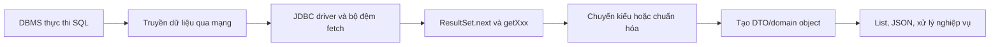

# Đo chi phí ánh xạ, chuyển kiểu và cấp phát đối tượng

Khi một ứng dụng Java đọc dữ liệu từ cơ sở dữ liệu quan hệ qua **JDBC**, thời gian trả kết quả không chỉ là thời gian DBMS chạy SQL. Sau khi driver nhận dữ liệu, ứng dụng còn phải chuyển các giá trị SQL thành kiểu Java, tạo đối tượng nghiệp vụ (DTO/domain object), có thể chuyển đổi định dạng lần nữa, rồi lưu chúng vào bộ sưu tập hoặc tuần tự hóa thành JSON. Với truy vấn trả vài chục hàng, chi phí này thường nhỏ; với hàng trăm nghìn hàng, việc tạo nhiều `String`, `BigDecimal`, đối tượng thời gian và DTO có thể làm tăng CPU, bộ nhớ và hoạt động của garbage collector (GC).

Trong chương **Hiệu năng** của module **JDBC**, bài này hướng dẫn **đo** ba loại chi phí thường bị gộp chung: **ánh xạ hàng** từ `ResultSet`, **chuyển kiểu** SQL–Java và **cấp phát đối tượng**. Bạn sẽ dùng `DataSource`, `PreparedStatement`, `ResultSet`, getter có kiểu, `System.nanoTime()` và công cụ quan sát heap/GC để so sánh các cách đọc dữ liệu công bằng trước khi tối ưu.

> **Nguyên tắc chính:** Đừng kết luận “mapping Java chậm” chỉ vì một request đọc nhiều hàng mất nhiều thời gian. Phải tách chi phí DBMS, mạng, fetch của JDBC, giải mã giá trị, tạo object và xử lý sau truy vấn. Tối ưu phải giữ nguyên **ý nghĩa dữ liệu** và dựa trên phép đo có thể lặp lại.

## 1. Một hàng dữ liệu đi qua những lớp chi phí nào?

Giả sử ứng dụng cần tạo báo cáo từ bảng giao dịch:

```sql
CREATE TABLE payment_events (
    id BIGINT PRIMARY KEY,
    amount DECIMAL(18, 2) NOT NULL,
    occurred_at TIMESTAMP NOT NULL,
    status VARCHAR(20) NOT NULL
);
```

Một truy vấn cơ bản:

```sql
SELECT id, amount, occurred_at, status
FROM payment_events
ORDER BY id;
```

Luồng xử lý có thể hình dung như sau:



| Lớp chi phí | Ví dụ | Phải đo hoặc kiểm tra ở đâu? |
| --- | --- | --- |
| **Thực thi SQL** | Quét bảng, dùng index, sắp xếp, chờ khóa. | Query plan, thời gian/đợi của DBMS. |
| **Mạng và fetch** | Truyền 100.000 hàng qua socket, gọi `rs.next()` phải lấy đợt tiếp theo. | Tracing, bytes truyền, fetch size, đo vòng lặp đọc kết quả. |
| **Giải mã kiểu SQL** | Driver biến `DECIMAL` thành `BigDecimal`, `VARCHAR` thành `String`. | Profiling CPU và allocation trong driver; so sánh getter trên cùng dữ liệu. |
| **Chuyển kiểu bổ sung** | `Timestamp` sang `LocalDateTime`, `BigDecimal` sang chuỗi tiền tệ. | Đo biến thể chuyển đổi có cùng đầu ra nghiệp vụ. |
| **Ánh xạ đối tượng** | Tạo `PaymentEvent` mới từ bốn cột mỗi hàng. | So sánh vòng đọc có/không lưu DTO; allocation profiling. |
| **Lưu giữ và tuần tự hóa** | Thêm DTO vào `ArrayList` hoặc tạo JSON cho API. | Heap retained, GC, profiler cho serializer. |

**Đừng cộng trực tiếp các số đo không độc lập.** Ví dụ, thời gian vòng lặp `rs.next()` đã bao gồm chờ fetch tiếp từ mạng lẫn gọi getter và mapping. Khi `executeQuery()` trả nhanh, phần lớn công việc vẫn có thể xảy ra **trong lần gọi `next()` đầu hoặc những lần fetch tiếp theo**. “Thời gian `executeQuery()`” **không phải** “tổng thời gian SQL và đọc dữ liệu”.

## 2. Đặt giả thuyết trước khi benchmark

Thay vì bắt đầu bằng “thay `getObject()` bằng `getString()` sẽ nhanh hơn”, hãy đặt câu hỏi đo lường cụ thể:

1. **Truy vấn trả bao nhiêu hàng và byte?** Tổng hàng, số cột, dữ liệu cột dài, `BLOB` và `CLOB` có thể quyết định thời gian truyền hơn là mapper.
2. **Driver có cấp phát nhiều đối tượng trung gian không?** Ví dụ việc đọc cột thời gian có tạo `Timestamp` rồi mới chuyển sang `LocalDateTime` hay driver hỗ trợ ánh xạ trực tiếp?
3. **Mapping chỉ tạo DTO hay còn chuẩn hóa dữ liệu?** Gọi parser ngày, regex, JSON, format tiền trong mapper thường đắt hơn một constructor đơn giản.
4. **Ứng dụng stream từng hàng hay giữ toàn bộ danh sách?** Tạo DTO để xử lý tức thì khác với giữ 500.000 DTO trong heap.
5. **Đo throughput hay độ trễ?** Một batch job ưu tiên rows/s có thể chọn khác một API cần p99 latency thấp và giới hạn bộ nhớ.

Đặt **tiêu chí đúng đắn** trước: dữ liệu sau hai cách đọc phải có cùng số hàng, kiểu số chính xác, trạng thái `NULL`, ngày giờ, đơn vị tiền và thứ tự hàng nếu ứng dụng dựa vào thứ tự. Không được đánh đổi `DECIMAL` lấy `double` chỉ để có benchmark nhanh hơn nếu ứng dụng cần tính tiền chính xác.

## 3. Getter và kiểu Java ảnh hưởng trực tiếp đến chi phí

JDBC có nhiều cách đọc cùng một cột. Những cách này **không tương đương hoàn toàn về ngữ nghĩa**:

| Kiểu cột SQL | API thường dùng | Kiểu Java/khoản chi phí cần để ý |
| --- | --- | --- |
| `BIGINT NOT NULL` | `rs.getLong(index)` | Trả `long` nguyên thủy; không phải tạo `Long` chỉ để biểu diễn giá trị này. |
| `BIGINT` có thể `NULL` | `getLong` rồi `wasNull`, hoặc `getObject(index, Long.class)` | Getter nguyên thủy trả `0` khi SQL `NULL`; cần `wasNull()` để phân biệt. Getter đối tượng có thể cấp phát wrapper. |
| `DECIMAL(18,2)` | `rs.getBigDecimal(index)` | Giữ độ chính xác thập phân; `BigDecimal` là object và có thể liên quan dữ liệu `BigInteger`. |
| `VARCHAR` | `rs.getString(index)` | Driver giải mã ký tự và thường cấp phát `String`. |
| `TIMESTAMP` không mang timezone | `rs.getObject(index, LocalDateTime.class)` | API kiểu Java Time từ JDBC 4.2 nếu driver hỗ trợ; có thể đỡ một bước chuyển đổi ở mã ứng dụng. |
| `TIMESTAMP` theo ánh xạ truyền thống | `rs.getTimestamp(index)` rồi `toLocalDateTime()` | Có thể có đối tượng `Timestamp` trung gian; xem xét khác biệt timezone và driver. |
| `BLOB` lớn | `getBinaryStream` hoặc API LOB thích hợp | Streaming tránh tạo một `byte[]` cực lớn bằng `getBytes`, nhưng giữ `ResultSet`/`Connection` lâu khi đọc. |

Ví dụ cùng cột `BIGINT`:

```java
long value = rs.getLong("external_id");
boolean isNull = rs.wasNull(); // Phải gọi ngay sau getter cần kiểm tra.

Long boxed = rs.getObject("external_id", Long.class);
// boxed có thể là null; chi phí và hỗ trợ ánh xạ phụ thuộc driver.
```

Ở đây `rs` là `ResultSet` đang đứng tại một hàng. **Không** kết luận hai cách nhanh/chậm dựa trên một giá trị đơn lẻ. Nếu cột khai báo `NOT NULL`, `getLong` thường đơn giản hơn khi ứng dụng chỉ cần `long`. Nếu cần biểu diễn `NULL`, dùng wrapper hoặc quy tắc `wasNull` đúng; không được dùng giá trị `0` làm ký hiệu `NULL` khi `0` là một giá trị hợp lệ.

### Tránh chuyển kiểu vòng vèo

Ví dụ không nên làm nếu đầu ra cần một giá trị số:

```java
// Có thể gây tạo String và parse lại dù DB đã có kiểu số.
long id = Long.parseLong(rs.getString("id"));
```

Đọc trực tiếp:

```java
long id = rs.getLong("id");
```

Tuy nhiên, **không được bỏ qua semantics**: `getString` đôi khi dùng cho định dạng hiển thị, còn `getLong` chỉ diễn đạt giá trị số. Với cột `DECIMAL` chứa phần thập phân, `getLong` có thể làm mất thông tin; phải chọn `BigDecimal` hoặc kiểu phù hợp với hợp đồng nghiệp vụ. Và `getObject(index, LocalDateTime.class)` cần được kiểm tra trên driver thực tế; nếu không hỗ trợ thì dùng ánh xạ thời gian tương thích và xác định rõ ý nghĩa timezone.

## 4. Ví dụ đo ba giai đoạn: lấy kết nối, thực thi ban đầu, tiêu thụ kết quả

Mã Java sau xây một phép đo lặp lại được trên cùng bảng `payment_events`. Hai chế độ:

- **`READ_TYPED`:** đọc đủ bốn cột bằng getter có kiểu, tính checksum nhỏ rồi bỏ giá trị sau mỗi hàng; **không tạo DTO của ứng dụng**.
- **`MAP_AND_RETAIN`:** đọc đúng bốn cột đó, tạo một `PaymentEvent` cho mỗi hàng và **giữ vào `ArrayList`**. Danh sách được đưa ra ngoài phương thức để tránh JIT dễ dàng loại bỏ toàn bộ đối tượng thử nghiệm.

Hai chế độ dùng cùng SQL, cùng getter và cùng checksum, nhưng chúng **không chỉ khác đúng một constructor**: chế độ thứ hai còn có thao tác mở rộng danh sách và giữ object trong heap. Đây là phép đo thực tiễn cho **chi phí bổ sung khi materialize kết quả**, không phải phép đo riêng biệt hoàn hảo của constructor.

```java
import java.math.BigDecimal;
import java.sql.Connection;
import java.sql.PreparedStatement;
import java.sql.ResultSet;
import java.sql.SQLException;
import java.time.LocalDateTime;
import java.util.ArrayList;
import java.util.List;
import java.util.Objects;
import javax.sql.DataSource;

public final class JdbcMappingProbe {
    private static final String SQL =
            "SELECT id, amount, occurred_at, status "
            + "FROM payment_events ORDER BY id";

    private final DataSource dataSource;

    public JdbcMappingProbe(DataSource dataSource) {
        this.dataSource = Objects.requireNonNull(dataSource);
    }

    public enum Mode {
        READ_TYPED,
        MAP_AND_RETAIN
    }

    public Sample measure(Mode mode, int maxRows) throws SQLException {
        Objects.requireNonNull(mode);
        if (maxRows < 1 || maxRows > 20_000) {
            // Giới hạn để ví dụ không giữ lượng DTO quá lớn.
            throw new IllegalArgumentException("maxRows phải từ 1 đến 20000");
        }

        long beforeAcquire = System.nanoTime();
        try (Connection connection = dataSource.getConnection()) {
            long afterAcquire = System.nanoTime();

            try (PreparedStatement ps = connection.prepareStatement(
                    SQL,
                    ResultSet.TYPE_FORWARD_ONLY,
                    ResultSet.CONCUR_READ_ONLY)) {
                ps.setMaxRows(maxRows);
                ps.setFetchSize(Math.min(500, maxRows));
                ps.setQueryTimeout(30);

                long beforeExecute = System.nanoTime();
                try (ResultSet rs = ps.executeQuery()) {
                    long afterExecute = System.nanoTime();

                    List<PaymentEvent> retained =
                            mode == Mode.MAP_AND_RETAIN
                                    ? new ArrayList<>() : null;
                    long count = 0;
                    long checksum = 0;

                    while (rs.next()) {
                        long id = rs.getLong(1);
                        BigDecimal amount = rs.getBigDecimal(2);
                        LocalDateTime time =
                                rs.getObject(3, LocalDateTime.class);
                        String status = rs.getString(4);

                        // Tiêu thụ một phần giá trị trong cả hai chế độ.
                        checksum = checksum * 31 + id
                                + amount.signum()
                                + time.getDayOfMonth()
                                + status.length();
                        count++;

                        if (retained != null) {
                            retained.add(new PaymentEvent(
                                    id, amount, time, status));
                        }
                    }

                    long afterScan = System.nanoTime();
                    return new Sample(
                            count,
                            checksum,
                            afterAcquire - beforeAcquire,
                            afterExecute - beforeExecute,
                            afterScan - afterExecute,
                            retained);
                }
            }
        }
    }

    public static final class PaymentEvent {
        public final long id;
        public final BigDecimal amount;
        public final LocalDateTime occurredAt;
        public final String status;

        public PaymentEvent(long id, BigDecimal amount,
                            LocalDateTime occurredAt, String status) {
            this.id = id;
            this.amount = amount;
            this.occurredAt = occurredAt;
            this.status = status;
        }
    }

    public static final class Sample {
        public final long rowCount;
        public final long checksum;
        public final long acquireNanos;
        public final long executeNanos;
        public final long consumeNanos;
        public final List<PaymentEvent> retainedRows;

        Sample(long rowCount, long checksum, long acquireNanos,
               long executeNanos, long consumeNanos,
               List<PaymentEvent> retainedRows) {
            this.rowCount = rowCount;
            this.checksum = checksum;
            this.acquireNanos = acquireNanos;
            this.executeNanos = executeNanos;
            this.consumeNanos = consumeNanos;
            this.retainedRows = retainedRows;
        }

        public double consumeMillis() {
            return consumeNanos / 1_000_000.0;
        }
    }
}
```

Ví dụ điều phối đo trong một ứng dụng đã cấu hình `dataSource`:

```java
JdbcMappingProbe probe = new JdbcMappingProbe(dataSource);

// Warm-up: bỏ kết quả giai đoạn khởi động JVM/driver/cache.
for (int i = 0; i < 3; i++) {
    probe.measure(JdbcMappingProbe.Mode.READ_TYPED, 10_000);
    probe.measure(JdbcMappingProbe.Mode.MAP_AND_RETAIN, 10_000);
}

// Đo nhiều vòng; không in từng hàng bên trong vòng đọc.
for (int i = 0; i < 5; i++) {
    JdbcMappingProbe.Sample baseline =
            probe.measure(JdbcMappingProbe.Mode.READ_TYPED, 10_000);
    JdbcMappingProbe.Sample mapped =
            probe.measure(JdbcMappingProbe.Mode.MAP_AND_RETAIN, 10_000);

    if (baseline.rowCount != mapped.rowCount
            || baseline.checksum != mapped.checksum) {
        throw new IllegalStateException("Đầu vào/giá trị đã thay đổi giữa 2 lần");
    }

    System.out.printf(
            "Run=%d, rows=%d, readTyped=%.2f ms, mapped=%.2f ms, "
            + "retained=%d%n",
            i, baseline.rowCount,
            baseline.consumeMillis(), mapped.consumeMillis(),
            mapped.retainedRows.size());
}
```

**Những giới hạn phải đọc cùng ví dụ:**

1. `acquireNanos` đo thời gian `DataSource.getConnection()`, gồm chờ pool hoặc tạo/kiểm tra kết nối. `executeNanos` chỉ đo `executeQuery()` đến khi trả `ResultSet`; `consumeNanos` đo vòng lặp `next()` và getter, **bao gồm fetch mạng**, decode và mapping. Thời gian đóng tài nguyên sau khi tạo `Sample` không nằm trong ba số này.
2. `setFetchSize(500)` là **gợi ý**; driver có thể fetch theo cách khác. `setMaxRows(10_000)` chặn số hàng được trả về ở mức JDBC nhưng không bảo đảm DBMS chỉ quét 10.000 hàng. Trong benchmark nghiêm túc, dùng SQL giới hạn/range phù hợp với DBMS và cùng execution plan.
3. `getObject(3, LocalDateTime.class)` yêu cầu ánh xạ Java Time được driver hỗ trợ. Cột `occurred_at` minh họa `TIMESTAMP` **không mang timezone**; phải thống nhất quy tắc thời gian trong ứng dụng. Nếu driver không hỗ trợ, thay cả hai biến thể bằng cùng cách `getTimestamp(3).toLocalDateTime()` rồi đo lại.
4. `MAP_AND_RETAIN` giữ danh sách trong `Sample` để đối tượng thực sự thoát khỏi phạm vi vòng lặp; vì vậy ví dụ chỉ cho tối đa 20.000 hàng. Không dùng cách này để vô tình giữ hàng triệu object trong heap ở production.
5. `checksum` giữ hai phép đọc tương đương hơn và phát hiện một số sai lệch, **không phải checksum đủ mạnh cho tính toàn vẹn dữ liệu**. Bảng cần ổn định trong suốt hai phép đo; nếu có ghi đồng thời, việc so sánh số hàng/checksum có thể nhiễu.
6. Nếu cần so sánh công bằng hơn, chạy biến thể theo **thứ tự luân phiên** (A–B rồi B–A), warm-up từng biến thể, lặp nhiều lượt và xem phân phối thời gian. Một lượt đo đơn không kết luận được chi phí chính xác.

### Chỉ số nên tính từ kết quả

Với `N` hàng và thời gian tiêu thụ kết quả `T` giây:

\[
\text{rows/s} = \frac{N}{T}
\qquad
\text{ns/row} = \frac{\text{consumeNanos}}{N}
\]

Chỉ tính các tỷ lệ này khi `N > 0`. Phần chênh lệch `MAP_AND_RETAIN - READ_TYPED` là **ước lượng chi phí bổ sung** của việc tạo/giữ DTO, cộng overhead danh sách, heap/GC và nhiễu đo. Không gán toàn bộ chênh lệch ấy cho constructor `new PaymentEvent(...)`.

## 5. Muốn đo riêng chuyển kiểu, phải giữ cùng ý nghĩa dữ liệu

Đo chuyển kiểu cần một thử nghiệm khác với đo DTO. Ví dụ với cột `TIMESTAMP` không timezone:

```java
// Phương án A: yêu cầu driver ánh xạ thẳng sang Java Time.
LocalDateTime a = rs.getObject(3, LocalDateTime.class);

// Phương án B: lấy kiểu JDBC truyền thống rồi chuyển trong Java.
java.sql.Timestamp raw = rs.getTimestamp(3);
LocalDateTime b = (raw == null) ? null : raw.toLocalDateTime();
```

Hai đoạn là **hai biến thể thay thế nhau**, không nên chạy nối tiếp cho mỗi hàng rồi lấy tổng thời gian làm thời gian của một biến thể. Phải đo trên cùng dữ liệu, driver, JVM và điều kiện tải; kiểm tra `a`/`b` tương đương đối với dữ liệu thử, đặc biệt ở giá trị biên, precision, daylight-saving hoặc quy tắc timezone của driver.

Để xem chi phí parse lại dữ liệu số, có thể so sánh:

```java
// A: lấy giá trị số từ kiểu SQL tương ứng.
long direct = rs.getLong(1);

// B: giải mã sang String rồi parse thêm một lần ở Java.
long parsed = Long.parseLong(rs.getString(1));
```

Ví dụ chỉ dùng cho `BIGINT NOT NULL`, không phải `DECIMAL`, số vượt `long` hoặc cột có `NULL`. Trong một benchmark, tính cùng checksum hoặc kiểm tra cùng kết quả của hai biến thể. Nếu biến thể B chậm hơn, không tự kết luận driver giải mã `String` luôn tệ: đường decode từng driver và đặc tính dữ liệu rất khác nhau.

### Những so sánh dễ sai về semantics

| So sánh | Vì sao dễ dẫn tới kết luận sai? |
| --- | --- |
| `BigDecimal` với `double` | `double` có thể mất độ chính xác; nhanh hơn nhưng không đáp ứng hợp đồng tiền tệ. |
| `String` với `long` cho một cột ID | Có thể khác cách xử lý `NULL`, giá trị ngoài phạm vi và lỗi parse. |
| `LocalDateTime` với `Instant` | `TIMESTAMP` không timezone không tự xác định một thời điểm toàn cầu; việc gán timezone là quyết định nghiệp vụ. |
| `getObject(i)` rồi ép kiểu với `getObject(i, Class)` | Driver có thể dùng ánh xạ khác; phải kiểm tra lớp trả về và độ chính xác. |
| Đọc hai cột với đọc hai mươi cột | Khác lượng dữ liệu truyền và decode, không chỉ khác mapper. |
| Tạo DTO với bỏ hoàn toàn getter | Trộn chi phí decode và mapping; không đo riêng được việc tạo object. |

**Hướng đo tốt hơn:** tạo một bảng kiểm thử cố định gồm các kiểu/giá trị quan trọng, đặt từng biến thể vào cùng cấu trúc vòng lặp, chỉ đổi **một lựa chọn ánh xạ** mỗi lượt, xác minh kết quả và đo CPU/allocation cùng với thời gian.

## 6. Đo cấp phát và GC, không chỉ thời gian chạy

Một vòng đọc có thể xử lý 30.000 hàng/giây vẫn gây vấn đề nếu mỗi hàng cấp phát quá nhiều object rồi nhanh chóng trở thành rác. Khi tải đồng thời tăng, GC có thể làm p95/p99 latency xấu đi dù thời gian trung bình của benchmark nhỏ.

Những chỉ số cần tách:

| Chỉ số | Nghĩa | Có thể nhìn ở đâu? |
| --- | --- | --- |
| **Allocated bytes/s** | Tổng số byte được cấp phát theo thời gian. | Java Flight Recorder (JFR), profiler hỗ trợ allocation. |
| **Allocated bytes/row** | Byte cấp phát chia cho số hàng đã xử lý, nếu đo cùng phạm vi workload. | Tính từ allocation profiling hoặc bộ đếm đã kiểm soát. |
| **Allocation hotspots** | Lớp/phương thức nào tạo object nhiều. | JFR, allocation profiler; có thể là JDBC driver, mapper hoặc serializer. |
| **Live/retained heap** | Bộ nhớ vẫn được tham chiếu sau khi xử lý. | Heap histogram/dump, memory profiler. |
| **GC count/pause time** | Số lần và độ dài GC, ảnh hưởng latency. | JFR, GC logging, metrics JVM. |
| **Throughput/latency** | Tốc độ và thời gian hoàn tất công việc. | Timer ứng dụng, benchmark và load test. |

**Allocated bytes không phải retained heap.** Một `BigDecimal` có thể được tạo rồi thu gom ngay khi chuyển sang hàng tiếp theo; tổng lượng cấp phát cao nhưng heap cuối phép đo không tăng nhiều. Ngược lại, `ArrayList` chứa hàng trăm nghìn DTO có thể tạo **retained heap lớn** dù số lần cấp phát trên mỗi hàng không thay đổi.

### Dùng Java Flight Recorder

Trên JDK có JFR, có thể chạy một phiên thử nghiệm với recording để quan sát CPU, GC và allocation:

```bash
java -XX:StartFlightRecording=filename=jdbc-mapping.jfr,settings=profile,dumponexit=true -jar app.jar
```

Tệp `jdbc-mapping.jfr` được tạo theo cấu hình thực tế. Mở trong JDK Mission Control hoặc công cụ phân tích JFR tương ứng để xem allocation và stack trace. **Cấu hình `profile` và tính năng JFR phụ thuộc JDK**, và các sự kiện cấp phát có thể sử dụng **lấy mẫu**, vì thế con số không nhất thiết là phép đếm chính xác từng object. Để đo thay đổi nhỏ, dùng cùng JDK/cấu hình profiler, chạy đủ lâu và đối chiếu nhiều lượt.

Ví dụ kết quả phân tích **giả định**:

| Nguồn cấp phát | Dấu hiệu | Hướng điều tra |
| --- | --- | --- |
| `java.lang.String` từ driver | Mỗi hàng giải mã một hoặc nhiều cột văn bản. | Có lấy thừa cột không, có parse/format lặp không? |
| `java.math.BigDecimal` | Mỗi hàng đọc cột `DECIMAL`. | Có đúng yêu cầu độ chính xác không; có gọi `toString`/parse lại không? |
| `PaymentEvent` và `ArrayList` | Mapper tạo DTO và giữ trong bộ nhớ. | Có thể xử lý theo từng trang hoặc stream thay vì giữ toàn bộ không? |
| `byte[]` hoặc char buffer lớn | Lấy BLOB/CLOB, chuyển chuỗi hoặc serializer đệm toàn bộ. | Dùng stream, giới hạn kích thước payload và kiểm tra cách driver fetch. |

Nếu muốn thống kê byte cấp phát **của một thread Java cụ thể**, một số JVM cung cấp `com.sun.management.ThreadMXBean.getThreadAllocatedBytes(threadId)`. Đây **không phải API JDBC**, có thể không được hỗ trợ/cho phép ở mọi runtime, và **không đếm allocation ở thread khác** của driver hoặc ứng dụng. Cần kiểm tra `isThreadAllocatedMemorySupported()`, trạng thái enable và đo trong cùng thread; JFR thường phù hợp hơn khi cần hiểu nguồn cấp phát trên toàn quá trình.

Ví dụ tiện ích tùy chọn để đọc bộ đếm **của thread hiện tại**, trả `-1` nếu runtime không hỗ trợ hoặc chức năng chưa được bật:

```java
import java.lang.management.ManagementFactory;
import com.sun.management.ThreadMXBean;

public final class ThreadAllocationMeter {
    public static long readCurrentThreadBytes() {
        java.lang.management.ThreadMXBean platform =
                ManagementFactory.getThreadMXBean();
        if (!(platform instanceof ThreadMXBean)) {
            return -1L;
        }
        ThreadMXBean meter = (ThreadMXBean) platform;
        if (!meter.isThreadAllocatedMemorySupported()
                || !meter.isThreadAllocatedMemoryEnabled()) {
            return -1L;
        }
        return meter.getThreadAllocatedBytes(Thread.currentThread().getId());
    }
}
```

Có thể đọc bộ đếm **trước và sau một lượt `probe.measure(...)`** rồi chia chênh lệch cho `sample.rowCount` nếu lớn hơn 0. Cách này chỉ đo allocation của thread gọi hàm (bao gồm driver, vòng đọc và việc tạo `Sample` trong lượt đo), **không cô lập riêng DTO**, cũng không nhất thiết bao gồm cấp phát của các thread khác. Một runtime không hỗ trợ, không bật hoặc không cấp quyền có thể làm cách này không áp dụng; khi đó sử dụng JFR/profiler và báo rõ hạn chế thay vì ghi nhận giá trị `0` giả.

**Đừng dùng riêng `Runtime.totalMemory() - Runtime.freeMemory()` trước/sau để kết luận số byte đã cấp phát.** GC, heap growth và các object còn sống có thể khiến số chênh lệch rất khác tổng lượng allocation thực.

## 7. Kiểm soát nhiễu khi benchmark JDBC

Khác với benchmark một hàm Java thuần, benchmark JDBC chạy qua nhiều hệ thống: JVM, driver, pool, mạng, DBMS, cache và lưu trữ. Kết quả bị nhiễu nếu mỗi lần thử không cùng điều kiện.

### Checklist đo công bằng

1. **Dữ liệu cố định và đủ lớn:** cùng số hàng, độ dài chuỗi, phân phối `NULL`, kiểu dữ liệu và kế hoạch truy vấn. Dữ liệu quá nhỏ dễ bị overhead khởi tạo chi phối.
2. **Warm-up JVM/driver/pool:** chạy đủ vòng trước khi ghi số; tránh trộn thời gian mở kết nối đầu tiên, JIT compilation và cache khởi động vào kết luận.
3. **Tách acquire time:** dùng pool đã khởi tạo, đo chờ mượn `Connection` riêng khỏi thời gian xử lý hàng. Không mở/đóng pool trong mỗi vòng đo.
4. **Đọc hết phạm vi cần đo:** `executeQuery()` trả `ResultSet` không có nghĩa dữ liệu đã được chuyển hết. Phải tiêu thụ `next()` theo hợp đồng thử nghiệm.
5. **Cùng getter cho phép đo mapping:** muốn xem riêng DTO thì cả hai biến thể phải gọi `getLong`, `getBigDecimal`, getter thời gian và `getString` giống nhau.
6. **Kiểm tra kết quả:** cùng số hàng và nội dung/độ chính xác; không để compiler bỏ toàn bộ công việc vì kết quả không được sử dụng.
7. **Đảo thứ tự chạy:** thử A–B và B–A, nhiều vòng; tránh nhầm hiệu ứng cache hoặc GC với tác động của mapper.
8. **Không log trong vòng lặp:** `System.out.println` cho mỗi hàng có thể lấn át hoàn toàn chi phí ánh xạ.
9. **Giới hạn độ đồng thời:** bắt đầu với một phép đo đơn để hiểu từng lớp chi phí, sau đó mới thử với nhiều request để xem pool, GC và contention.
10. **Đo phân phối:** báo trung vị/p95 và độ dao động, không chỉ một con số nhanh nhất; ghi JDK/driver/DBMS, cấu hình JVM, fetch size, dữ liệu và máy chạy.

`System.nanoTime()` phù hợp để đo **khoảng thời gian** trong ứng dụng, không phải timestamp đồng hồ dùng để so các máy khác nhau. Đặt timer ở **ranh giới giai đoạn** (trước/sau vòng đọc) sẽ ít nhiễu hơn gọi `nanoTime()` tại mọi hàng.

### JMH có vai trò gì?

**JMH** (Java Microbenchmark Harness) hữu ích khi muốn đo **hàm mapper thuần Java** trên dữ liệu đã có trong bộ nhớ, tránh để thời gian DBMS/mạng lấn át. JMH cần dependency/cấu hình build riêng, **không thuộc JDBC**. Với benchmark mapper in-memory, vẫn phải để dữ liệu đầu vào và đầu ra thực sự được tiêu thụ (JMH `Blackhole` hoặc trả kết quả), chọn lượng dữ liệu hợp lý, warm-up và kiểm soát JVM optimization.

Không lấy kết quả JMH cho một constructor nhỏ để suy ra ngay thời gian endpoint đọc database. Nó bỏ qua chi phí giải mã trong driver, query, fetch, serializer và GC khi tải thật; kết luận production cần cả **benchmark riêng** và **đo end-to-end**.

## 8. Ví dụ diễn giải kết quả: khi nào mapping là nút thắt?

Giả sử một thử nghiệm đọc 10.000 hàng trên cùng bảng, các số sau **chỉ minh họa cách suy luận**, không phải kết quả benchmark thực tế:

| Biến thể | Consume time trung vị | Ghi chú |
| --- | ---: | --- |
| `READ_TYPED` (đọc getter, checksum) | 115 ms | Gồm fetch mạng, giải mã cột và vòng lặp. |
| `MAP_AND_RETAIN` (cùng getter + DTO + List) | 142 ms | Gồm phần chi phí của biến thể trên và giữ object. |
| `MAP_AND_RETAIN` với chuỗi chuẩn hóa/format thêm | 218 ms | Thêm chi phí business conversion/formatting. |

Từ bảng, chênh `142 - 115 = 27 ms` **có thể liên quan** đến tạo/giữ DTO, `ArrayList`, GC và nhiễu; chưa thể khẳng định chính xác 27 ms đều do cấp phát. Chênh `218 - 142 = 76 ms` đặt giả thuyết conversion/formatting là chi phí đáng kể hơn constructor. Muốn xác nhận, hãy đo CPU/allocation hotspots, tách hàm format để benchmark riêng, đảo thứ tự thử nghiệm và so kết quả trên nhiều lượt.

Ngược lại, nếu `READ_TYPED` đã mất hàng giây vì query/đợi DB hoặc truyền dữ liệu, tối ưu một getter vài nanosecond thường **không đem lại khác biệt đáng kể** cho thời gian tổng. Khi đó cần kiểm tra execution plan, số hàng/cột và dữ liệu được truyền trước.

### Quy tắc “đo đúng tầng”

| Kết quả quan sát | Đầu mối ưu tiên |
| --- | --- |
| DBMS báo query rất chậm, Java chỉ giải mã ít hàng. | SQL/index/plan/khóa, không phải mapper. |
| `executeQuery` nhanh nhưng vòng `next` chậm, nhiều byte truyền. | Fetch size, network, số hàng/cột, khả năng driver buffer. |
| Getters chiếm CPU, nhiều `BigDecimal`/`String` cấp phát. | Cách dùng kiểu SQL, ánh xạ trực tiếp, tránh parse/format lặp. |
| Chênh lớn giữa `READ_TYPED` và `MAP_AND_RETAIN`, retained heap tăng. | DTO/List/object graph, phương án phân trang/stream. |
| Sau khi bổ sung JSON, latency/GC tăng mạnh. | Serializer, định dạng đầu ra, cách đệm payload; không đổ lỗi hết cho JDBC. |
| p99 xấu khi nhiều request dù một request đơn nhanh. | GC, contention, connection pool, query concurrency và memory pressure. |

## 9. Tối ưu sau khi đã có bằng chứng

### 9.1. Chỉ SELECT những cột cần dùng

```sql
-- Dễ truyền thừa các cột dài, BLOB hoặc thông tin không sử dụng:
SELECT *
FROM payment_events;

-- Chỉ lấy bốn cột mà màn hình cần:
SELECT id, amount, occurred_at, status
FROM payment_events;
```

Giảm cột thừa có thể giảm cả **I/O DBMS**, **bytes mạng**, **giải mã JDBC** và **object Java**. Với bảng lớn, đây thường là thay đổi có lợi hơn tối ưu constructor DTO. Cần đo lại query plan vì cách SELECT cột cũng có thể thay đổi khả năng index-only scan.

### 9.2. Chọn getter đúng kiểu và tránh đổi qua String

Ưu tiên `getLong` cho cột `BIGINT NOT NULL`, `getBigDecimal` cho decimal cần chính xác, getter Java Time khi driver và ngữ nghĩa hỗ trợ. Không vòng vèo `getString` → `parseLong` hoặc `getBigDecimal` → `toString` → `new BigDecimal` trong pipeline nếu không có yêu cầu biến đổi rõ ràng.

Không bỏ `wasNull()` khi dùng primitive getter trên cột nullable. Một tối ưu giảm allocation nhưng âm thầm biến `NULL` thành `0` là **lỗi dữ liệu**, không phải cải thiện hiệu năng hợp lệ.

### 9.3. Tránh tạo object trung gian không cần thiết

Ví dụ mapper tạo `Map<String, Object>` cho mỗi hàng rồi chuyển tiếp sang DTO có thể cấp phát thêm map, entry, boxing và lookup. Nếu schema đã biết, mapping trực tiếp:

```java
PaymentEvent event = new PaymentEvent(
        rs.getLong("id"),
        rs.getBigDecimal("amount"),
        rs.getObject("occurred_at", LocalDateTime.class),
        rs.getString("status"));
```

`PaymentEvent` ở đây là lớp DTO minh họa trong ví dụ trước; đoạn code nằm ở ngữ cảnh có `ResultSet` mở. Mapping trực tiếp có thể tránh một tầng dữ liệu trung gian, nhưng **không chứng minh chắc luôn nhanh hơn** thư viện mapper tối ưu. Đo trên workload thật trước khi viết lại framework hoặc bỏ những tính năng cần thiết.

### 9.4. Giới hạn số object được giữ đồng thời

Nếu cần xuất CSV/JSON hoặc xử lý từng hàng mà không cần giữ toàn bộ dữ liệu, cân nhắc đọc/serialize theo từng trang hoặc stream, với xử lý `NULL`/LOB chính xác. `setFetchSize(500)` **không giới hạn tổng số hàng được giữ** nếu bạn vẫn thêm tất cả DTO vào `List`. Phân trang và trả `Connection` sau mỗi trang phù hợp khi các bước xử lý bên ngoài DB tốn thời gian.

Ngược lại, stream trực tiếp một `ResultSet` lớn có thể **giữ connection và transaction lâu**, gây nghẽn pool hoặc snapshot. Hãy cân bằng throughput, bộ nhớ và thời gian giữ `Connection`; không đổi một vấn đề heap thành vấn đề cạn kết nối.

### 9.5. Đừng dùng object pooling tùy tiện

Tự xây pool cho DTO nhỏ hoặc tái sử dụng một object mutable qua nhiều hàng có thể gây lỗi tham chiếu, cạnh tranh giữa thread và object bị sửa ngoài ý muốn. JVM hiện đại có các cơ chế JIT, escape analysis và GC tối ưu cho object sống ngắn. Chỉ cân nhắc reuse buffer/object khi **profiler chứng minh** lợi ích và hợp đồng sở hữu object rất rõ ràng, nhất là với buffer lớn hơn là DTO đơn giản.

## 10. Lỗi đo hiệu năng hay gặp

| Sai lầm | Hệ quả | Cách sửa |
| --- | --- | --- |
| Chỉ đo `executeQuery()` rồi kết luận driver nhanh. | Chưa tính tiêu thụ `ResultSet` và fetch sau đó. | Đo đến khi `rs.next()` kết thúc hoặc đến mốc trang đã định. |
| Đo biến thể A trên bảng nhỏ, B trên bảng đã tăng dữ liệu. | Query/cache khác nhau, phép so sánh vô nghĩa. | Cố định dữ liệu, schema, index và phạm vi đọc. |
| So `getLong` với `getString` nhưng không kiểm tra `NULL`/overflow. | Kết quả có thể sai dù nhanh. | Xác nhận hợp đồng kiểu dữ liệu và kết quả. |
| Gọi `System.nanoTime()`, log hoặc format ở mọi hàng. | Overhead đo lấn át điều cần đo. | Đo theo đoạn, dùng profiler khi cần chi tiết. |
| Không warm-up JVM và connection pool. | Nhầm JIT/khởi tạo driver/pool với chi phí mapping. | Warm-up trước khi ghi kết quả. |
| Đọc ít hàng rồi suy ra hiệu năng 1 triệu hàng. | Bỏ qua GC, heap và fetch trên nhiều đợt. | Thử nhiều kích thước từ nhỏ đến tải mục tiêu. |
| Dùng `Runtime.freeMemory` để tính “bytes allocated”. | GC và thay đổi heap làm số không đại diện allocation. | Dùng JFR/allocation profiler hoặc bộ đếm phù hợp. |
| Chỉ nhìn throughput trung bình, bỏ p99/GC. | Có thể làm trải nghiệm API tệ hơn khi tải tăng. | Đo tail latency, allocation rate và GC. |
| Tạo `List` hàng triệu DTO khi chỉ cần xuất theo luồng. | Retained heap cao, rủi ro OOM. | Stream hoặc phân trang có giới hạn và đóng connection đúng lúc. |
| Tối ưu bằng cách bỏ precision/kiểm tra dữ liệu. | Nhanh hơn nhưng trả dữ liệu sai. | Hiệu năng chỉ hợp lệ khi kết quả và bất biến nghiệp vụ không đổi. |

## 11. Bài thực hành: tìm nút thắt trong lớp JDBC mapper

Một API dùng `DataSource`, `PreparedStatement` và `ResultSet` để trả danh sách lịch sử thanh toán. Bảng có `100.000` hàng, trong đó có cột `DECIMAL`, `TIMESTAMP` và một cột text dài. Service hiện:

1. `SELECT *` dù màn hình chỉ dùng `id`, `amount`, `occurred_at` và `status`.
2. Với mỗi hàng, gọi `getString("amount")` rồi `new BigDecimal(...)`.
3. Tạo `Map<String, Object>`, sau đó tạo thêm `PaymentEvent` DTO.
4. Thêm tất cả DTO vào một `ArrayList`, rồi mới bắt đầu tạo JSON.
5. Gọi `System.out.println` trong vòng `rs.next()` để ghi log từng hàng.

Hãy trả lời:

1. Những thao tác nào làm tăng bytes truyền từ DB, thao tác nào tăng CPU chuyển kiểu và thao tác nào tăng lượng object được giữ trong heap?
2. Nếu `executeQuery()` mất `10 ms` nhưng vòng đọc toàn bộ `ResultSet` mất `2 s`, có thể kết luận ngay mapper gây ra toàn bộ `2 s` không? Cần đo thêm gì?
3. Làm thế nào thiết kế hai biến thể `READ_TYPED` và `MAP_AND_RETAIN` để tránh đo “bỏ hết getter” so với “getters + DTO”?
4. Vì sao không được thay `BigDecimal` bằng `double` chỉ vì số đo nhanh hơn? Vì sao `getLong` trên cột nullable phải đi kèm `wasNull()`?
5. Bạn sẽ dùng JFR để phân biệt object sống ngắn với danh sách DTO giữ lâu như thế nào?
6. Khi chuyển sang stream để giảm heap, rủi ro nào xuất hiện về `Connection` và transaction?

**Đáp án định hướng:**

1. `SELECT *` tăng dữ liệu truyền và decode; chuyển chuỗi sang `BigDecimal` tăng công việc chuyển kiểu; `Map` trung gian tăng object; giữ `ArrayList` tăng retained heap; log từng hàng tăng chi phí I/O và format.
2. Không. `rs.next()` có thể chờ fetch, giải mã cột, GC, mapping và xử lý khác. Đo bằng cùng truy vấn/cùng getter, phân biệt thời gian đọc và materialize, kết hợp profiler và metrics mạng/DBMS.
3. Cả hai biến thể đọc đủ các cột bằng cùng getter và có cùng công việc kiểm tra; biến thể mapping mới thêm DTO/List. Đảo thứ tự, warm-up và kiểm tra số hàng/kết quả.
4. `double` không bảo đảm chính xác decimal dùng cho tiền; `getLong` trả `0` cho SQL `NULL` nên phải gọi `wasNull()` nếu `NULL` là một trạng thái riêng.
5. Xem allocation hotspots/bytes allocated rồi đối chiếu live heap, số object `PaymentEvent`/`BigDecimal` còn được giữ và GC; không xem heap sau GC là tổng lượng allocation.
6. Stream một `ResultSet` lớn có thể giữ `Connection` và snapshot lâu; phân trang và trả connection sớm giúp giảm áp lực pool nếu không cần transaction đọc liên tục.

**Ghi nhớ:** Hiệu năng đọc qua **JDBC** là tổng hợp của **SQL + mạng/fetch + giải mã kiểu + ánh xạ + cấp phát + GC + xử lý đầu ra**. Hãy đo đủ thời gian tiêu thụ `ResultSet`, dùng getter giữ đúng ngữ nghĩa, so sánh đối chứng có cùng dữ liệu/cột, kết hợp timer với allocation profiling và kiểm tra retained heap. Chỉ tối ưu sau khi đã biết chi phí nằm ở tầng nào; giảm object mà làm mất độ chính xác hay giữ connection lâu hơn không phải một tối ưu thành công.
