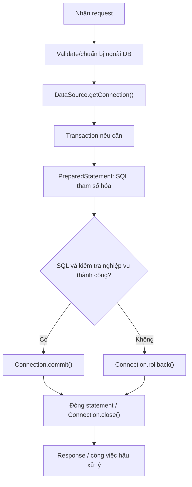

# Giới hạn thời gian giữ giao dịch và kết nối trong JDBC

Khi tối ưu hiệu năng truy cập cơ sở dữ liệu bằng **JDBC**, không chỉ thời gian chạy một câu `SELECT` hay `UPDATE` mới quan trọng. Cần quan sát cả **thời gian ứng dụng mượn một `Connection` từ pool** và **thời gian một transaction giữ trạng thái chưa kết thúc**. Nếu một request giữ kết nối quá lâu để xử lý dữ liệu, gọi HTTP hoặc chờ người dùng, các request khác có thể phải xếp hàng. Nếu transaction kéo dài, DBMS có thể phải duy trì khóa, snapshot, log và nhiều tài nguyên phiên, làm giảm throughput của cả hệ thống.

Bài thuộc chương **Hiệu năng** của module **JDBC**, kết hợp `DataSource`, `Connection`, `PreparedStatement`, `ResultSet`, SQL tham số hóa, CRUD, transaction và cơ chế timeout chuẩn. Mục tiêu là biết **đo đúng hai khoảng thời gian**, tổ chức công việc để mượn kết nối muộn và trả sớm, đặt ngân sách thời gian hợp lý, xử lý lỗi/rollback và tránh ngộ nhận rằng một query timeout có thể giới hạn toàn bộ transaction.

> **Nguyên tắc:** Mượn kết nối **chỉ khi sắp làm việc với DB**, giữ transaction **chỉ trong phạm vi các thao tác cần nguyên tử**, luôn `commit()` hoặc `rollback()` trước khi trả handle, rồi đóng bằng `try-with-resources`. Đừng dựa vào việc pool tự thu hồi kết nối để thay thế quản lý vòng đời của ứng dụng.

## 1. Phân biệt thời gian mượn, giữ kết nối và giữ transaction

Ba khoảng thời gian thường được nhắc cùng nhau nhưng không giống nhau.

| Khái niệm | Mốc bắt đầu | Mốc kết thúc | Điều đang bị chiếm |
|---|---|---|---|
| **Connection acquisition time** | Bắt đầu gọi `dataSource.getConnection()` | Nhận được handle hoặc báo lỗi | Thread/request có thể chờ pool; chưa chắc đã giữ một kết nối. |
| **Connection hold time** | Pool bàn giao handle `Connection` cho ứng dụng | Ứng dụng gọi `Connection.close()` hoặc trả handle qua try-with-resources | Một slot kết nối đang được mượn, không phục vụ tác vụ khác qua pool thông thường. |
| **Transaction duration** | Transaction thực sự bắt đầu theo semantics DBMS/driver | `commit()` hoặc `rollback()` hoàn tất | Ngữ cảnh giao dịch, có thể có khóa, snapshot, trạng thái ghi chưa commit và tài nguyên DB. |
| **Statement execution time** | Bắt đầu `executeQuery()/executeUpdate()/execute()` | Lời gọi trả về hoặc ném lỗi | Một phần thời gian của thao tác SQL; fetch qua `ResultSet` có thể tiếp tục sau đó. |
| **End-to-end request time** | Request được nhận | Response hoàn tất | Còn bao gồm HTTP, xác thực, tính toán, serialization và nhiều thao tác khác. |

### Điểm tinh tế: `setAutoCommit(false)` không phải luôn là “bắt đầu transaction” của DBMS

`connection.setAutoCommit(false)` chuyển JDBC sang chế độ ứng dụng chủ động kết thúc transaction. **Thời điểm DBMS thật sự mở giao dịch và giữ snapshot/khóa** có thể gắn với câu SQL đầu tiên hoặc quy tắc của hệ quản trị. Vì thế, để đo “transaction duration”, cần phân biệt:

- **Phạm vi transaction phía ứng dụng:** từ lúc cấu hình/chuẩn bị một đơn vị công việc đến khi `commit()/rollback()`.
- **Thời gian giao dịch đang hoạt động ở DBMS:** quan sát qua trạng thái transaction/lock/snapshot mà DBMS cung cấp.

Không nên lấy thời gian mượn kết nối rồi mặc định toàn bộ thời gian đó đều là thời gian giữ khóa DB.

### Hai trục thời gian minh họa

```text
Request A — thiết kế chưa tốt
|---- chuẩn bị dữ liệu -----|------- gọi HTTP -------|-- SQL --|--- gửi email ---|
^ getConnection()                                                     ^ close()
  <-------------------- connection hold time ------------------------------>
                                ^ setAutoCommit(false)
                                  <---------------- transaction ----------->

Request B — thiết kế tốt hơn
|---- chuẩn bị dữ liệu -----|-- HTTP cần thiết --|-- SQL/transaction --|-- gửi email --|
                                                ^ getConnection()    ^ close()
                                                <-- hold ngắn ------>

Lưu ý: email chỉ gửi sau commit; nếu cần giao hàng bảo đảm,
dùng transactional outbox thay vì giả định gửi email là một phần của DB transaction.
```

Cả hai request có thể chạy tổng thời gian gần giống nhau, nhưng thiết kế B chiếm **ít thời gian kết nối** hơn, giúp pool phục vụ nhiều request đồng thời hơn. Nếu gọi HTTP phải tham gia một quy tắc nghiệp vụ nguyên tử với DB, cần thiết kế phân tán/outbox/saga thay vì chỉ đưa HTTP vào giữa hai câu SQL và giữ transaction chờ.

## 2. Vì sao một transaction dài làm giảm hiệu năng?

Một transaction có thể kéo dài vì chờ thao tác Java hoặc vì chính SQL chậm. Trong nhiều hệ quản trị, điều này có thể gây:

- **Giữ khóa lâu:** transaction đã sửa hàng nhưng chưa commit có thể khiến transaction khác chờ, timeout hoặc deadlock. Loại khóa và thời điểm giữ phụ thuộc DBMS/isolation.
- **Giữ snapshot/version:** với DBMS dùng MVCC, transaction đọc dài có thể trì hoãn việc thu hồi phiên bản cũ hoặc công việc bảo trì tùy engine.
- **Giữ kết nối trong pool:** dù CPU ứng dụng đang rảnh, slot kết nối đã mượn vẫn không thể phục vụ request khác theo cách chia sẻ pool thông thường.
- **Tăng sức ép log và tài nguyên:** thao tác ghi lớn chưa commit có thể chiếm log, tài nguyên transaction hoặc bộ nhớ máy chủ.
- **Kéo dài thời gian phục hồi:** rollback một giao dịch đã thay đổi rất nhiều dữ liệu có thể tốn thời gian đáng kể.
- **Lan truyền độ trễ:** một vài transaction chậm làm tăng thời gian chờ của nhiều request khác, đặc biệt khi pool nhỏ.

Một transaction **chỉ đọc** không nhất thiết giữ khóa ghi, nhưng vẫn có thể giữ snapshot, cursor, phiên hoặc connection. Ngược lại, một statement `UPDATE` nhanh cũng có thể tạo khóa chờ lâu nếu chương trình trì hoãn commit.

## 3. Đếm slot pool: tác động của thời gian giữ kết nối

Giả sử pool có **20 kết nối**, mỗi request phải mượn một kết nối để hoàn thành việc truy cập DB. Nếu trung bình mỗi request giữ kết nối **0,1 giây**, cùng một số slot có thể luân chuyển nhanh hơn nhiều so với khi request giữ **2 giây** vì thực hiện thêm thao tác mạng bên ngoài.

Một ước lượng trực giác về công suất phục vụ của pool, **khi mọi request đều cần một slot trong suốt thời gian giữ và bỏ qua overhead**, là:

\[
\text{Số lượt mượn kết nối/giây tối đa gần đúng}
\approx \frac{\text{số kết nối khả dụng}}{\text{hold time trung bình (giây)}}
\]

Với 20 slot:

| Hold time trung bình | Công suất slot theo mô hình đơn giản |
|---:|---:|
| 0,1 giây | Khoảng 200 lượt/giây |
| 0,5 giây | Khoảng 40 lượt/giây |
| 2 giây | Khoảng 10 lượt/giây |

Đây **không phải throughput SQL được bảo đảm**. Thực tế còn giới hạn bởi tài nguyên DBMS, số request đến, phân phối thời gian, khóa, CPU, mạng, pool acquisition và kiểu workload. Mô hình chỉ giúp thấy vì sao **giảm thời gian giữ connection** đôi khi hiệu quả hơn tăng kích thước pool.

Nếu tải đến vượt khả năng phục vụ, số request chờ `getConnection()` tăng. Tăng pool quá lớn có thể đẩy DBMS vào quá tải, làm thời gian SQL dài hơn và tạo vòng phản hồi xấu.

## 4. Vòng đời chuẩn: mượn muộn, trả sớm

Với một API nhận dữ liệu đặt hàng, trình tự thuận lợi là:

1. Xác thực dữ liệu đầu vào **không cần DB** trước.
2. Chuẩn bị các giá trị, tính toán hoặc gọi dịch vụ độc lập mà không giữ connection nếu có thể.
3. Gọi `dataSource.getConnection()` sát trước thao tác JDBC cần thiết.
4. Mở transaction **khi có nhiều thao tác bắt buộc nguyên tử**.
5. Thực thi các câu `PreparedStatement` cần thiết, kiểm tra số dòng tác động.
6. Gọi `commit()` khi toàn bộ công việc DB thành công; nếu lỗi, cố `rollback()`.
7. Đóng `ResultSet`, `PreparedStatement`, `Connection` qua `try-with-resources`.
8. Chỉ sau đó thực hiện những thao tác chậm không thuộc giao dịch, như trả response hoặc đẩy thông báo qua cơ chế phù hợp.



Trong trường hợp nghiệp vụ có các thao tác DB cần thấy cùng snapshot hoặc cùng ràng buộc khóa, **không tách transaction thành nhiều kết nối chỉ để giảm hold time**. Tối ưu đúng là thu gọn công việc bên trong transaction trong khi giữ tính nhất quán; không hy sinh atomicity để đạt một con số latency đẹp.

## 5. Ví dụ đọc dữ liệu: không giữ Connection trong lúc xử lý bên ngoài

Giả sử bảng:

```sql
CREATE TABLE product (
    id BIGINT PRIMARY KEY,
    name VARCHAR(120) NOT NULL,
    available INTEGER NOT NULL
);
```

Một repository chỉ cần đọc tên sản phẩm:

```java
import java.sql.Connection;
import java.sql.PreparedStatement;
import java.sql.ResultSet;
import java.sql.SQLException;
import javax.sql.DataSource;

public final class ProductRepository {
    private final DataSource dataSource;

    public ProductRepository(DataSource dataSource) {
        this.dataSource = dataSource;
    }

    public String findName(long productId) throws SQLException {
        String sql = "SELECT name FROM product WHERE id = ?";

        try (Connection connection = dataSource.getConnection();
             PreparedStatement ps = connection.prepareStatement(sql)) {

            ps.setLong(1, productId);

            try (ResultSet rs = ps.executeQuery()) {
                return rs.next() ? rs.getString("name") : null;
            }
        }
    }
}
```

Khi `findName(...)` trả về, cả `ResultSet`, statement và handle kết nối đã được đóng theo thứ tự phù hợp. Tầng service có thể tiếp tục định dạng JSON, ghi log hoặc thực hiện công việc không cần DB **sau khi connection đã trả pool**.

### Cách tổ chức khiến connection bị giữ lâu

```java
// Chỉ là phản ví dụ mô tả luồng, không phải mẫu triển khai.
try (Connection connection = dataSource.getConnection()) {
    String payload = callRemoteApi();  // Có thể chờ mạng nhiều giây.
    prepareLargeReport(payload);       // CPU và bộ nhớ, chưa cần DB.
    // Cuối cùng mới thực thi một câu SELECT.
}
```

Đoạn trên mượn connection ngay từ đầu nhưng để nó nhàn rỗi trong lúc làm việc bên ngoài DB. Nếu gọi HTTP có thể mất vài giây, chi phí trên pool có thể lớn hơn rất nhiều so với thời gian bản thân `SELECT`.

Cách viết hợp lý hơn:

```java
String payload = callRemoteApi();
ReportRequest input = prepareLargeReport(payload);

// Mượn connection ở ngay thao tác JDBC thực sự:
// repository.findName(input.productId()) là ví dụ về ranh giới DAO.
String productName = repository.findName(input.productId());
```

Đây là đoạn **minh họa tổ chức tầng service**; các hàm và kiểu `ReportRequest` là thành phần của ứng dụng chứ không phải API JDBC. Điểm cần nhớ là **thứ tự mượn kết nối**, không phải tên phương thức.

## 6. Giao dịch nhiều bước: giữ gọn nhưng không đánh mất atomicity

Giả sử cần tạo yêu cầu giữ hàng và trừ số lượng tồn trong cùng transaction:

```sql
CREATE TABLE inventory (
    product_id BIGINT PRIMARY KEY,
    available INTEGER NOT NULL CHECK (available >= 0)
);

CREATE TABLE stock_reservation (
    reservation_id BIGINT PRIMARY KEY,
    product_id BIGINT NOT NULL,
    quantity INTEGER NOT NULL CHECK (quantity > 0)
);
```

Cú pháp constraint và khả năng rollback phải được kiểm chứng trên DBMS/engine đang dùng. Schema là minh họa, tạo trước bài thực hành.

Một mẫu triển khai JDBC tập trung vào **thời gian transaction và connection**:

```java
import java.sql.Connection;
import java.sql.PreparedStatement;
import java.sql.SQLException;
import javax.sql.DataSource;

public final class ReservationService {
    private final DataSource dataSource;

    public ReservationService(DataSource dataSource) {
        this.dataSource = dataSource;
    }

    public boolean reserve(
            long reservationId,
            long productId,
            int quantity
    ) throws SQLException {
        if (reservationId <= 0 || productId <= 0 || quantity <= 0) {
            throw new IllegalArgumentException("Thông tin đặt chỗ không hợp lệ");
        }

        String decrease = "UPDATE inventory "
                + "SET available = available - ? "
                + "WHERE product_id = ? AND available >= ?";
        String insertReservation =
                "INSERT INTO stock_reservation "
                + "(reservation_id, product_id, quantity) VALUES (?, ?, ?)";

        // Không mượn connection cho tới khi đã kiểm tra input.
        try (Connection connection = dataSource.getConnection()) {
            connection.setAutoCommit(false);

            try {
                try (PreparedStatement stock =
                             connection.prepareStatement(decrease);
                     PreparedStatement reservation =
                             connection.prepareStatement(insertReservation)) {

                    stock.setInt(1, quantity);
                    stock.setLong(2, productId);
                    stock.setInt(3, quantity);

                    if (stock.executeUpdate() != 1) {
                        connection.rollback();
                        return false; // Không đủ hàng hoặc không có sản phẩm.
                    }

                    reservation.setLong(1, reservationId);
                    reservation.setLong(2, productId);
                    reservation.setInt(3, quantity);

                    if (reservation.executeUpdate() != 1) {
                        throw new SQLException("Không tạo được reservation");
                    }
                }

                connection.commit();
                return true;

            } catch (SQLException | RuntimeException failure) {
                try {
                    connection.rollback();
                } catch (SQLException rollbackError) {
                    failure.addSuppressed(rollbackError);
                }
                throw failure;
            }
        }
    }
}
```

Các thao tác liên quan tới dữ liệu đều nằm trên **một `Connection`** trong một transaction. Nếu câu `INSERT` thất bại, nhánh `catch` rollback câu trừ tồn đã chạy nhưng chưa commit. Nếu không đủ tồn, phương thức rollback trước khi trả `false`.

**Giới hạn nghiệp vụ:** `reservationId` được đặt làm khóa chính, nhưng ví dụ này không tự triển khai logic **idempotency** cho request bị gửi lại. Khi một thao tác `commit()` gặp mất kết nối, ứng dụng có thể không biết chắc đã commit hay chưa. Không nên tự động retry chỉ vì lỗi kết nối; cần tra cứu yêu cầu bằng khóa nghiệp vụ, xử lý trùng và đối soát.

### Một lưu ý về thời gian

Ngay cả khi SQL đúng, việc gọi thêm HTTP hoặc chờ queue giữa `stock.executeUpdate()` và `connection.commit()` sẽ kéo dài transaction. Khi đó transaction có thể giữ khóa trên `inventory`, khiến request giữ hàng khác chờ. Những công việc bên ngoài DB nên chuyển ra trước hoặc sau transaction; khi phải liên kết trạng thái với hệ ngoài, dùng thiết kế đáng tin cậy như **transactional outbox** thay vì giữ transaction mở trong suốt lời gọi mạng.

## 7. Mẫu “đọc lâu rồi ghi”: tách phần tính toán nhưng kiểm tra lại dữ liệu

Một bài toán phổ biến là đọc trạng thái, thực hiện tính toán nặng, sau đó cập nhật. Giữ transaction trong suốt quá trình tính toán đôi khi không cần thiết, nhưng tách các bước có thể tạo **dữ liệu cũ** (*stale read*).

Ví dụ không an toàn nếu bỏ kiểm tra lại:

```text
Transaction A đọc giá = 100, đóng connection.
Ứng dụng tính toán trong 30 giây.
Transaction B đổi giá = 120 và commit.
Ứng dụng A ghi theo giá 100 mà không kiểm tra phiên bản.
```

Cách an toàn hơn tùy nghiệp vụ:

- **Optimistic locking:** lấy `version` khi đọc; khi ghi dùng `UPDATE ... WHERE id = ? AND version = ?` để từ chối nếu dữ liệu đã đổi.
- **Cập nhật nguyên tử:** chuyển phép kiểm tra và thay đổi vào **một câu `UPDATE` có điều kiện**, như ví dụ `available >= ?`.
- **Pessimistic locking:** dùng transaction ngắn và `SELECT ... FOR UPDATE` khi buộc phải đọc–ra quyết định–ghi trên dữ liệu không được thay đổi trong khoảng đó, theo khả năng DBMS.
- **Snapshot/độ nhất quán theo nghiệp vụ:** nếu thực sự cần snapshot toàn bộ lượt tính, có thể phải giữ transaction hoặc dùng snapshot dữ liệu tách riêng; cân nhắc chi phí.

### Cập nhật theo phiên bản giúp tránh giữ khóa trong lúc tính toán

```sql
UPDATE product
SET name = ?, version = version + 1
WHERE id = ? AND version = ?;
```

Ví dụ giả định bảng `product` có cột `version` phù hợp, được cập nhật **đồng nhất trên mọi đường ghi**:

```java
String sql = "UPDATE product "
        + "SET name = ?, version = version + 1 "
        + "WHERE id = ? AND version = ?";

try (Connection connection = dataSource.getConnection();
     PreparedStatement ps = connection.prepareStatement(sql)) {
    ps.setString(1, computedName);
    ps.setLong(2, productId);
    ps.setLong(3, versionReadEarlier);
    int changed = ps.executeUpdate();
    if (changed == 0) {
        // Dữ liệu không tồn tại hoặc đã được thay đổi.
        // Tầng nghiệp vụ tải lại và quyết định cách giải quyết xung đột.
    }
}
```

Ví dụ chỉ dùng một `UPDATE` và giả định auto-commit theo cấu hình kết nối; nếu tầng gọi quản lý transaction, phải `commit()/rollback()` tại ranh giới của tầng đó. Đoạn mã nêu cơ chế chống dữ liệu cũ, không phải lời khuyên luôn tách mọi transaction đọc–ghi thành hai lần mượn.

## 8. Phân biệt giới hạn thời gian ở nhiều tầng

Một hệ thống truy cập JDBC có thể có nhiều loại timeout, và mỗi loại giới hạn **một đoạn khác nhau**.

| Cơ chế | Phạm vi | Không thay thế được |
|---|---|---|
| **Pool acquisition timeout** | Thời gian request chờ `getConnection()` khi pool không có handle sẵn sàng. | Không giới hạn thời gian giữ handle sau khi đã mượn. |
| **`DataSource.setLoginTimeout(seconds)`** | Thời gian thiết lập/đăng nhập kết nối, tùy driver. | Không giới hạn thực thi SQL hoặc transaction. |
| **`Statement.setQueryTimeout(seconds)`** | Thời gian thực thi statement theo cơ chế driver. | Không bảo đảm tổng thời gian transaction, xử lý ResultSet hoặc commit. |
| **`Connection.setNetworkTimeout(executor, ms)`** | Giới hạn chờ thao tác mạng theo khả năng driver. | Không phải ngân sách nghiệp vụ; có thể làm connection hỏng. |
| **Lock timeout phía DBMS** | Thời gian chờ khóa của một thao tác DB. | Không giới hạn toàn bộ công việc Java giữ connection. |
| **Statement timeout phía DBMS** | Thời hạn cho statement theo DBMS và phiên. | Không giới hạn mọi bước của một transaction hoặc response HTTP. |
| **Idle-in-transaction timeout phía DBMS** | Chấm dứt phiên/giao dịch bị bỏ không trong transaction ở DBMS hỗ trợ. | Không chặn một transaction bận chạy SQL liên tục nhưng kéo dài. |
| **Transaction timeout của framework/manager** | Ngân sách transaction theo môi trường điều phối. | Không mặc định áp dụng với mọi chương trình JDBC thuần. |
| **Deadline của request/job** | Thời gian tối đa của toàn bộ nghiệp vụ. | Không tự động dừng JDBC đang chạy nếu không phối hợp cancel/timeout. |
| **Leak detection của pool** | Cảnh báo handle được giữ lâu theo ngưỡng. | Thường không phải biện pháp tự động hủy transaction an toàn. |

### Không tồn tại một `Connection.setTransactionTimeout(...)` chuẩn

API `java.sql.Connection` **không** có phương thức chuẩn `setTransactionTimeout(int)`. Đừng sáng tác một lệnh JDBC như vậy. Nếu cần kiểm soát thời hạn cho toàn transaction, có thể sử dụng:

1. **Thiết kế ranh giới nghiệp vụ:** không làm I/O không liên quan trong transaction.
2. **Deadline/budget ở tầng ứng dụng:** theo dõi thời gian còn lại và từ chối bắt đầu thao tác tiếp theo khi hết ngân sách.
3. **Query timeout cho từng statement:** đặt `setQueryTimeout(...)` theo thời gian còn lại khi driver hỗ trợ.
4. **Cấu hình transaction/statement/idle-in-transaction timeout phía DBMS:** cú pháp và quyền phụ thuộc sản phẩm; cần xem tài liệu DBMS.
5. **Transaction manager** nếu framework sở hữu transaction, với chính sách timeout của manager và tích hợp JDBC tương ứng.

**Không phải tổ hợp nào cũng tạo một hard deadline tuyệt đối.** Query timeout nhận giây, driver có thể hủy trễ, thao tác commit có thể chờ mạng, và ứng dụng không kiểm soát thời gian phản hồi của DBMS trong mọi tình huống.

## 9. Dùng ngân sách thời gian để giới hạn một đơn vị công việc

Với ứng dụng Java, `System.nanoTime()` phù hợp để đo **khoảng thời gian trôi qua**, không phải để lưu timestamp ngoài hệ thống. Có thể dùng nó để kiểm tra ngân sách trước khi bắt đầu từng câu SQL và trước commit.

Một mẫu helper cơ bản:

```java
import java.sql.SQLTimeoutException;
import java.util.concurrent.TimeUnit;

public final class TransactionBudget {
    private final long startedNanos;
    private final long budgetNanos;

    public TransactionBudget(long maxDurationMillis) {
        if (maxDurationMillis <= 0) {
            throw new IllegalArgumentException("Ngân sách phải dương");
        }
        this.budgetNanos = TimeUnit.MILLISECONDS.toNanos(maxDurationMillis);
        this.startedNanos = System.nanoTime();
    }

    public int secondsForNextStatement() throws SQLTimeoutException {
        long elapsed = System.nanoTime() - startedNanos;
        long remaining = budgetNanos - elapsed;

        if (remaining <= 0) {
            throw new SQLTimeoutException("Đã hết ngân sách transaction");
        }

        // Làm tròn LÊN để tránh 0 = không có timeout trong JDBC.
        long billion = TimeUnit.SECONDS.toNanos(1);
        long seconds = remaining / billion;
        if (remaining % billion != 0) {
            seconds++;
        }
        return (int) Math.min(seconds, Integer.MAX_VALUE);
    }

    public void requireRemaining() throws SQLTimeoutException {
        if (System.nanoTime() - startedNanos >= budgetNanos) {
            throw new SQLTimeoutException("Đã hết ngân sách transaction");
        }
    }
}
```

Cách dùng khi **chính ứng dụng sở hữu transaction JDBC**:

```java
try (Connection connection = dataSource.getConnection()) {
    connection.setAutoCommit(false);
    TransactionBudget budget = new TransactionBudget(3_000);

    try {
        try (PreparedStatement ps = connection.prepareStatement(
                "UPDATE inventory SET available = available - ? "
                + "WHERE product_id = ? AND available >= ?")) {

            ps.setQueryTimeout(budget.secondsForNextStatement());
            ps.setInt(1, quantity);
            ps.setLong(2, productId);
            ps.setInt(3, quantity);

            if (ps.executeUpdate() != 1) {
                throw new SQLException("Không đủ hàng hoặc thiếu product");
            }
        }

        // Nếu code đã tiêu hết ngân sách thì không chọn đường commit.
        budget.requireRemaining();
        connection.commit();

    } catch (SQLException | RuntimeException failure) {
        try {
            connection.rollback();
        } catch (SQLException rollbackError) {
            failure.addSuppressed(rollbackError);
        }
        throw failure;
    }
}
```

Đoạn sử dụng giả định biến `dataSource`, `quantity`, `productId` được tầng gọi cung cấp và đã kiểm tra; đây là mẫu về **time budget**, không phải toàn bộ service nghiệp vụ.

### Giới hạn của mẫu deadline

Mẫu ở trên **không phải bộ cưỡng chế transaction kết thúc trong đúng 3 giây**:

- `setQueryTimeout()` nhận **số giây nguyên**. Nếu còn 100 ms, làm tròn lên 1 giây có thể cho phép statement chạy quá thời gian còn lại. Làm tròn xuống `0` còn nguy hiểm hơn vì có nghĩa “không có query timeout”.
- `requireRemaining()` kiểm tra trước commit; `commit()` vẫn có thể chờ lâu hơn ngân sách, và không có một `Connection.setCommitTimeout(...)` chuẩn dùng chung.
- Thời điểm thực thi hủy, phát hiện lỗi timeout và khả năng giữ trạng thái transaction sau lỗi phụ thuộc driver/DBMS.
- Đếm thời gian bằng `System.nanoTime()` **không tự hủy thread** hoặc câu SQL đang chạy. Nếu cần yêu cầu hủy, phải thiết kế tích hợp `Statement.cancel()` hoặc cơ chế phía server/manager.
- Không thể xem một `SQLTimeoutException` là bằng chứng chắc chắn không có thay đổi nào đã xảy ra. Cần rollback, xử lý lỗi rollback và đối soát trong tình huống kết quả commit không rõ.

Vì thế, nên kết hợp deadline ở tầng request với giới hạn statement/transaction **do chính DBMS hoặc framework hỗ trợ**, thay vì tuyên bố đoạn code trên đảm bảo hard SLA.

## 10. Đọc ResultSet lớn cũng giữ connection lâu

Một câu `SELECT` có thể thực thi nhanh nhưng trả **500.000 hàng**. Ứng dụng duyệt hết các hàng bằng `ResultSet.next()` trong nhiều phút, giữ `Connection` suốt quá trình đó. `setQueryTimeout(5)` không bảo đảm toàn bộ vòng lặp `rs.next()` và xử lý Java hoàn tất trong 5 giây trên mọi driver.

```java
try (Connection connection = dataSource.getConnection();
     PreparedStatement ps = connection.prepareStatement(
             "SELECT id, payload FROM event_log ORDER BY id")) {

    ps.setFetchSize(500); // Hint; streaming phụ thuộc driver.
    ps.setQueryTimeout(30);

    try (ResultSet rs = ps.executeQuery()) {
        while (rs.next()) {
            // Chỉ trích xuất giá trị cần thiết.
            long id = rs.getLong("id");
            String payload = rs.getString("payload");

            // Tránh gọi HTTP chậm ngay trong vòng lặp giữ connection.
            consumeLocally(id, payload);
        }
    }
}
```

Đoạn này là minh họa; `consumeLocally` do ứng dụng định nghĩa, không phải API JDBC. Nó chỉ nên xử lý nhanh hoặc ghi vào một cấu trúc giới hạn dung lượng, tránh gom toàn bộ kết quả vào List.

Các lựa chọn để rút ngắn thời gian giữ kết nối:

- Chỉ `SELECT` các cột thực sự cần, có điều kiện lọc và chỉ mục phù hợp.
- Giới hạn số hàng bằng SQL (pagination/`FETCH FIRST`/`LIMIT` theo DBMS) nếu không cần toàn bộ dữ liệu.
- Với tác vụ xử lý lâu, dùng **keyset pagination** và checkpoint để mượn/trả kết nối giữa các trang.
- Nếu cần streaming một `ResultSet` lớn, chọn `fetchSize` dựa trên hàng, mạng và driver; kết thúc cursor/transaction đúng lúc.
- Với payload LOB lớn, cân nhắc streaming từng cột theo khả năng driver, không mặc định `getString()/getBytes()` luôn an toàn bộ nhớ.
- Tránh tạo transaction đọc dài không cần thiết hoặc giữ snapshot quá lâu trên DBMS dùng MVCC.

**Đánh đổi:** phân trang nhiều transaction có thể nhìn thấy dữ liệu thay đổi giữa các trang; một transaction snapshot dài có thể nhất quán hơn nhưng tốn tài nguyên. Lựa chọn theo yêu cầu nhất quán, không chỉ theo hold time.

## 11. Vì sao gọi dịch vụ ngoài bên trong transaction là rủi ro?

Giả sử quy trình thanh toán:

```text
BEGIN DB transaction
  1. UPDATE trạng thái đơn hàng
  2. Gọi cổng thanh toán qua HTTP (có thể timeout)
  3. INSERT lịch sử thanh toán
COMMIT DB transaction
```

Nếu bước 2 chờ 10 giây, connection và transaction đã mở có thể bị giữ suốt khoảng đó. Hơn nữa, transaction JDBC trên một DB **không thể rollback thanh toán đã xử lý thành công tại cổng thanh toán** chỉ bằng `Connection.rollback()`.

Cách tổ chức thường phù hợp hơn là tách phần DB transaction và tương tác bên ngoài bằng một mô hình phối hợp rõ ràng:

- **Transactional outbox:** transaction DB ngắn ghi trạng thái và một bản ghi sự kiện cần phát, commit; worker gửi ra ngoài sau, có idempotency.
- **Saga/compensation:** mỗi bước có transaction cục bộ, xử lý lỗi bằng thao tác bù phù hợp.
- **Idempotency key:** cùng một yêu cầu gửi lại không tạo tác động thanh toán hoặc đặt hàng trùng lặp.
- **Truy vấn trạng thái/đối soát:** khi phản hồi HTTP/commit bị mất, xác định trạng thái thực trước khi gửi lại.

Không tự động kết luận mọi lời gọi HTTP giữa hai câu SQL đều phải xóa: đôi khi nghiệp vụ có ràng buộc đặc biệt. Tuy nhiên, cần nhận thức rằng **giữ transaction DB mở không tạo atomicity giữa DB và dịch vụ HTTP**.

## 12. Giới hạn ở DBMS và pooling: lớp phòng vệ bổ sung

### Server-side statement và transaction timeouts

Một số DBMS có cấu hình như:

- **Statement timeout:** chấm dứt lệnh SQL vượt thời hạn.
- **Lock wait timeout:** chấm dứt thao tác chờ khóa quá lâu.
- **Idle-in-transaction timeout:** chấm dứt phiên/giao dịch nằm yên trong transaction vượt ngưỡng.
- **Session/transaction resource limits:** các giới hạn khác theo sản phẩm.

Tên cấu hình, đơn vị, cấp session hay cấp database, quyền thay đổi và hành vi rollback **không giống nhau** giữa PostgreSQL, MySQL, SQL Server, Oracle và các hệ khác. Ví dụ một DBMS có “idle in transaction” timeout không có nghĩa nó cung cấp một **maximum transaction duration** chung cho mọi transaction đang hoạt động.

**Không dùng SQL cấu hình đặc thù DBMS như một cú pháp JDBC chuẩn.** Nếu thiết lập biến session ở kết nối lấy từ pool, cần xác định nó có tồn tại sang lần mượn sau không và pool có reset được không. Không để request A âm thầm thay timeout của request B.

### Pool acquisition timeout và connection leak detection

Một pooled `DataSource` có thể có:

- **Acquisition timeout:** thời gian chờ lấy `Connection`. Đây là giới hạn **trước** khi một handle được mượn.
- **Leak detection threshold:** cảnh báo khi handle được giữ quá lâu. Cảnh báo không có nghĩa pool sẽ cắt transaction đang chạy một cách an toàn.
- **Max lifetime/idle timeout:** chính sách tuổi đời hoặc thời gian nhàn rỗi của kết nối vật lý. Không thay thế việc ứng dụng `close()` handle đúng thời điểm.
- **Metrics active/idle/pending:** theo dõi mức bão hòa kết nối.

Không tăng pool size vô hạn để che giấu transaction chậm. Một pool lớn có thể làm tăng số truy vấn đồng thời vượt khả năng của DBMS, kéo dài transaction và khiến thời gian giữ kết nối càng cao.

## 13. Đo hold time và transaction time trong ứng dụng

Để biết một thay đổi có cải thiện hiệu năng hay không, cần phân biệt **thời gian chờ mượn connection** với **thời gian giữ connection sau khi đã mượn**.

Mẫu đo:

```java
import java.sql.Connection;
import java.sql.SQLException;
import javax.sql.DataSource;

public static void measuredRead(DataSource dataSource)
        throws SQLException {
    long borrowStarted = System.nanoTime();

    try (Connection connection = dataSource.getConnection()) {
        long acquiredAt = System.nanoTime();

        try {
            // Thực hiện JDBC đã chuẩn bị, đóng statement/result set.
            // Đây là ví dụ đo thời gian, không thay thế SQL thực tế.
        } finally {
            long beforeClose = System.nanoTime();
            double borrowMs = (acquiredAt - borrowStarted) / 1_000_000.0;
            double activeMs = (beforeClose - acquiredAt) / 1_000_000.0;
            System.out.printf("acquisitionMs=%.2f holdApproxMs=%.2f%n",
                    borrowMs, activeMs);
        }
    }
}
```

**Giới hạn phép đo:** `holdApproxMs` ở trên đo từ nhận handle đến **ngay trước lúc tự động `close()`**; nó chưa tính thời gian thực thi `close()`. Nếu muốn đo chính xác thời điểm trả handle cho pool, cần instrumentation ở pool hoặc bọc ranh giới `close()`; không gắn nhãn kết quả mẫu là “thời gian giữ kết nối tuyệt đối”.

Tương tự, để đo thời gian của một transaction ở tầng ứng dụng:

```java
long transactionStarted = System.nanoTime();

connection.setAutoCommit(false);
try {
    // Các thao tác JDBC trong transaction.
    connection.commit();
} catch (SQLException | RuntimeException error) {
    try {
        connection.rollback();
    } catch (SQLException rollbackError) {
        error.addSuppressed(rollbackError);
    }
    throw error;
} finally {
    long elapsedNanos = System.nanoTime() - transactionStarted;
    System.out.println("transactionScopeMs="
            + elapsedNanos / 1_000_000.0);
}
```

Mẫu này giả định connection do tầng ngoài quản lý và chỉ dành để minh họa đo phạm vi transaction. **Đừng đặt transaction này trong cùng transaction của framework** rồi tự gọi commit nếu transaction manager đang sở hữu ranh giới đó.

### Đo trên pool và DBMS

Bên cạnh số đo Java, cần theo dõi:

| Chỉ số | Điều giúp chẩn đoán |
|---|---|
| `getConnection()` acquisition latency p95/p99 | Request có phải chờ pool vì connection bị giữ lâu không? |
| Connection active/idle/pending | Pool có bão hòa thường xuyên không? |
| Connection hold time p50/p95/p99 | Có request giữ kết nối bất thường so với SQL execution time không? |
| Transaction age/duration ở DBMS | Có giao dịch lâu tồn tại trong server không? |
| Idle-in-transaction sessions | Có code mở transaction rồi đứng chờ ngoài DB không? |
| Lock wait / blocked sessions | Transaction nào đang chặn transaction khác? |
| Statement execution/fetch duration | Truy vấn chậm ở SQL, network hay khi duyệt `ResultSet`? |
| DB CPU, I/O, log, MVCC/vacuum pressure | Phần tài nguyên nào giới hạn throughput? |
| Commit/rollback errors | Có transaction thất bại hoặc kết quả commit chưa xác định không? |

**Không log toàn bộ SQL chứa thông tin nhạy cảm hoặc dữ liệu tham số người dùng**. Dùng tên truy vấn, trace ID, thời gian, SQLState, mã lỗi và trạng thái transaction; tránh ghi thông tin xác thực hoặc payload bí mật.

## 14. Các tình huống sai thường gặp

| Sai lầm | Hậu quả | Cách khắc phục |
|---|---|---|
| Mượn connection từ đầu request rồi gọi HTTP, xử lý CPU trước khi dùng DB | Chiếm slot pool dù không có SQL đang chạy. | Chuẩn bị dữ liệu trước, mượn gần lúc chạy SQL. |
| Mở transaction bao quanh cả việc gửi email/thông báo | Giữ khóa/snapshot lâu, rollback DB không rollback được email. | Tách công việc, outbox hoặc quy trình phối hợp phù hợp. |
| Nghĩ `setAutoCommit(false)` là đủ để có timeout giao dịch | JDBC không tự giới hạn tổng thời gian transaction. | Deadline + query timeout + cơ chế DBMS/framework phù hợp. |
| Coi `setQueryTimeout(5)` bảo đảm connection được trả sau 5 giây | Query timeout không bao phủ mọi bước fetch/commit/Java. | Đo hold time, quản lý toàn bộ vòng đời và deadline. |
| Đóng connection khi transaction chưa rõ commit/rollback | Pool phải xử lý trạng thái dở dang, có thể rò rỉ tài nguyên hoặc lỗi. | Kết thúc transaction tường minh trước `close()`. |
| Gọi `setAutoCommit(true)` để reset khi chưa rollback | Có thể commit thay đổi đang chờ. | Rollback/commit theo nghiệp vụ trước khi reset trạng thái. |
| Quên đóng `ResultSet` lớn | Giữ cursor, statement, connection lâu hơn cần thiết. | Dùng try-with-resources và tiêu thụ dữ liệu đúng cách. |
| Tạo List chứa mọi hàng vì đã có `fetchSize` nhỏ | Heap vẫn tăng theo toàn bộ kết quả. | Streaming hoặc phân trang/checkpoint. |
| Tách mỗi SQL thành một connection để rút hold time | Các thao tác mất atomicity và có thể thấy dữ liệu không nhất quán. | Giữ các bước cần nguyên tử trong một transaction ngắn. |
| Transaction lỗi nhưng chỉ retry một statement trong chuỗi | Trạng thái transaction có thể đã không dùng được hoặc đã có tác động trước đó. | Rollback, rồi retry toàn transaction khi an toàn. |
| Hủy JDBC bằng `Thread.interrupt()` và tin chắc SQL dừng ngay | Driver/DBMS có thể vẫn đang chạy câu lệnh. | Dùng `Statement.cancel()` khi hỗ trợ, quản lý trạng thái JDBC. |
| Mỗi request tự đặt session timeout rồi không reset | Timeout khác nhau giữa borrowers của pool. | Cấu hình nhất quán, reset theo hợp đồng pool. |
| Tăng max pool size để giải quyết mọi timeout | DBMS có thể quá tải và transaction chậm hơn. | Điều tra hold time, SQL, lock và workload trước. |
| Retry ngay sau mất mạng lúc `commit()` | Có thể thực hiện trùng một nghiệp vụ đã commit. | Idempotency, đối soát và quản lý trạng thái không chắc chắn. |

## 15. Thực hành đo và rút ngắn thời gian giữ tài nguyên

Thực hiện trên cơ sở dữ liệu kiểm thử, với một pool có metrics và giới hạn hợp lý. Không giữ khóa dài hoặc gây timeout chủ đích trên dữ liệu dùng chung.

### Bài 1 — Mượn connection sớm so với mượn muộn

1. Tạo endpoint mô phỏng có một câu `SELECT` nhanh và một hàm `sleep`/tính toán không dùng DB khoảng vài trăm mili giây.
2. Lần A, gọi `getConnection()` trước khi chờ; lần B, gọi sau khi chờ.
3. So sánh request latency, connection hold time và số pending trong pool khi tăng concurrency.
4. Giải thích vì sao thời gian request không nhất thiết đổi nhiều dù throughput pool cải thiện.

### Bài 2 — Transaction ngắn và transaction giữ khóa

1. Kết nối A bắt đầu transaction, `UPDATE` một hàng rồi chưa commit.
2. Kết nối B thử cập nhật cùng hàng; đo lock wait hoặc lỗi timeout.
3. Kết thúc A bằng `commit()`/`rollback()`, ghi nhận B có tiếp tục được hay không theo DBMS.
4. Lặp lại khi A commit ngay sau `UPDATE` và so sánh thời gian chờ.

### Bài 3 — SQL nhanh nhưng vòng lặp ResultSet chậm

Truy vấn hàng chục nghìn hàng, đo riêng `executeQuery()` và thời gian từ `rs.next()` đầu tiên tới khi đọc hết. Cố ý thêm một bước xử lý CPU nhỏ trên mỗi hàng; quan sát hold time. Thử chỉ lấy cột cần thiết, dùng fetch size phù hợp và phân trang nếu chấp nhận mô hình consistency đó.

### Bài 4 — Transaction budget theo từng statement

Dùng `TransactionBudget` với thời gian thử nghiệm nhỏ. Trước mỗi câu SQL, gọi `secondsForNextStatement()`; trước commit gọi `requireRemaining()`. Thử cho phần tính toán tiêu hết ngân sách giữa hai câu SQL và xác minh nhánh lỗi rollback. Ghi nhận phép làm tròn giây **không thể bảo đảm hard deadline**.

### Bài 5 — Pool bị chiếm hết

Cấu hình pool rất nhỏ trong môi trường test, tạo nhiều request giữ connection lâu. Theo dõi active/idle/pending và acquisition timeout. Sau đó thu gọn phần không dùng DB ra ngoài ranh giới mượn connection, chạy lại cùng workload. Không mặc định tăng pool là cách sửa đúng.

### Bài 6 — Kiểm tra idle-in-transaction

Nếu DBMS có metric tương ứng, bắt đầu transaction rồi để application tạm dừng không gọi SQL trong một khoảng thời gian ngắn có kiểm soát. Xem dashboard/số liệu session, sau đó rollback và đóng kết nối. Đọc tài liệu về giới hạn idle transaction cụ thể của DBMS; không áp dụng SQL cấu hình thử nghiệm lên pool sản xuất.

### Bài 7 — Lỗi commit không rõ trạng thái

Mô phỏng mất phản hồi ở tầng thử nghiệm khi commit, rồi kiểm tra khả năng đối soát theo `reservation_id`/business key. Phân biệt “đã commit nhưng client không nhận phản hồi” với “chưa commit”, và xây xử lý idempotent trước khi tự động retry.

## 16. Câu hỏi tự kiểm tra

**1. Connection hold time có luôn bằng transaction duration không?**

Không. Ứng dụng có thể giữ connection ngoài transaction; transaction có thể bắt đầu sau khi mượn handle. Thời điểm giao dịch thực sự hoạt động ở DBMS còn phụ thuộc driver và DBMS.

**2. Vì sao một transaction đọc lớn có thể gây vấn đề hiệu năng dù không cập nhật hàng?**

Vì nó có thể giữ connection, cursor, snapshot hoặc các tài nguyên phiên; với MVCC còn có thể ảnh hưởng việc dọn phiên bản cũ.

**3. `Statement.setQueryTimeout(5)` có bảo đảm mọi transaction hoàn tất trong 5 giây không?**

Không. Nó áp dụng cho thời gian thực thi statement theo driver, không bao trùm toàn bộ vòng lặp Java, fetch, các câu SQL khác hoặc commit.

**4. Có thể đóng connection mà chưa commit/rollback rồi trông chờ pool tự sửa không?**

Không nên. Tầng sở hữu transaction phải kết thúc rõ ràng; hành vi pool khi nhận transaction dở dang khác nhau và không thay thế chính sách nghiệp vụ.

**5. Khi nào nên tách tính toán ra khỏi transaction?**

Khi tính toán không cần giữ snapshot hoặc khóa trong suốt thời gian thực hiện; phải xác minh lại dữ liệu bằng cập nhật nguyên tử, version check hoặc giải pháp nhất quán khác nếu trạng thái có thể đổi.

**6. Vì sao không nên gọi HTTP giữa hai câu SQL trong một transaction mở?**

Nó kéo dài thời gian giữ connection/khóa và không khiến HTTP trở thành một phần của atomic transaction DB. Cần cơ chế phối hợp như outbox/saga nếu hệ ngoài tham gia nghiệp vụ.

**7. TransactionBudget có thể làm timeout trước commit, vậy đã bảo đảm toàn bộ transaction kết thúc đúng hạn chưa?**

Chưa. Mẫu chỉ kiểm tra ngân sách trước các bước, còn query timeout có độ phân giải giây và commit/rollback có thể chờ ngoài ngân sách.

**8. Nếu pool có 20 kết nối, tăng thành 100 có phải luôn giúp giảm độ trễ không?**

Không. Nếu DBMS hoặc khóa là điểm nghẽn, quá nhiều kết nối đồng thời có thể làm tình hình xấu hơn. Phải quan sát hold time, lock wait và năng lực DB.

## 17. Checklist cho service/repository JDBC

- **Ranh giới mượn:** đã tránh gọi `getConnection()` quá sớm và bảo đảm `close()` trên mọi đường đi?
- **Ranh giới transaction:** các câu SQL cần nguyên tử có chạy trên cùng `Connection`, với `commit()/rollback()` rõ ràng?
- **Tác vụ ngoài DB:** HTTP, email, xử lý CPU nặng và chờ người dùng có được đưa ra ngoài transaction khi phù hợp?
- **Ngân sách:** đã phân biệt pool acquisition timeout, query timeout, lock/network timeout và deadline tổng, không coi bất kỳ loại nào là giải pháp duy nhất?
- **Xử lý lỗi:** đã giữ `SQLState`, xử lý lỗi rollback, không retry mù khi kết quả commit không chắc chắn?
- **Đọc dữ liệu lớn:** có projection hợp lý, fetch size đúng driver, phân trang/checkpoint khi phù hợp, và đóng `ResultSet` sớm?
- **Đồng thời:** có chiến lược optimistic/pessimistic locking hoặc SQL nguyên tử để giữ đúng invariant khi thu ngắn transaction?
- **Pool:** có giám sát acquisition latency, active/idle/pending, connection hold time p95/p99 và leak warnings?
- **DBMS:** có quan sát transaction age, idle-in-transaction, lock wait và tài nguyên server?
- **Kiểm chứng:** đã thử lỗi/timeout và đo hiệu quả trên DBMS, JDBC driver, mạng và workload gần sản xuất?

**Ghi nhớ:** Tối ưu JDBC không chỉ là làm cho `executeQuery()` chạy nhanh, mà còn là **giảm thời gian giữ `Connection` và transaction trong khi vẫn giữ đúng quy tắc nghiệp vụ**. Hãy chuẩn bị công việc ngoài DB trước, mượn connection khi cần, gom những câu SQL phải nguyên tử vào transaction ngắn, kiểm soát deadline và timeout ở nhiều tầng, đóng tài nguyên và đo số liệu từ ứng dụng, pool lẫn DBMS. Không hy sinh atomicity hoặc phỏng đoán trạng thái commit chỉ để đạt thời gian giữ kết nối thấp.
