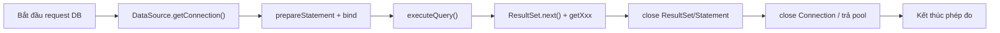

# Đo bằng dữ liệu đại diện thay vì chỉ dùng cơ sở dữ liệu giả lập

## 1. Tại sao phép đo trên dữ liệu giả lập quá nhỏ dễ gây hiểu nhầm?

Trong một ứng dụng **JDBC**, hai câu lệnh Java cùng sử dụng `DataSource`, `PreparedStatement` và `ResultSet` có thể hoạt động rất khác nhau khi chạy với **100 hàng thử nghiệm** so với **10 triệu hàng có phân bố giống thực tế**.

Ví dụ, một truy vấn tìm 100 đơn hàng gần nhất của một khách hàng có thể hoàn thành rất nhanh trên database in-memory chứa vài trăm bản ghi. Khi triển khai với một hệ quản trị quan hệ thật, thời gian có thể tăng vì:

- Bảng và chỉ mục có nhiều trang dữ liệu hơn, không còn nằm toàn bộ trong cache.
- Một số tenant có hàng triệu đơn, trong khi đa số chỉ có vài chục đơn; dữ liệu **lệch phân bố** (*skew*).
- Những tổ hợp điều kiện lọc hiếm hoặc phổ biến dẫn tới các execution plan khác nhau.
- Database phải xử lý nhiều kết nối và giao dịch đồng thời.
- Mạng, TLS, connection pool, truyền dữ liệu, ánh xạ Java và thu gom rác làm tăng thời gian tổng.
- Những trường hợp dữ liệu NULL, giá trị dài, khóa ngoại và nhóm dữ liệu nóng có thể kích hoạt nhánh xử lý ít khi xuất hiện trong test nhỏ.

Vì vậy, phép đo `executeQuery()` trên một mock `ResultSet` hoặc một database in-memory chỉ đủ trả lời **một số câu hỏi hẹp**, không chứng minh hệ thống sẽ đáp ứng SLA với dữ liệu production.

Bài thuộc chương **Hiệu năng** của module **JDBC**: truy cập cơ sở dữ liệu qua driver, `DataSource`, `PreparedStatement`, `ResultSet`, thực hành SQL tham số hóa, CRUD, transaction, batching, xử lý lỗi và hiệu năng. Trọng tâm là **đo trên dữ liệu và khối lượng công việc đại diện**, sử dụng DB/driver/pool gần môi trường triển khai, trong khi vẫn tận dụng mock cho đúng mục đích kiểm thử logic.

Sau bài này, bạn có thể thiết kế dataset đại diện, tạo kịch bản đo có thể lặp lại, tách chi phí connection/statement/duyệt dữ liệu, đọc độ trễ p50/p95/p99, nhận biết những phép benchmark sai lệch và báo cáo kết quả một cách có căn cứ.

> **Nguyên tắc:** một kết quả “truy vấn mất 3 ms” chỉ hữu ích khi biết **truy vấn gì, dữ liệu có hình dạng ra sao, driver/DB nào, đồng thời bao nhiêu request, cache ở trạng thái nào, đo từ đâu tới đâu và độ biến thiên thế nào**.

## 2. Mock, database in-memory và database đại diện phục vụ mục đích khác nhau

### 2.1. Phân biệt các cấp độ thử nghiệm

| Môi trường | Có thể kiểm tra tốt | Không đủ để kết luận |
|---|---|---|
| Mock `DataSource` / `Connection` / `ResultSet` | Logic gọi API, mapping, xử lý lỗi, đóng tài nguyên, số lần gọi repository | Query plan, I/O thật, network, lock, throughput, hiệu năng driver và DB |
| Database in-memory rất nhỏ | Tính đúng đắn CRUD cơ bản, một số ràng buộc và SQL được hỗ trợ | Tốc độ trên dữ liệu lớn, buffer cache, hành vi DB sản xuất, khóa/tranh chấp thật |
| DB tích hợp cùng hệ quản trị nhưng dữ liệu ít | Tính tương thích cú pháp, schema, JDBC driver, transaction | Phân bố production, chi phí full scan, plan khi thống kê và cardinality thay đổi |
| DB cùng engine/version với dữ liệu đại diện | Plan, chỉ mục, cardinality, phần lớn chi phí JDBC/DB, một số vấn đề cạnh tranh | Không tự bảo đảm phản ánh đúng network, tài nguyên hoặc tải của production |
| Môi trường staging gần production, tải đại diện | Khả năng đáp ứng mục tiêu hiệu năng trong điều kiện gần thực tế | Không phải dự đoán chắc chắn nếu cấu hình và workload production thay đổi |

**Mock không vô dụng.** Nó rất phù hợp để xác minh repository có gọi `PreparedStatement.setLong(1, id)` hay đóng `ResultSet` khi lỗi. Nhưng nếu `executeQuery()` trong mock chỉ trả một danh sách Java có sẵn, phép đo đó không bao gồm bộ tối ưu SQL, lưu trữ trên đĩa, TCP, transaction hay connection pool.

**Database in-memory không đồng nghĩa database giả lập theo nghĩa mock**, nhưng cũng không thể thay thế mọi đặc điểm của một DB production khác loại. Ví dụ, kiểm thử trên H2 không mặc nhiên dự đoán hiệu năng PostgreSQL hoặc MySQL vì optimizer, kiểu dữ liệu, index, cơ chế khóa, transaction isolation và JDBC driver khác nhau.

Một database thật **có dữ liệu không đại diện** cũng dễ gây kết luận sai. Chỉ chuyển từ H2 sang PostgreSQL nhưng vẫn tạo 20 hàng đều nhau là chưa đủ để kiểm tra một truy vấn vốn phục vụ hàng triệu đơn và dữ liệu lệch theo tenant.

### 2.2. Các câu hỏi phải đặt trước khi đo

1. Cần tìm hiểu **độ đúng** của SQL hay **độ trễ/throughput** của hệ thống?
2. Đo **một truy vấn**, một luồng nghiệp vụ nhiều SQL, hay request đi qua connection pool?
3. Dataset có gần số hàng, độ dài cột, phân bố, tỷ lệ NULL và quan hệ thực tế không?
4. Query và index có đúng như môi trường triển khai không?
5. Có chạy đồng thời, giao dịch ghi, batch, rollback và background job không?
6. Dữ liệu/plan/cache đang ở trạng thái nóng (*warm*) hay lạnh (*cold*)?
7. Giới hạn chất lượng cần đạt: p95, p99, số request/giây, tài nguyên hay thời gian job?

Câu trả lời quyết định thiết kế benchmark. Không nên chọn công cụ hoặc con số fetch size trước khi biết **điều gì được đo**.

## 3. “Dữ liệu đại diện” có nghĩa nhiều hơn số lượng bản ghi

### 3.1. Những chiều dữ liệu ảnh hưởng hiệu năng

| Chiều cần mô phỏng | Tác động tới DB/JDBC | Cách kiểm tra |
|---|---|---|
| **Số hàng** trong từng bảng | Kích thước index/bảng, số trang phải đọc, chi phí join/sort | Tổng hàng và hàng theo phân vùng/ngày |
| **Phân bố khóa** | Tenant nóng, khách hàng có nhiều đơn, hàng ít phổ biến | P50/P90/P99 số đơn trên mỗi tenant/khách |
| **Độ chọn lọc điều kiện lọc** | Chọn index scan, bitmap scan hay sequential scan | Số hàng khớp từng tổ hợp điều kiện |
| **Tương quan cột** | Ước lượng cardinality có thể sai nếu các điều kiện phụ thuộc nhau | Đếm tổ hợp `tenant_id`, `status`, thời gian |
| **NULL và giá trị mặc định** | Khác biệt giữa `IS NULL`, so sánh, index và mapping `ResultSet` | Tỷ lệ NULL theo từng cột |
| **Độ rộng hàng** | Network, buffer cache, Java allocation, đọc BLOB/CLOB | Phân vị độ dài chuỗi, kích thước payload |
| **Cardinality quan hệ** | JOIN 1–N, fan-out lớn, dữ liệu nhân bản | Số dòng con/cha và trường hợp không có con |
| **Dữ liệu thời gian** | Query gần đây và query lịch sử có độ chọn lọc khác | Phân bố theo ngày/tháng, mùa vụ, hot range |
| **Index và thống kê** | Execution plan và lựa chọn join của optimizer | Danh sách index, thống kê sau nạp, plan thực tế |
| **Tỷ lệ đọc/ghi/xóa** | Lock, dirty pages, MVCC, background cleanup | Lưu lượng thao tác theo thời gian |
| **Trạng thái cache** | Đọc từ RAM khác đọc đĩa/remote storage | Đo warm/cold theo cách kiểm soát |
| **Số phiên đồng thời** | Cạnh tranh pool, CPU, I/O, khóa, bộ nhớ | Số client, transaction active, pending pool |

Ví dụ, một tập dữ liệu có 1 triệu đơn chia đều cho 1.000 tenant có thể rất khác với 1 triệu đơn mà **2 tenant chiếm 80% tổng số**. Query `WHERE tenant_id = ?` cho hai nhóm có thời gian và plan khác nhau. Nếu benchmark chỉ dùng tenant trung bình, nó có thể bỏ qua tình huống người dùng nhiều dữ liệu nhất.

### 3.2. Dữ liệu đại diện không nhất thiết là bản sao production

Có ba cách phổ biến:

- **Sinh dữ liệu tổng hợp** theo phân bố, tỷ lệ NULL, cấu trúc quan hệ và độ rộng cột được quan sát từ production. Đây là lựa chọn tốt khi không thể dùng dữ liệu thật.
- **Dữ liệu đã được ẩn danh đúng cách**, với quy trình phê duyệt bảo mật và giới hạn truy cập, nếu chính sách tổ chức cho phép. Cẩn thận: chỉ đổi tên hoặc email không đủ bảo vệ khi các trường khác có thể tái định danh.
- **Dữ liệu hoàn toàn giả** nhưng được hiệu chỉnh dựa trên thống kê tổng hợp của workload thật, chẳng hạn số hàng theo tenant, trạng thái và tháng.

Không cần chép dữ liệu cá nhân, mật khẩu hay token thật để đo hiệu năng SQL. Nếu một cột có độ dài trung bình 200 ký tự, có thể sinh nội dung giả cùng kích thước thay vì lấy nội dung của người dùng. Với dữ liệu quan hệ, bảo đảm **khóa ngoại hợp lệ** và phân bố fan-out phù hợp; dữ liệu không nhất quán có thể khiến optimizer chọn plan không đại diện.

### 3.3. Một ma trận trường hợp dữ liệu

Không nên báo cáo chỉ một trường hợp “tenant 1”. Hãy có ít nhất:

| Loại trường hợp | Ví dụ | Rủi ro mà nó làm lộ |
|---|---|---|
| **Hot key** | Tenant có số đơn thuộc nhóm lớn nhất | Truy vấn nhiều hàng, index kém chọn lọc, tải tập trung |
| **Typical key** | Tenant gần trung vị | Trải nghiệm phổ biến của người dùng |
| **Cold key** | Tenant chỉ có vài đơn | Plan khác, overhead cố định chiếm ưu thế |
| **No-match** | Không có đơn nào khớp `status`/ngày | Chi phí tìm kiếm khi kết quả rỗng |
| **Wide row** | Đơn có mô tả/JSON dài | Truyền dữ liệu và mapping Java tốn RAM |
| **Old/new data** | Truy vấn 1 ngày và 2 năm | Khác biệt index, partition hoặc cache |
| **High fan-out** | Khách có rất nhiều dòng con | Chi phí JOIN, nhân bản kết quả |
| **Concurrent writes** | Nhiều transaction cùng cập nhật khóa nóng | Lock wait, deadlock, WAL/redo và độ trễ đuôi |

Mỗi trường hợp phải được đo **riêng** và có trọng số khi tổng hợp theo tải thật; không lấy trung bình thời gian của tám kịch bản với trọng số bằng nhau nếu production sử dụng chúng rất khác nhau.

## 4. Một dataset minh họa trên PostgreSQL

Để có ví dụ có thể thực hành, dùng **PostgreSQL** làm DB mục tiêu. Cú pháp DDL/`generate_series`/`ANALYZE` dưới đây là của PostgreSQL, **không phải** SQL chung cho mọi hệ quản trị. Nếu dự án triển khai MySQL, SQL Server hoặc Oracle, phải tạo dữ liệu và xem execution plan trên chính hệ đó thay vì lấy kết quả PostgreSQL làm dự đoán.

### 4.1. Schema phục vụ truy vấn đơn hàng

```sql
CREATE TABLE benchmark_orders (
    order_id      BIGINT GENERATED ALWAYS AS IDENTITY PRIMARY KEY,
    tenant_id     BIGINT NOT NULL,
    status        VARCHAR(16) NOT NULL,
    created_at    TIMESTAMPTZ NOT NULL,
    total_amount  NUMERIC(14, 2) NOT NULL CHECK (total_amount >= 0)
);

CREATE INDEX idx_benchmark_orders_tenant_status_recent
ON benchmark_orders (
    tenant_id,
    status,
    created_at DESC,
    order_id DESC
);
```

Khóa `order_id` tạo thứ tự ổn định khi nhiều hàng có cùng `created_at`. Index phù hợp với ví dụ tìm đơn theo tenant, trạng thái và thời gian bên dưới. **Không phải mọi index nhiều cột đều có lợi cho mọi truy vấn**: thứ tự cột, độ chọn lọc, cập nhật thường xuyên và bộ nhớ phải được đánh giá trên workload thật.

### 4.2. Sinh dữ liệu lệch phân bố thay vì chia đều

Ví dụ sinh **1.000.000 hàng giả** với tỷ lệ tenant không đồng đều:

```sql
-- Chỉ chạy trong môi trường benchmark/staging được phép.
INSERT INTO benchmark_orders (
    tenant_id,
    status,
    created_at,
    total_amount
)
SELECT
    CASE
        WHEN g % 100 < 60 THEN 1                 -- tenant nóng
        WHEN g % 100 < 85 THEN 2                 -- tenant khá lớn
        ELSE 100 + (g % 900)                     -- nhiều tenant nhỏ
    END AS tenant_id,
    CASE
        WHEN g % 10 < 7 THEN 'PAID'
        WHEN g % 10 < 9 THEN 'PENDING'
        ELSE 'CANCELED'
    END AS status,
    TIMESTAMPTZ '2025-01-01 00:00:00+00'
        + (g % 500000) * INTERVAL '1 minute' AS created_at,
    (10 + (g % 20000) / 10.0)::NUMERIC(14, 2) AS total_amount
FROM generate_series(1, 1000000) AS g;

-- Cập nhật thống kê cho optimizer sau khi nạp dữ liệu.
ANALYZE benchmark_orders;
```

Dataset này tạo một **ví dụ skew có chủ đích**, không phải mô hình được khẳng định là giống bất kỳ công ty nào. Công thức modulus có thể tạo ra tương quan nhân tạo giữa tenant, status và thời gian. Vì thế, bài benchmark nghiêm túc phải **đo lại phân bố thực tế sau khi sinh** và điều chỉnh thuật toán sinh dựa trên thống kê tổng hợp mục tiêu.

Kiểm tra cơ bản:

```sql
SELECT tenant_id,
       status,
       COUNT(*) AS row_count
FROM benchmark_orders
GROUP BY tenant_id, status
ORDER BY row_count DESC
LIMIT 20;

SELECT COUNT(*) AS total_rows,
       MIN(created_at) AS earliest,
       MAX(created_at) AS latest,
       MIN(total_amount) AS min_amount,
       MAX(total_amount) AS max_amount
FROM benchmark_orders;
```

Với môi trường gần production, cần xem thêm kích thước bảng/index, các nhóm tenant không xuất hiện, thống kê theo tháng, bảng con, NULL, phân vùng và cấu hình lưu trữ tương ứng.

### 4.3. Quy mô nào là đủ?

Một triệu hàng chỉ là **mức minh họa**. Nếu production có 50 triệu hàng và mỗi hàng chứa JSON vài KB, dataset 1 triệu hàng không phản ánh đầy đủ chi phí. Ngược lại, nếu production chỉ có 20.000 hàng, nhân lên thành 100 triệu không nhất thiết giúp trả lời đúng bài toán.

Nên thiết kế ít nhất ba mức:

- **Mức thường gặp:** số hàng và phân bố gần trạng thái hiện tại.
- **Mức tăng trưởng dự kiến:** ví dụ mức tương ứng 6–12 tháng tới theo dự báo đã có căn cứ.
- **Mức stress:** vượt mức dự kiến có kiểm soát để xem điểm bắt đầu suy giảm, nhưng phải ghi rõ đây là stress test chứ không phải workload trung bình.

Cần ghi chính xác phiên bản schema, migration, index, thống kê optimizer, DB version và số hàng cho mỗi lần đo. Nếu thêm index mới hoặc đổi phân bố dữ liệu giữa hai lượt, không thể quy toàn bộ chênh lệch latency cho thay đổi Java.

## 5. Chọn workload đại diện: không chỉ chọn SQL thuận tiện nhất

Truy vấn minh họa dùng cho API danh sách đơn hàng:

```sql
SELECT order_id, created_at, total_amount
FROM benchmark_orders
WHERE tenant_id = ?
  AND status = ?
  AND created_at >= ?
ORDER BY created_at DESC, order_id DESC
LIMIT ?;
```

**Vì sao chọn truy vấn này?** Nó có điều kiện theo tenant, giá trị trạng thái, thời gian và giới hạn hàng; hiệu năng phụ thuộc dữ liệu lệch, index và chi phí trả dữ liệu qua JDBC. Các dấu `?` sẽ được bind bằng `PreparedStatement`, tránh dùng nối chuỗi SQL với giá trị input.

Nên đo những tổ hợp như:

| Scenario | Tenant | Trạng thái | Khoảng thời gian | Limit | Câu hỏi |
|---|---|---|---|---:|---|
| Hot–recent | 1 | PAID | 30 ngày gần mốc thử | 100 | Truy vấn tenant có nhiều hàng |
| Hot–old | 1 | PAID | Rộng hơn nhiều tháng | 100 | Tác động phạm vi thời gian và cache |
| Medium | 2 | PENDING | 90 ngày | 100 | Điều kiện có độ chọn lọc khác |
| Cold | Tenant ít hàng | PAID | Rộng | 100 | Chi phí phần lớn đến từ overhead? |
| No-match | Tenant/điều kiện không có hàng | PAID | Rộng | 100 | Chi phí chỉ để xác định không có kết quả |
| Large-result | Tenant nóng | PAID | Rộng | 10.000 | Chi phí đọc `ResultSet` và mapping |

“Mốc thử” phải được cố định (ví dụ ngày giả tương ứng dữ liệu đã sinh), không dùng `Instant.now()` một cách tùy tiện giữa các lượt vì sẽ khiến **điều kiện truy vấn thay đổi theo thời gian**. Với dataset tại mục 4, phân bố `created_at` nằm trong một khoảng giả định; chọn các cutoff **thực sự nằm trong vùng dữ liệu đó**.

Ngoài `SELECT`, một workload đại diện cho ứng dụng JDBC hoàn chỉnh thường còn có:

- `INSERT` và `UPDATE` theo khóa nóng/lạnh, bao gồm trường hợp không tìm thấy hàng.
- Một transaction ghi nhiều bảng và khóa ngoại.
- `PreparedStatement.executeBatch()` với cỡ lô thường dùng, cả thành công lẫn lỗi.
- Query join 1–N và dữ liệu có fan-out cao.
- Đọc nhiều hàng qua `ResultSet` với fetch size dự kiến.
- Thời gian mượn connection từ pool khi nhiều request cạnh tranh.

Không được đo một câu `SELECT LIMIT 1` rồi dùng kết quả để kết luận toàn bộ ứng dụng “đáp ứng 10.000 request/giây”.

## 6. Xác định rõ ranh giới của phép đo

Khi một repository gọi `DataSource.getConnection()` rồi chạy SQL, có nhiều loại thời gian cần tách:



Một phép đo hữu ích có thể báo cáo:

| Khoảng thời gian | Bao gồm | Lưu ý |
|---|---|---|
| **Acquire** | `dataSource.getConnection()` | Có thể gồm pool wait, kiểm tra kết nối và mở kết nối vật lý |
| **Prepare + bind** | `prepareStatement(...)` và `setXxx(...)` | Một phần chi phí JDBC/driver; có thể gồm network tùy driver |
| **Execute** | Từ trước `executeQuery()` đến khi nó trả `ResultSet` | Không chắc bao trùm tất cả thời gian DB truyền hàng |
| **Consume** | Vòng `rs.next()` + `getXxx()` + mapping | Có thể gồm I/O mạng khi driver fetch theo đợt |
| **Cleanup** | Đóng result set, statement, connection; transaction nếu có | Có thể gồm hoạt động DB/pool, không luôn bằng 0 |
| **Total** | Từ trước `getConnection()` tới sau cleanup | Gần hơn với thời gian tầng gọi thực sự phải chờ |

**Đặc biệt:** thời gian đo của `executeQuery()` **không đồng nhất với thời gian SQL chạy trên server**. Một driver có thể trả `ResultSet` sớm rồi lấy thêm hàng ở `next()`, trong khi driver khác đệm nhiều hàng trước khi `executeQuery()` trả về. Muốn biết server xử lý ra sao, phải kết hợp metrics và công cụ phân tích plan của DB.

Nếu ứng dụng gọi `ResultSet.getString()` trên cột JSON rất dài, thời gian mapping cũng là một phần latency thực. Đừng chỉ đo đến khi nhận `ResultSet` rồi báo cáo là “truy vấn đã xong”.

## 7. Ví dụ Java 17+: đo connection, execute, consume và tổng

Đoạn mã sau không cần thư viện benchmark ngoài JDK. Nó phù hợp để **minh họa cách đo JDBC tích hợp**, không phải một hệ thống load test hay microbenchmark chuẩn công nghiệp. `DataSource` phải được ứng dụng cung cấp, cấu hình tới DB/driver cần đo.

### 7.1. Một lần đo với PreparedStatement và ResultSet

```java
import javax.sql.DataSource;
import java.math.BigDecimal;
import java.sql.Connection;
import java.sql.PreparedStatement;
import java.sql.ResultSet;
import java.sql.SQLException;
import java.sql.Timestamp;
import java.time.Instant;
import java.util.Objects;

public final class JdbcQueryProbe {
    private static final String SQL = """
            SELECT order_id, created_at, total_amount
            FROM benchmark_orders
            WHERE tenant_id = ?
              AND status = ?
              AND created_at >= ?
            ORDER BY created_at DESC, order_id DESC
            LIMIT ?
            """;

    public record Sample(
            long acquireNanos,
            long executeNanos,
            long consumeNanos,
            long totalNanos,
            int rows,
            long checksum
    ) {}

    private final DataSource dataSource;

    public JdbcQueryProbe(DataSource dataSource) {
        this.dataSource = Objects.requireNonNull(dataSource);
    }

    public Sample sample(
            long tenantId,
            String status,
            Instant fromInclusive,
            int limit
    ) throws SQLException {
        Objects.requireNonNull(status, "status");
        Objects.requireNonNull(fromInclusive, "fromInclusive");
        if (limit <= 0) {
            throw new IllegalArgumentException("limit phải dương");
        }

        long started = System.nanoTime();
        long acquireNanos;
        long executeNanos;
        long consumeNanos;
        int rows = 0;
        long checksum = 0;

        try (Connection connection = dataSource.getConnection()) {
            acquireNanos = System.nanoTime() - started;

            try (PreparedStatement ps = connection.prepareStatement(
                    SQL,
                    ResultSet.TYPE_FORWARD_ONLY,
                    ResultSet.CONCUR_READ_ONLY)) {
                ps.setLong(1, tenantId);
                ps.setString(2, status);
                ps.setTimestamp(3, Timestamp.from(fromInclusive));
                ps.setInt(4, limit);

                // Gợi ý của JDBC, không phải cam kết fetch từng 100 hàng.
                ps.setFetchSize(100);
                ps.setQueryTimeout(10);

                long beforeExecute = System.nanoTime();

                try (ResultSet rs = ps.executeQuery()) {
                    executeNanos = System.nanoTime() - beforeExecute;
                    long beforeConsume = System.nanoTime();

                    while (rs.next()) {
                        long orderId = rs.getLong("order_id");
                        BigDecimal amount =
                                rs.getBigDecimal("total_amount");
                        Timestamp created =
                                rs.getTimestamp("created_at");

                        if (rs.wasNull()
                                || amount == null
                                || created == null) {
                            throw new SQLException(
                                    "Dữ liệu không hợp lệ trong benchmark");
                        }

                        // Tiêu thụ cả ba cột, không chỉ gọi next().
                        // Overflow của long được chấp nhận cho dấu vết
                        // kiểm tra tương đối, không phải hash mật mã.
                        checksum = checksum * 31 + orderId;
                        checksum = checksum * 31 + amount.hashCode();
                        checksum = checksum * 31 + created.hashCode();
                        rows++;
                    }

                    consumeNanos =
                            System.nanoTime() - beforeConsume;
                }
            }
        }

        // total gồm prepare/bind, đọc và đóng tài nguyên.
        long totalNanos = System.nanoTime() - started;

        return new Sample(
                acquireNanos,
                executeNanos,
                consumeNanos,
                totalNanos,
                rows,
                checksum
        );
    }
}
```

**Điểm cần chú ý khi đọc code:**

1. `System.nanoTime()` dùng để đo **khoảng thời gian**, không phải timestamp lịch. `totalNanos` được lấy **sau khi đã đóng** result set, statement và connection.
2. `acquireNanos` đo lời gọi `getConnection()`. Nếu có pool, khoảng này có thể bao gồm chờ mượn và kiểm tra connection, không chỉ mở TCP socket.
3. `executeNanos` chỉ đo lời gọi `executeQuery()`. `consumeNanos` đo cả `rs.next()` và các getter, nên có thể chứa chi phí mạng/driver lẫn đọc dữ liệu Java.
4. `setFetchSize(100)` là một hint; một số driver cần cấu hình riêng hoặc transaction tường minh để dùng server cursor. Trong ví dụ này, không tự thay `autoCommit` vì mục tiêu đo chính là hành vi theo cấu hình DataSource hiện tại.
5. `setQueryTimeout(10)` là thời hạn thực thi statement theo driver, **không nhất thiết** bao phủ tổng phép đo hoặc thời gian chạy Java ngoài JDBC.
6. Mỗi lần đo đều tạo statement và trả connection về pool; điều này gần với một kiểu truy cập repository thông thường. Nếu ứng dụng production giữ connection cho nhiều SQL trong một transaction, cần một phép đo **riêng** mô phỏng đúng vòng đời đó.
7. `checksum` giúp phát hiện thay đổi dữ liệu/kết quả bất ngờ giữa lượt, nhưng không thay thế xác nhận tính đúng đắn của query. Nó cũng không bảo đảm phát hiện mọi thay đổi vì có thể xảy ra va chạm.
8. Kiểu `TIMESTAMPTZ` và `LIMIT` trong SQL phản ánh ví dụ PostgreSQL. Với các DB khác, điều chỉnh SQL, cách bind thời gian/múi giờ và phương án phân trang cho phù hợp.

**Một chi tiết kỹ thuật:** sau khi lấy `created = rs.getTimestamp(...)`, `rs.wasNull()` áp dụng cho getter vừa thực hiện — không phải cho cả ba cột. Ví dụ kiểm tra thêm `amount == null` và `created == null`, còn schema định nghĩa khóa `order_id` không null. Nếu schema cho phép giá trị null, nên kiểm tra riêng ngay sau mỗi getter thay vì dùng một lần `wasNull()` ở cuối vòng đọc.

### 7.2. Tại sao không đo bằng System.currentTimeMillis?

`System.currentTimeMillis()` phản ánh đồng hồ hệ thống có thể bị đồng bộ/điều chỉnh; độ phân giải cũng không tối ưu cho các khoảng ngắn. `System.nanoTime()` có mục đích đo thời gian trôi qua và thích hợp hơn cho latency từng lượt.

Không in log cho **mỗi hàng** trong vòng `while (rs.next())` khi đo hiệu năng: I/O log có thể lấn át chi phí DB. Tương tự, nếu chỉ đọc mỗi `rs.next()` mà không lấy cột, phép đo không phản ánh mapping và chuyển kiểu dữ liệu của ứng dụng thật.

## 8. Đo nhiều lần: warm-up, p50/p95/p99 và độ biến thiên

### 8.1. Vì sao một lượt đo không đủ?

Một lượt đầu có thể chậm vì:

- JVM vừa nạp class và JIT chưa tối ưu code nóng.
- Pool phải tạo connection đầu tiên.
- Driver phải chuẩn bị statement và DB phải xây dựng kế hoạch thực thi.
- Buffer cache và filesystem cache chưa chứa dữ liệu liên quan.
- Các background task, GC hoặc hệ thống lưu trữ đang có độ trễ khác thường.

Một lượt chạy sau có thể nhanh hơn nhờ cache, nhưng **warm-cache benchmark** không đại diện cho một truy vấn ít được gọi sau lúc restart hoặc sau khi dữ liệu làm việc vượt RAM.

Vì vậy nên:

1. **Làm nóng** với số lượt có chủ đích, không ghi các lượt đó vào thống kê latency cuối.
2. Thực hiện đủ lượt đo chính thức với input tương tự hoặc phân bố input được chỉ định.
3. Báo cáo phân vị, không chỉ giá trị nhỏ nhất hoặc trung bình.
4. Chạy lặp lại các phiên benchmark vào nhiều thời điểm để xem độ biến thiên.
5. Ghi rõ trạng thái cache, pool, DB và đồng thời.

### 8.2. Hàm tính phân vị minh họa bằng Java chuẩn

Đoạn sau thực hiện warm-up và thu 100 mẫu cho **một scenario**. Nó dùng cách tính **nearest-rank percentile**: sắp xếp mẫu và lấy vị trí `ceil(p × N)` (đánh số từ 1).

```java
import java.sql.SQLException;
import java.time.Instant;
import java.util.ArrayList;
import java.util.List;
import java.util.Objects;

public final class JdbcScenarioRunner {
    public record Summary(
            int samples,
            int rowsPerRun,
            double totalP50Ms,
            double totalP95Ms,
            double totalP99Ms,
            double acquireP95Ms,
            double executeP95Ms,
            double consumeP95Ms
    ) {}

    private JdbcScenarioRunner() {}

    public static Summary run(
            JdbcQueryProbe probe,
            long tenantId,
            String status,
            Instant fromInclusive,
            int limit,
            int warmups,
            int measurements
    ) throws SQLException {
        Objects.requireNonNull(probe);
        if (warmups < 0 || measurements <= 0) {
            throw new IllegalArgumentException(
                    "warmups >= 0 và measurements > 0");
        }

        for (int i = 0; i < warmups; i++) {
            probe.sample(tenantId, status, fromInclusive, limit);
        }

        List<Long> total = new ArrayList<>();
        List<Long> acquired = new ArrayList<>();
        List<Long> executed = new ArrayList<>();
        List<Long> consumed = new ArrayList<>();
        int expectedRows = -1;
        long expectedChecksum = 0;

        for (int i = 0; i < measurements; i++) {
            JdbcQueryProbe.Sample sample =
                    probe.sample(
                            tenantId,
                            status,
                            fromInclusive,
                            limit
                    );

            // Hợp đồng benchmark này: dữ liệu và thứ tự cố định.
            if (i == 0) {
                expectedRows = sample.rows();
                expectedChecksum = sample.checksum();
            } else if (sample.rows() != expectedRows
                    || sample.checksum() != expectedChecksum) {
                throw new SQLException(
                        "Kết quả giữa các lượt khác nhau: "
                                + "dataset có thể đang thay đổi");
            }

            total.add(sample.totalNanos());
            acquired.add(sample.acquireNanos());
            executed.add(sample.executeNanos());
            consumed.add(sample.consumeNanos());
        }

        return new Summary(
                measurements,
                expectedRows,
                toMillis(percentile(total, 0.50)),
                toMillis(percentile(total, 0.95)),
                toMillis(percentile(total, 0.99)),
                toMillis(percentile(acquired, 0.95)),
                toMillis(percentile(executed, 0.95)),
                toMillis(percentile(consumed, 0.95))
        );
    }

    private static long percentile(List<Long> values, double p) {
        if (values.isEmpty() || p <= 0 || p > 1) {
            throw new IllegalArgumentException("Percentile không hợp lệ");
        }
        values.sort(Long::compareTo);
        int index = (int) Math.ceil(p * values.size()) - 1;
        return values.get(index);
    }

    private static double toMillis(long nanos) {
        return nanos / 1_000_000.0;
    }
}
```

Ví dụ gọi:

```java
JdbcQueryProbe probe = new JdbcQueryProbe(configuredDataSource);

JdbcScenarioRunner.Summary hot = JdbcScenarioRunner.run(
        probe,
        1L,
        "PAID",
        Instant.parse("2025-05-01T00:00:00Z"),
        100,
        20,   // warm-up
        100   // measured iterations
);

System.out.println(hot);
```

`configuredDataSource` là DataSource do ứng dụng chuẩn bị (driver/pool, URL, credentials và môi trường test). Đoạn trích giả định có import `java.time.Instant` và các lớp benchmark ở trên. Không hardcode thông tin đăng nhập vào tài liệu hay log.

**Giới hạn của ví dụ runner:**

- Nếu dữ liệu bị cập nhật đồng thời, kiểm tra checksum sẽ báo lỗi. Đây là hành vi **cố ý** của kịch bản đo trên dataset cố định, không phải cách đo workload ghi đồng thời. Để đo thực tế có update, cần tách bài toán tính nhất quán khỏi bài toán latency và thiết kế kiểm tra đúng theo business requirement.
- Các p95 con của acquire/execute/consume **không được cộng lại** để suy ra p95 total, vì chúng có thể xuất hiện ở những mẫu khác nhau.
- P99 từ chỉ 100 mẫu rất nhạy với giá trị cực đoan. Với hệ thống production, cần nhiều mẫu hơn, nhiều phiên chạy và độ tin cậy phù hợp; không dùng một p99 từ 100 lượt làm cam kết SLA.
- Runner này chạy **tuần tự một luồng**, chưa mô phỏng 50–500 request đồng thời hoặc contention trong pool.
- Đo độ trễ nhiều lần trên một dataset nóng khác với đo cold start, query ngẫu nhiên hoặc hỗn hợp thao tác. Cần đặt tên đúng loại kết quả đang báo cáo.

## 9. Kịch bản đồng thời: hiệu năng JDBC không chỉ nằm ở executeQuery

Một connection pool có tối đa 20 kết nối không thể đồng thời cấp 100 kết nối đang bận. Khi 100 request cùng thực hiện truy vấn nặng, một số request có thể **chờ pool** trước khi SQL bắt đầu.

Vì vậy cần đo cùng các kịch bản:

| Workload | Điều muốn phát hiện |
|---|---|
| 1 client tuần tự | Baseline latency khi gần như không có contention |
| 5–10 client | Ảnh hưởng chi phí chia sẻ tài nguyên và warm cache |
| Gần giới hạn pool | Pool wait, CPU/I/O DB, lock wait |
| Vượt giới hạn pool | Pending connections, request timeout và độ trễ đuôi |
| Đọc + ghi theo tỷ lệ thực | Khóa, MVCC/undo, WAL/redo, buffer eviction |
| Query nhanh trộn query chậm | Head-of-line blocking, phân bố latency và fairness |
| Job batch chạy song song API | Cạnh tranh I/O, connection, lock, độ trễ của endpoint |

Cần kiểm soát **arrival rate** và concurrency. Một load generator chỉ gửi request mới khi response trước hoàn thành (*closed-loop*) có thể **giảm tốc độ gửi khi hệ thống chậm**, làm kết quả dễ đẹp hơn thực tế khi người dùng vẫn tiếp tục truy cập. Với SLA chịu ảnh hưởng bởi burst, nên có thêm phép thử tải theo tốc độ đến cố định hoặc kịch bản arrival phù hợp, đồng thời theo dõi lỗi, timeout và request bị từ chối.

Các chỉ số nên đi kèm:

- Throughput: request/giây, hàng đọc/giây, batch/giây.
- Latency: p50, p95, p99 và phần trăm vượt deadline.
- Lỗi: SQLState, timeout, deadlock, pool exhaustion, tỷ lệ retry.
- Pool: active, idle, pending, thời gian borrow, thời gian giữ connection.
- DB: CPU, IOPS, lock wait, transaction dài, buffer hit/miss, số connection.
- JVM: heap, GC pauses, allocation rate, CPU ứng dụng.

**Không thể kết luận một tối ưu JDBC là tốt nếu throughput tăng nhưng tỷ lệ lỗi, p99 hoặc thời gian chờ pool tăng mạnh.**

## 10. Dùng execution plan của DB để lý giải kết quả

Trên PostgreSQL, có thể dùng:

```sql
EXPLAIN (ANALYZE, BUFFERS)
SELECT order_id, created_at, total_amount
FROM benchmark_orders
WHERE tenant_id = 1
  AND status = 'PAID'
  AND created_at >= TIMESTAMPTZ '2025-05-01T00:00:00Z'
ORDER BY created_at DESC, order_id DESC
LIMIT 100;
```

**`EXPLAIN ANALYZE` thực sự thực thi truy vấn.** Với `SELECT` trên DB thử nghiệm, nó giúp quan sát thời gian và số hàng; với các lệnh ghi như `INSERT`, `UPDATE` hoặc `DELETE`, không được chạy bừa trên dữ liệu thật vì có thể gây tác động. Dù bọc trong transaction rồi rollback, vẫn có các hiệu ứng không được rollback như sequence hoặc side effect bên ngoài tùy DB. Phép thử plan cần môi trường và quyền được kiểm soát.

Những thông tin quan trọng khi đọc plan:

| Thông tin | Ý nghĩa |
|---|---|
| `Index Scan`, `Index Only Scan`, `Seq Scan` | DB truy cập hàng bằng chỉ mục hay quét |
| Estimated rows so với actual rows | Chênh lệch cardinality estimate, có thể liên quan skew/thống kê |
| `Sort`, `Hash Join`, `Nested Loop` | Cách DB sắp xếp và ghép dữ liệu |
| Buffers hit/read | Mức truy cập cache và trang dữ liệu, theo công cụ DB |
| Thời gian từng operator và tổng | Gợi ý nút thắt xử lý phía DB |
| Số vòng lặp và rows ở join | Phát hiện fan-out hoặc N+1 phía query plan |

Plan cũng không phải toàn bộ bức tranh. Kết quả `EXPLAIN ANALYZE` thường **không bao gồm đầy đủ chi phí truyền dữ liệu và ánh xạ `ResultSet` ở Java**. Ngược lại, phép đo tại Java chịu ảnh hưởng network, connection acquisition, encoding và cả scheduler. Kết hợp hai phía sẽ cho chẩn đoán tốt hơn.

### 10.1. Đừng chỉ nhìn SQL có dùng index hay không

Một index có thể tăng tốc trường hợp `tenant_id = 1` nhưng làm chậm `INSERT`/`UPDATE` vì cần duy trì index. Một query chỉ trả 100 hàng đôi khi vẫn phải đọc nhiều trang nếu điều kiện lọc không phù hợp hoặc dữ liệu phân tán.

Đánh giá index cần gồm:

1. Kịch bản hot, typical, cold và no-match.
2. Thay đổi latency p50/p95/p99 và số hàng thực tế.
3. Kích thước index, chi phí ghi và bảo trì.
4. Kế hoạch query dưới các giá trị bind khác nhau.
5. Điều kiện thực tế của prepared statement và plan caching ở driver/DB.

**Không đánh giá chỉ bằng một câu `EXPLAIN` dùng literal dễ nhất.** Một số DB lựa chọn giữa generic plan và custom plan khi dùng prepared statement; giá trị tham số và thống kê có thể làm hiệu năng thay đổi. Cần kiểm chứng đường thực thi thật qua JDBC.

## 11. Đo transaction, batch và ResultSet với dữ liệu thật

### 11.1. Transaction ghi phải tính cả commit

Một nghiệp vụ chuyển tiền hoặc tạo đơn gồm nhiều câu SQL không thể được đánh giá bằng tổng thời gian `executeUpdate()` riêng lẻ mà bỏ qua `commit()`, khóa và rollback.

```text
getConnection()
  |
setAutoCommit(false)
  |
INSERT order
  |
INSERT order_items / UPDATE inventory
  |
commit()  <-- có thể có I/O, WAL/redo, lock và độ trễ mạng
  |
close()
```

Nếu transaction thất bại, thời gian rollback và dọn tài nguyên cũng ảnh hưởng SLA. Trong benchmark, cần giữ tỷ lệ xung đột, khóa nóng, số hàng mỗi đơn và số item/order gần workload thật.

Với phép đo ghi dữ liệu, phải có quy trình **làm mới trạng thái đầu vào** hoặc sinh ID mới có kiểm soát: lặp lại cùng một `INSERT` có thể biến tất cả lượt sau thành lỗi `UNIQUE`, còn lặp lại một `UPDATE` tăng dần có thể đổi điều kiện thử nghiệm. Không dùng dữ liệu production có tác động nghiệp vụ thật.

### 11.2. Batch phụ thuộc số hàng, cỡ lô và lỗi

`PreparedStatement.addBatch()`/`executeBatch()` thường giảm overhead so với gửi từng lệnh riêng, nhưng độ cải thiện còn phụ thuộc:

- Số hàng trong batch và số cột được bind.
- Cỡ payload và kiểu dữ liệu, kể cả BLOB/CLOB.
- Index/ràng buộc trên bảng đích.
- Có transaction bao quanh hay auto-commit.
- Khả năng rewrite batch của driver, cách trả generated keys.
- Tỷ lệ phần tử lỗi, `BatchUpdateException` và chính sách rollback/retry.

Nên thử cỡ batch như 50, 200, 1000 (các **ứng viên để đo**, không phải chuẩn cố định), trong điều kiện dataset, transaction và tổng số hàng tương đương. Nếu 1.000 hàng thành công nhưng một lỗi khiến rollback và retry cả lô, throughput của workload thật có thể thấp hơn một phương án dùng chunk nhỏ.

### 11.3. ResultSet: đo cả đọc và ánh xạ

Một câu `SELECT` trả 10.000 hàng không được coi là hoàn thành chỉ vì `executeQuery()` mất 5 ms. Tùy driver, chi phí chính có thể nằm ở 10.000 lần `next()`, chuyển kiểu `BigDecimal`, `Timestamp`, đọc chuỗi UTF-8 hoặc BLOB.

Khi đo các mức `setFetchSize(...)`, hãy dùng:

- Cùng query, cùng dataset, cùng số hàng thực sự tiêu thụ.
- Cùng kiểu ResultSet (`TYPE_FORWARD_ONLY` nếu chỉ quét tới trước).
- Cùng mapping và checksum/validation để tránh optimizer Java loại bỏ công việc không quan sát được.
- Cùng driver, network và cấu hình pool.
- Ghi nhận heap và throughput, không chỉ latency.

Một số driver yêu cầu `autoCommit=false` để fetch qua server cursor; số khác dùng giao thức riêng. **`setFetchSize` chỉ là gợi ý API chung**, không bảo đảm RAM giới hạn đúng theo số hàng đã chọn. Nếu phép đo so sánh hai cỡ fetch size làm thay đổi transaction behavior, phải ghi rõ thay đổi đó thay vì coi đây là A/B chỉ có một biến.

## 12. Tránh những sai lệch benchmark phổ biến

| Sai lệch | Vì sao tạo kết quả sai | Cách phòng |
|---|---|---|
| Chỉ dùng 100 hàng mock | Không có optimizer/I/O/index/lock thật | Test integration với dữ liệu đủ lớn và phân bố đúng |
| Dùng SQLite/H2 để đại diện DB khác | Engine, driver, SQL planner và khóa khác | Đo trên đúng engine/version cần triển khai |
| Chỉ chọn một tenant nhỏ | Bỏ qua hot key và skew | Thêm hot/typical/cold/no-match scenarios |
| Không có `ORDER BY` | Kết quả có thể thay đổi, checksum khó so | Dùng thứ tự có khóa phân giải hòa |
| Đo đúng một lượt | Nhiễu JVM, pool, cache, OS | Warm-up, lặp lại và báo phân vị |
| Chỉ báo trung bình | Che khuất p95/p99 và timeout | Báo cả phân vị, error rate và sample count |
| Chỉ đo `executeQuery()` | Bỏ thời gian `ResultSet.next()` và mapping | Đo toàn bộ vòng đời và từng pha |
| Không tiêu thụ ResultSet | Driver có thể chưa fetch dữ liệu | Duyệt hết hoặc số hàng đúng hợp đồng |
| Bỏ qua pool wait | App latency khác DB query latency | Đo `getConnection()` riêng |
| Bỏ qua commit/rollback | Không đo chi phí transaction thật | Đo đầy đủ transaction, error path |
| Cache nóng trong test nhưng production nhiều cold reads | Quá lạc quan về I/O | Đo cả warm/cold hoặc ghi rõ giới hạn |
| Benchmark trên laptop với DB local trong khi production qua mạng | Không có network latency/băng thông tương ứng | Dùng topology gần thật hoặc phân tích riêng |
| Đang thay index/schema song song | A/B không còn chỉ thay một biến | Cố định dataset/schema/config, ghi version |
| Sinh data đều nhau | Optimizer/plan khác production bị skew | Tái tạo phân bố và tương quan |
| Bắn tải không giới hạn | Đo bão hòa không chủ đích, phá môi trường | Kiểm soát arrival rate, concurrency và deadline |
| Retry trong benchmark nhưng không thống kê | Các lượt thành công chậm hoặc lỗi bị che | Báo retries, timeout, failure rate |
| Chạy `EXPLAIN ANALYZE` ghi trên DB thật | Có thể thay dữ liệu | Chỉ chạy trong môi trường được phép |
| Dùng dữ liệu production thô | Rủi ro quyền riêng tư và rò rỉ | Dữ liệu tổng hợp/ẩn danh đúng quy trình |
| Không công bố bộ lọc kết quả | Có thể chỉ báo các request thành công | Luôn tính tỷ lệ lỗi, bị hủy và timeout |

### 12.1. Thay đổi một biến không có nghĩa bỏ qua môi trường

Khi so sánh trước/sau thay index hoặc điều chỉnh fetch size, cố giữ ổn định:

- Query text và giá trị bind theo các scenario đã định.
- DB/driver version, cấu hình JVM, pool và network.
- Kích thước và phân bố dataset.
- Thống kê optimizer và trạng thái kết nối.
- Mức đồng thời, arrival rate và warm-up.
- Thời gian đo, bộ đo và cách tính phân vị.

Nếu không thể giữ mọi thứ tuyệt đối, **ghi nhận** những khác biệt và thiết kế nhiều lượt A/B luân phiên để giảm tác động do thời điểm/caching. Đừng khẳng định mức tăng tốc là do một thay đổi Java khi cùng lúc đã nâng CPU DB, thêm index và làm nóng cache.

### 12.2. Benchmark không phải unit test

Không nên viết một unit test với ngưỡng cứng:

```java
long started = System.nanoTime();
repository.findAll();
assertTrue(System.nanoTime() - started < 5_000_000);
```

Trên máy CI dùng chung, một giới hạn 5 ms thường thiếu ổn định vì scheduler, GC, tình trạng máy và connection startup. Unit test nên tập trung vào **tính đúng đắn** và **giới hạn hành vi có thể khẳng định** (ví dụ chỉ tạo một statement, không gây N+1). Benchmark hiệu năng nên chạy trong môi trường kiểm soát, có nhiều mẫu và ngưỡng thống kê/điều kiện tải rõ ràng.

## 13. Báo cáo benchmark sao cho có thể tái lập

Một bản báo cáo không chỉ nêu “nhanh hơn 40%”. Nên lưu các trường:

| Nhóm | Thông tin cần ghi |
|---|---|
| Mục tiêu | Endpoint/transaction/SQL đang đánh giá và SLA |
| Môi trường | DB engine/version, JDBC driver/version, JVM, OS, CPU, RAM, storage, network |
| Schema | Migration/version, index và chính sách partition |
| Dữ liệu | Số hàng/bảng, phân bố tenant/status, tỷ lệ NULL, độ rộng hàng, số hàng trong mỗi join |
| Workload | Tỷ lệ read/write, scenario keys, SQL/values bind, concurrency, arrival rate |
| JDBC | DataSource/pool size, autoCommit, isolation, fetch size, batch size, timeout |
| Thời gian | Warm-up, thời gian đo, mẫu, trạng thái cache |
| Kết quả | p50/p95/p99, throughput, error/timeout rate, CPU/I/O/heap/pool |
| Chẩn đoán | Execution plan/DB metrics, bottleneck giả định và bằng chứng |
| So sánh | Baseline với ứng viên, biến thay đổi và phần trăm cải thiện có ngữ cảnh |
| Giới hạn | Điều chưa được mô phỏng: tải nền, topology, dữ liệu lớn hơn, failover |
| Tái lập | Cách tạo dataset, seed sinh dữ liệu, tham số chạy, script truy vấn và mã nguồn phiên bản |

Ví dụ bảng kết quả minh họa **không phải số đo thực tế**:

| Scenario | p50 (ms) | p95 (ms) | p99 (ms) | Lỗi | Ghi chú |
|---|---:|---:|---:|---:|---|
| Hot tenant, 100 hàng | 18 | 44 | 71 | 0/1000 | Bộ nhớ cache nóng, 10 client |
| Typical tenant, 100 hàng | 6 | 12 | 20 | 0/1000 | Cùng cấu hình |
| Cold tenant, 100 hàng | 4 | 9 | 16 | 0/1000 | Nhiều request chỉ vài hàng |
| Hot tenant, 10.000 hàng | 145 | 280 | 390 | 3/1000 | Mapping/fetch chiếm phần lớn |

Các số ở bảng **do người viết đặt ra chỉ để minh họa cách trình bày**, không được dùng như kết quả đo của PostgreSQL hay một hệ thống cụ thể. Cách phân tích nên chỉ ra hot tenant và large-result có đuôi latency cao, rồi đối chiếu plan, network và mapping thay vì chỉ kết luận “JDBC chậm”.

### 13.1. Khi nào một cải thiện là có ý nghĩa?

Cần so sánh sự cải thiện trên **cùng workload và môi trường**, xem cả mức biến thiên giữa các lượt. Nếu một bản sửa làm p50 giảm 2% nhưng độ biến thiên p50 giữa các phiên là 10%, chưa đủ bằng chứng để khẳng định hiệu quả ổn định.

Ngược lại, giảm p95 từ 300 ms xuống 120 ms trên hot tenant mà không tăng timeout hoặc write latency có thể có giá trị lớn, nếu đo đủ mẫu và phản ánh tải thật. Cũng cần xem regression ở trường hợp cold key, query ghi, bộ nhớ và khả năng chịu đồng thời.

Đừng lấy tỷ lệ tăng tốc của một câu query làm tỷ lệ tăng tốc chung của ứng dụng: hiệu quả đầu-cuối phụ thuộc tỷ trọng thời gian của query đó, connection pool, serialization và các dịch vụ khác.

## 14. Quy trình thực hành từ kiểm thử đúng đến đo hiệu năng

### Bước 1 — Xác nhận tính đúng đắn của SQL/JDBC

Trước benchmark, dùng unit test/mock để xác nhận:

- Bind đúng tham số bằng `PreparedStatement`.
- Ánh xạ đúng `ResultSet`, xử lý `NULL` và kiểu dữ liệu.
- Đóng `ResultSet`/`PreparedStatement`/`Connection` khi thành công và khi lỗi.
- Transaction rollback đúng với các nghiệp vụ nhiều bước.
- Không có lỗi bảo mật kiểu nối input người dùng vào SQL.

Một benchmark nhanh nhưng trả dữ liệu sai không có giá trị.

### Bước 2 — Chuẩn bị dataset và thống kê

- Chốt engine/driver, schema và index gần production.
- Sinh dữ liệu có số hàng, độ dài, skew, fan-out và NULL đại diện.
- Kiểm tra dữ liệu đã sinh bằng các query thống kê.
- Cập nhật optimizer statistics nếu DB yêu cầu (ví dụ `ANALYZE` trong PostgreSQL).
- Ghi seed và phiên bản tập dữ liệu để tái tạo.

### Bước 3 — Định nghĩa workload và mục tiêu

Chọn các scenario hot/typical/cold/no-match, query có nhiều hàng và nghiệp vụ có transaction/batch. Chốt rõ biến đầu vào, cutoff thời gian, limit và tỷ lệ mỗi scenario. Ghi các ngưỡng latency, throughput, timeout và tài nguyên cần đáp ứng.

### Bước 4 — Đo baseline

Đo từng scenario **riêng**, làm nóng và chạy nhiều lần. Lưu p50/p95/p99, số hàng, checksum, throughput, lỗi và các pha acquire/execute/consume. Sau đó chạy kịch bản đồng thời và mixed read/write trên môi trường an toàn. Không thay dữ liệu trong lúc chạy baseline nếu kịch bản cần snapshot cố định.

### Bước 5 — Chẩn đoán nút thắt

- Chậm ở `getConnection()` → xem pool, số connection, thread chờ, login/connect timeout.
- Chậm ở `executeQuery()` và DB plan → xem index, thống kê, sort/join, lock và CPU/I/O DB.
- Chậm ở `ResultSet.next()`/mapping → xem lượng dữ liệu, fetch size, network, conversion và số hàng.
- Chậm ở commit → xem tranh chấp, WAL/redo, storage và transaction design.
- Chỉ chậm ở tải đồng thời → xem tài nguyên chia sẻ, pool sizing, khóa nóng và GC.

### Bước 6 — Thử một thay đổi có thể kiểm chứng

Ví dụ: thêm/chỉnh index, thay SQL để lọc sớm, giảm cột trả về, điều chỉnh fetch size, thay batch size, bỏ N+1 query, giới hạn kết quả hoặc thay pagination. Chạy lại cùng workload, đánh giá cải thiện và regression, ghi đủ giới hạn đo.

### Bước 7 — Đưa kết quả thành hành động

Nếu một thay đổi đạt mục tiêu, đưa vào thử nghiệm tiếp theo với kế hoạch rollback. Dùng monitoring ở production để xác minh p95/p99, error rate, pool và DB resources. Benchmark staging cung cấp bằng chứng hữu ích nhưng **không thay thế** theo dõi hoạt động thật sau triển khai.

## 15. Bài tập nâng cao: thiết kế phép thử chống “benchmark đẹp giả”

Hãy thực hiện với một DB thử nghiệm và JDBC driver mục tiêu:

1. Tạo bảng `benchmark_orders`, nạp dữ liệu bằng SQL mẫu hoặc trình sinh dữ liệu theo phân bố bạn đặt ra. Ghi tổng hàng, số tenant, skew và kích thước index.
2. Chạy cùng SQL với tenant nóng và tenant lạnh. Đo cả trường hợp có hàng và no-match. Không gộp kết quả hai kịch bản làm một số trung bình.
3. Dùng `JdbcQueryProbe` để đo acquisition, execute, consume và total. Kiểm tra số hàng/checksum giống nhau trong mỗi scenario trên dataset cố định.
4. Thử fetch size 10, 100 và 1000, nhưng **ghi rõ** driver có thực sự dùng fetch theo đợt hay không. Theo dõi heap, network và latency.
5. Chạy `EXPLAIN (ANALYZE, BUFFERS)` của các giá trị lọc đại diện trong môi trường PostgreSQL thử nghiệm; so sánh estimated rows, actual rows và cách dùng index.
6. Lặp lại với 1, 10 và 50 client đồng thời bằng một bộ tạo tải thích hợp. Theo dõi p95/p99, CPU DB, pool wait, timeout và tỷ lệ lỗi.
7. Tạo một kịch bản JOIN có khách hàng có nhiều hàng con để kiểm tra fan-out và số lượng dòng trả về. So sánh query JOIN với cách N+1 do ứng dụng tự phát.
8. Đo một thao tác `INSERT` theo batch với hai kích thước lô, bao gồm `commit()` và rollback khi có một ràng buộc lỗi. Đừng để trạng thái DB ở lượt sau khác quá mức ngoài chủ đích.
9. Đổi dataset từ **phân bố đều** sang **phân bố lệch**, giữ tổng hàng bằng nhau. Quan sát query plan và latency của hot key, viết giải thích tại sao chỉ biết số hàng là chưa đủ.
10. Viết báo cáo có bảng phương pháp, môi trường, phân vị, error rate, plan/metrics, biến thay đổi và những gì benchmark chưa phản ánh.

## 16. Ghi nhớ

- **Mock và database nhỏ chứng minh logic trong phạm vi của chúng, không chứng minh hiệu năng production.**
- **Dữ liệu đại diện gồm kích thước, phân bố, skew, tương quan cột, fan-out, độ rộng hàng, index và cập nhật**, không chỉ tổng số bản ghi.
- **Dùng đúng engine/driver/pool và workload gần thật** nếu muốn đo query plan, I/O, transaction, concurrency và JDBC latency.
- **Đo toàn bộ vòng đời:** `getConnection()`, prepare/bind, `executeQuery()`, tiêu thụ `ResultSet`, commit nếu có và cleanup. Thời gian `executeQuery()` không đồng nhất toàn bộ thời gian truy vấn phía người dùng.
- **Warm-up rồi đo nhiều lần, báo p50/p95/p99 và tỷ lệ lỗi**, không suy ra SLA từ một lượt hoặc một mock quá nhanh.
- **Kết hợp số đo phía Java với execution plan/metrics phía DB**, không kết luận từ một phía.
- **Kiểm soát bảo mật dữ liệu thử nghiệm và khả năng tái lập:** dữ liệu tổng hợp/ẩn danh đúng chính sách, giữ nguyên schema, seed, cấu hình và kịch bản.
- **Cải thiện có giá trị khi giải quyết workload thật mà không tạo regression lớn** ở các trường hợp còn lại hay trong tải đồng thời.
