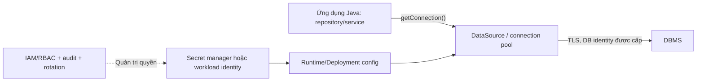
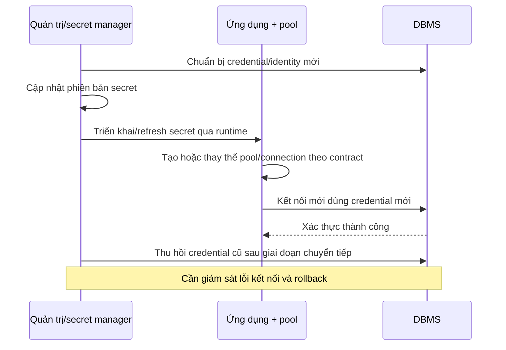

# Quản lý mật khẩu và thông tin xác thực ngoài mã nguồn khi dùng JDBC

## Mục tiêu học tập

Trong **JDBC**, ứng dụng Java kết nối cơ sở dữ liệu quan hệ qua driver và `DataSource` hoặc `DriverManager`, sau đó thao tác với `Connection`, `PreparedStatement` và `ResultSet`. Để đăng nhập database, một số hệ thống cần tên tài khoản và mật khẩu; hệ thống khác sử dụng token ngắn hạn, chứng chỉ máy khách hoặc danh tính workload. **Thông tin xác thực là bí mật vận hành**, không nên viết trực tiếp trong mã Java, tệp cấu hình được commit vào Git, ví dụ tài liệu hoặc câu lệnh build.

Một thiết kế an toàn cần giải quyết cả **nơi lưu bí mật**, **cách cấp cho ứng dụng khi khởi động**, **ai có quyền đọc**, **cách ngăn rò rỉ qua log**, **cách xoay vòng khi hết hạn hoặc bị lộ**, và **cách connection pool phản ứng khi thông tin xác thực thay đổi**. Chỉ chuyển mật khẩu từ một hằng `String` sang một file khác chưa chắc đạt yêu cầu nếu file đó vẫn nằm trong repository hoặc được đưa nguyên văn vào artifact triển khai.

Bài thuộc chương **Bảo mật truy cập** giúp bạn:

- Nhận diện các kênh làm lộ credential trong code, repository, build, log, monitoring và môi trường chạy.
- Phân biệt **biến môi trường**, **tệp cấu hình ngoài repository**, **secret manager** và **xác thực dựa trên danh tính workload**.
- Thiết kế tầng persistence để service nhận `DataSource` đã cấu hình, thay vì tự biết mật khẩu database.
- Viết ví dụ JDBC dùng SQL tham số hóa mà không hard-code hoặc in bí mật.
- Áp dụng **least privilege**, TLS và phân tách quyền truy cập theo môi trường.
- Lập kế hoạch **rotation** và kiểm tra connection pool sau khi thay credential.
- Thiết kế quy trình kiểm thử, kiểm tra CI/CD và ứng phó khi credential bị lộ.

## 1. Tại sao không đặt mật khẩu trong mã Java?

Một đoạn mã như sau có vẻ tiện cho thử nghiệm:

```java
// PHẢN VÍ DỤ: không làm như thế trong dự án thật.
String url = "jdbc:vendor://db.internal:5432/app";
String user = "app_user";
String password = "example-password-in-source"; // Giá trị giả!
Connection connection =
    java.sql.DriverManager.getConnection(url, user, password);
```

Vấn đề không chỉ là người khác đọc được source. Một credential được commit vào Git có thể tồn tại trong **lịch sử commit, nhánh, bản sao repository, artifact CI, review, cache và máy của nhiều thành viên**, ngay cả khi bạn xóa nó ở commit sau. Người có credential cũng có thể truy cập database **ngoài phạm vi ứng dụng** nếu network và quyền DBMS cho phép.

Những đường rò rỉ thường gặp:

| Vị trí | Dấu hiệu rủi ro | Biện pháp |
| --- | --- | --- |
| Mã Java hoặc test | `PASSWORD = "..."`, chuỗi JDBC URL chứa password | Cấp secret ở runtime; dùng credential giả cho ví dụ |
| Git và lịch sử Git | File `application.properties` có password thật đã commit | Không commit secret; nếu lộ phải thu hồi/rotation |
| File `.env` trên máy phát triển | File bị commit hoặc chia sẻ qua chat | Đưa vào `.gitignore`, kiểm soát quyền file và vòng đời |
| CI/CD | In secret trong log lệnh, test report, environment dump | Dùng secret injection, masking, giới hạn job có quyền |
| Command line | `--db-password=...` hoặc `-Ddb.password=...` | Tránh đưa bí mật vào tham số có thể xuất hiện trong process list/history |
| Stack trace và exception | Log nguyên JDBC URL, `Properties` hoặc thông điệp chứa dữ liệu nhạy cảm | Chỉ log mã lỗi và metadata an toàn |
| Metrics/health endpoint | Trả về cấu hình kết nối, username, endpoint nội bộ | Chỉ báo trạng thái; không xuất credential |
| Container image | Sao chép file chứa secret vào image layer | Không đóng gói secret vào image; mount/cấp lúc chạy |
| Bản backup và crash dump | Credential nằm trong heap, file tạm, log | Kiểm soát truy cập, mã hóa và retention |

**Mã hóa một chuỗi rồi commit cả khóa giải mã vào repository không giải quyết vấn đề.** Tương tự, Base64 là cách biểu diễn dữ liệu, không phải bảo vệ bí mật.

## 2. Kiến trúc: ứng dụng cần DataSource, không cần biết nguồn secret

Thiết kế nên tách **tầng nghiệp vụ** khỏi **tầng cung cấp thông tin xác thực**.



Trong mô hình này:

1. **Repository** nhận `DataSource` và chỉ thực hiện SQL/thao tác transaction; không chứa mật khẩu.
2. **Bootstrap/deployment** cấu hình pool và nguồn credential trong môi trường chạy.
3. **Secret manager hoặc cơ chế danh tính** kiểm soát ai được lấy secret và cách cấp/luân chuyển.
4. **DBMS** kiểm tra tài khoản có quyền tối thiểu trên những schema/bảng cần thiết.
5. **Giám sát** ghi kết nối thành công/thất bại, thời gian cấp connection và số lỗi, không ghi giá trị bí mật.

`DataSource` là **interface tiêu chuẩn** của JDBC, nhưng **không có một API chuẩn duy nhất để cấu hình host, URL, username, password cho mọi triển khai DataSource**. Cách cấu hình phụ thuộc server ứng dụng, framework, pool hoặc driver. Vì thế nên định nghĩa lớp nghiệp vụ phụ thuộc vào interface `DataSource`, còn cấu hình được xử lý ở một tầng cụ thể.

### 2.1. Ví dụ repository không chứa credential

```java
import java.sql.Connection;
import java.sql.PreparedStatement;
import java.sql.ResultSet;
import java.sql.SQLException;
import java.util.Optional;
import java.util.Objects;
import javax.sql.DataSource;

public final class CustomerRepository {
    private final DataSource dataSource;

    public CustomerRepository(DataSource dataSource) {
        this.dataSource = Objects.requireNonNull(dataSource);
    }

    public Optional<String> findDisplayName(long customerId)
            throws SQLException {

        String sql = """
            SELECT display_name
              FROM customers
             WHERE customer_id = ?
            """;

        try (Connection connection = dataSource.getConnection();
             PreparedStatement ps = connection.prepareStatement(sql)) {
            ps.setLong(1, customerId);

            try (ResultSet rs = ps.executeQuery()) {
                if (!rs.next()) {
                    return Optional.empty();
                }
                // Ví dụ giả định display_name NOT NULL.
                return Optional.of(rs.getString("display_name"));
            }
        }
    }
}
```

Lớp này dùng **Java 15+** vì text block, có thể đổi thành chuỗi thường ở Java 8/11. Nó không biết password đến từ biến môi trường, secret manager hay token. Nhờ vậy có thể cấu hình nguồn kết nối khác nhau cho development, staging và production mà không sửa code nghiệp vụ.

**Tách secret khỏi mã nguồn không thay thế SQL tham số hóa**: `PreparedStatement` với dấu `?` vẫn cần thiết để giảm rủi ro SQL injection khi tham số có nguồn từ người dùng.

## 3. So sánh các cách cấp thông tin xác thực

| Phương thức | Điểm mạnh | Giới hạn cần biết | Trường hợp phù hợp |
| --- | --- | --- | --- |
| Biến môi trường lúc khởi động | Đơn giản, tương thích nhiều nền tảng | Có thể lộ qua debug, crash dump, process inspection hoặc child process tùy hệ thống; khó xoay vòng mà không restart | Local dev, môi trường nhỏ có kiểm soát |
| Tệp cấu hình ở ngoài repository | Cấu hình độc lập source; có thể mount read-only | Phải kiểm soát quyền file, backup, copy và xóa khi không cần | Server có quản trị filesystem tốt |
| Secret manager | Quyền truy cập, audit, version, rotation, cấp secret theo workload | Cần bảo vệ danh tính truy cập secret manager và kiểm soát cache/failure | Production, hệ thống nhiều dịch vụ |
| Kubernetes Secret/secret volume (hoặc cơ chế tương đương) | Tích hợp với deployment, tách image khỏi secret | Secret vẫn cần RBAC, bảo vệ kênh và lưu trữ; cơ chế cập nhật mounted secret khác env var | Triển khai container có kiểm soát |
| Danh tính workload + token ngắn hạn / mTLS | Có thể giảm nhu cầu giữ mật khẩu dài hạn; danh tính theo service | Driver/DBMS/proxy phải hỗ trợ, token expiry ảnh hưởng pool | Hạ tầng có identity federation |
| Kho khóa dành cho con người | Phân phối quyền và MFA cho nhân sự | Không nên biến tài khoản cá nhân thành tài khoản chạy service | Quản trị, thao tác DBA bằng người thật |

Không tồn tại một lựa chọn an toàn tuyệt đối. **Secret manager không phải phép màu** nếu mọi workload dùng chung quyền đọc mọi secret; file ngoài repository vẫn có thể an toàn khi được bảo vệ tốt; biến môi trường có thể phù hợp với development nhưng không nên được hiểu là nơi lưu secret bền vững có đầy đủ audit/rotation.

### 3.1. Biến môi trường: tiện nhưng không được thần thánh hóa

Một convention ở tầng triển khai có thể là:

```text
APP_DB_JDBC_URL=<JDBC URL không chứa user/password>
APP_DB_USER=<tài khoản riêng của môi trường>
APP_DB_PASSWORD=<được cấp qua secret injection>
```

Đây là **placeholder**, không phải giá trị thật. Không commit file chứa giá trị thực; không gửi ảnh màn hình cấu hình hoặc các biến môi trường này qua kênh không được phép. Tránh ghi password vào JDBC URL dù driver hỗ trợ, vì URL thường xuất hiện trong log/cấu hình.

Nếu dùng tệp `.env` cho development, giữ nó **ngoài Git**, dùng quyền truy cập chỉ cho người dùng cần thiết và chỉ nạp vào tiến trình khi chạy. Tên `.env` tự nó không cung cấp cơ chế bảo mật hoặc tự động ngăn file bị commit.

### 3.2. Secret manager trong production

Luồng thường gặp:

1. Tạo secret trong hệ thống lưu trữ bí mật được quản lý, gắn với đúng môi trường.
2. Cấp quyền **chỉ đọc secret đó** cho danh tính workload cụ thể; không chia sẻ khóa quản trị.
3. Runtime lấy secret bằng danh tính của workload, hoặc platform đưa secret vào file/biến môi trường tại lúc chạy.
4. Cấu hình `DataSource`/pool bằng credential trong bộ nhớ, không log giá trị.
5. Áp chính sách refresh/rotation theo vòng đời pool.
6. Theo dõi sự kiện đọc secret và lỗi xác thực, không xuất bí mật vào telemetry.

Nếu secret manager trả lỗi hoặc mất kết nối lúc khởi động, ứng dụng nên xử lý theo **chính sách fail closed** phù hợp: không tự rơi về password hard-code, password của môi trường khác hoặc tài khoản DBA. Có thể đánh dấu instance chưa sẵn sàng (*not ready*) và thử lại có giới hạn, nhưng không được để dịch vụ chạy với quyền cao ngoài dự kiến.

## 4. Ví dụ phát triển cục bộ: DriverManager lấy cấu hình từ runtime

Với công cụ nhỏ hoặc bài thử, `DriverManager` giúp minh họa việc đọc cấu hình từ biến môi trường. Mẫu này **không thay thế connection pool production**; mục tiêu là không đặt password trong source.

```java
import java.sql.Connection;
import java.sql.DriverManager;
import java.sql.SQLException;
import java.util.Properties;

public final class LocalJdbcConnection {
    private LocalJdbcConnection() {}

    public static Connection open() throws SQLException {
        String url = requiredEnvironment("APP_DB_JDBC_URL");
        String user = requiredEnvironment("APP_DB_USER");
        String password = requiredEnvironment("APP_DB_PASSWORD");

        // Tên key user/password là cách thường dùng với JDBC drivers,
        // nhưng thuộc tính bổ sung như TLS phụ thuộc driver cụ thể.
        Properties props = new Properties();
        props.setProperty("user", user);
        props.setProperty("password", password);

        try {
            return DriverManager.getConnection(url, props);
        } finally {
            // Bỏ tham chiếu trong Properties sớm nhất có thể.
            // KHÔNG có nghĩa String mật khẩu đã bị xóa khỏi heap.
            props.clear();
        }
    }

    private static String requiredEnvironment(String name) {
        String value = System.getenv(name);
        if (value == null || value.isBlank()) {
            // Chỉ báo tên biến còn thiếu, không báo giá trị.
            throw new IllegalStateException(
                "Thiếu biến môi trường bắt buộc: " + name
            );
        }
        return value;
    }
}
```

Cách sử dụng:

```java
try (java.sql.Connection connection = LocalJdbcConnection.open()) {
    // Chỉ thực thi truy vấn cần thiết.
    // Không System.out.println(connection) hay log cấu hình đầy đủ.
}
```

Những giới hạn cần hiểu:

- `System.getenv(...)` chỉ đọc **môi trường của tiến trình**; không tự lấy secret từ secret manager hay file `.env`. Tầng triển khai phải cung cấp biến trước khi Java chạy.
- `DriverManager.getConnection(...)` thiết lập kết nối mỗi lần gọi; **không mặc nhiên là pool**. Ứng dụng server nên cấu hình `DataSource`/pool ở tầng bootstrap.
- `Properties.clear()` xóa entry từ đối tượng `Properties`, **không bảo đảm xóa chuỗi password khỏi JVM**. API JDBC tiêu chuẩn thường dùng `String`, nên không thể hứa rằng việc dùng `char[]` sẽ luôn bảo vệ bí mật khỏi heap dump; vẫn cần khóa truy cập vào tiến trình/dump.
- Một số driver yêu cầu hoặc hỗ trợ thuộc tính xác thực riêng. Không tự lắp các tham số `password=...` vào URL hay chuyển thông tin xác thực qua chuỗi SQL.
- Thiết lập TLS/kiểm tra chứng chỉ phải theo **tài liệu driver và DBMS cụ thể**; `DriverManager` không tự bảo đảm đường truyền đã được xác thực và mã hóa.
- Nếu URL hoặc secret không hợp lệ, tránh log toàn bộ `Properties` hoặc ghép password vào thông điệp ngoại lệ.

### 4.1. Không log toàn bộ cấu hình lúc khởi động

Phản ví dụ:

```java
// KHÔNG làm vậy trong production:
System.out.println(System.getenv());
System.out.println("JDBC config: " + props);
// Không đưa JDBC URL chứa credential vào log.
```

Có thể ghi dữ liệu vận hành **không nhạy cảm** theo một danh sách cho phép: tên môi trường, tên pool, phiên bản driver, trạng thái kết nối và error category. Host/database name cũng có thể là thông tin nội bộ; chỉ ghi khi policy cho phép và tránh đưa trực tiếp vào response public.

## 5. Cách ưu tiên: để runtime cung cấp DataSource

Ở một số application server có JNDI, runtime quản lý resource `DataSource` và credential của nó. Java chỉ lookup theo tên resource.

```java
import javax.naming.InitialContext;
import javax.naming.NamingException;
import javax.sql.DataSource;

public final class DataSourceLookup {
    private DataSourceLookup() {}

    public static DataSource fromContainer() throws NamingException {
        InitialContext context = new InitialContext();
        try {
            Object value = context.lookup(
                "java:comp/env/jdbc/ApplicationDb"
            );
            if (!(value instanceof DataSource dataSource)) {
                throw new NamingException(
                    "Resource JDBC không phải DataSource"
                );
            }
            return dataSource;
        } finally {
            context.close();
        }
    }
}
```

**Điều kiện:** đây là ví dụ cho một runtime **thực sự cung cấp** JNDI resource với tên đó, chẳng hạn môi trường Jakarta EE hoặc server ứng dụng được cấu hình. Chạy một ứng dụng Java SE độc lập chưa có JNDI provider/resource không tự nhiên hoạt động chỉ vì có `InitialContext` trong JDK.

Ứng dụng có thể dùng:

```java
DataSource dataSource = DataSourceLookup.fromContainer();
CustomerRepository repository = new CustomerRepository(dataSource);

repository.findDisplayName(1001L);
// Không có mật khẩu nào được truyền tới repository.
```

Trong framework có dependency injection, ý tưởng tương tự: cấp `DataSource` qua container. Configuration code vẫn cần quyền nhận secret, nhưng tầng nghiệp vụ không phụ thuộc cách lấy secret. Cấu hình pool có thể sử dụng thuộc tính riêng của thư viện hoặc driver; **không có một tập setter chung cho mọi DataSource** ngoài giao diện JDBC.

### 5.1. Ai có quyền đọc secret trong kiến trúc này?

Điều kiện tối thiểu nên có:

- Identity của service production chỉ được lấy secret database **của production dành riêng cho service đó**.
- Service staging/dev có secret và tài khoản DBMS **khác production**.
- Developer không mặc định có quyền đọc password production.
- Runtime có thể quản lý connection pool mà không cần đưa giá trị credential vào code ứng dụng hoặc log.
- Quyền đọc secret và quyền **ghi/rotate** secret nên tách theo vai trò.
- Các lệnh truy cập secret và thay đổi phân quyền có audit log phù hợp.

Ngay cả nếu ứng dụng “không biết password” ở tầng repository, một lỗi cấu hình IAM quá rộng vẫn có thể làm credential bị lộ thông qua các thành phần khác.

## 6. Mật khẩu mạnh chưa đủ: least privilege tại database

Nếu một service chỉ đọc bảng `products`, tài khoản JDBC của nó không cần quyền tạo bảng, xóa schema hoặc quản trị user. Nếu service ghi đơn hàng, cấp quyền cần thiết trên đúng bảng/sequence/procedure, thay vì cấp quyền DBA.

| Loại workload | Quyền phù hợp cần cân nhắc | Quyền thường không nên cấp mặc định |
| --- | --- | --- |
| API tra cứu dữ liệu | `SELECT` trên bảng/view cần thiết | `DROP`, `ALTER`, tạo user |
| API CRUD nghiệp vụ | `SELECT/INSERT/UPDATE/DELETE` đúng phạm vi | Quyền quản trị schema toàn database |
| Migration | Quyền DDL trong quy trình triển khai có kiểm soát | Dùng chung account migration cho mọi request |
| Job báo cáo | Quyền đọc view hoặc schema báo cáo | Ghi/xóa dữ liệu giao dịch |
| Backup/maintenance | Quyền riêng theo công cụ/quy trình | Tài khoản ứng dụng thông thường dùng thay |

DBMS khác nhau về grant syntax và đối tượng được cấp quyền. **Không có một câu GRANT chung** cho mọi hệ quản trị; cần dựa vào tài liệu và review quyền của DBMS thực tế.

### Tài khoản riêng cho môi trường và mục đích

Không dùng cùng một password cho dev, staging và production. Một credential lộ trên máy phát triển không nên có đường trực tiếp tới database production. Tách tài khoản read-only và read-write khi kiến trúc phù hợp cũng giúp giảm tác động khi một thành phần bị chiếm quyền.

**Least privilege còn áp dụng ở tầng ứng dụng:** tài khoản JDBC có quyền `SELECT` nhiều bản ghi không có nghĩa mọi HTTP client được quyền đọc tất cả chúng. Ứng dụng vẫn cần kiểm soát xác thực và phân quyền người dùng; tài khoản DB của service không thay thế authorization nghiệp vụ.

## 7. Bảo vệ đường truyền JDBC bằng TLS đúng cách

Đưa credential ra khỏi source giải quyết rủi ro lưu trữ/lộ trong repository, **không tự bảo vệ** password trên đường truyền mạng. Khi driver hỗ trợ, cần cấu hình TLS với **xác minh chứng chỉ máy chủ và danh tính endpoint**, không chỉ bật mã hóa mà bỏ qua validation.

Một checklist:

1. Kiểm tra DBMS và JDBC driver hỗ trợ TLS và phiên bản giao thức thích hợp.
2. Cấu hình client trust store hoặc CA được tin cậy theo kiến trúc.
3. Yêu cầu kiểm tra chứng chỉ và hostname server; tránh bật tùy chọn “trust all”.
4. Nếu dùng mutual TLS/client certificate, đặt khóa riêng và chứng chỉ trong kho thích hợp, giới hạn quyền đọc.
5. Kiểm tra thông tin TLS qua công cụ đo và tài liệu driver; không chỉ suy từ việc TCP kết nối được.
6. Khi xoay vòng certificate, triển khai theo trình tự không làm tất cả connection mới thất bại đồng thời.

Tên thuộc tính để yêu cầu verify-full, encrypt, trust certificate hoặc keystore **khác nhau theo driver**. Không đưa một cấu hình ví dụ của PostgreSQL/MySQL/SQL Server/Oracle như thể là thuộc tính JDBC chuẩn áp dụng cho mọi driver.

Nếu có proxy/connection broker giữa ứng dụng và database, cần kiểm tra bảo vệ từng chặng và ranh giới trust của proxy, không mặc nhiên rằng TLS từ ứng dụng tới proxy nghĩa là toàn bộ đường đi đã được bảo vệ.

## 8. Rotation: credential mới không tự đi vào connection pool

Khi mật khẩu được cập nhật trong secret manager hoặc DBMS, nhiều pool JDBC **không tự biết** giá trị đã đổi. Pool có thể giữ credential cũ để tạo **connection mới**, trong khi những connection vật lý đã được xác thực từ trước vẫn còn hoạt động cho tới khi server đóng chúng hoặc chính sách bảo mật bắt buộc ngắt.

Các bước thường cần phối hợp:



**Không có trình tự duy nhất** cho mọi DBMS. Một số hệ thống cho phép tồn tại đồng thời hai credential hoặc hai user trong giai đoạn chuyển tiếp; hệ thống khác đổi password ngay lập tức. Với token ngắn hạn, việc cấp lại token và tuổi thọ connection phải được kiểm soát. Mục tiêu là không ngắt đồng loạt kết nối hợp lệ hoặc mở ra khoảng thời gian bí mật cũ tồn tại quá lâu.

### 8.1. Các loại rotation

| Loại | Mục tiêu | Tác động tới ứng dụng |
| --- | --- | --- |
| Theo lịch | Giảm vòng đời credential dài hạn | Refresh pool và giám sát xác thực |
| Khi nhân sự/quyền thay đổi | Thu hồi quyền truy cập không còn cần thiết | Kiểm tra owner, service accounts và audit |
| Khi nghi ngờ lộ secret | Ngắt khả năng dùng lại credential bị lộ | Thu hồi sớm, xử lý incident và truy tìm nơi còn bản sao |
| Token ngắn hạn | Thay password cố định bằng chứng thực có thời hạn | Cấp token mới đúng lúc tạo connection |
| Thay certificate/CA | Bảo vệ transport identity | Cập nhật trust store/client cert và kiểm tra TLS |

### 8.2. Kế hoạch thay pool có kiểm soát

Khi cấu hình pool không hỗ trợ đổi credential động an toàn, có thể:

1. Cấp secret/identity mới ở nơi quản lý.
2. Khởi tạo **pool mới** bằng credential mới và kiểm tra health qua một kết nối thực.
3. Chuyển những request mới sang pool mới.
4. Chờ các giao dịch đang chạy trên pool cũ hoàn tất trong thời hạn cho phép.
5. Đóng pool cũ, rồi thu hồi credential cũ theo chính sách an ninh.

Đây là mô hình **khái niệm**; code và thứ tự rollback thuộc framework/pool/DBMS cụ thể. Không tự chia sẻ `Connection` đang hoạt động giữa pool cũ/mới; không thay credentials trong session đang thực hiện transaction rồi giả định trạng thái nhất quán.

Nếu bắt buộc restart để nhận env vars mới, dùng rollout có kiểm soát và xác minh số instance sẵn sàng, tránh restart đồng loạt khi database đang ở giới hạn kết nối. Secret manager cập nhật secret nhưng ứng dụng chưa refresh **không phải rotation đã hoàn tất**.

## 9. Chuẩn bị cho lỗi xác thực và lỗi secret service

Phân biệt các lỗi có thể gặp:

| Hiện tượng | Nguyên nhân có thể | Hành động |
| --- | --- | --- |
| Không có biến cấu hình | Runtime chưa inject hoặc tên biến sai | Fail startup/readiness, log **tên biến** thiếu |
| Secret manager trả 403/Access Denied | Identity workload thiếu quyền hoặc policy bị đổi | Kiểm tra IAM; không dùng account quyền cao để “chữa cháy” |
| DBMS từ chối user/password | Secret lệch với DBMS, credential hết hạn, user bị khóa | Kiểm tra secret version và DB audit |
| Connection cũ chạy được nhưng tạo connection mới lỗi | Pool đang dùng credential cũ sau rotation | Refresh/recreate pool có kiểm soát |
| TLS handshake lỗi | CA/certificate/hostname không hợp lệ hoặc cấu hình TLS sai | Sửa trust/cert, không tắt xác thực hostname |
| Nhiều connection timeout | Database quá tải, network hoặc pool bão hòa | Phân loại khỏi lỗi password; xem pool metrics |
| Lỗi commit giữa mất kết nối | Trạng thái transaction có thể chưa xác định | Đối soát theo request ID; không retry mù quáng |

### Không lặp lại lỗi xác thực vô hạn

Nếu service liên tục thử mở connection bằng password cũ hàng nghìn lần, bạn có thể làm quá tải DBMS hoặc kích hoạt cơ chế khóa tài khoản. Hãy giới hạn retry, có backoff và cảnh báo. Một lỗi cấu hình không thể tự sửa bằng lặp lại `getConnection()` liên tục.

Tương tự, lỗi secret manager hoặc token hết hạn **không nên** làm ứng dụng fallback sang secret hard-coded “dự phòng” nằm trong source.

### Lỗi trong transaction không đồng nghĩa retry an toàn

Lỗi xác thực thường xảy ra trước khi connection được cấp, nhưng lỗi mạng/token/certificate có thể xuất hiện tại nhiều giai đoạn. Nếu `commit()` ném `SQLException`, database có thể đã commit rồi nhưng phản hồi bị mất. Không tự động chạy lại một yêu cầu tạo đơn hàng/chuyển tiền với mã mới chỉ vì thông điệp có từ “connection”. Cần idempotency và đối soát giao dịch.

## 10. Cẩn thận với log, tracing và SQLException

Thông điệp JDBC có thể cung cấp `SQLState`, `getErrorCode()` và chuỗi `getNextException()`. Đây là thông tin hữu ích để chẩn đoán lỗi xác thực và connection, nhưng log phải có chính sách bảo vệ thông tin nhạy cảm.

Ví dụ helper ghi **các trường có cấu trúc**:

```java
import java.sql.SQLException;
import java.util.logging.Level;
import java.util.logging.Logger;

public final class SafeJdbcErrorLog {
    private static final Logger LOG =
        Logger.getLogger(SafeJdbcErrorLog.class.getName());

    private SafeJdbcErrorLog() {}

    public static void record(String operation, SQLException first) {
        int index = 0;

        for (SQLException current = first;
             current != null;
             current = current.getNextException()) {

            LOG.log(Level.WARNING,
                "operation={0}, chainIndex={1}, type={2}, "
              + "sqlState={3}, vendorCode={4}",
                new Object[] {
                    operation, index++,
                    current.getClass().getSimpleName(),
                    current.getSQLState(),
                    current.getErrorCode()
                }
            );
        }
    }
}
```

Đối số `operation` nên là giá trị tĩnh do code chọn (ví dụ `"customerLookup"`), **không phải chuỗi input của người dùng**. Helper cố ý không log `getMessage()` vì thông điệp driver đôi khi có thông tin môi trường hoặc SQL. Đối với log chẩn đoán sâu được cấp quyền, có thể áp quy tắc lọc và giới hạn truy cập để thu thông tin thêm, nhưng không nên lấy việc “ẩn password bằng regex” làm hàng rào duy nhất: driver và định dạng secret có thể thay đổi.

**Không log nguyên `Throwable` hoặc stack trace vào hệ thống công khai khi chưa đánh giá đường rò rỉ**; stack trace có thể kèm exception message chứa endpoint, SQL hoặc tài liệu nội bộ. Log bảo mật nên có retention, giới hạn người xem và audit.

### 10.1. Tránh secret trong metric labels

Metrics như `jdbc_pool_active{pool="orders"}` thường an toàn hơn label chứa cả JDBC URL, username hoặc password. Nhãn có giá trị biến thiên cao còn làm tăng cardinality. Chỉ ghi những thuộc tính được cho phép và đã được đánh giá bảo mật.

## 11. CI/CD và môi trường phát triển: phòng ngừa từ đầu

### 11.1. Quy trình cho developer

- Cung cấp file mẫu **không chứa bí mật**, ví dụ `.env.example` có **tên biến** và giá trị placeholder.
- Đưa file cấu hình cục bộ có secret vào `.gitignore`, đồng thời dùng công cụ secret scanner trước commit và trong CI.
- Dùng database phát triển hoặc container local với tài khoản riêng, dữ liệu thử nghiệm; không sao chép password production cho dễ debug.
- Không chia sẻ mật khẩu qua issue, comment code, email, ảnh màn hình terminal hoặc tài liệu công khai.
- Không đặt credential vào lệnh chạy mà shell history hoặc process viewer có thể thu được.
- Nếu cần truy cập DB production để hỗ trợ sự cố, dùng quy trình break-glass/audit có quyền tối thiểu và thời hạn rõ.

**`.gitignore` không bảo vệ file đã được Git theo dõi trước đó**. Nếu password đã xuất hiện trong commit, phải xử lý như sự cố lộ secret; việc thêm ignore sau đó không thu hồi được credential.

### 11.2. Quy trình cho CI/CD

- Chỉ cấp secret cho job cần database test hoặc deployment; job chạy PR từ nguồn không tin cậy không nên tự có quyền đọc secret production.
- Ưu tiên **identity federation / short-lived credentials** tới secret manager thay vì token quản trị dài hạn trong biến CI.
- Tắt echo/verbose ở bước có thể in bí mật; tránh đưa secret vào tham số dòng lệnh hay artifact test.
- Không lưu secret trong cache dependency, build artifact, container image hoặc test report.
- Cấu hình khả năng revoke nhanh khi runner bị xâm nhập.
- Tách secret của integration test khỏi production và giới hạn mạng từ runner tới DB.
- Ghi nhận thành công/thất bại theo trạng thái, không xuất nội dung secret.

### 11.3. Kiểm thử an toàn cấu hình JDBC

| Ca kiểm thử | Kỳ vọng |
| --- | --- |
| Thiếu `APP_DB_PASSWORD` | Startup hoặc tác vụ kết nối báo lỗi an toàn, không in password khác |
| Credential sai | DBMS từ chối; không tự fallback account quyền cao |
| DB server chứng chỉ không hợp lệ | Kết nối thất bại nếu policy yêu cầu verify TLS |
| Secret được rotation | Kết nối mới dùng secret mới đúng kế hoạch; pool cũ được drain |
| Service chỉ có quyền SELECT | `SELECT` thành công, `DROP/ALTER` bị DBMS từ chối |
| Secret manager tạm lỗi | Retry có giới hạn, readiness phản ánh lỗi, không lộ secret trong log |
| Driver ném `SQLException` | Log có SQLState/mã vendor an toàn; không in credential |
| Nhiều replica cùng deploy | Tổng số connection không vượt DB budget |
| Credential bị thu hồi | Instance không tiếp tục tạo connection mới bằng secret cũ |
| Bản backup, log, artifact | Không chứa mật khẩu hoặc token thực |

## 12. Ứng phó khi phát hiện credential đã lộ

Nếu một password đã được đưa vào repository hoặc log, **đừng chỉ xóa chuỗi rồi coi như xong**. Một quy trình thường cần:

1. **Xác định phạm vi:** credential nào, môi trường nào, quyền nào, thời gian nó có thể đã bị xem hoặc sao chép.
2. **Thu hồi hoặc xoay vòng ngay** theo quy trình khẩn cấp tương ứng; tránh để hệ thống tiếp tục phụ thuộc bí mật đã lộ.
3. **Điều tra hoạt động bất thường** từ audit DBMS, secret manager, network và CI trong giai đoạn liên quan.
4. **Xóa bản sao có thể kiểm soát** khỏi log, cache, artifact, ticket và repository theo quy trình; cần hiểu lịch sử Git hoặc bản sao ngoài quyền kiểm soát có thể vẫn còn.
5. **Cập nhật cơ chế triển khai** để ứng dụng nhận secret mới và làm mới pool mà không lộ thêm trong log.
6. **Thu hẹp quyền** nếu credential trước đó được cấp vượt nhu cầu, đồng thời cải thiện secret scanning và kiểm thử.
7. **Ghi nhận sự cố và khắc phục** theo chính sách bảo mật của tổ chức.

**Điểm quan trọng:** viết lại lịch sử Git không thu hồi credential. Nếu credential từng thật sự hợp lệ và có khả năng bị lộ, **revocation/rotation** mới làm vô hiệu việc sử dụng lại nó. Việc dọn lịch sử, nếu cần, là bước bổ sung để giảm phát tán, không phải bước thay thế.

## 13. Bảng quyết định nhanh theo từng môi trường

| Bối cảnh | Cách tiếp cận hợp lý | Điều không nên làm |
| --- | --- | --- |
| Bài thực hành JDBC trên máy cá nhân | Biến môi trường hoặc local secret file không commit; DB test riêng | Đặt mật khẩu thật trong bài viết/source |
| Backend production dùng connection pool | Runtime cấp `DataSource`; secret manager/workload identity; giám sát rotation | Cho repository tự đọc password và giữ toàn cục |
| Job CI chạy integration test | Credential test tạm thời, quyền tối thiểu, secret injection | Cho PR tùy ý đọc secret production |
| Nhiều replica Kubernetes | Cấp secret theo workload, RBAC, rollout/pool refresh có kiểm soát | Tưởng cập nhật Secret tự đổi env var của tiến trình đang chạy |
| DB chỉ hỗ trợ user/password dài hạn | Password riêng từng service, rotation, TLS, least privilege | Dùng tài khoản admin chung cho mọi dịch vụ |
| DB hỗ trợ token ngắn hạn/mTLS | Kiểm tra driver/pool hỗ trợ refresh, expiration và reauthentication | Tái sử dụng token hết hạn cho kết nối mới |
| Cần hỗ trợ sự cố production | Danh tính tạm thời, quyền có thời hạn, audit | Chia sẻ password dịch vụ qua chat/ticket |

Không phải mọi driver có cùng cách nhận token, certificate hoặc credential provider. Đối với những cơ chế đặc thù, phải xác minh **DBMS, phiên bản driver và cách pool tạo connection mới** trước khi chọn phương án.

## 14. Bài luyện tập

**Bài 1 — Di chuyển secret khỏi source.** Một dự án có `private static final String PASSWORD = "..."`. Bạn chuyển chuỗi sang file `db.properties` nhưng vẫn commit file này. Đã giải quyết rủi ro chưa?

*Đáp án:* Chưa. Secret vẫn nằm trong repository và lịch sử, có thể bị sao chép. Cần cấp thông tin xác thực tại runtime hoặc dùng kho bí mật có kiểm soát quyền.

**Bài 2 — Biến môi trường.** Một service dùng `System.getenv("APP_DB_PASSWORD")`. Điều đó có nghĩa password không thể bị lộ qua debug, crash dump hoặc process inspection không?

*Đáp án:* Không. Biến môi trường tách password khỏi source, nhưng chưa phải bảo vệ tuyệt đối; vẫn cần kiểm soát quyền trên môi trường chạy, log và dump.

**Bài 3 — DataSource.** Vì sao nên truyền `DataSource` vào `CustomerRepository` thay vì để repository gọi secret manager trực tiếp?

*Đáp án:* Giảm coupling với cơ chế lấy secret, cho phép thay nguồn xác thực/pool qua cấu hình, tập trung quyền và quản lý rotation ở một tầng.

**Bài 4 — Pool rotation.** Secret manager đã có password mới, nhưng pool vẫn dùng password cũ khi tạo connection. Có thể coi rotation đã hoàn tất chưa?

*Đáp án:* Chưa. Ứng dụng/pool phải refresh hoặc được thay thế theo contract, các kết nối mới phải được xác nhận dùng credential mới rồi mới thu hồi hoàn toàn credential cũ.

**Bài 5 — Least privilege.** Một API chỉ đọc danh sách sản phẩm. Tài khoản JDBC có cần quyền `DROP TABLE` không?

*Đáp án:* Không. Cấp `SELECT` trên đối tượng cần thiết; tài khoản migration riêng xử lý DDL.

**Bài 6 — TLS.** JDBC connection sử dụng TLS nhưng bỏ qua kiểm tra chứng chỉ máy chủ. Password có được bảo vệ hoàn toàn khỏi máy chủ giả mạo không?

*Đáp án:* Không. Nếu không xác thực đúng server, có thể bị kết nối tới endpoint giả mạo tùy threat model. Cần certificate/hostname validation phù hợp.

**Bài 7 — Password từng nằm trong Git.** Bạn xóa password ở commit mới và thêm `db.properties` vào `.gitignore`. Còn việc nào bắt buộc phải cân nhắc?

*Đáp án:* Thu hồi/rotation secret, kiểm tra nơi khác còn bản sao và audit truy cập. Chỉ xóa file hoặc viết lại lịch sử Git không làm password cũ tự mất hiệu lực.

**Bài 8 — Lỗi commit.** Một yêu cầu ghi đơn hàng đã dùng connection hợp lệ, nhưng `commit()` ném lỗi mạng. Có nên tự động tạo đơn hàng mới với ID khác?

*Đáp án:* Không. Kết quả commit có thể chưa xác định; cần đối soát theo request ID/idempotency trước khi retry.

## Kết luận

**Bảo mật thông tin xác thực JDBC bắt đầu bằng việc không để mật khẩu hoặc token thật trong mã nguồn và artifact được chia sẻ, nhưng không dừng ở đó.** Một thiết kế vững chắc để `DataSource`/pool được cấu hình bởi runtime có kiểm soát, secret manager hoặc danh tính workload, còn repository chỉ nhận connection và thực hiện SQL tham số hóa. Hãy cấp quyền tối thiểu ở DBMS, bảo vệ kết nối bằng TLS có kiểm tra danh tính máy chủ, tránh log credential, tách bí mật theo môi trường và kiểm soát CI/CD. Khi rotation diễn ra, bảo đảm pool tạo kết nối mới bằng thông tin xác thực mới và có kế hoạch thu hồi credential cũ. Nếu secret đã lộ, cần revoke/rotate và điều tra, không chỉ xóa chuỗi trong Git. Những nguyên tắc này giúp ứng dụng Java sử dụng JDBC với tính bảo mật vận hành phù hợp mà vẫn giữ được khả năng kiểm thử, triển khai và thay đổi cấu hình.
