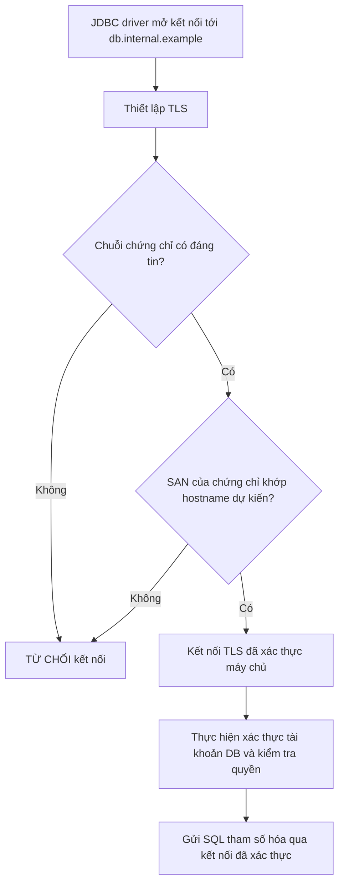
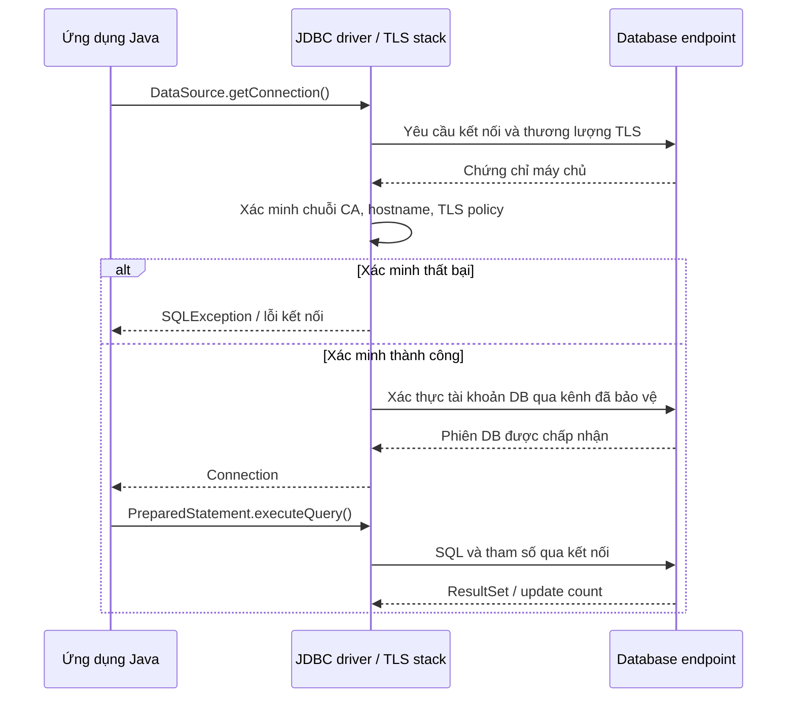
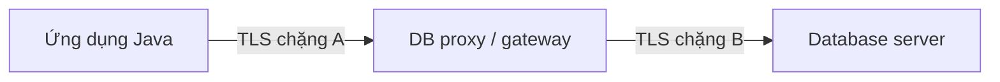

# Bảo vệ đường truyền và xác minh máy chủ cơ sở dữ liệu

## 1. Kết nối JDBC có an toàn chỉ vì dùng mật khẩu?

Ứng dụng Java dùng **JDBC** để kết nối cơ sở dữ liệu quan hệ thông qua driver, `DataSource`, `Connection`, `PreparedStatement` và `ResultSet`. Khi thực hiện CRUD, transaction hoặc batching, ứng dụng có thể trao đổi dữ liệu nhạy cảm qua kết nối mạng: tên người dùng, mật khẩu xác thực DB, câu SQL tham số hóa, dữ liệu khách hàng và kết quả truy vấn.

Nếu kết nối không được bảo vệ, người có khả năng quan sát hoặc can thiệp vào đường truyền có thể đọc hoặc sửa lưu lượng. Ngay cả khi bật mã hóa, một cấu hình **chấp nhận mọi chứng chỉ** có thể cho phép ứng dụng thiết lập kết nối TLS tới **máy chủ giả mạo** thay vì máy chủ DB cần truy cập.

Vì thế, bài toán gồm ba yêu cầu khác nhau:

1. **Bảo mật đường truyền:** dùng TLS để bảo vệ tính bí mật và tính toàn vẹn của dữ liệu được trao đổi trên kết nối.
2. **Xác thực máy chủ:** kiểm tra chứng chỉ máy chủ được cấp bởi nguồn tin cậy và khớp với hostname mà ứng dụng định kết nối.
3. **Phân quyền và xác thực ứng dụng:** dùng tài khoản DB/secret được bảo vệ, quyền tối thiểu, kiểm tra quyền theo nghiệp vụ. TLS không thay thế các kiểm soát này.

> **Nguyên tắc cốt lõi:** “Kết nối được mã hóa” chưa đủ; ứng dụng phải xác minh nó đang mã hóa tới **đúng máy chủ**.

Sau bài học, bạn sẽ biết đọc yêu cầu TLS trong cấu hình JDBC, phân biệt kiểm tra CA và hostname, cấu hình các chế độ xác thực máy chủ thông dụng, sử dụng kết nối qua `DataSource` an toàn, xử lý proxy/replica và vòng đời chứng chỉ, kiểm thử trường hợp phải từ chối kết nối, cũng như phân tích những giới hạn của TLS đối với SQL và transaction.

## 2. Mô hình đe dọa: những gì có thể xảy ra trên mạng

Xét hệ thống:

```text
Ứng dụng Java --[mạng nội bộ hoặc cloud]--> Database
     |                                         |
 DataSource                                 SQL Server
 PreparedStatement                          dữ liệu và quyền
 ResultSet
```

Đường truyền có thể đi qua nhiều lớp: mạng của container/Kubernetes, mạng VPC, proxy cân bằng tải, VPN, service mesh hoặc đường kết nối giữa các vùng hạ tầng. “Mạng nội bộ” không tự đồng nghĩa “mọi nút đều đáng tin”.

| Mối đe dọa | Khi không bảo vệ đúng | TLS kèm xác minh máy chủ giúp gì? |
|---|---|---|
| Nghe lén dữ liệu trên đường truyền | Người quan sát có thể thấy nội dung giao tiếp nếu giao thức không mã hóa | Mã hóa dữ liệu trên chặng TLS |
| Sửa nội dung gói tin | Có thể can thiệp vào giao tiếp không được bảo vệ | TLS kiểm tra tính toàn vẹn của bản ghi truyền |
| DNS hoặc định tuyến trỏ đến endpoint giả | Ứng dụng có thể kết nối nhầm nơi | Xác minh chứng chỉ cho hostname dự kiến |
| Máy chủ giả trình diện chứng chỉ tự ký | Ứng dụng cấu hình trust-all có thể chấp nhận | Kiểm tra chuỗi tin cậy, từ chối chứng chỉ không đáng tin |
| Máy chủ có chứng chỉ hợp lệ nhưng cho tên khác | Có nguy cơ kết nối tới endpoint không mong muốn | Kiểm tra Subject Alternative Name (SAN) khớp hostname |
| Lộ mật khẩu từ log, secret store hoặc mã nguồn | Đối tượng tấn công có thể lấy credential ngoài đường truyền | **TLS không giải quyết**; phải bảo vệ bí mật riêng |
| Tài khoản DB có quyền quá rộng | Tác động lên bảng không liên quan | **TLS không giải quyết**; phải cấp quyền tối thiểu |
| SQL injection qua câu SQL nối chuỗi | Thao tác SQL trái phép được gửi qua kết nối hợp lệ | **TLS không giải quyết**; dùng `PreparedStatement` và kiểm soát đầu vào |

### Mô hình xác minh máy chủ



Trình tự minh họa hai điều kiện cốt lõi của **server authentication**. Việc kiểm tra thuật toán ký, thời hạn chứng chỉ, ràng buộc CA và một số chính sách khác do TLS stack/driver/trust manager thực hiện. Không nên tự viết lại quy trình xác minh chứng chỉ bằng chuỗi so sánh tùy tiện.

## 3. Phân biệt các cấp độ bảo vệ kết nối

Một cấu hình JDBC có thể thuộc một trong những cấp độ sau:

| Cấp độ | Mã hóa? | Kiểm tra chứng chỉ CA? | Kiểm tra hostname? | Đánh giá |
|---|---|---|---|---|
| Không dùng TLS | Không | Không | Không | Không phù hợp cho lưu lượng nhạy cảm qua mạng không tin cậy |
| TLS nhưng không xác minh chứng chỉ | Có thể có | Không | Không | Dễ bị máy chủ giả mạo khi kẻ tấn công có khả năng chặn/định tuyến kết nối |
| TLS, kiểm tra chuỗi CA | Có | Có | Chưa chắc | Có thể vẫn chấp nhận chứng chỉ hợp lệ của hostname khác |
| TLS, kiểm tra CA và danh tính hostname | Có | Có | Có | Mục tiêu thông thường cho kết nối JDBC từ ứng dụng đến DB |
| Mutual TLS (mTLS) | Có | Có đối với máy chủ | Có đối với máy chủ | Bổ sung xác thực **client** bằng chứng chỉ, theo chính sách DB |

**Xác minh danh tính hostname** nghĩa là hostname mà ứng dụng thực sự định kết nối phải khớp danh tính được phép trong chứng chỉ server, thường nằm trong **Subject Alternative Name (SAN)**. Không tự suy rằng tên chung `CN` luôn đủ thay thế SAN; hành vi phụ thuộc TLS stack/driver và chính sách chứng chỉ hiện hành.

Nếu ứng dụng kết nối `db.prod.internal.example` nhưng chứng chỉ chỉ dành cho `db-staging.internal.example`, kết nối cần **thất bại**, ngay cả khi chứng chỉ được một CA đáng tin cậy ký.

### TLS không đồng nghĩa mTLS

TLS xác thực máy chủ giúp ứng dụng biết đang giao tiếp với DB nào. **mTLS** yêu cầu phía client cũng trình diện chứng chỉ được server xác minh. Đây là lớp xác thực bổ sung, không nhất thiết thay thế thông tin đăng nhập SQL hoặc cơ chế phân quyền trong DB.

Việc chọn mTLS phụ thuộc chính sách bảo mật và khả năng của driver/server. Một kết nối chỉ có chứng chỉ máy chủ, username và password vẫn có thể được bảo vệ TLS phù hợp; không phải mọi ứng dụng bắt buộc phải có chứng chỉ client.

## 4. TLS được thiết lập ở đâu trong luồng JDBC?

Luồng thông thường:



TLS thường được thiết lập trên **kết nối vật lý**, không phải mỗi lần gọi `executeQuery()`. Khi dùng connection pool, một `Connection` logic được mượn có thể tái sử dụng kết nối vật lý đã mở. Vì vậy, chính sách TLS cần áp dụng tại **nơi khởi tạo kết nối vật lý**: driver, `DataSource`/pool, thông số kết nối và trust material.

Không thể “bật TLS cho riêng một PreparedStatement” sau khi connection đã mở không an toàn. `PreparedStatement` bảo vệ việc gắn dữ liệu vào SQL và giúp chống injection khi dùng đúng cách, nhưng **không thay thế TLS**.

## 5. Cơ chế tin cậy: trust store, CA, hostname và SAN

### 5.1. Chuỗi chứng chỉ và trust anchor

Thông thường, database trình diện chứng chỉ máy chủ và một phần chuỗi chứng chỉ trung gian. Driver/TLS stack kiểm tra:

- Chứng chỉ chưa hết hạn và nằm trong thời gian hiệu lực.
- Chuỗi chứng chỉ hợp lệ theo chính sách xác minh hiện hành.
- Chuỗi dẫn đến **CA hoặc trust anchor** mà ứng dụng cho phép tin cậy.
- Danh tính endpoint được trình diện trong SAN khớp hostname dự kiến.

Trust anchor có thể đến từ trust store của JVM hoặc tập CA riêng được cấu hình cho driver. Với DB nội bộ dùng CA doanh nghiệp, nên phân phối CA đáng tin qua cơ chế cấu hình/secret/certificate management có kiểm soát, không “sửa lỗi” bằng cách chấp nhận tất cả chứng chỉ.

### 5.2. Trust store và key store không phải cùng một thứ

| Thành phần | Mục đích | Có nên đưa vào source code? |
|---|---|---|
| Trust store / CA bundle | Chứa những CA/chứng chỉ được tin để xác minh **server** | Có thể quản lý cấu hình và nội dung chứng chỉ công khai, nhưng phải kiểm soát thay đổi |
| Client key store | Chứa khóa riêng và chứng chỉ client khi dùng mTLS | **Không** commit khóa riêng; cần secret store, mã hóa và hạn quyền |
| JDBC username/password | Xác thực tài khoản DB | **Không** hardcode hoặc ghi log |
| Hostname DB | Chỉ ra endpoint cần kết nối và tên phải được kiểm tra | Cần quản lý cấu hình, không cho client tùy ý định tuyến |
| Signed/issued certificate | Bằng chứng nhận dạng endpoint | Có thể công khai chứng chỉ, nhưng phải kiểm tra tin cậy và vòng đời |

JVM có các cơ chế trust store chung, nhưng **driver JDBC có thể có thuộc tính SSL riêng**; không giả định mọi driver đều sử dụng cùng một file trust store hoặc cùng thuật toán hostname verification. Hãy đọc tài liệu cho đúng phiên bản driver và cách cấu hình `DataSource`/pool đang sử dụng.

### 5.3. Không dùng trust-all hay tắt hostname verification

Những cách “vượt lỗi chứng chỉ” nguy hiểm:

```text
KHÔNG dùng trong môi trường thật:
  - TrustManager tự chấp nhận mọi chứng chỉ.
  - sslmode=require / mã hóa-only nếu yêu cầu xác minh hostname.
  - trustServerCertificate=true khi yêu cầu kiểm tra danh tính DB.
  - Thuộc tính bỏ qua hostname verification.
  - Chuyển về plaintext vì chứng chỉ hết hạn.
```

Một chứng chỉ không hợp lệ là tín hiệu **cần sửa endpoint/chứng chỉ/trust configuration**, không phải lý do để bỏ qua xác minh. Chính sách an toàn phải **fail closed**: kết nối bị từ chối và thao tác nghiệp vụ không tiếp tục trên kết nối không được xác thực.

## 6. Cấu hình PostgreSQL JDBC: `sslmode=verify-full`

Với PostgreSQL JDBC driver (pgJDBC), chế độ xác minh đầy đủ thường dùng:

```text
jdbc:postgresql://db.internal.example:5432/orders
  sslmode = verify-full
  sslrootcert = /etc/myapp/certs/db-ca.pem
```

Các giá trị này có thể được truyền qua thuộc tính kết nối hoặc URL theo cú pháp mà driver hỗ trợ. `verify-full` yêu cầu TLS, xác minh chuỗi chứng chỉ qua CA và xác minh hostname của máy chủ.

| `sslmode` | Mức bảo vệ theo ý nghĩa thông dụng của PostgreSQL/pgJDBC |
|---|---|
| `disable` | Không dùng SSL/TLS. |
| `allow` | Có thể dùng kết nối không TLS tùy cơ chế thương lượng. |
| `prefer` | Ưu tiên TLS nhưng có thể rơi về kết nối không TLS; không phù hợp khi bắt buộc mã hóa và xác minh máy chủ. |
| `require` | Yêu cầu TLS; **không nên coi là chế độ xác minh hostname đầy đủ**. |
| `verify-ca` | Yêu cầu TLS và kiểm tra chuỗi chứng chỉ CA, nhưng không đầy đủ như xác minh hostname. |
| `verify-full` | Yêu cầu TLS, xác minh CA và danh tính hostname. |

Không dựa vào giá trị mặc định của driver nếu yêu cầu bảo mật bắt buộc. **Đặt chế độ xác minh đầy đủ một cách tường minh** để thay đổi driver/cấu hình không âm thầm làm suy giảm bảo vệ.

### 6.1. Ví dụ Java dùng Properties, không nhét mật khẩu vào URL

```java
import java.sql.Connection;
import java.sql.DriverManager;
import java.sql.SQLException;
import java.util.Objects;
import java.util.Properties;

public final class SecurePostgresConnection {
    private SecurePostgresConnection() {}

    public static Connection open(
            String hostname,
            String databaseName,
            String dbUsername,
            String dbPassword,
            String trustedRootCertPath) throws SQLException {

        Objects.requireNonNull(hostname);
        Objects.requireNonNull(databaseName);
        Objects.requireNonNull(dbUsername);
        Objects.requireNonNull(dbPassword);
        Objects.requireNonNull(trustedRootCertPath);

        // Các giá trị hostname/databaseName phải đến từ cấu hình đáng tin cậy,
        // KHÔNG lấy trực tiếp từ tham số người dùng hoặc URL chưa kiểm chứng.
        String url = "jdbc:postgresql://" + hostname + ":5432/"
                + databaseName;

        Properties properties = new Properties();
        properties.setProperty("user", dbUsername);
        properties.setProperty("password", dbPassword);
        properties.setProperty("sslmode", "verify-full");
        properties.setProperty("sslrootcert", trustedRootCertPath);

        // Connection phải được đóng bởi tầng gọi qua try-with-resources.
        return DriverManager.getConnection(url, properties);
    }
}
```

Đây là ví dụ **định hình cấu hình kết nối**, dùng `DriverManager` để minh họa thuộc tính driver. Trong ứng dụng thực có nhiều request, nên đưa **chính các yêu cầu TLS tương ứng** vào cấu hình `DataSource` hoặc connection pool thay vì mở kết nối vật lý từ `DriverManager` cho mỗi câu SQL.

`dbPassword` phải được nạp từ secret manager hoặc cơ chế cấu hình bí mật đáng tin, không hardcode và không ghi `Properties` hay URL ra log. Dù không nằm trong URL, mật khẩu vẫn tồn tại trong bộ nhớ Java theo hợp đồng của JDBC; cần bảo vệ tiến trình và quyền truy cập môi trường chạy.

### 6.2. Chứng chỉ khớp tên host

Nếu URL là:

```text
jdbc:postgresql://db.internal.example:5432/orders
```

chứng chỉ máy chủ phải hợp lệ cho `db.internal.example` theo chính sách xác minh. Nếu đổi URL thành địa chỉ IP hoặc alias khác, việc khớp SAN có thể thất bại. Cách sửa đúng là **phát hành chứng chỉ có SAN phù hợp hoặc sử dụng hostname được chứng chỉ bao phủ**, không chuyển từ `verify-full` về `require` chỉ để bỏ qua lỗi.

## 7. Cấu hình MySQL Connector/J: `sslMode=VERIFY_IDENTITY`

Với MySQL Connector/J hiện đại, thuộc tính `sslMode` quy định cách sử dụng và xác minh TLS. Để yêu cầu xác thực danh tính server, dùng `VERIFY_IDENTITY`.

| `sslMode` | Ý nghĩa chính |
|---|---|
| `DISABLED` | Không dùng TLS. |
| `PREFERRED` | Ưu tiên TLS nhưng có thể sử dụng kết nối không TLS, tùy driver/server. |
| `REQUIRED` | Bắt buộc TLS nhưng không xác minh danh tính server đầy đủ. |
| `VERIFY_CA` | Bắt buộc TLS và xác minh chứng chỉ dựa trên CA đáng tin. |
| `VERIFY_IDENTITY` | Bắt buộc TLS, xác minh CA và hostname server. |

Ví dụ cấu hình:

```text
jdbc:mysql://db.internal.example:3306/orders

sslMode=VERIFY_IDENTITY
trustCertificateKeyStoreUrl=file:/etc/myapp/certs/mysql-truststore.p12
trustCertificateKeyStoreType=PKCS12
```

Đây là ví dụ thuộc tính dành cho Connector/J hỗ trợ `sslMode`; tên thuộc tính và hành vi có thể thay đổi theo phiên bản driver. Trust store chứa CA đáng tin; nếu trust store có mật khẩu, cung cấp qua **cơ chế bí mật** ở tầng cấu hình, không đặt mật khẩu trong câu ví dụ hoặc log.

Ví dụ Java với `Properties`:

```java
import java.sql.Connection;
import java.sql.DriverManager;
import java.sql.SQLException;
import java.util.Properties;

public final class SecureMySqlConnection {
    private SecureMySqlConnection() {}

    public static Connection open(
            String username, String password,
            String trustStoreUrl, String trustStorePassword)
            throws SQLException {

        String url = "jdbc:mysql://db.internal.example:3306/orders";
        Properties props = new Properties();
        props.setProperty("user", username);
        props.setProperty("password", password);
        props.setProperty("sslMode", "VERIFY_IDENTITY");
        props.setProperty("trustCertificateKeyStoreUrl", trustStoreUrl);
        props.setProperty("trustCertificateKeyStoreType", "PKCS12");
        props.setProperty(
                "trustCertificateKeyStorePassword", trustStorePassword);

        // Dùng bản JDBC Connector/J phù hợp và trust store đã được cấp.
        return DriverManager.getConnection(url, props);
    }
}
```

Đoạn trên minh họa **lớp helper** Java, giả định `username`, `password` và trust store đến từ cấu hình được quản lý. Tầng gọi phải đóng `Connection` đúng cách. Không sử dụng `useSSL=true` đơn lẻ như bằng chứng rằng cả CA và hostname đã được xác minh. Khi nâng cấp Connector/J, kiểm tra các thuộc tính SSL/TLS không còn được khuyến nghị và thử lại các tình huống chứng chỉ sai.

## 8. Microsoft SQL Server JDBC và những tùy chọn đáng chú ý

Với Microsoft JDBC Driver for SQL Server, ví dụ URL kết nối có thể dùng:

```text
jdbc:sqlserver://db.internal.example:1433;
  databaseName=orders;
  encrypt=true;
  trustServerCertificate=false;
```

`encrypt=true` yêu cầu mã hóa theo phiên bản driver và chính sách SQL Server; `trustServerCertificate=false` yêu cầu driver **không bỏ qua xác minh chứng chỉ máy chủ**. Ứng dụng cần có CA/trust store phù hợp và hostname được chứng chỉ bao phủ.

Một số phiên bản driver có tùy chọn bảo mật nâng cao hoặc mặc định mã hóa khác nhau. Vì vậy, hãy kiểm tra tài liệu của **đúng phiên bản driver** thay vì dựa vào mặc định hoặc sao chép nguyên thông số từ hệ thống cũ.

Khi kết nối qua alias hợp lệ hoặc tên VIP, tùy chọn `hostNameInCertificate` có thể được dùng theo hợp đồng driver để chỉ rõ hostname cần so khớp. **Không đặt một giá trị tùy tiện chỉ để làm chứng chỉ “pass”**; hostname phải thực sự đại diện cho endpoint mà tổ chức đã xác minh.

Đặc biệt tránh:

```text
encrypt=true;trustServerCertificate=true;
```

Cấu hình này có thể mã hóa lưu lượng nhưng cho phép bỏ qua xác minh danh tính chứng chỉ, không đáp ứng yêu cầu xác thực máy chủ đầy đủ.

### So sánh cấu hình theo hệ quản trị

| DB / driver | Lựa chọn mục tiêu | Tránh nhầm với |
|---|---|---|
| PostgreSQL / pgJDBC | `sslmode=verify-full` | `sslmode=require` chỉ yêu cầu TLS |
| MySQL / Connector/J | `sslMode=VERIFY_IDENTITY` | `REQUIRED` hoặc `VERIFY_CA` chưa đủ cùng mức xác minh hostname |
| SQL Server / Microsoft JDBC Driver | `encrypt=true` và `trustServerCertificate=false` với hostname/trust phù hợp | `trustServerCertificate=true` bỏ kiểm tra chứng chỉ |

Các ví dụ này là **mẫu cấu hình cần kiểm chứng trên DB/driver thật**, không phải một abstraction chung mà mọi loại JDBC URL đều hiểu. Oracle, DB2 và các hệ quản trị khác có thuộc tính TLS/TCPS và kho chứng chỉ riêng; cần thiết kế tương đương theo driver đang dùng.

## 9. Dùng DataSource và PreparedStatement sau khi cấu hình TLS

Khi driver/connection pool đã được cấu hình TLS và xác minh server, code JDBC nghiệp vụ vẫn hoạt động theo các API quen thuộc:

```java
import java.sql.Connection;
import java.sql.PreparedStatement;
import java.sql.ResultSet;
import java.sql.SQLException;
import java.util.ArrayList;
import java.util.List;
import java.util.Objects;
import javax.sql.DataSource;

public final class SecureOrderRepository {
    private final DataSource dataSource;

    // DataSource phải được tạo từ cấu hình kết nối có
    // TLS + CA + hostname verification bắt buộc.
    public SecureOrderRepository(DataSource dataSource) {
        this.dataSource = Objects.requireNonNull(dataSource);
    }

    public record OrderSummary(long id, String status) {}

    public List<OrderSummary> findByTenant(long tenantId)
            throws SQLException {
        if (tenantId <= 0) {
            throw new IllegalArgumentException("Invalid tenantId");
        }

        String sql = """
                SELECT id, status
                FROM orders
                WHERE tenant_id = ?
                ORDER BY id
                """;

        List<OrderSummary> results = new ArrayList<>();
        try (Connection connection = dataSource.getConnection();
             PreparedStatement ps = connection.prepareStatement(sql)) {
            ps.setLong(1, tenantId);
            ps.setQueryTimeout(10);

            try (ResultSet rs = ps.executeQuery()) {
                while (rs.next()) {
                    results.add(new OrderSummary(
                            rs.getLong("id"),
                            rs.getString("status")
                    ));
                }
            }
        }
        return List.copyOf(results);
    }
}
```

**Điểm ranh giới:** repository chỉ biết `DataSource` cung cấp kết nối; nó **không tự kiểm tra lại chứng chỉ trong mỗi lời gọi SELECT**. Tầng cấu hình hạ tầng phải bảo đảm các physical connection được tạo trong chế độ xác minh đầy đủ, không có fallback sang plaintext hoặc trust-all.

Không dùng câu SQL thử kết nối như `SELECT 1` để tự kết luận hostname đã được xác minh: truy vấn có thể chạy thành công trên kết nối mã hóa nhưng tin nhầm chứng chỉ. **Cấu hình xác minh + kiểm thử từ chối chứng chỉ sai** mới kiểm chứng được yêu cầu an ninh.

### Mã hóa kết nối không giải quyết SQL injection

Vẫn phải bind giá trị:

```java
ps.setLong(1, tenantId);
```

Đừng nối `tenantId` hoặc giá trị người dùng khác trực tiếp vào SQL. TLS bảo vệ dữ liệu **đang truyền**, còn SQL tham số hóa kiểm soát cách dữ liệu được DB diễn giải. Ứng dụng cũng cần xác thực quyền truy cập `tenant_id` từ ngữ cảnh tin cậy; có kết nối TLS không chứng minh người dùng cuối có quyền đọc hàng.

## 10. Phân biệt mã hóa từng chặng qua proxy hoặc service mesh

Một hệ thống triển khai thực tế có thể không kết nối trực tiếp tới DB:



**TLS đến proxy không mặc định bảo vệ chặng proxy → DB.** Cần trả lời rõ:

- Ứng dụng đang xác minh chứng chỉ của **proxy** hay của **DB**?
- Proxy **kết thúc TLS** rồi mở một phiên TLS khác, hay chỉ chuyển tiếp các byte của phiên TLS end-to-end?
- Chặng proxy → DB có được yêu cầu mã hóa và xác minh server riêng không?
- Proxy có quyền đọc SQL và dữ liệu sau khi giải mã không? Có cơ chế logging/ghi lại tham số hay không?
- Chính sách truy cập và audit cho proxy có đáp ứng mức nhạy cảm của dữ liệu không?

Nếu proxy terminate TLS, ứng dụng thực chất xác minh proxy và phải tin cậy các kiểm soát của proxy đối với chặng tiếp theo. Muốn **xác minh tận cùng DB** từ ứng dụng, kiến trúc phải bảo toàn được phiên TLS đến endpoint mong muốn hoặc có cơ chế tương đương được thiết kế và kiểm chứng; không suy từ biểu tượng khóa trong dashboard rằng đã mã hóa end-to-end.

### DNS, IP, load balancer và read replica

Trong hệ thống HA, hostname kết nối có thể trỏ đến nhiều máy vật lý. Danh tính chứng chỉ vẫn cần hợp lệ cho **hostname do client yêu cầu**:

- Nếu dùng `db.cluster.internal.example`, các endpoint phục vụ tên đó phải trình diện chứng chỉ phù hợp hoặc dùng TLS termination đáng tin cậy.
- Nếu chuyển sang `replica-2.internal.example`, cần xác minh tên mới bằng chứng chỉ hợp lệ cho nó.
- Nếu dùng địa chỉ IP thay hostname, cần SAN loại IP tương ứng hoặc cơ chế cấu hình danh tính hợp lệ theo driver; không tắt kiểm tra hostname.
- Khi failover, phải kiểm thử cả primary, replica, proxy và đường khôi phục, không chỉ kết nối thành công lúc ban đầu.

Một cấu hình đúng với môi trường development có thể thất bại ở production nếu SAN hoặc CA khác. Nên xem đó là lỗi triển khai cần sửa, không phải lý do hạ cấp chế độ bảo mật.

## 11. Mật khẩu, chứng chỉ client và nguyên tắc quyền tối thiểu

TLS chỉ bảo vệ **đường truyền**. Để bảo vệ toàn bộ truy cập DB, cần bổ sung:

1. **Secret management:** lấy username/password hoặc token từ nơi quản lý bí mật; phân quyền người được đọc, có quy trình rotation và không commit credential vào repository.
2. **Quyền DB tối thiểu:** tài khoản chỉ đọc không cần quyền `INSERT`/`UPDATE`/DDL; phân biệt tài khoản migration với tài khoản ứng dụng.
3. **Đường kết nối giới hạn:** firewall, network policies, allowlist service và tách môi trường; TLS không thay thế segmentation.
4. **Chứng chỉ client khi dùng mTLS:** bảo vệ khóa riêng, giới hạn quyền đọc, thay mới trước khi hết hạn. Nếu driver hỗ trợ file client certificate/key, tuân thủ định dạng và cơ chế cung cấp secret riêng.
5. **Audit và bảo mật log:** không ghi nguyên JDBC URL chứa credential, `Properties`, secret, nội dung `ResultSet` hoặc SQL với giá trị nhạy cảm.
6. **Bảo vệ máy chạy ứng dụng:** nếu kẻ tấn công kiểm soát tiến trình có quyền đọc DB, TLS không ngăn việc dữ liệu bị đọc từ bộ nhớ hoặc xuất qua API.

### Không truyền credential trong các ví dụ kết nối công khai

Hình thức nên tránh:

```text
jdbc:postgresql://db.internal.example:5432/orders?user=app&password=secret
```

URL chứa bí mật có thể bị in vào log khởi động, thông báo lỗi, tracing hoặc công cụ quan sát cấu hình. Thay vào đó, dùng cấu hình connection pool với secret được tiêm vào qua cơ chế an toàn, hạn quyền xem cấu hình và không ghi raw configuration.

## 12. Kiểm thử cấu hình TLS theo nguyên tắc fail closed

Một lần `getConnection()` thành công **không đủ** chứng minh driver đang xác minh máy chủ. Ngoài bài thử “đường đúng”, phải thực hiện các bài thử **đường sai** mà hệ thống cần chủ động từ chối.

| Ca thử | Điều kiện thử nghiệm | Kết quả kỳ vọng với xác minh đầy đủ |
|---|---|---|
| 1. Chứng chỉ đúng | Endpoint có CA đáng tin, SAN khớp hostname, cert còn hiệu lực | Kết nối được nếu xác thực DB/ACL đúng |
| 2. CA không tin cậy | Server dùng chứng chỉ được ký bởi CA khác trust store | **Từ chối kết nối** |
| 3. Sai hostname | Cert hợp lệ cho tên khác với hostname kết nối | **Từ chối kết nối** |
| 4. Chứng chỉ hết hạn | Cert vượt thời gian hiệu lực | **Từ chối kết nối** |
| 5. Chứng chỉ thiếu intermediate hoặc chain sai | Chuỗi không thể xây tới trust anchor được phép | **Từ chối kết nối** |
| 6. Server không hỗ trợ TLS | Chỉ nhận kết nối không mã hóa | **Không fallback sang plaintext** |
| 7. Chứng chỉ bị thay sau failover | Replica/proxy mới trình diện cert cho tên khác | Từ chối cho tới khi endpoint/cert được sửa |
| 8. Trust store không đọc được | File CA hoặc trust store sai đường dẫn/quyền | Kết nối thất bại với lỗi cấu hình |
| 9. Sai credential nhưng TLS hợp lệ | Server đúng, mật khẩu/DB user sai | TLS có thể hoàn tất, nhưng **xác thực tài khoản DB thất bại** |

Chạy các phép thử trên môi trường **không chứa dữ liệu thật** và endpoint được phép kiểm thử. Không cố tạo tấn công vào máy chủ sản xuất.

### 12.1. Ví dụ kiểm tra kết nối JDBC

```java
import java.sql.Connection;
import java.sql.SQLException;
import javax.sql.DataSource;

public final class DbConnectivityProbe {
    private DbConnectivityProbe() {}

    public static boolean canConnect(DataSource dataSource)
            throws SQLException {
        try (Connection connection = dataSource.getConnection()) {
            return connection.isValid(5);
        }
    }
}
```

`Connection.isValid(5)` có thể giúp kiểm tra kết nối còn dùng được theo driver, nhưng **không tự chứng minh** driver đã bật hostname verification. Hãy kết hợp với kiểm tra thuộc tính cấu hình và các ca kiểm thử chứng chỉ sai.

### 12.2. Xác nhận kết nối thực sự mã hóa ở phía database

Một số hệ quản trị có cách quan sát phiên DB có dùng TLS hay không. Chẳng hạn, trên PostgreSQL có thể kiểm tra:

```sql
SELECT ssl, version, cipher
FROM pg_stat_ssl
WHERE pid = pg_backend_pid();
```

Khi có quyền và môi trường hỗ trợ, `ssl = true` là bằng chứng phiên hiện tại dùng SSL/TLS ở phía PostgreSQL. Tuy nhiên:

- Đây là cơ chế **riêng PostgreSQL**, không phải SQL chuẩn của mọi DB.
- Nó **không chứng minh client đã xác minh hostname**: một client dùng TLS với trust-all vẫn có thể có `ssl = true`.
- Nếu kết nối đi qua TLS-terminating proxy hoặc pool/proxy, cần hiểu `pg_stat_ssl` quan sát **chặng nào**.
- Với môi trường dùng cơ chế tiếp cận phiên DB khác, hãy kiểm tra khả năng quan sát tương ứng theo hệ quản trị.

Do vậy, kiểm tra bảo mật đầy đủ cần kết hợp **policy ở client, cấu hình server và kiểm thử fail-closed**; không chỉ dựa một query “SSL = true”.

## 13. Vận hành chứng chỉ: hết hạn, xoay CA và connection pool

Chứng chỉ có vòng đời. Nếu ứng dụng chỉ được kiểm thử vào ngày triển khai đầu tiên, một sự kiện hết hạn hoặc rotation có thể gây lỗi trên các kết nối vật lý mới:

```text
T0:  Pool có các connection đã được mở hợp lệ
T1:  Server thay chứng chỉ hoặc CA
T2:  Connection cũ có thể vẫn phục vụ nếu còn hợp lệ ở cấp phiên
T3:  Pool mở connection mới -> bắt đầu TLS handshake
T4:  CA/SAN không khớp -> connection mới bị từ chối
T5:  Ứng dụng cần chuyển sang trust config/cert phù hợp
```

Điều này có thể tạo tình huống **có request thành công, có request thất bại** trong giai đoạn chuyển đổi nếu pool còn cả kết nối cũ và việc tạo kết nối mới. Cần:

- Theo dõi ngày hết hạn chứng chỉ server, CA trung gian và client cert nếu dùng mTLS.
- Có quy trình rotation với thời gian chuyển tiếp trust anchor hợp lý; tránh để tất cả kết nối mới bị chặn.
- Cập nhật trust store/cấu hình theo hệ thống quản lý, khởi động lại hoặc tái tạo physical connection khi cần, không giả định mọi pool tự hot-reload certificate.
- Kiểm tra SAN cho mọi endpoint sau failover và từng môi trường.
- Không giảm `verify-full`/`VERIFY_IDENTITY` khi rotation gặp lỗi.
- Giám sát số lần tạo connection lỗi và thời gian chờ pool; đặt timeout phù hợp để lỗi xác minh không khiến request chờ vô hạn.

**Lưu ý về CA rotation:** nếu CA cũ và CA mới đồng tồn tại trong giai đoạn chuyển tiếp, trust store có thể tạm tin cả hai theo kế hoạch được duyệt. Sau chuyển đổi, loại CA không còn được sử dụng để thu hẹp phạm vi tin cậy. Không mở rộng trust store vô hạn vì tiện vận hành.

## 14. Kết nối mất trong transaction: TLS không giải quyết tính nguyên tử

Khi đường TLS bị gián đoạn, JDBC thường báo `SQLException`. Nếu lệnh đang là `SELECT`, ứng dụng có thể đóng connection lỗi rồi cân nhắc đọc lại. Nhưng với câu lệnh thay đổi dữ liệu, đặc biệt trong lúc `commit()`, trạng thái có thể **không xác định**.

```text
Ứng dụng                Database
  |  UPDATE orders ...     |
  |----------------------->|
  |  COMMIT                |
  |----------------------->|
  |               DB có thể đã commit
  X  TLS/Network bị ngắt trước khi nhận phản hồi
  |
Ứng dụng không thể kết luận chắc chắn đã rollback.
```

Đừng retry mù quáng những thao tác như tạo đơn, trừ tiền hoặc cấp quyền chỉ vì driver báo lỗi kết nối. Tùy nghiệp vụ, cần **idempotency key**, khóa duy nhất, transaction log nghiệp vụ và cơ chế đối soát sau khi khôi phục kết nối.

Nếu driver báo kết nối hỏng trong lúc transaction, đừng trả connection đó về pool như kết nối lành mạnh. Tầng pool/transaction manager cần xử lý loại bỏ hoặc reset đúng cách; nỗ lực `rollback()` có thể thất bại khi đường truyền đã mất.

Đặc biệt, TLS không ngăn deadlock, lost update, sai mức isolation hoặc SQL injection. Nó là lớp bảo vệ **kênh truyền tới endpoint được xác minh**, không phải một giao thức bảo đảm nghiệp vụ.

## 15. Lỗi cấu hình và cách chẩn đoán an toàn

| Triệu chứng | Nguyên nhân cần kiểm tra | Hướng xử lý |
|---|---|---|
| Lỗi `PKIX path building failed` hoặc xác minh trust chain | Trust store thiếu CA, intermediate hoặc dùng trust store không đúng | Bổ sung CA đúng qua quy trình cấp phát, kiểm tra chain; không bật trust-all |
| Lỗi hostname mismatch / certificate name | URL dùng alias/IP khác SAN của chứng chỉ | Sửa hostname hoặc phát hành chứng chỉ bao phủ tên hợp lệ |
| Cert expired / not yet valid | Chứng chỉ hết hạn hoặc đồng hồ hệ thống lệch | Gia hạn cert, kiểm tra thời gian hệ thống |
| Chỉ production lỗi TLS | CA, SAN, proxy, ciphers hoặc version driver khác môi trường test | Đối chiếu cấu hình/phiên bản và kiểm thử endpoint production một cách được phép |
| Một số kết nối pool thành công, số khác lỗi | Rotation cert/trust store hoặc endpoint HA chưa đồng nhất | Kiểm tra từng physical connection và lộ trình rotation |
| Cấu hình TLS đúng nhưng lỗi login | Username/password, quyền DB hoặc chính sách xác thực | Sửa xác thực/ủy quyền, không thay TLS |
| TLS handshake thành công nhưng `SELECT` bị từ chối | Thiếu quyền bảng/schema | Điều chỉnh quyền tối thiểu hoặc truy vấn, không tắt kiểm tra chứng chỉ |
| Timeout sau đổi cấu hình bảo mật | Handshake, DNS, firewall hoặc pool wait | Phân loại timeout theo từng giai đoạn và theo dõi kết nối |
| Cấu hình `trustServerCertificate=true` để “chạy được” | Đang bỏ qua kiểm tra cert server | Đổi sang cert/CA/hostname đúng và tắt bypass |

### Log đủ để tìm lỗi nhưng không ghi bí mật

Một sự kiện chẩn đoán có thể ghi:

```text
jdbc.connection.failure
    operation=orders.read-list
    tlsPolicy=SERVER_IDENTITY_REQUIRED
    driverFamily=postgresql
    phase=CONNECT_OR_TLS_HANDSHAKE
    sqlState=UNAVAILABLE
    vendorCode=0
    outcome=CONNECTION_REJECTED
```

Các giá trị trên là **minh họa** và cần lấy từ dữ liệu vận hành đã kiểm soát. `SQLState`, mã lỗi vendor, loại exception và trạng thái TLS policy giúp điều tra. Không log:

- Password, token, khóa riêng, nội dung trust store/key store.
- JDBC URL có credential hoặc mọi giá trị `Properties`.
- SQL đã nội suy tham số, bản ghi khách hàng hoặc `ResultSet`.
- `SQLException.getMessage()` nguyên văn nếu có thể chứa URL, tên nội bộ, tham số hoặc thông tin nhạy cảm.

Có thể giới hạn logging của driver/TLS stack ở môi trường vận hành. Chế độ debug handshake hoặc trace rất chi tiết có thể làm lộ metadata kết nối, gây tải và phải được cấp quyền riêng nếu cần bật trong thử nghiệm.

## 16. Bài thực hành và tiêu chí hoàn thành

### Thực hành A — Cấu hình JDBC có xác minh máy chủ

1. Chuẩn bị một DB thử nghiệm, chứng chỉ server có SAN khớp hostname và CA đáng tin theo driver.
2. Với PostgreSQL, cấu hình `sslmode=verify-full` và `sslrootcert` phù hợp; hoặc với MySQL, dùng `sslMode=VERIFY_IDENTITY` và trust store.
3. Tạo kết nối qua driver/`DataSource`, thực thi một `SELECT` đơn giản bằng `PreparedStatement` và đọc kết quả bằng `ResultSet`.
4. Xác minh không có credential trong source code, URL, log và cấu hình hiển thị công khai.
5. Nếu DB có cơ chế hiển thị phiên TLS, kiểm tra phiên mã hóa; phân biệt kết quả này với việc xác minh hostname phía client.

### Thực hành B — Các phép thử phải thất bại

1. Cho DB thử nghiệm trình diện một chứng chỉ do CA **không có trong trust store** ký. Mong đợi từ chối kết nối.
2. Kết nối bằng hostname không nằm trong SAN, trong khi CA vẫn đúng. Mong đợi từ chối.
3. Thử chứng chỉ đã hết hạn hoặc chuỗi không hợp lệ trong môi trường test. Mong đợi từ chối.
4. Thử endpoint không hỗ trợ TLS. Với chế độ yêu cầu TLS, không được âm thầm chuyển sang plaintext.
5. Nếu một ca kiểm thử trên vẫn kết nối thành công, kiểm tra xem driver có đang dùng `require`/`REQUIRED`/trust-all hoặc `trustServerCertificate=true` hay không.

### Thực hành C — Proxy, failover và vận hành

1. Vẽ rõ các chặng từ JVM đến proxy và từ proxy đến DB. Ghi hostname, nơi TLS kết thúc và ai xác minh chứng chỉ ở từng chặng.
2. Mô phỏng failover sang replica có chứng chỉ SAN khác; kết nối phải thành công **chỉ khi** hostname/trust policy hợp lệ.
3. Thay trust store trong môi trường thử nghiệm và quan sát connection pool: kết nối cũ/mới phản ứng ra sao?
4. Giả lập mất kết nối trong transaction không quan trọng; kiểm tra tầng service không suy `SQLException` đồng nghĩa rollback đã hoàn tất.
5. Đánh giá log driver/pool/APM để chắc chắn không lộ password, key, URL có credential hoặc nội dung truy vấn.

### Câu hỏi tự đánh giá

- Vì sao một kết nối TLS có mã hóa nhưng **không** kiểm tra chứng chỉ vẫn có nguy cơ gặp máy chủ giả?
- Kiểm tra CA khác với kiểm tra hostname/SAN ở điểm nào?
- Trong pgJDBC, khi bắt buộc xác minh danh tính DB, vì sao ưu tiên `verify-full` hơn `require`?
- `sslMode=VERIFY_CA` khác `VERIFY_IDENTITY` của MySQL ở điều kiện nào?
- `encrypt=true;trustServerCertificate=true` của SQL Server đáp ứng yêu cầu xác minh server đầy đủ không?
- Với proxy terminate TLS, kết nối ứng dụng đã được bảo vệ end-to-end đến DB chưa?
- Vì sao `SELECT 1` và `Connection.isValid()` không đủ chứng minh hostname verification?
- Khi chứng chỉ server hết hạn, có nên sửa bằng cách vô hiệu hóa xác minh hostname không?
- Nếu connection mất ngay lúc `commit()`, tại sao không thể tự kết luận đã rollback?

### Ghi nhớ

**Bảo vệ truy cập JDBC qua mạng đòi hỏi cả TLS và xác minh đúng máy chủ.** Đừng nhầm mã hóa với xác thực: cấu hình client phải tin đúng CA, kiểm tra hostname/SAN và từ chối mọi chứng chỉ hoặc endpoint không hợp lệ. Với các driver phổ biến, điểm khởi đầu là `sslmode=verify-full` (PostgreSQL), `sslMode=VERIFY_IDENTITY` (MySQL) hoặc `encrypt=true` cùng `trustServerCertificate=false` (SQL Server) theo phiên bản phù hợp. Thiết lập chính sách ở nơi tạo kết nối vật lý (`DataSource`/pool), kiểm thử fail-closed, bảo vệ credential và các chặng proxy/replica, vận hành vòng đời chứng chỉ, sau đó tiếp tục dùng `PreparedStatement`, quyền tối thiểu và transaction đúng cách. TLS bảo vệ **kênh truyền tới endpoint được xác thực**, không thay thế an toàn SQL hay bảo đảm kết quả commit.
