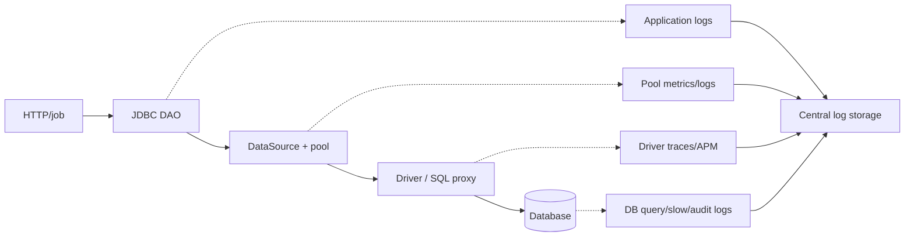

# Ngăn lộ dữ liệu nhạy cảm trong SQL log và tham số

Trong một ứng dụng **JDBC**, việc dùng `PreparedStatement` và tham số `?` là bước quan trọng để chống SQL injection. Tuy nhiên, **SQL an toàn để thực thi không có nghĩa là an toàn để ghi log**. Một logger, JDBC driver, connection pool, SQL proxy, APM agent hoặc chính database có thể ghi câu SQL **kèm giá trị tham số**, thông tin kết nối, nội dung lỗi hay dữ liệu trả về. Nếu tham số là email, token, số tài khoản, mã xác thực hoặc dữ liệu của khách hàng, sự cố lộ lọt có thể xảy ra ngay cả khi truy vấn hoàn toàn hợp lệ.

Bài thuộc chương **Bảo mật truy cập** của module **JDBC**. Mục tiêu là thiết kế việc quan sát truy vấn mà không phát tán bí mật: xác định luồng dữ liệu nhạy cảm qua `DataSource`, `Connection`, `PreparedStatement` và `ResultSet`; cấu hình các tầng logging; sử dụng **query ID, số liệu kỹ thuật và trace ID do hệ thống tạo** thay cho câu SQL/giá trị thô; bảo toàn khả năng chẩn đoán `SQLException`; kiểm thử rò rỉ trong log, trace, metric và hệ thống lưu trữ.

Một nguyên tắc xuyên suốt: **giá trị có thể cần thiết để DB xử lý nhưng không cần thiết để log thực hiện nhiệm vụ của nó**. Log phải được thiết kế theo nguyên tắc tối thiểu hóa dữ liệu, không đơn giản là “ghi tất cả rồi tìm cách che sau”.

## 1. Hiểu đúng mô hình đe dọa: log là một đường xuất dữ liệu

Khi thực thi câu lệnh sau:

```java
String sql = "SELECT id FROM accounts WHERE email = ? AND status = ?";
try (PreparedStatement ps = con.prepareStatement(sql)) {
    ps.setString(1, email);       // Thông tin cá nhân.
    ps.setString(2, "ACTIVE");
    try (ResultSet rs = ps.executeQuery()) {
        // Xử lý kết quả.
    }
}
```

DB cần nhận giá trị `email` để lọc hàng; log thường chỉ cần biết **truy vấn nào, chạy bao lâu và thành công hay lỗi**. Nếu người viết thêm:

```java
logger.info("SQL=" + ps); // Không an toàn: toString() tùy driver.
logger.info("Search email=" + email); // Rò rỉ PII.
```

thì một đường xử lý nội bộ đã biến email thành dữ liệu trong hệ thống observability. Các bản sao log có thể nằm ở nhiều nơi: file trên máy, stdout container, log collector, hệ thống tìm kiếm, dashboard, backup, ứng dụng cảnh báo, công cụ hỗ trợ và bản trích xuất khi xử lý sự cố. Quyền truy cập và thời hạn lưu của chúng thường **rộng hơn** quyền đọc bảng dữ liệu gốc.

Rủi ro không chỉ là kẻ tấn công chủ động. Một developer bật DEBUG để xử lý hiệu năng, một hệ thống APM tự ghi bind parameters hoặc một công cụ support xuất log thô cũng có thể tạo ra bản sao dữ liệu mà tổ chức không chủ đích lưu.

### Những nguồn phát sinh rò rỉ thường gặp

| Nguồn | Dữ liệu có thể xuất hiện | Vì sao dễ bị bỏ sót |
| --- | --- | --- |
| Log ứng dụng tự viết | Tham số SQL, DTO, kết quả truy vấn, request body | Developer muốn debug nhanh |
| `PreparedStatement.toString()` / proxy statement | SQL và bind values tùy implementation | Ngỡ rằng chỉ in mẫu SQL có `?` |
| JDBC driver logging/tracing | URL, SQL, tham số, thông tin protocol hoặc lỗi | Bật trace ở mức driver |
| Connection pool / JDBC proxy | SQL chậm, thông tin borrow, chi tiết kết nối | Plugin quan sát độc lập với DAO |
| APM/distributed tracing | `db.statement`, query text, bind variables, baggage | Auto-instrumentation ghi thuộc tính không do ứng dụng đặt |
| Log database/slow query/audit | SQL text, literal, tham số, kế hoạch và lỗi | Log ở server ngoài tầm kiểm soát logger Java |
| `SQLException` và warning | Thông điệp chứa tên cột, giá trị vi phạm, SQL fragment | Log toàn bộ throwable theo thói quen |
| `ResultSet`/mapper/debugger | Nội dung hàng trả về và BLOB/CLOB | Log object hoặc dump toàn bộ kết quả |
| Hệ thống giám sát/alert | Ví dụ log, query sample, metric label | Dữ liệu được sao chép sang công cụ khác |

Phải xem xét **mọi nơi SQL/param đi qua**, không chỉ những câu `logger.info(...)` trong repository.

## 2. Phân loại dữ liệu trước khi quyết định ghi gì

Tùy miền nghiệp vụ, dữ liệu nhạy cảm có thể thuộc các nhóm:

| Nhóm | Ví dụ | Chính sách log mặc định |
| --- | --- | --- |
| **Bí mật xác thực** | Password, API key, access/refresh token, OTP, session cookie, private key | **Không bao giờ ghi giá trị thô** |
| **Thông tin thanh toán** | Số thẻ đầy đủ, mã xác thực, số tài khoản ngân hàng | Không ghi; chỉ tham chiếu hợp lệ đã được phê duyệt |
| **Thông tin cá nhân** | Email, số điện thoại, địa chỉ, giấy tờ, tên, ngày sinh | Không ghi mặc định; chỉ trường đã phân loại và được cho phép |
| **Dữ liệu nhạy cảm đặc thù** | Hồ sơ sức khỏe, thông tin định danh, dữ liệu nhân sự | Không ghi; giới hạn truy cập và mục đích rất chặt |
| **Thông tin hệ thống** | JDBC URL chứa mật khẩu, tên service nội bộ, schema, SQL lỗi | Kiểm soát; không giả định luôn công khai |
| **Thông tin vận hành ít rủi ro hơn** | Query ID cố định, thời lượng, loại lỗi, số lần retry, pool active | Có thể log sau khi xác nhận không chứa giá trị nhạy cảm |

Một mã `customer_id` cũng có thể là dữ liệu định danh, dù nó “chỉ là số”. Không mặc định log ID tài khoản/đơn hàng ở mọi môi trường. Một trace ID được **hệ thống tự tạo ngẫu nhiên**, không rút ra từ email/token/ID thật, thường là lựa chọn phù hợp hơn để liên kết sự kiện.

**Dữ liệu có trong SQL không phải dữ liệu phải có trong log.** Cần xác định trước: từng loại event cần trả lời câu hỏi vận hành nào, trường nào thực sự cần thiết, thời hạn giữ bao lâu và ai được truy cập.

## 3. PreparedStatement chống injection, không tự che tham số khỏi log

Sự khác biệt rõ nhất:

```java
// Sai: nối trực tiếp giá trị không tin cậy vào câu SQL.
String unsafe = "SELECT id FROM users WHERE email = '" + email + "'";

// Đúng để thực thi: truyền giá trị qua tham số JDBC.
String safe = "SELECT id FROM users WHERE email = ?";
try (PreparedStatement ps = con.prepareStatement(safe)) {
    ps.setString(1, email);
    try (ResultSet rs = ps.executeQuery()) {
        // ...
    }
}
```

`PreparedStatement` giúp driver xử lý giá trị như **dữ liệu**, không phải một đoạn cấu trúc SQL do người dùng điều khiển. Nhưng ở tầng logging, có ba đường vẫn có thể làm lộ `email`:

1. Developer log biến Java `email` hoặc tự nội suy giá trị trước khi ghi log.
2. Driver/proxy/agent log tham số thông qua các lệnh `setString(1, email)` và tạo SQL đã render.
3. Database, profiler hoặc log truy vấn ghi các literal/parameter theo cấu hình của nó.

Từ đó:

- **Vẫn phải dùng `PreparedStatement`** để chống injection, không vì muốn log dễ đọc mà chuyển sang nối SQL.
- **Không log `PreparedStatement` bằng `toString()`**: kết quả là đặc thù implementation, có thể bao gồm giá trị đã bind.
- **Không dùng tham số SQL làm metric labels/tags**. Một email biến thành nhãn metric còn gây cardinality cao.
- **Không ghi lại SQL có literal bí mật trong comment**, ví dụ `/* token=... */`. SQL comment cũng có thể xuất hiện trong server logs và traces.
- Khi phải xử lý tên bảng, cột hoặc `ORDER BY` động, chỉ dùng danh sách định danh **allowlist**, bởi `?` không thể bind tên SQL identifier. Phần đó không được dùng làm lý do để nội suy dữ liệu nhạy cảm.

## 4. Thiết kế hợp đồng log: query ID thay vì giá trị truy vấn

Hãy coi log là một **API dữ liệu có schema**. Với mỗi thao tác JDBC, log những thuộc tính đã được duyệt:

| Trường đề xuất | Ví dụ | Ghi chú bảo mật |
| --- | --- | --- |
| `event` | `jdbc.query.completed` | Tên sự kiện tĩnh do code định nghĩa |
| `query_id` | `accounts.find-active.v1` | ID cố định từ catalog câu truy vấn, **không chứa dữ liệu người dùng** |
| `trace_id` | UUID ngẫu nhiên do server phát | Không dùng email/customer ID làm trace ID |
| `duration_ms` | `27` | Dữ liệu đo kỹ thuật; có thể được tổng hợp |
| `result` | `success` / `failure` | Trạng thái vận hành |
| `sql_state` | `23505` | Chuẩn hóa định dạng, không log nguyên message |
| `vendor_code` | `1062` | Mã số tùy DB; không đủ để quyết định chính sách một mình |
| `retry_attempt` | `2` | Số lần thử, tránh log payload |
| `rows_affected` | `1` | Có thể hữu ích, nhưng xem xét rò rỉ qua truy vấn cá nhân |
| `connection_wait_ms` | `14` | Hỗ trợ chẩn đoán pool |

Không nên thêm vào log mặc định: `bind_values`, `request_body`, `access_token`, `jdbc_url` nguyên văn, `ResultSet`, `password_hash`, `sql_rendered_with_parameters` hay object DTO thô.

Ví dụ một event vận hành an toàn hơn:

```text
event=jdbc.query.completed query_id=accounts.find-active.v1
trace_id=ddc19175-9947-437b-bb96-732b52b42ccf
duration_ms=27 result=success
```

Và một event lỗi:

```text
event=jdbc.query.failed query_id=accounts.find-active.v1
trace_id=ddc19175-9947-437b-bb96-732b52b42ccf
sql_state=23505 vendor_code=0
```

Các giá trị trên chỉ minh họa định dạng. **Không lấy query ID từ SQL người dùng gửi tới**. Nếu có một catalog câu SQL cố định trong code, query ID được gán thủ công hoặc build-time; nhờ đó có thể tìm được câu truy vấn tương ứng khi debug mà không phải đưa chính SQL hoặc tham số vào log.

**Đừng mặc định mọi count đều vô hại:** kết quả “1 hàng tìm thấy / 0 hàng” gắn với một tài khoản nhạy cảm có thể tiết lộ thông tin qua log hoặc metric có nhãn quá chi tiết. Khi không cần điều tra ở mức bản ghi, ưu tiên tổng hợp theo query ID và khoảng thời gian.

## 5. Ví dụ Java: JDBC DAO không ghi email hoặc SQL parameter

Ví dụ dùng `DataSource`, `PreparedStatement`, `ResultSet`, `SQLException` và logger chuẩn `java.util.logging`. Truy vấn tìm một tài khoản bằng email; **email chỉ được bind vào SQL, không được đưa vào log**. `traceId` là UUID đã được lớp HTTP/service tạo độc lập với dữ liệu người dùng.

```java
import java.sql.Connection;
import java.sql.PreparedStatement;
import java.sql.ResultSet;
import java.sql.SQLException;
import java.util.Locale;
import java.util.Objects;
import java.util.Optional;
import java.util.UUID;
import java.util.concurrent.TimeUnit;
import java.util.logging.Level;
import java.util.logging.Logger;
import javax.sql.DataSource;

public final class SafeCustomerDao {
    private static final String QUERY_ID = "customers.find-by-email.v1";
    private static final String FIND_CUSTOMER = """
            SELECT id, display_name
            FROM customers
            WHERE email = ?
            """;

    private final DataSource source;
    private final Logger logger;

    public record Customer(long id, String displayName) {}

    public SafeCustomerDao(DataSource source, Logger logger) {
        this.source = Objects.requireNonNull(source);
        this.logger = Objects.requireNonNull(logger);
    }

    public Optional<Customer> findByEmail(String email, UUID traceId)
            throws SQLException {
        Objects.requireNonNull(email);
        Objects.requireNonNull(traceId);
        long started = System.nanoTime();
        boolean succeeded = false;

        try (Connection con = source.getConnection();
             PreparedStatement ps = con.prepareStatement(FIND_CUSTOMER)) {

            ps.setString(1, email);
            ps.setQueryTimeout(10);
            try (ResultSet rs = ps.executeQuery()) {
                Optional<Customer> result;
                if (rs.next()) {
                    result = Optional.of(new Customer(
                            rs.getLong("id"),
                            rs.getString("display_name")));
                } else {
                    result = Optional.empty();
                }
                succeeded = true;
                return result;
            }
        } catch (SQLException failure) {
            // Không ghi SQL, email, ps.toString(), hoặc failure object.
            // SQLException.getMessage() và stack trace có thể chứa giá trị.
            logger.log(Level.WARNING,
                    "event=jdbc.query.failed query_id={0} "
                    + "trace_id={1} sql_state={2} vendor_code={3}",
                    new Object[] {
                        QUERY_ID, traceId,
                        safeSqlState(failure), failure.getErrorCode()
                    });
            throw failure; // Giữ nguyên nguyên nhân cho tầng có quyền xử lý.
        } finally {
            long durationMs = TimeUnit.NANOSECONDS.toMillis(
                    System.nanoTime() - started);
            logger.log(Level.FINE,
                    "event=jdbc.query.finished query_id={0} "
                    + "trace_id={1} duration_ms={2} success={3}",
                    new Object[] {
                        QUERY_ID, traceId, durationMs, succeeded
                    });
        }
    }

    private static String safeSqlState(SQLException error) {
        String state = error.getSQLState();
        if (state == null || !state.matches("[A-Za-z0-9]{5}")) {
            return "UNKNOWN";
        }
        return state.toUpperCase(Locale.ROOT);
    }
}
```

### Điểm cần hiểu

1. `FIND_CUSTOMER` là SQL tĩnh chứa dấu `?`. Không có phép nối email vào SQL và cũng không ghi biến `email`.
2. `QUERY_ID` là hằng do ứng dụng đặt, không chứa dữ liệu request. Người vận hành có thể tra trong catalog để biết câu SQL tương ứng.
3. `traceId` nên được phát sinh ngẫu nhiên trong hệ thống hoặc kiểm soát chặt ở ingress. Đừng nhận nguyên một header có thể chứa newline/secret từ client rồi đưa thẳng vào log.
4. Event lỗi chỉ dùng `SQLState` đã kiểm tra đúng 5 ký tự chữ/số và `getErrorCode()`. Nó không ghi `failure.getMessage()`, `failure.toString()` hay throwable.
5. `throw failure` giữ đầy đủ lỗi cho tầng trên; **đây không có nghĩa dữ liệu trong exception đã được khử nhạy cảm**. Nếu API framework tự động log unhandled exceptions với stack trace, phải kiểm soát cả tầng đó.
6. `try-with-resources` vẫn đóng `ResultSet`, `PreparedStatement` và `Connection` khi có lỗi. Một lỗi từ `close()` có thể được trả thành `SQLException` và ghi bằng cùng schema an toàn.
7. `Logger` chuẩn dùng MessageFormat placeholders `{0}`, `{1}` thay vì nối giá trị nhạy cảm. Placeholder **không tự bảo vệ dữ liệu**; chính danh sách trường được phép mới là rào chắn bảo mật.

Trong ví dụ, `succeeded` được đặt thành true sau khi đọc kết quả thành công, trước khi đóng tất cả tài nguyên; lỗi xảy ra lúc `close()` sau đó vẫn được catch và log lỗi, trong khi metric `success=true` có thể phản ánh thành công của phần query thay vì toàn bộ scope. Nếu hệ thống yêu cầu kết quả tổng thể chính xác cả bước cleanup, hãy thiết kế event kết quả sau khi scope đóng xong, không đơn giản chỉ dựa trên biến `succeeded`.

## 6. Exception và warning là nguồn rò rỉ khó nhận biết

`SQLException` mang nhiều thông tin hữu ích:

| API | Giá trị chẩn đoán | Nguy cơ khi log nguyên văn |
| --- | --- | --- |
| `getSQLState()` | Nhóm/mã trạng thái SQL | Thường có thể log sau khi kiểm tra định dạng |
| `getErrorCode()` | Mã vendor | Thường có thể log dạng số, tùy chính sách |
| `getMessage()` | Mô tả lỗi của DB/driver | Có thể chứa SQL, giá trị vi phạm constraint, tên bảng/cột hoặc kết nối |
| `getNextException()` | Các lỗi SQL đi kèm/batch | Có thể mang thông điệp nhạy cảm khác |
| `getCause()` | Ngoại lệ gốc | Thông điệp/cause có thể mang dữ liệu không được phép |
| `getSuppressed()` | Lỗi phát sinh khi rollback/close/cleanup | Có thể chứa connection URL hoặc SQL fragment |
| `SQLWarning.getMessage()` | Cảnh báo khi chạy SQL | Không bảo đảm đã loại bỏ giá trị dữ liệu |

Ví dụ lỗi vi phạm `UNIQUE(email)` trên một số DB có thể mô tả cả giá trị email đang trùng. Nếu gọi:

```java
logger.log(Level.SEVERE, "Create user failed", sqlException);
```

thì formatter có thể in stack trace, message, cause và suppressed; logger tự nó **không biết email là PII**. Một lỗi `BatchUpdateException` có thể chứa cả các `getNextException()` từ nhiều hàng thất bại, làm lộ dữ liệu hàng loạt.

Thay vì log tất cả theo mặc định:

- Ghi **event loại lỗi**, `query_id`, `SQLState`, mã vendor và trace ID không định danh cá nhân.
- Chuyển mã lỗi DB thành **mã ứng dụng an toàn** ở tầng API, ví dụ `ACCOUNT_ALREADY_EXISTS`, `DATABASE_UNAVAILABLE`; không trả nguyên message DB cho client.
- Giữ ngoại lệ gốc trong control flow bằng `throw` hoặc làm `cause` cho lớp lỗi thích hợp, **nhưng ngăn logger mặc định tự dump throwable ra sink công khai**.
- Khi cần forensic sâu, dùng quy trình chẩn đoán có phân quyền, mục đích cụ thể, giới hạn thời gian, không tự bật DEBUG toàn môi trường production.
- Không cho phép một lỗi cleanup che lỗi nghiệp vụ chính; `try-with-resources` và `addSuppressed()` vẫn cần được sử dụng để giữ cấu trúc lỗi, dù không ghi toàn bộ cấu trúc đó vào log thông thường.

**Đừng nhầm “không log message” với “nuốt lỗi”.** DAO vẫn phải ném lỗi, service vẫn phải xử lý transaction và API vẫn cần trả lỗi phù hợp. Chính sách log an toàn tách khỏi logic nghiệp vụ; nó không cho phép trả kết quả thành công giả.

## 7. Hai phương án hữu ích: trường được phép và dữ liệu đã biến đổi

Tầng logging nên dùng một trong hai phương án theo nhu cầu:

**Phương án ưu tiên – allowlist trường:** chỉ xuất các trường kỹ thuật đã định nghĩa trong schema như `query_id`, `duration_ms`, `sql_state` và `trace_id`. Không xuất một “details map” lấy tự do từ request/exception.

**Phương án có kiểm soát – biến đổi dữ liệu:** chỉ khi thực sự cần liên kết nhiều sự kiện theo cùng một thực thể, cân nhắc định danh được **pseudonymize** bằng cơ chế được phê duyệt, chẳng hạn HMAC dùng khóa bí mật riêng cho log. Vẫn phải đánh giá quyền truy cập và nguy cơ tái định danh.

| Cách xử lý | Ưu điểm | Giới hạn |
| --- | --- | --- |
| Không ghi trường nhạy cảm | Rủi ro thấp nhất, đơn giản | Không tìm theo giá trị thật |
| Giá trị tĩnh `[REDACTED]` | Không để lộ bí mật ở vị trí đã biết | Mất phân biệt các giá trị |
| Chỉ giữ 4 ký tự cuối | Có thể giúp hỗ trợ đối soát trong tình huống được phép | **Vẫn là dữ liệu**; có thể suy ra danh tính ở miền giá trị nhỏ |
| Hash không khóa (SHA-256) | Giá trị giống nhau ra cùng mã | Email/số điện thoại có thể bị dò từ danh sách ứng viên |
| HMAC có khóa bí mật riêng | Khó dò hơn khi key được giữ bí mật | Vẫn là định danh giả, cần bảo vệ/luân phiên khóa |
| Regex che nội dung sau khi log | Có thể giảm một số mẫu đã biết | Dễ bỏ sót/che sai; không phải hàng rào chính |

Một đoạn biến đổi nhỏ trước logger có thể bảo vệ **một kiểu trường đã biết**; nó không thay thế việc phân loại nguồn dữ liệu. Nếu thông điệp lỗi chứa các chuỗi tự do và nhiều dạng dữ liệu, “regex xóa email và token” không thể đảm bảo lọc hết bí mật.

### Không dùng `Object.toString()` cho một DTO nhạy cảm

Một Java record mặc định có `toString()` chứa các field. Ví dụ:

```java
record LoginRequest(String email, String password) {}

// Không ghi: logger.info("Request: " + request);
// toString() có thể chứa cả password.
```

Đặc biệt tránh `logger.debug("{}", object)` hoặc tự động serial hóa request body/response body ở middleware khi object có token, credentials hay PII. Với dữ liệu dùng cho xác thực, không đưa bí mật vào record/loggable object chỉ để debug; nếu bắt buộc nhận object, lập quy tắc log theo schema tách biệt.

## 8. SQL động: identifier allowlist, không gắn tham số vào tên cột

`PreparedStatement` chỉ bind **giá trị**, không bind tên bảng/cột/`ORDER BY`. Khi cần sắp xếp động, một cách làm an toàn và dễ kiểm soát log là ánh xạ lựa chọn từ một tập hữu hạn:

```java
enum OrderSort {
    NEWEST, OLDEST
}

String sql = switch (sort) {
    case NEWEST -> """
        SELECT id, amount FROM orders
        WHERE customer_id = ?
        ORDER BY id DESC
        """;
    case OLDEST -> """
        SELECT id, amount FROM orders
        WHERE customer_id = ?
        ORDER BY id ASC
        """;
};

try (PreparedStatement ps = con.prepareStatement(sql)) {
    ps.setLong(1, customerId);
    // executeQuery; không ghi customerId vào log.
}
```

Tạo query ID riêng cho hai biến thể, ví dụ `orders.by-customer.newest.v1` và `orders.by-customer.oldest.v1`. **Không** log trực tiếp chuỗi `sort` từ request hay một tên cột tự do làm query ID.

Chống SQL injection và giảm rò rỉ dữ liệu log là hai bài toán bổ sung nhau: identifier phải có allowlist để ngăn sửa cấu trúc SQL; bind values phải được hạn chế khỏi hệ thống quan sát. Nếu một nhánh vẫn tạo SQL động có literal nội suy (ví dụ builder/proxy), cần kiểm tra cả SQL được tạo và cách các tầng log nó.

## 9. Kiểm tra các tầng logging nằm ngoài DAO

Ngay cả DAO không có `logger.debug(...)`, tham số vẫn có thể đi qua công cụ quan sát. Hãy rà soát **đường đi đầu-cuối**:



### 9.1. JDBC driver

Driver có thể có các mức trace, debug, protocol logging và thuộc tính cấu hình riêng. Một số mức log cao có thể ghi SQL đã tạo hoặc bind values. Phải kiểm tra tài liệu của **đúng phiên bản driver** và cấu hình đang triển khai, không mặc định `INFO` ở driver A có ý nghĩa giống `INFO` ở driver B.

JDBC `CommonDataSource.setLogWriter(PrintWriter)` cho phép gán writer theo API; nếu một ứng dụng chuyển writer tới stdout hoặc file được thu thập tập trung, nội dung do driver/DataSource ghi ra cần được xem là **có thể chứa thông tin nhạy cảm**. `setLogWriter(null)` hoặc không cấu hình writer có thể loại một kênh log tùy implementation, nhưng **không đảm bảo tắt mọi logging nội bộ của driver**.

Không in `dataSource.toString()`, toàn bộ thuộc tính JDBC URL hay `Properties` của driver trong log lúc startup. Một URL như:

```text
jdbc:vendor://db.internal:1234/shop?user=***&password=***
```

chỉ minh họa vị trí có thể chứa credentials. Trong log production, ưu tiên tên data-source cấu hình tĩnh như `orders-primary`; không đưa raw URL rồi hy vọng logger tự che mật khẩu.

### 9.2. Connection pool và SQL proxy

HikariCP, DBCP hoặc các lớp bọc `DataSource` có chức năng log/metric riêng. Một JDBC proxy (ví dụ công cụ theo dõi slow SQL) có thể intercept `prepareStatement`, `setXxx` và `execute` để tái tạo giá trị bind. Pool cũng có thể chứa thông tin cấu hình khi ghi diagnostic dump.

Chính sách cần có:

1. Định nghĩa mức log mặc định và những logger name cụ thể được phép nâng mức.
2. Tắt hoặc cấu hình loại bỏ **raw bind values** và **SQL literal** ở SQL proxy.
3. Khi ghi slow query, ưu tiên query ID hoặc normalized SQL **không có dữ liệu cá nhân**, kèm thời lượng và số hàng.
4. Kiểm tra các plugin của driver, wrapper DataSource và interceptor trong cả profile test/staging/production; đừng chỉ nhìn cấu hình logger của DAO.
5. Không gửi exception hoặc object `PreparedStatement` qua một logger khác mà không kiểm soát format của nó.

**Không có API JDBC chuẩn chung mang tên “mask mọi tham số”**. Từng thư viện và driver có cách bật/tắt logging riêng. Thiết kế hệ thống nên bắt đầu từ **không phát sinh dữ liệu nhạy cảm**, rồi xác nhận bằng kiểm thử, thay vì tin một công tắc khử nhạy cảm toàn cục.

### 9.3. APM và auto-instrumentation

Một APM agent có thể tự thêm span attributes như tên DB, SQL statement, SQL operation, server address hoặc thông tin error. Các công cụ khác nhau về khả năng **record SQL parameters**, query samples, result sets và exception events.

Nguyên tắc cấu hình:

- Chỉ giữ thuộc tính cần cho hiệu năng: query ID/operation, thời lượng, trạng thái, DB service alias và thông tin truy vết đã kiểm soát.
- Tắt capture raw query/bind variables nếu không có yêu cầu bảo mật đặc biệt được phê duyệt.
- Không đưa PII/token vào `span.setAttribute(...)`, span event, log correlation, baggage hoặc tag metric.
- Kiểm tra ngoại lệ được APM tự động ghi: stack trace/message có thể chứa bí mật dù app logger không in.
- Kiểm tra sampling, export và quyền truy cập. **Sampling không phải biện pháp bảo vệ bí mật**: dữ liệu nhạy cảm vẫn có thể nằm trong mẫu được chọn.

Trong kiến trúc đa dịch vụ, trace ID nên là định danh ngẫu nhiên kỹ thuật; không dùng email, username, request payload hoặc giá trị `customer_id` để thay thế.

## 10. Logging ở database server vẫn có thể rò rỉ

Ngay cả khi app không log tham số, database vẫn có những kênh riêng:

- Log câu SQL chậm, log tất cả statements hoặc query history.
- SQL audit log, extension/module giám sát, profiler và công cụ query tuning.
- Query plan, performance snapshots, diagnostic bundles và bản chụp trạng thái session.
- SQL lỗi kèm literal, bind variables hoặc giá trị vi phạm constraint tùy DB.
- Log từ công cụ migration, backup/restore hay script vận hành chạy SQL có literal.

Không có một lệnh SQL chuẩn để tắt toàn bộ các nguồn này. Thao tác phải dựa trên **đúng hệ quản trị và chính sách vận hành**. DB logs cũng thường được ship tới nơi lưu log tập trung nên vẫn chịu yêu cầu tối thiểu hóa, phân quyền, thời hạn lưu, giám sát truy cập và xóa theo quy trình.

Đặc biệt lưu ý SQL có literal:

```sql
-- Sai nếu biến thành câu SQL từ dữ liệu request:
SELECT id FROM customers WHERE email = 'example@private.test';

-- Hướng JDBC:
SELECT id FROM customers WHERE email = ?;
```

Không nên đưa giá trị nhạy cảm vào `EXPLAIN` hoặc query history khi debug một vấn đề hiệu năng. Dùng dữ liệu mô phỏng hoặc mẫu đã được phê duyệt, lưu trong môi trường tách biệt. Việc database nhận bind parameters không bảo đảm **mọi** cấu hình server sẽ che giá trị tương ứng trong diagnostic logs.

## 11. Đặc biệt chú ý lỗi batch, transaction và CRUD

Các thao tác hàng loạt làm tăng phạm vi rủi ro: một lần `executeBatch()` có thể gửi hàng nghìn bộ tham số; log SQL đã render có thể làm lộ **toàn bộ danh sách khách hàng**.

Ví dụ:

```java
try (PreparedStatement ps = con.prepareStatement(
        "UPDATE accounts SET verified = ? WHERE email = ?")) {
    for (String email : emails) {
        ps.setBoolean(1, true);
        ps.setString(2, email);
        ps.addBatch();
    }
    int[] counts = ps.executeBatch();
    // Không log emails, ps.toString() hoặc danh sách tham số.
    // Chỉ tổng hợp số phần tử, thời lượng và trạng thái hợp lệ.
}
```

Khi thất bại, `BatchUpdateException.getUpdateCounts()`/`getLargeUpdateCounts()`, `getSQLState()` và `getErrorCode()` giúp chẩn đoán **mà không cần in payload**. Nhưng `getNextException()` hoặc message có thể chứa giá trị cụ thể; không dump nguyên chuỗi exception vào log mặc định.

Đối với transaction:

- Bản ghi audit nghiệp vụ (ví dụ **ai đã duyệt quyền** hoặc một giao dịch đã được xác nhận) có thể cần thông tin riêng theo yêu cầu pháp lý/nghiệp vụ, nhưng phải được thiết kế thành hệ thống **audit có phạm vi, quyền truy cập và retention riêng**, không “mượn tạm” SQL debug log.
- `rollback()` hoặc `commit()` lỗi vẫn phải được phát hiện và báo an toàn; đừng log raw SQL/bind để giải thích lỗi.
- Khi `commit()` mất phản hồi, trạng thái giao dịch có thể không xác định. Truy vấn/đối soát theo request ID/idempotency key trong hệ thống nghiệp vụ, không cần ghi nội dung giao dịch thô vào log.
- Các câu `INSERT/UPDATE/DELETE` tác động nhiều hàng cần metric theo **nhóm truy vấn**, tránh nhãn theo email hoặc customer ID.
- Không ghi dữ liệu từ `ResultSet` hoặc `getGeneratedKeys()` vào log nếu chưa có chính sách phân loại; generated keys cũng có thể là ID nhạy cảm.

## 12. Các trường hợp dễ lộ qua giá trị không phải "SQL"

Một số điểm thường bị bỏ qua:

| Dữ liệu đi qua JDBC | Điểm có thể bị log | Cách phòng ngừa |
| --- | --- | --- |
| `BLOB`, `CLOB`, `byte[]` | Hex/base64 dump, `Arrays.toString(...)`, response capture | Chỉ log số byte đã xử lý khi phù hợp; không log nội dung |
| JSON lưu trong `VARCHAR/JSON` | Object mapper/debug output | Không log body/payload, cho phép vài field kỹ thuật |
| Password hash/salt | Mapper DTO, SQL parameter bind | Không log; hash password vẫn là dữ liệu nhạy cảm |
| OTP/access token | Exception message, request header, bind parameter | Không log/không echo; hạn chế cả trace baggage |
| JDBC URL, connection properties | Startup diagnostics, exception, `toString()` | Sử dụng alias tĩnh, quản lý secret riêng |
| Email/phone/địa chỉ | Query sample, SQL proxy, application events | Query ID và metrics tổng hợp |
| SQL identifier/tên tenant | Tên schema động, error message | Hạn chế theo allowlist và đánh giá mức nhạy cảm |
| Generated keys/row IDs | Log sau `getGeneratedKeys()` | Chỉ xuất khi mục đích cụ thể và được cho phép |

Log injection cũng là một vấn đề: nếu giá trị từ request chứa newline, dấu phân tách hoặc chuỗi trông giống log level, việc ghi thẳng có thể làm giả mạo sự kiện. **Structured logging** và allowlist trường giúp giảm rủi ro, nhưng không có tác dụng nếu cho phép đưa chuỗi tùy ý vào field đã đặt tên. Với trace ID, hãy sinh/chuẩn hóa định danh kỹ thuật tại ingress.

Một kiểu rò rỉ tinh vi là **PII trong metric labels**. Thay vì:

```text
jdbc_query_count{email="somebody@private.test",query="find-customer"} 1
```

hãy dùng:

```text
jdbc_query_count{query_id="customers.find-by-email.v1",outcome="success"} 1
```

Ngay cả nếu metric không lưu nội dung bản ghi DB, label có thể được sao chép đi nhiều hệ thống và có thời gian lưu dài.

## 13. Logging ít dữ liệu mà vẫn chẩn đoán được

Không log tham số không có nghĩa từ bỏ observability. Một pipeline tốt có thể trả lời:

| Câu hỏi điều tra | Dữ liệu cần, không cần |
| --- | --- |
| Query nào đang chậm? | `query_id`, duration, DB alias, số lượt chạy |
| Pool có bị cạn? | Active/idle/pending connections, borrow latency |
| Nhiều deadlock hơn? | `SQLState`, vendor code, retry count theo query ID |
| Request nào cần kiểm tra nghiệp vụ? | Trace ID ngẫu nhiên và bảng trạng thái nghiệp vụ có phân quyền |
| Query nào xuất hiện lỗi constraint? | Query ID + loại lỗi + tổng số lỗi, **không** cần giá trị khóa trùng |
| Có hàng loạt truy vấn lỗi sau deploy? | Service version, database alias, query ID, time window |
| Một lần import thất bại ở đâu? | Job ID kỹ thuật, chunk index, trạng thái và checkpoint đã được phê duyệt |

Khi thực sự cần liên kết một log với bản ghi nghiệp vụ, ưu tiên **tra cứu từ trace ID sang dữ liệu nghiệp vụ trong hệ thống được phân quyền**, không nhúng thông tin cá nhân vào từng log. Phải định nghĩa thời hạn và kiểm soát truy cập của bảng liên kết này.

Một hệ thống có thể dùng metric/trace cho **nhiều lần truy vấn** và dành log chi tiết được kiểm soát cho **những ngoại lệ hiếm**. Nhưng không nên tự động bật SQL literal logging khi phát hiện lỗi, bởi chính thời điểm lỗi thường mang giá trị nhạy cảm trong exception.

## 14. Quy trình cấu hình an toàn theo môi trường

Nên có cấu hình **mặc định an toàn** ở mọi môi trường và quy trình nâng mức chẩn đoán hạn chế:

1. **Production:** tắt logging bind values và raw SQL có literal ở ứng dụng, driver, proxy, APM và database nếu không có mục đích được phê duyệt; log query ID, latency và lỗi đã được kiểm soát.
2. **Staging/test:** dùng dữ liệu giả/synthetic, không sao chép dữ liệu production chưa được xử lý; kiểm chứng các đường log, exception, trace và export.
3. **Local development:** không dùng bí mật thật trong query demo. Nếu bật debug, dùng DB test và dữ liệu giả; reset/tắt debug sau khi hoàn thành.
4. **Điều tra sự cố:** mọi thay đổi logger level/query capture có owner, thời gian hết hạn, phạm vi hẹp, nơi lưu riêng và quyền truy cập được ghi nhận; xem xét việc không ghi tham số ngay cả khi debug.
5. **Kết thúc điều tra:** đưa cấu hình về mặc định, kiểm tra dữ liệu đã phát tán, xử lý bản sao log nếu cần và lưu tài liệu root cause.

Đừng chỉ kiểm tra file config của ứng dụng. Cần rà soát cấu hình driver ở JDBC URL/properties, logger hierarchy, proxy instrumentation, các agent gắn lúc khởi chạy, sidecar collector, dashboard và database server. Một biến môi trường hoặc override trong deployment có thể bật logging trái với cấu hình trong repository.

**Không đưa secret vào system properties, command-line arguments hoặc SQL comment** để tiện debug. Các kênh này có thể xuất hiện trong process listing, container diagnostics, crash dumps và support bundles. Quản lý credentials bằng cơ chế secret/config phù hợp và giới hạn quyền đọc.

## 15. Kiểm thử để phát hiện rò rỉ thay vì chỉ đọc code

Chính sách log phải có **kiểm thử quan sát đầu ra**, vì nhiều nguồn rò rỉ nằm ngoài DAO. Hãy dùng **canary data giả** có chuỗi dễ nhận diện, không dùng password/token thật:

```text
PII_TEST_EMAIL_4f8e2@example.invalid
SECRET_TEST_TOKEN_49ac1f7c_DO_NOT_LOG
```

Kịch bản kiểm thử:

1. Khởi chạy app với driver, pool, SQL proxy/APM và exporter giống môi trường mục tiêu trong khả năng cho phép.
2. Dùng canary làm bind parameters của `INSERT`, `SELECT`, `UPDATE` và một batch.
3. Tạo tình huống thành công, violation constraint, SQL syntax error, timeout và kết nối bị đóng để kích hoạt exception/trace.
4. Thu thập **mọi sink có thể quan sát**: app logs, stdout container, driver trace, pool logs, APM spans, exporter payload, DB log và metric labels.
5. Tìm chuỗi canary và các dạng encode thường gặp (ví dụ JSON escaping hoặc base64 nếu kênh đó có thể phát sinh).
6. Yêu cầu **không xuất hiện canary** trong những sink không có quyền lưu giá trị đó. Kiểm tra vẫn có query ID, SQLState và duration để debug.
7. Kiểm tra fallback khi driver/proxy nâng cấp, khi logger level thay đổi và khi framework tự log unhandled exception.

### Ma trận ca kiểm thử

| Ca thử | Kết quả mong muốn |
| --- | --- |
| Query thành công với email canary | Log có query ID/duration, không có email |
| `PreparedStatement.toString()` của driver hiện tại | Không bị gửi vào log; review không phụ thuộc format |
| `SQLException` chứa email trong message | Không có email trong app log/API response/APM |
| `BatchUpdateException` với nhiều hàng lỗi | Không lộ bind values trong message, cause hoặc next exception đã được log |
| Đóng connection lỗi, xuất suppressed | Không dump raw exception từ cleanup vào sink không được phép |
| Bật DEBUG ở repository | Không xuất tham số nhạy cảm |
| Bật trace driver/proxy trong môi trường test | Xác định có nguy cơ gì; production có guard cấu hình |
| DB slow-query log | Không ghi literal/bind values ngoài chính sách đã duyệt |
| APM span error | Không chứa password, token, query có literal hay exception message thô |
| Metric và labels | Không có email, customer ID, token hoặc tham số SQL |
| BLOB/JSON | Không log payload, chỉ ghi số lượng/định danh công việc hợp lệ |
| Input có newline ký tự điều khiển | Không tạo log record giả hoặc nội suy giá trị từ request |
| Response khi SQL lỗi | Không lộ SQL text, tên bảng nhạy cảm, connection URL hoặc giá trị constraint |

**Kiểm thử bằng canary không phải bằng chứng tuyệt đối mọi dữ liệu đã được bảo vệ.** Nó kiểm tra những đường đi và chế độ đã thử. Vẫn cần kiểm duyệt schema log, kiểm tra cấu hình định kỳ và xác minh khi nâng cấp driver/agent/DB.

### Unit test logger của DAO

Có thể gắn một `java.util.logging.Handler` chỉ lưu các message event mà DAO phát, gọi `SafeCustomerDao.findByEmail(...)` với email canary, rồi xác nhận nội dung không chứa canary và có query ID. Khi code ở ví dụ dùng `logger.log(Level.WARNING, format, params)`, nhớ kiểm tra cả **`LogRecord.getParameters()`**, không chỉ `getMessage()` chưa được render, vì formatter sẽ kết hợp hai nguồn này.

Khi DAO ném lỗi, không gọi `logger.log(..., exception)` trong unit test và cho qua vì nội dung `getMessage()` nhìn có vẻ an toàn; driver hoặc DB khác có thể trả message khác. Cần test cả hướng exception được framework/logger global xử lý.

## 16. Khi phát hiện log đã chứa dữ liệu nhạy cảm

Nếu phát hiện token, password, PII hoặc dữ liệu nhạy cảm khác trong log thật, xử lý như **một sự cố bảo mật dữ liệu**, không chỉ là lỗi format:

1. **Ngăn phát sinh tiếp:** tắt điểm capture hoặc cập nhật cấu hình/đường log gây rò rỉ.
2. **Giới hạn phạm vi truy cập:** xác định sink, dashboard, exporter, alert, support bundle và những người có quyền đọc.
3. **Đánh giá ảnh hưởng:** phân loại dữ liệu, thời điểm, khối lượng và nơi đã được sao chép; không in lại bí mật vào ticket/chat/log trong lúc điều tra.
4. **Xử lý credential:** nếu lộ token/password/key, luân phiên/thu hồi theo quy trình bảo mật và đánh giá việc sử dụng trái phép nếu cần.
5. **Xử lý dữ liệu đã lưu:** phối hợp với đơn vị quản trị hệ thống log để xóa/giới hạn retention theo chính sách và nghĩa vụ áp dụng; xem xét backup, index và bản sao.
6. **Phòng tái diễn:** thêm test canary, allowlist event, cấu hình phòng thủ ở driver/proxy/DB/APM và review quyền truy cập.

Việc xóa một dòng log ở máy nguồn **không chứng minh** bản sao trong hệ thống tập trung, backup hoặc alert đã được xử lý. Cần quy trình có owner và bằng chứng hoàn tất. Với dữ liệu liên quan nghĩa vụ bảo mật/quyền riêng tư, phối hợp bộ phận pháp lý/an toàn thông tin theo quy định phù hợp.

## 17. Những phản mẫu thường gặp

| Phản mẫu | Rủi ro | Giải pháp |
| --- | --- | --- |
| Dùng `PreparedStatement` rồi log `ps.toString()` | Driver/proxy có thể render bind values | Log query ID tĩnh |
| Log `getMessage()` của mọi `SQLException` | Có thể chứa giá trị constraint/SQL/URL | Log SQLState/vendor code, giữ exception cho luồng xử lý |
| Log đầy đủ `BatchUpdateException` | Có thể lộ hàng loạt tham số | Chỉ log metadata an toàn, counts tổng hợp |
| Log `CustomerDto` / Java record bất kỳ | `toString()` có thể chứa PII/secret | Sử dụng event schema cho phép trường |
| Tắt app logger nhưng quên DB slow-query log | DB vẫn ghi SQL/param | Kiểm tra DB và exporter |
| Bật driver TRACE ở production vô thời hạn | Tăng dữ liệu nhạy cảm và dung lượng log | Phạm vi hẹp, có owner và deadline |
| Dùng email/customer ID làm trace ID | Dữ liệu cá nhân xuất hiện mọi span/log | UUID kỹ thuật ngẫu nhiên |
| Hash email bằng SHA-256 rồi cho là vô danh | Có thể dò dictionary | Không log, hoặc HMAC có khóa khi được cho phép |
| Regex xóa mọi chuỗi giống email | Bỏ sót token/PII khác hoặc làm sai dữ liệu | Không ghi nguồn nhạy cảm ngay từ đầu |
| Ghi các giá trị SQL vào metric labels | PII và cardinality cao | Query ID, outcome, tổng hợp |
| Ghi nguyên JDBC URL trong startup log | URL có thể chứa mật khẩu và thông tin nội bộ | DataSource alias tĩnh |
| Trả raw DB error cho HTTP client | Tiết lộ schema/giá trị ràng buộc | Mã lỗi API an toàn, trace ID |
| Chỉ test DAO logger rồi tuyên bố an toàn | Driver/APM/DB có đường log khác | Integration test tất cả sink |
| Nuốt `SQLException` để tránh lộ log | Không còn khả năng xử lý lỗi/transaction | Giữ lỗi trong control flow, giới hạn log |
| Bật masking chỉ ở đầu thu log | Dữ liệu đã đi qua mạng/queue trước khi che | Ngăn capture tại nguồn, bổ sung lọc ở sink |

## 18. Bài tập thực hành

**Bài 1 – Kiểm kê đường đi dữ liệu.** Một service dùng `DataSource` HikariCP, một JDBC SQL proxy và APM. Hãy vẽ đường đi của tham số `email` từ API tới DB và mọi nơi nó có thể được ghi ra. Đặt query ID tĩnh cho hai truy vấn đọc/ghi, rồi mô tả cấu hình cần kiểm tra.

**Bài 2 – Sửa logging nguy hiểm.** Một DAO có đoạn:

```java
logger.info("Running " + ps + " for user " + email);
try (ResultSet rs = ps.executeQuery()) {
    // ...
} catch (SQLException e) {
    logger.log(Level.SEVERE, "Query failed", e);
    throw e;
}
```

Viết lại thành log gồm `query_id`, `trace_id`, `duration_ms`, `sql_state` và `vendor_code` đã được phép. Giải thích tại sao việc vẫn dùng `PreparedStatement` **không đủ** ngăn lộ email ở mã gốc.

**Bài 3 – Thử rò rỉ.** Tạo một email canary và một token giả, dùng chúng làm bind values trong truy vấn và batch. Thu app logs, SQL proxy/driver logs, APM spans và DB logs. Kiểm tra nơi nào còn chứa canary, kể cả exception khi constraint fail.

**Bài 4 – SQL động.** Một API nhận `sortBy` và `customerId`, hiện ghép cả hai vào SQL. Hãy đổi `sortBy` thành enum allowlist và `customerId` thành `?`. Định nghĩa query ID không chứa giá trị request.

**Bài 5 – Phân loại log.** Cho các field `query_id`, `trace_id`, `email`, `SQLState`, `rows_affected`, `password_hash`, `elapsed_ms`, `access_token` và `jdbc_url`. Hãy chọn trường nên ghi mặc định, trường không được ghi và trường cần xem xét theo độ nhạy/kết quả thống kê.

**Bài 6 – Điều tra sự cố.** Phát hiện log của DB server chứa mật khẩu từ một câu SQL chèn literal. Viết thứ tự hành động: ngăn capture, phạm vi bản sao, phân quyền, luân phiên bí mật, xử lý retention và test không tái diễn. Không đưa mật khẩu thật vào báo cáo.

## 19. Checklist đưa JDBC vào production

- [ ] Mọi giá trị bên ngoài được truyền qua `PreparedStatement`/`CallableStatement` đúng cách; SQL identifier động chỉ lấy từ allowlist?
- [ ] Không log `PreparedStatement.toString()`, SQL render có bind values, câu SQL chứa literal nhạy cảm?
- [ ] Có catalog `query_id` cố định, schema log allowlist và trace ID kỹ thuật không suy ra từ PII?
- [ ] Không log parameter, request/response body, DTO, `ResultSet`, BLOB/CLOB hoặc generated keys khi chưa được phép?
- [ ] `SQLException`, `BatchUpdateException`, `SQLWarning`, cause/next/suppressed không bị dump nguyên văn ra sink thông thường?
- [ ] Log lỗi vẫn đủ SQLState/vendor code, query ID, duration, correlation để chẩn đoán và không nuốt ngoại lệ?
- [ ] Database error trả về client đã được ánh xạ sang mã ứng dụng an toàn, không lộ message/schema/param?
- [ ] Đã rà soát JDBC driver logging, pool/proxy interceptors, `setLogWriter` và nguồn cấu hình của chúng?
- [ ] Đã rà soát DB slow-query/audit/query-history logs, query plans và diagnostic export?
- [ ] Đã rà soát APM tracing, span attributes, exception capture, baggage và metric labels?
- [ ] Không chứa credentials trong JDBC URL log, startup dump, system properties, process arguments hoặc SQL comments?
- [ ] Chính sách truy cập, mã hóa, retention, xóa và backup của log phù hợp dữ liệu được phép chứa?
- [ ] Có bài test với canary synthetic, bao gồm trường hợp SQL lỗi, batch, cleanup, DEBUG và pipeline xuất log?
- [ ] Có owner và thời hạn cho việc nâng log level, với kiểm tra sau khi tắt chẩn đoán?
- [ ] Có quy trình phản ứng khi phát hiện secret/PII đã bị ghi trong log, kể cả bản sao trung gian?

Trong **JDBC**, **truy vấn tham số hóa bảo vệ cấu trúc SQL**, còn **chính sách ghi log theo trường được phép bảo vệ dữ liệu khỏi bị sao chép không cần thiết**. Để ngăn lộ thông tin nhạy cảm, cần đồng thời quản lý mã Java, cách hiển thị `PreparedStatement` và `SQLException`, cấu hình driver/pool/proxy, APM, database server và các sink lưu log. Thiết kế query ID, trace ID, metrics an toàn và kiểm thử bằng dữ liệu giả sẽ cho phép chẩn đoán lỗi, hiệu năng và transaction mà không biến hệ thống observability thành một kho bí mật ngoài ý muốn.
