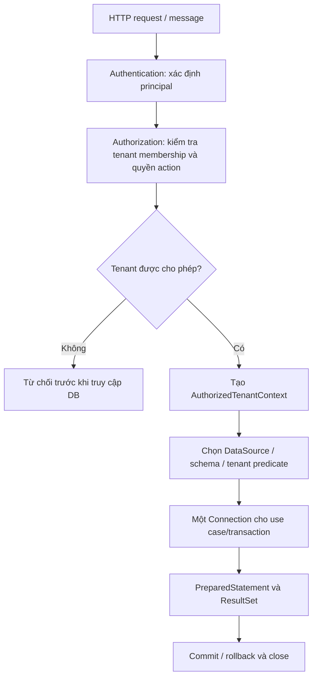
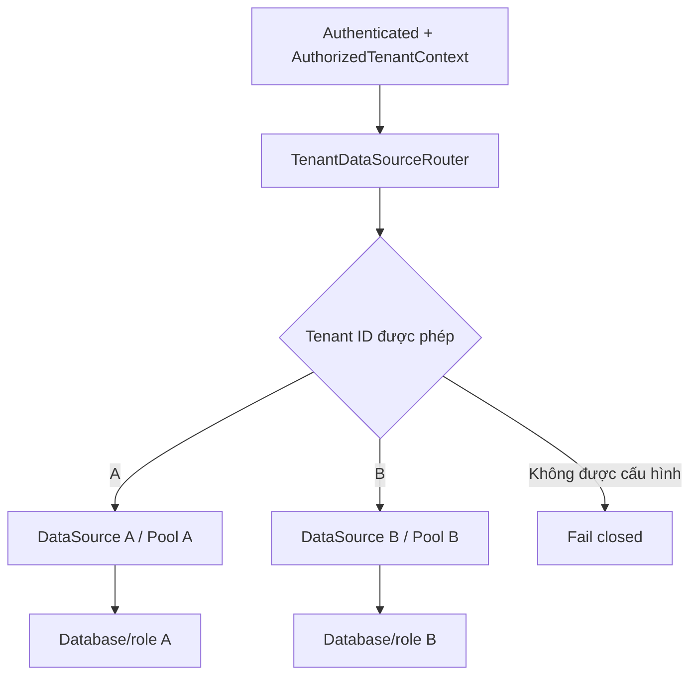

# Phân tách schema hoặc nguồn dữ liệu theo phạm vi người dùng

> **Chương:** Bảo mật truy cập  
> **Ngữ cảnh:** Ứng dụng Java sử dụng **JDBC** qua `DataSource`, `Connection`, `PreparedStatement`, `ResultSet` và transaction để truy cập dữ liệu quan hệ cho nhiều người dùng, tổ chức hoặc khách hàng (*tenant*). Ví dụ chính dùng Java 17+ và PostgreSQL; các cơ chế SQL như Row-Level Security và `search_path` là đặc thù DBMS.

Một hệ thống quản lý tài liệu phục vụ nhiều công ty. Alice thuộc công ty A, Bob thuộc công ty B. Cả hai đều có tài liệu mang ID `42` theo hệ thống nội bộ của mình. Khi Alice gọi API tải tài liệu, làm sao đảm bảo SQL không lấy nhầm tài liệu của B? Nếu chương trình dùng pool JDBC, một connection từng phục vụ A có thể được cấp cho B; có cách nào bảo đảm trạng thái schema hoặc tenant cũ không bị giữ lại?

Đây là bài toán **phân tách dữ liệu theo phạm vi truy cập** (*tenant isolation/data isolation*). Một phương án là dùng chung bảng rồi lọc bằng `tenant_id`. Phương án khác tạo **schema riêng** cho từng tenant. Một phương án nữa cấp **nguồn kết nối (`DataSource`) riêng** đến database hoặc tài khoản cơ sở dữ liệu tương ứng với tenant. Mỗi lựa chọn có chi phí vận hành và mức phòng vệ khác nhau; không có phép đổi `Connection.setSchema()` nào tự động thay thế bước kiểm tra phân quyền.

Bài học tập trung vào việc kết hợp lựa chọn phân tách với **quyền sở hữu connection/transaction, tham số hóa SQL, cấu hình connection pool, quyền DBMS và kiểm thử truy cập chéo**. Mục tiêu không chỉ là truy vấn “đúng dữ liệu” trong trường hợp bình thường, mà còn **không truy cập nhầm khi thiếu tenant context, truyền sai ID, driver/pool tái sử dụng connection hoặc phát sinh lỗi giữa giao dịch**.

## 1. Phân biệt người dùng, tenant, schema và DataSource

Các khái niệm thường bị gộp làm một:

| Khái niệm | Ví dụ | Vai trò |
|---|---|---|
| **Principal/người dùng** | Alice đã đăng nhập | Danh tính từ authentication |
| **Tenant** | Công ty A hoặc workspace A | Phạm vi dữ liệu/đơn vị quản trị; một người có thể thuộc nhiều tenant |
| **Authorization** | Alice có quyền đọc tài liệu của A | Quyết định được thực hiện sau khi xác thực danh tính |
| **Schema** | `tenant_a.documents` | Namespace chứa bảng, view, function… bên trong database; không tự chứng minh cách ly quyền |
| **Database** | Database riêng cho A | Đơn vị lưu trữ/logical database tùy DBMS |
| **DataSource** | Một `javax.sql.DataSource` được cấu hình cho A | Factory cấp JDBC `Connection`; có thể có hoặc không có pool |
| **Connection pool** | Pool giữ 10 connection đến database | Cơ chế tái sử dụng kết nối vật lý; **không tự đảm bảo tenant isolation** |
| **Database role/user** | `app_a_reader` | Danh tính/quyền mà DBMS áp dụng cho SQL trên session |

**Authentication trả lời “ai đang gọi?”; authorization trả lời “người này được vào phạm vi nào?”; isolation trả lời “SQL và DBMS ngăn dữ liệu phạm vi khác bị đọc/ghi bằng cách nào?”**

Đừng suy ra từ `userId` rằng mỗi người cần một database hoặc một pool riêng. Với hàng trăm nghìn người, cách này thường tạo số kết nối và đối tượng hạ tầng không thể quản lý. Phân tách thường được thiết kế **theo tenant/tổ chức/workspace**, còn quyền từng người được kiểm tra bên trong tenant bằng ACL, role hoặc policy của ứng dụng/database.

### Quy tắc an toàn quan trọng nhất

**Tenant ID dùng để định tuyến hoặc lọc dữ liệu phải đến từ ngữ cảnh đã xác thực và được kiểm tra quyền**, không được tin trực tiếp một query parameter như `?tenantId=...`.

Nếu người dùng được phép chọn workspace trong request, backend phải xác minh người đó là thành viên có quyền với workspace ấy **trước khi lấy DataSource, chọn schema hoặc chạy SQL**. Sau đó truyền một định danh tenant đã được chấp thuận xuyên suốt use case.

## 2. Các mô hình phân tách dữ liệu phổ biến

| Mô hình | Tổ chức vật lý | Ưu điểm | Rủi ro và chi phí |
|---|---|---|---|
| **Một bảng chung có `tenant_id`** | `documents(tenant_id, document_id, ...)` | Ít schema/pool, migration đơn giản, vận hành tập trung | Thiếu điều kiện tenant ở một SQL có thể gây lộ dữ liệu; cần RLS/chính sách bổ sung |
| **Schema riêng theo tenant** | `tenant_a.documents`, `tenant_b.documents` cùng database | Namespace rõ ràng, có thể quản lý một phần quyền/schema độc lập | Phải chạy migration trên nhiều schema; `search_path`/pool state và quyền DB dễ cấu hình sai |
| **Database riêng theo tenant** | `db_a`, `db_b` | Ranh giới quản trị/backup/resource rõ hơn tùy hạ tầng; có thể cấp user riêng | Nhiều database, migration, monitoring, backup và pool kết nối |
| **Cluster/instance riêng cho nhóm tenant** | Nhóm A trên cluster 1, nhóm B trên cluster 2 | Phù hợp nhu cầu cách ly tài nguyên cao | Chi phí/độ phức tạp điều phối lớn, bài toán routing và failover |
| **Lai/hybrid** | Tenant nhỏ dùng chung; tenant lớn ở database riêng | Cân bằng chi phí và yêu cầu cách ly | Di chuyển tenant, routing/version migration phức tạp hơn |

**Mức cô lập mạnh yếu không chỉ phụ thuộc tên mô hình.** Nếu tất cả tenant dùng chung một DB role có quyền `SELECT` trên mọi schema, một lỗi SQL hoặc lỗ hổng injection có thể vẫn đọc chéo dù bảng đã tách schema. Ngược lại, bảng chung có **Row-Level Security (RLS)** và quyền DB thích hợp có thể phòng thủ tốt hơn nhiều so với chỉ nhớ thêm `WHERE tenant_id = ?` trong ứng dụng.

Các tiêu chí lựa chọn còn bao gồm số tenant, dữ liệu/tenant, nhu cầu sao lưu/phục hồi độc lập, yêu cầu tuân thủ, khả năng chuyển vùng, độ trễ, chi phí migration, mức cô lập tài nguyên và mô hình vận hành hiện có.

## 3. Điểm cần chặn: từ request tới JDBC

Một đường đi an toàn về mặt kiến trúc:



Không nên cho DAO tự đoán tenant bằng một thread-local có thể bị quên xóa hoặc lấy giá trị trực tiếp từ request. Cần **hợp đồng tường minh**: một thành phần đáng tin cậy xác định tenant, service sử dụng đúng tenant đó, DAO không nhận hai định danh tenant mâu thuẫn.

Ví dụ khái niệm Java:

```java
record AuthorizedTenantContext(
    java.util.UUID tenantId,
    java.util.UUID principalId
) {}

// Ví dụ ý tưởng: phương thức requireAccess phải kiểm tra quyền thật.
AuthorizedTenantContext context =
    authorizationService.requireAccess(
        authenticatedPrincipal,
        requestedTenantId,
        "DOCUMENT_WRITE"
    );

documentService.create(context, newDocument);
```

`authorizationService`, `authenticatedPrincipal` và `newDocument` ở đây là tên minh họa cho các thành phần của ứng dụng; chúng **không phải** class hoặc biến do JDBC cung cấp.

Một `AuthorizedTenantContext` chỉ có ý nghĩa bảo mật nếu **không được khởi tạo tùy tiện từ dữ liệu chưa xác thực**. Trong ứng dụng thật, giới hạn nơi tạo context và bắt buộc kiểm tra membership, role, trạng thái tenant và quyền đối với đối tượng cụ thể trước khi sử dụng.

## 4. Mô hình một bảng chung: khóa ghép và điều kiện tenant

Giả sử hệ thống có một database PostgreSQL chung, mỗi tài liệu thuộc một tenant:

```sql
CREATE SCHEMA app_data;

CREATE TABLE app_data.documents (
    tenant_id UUID NOT NULL,
    document_id UUID NOT NULL,
    title TEXT NOT NULL,
    body TEXT NOT NULL,
    owner_user_id UUID NOT NULL,
    created_at TIMESTAMPTZ NOT NULL DEFAULT CURRENT_TIMESTAMP,

    PRIMARY KEY (tenant_id, document_id)
);

CREATE INDEX documents_by_tenant_created
    ON app_data.documents (tenant_id, created_at DESC, document_id);
```

**Khóa chính ghép** cho phép cùng một `document_id` tồn tại ở hai tenant khác nhau, đồng thời tạo cách định danh không mơ hồ. Nếu có bảng con như `document_comments`, nên cân nhắc khóa ngoại bao gồm tenant:

```sql
CREATE TABLE app_data.document_comments (
    tenant_id UUID NOT NULL,
    document_id UUID NOT NULL,
    comment_id UUID NOT NULL,
    content TEXT NOT NULL,

    PRIMARY KEY (tenant_id, document_id, comment_id),
    FOREIGN KEY (tenant_id, document_id)
        REFERENCES app_data.documents (tenant_id, document_id)
);
```

Khóa ngoại ghép giúp ngăn một bản ghi comment của tenant A tham chiếu tài liệu của tenant B chỉ thông qua `document_id`. Ràng buộc ở DBMS bổ sung phòng vệ cho logic Java; nó không thay thế authorization đối với người đọc/ghi.

### Câu SQL đúng phạm vi

```sql
-- Đọc một tài liệu mà tenant hiện tại được phép truy cập.
SELECT document_id, title
FROM app_data.documents
WHERE tenant_id = ?
  AND document_id = ?;

-- Sửa đúng một hàng trong cùng tenant.
UPDATE app_data.documents
SET title = ?
WHERE tenant_id = ?
  AND document_id = ?;

-- Xóa đúng một hàng trong tenant.
DELETE FROM app_data.documents
WHERE tenant_id = ?
  AND document_id = ?;
```

**Mọi thao tác** đọc, update, delete, batch, join, export và aggregate phải tuân thủ ranh giới tenant. Các query `SELECT COUNT(*)` hoặc `SELECT EXISTS(...)` cũng có thể tiết lộ thông tin về tenant khác nếu thiếu điều kiện.

Một thiết kế rủi ro:

```sql
-- Sai: không xét tenant, có thể đọc hoặc sửa tài liệu tenant khác.
SELECT document_id, title
FROM app_data.documents
WHERE document_id = ?;
```

Ngay cả khi `document_id` là UUID ngẫu nhiên khó đoán, **không coi sự khó đoán là cơ chế authorization**. Hãy kiểm tra tenant/role và áp dụng ràng buộc trong DBMS.

## 5. DAO JDBC với tenant predicate tường minh

DAO sau nhận connection do caller sở hữu, bind giá trị bằng `PreparedStatement` và trả kết quả có phạm vi rõ ràng:

```java
import java.sql.Connection;
import java.sql.PreparedStatement;
import java.sql.ResultSet;
import java.sql.SQLException;
import java.util.Optional;
import java.util.UUID;

record DocumentSummary(UUID documentId, String title) {}

final class DocumentDao {

    Optional<DocumentSummary> find(
            Connection connection,
            UUID authorizedTenantId,
            UUID documentId
    ) throws SQLException {

        String sql = """
            SELECT document_id, title
            FROM app_data.documents
            WHERE tenant_id = ? AND document_id = ?
            """;

        try (PreparedStatement ps = connection.prepareStatement(sql)) {
            ps.setObject(1, authorizedTenantId);
            ps.setObject(2, documentId);

            try (ResultSet rs = ps.executeQuery()) {
                if (!rs.next()) {
                    return Optional.empty();
                }

                return Optional.of(new DocumentSummary(
                    rs.getObject("document_id", UUID.class),
                    rs.getString("title")
                ));
            }
        }
    }

    void insert(
            Connection connection,
            UUID authorizedTenantId,
            UUID documentId,
            UUID ownerUserId,
            String title,
            String body
    ) throws SQLException {

        String sql = """
            INSERT INTO app_data.documents (
                tenant_id, document_id, owner_user_id, title, body
            ) VALUES (?, ?, ?, ?, ?)
            """;

        try (PreparedStatement ps = connection.prepareStatement(sql)) {
            ps.setObject(1, authorizedTenantId);
            ps.setObject(2, documentId);
            ps.setObject(3, ownerUserId);
            ps.setString(4, title);
            ps.setString(5, body);

            if (ps.executeUpdate() != 1) {
                throw new SQLException("Expected one inserted document");
            }
        }
    }

    int rename(
            Connection connection,
            UUID authorizedTenantId,
            UUID documentId,
            String title
    ) throws SQLException {

        String sql = """
            UPDATE app_data.documents
            SET title = ?
            WHERE tenant_id = ? AND document_id = ?
            """;

        try (PreparedStatement ps = connection.prepareStatement(sql)) {
            ps.setString(1, title);
            ps.setObject(2, authorizedTenantId);
            ps.setObject(3, documentId);
            return ps.executeUpdate();
        }
    }
}
```

Ví dụ sử dụng **PostgreSQL JDBC** để bind và đọc kiểu `UUID` bằng `setObject`/`getObject(..., UUID.class)`. Khả năng mapping kiểu vendor phải được kiểm chứng trên driver mục tiêu; với DBMS lưu UUID dưới `CHAR/BINARY`, cách bind có thể khác.

DAO **không** tự `getConnection()` khi được service truyền connection cho transaction chung; không gọi `commit()`, `rollback()` hoặc `close()` connection của caller. DAO chỉ đóng statement/result set do nó tạo.

**Không được hiểu `0` hàng cập nhật là “chắc chắn tài liệu không tồn tại”.** Với chính sách RLS, một hàng thuộc tenant khác có thể bị che và trông như không tồn tại. API nên trả thông báo phù hợp hợp đồng bảo mật, tránh tiết lộ sự tồn tại của bản ghi ở tenant khác.

## 6. Tăng phòng vệ bằng PostgreSQL Row-Level Security

Điều kiện `tenant_id = ?` phụ thuộc từng câu SQL của ứng dụng. Một lỗi lập trình trong một query mới có thể làm lộ dữ liệu. PostgreSQL hỗ trợ **Row-Level Security (RLS)** để DBMS áp dụng policy theo hàng, bổ sung lớp phòng thủ.

Ví dụ chính sách: database chỉ cho phép thao tác trên hàng có `tenant_id` trùng với tenant context được thiết lập trong transaction.

### 6.1. Bật RLS và khai báo policy

Giả định hạ tầng đã tạo role ứng dụng **`app_runtime` không sở hữu bảng, không có `BYPASSRLS`, không phải superuser**. Việc tạo role và cấp quyền đăng nhập được quản lý ở bước provisioning, không thực hiện trong mỗi request.

```sql
ALTER TABLE app_data.documents ENABLE ROW LEVEL SECURITY;

-- Buộc cả table owner thông thường cũng áp dụng RLS.
-- Superuser / role BYPASSRLS vẫn là ngoại lệ theo PostgreSQL.
ALTER TABLE app_data.documents FORCE ROW LEVEL SECURITY;

CREATE POLICY document_tenant_isolation
ON app_data.documents
FOR ALL
TO app_runtime
USING (
    tenant_id = NULLIF(
        current_setting('app.tenant_id', true), ''
    )::UUID
)
WITH CHECK (
    tenant_id = NULLIF(
        current_setting('app.tenant_id', true), ''
    )::UUID
);

GRANT USAGE ON SCHEMA app_data TO app_runtime;
GRANT SELECT, INSERT, UPDATE, DELETE
ON app_data.documents TO app_runtime;
```

Giải thích:

- `USING` lọc các hàng ứng dụng được **nhìn thấy/được thao tác**, tùy loại câu SQL.
- `WITH CHECK` giới hạn dữ liệu **được chèn hoặc trạng thái mới sau UPDATE**, không cho chuyển hàng sang tenant khác ngoài policy.
- `current_setting('app.tenant_id', true)` lấy biến context của PostgreSQL; tham số `true` cho phép trả `NULL` khi setting không tồn tại.
- `NULLIF(..., '')::UUID` tránh lỗi ép kiểu khi một transaction-local setting đã kết thúc và PostgreSQL trả chuỗi rỗng trong một số trường hợp. Nếu setting vắng/NULL, so sánh với tenant UUID không đúng, nên không mở quyền.
- `FORCE ROW LEVEL SECURITY` giúp giảm nguy cơ owner vô tình bỏ qua policy, nhưng không thay thế nguyên tắc dùng role runtime không sở hữu bảng.
- **RLS là chính sách bổ sung cho quyền bảng**. Runtime role vẫn cần `GRANT` phù hợp, và không được có quyền quản trị giúp vô hiệu hóa policy.

Để kiểm thử không có context, dùng đúng role runtime trong transaction thử nghiệm. Nếu không thiết lập tenant, query `SELECT` sẽ không thấy hàng theo policy trên; thao tác chèn hàng không khớp policy bị từ chối. Không tự kiểm thử bằng superuser hoặc role có `BYPASSRLS`, vì chúng không phản ánh ranh giới ứng dụng.

### RLS với biến do ứng dụng đặt có giới hạn bảo mật

**Biến `app.tenant_id` không phải một bằng chứng xác thực do PostgreSQL tự tạo.** Nếu kẻ tấn công có khả năng chạy SQL tùy ý dưới cùng role `app_runtime`, họ có thể thử đổi biến context bằng SQL và đọc tenant khác. Vì vậy:

1. **Tenant context phải xuất phát từ authorization tin cậy**, không từ input chưa xác thực.
2. Dùng `PreparedStatement` với tham số hóa và không ghép SQL tùy ý.
3. Runtime role có quyền tối thiểu; không cấp quyền DDL/`BYPASSRLS`/owner không cần thiết.
4. Nếu threat model đòi cách ly ngay cả khi code SQL của ứng dụng bị lạm dụng, cân nhắc **DB role/credential tách tenant hoặc database riêng**; custom setting của cùng một DB role không tự đáp ứng ranh giới này.
5. Với dữ liệu cực kỳ nhạy cảm, xây chính sách đầy đủ cho bảng con, view, function `SECURITY DEFINER`, export và quyền chạy routine; chỉ bật RLS trên một bảng chưa đủ.

## 7. Thiết lập tenant context trong transaction JDBC đúng cách

Với PostgreSQL, có thể đặt context **chỉ trong transaction hiện tại** qua `set_config(name, value, is_local=true)`. Điều này tốt hơn việc đặt một biến session kéo dài qua nhiều lần mượn connection, vì connection pool có thể tái sử dụng physical connection cho tenant tiếp theo.

Tuy nhiên, `is_local=true` chỉ có ý nghĩa dự kiến khi có transaction rõ ràng. Do đó trình tự bắt buộc trong ví dụ là:

1. Service nhận **tenant đã được authorization chấp thuận**.
2. Mượn một `Connection`.
3. `setAutoCommit(false)` trước khi chạy câu SQL thiết lập context.
4. Gọi `SELECT set_config('app.tenant_id', ?, true)` **trên connection đó**.
5. Gọi nhiều DAO với **chính connection đó**.
6. Commit hoặc rollback. PostgreSQL tự kết thúc phạm vi transaction-local setting.
7. Đóng/hoàn trả connection về pool, không giữ reference dùng lại.

```java
import java.sql.Connection;
import java.sql.PreparedStatement;
import java.sql.ResultSet;
import java.sql.SQLException;
import java.util.Objects;
import java.util.UUID;
import javax.sql.DataSource;

public final class TenantJdbc {
    @FunctionalInterface
    public interface SqlWork<T> {
        T run(Connection connection) throws SQLException;
    }

    private final DataSource dataSource;

    public TenantJdbc(DataSource dataSource) {
        this.dataSource = Objects.requireNonNull(dataSource);
    }

    public <T> T inTenantTransaction(
            UUID authorizedTenantId,
            SqlWork<T> work
    ) throws SQLException {

        Objects.requireNonNull(
            authorizedTenantId, "authorizedTenantId"
        );
        Objects.requireNonNull(work, "work");

        try (Connection connection = dataSource.getConnection()) {
            // Phương thức này chủ động sở hữu transaction JDBC local.
            // Không nhận connection đã tham gia transaction của caller.
            if (!connection.getAutoCommit()) {
                throw new SQLException("Expected an idle auto-commit connection");
            }

            connection.setAutoCommit(false);

            boolean transactionEnded = false;
            Throwable primaryFailure = null;

            try {
                setLocalTenant(connection, authorizedTenantId);

                T result = work.run(connection);

                connection.commit();
                transactionEnded = true;
                return result;

            } catch (SQLException | RuntimeException | Error failure) {
                primaryFailure = failure;

                try {
                    connection.rollback();
                    transactionEnded = true;
                } catch (SQLException rollbackFailure) {
                    failure.addSuppressed(rollbackFailure);
                }

                throw failure;

            } finally {
                // Không bật autoCommit khi rollback không rõ kết quả.
                if (transactionEnded) {
                    try {
                        connection.setAutoCommit(true);
                    } catch (SQLException resetFailure) {
                        if (primaryFailure != null) {
                            primaryFailure.addSuppressed(resetFailure);
                        } else {
                            throw resetFailure;
                        }
                    }
                }
            }
        }
    }

    private static void setLocalTenant(
            Connection connection, UUID tenantId
    ) throws SQLException {

        String sql = """
            SELECT set_config('app.tenant_id', ?, true)
            """;

        try (PreparedStatement ps = connection.prepareStatement(sql)) {
            ps.setString(1, tenantId.toString());

            try (ResultSet rs = ps.executeQuery()) {
                if (!rs.next()) {
                    throw new SQLException("Tenant context was not set");
                }
            }
        }
    }
}
```

Gọi DAO trong scope đã được cấp quyền:

```java
DocumentDao dao = new DocumentDao();
TenantJdbc tenantJdbc = new TenantJdbc(dataSource);

// authorizedTenantId phải được xác minh ở authorization layer.
Optional<DocumentSummary> document =
    tenantJdbc.inTenantTransaction(
        authorizedTenantId,
        connection -> dao.find(
            connection, authorizedTenantId, requestedDocumentId
        )
    );
```

Đoạn gọi giả định `authorizedTenantId` và `requestedDocumentId` đã được xác định từ ngữ cảnh/đầu vào phù hợp; chỉ `authorizedTenantId` bắt buộc là kết quả đã qua authorization. Để thực hiện `INSERT`, callback cũng nhận connection đó và gọi `dao.insert(...)` rồi trở về; `TenantJdbc` sẽ commit nếu toàn bộ callback thành công.

**Phạm vi áp dụng:** `TenantJdbc` dành cho JDBC local transaction khi service tự làm chủ `Connection`. Trong Spring/JTA hoặc môi trường container-managed transaction, phải dùng transaction manager/connection tham gia đúng transaction của framework; không tự gọi `dataSource.getConnection()` và `commit()` như một transaction độc lập.

### Vì sao không dùng `SET app.tenant_id = 'A'` trên connection pooled?

Một biến **session-level** có thể còn tồn tại sau `Connection.close()` nếu pool không reset chính biến tùy biến đó. Request của B có thể mượn lại physical connection của A và nhìn thấy context A nếu code quên đặt context hoặc đặt thất bại.

Với `set_config(..., true)` trong explicit transaction, PostgreSQL giới hạn giá trị trong transaction; khi commit/rollback, giá trị local hết hiệu lực. Dù vậy **đừng biến điều đó thành bảo đảm mọi thuộc tính session đều được pool reset**: `setSchema()`, `search_path`, role và session variables khác có thể có quy tắc khác. Kiểm thử reuse connection và luôn **fail closed** khi không có tenant context.

### Nếu rollback hoặc close cũng thất bại?

Khi một DAO ném `SQLException`, mã trên cố rollback và giữ lỗi rollback dưới dạng `suppressed`. Nếu rollback thất bại, nó **không bật lại auto-commit**, vì đổi từ false sang true có thể xác nhận transaction đang còn mở. Connection được đóng/trả về pool theo implementation; pool phải loại bỏ hoặc reset connection lỗi đúng chính sách.

Nếu `commit()` lỗi gần lúc database đã xử lý, kết quả có thể **không rõ**, bất kể rollback sau đó báo gì. Các thao tác ghi nên dùng request/document ID ổn định và đối soát với một connection mới trước khi retry. Việc set tenant context đúng không thay thế thiết kế idempotency.

## 8. RLS không phải là cách duy nhất ngăn truy cập chéo

Một mô hình nhiều lớp thường tốt hơn một lớp đơn độc:

| Lớp | Ví dụ | Phòng ngừa gì? |
|---|---|---|
| Authentication | Xác nhận principal | Ngăn truy cập ẩn danh/giả danh ở tầng ứng dụng |
| Authorization | Kiểm tra principal có quyền vào tenant và tài liệu | Ngăn người dùng tự chọn tenant khác |
| Tenant predicate | `WHERE tenant_id = ?` trong SQL | Tránh thao tác nhầm khi viết DAO đúng hợp đồng |
| Composite PK/FK | `(tenant_id, document_id)` | Ngăn tham chiếu dữ liệu chéo tenant ở quan hệ bảng |
| RLS | PostgreSQL `USING`/`WITH CHECK` | Chặn một số truy vấn thiếu tenant filter |
| DB role/GRANT | Role runtime ít quyền, không `BYPASSRLS` | Thu hẹp phạm vi SQL được phép chạy |
| Routing riêng | Pool/DB credential riêng mỗi tenant | Củng cố ranh giới khi cần cách ly hạ tầng/role |
| Audit/test/observability | Test Alice/A và Bob/B, log tenant ID | Phát hiện regression và sự cố truy cập chéo |

RLS thường áp dụng theo bảng, vì vậy phải rà soát **các bảng mới, view, function, routine, join và đường xuất dữ liệu**. Một view hoặc function có quyền nâng cao có thể thay đổi ngữ nghĩa security theo DBMS và cấu hình; kiểm thử bằng đúng role runtime, không chỉ bằng role owner.

Khi join hai bảng có `tenant_id`, cần bảo đảm điều kiện join mang cả tenant:

```sql
-- Giả sử bảng document_comments có tenant_id và document_id.
SELECT d.document_id, d.title, c.comment_id, c.content
FROM app_data.documents AS d
JOIN app_data.document_comments AS c
  ON c.tenant_id = d.tenant_id
 AND c.document_id = d.document_id
WHERE d.tenant_id = ?
  AND d.document_id = ?;
```

Việc chỉ join bằng `document_id` có thể ghép nhầm dữ liệu khi ID chỉ duy nhất **trong từng tenant**, kể cả khi query chính đã lọc theo tenant. Chính sách RLS cũng cần được triển khai cho `document_comments` thay vì giả định policy trên bảng cha tự bảo vệ bảng con.

## 9. Mô hình schema riêng theo tenant

Nếu mỗi tenant có schema riêng, database có thể tổ chức:

```text
database: multi_tenant_app
  ├── schema tenant_alpha
  │     ├── documents
  │     └── document_comments
  ├── schema tenant_beta
  │     ├── documents
  │     └── document_comments
  └── schema shared
        └── schema_migrations
```

Ví dụ PostgreSQL:

```sql
-- Thực hiện ở bước provisioning/migration, không làm mỗi request.
CREATE SCHEMA tenant_alpha;
CREATE SCHEMA tenant_beta;

CREATE TABLE tenant_alpha.documents (
    document_id UUID PRIMARY KEY,
    title TEXT NOT NULL
);

CREATE TABLE tenant_beta.documents (
    document_id UUID PRIMARY KEY,
    title TEXT NOT NULL
);
```

Ưu điểm là tên bảng tách theo namespace, có thể dùng chính sách quyền khác nhau và hỗ trợ một số tác vụ sao lưu/migration theo schema. Nhưng **schema không mặc nhiên là ranh giới bảo mật**: quyền `USAGE` trên schema và quyền đọc/ghi bảng do DB role quyết định. Nếu role ứng dụng có toàn quyền trên `tenant_alpha` lẫn `tenant_beta`, một câu SQL đủ quyền vẫn có thể truy cập cả hai bằng tên đầy đủ.

### 9.1. Hai cách chọn schema từ JDBC

**Cách 1 — viết tên schema đầy đủ trong SQL** sau khi tra cứu từ một registry đáng tin cậy:

```java
import java.sql.Connection;
import java.sql.PreparedStatement;
import java.sql.ResultSet;
import java.sql.SQLException;
import java.util.regex.Pattern;

static String safeTenantSchema(String schemaFromRegistry) {
    // Policy minh họa: chỉ tên đã được hệ thống cấp phát.
    // Validation cú pháp KHÔNG thay thế kiểm tra tenant ownership.
    if (schemaFromRegistry == null ||
        !Pattern.matches("tenant_[a-z0-9_]{1,50}", schemaFromRegistry)) {
        throw new IllegalArgumentException("Invalid schema name");
    }
    return schemaFromRegistry;
}

static String readTitle(
        Connection connection,
        String trustedSchema,
        java.util.UUID documentId
) throws SQLException {

    String schema = safeTenantSchema(trustedSchema);

    // PostgreSQL identifier được quote. schema chỉ tới từ registry
    // của tenant đã được authorization chấp thuận.
    String sql = "SELECT title FROM \"" + schema
        + "\".documents WHERE document_id = ?";

    try (PreparedStatement ps = connection.prepareStatement(sql)) {
        ps.setObject(1, documentId);

        try (ResultSet rs = ps.executeQuery()) {
            return rs.next() ? rs.getString("title") : null;
        }
    }
}
```

**Không dùng tên schema do client gửi trực tiếp.** `PreparedStatement` không cho phép bind identifier như tên bảng/schema bằng dấu `?`. Điều kiện regex ở trên chỉ giúp tránh cú pháp identifier nguy hiểm; **authorization và mapping tenant → schema trong registry mới xác định schema nào hợp lệ đối với request**. Một registry đáng tin cậy cũng phải cấm schema hệ thống, tên trùng và cấu hình bị sửa trái phép.

**Cách 2 — thay đổi schema/search path của connection** bằng API `Connection.setSchema(String)` khi driver hỗ trợ:

```java
// Minh họa riêng phần thao tác trạng thái connection.
// Không dùng độc lập như một phương thức transaction hoàn chỉnh.
String original = connection.getSchema();

try {
    connection.setSchema(trustedSchemaFromAuthorizedRegistry);
    // Chỉ thực hiện SQL sau khi đã kiểm tra quyền tenant.
} finally {
    connection.setSchema(original);
}
```

**Rủi ro của cách 2:** trạng thái schema là **trạng thái connection/session**, có thể bị giữ lại khi pooled physical connection được tái sử dụng, tùy driver/pool. `setSchema()` có thể không được hỗ trợ hoặc ánh xạ khác nhau theo DBMS. Câu `setSchema(original)` trong `finally` cũng có thể lỗi và che lỗi SQL đầu tiên nếu không quản lý suppressed exception.

Nếu dùng cách 2, service phải quản lý toàn bộ ranh giới:

1. Xác minh tenant và schema từ registry.
2. Lưu schema ban đầu trên connection mới mượn.
3. Đặt schema rồi chạy SQL trong scope chỉ dành cho tenant đó.
4. Hoàn tất transaction, phục hồi schema trước khi trả connection.
5. Nếu không thể phục hồi hoặc connection hỏng, **không tiếp tục dùng handle**, để pool loại bỏ/reset theo chính sách.
6. Kiểm thử chính xác DBMS/driver/pool để bảo đảm không có trạng thái schema cũ rò sang request mới.

**Không dùng `setSchema` như một “kiểm tra quyền”.** Database vẫn áp dụng quyền của role kết nối; nếu role có thể truy cập schema khác qua tên đầy đủ hoặc thay đổi `search_path`, đây chỉ là cách chọn namespace mặc định.

### 9.2. `search_path` và tên đối tượng không đầy đủ

Với PostgreSQL, `search_path` ảnh hưởng cách phân giải tên bảng, function và một số đối tượng không có schema prefix. Nếu cho người dùng tác động vào `search_path` hoặc một schema nơi họ có quyền tạo object, câu SQL dùng tên không đủ điều kiện có thể bị phân giải sang đối tượng không mong muốn.

Khi xây ranh giới bảo mật, ưu tiên:

- Không cấp quyền `CREATE` trong schema dùng làm đường tìm kiếm cho runtime role khi không cần.
- Không lấy `search_path` từ input client.
- Cân nhắc **schema-qualified SQL** cho các đối tượng quan trọng.
- Kiểm tra các function có quyền nâng cao (`SECURITY DEFINER`), vì cách phân giải object có thể ảnh hưởng đường thực thi có đặc quyền.
- Kiểm thử hành vi sau khi trả connection về pool và khi một request thiếu tenant context.

## 10. Mô hình DataSource hoặc database riêng theo tenant

Khi tenant cần database/credential riêng, ứng dụng có thể có một **bộ định tuyến DataSource** (*DataSource router*):



Mã nghiệp vụ không tự chế URL database từ `tenantId`. Bootstrap/provisioning tạo những `DataSource` đã được cấu hình sẵn và router tra cứu theo ID tenant **đã qua authorization**.

### 10.1. Ví dụ router đơn giản

```java
import java.util.Map;
import java.util.Objects;
import java.util.UUID;
import javax.sql.DataSource;

public final class TenantDataSourceRouter {
    private final Map<UUID, DataSource> routes;

    public TenantDataSourceRouter(Map<UUID, DataSource> routes) {
        this.routes = Map.copyOf(routes);
    }

    public DataSource forAuthorizedTenant(UUID authorizedTenantId) {
        Objects.requireNonNull(authorizedTenantId, "authorizedTenantId");

        DataSource selected = routes.get(authorizedTenantId);

        if (selected == null) {
            throw new IllegalStateException(
                "No DataSource configured for authorized tenant"
            );
        }
        return selected;
    }
}
```

Sử dụng ở service:

```java
DataSource selected =
    router.forAuthorizedTenant(authorizedTenantId);

try (Connection connection = selected.getConnection();
     PreparedStatement ps = connection.prepareStatement(
         "SELECT document_id, title FROM documents WHERE document_id = ?"
     )) {

    ps.setObject(1, requestedDocumentId);

    try (ResultSet rs = ps.executeQuery()) {
        // Map kết quả và đóng resource khi còn trong scope.
    }
}
```

Mã này giả định **mỗi DataSource được nối tới database chỉ chứa dữ liệu được cấp cho tenant tương ứng**, hoặc ít nhất role của pool đã bị giới hạn vào đúng phạm vi tenant. Nếu hai DataSource cùng trỏ tới database và role có toàn quyền trên mọi tenant, việc chọn router đúng **chưa tạo ra ranh giới DBMS mạnh**.

Điểm lưu ý: `forAuthorizedTenant` được đặt tên theo contract, nhưng method **không tự xác thực người dùng**. Caller phải kiểm tra quyền trước đó và truyền đúng tenant; không coi tên method là kiểm soát truy cập.

### 10.2. Chi phí pool khi có nhiều DataSource

Nếu mỗi tenant có một pool riêng, tổng số connection có thể tăng rất nhanh:

```text
Số tenant hoạt động        = 200
Maximum pool size / tenant = 10
Tổng slot tối đa           = 2.000
```

Nếu có nhiều instance ứng dụng, con số cấu hình tổng còn phải nhân theo số instance. Ngay cả khi idle pool không mở đủ tối đa, **giới hạn và vòng đời connection vẫn cần quản lý**. Không tạo `new HikariDataSource(...)` cho **mỗi request** hoặc mỗi lần gọi DAO.

Các chiến lược thực tế:

- Tạo pool cho nhóm tenant hoạt động với số lượng giới hạn, có lifecycle rõ ràng.
- Chọn kích thước pool theo workload và giới hạn database, không mặc định 10 cho mọi tenant.
- Cân nhắc chia nhóm tenant trên nhiều database/pool với role và row policy thích hợp.
- Đóng pool khi tenant bị deprovision hoặc ứng dụng shutdown; đừng đóng pool sau mỗi request.
- Ghi nhận active/idle/pending/acquisition timeouts theo tenant và database.
- Giới hạn số pool/tenant được kích hoạt đồng thời; xác định chính sách xử lý tenant chưa có route.

**Không đánh đồng “mỗi user một DataSource” với “bảo mật hơn”.** Nếu mỗi người dùng có một pool, hệ thống lớn dễ cạn kết nối và khó vận hành. Bảo mật đến từ xác thực, authorization, database privileges, cô lập credential/schema/DB và kiểm thử; số lượng pool không phải thước đo bảo mật.

## 11. Kết hợp schema isolation với DB role/GRANT

Với schema-per-tenant, có thể dùng **role khác nhau** để thực thi giới hạn ở tầng DBMS thay vì chỉ dựa vào việc ứng dụng chọn đúng schema.

Ví dụ PostgreSQL theo ý tưởng:

```sql
-- Giả định role tenant_alpha_app đã được provisioning tạo.
GRANT USAGE ON SCHEMA tenant_alpha TO tenant_alpha_app;
GRANT SELECT, INSERT, UPDATE, DELETE
ON ALL TABLES IN SCHEMA tenant_alpha
TO tenant_alpha_app;

-- Không GRANT quyền trên tenant_beta cho tenant_alpha_app.
-- Dùng role tenant_beta_app có quyền riêng với tenant_beta.
```

Một số điểm dễ bỏ sót:

- `USAGE` trên schema và quyền bảng là các quyền **khác nhau**.
- Quyền đối với bảng mới tạo sau migration có thể cần `ALTER DEFAULT PRIVILEGES` hoặc bước GRANT riêng; kiểm tra ai là object owner và migration role.
- Một role có quyền của role khác qua membership/inheritance hoặc được cấp thông qua view/function có đặc quyền có thể mở rộng phạm vi truy cập.
- Nếu runtime role sở hữu bảng/schema hoặc có quyền quản trị rộng, các ranh giới thiết kế có thể bị vô hiệu hóa.
- Pool thường gắn với credential/role cố định; muốn mỗi tenant dùng role riêng có thể cần DataSource riêng hoặc cơ chế quản lý vai trò đã được kiểm thử nghiêm ngặt.

Việc cấp quyền tại database có thể tạo hàng rào chặn ngay cả khi một câu query đã bỏ quên điều kiện tenant. Nhưng **quyền database không thay thế authorization theo tài liệu/đối tượng** trong cùng tenant. Ví dụ Alice và một đồng nghiệp đều thuộc A nhưng chỉ Alice được đọc một tài liệu mật; role chung cho A chưa đủ phân biệt hai người.

## 12. Transaction, connection pool và nguy cơ rò rỉ tenant context

JDBC transaction thông thường gắn với **một `Connection`**. Các DAO trong cùng use case phải sử dụng connection đã chọn cho tenant đó.

```text
Request A
  - authorize tenant A
  - borrow connection #17
  - set tenant/schema context for A
  - DAO 1 + DAO 2 + DAO 3 (cùng connection)
  - commit/rollback
  - cleanup/close -> pool

Request B
  - authorize tenant B
  - borrow logical connection (có thể dùng physical #17)
  - set tenant/schema context for B, không kế thừa A
  - query + commit/rollback
  - cleanup/close -> pool
```

Các lỗi điển hình:

| Lỗi thiết kế | Hậu quả tiềm ẩn | Hướng phòng vệ |
|---|---|---|
| DAO tự `getConnection()` trong transaction đã có tenant context | Connection mới không có context hoặc không thuộc transaction, có thể truy vấn sai/không nhất quán | Service truyền một connection xuyên suốt |
| `setSchema(A)` rồi trả pooled connection mà không reset | Request B có thể dùng namespace A | Cleanup chắc chắn và test reuse; ưu tiên route/SQL-qualified khi phù hợp |
| Dùng session-level tenant variable | Giá trị có thể sống qua lần mượn tiếp theo | Transaction-local context và fail closed |
| Lấy tenant từ HTTP header mà không verify | Người dùng đổi header để thử tenant khác | Authorization trước routing |
| Cache chỉ theo `document_id`, thiếu tenant | Trả kết quả A từ cache cho B | Cache key có tenant + quyền phù hợp |
| Batch có item của nhiều tenant nhưng chỉ thiết lập một context | Ghi/đọc sai phạm vi, lỗi policy hoặc dữ liệu lẫn | Phân batch theo tenant và kiểm tra từng item |
| Background job không có auth context | Truy vấn thiếu tenant hoặc dùng context cũ | Service/job principal được cấp quyền rõ và context tường minh |
| Gọi `setAutoCommit(true)` khi rollback lỗi | Có thể vô tình commit transaction còn mở | Chỉ reset sau khi transaction đã kết thúc |
| Transaction đọc/ghi qua hai DataSource khác nhau | `rollback()` của connection A không rollback B | Thiết kế distributed transaction/saga/outbox nếu thật sự cần |

**Không cố “khôi phục” kết nối hỏng bằng việc đổi tenant/schema rồi chạy lại SQL.** Sau lỗi mạng, abort hoặc rollback thất bại, hãy chấm dứt sử dụng handle, để pool kiểm tra/loại physical connection theo policy và sử dụng connection mới cho nỗ lực tiếp theo.

### Ranh giới không chắc chắn khi commit

Nếu commit mất phản hồi, có thể database đã commit nhưng Java thấy `SQLException`. Nếu request dùng `document_id` mới mỗi lần retry, có thể tạo bản sao ngoài ý muốn. Hãy lưu ID/idempotency key ổn định **trong phạm vi tenant** và truy vấn đối soát trên đúng DataSource/schema/RLS context trước khi quyết định retry. Không đối soát qua route khác vì có thể dẫn đến kết luận sai hoặc rò dữ liệu.

## 13. Khi nào nên chọn mô hình nào?

| Điều kiện dự án | Phương án thường đáng cân nhắc | Cần kiểm chứng |
|---|---|---|
| Rất nhiều tenant nhỏ, dữ liệu cùng schema, tối ưu chi phí | Bảng chung với `tenant_id`, khóa ghép và RLS nếu DBMS hỗ trợ | Policy cho mọi bảng/role, fail closed, giới hạn truy cập chéo |
| Nhiều tenant cần namespace và migration riêng | Schema-per-tenant | Privileges/search path, chi phí migration, rollback schema/session |
| Tenant lớn có nhu cầu backup/phục hồi hoặc tài nguyên riêng | Database-per-tenant hoặc nhóm tenant | Pool count, provisioning, credential, migration, monitoring |
| Phân tách nghiêm ngặt khi có lỗi SQL ở ứng dụng | DB/role/credential riêng; kết hợp kiểm tra authorization | Mức isolation thực tế của hạ tầng, shared admin/backup paths |
| Một người dùng có quyền ở nhiều tenant | Context tenant được chọn sau authz cho mỗi request | Mỗi request chỉ dùng một tenant đã xác minh; tránh cache/context rò |
| Job cross-tenant hợp lệ | Quyền job admin chuyên biệt, đường thực thi riêng | Audit, giới hạn quyền, không dùng runtime role mặc định với BYPASSRLS |
| Khối lượng tenant biến động nhiều | Router/pool lifecycle có giới hạn | Tránh tạo pool vô hạn và chặn tenant chưa provisioning |

**Không có mô hình nào loại bỏ yêu cầu kiểm thử.** Bảng chung có thể được bảo vệ bằng policy tốt; database riêng vẫn có thể bị định tuyến sai; schema riêng vẫn có thể dùng role quá rộng. Quan trọng là xác định threat model và đặt ranh giới ở **cả ứng dụng lẫn DBMS**.

## 14. Kiểm thử truy cập chéo: phần bắt buộc của thiết kế

Một vài test chỉ chứng minh “Alice đọc được tài liệu A” là chưa đủ. Cần kiểm tra **người dùng sai, tenant sai, object trùng ID, pool reuse và dữ liệu thay đổi đồng thời**.

### Ma trận integration test

| Tình huống | Chuẩn bị | Kết quả phải thấy |
|---|---|---|
| Đọc trong tenant được phép | Alice có quyền A, `document_id = X` ở A | Trả tài liệu A |
| Đọc chéo tenant | Alice chỉ thuộc A, yêu cầu tenant B | Bị chặn ở authorization **trước SQL** |
| Tham chiếu ID của B trong A | Alice chọn A, gửi ID chỉ có ở B | Không trả bản ghi B |
| Trùng ID giữa A/B | Hai tenant cùng `document_id = X` | Đúng bản ghi theo tenant, không đọc lẫn |
| UPDATE/DELETE chéo | Alice gửi ID chỉ ở B khi đang ở A | Không sửa/xóa B, số hàng hoặc policy phù hợp |
| INSERT giả tenant | Context A nhưng SQL thử chèn `tenant_id=B` | Bị RLS `WITH CHECK` từ chối |
| Thiếu tenant context | Runtime role truy vấn RLS khi không đặt `app.tenant_id` | Không nhìn thấy hàng/không được ghi |
| Sai role DB | Role A thử SELECT từ schema B | Database từ chối theo GRANT |
| Pool reuse A → B | Hai request liên tiếp, cố tái dùng physical session | B không thấy tenant context/schema của A |
| Lỗi giữa transaction | SQL đầu thành công, SQL sau lỗi | Rollback mọi thay đổi, không rò context |
| Background job | Chạy job không có principal/tenant hợp lệ | Fail closed hoặc dùng job principal được cấp quyền riêng |
| Cache chéo tenant | Cùng document ID với payload khác | Cache key/context không trả dữ liệu A cho B |
| Reporting/export | `COUNT(*)`, join, batch và export | Chỉ thấy dữ liệu trong phạm vi được cấp |
| Cập nhật policy/migration | Thêm bảng hoặc cột liên quan tenant | Test bảo mật tiếp tục đạt trên schema mới |

### Test PostgreSQL RLS thiếu context

Khi muốn thử cơ chế **fail closed**, hãy dùng một connection đăng nhập bằng role runtime thực tế và đảm bảo không có tenant setting đang còn hiệu lực:

```sql
BEGIN;

-- Với policy ở mục 6, không có app.tenant_id hợp lệ
-- thì câu SELECT này không thấy dữ liệu tenant.
SELECT document_id, title
FROM app_data.documents;

ROLLBACK;
```

Trong môi trường test, lưu ý nếu connection trước đó đã đặt **session-level** setting thì test không còn thực sự ở trạng thái “thiếu context”. Chạy trên session sạch hoặc reset đúng setting và kiểm tra trạng thái. Với cách đặt `set_config(..., true)`, chỉ dùng trong explicit transaction; xác nhận không còn context sau khi kết thúc transaction.

### Test hai tenant dùng lại connection

Một bộ test cần chạy các bước sau trên pool cấu hình nhỏ:

1. Dùng runtime principal A, xác thực tenant A; đặt RLS context A trong transaction và đọc tài liệu A.
2. Commit/rollback và đóng logical connection.
3. Dùng runtime principal B, xác thực tenant B; mượn connection mới từ pool.
4. **Trước khi đặt B**, nếu chính sách RLS chỉ dựa vào transaction-local context, thử một câu đọc bảo mật trong transaction sạch: **không được nhìn thấy dữ liệu A**.
5. Đặt B, truy vấn cùng `document_id` và xác nhận chỉ trả bản ghi B; không được trả A.
6. Lặp lại với nhánh exception/rollback và kiểm tra pool không tái cấp connection với trạng thái không an toàn.

Không dùng `Connection.toString()` hoặc object identity làm bằng chứng đã tái sử dụng đúng physical session. Có thể dùng cấu hình test/pool instrumentation hoặc cơ chế session ID được DBMS cung cấp để ghi nhận thực tế; kết luận quan trọng nhất vẫn là **không có truy cập dữ liệu chéo**, bất kể session vật lý được cấp.

## 15. Vận hành, migration và quan sát an toàn

Tách dữ liệu theo tenant không kết thúc ở một câu SQL:

- **Provisioning:** tenant mới được cấp ID, schema/database/role đúng mức; cấp quyền và chạy migration theo trình tự có kiểm soát.
- **Migration:** với schema-per-tenant, theo dõi version của từng schema; tránh tenant A có cột mà B chưa có khiến router/DAO chạy sai.
- **Deprovisioning:** thu hồi route/credential/pool, xử lý dữ liệu lưu trữ và backup theo chính sách; không tái sử dụng định danh tenant cũ thiếu kiểm soát.
- **Backup/restore:** database chung có thể khó phục hồi riêng một tenant; database riêng dễ quản lý hơn ở một số hạ tầng nhưng tăng số bản sao.
- **Pool management:** khi có nhiều DataSource, tổng maximum connections phải nằm trong ngân sách DBMS của toàn bộ application instance.
- **Observability:** log request ID, principal/tenant ID đã được phê duyệt, route ID, SQL operation, duration và số hàng; **không log dữ liệu nhạy cảm** hoặc thông tin credential.
- **Security testing:** bổ sung test cross-tenant trong CI cho từng endpoint/DAO, kể cả batch, job và reporting.
- **Schema/role audit:** định kỳ kiểm tra runtime role không có quyền DDL, owner, `BYPASSRLS` hoặc quyền chéo tenant không mong muốn.

**Đừng suy từ log chứa tenant ID đúng rằng database chắc chắn dùng đúng tenant.** Muốn xác minh cần kết hợp kiểm thử truy vấn, ràng buộc DB, policy, route thực tế và audit log của tầng dữ liệu.

## 16. Các lỗi phổ biến và hướng khắc phục

| Sai lầm | Vì sao nguy hiểm? | Cách khắc phục |
|---|---|---|
| Dùng `tenantId` từ request mà không kiểm tra membership | User có thể chọn tenant khác | Authorization trước mọi routing/query |
| Chỉ dùng UUID khó đoán mà bỏ tenant predicate | ID là định danh, không phải quyền | Composite key, RLS/ACL và kiểm tra quyền |
| Dùng `WHERE document_id = ?` cho bảng chia sẻ | Có thể truy cập/sửa hàng khác tenant | Luôn dùng `tenant_id` và khóa ghép |
| Join chỉ theo `document_id` | Ghép sai dữ liệu có ID trùng giữa tenant | Join thêm `tenant_id` |
| Bật RLS nhưng test bằng superuser | Kết quả test có thể bypass policy | Test bằng runtime role không BYPASSRLS |
| Cho user tự chọn `search_path` hoặc schema | Có thể trỏ sang namespace không được phép | Registry tin cậy, quyền tối thiểu, không SQL identifier injection |
| Xem `setSchema()` là authorization | Nó chỉ đổi namespace mặc định | DB GRANT/role riêng và authz |
| Lưu schema/tenant variable qua pool mà không reset | Request sau nhận context trước | Transaction-local context, cleanup và test reuse |
| Tạo DataSource/pool cho mỗi user/request | Quá nhiều physical connections | Router quản lý pool có giới hạn theo tenant/nhóm |
| DAO mỗi lần tự mượn connection trong transaction | Context/transaction rơi mất | Service truyền cùng connection |
| Cache theo document ID mà quên tenant | Cross-tenant leak dù SQL đúng | Tenant-aware cache key và authz |
| Dùng RLS custom setting làm chống SQL injection | Arbitrary SQL có thể tự đổi setting | PreparedStatement, quyền DB chặt, cân nhắc role/DB isolation |
| Bỏ qua đường export, batch, job | Những đường ít dùng vẫn đọc/ghi chéo | Phạm vi tenant ở mọi đường dữ liệu |
| Retry commit lỗi với ID mới/route sai | Duplicates hoặc đối soát nhầm tenant | ID ổn định, đối soát trên đúng tenant |

## 17. Bài thực hành

1. **Phân loại:** mô tả điểm khác nhau giữa một bảng chung có `tenant_id`, schema-per-tenant và database/DataSource-per-tenant. Nêu mức cách ly và chi phí pool/migration của từng cách.
2. **Tạo bảng chia sẻ:** triển khai `app_data.documents` với `PRIMARY KEY (tenant_id, document_id)` và `document_comments` có khóa ngoại ghép.
3. **Viết DAO an toàn:** cài đặt `find`, `insert`, `rename` với `PreparedStatement` và `tenant_id` được truyền từ service đã kiểm tra quyền. Kiểm thử hai tenant dùng cùng `document_id`.
4. **Bật RLS:** tạo runtime role tối thiểu, bật `ENABLE/FORCE ROW LEVEL SECURITY` và policy `USING/WITH CHECK`; kiểm tra đọc khi thiếu context và chèn hàng tenant khác.
5. **Gắn tenant transaction-local:** dùng `TenantJdbc.inTenantTransaction()` với `set_config(..., true)` để thực hiện hai DAO trên một connection rồi commit/rollback. Đọc dữ liệu sau rollback để xác nhận không có partial commit.
6. **Thử rò rỉ pool:** tạo hai request A → B qua pool nhỏ; xác nhận transaction B không kế thừa context A, cả ở nhánh thành công và lỗi.
7. **Schema riêng:** tạo `tenant_alpha.documents` và `tenant_beta.documents`. Viết router lấy schema từ registry, không nối input client vào SQL; thử `setSchema()` trong môi trường test và kiểm tra cleanup.
8. **Role riêng:** tạo role thử nghiệm chỉ có quyền trên `tenant_alpha`, chạy câu `SELECT` tới `tenant_beta.documents` và xác nhận bị từ chối.
9. **DataSource routing:** tạo hai DataSource thử nghiệm trỏ tới hai database/role khác nhau; triển khai `TenantDataSourceRouter`, bảo đảm tenant thiếu route bị chặn, và tính tổng connection budget khi số tenant tăng.
10. **Kiểm tra đường ít thấy:** viết test cross-tenant cho `COUNT(*)`, join, batch update, export và cache cùng document ID.
11. **Thiết kế threat model:** phân tích trường hợp attacker đoán được UUID, tự sửa tenant header, gây SQL injection, hoặc lợi dụng pool state. Chọn tầng phòng vệ phù hợp cho từng kịch bản.
12. **Kế hoạch migration:** đề xuất cách thêm một cột cho 500 tenant khi mỗi tenant có schema riêng; nêu quản lý version, rollback migration, monitoring và kiểm soát quyền.

### Checklist trước khi đưa vào production

- [ ] Tenant ID được xác định từ authentication **và** authorization, không tin input trực tiếp.
- [ ] Đã chọn rõ shared-table, schema-per-tenant hay database/DataSource-per-tenant theo threat model.
- [ ] Mỗi DAO, JOIN, aggregate, batch, export và background job xử lý đúng tenant scope.
- [ ] `PreparedStatement` dùng bind cho giá trị; tên schema/bảng nếu động phải từ registry/allowlist tin cậy.
- [ ] Schema riêng có quyền `USAGE`/quyền bảng/role được cấu hình chặt, không chỉ dựa vào `search_path`.
- [ ] Nếu dùng RLS, policy được kiểm thử bằng role runtime thật, không `BYPASSRLS`.
- [ ] RLS context được thiết lập trong scope transaction rõ ràng, không rò sang lần mượn pool sau.
- [ ] Service quyết định ranh giới transaction, các DAO cùng connection khi cần nguyên tử.
- [ ] Không reset auto-commit hoặc schema tùy tiện khi rollback/connection đã hỏng.
- [ ] Router không tạo pool cho mỗi request và có ngân sách tổng connection.
- [ ] Cache key, idempotency key, log/audit và reconciliation có đủ tenant scope.
- [ ] Có integration test truy cập chéo cho cả trường hợp trùng object ID và pool reuse.
- [ ] Có quy trình provisioning, migration, backup, credential rotation và deprovisioning.

**Tiêu chí hoàn thành:** người học phân biệt được user, tenant, schema, database, `DataSource` và pool; chọn mô hình phân tách phù hợp yêu cầu bảo mật/vận hành; dùng tenant context đã được authorization, khóa ghép và SQL tham số hóa; triển khai được PostgreSQL RLS với transaction-local context hoặc định tuyến schema/DataSource theo registry tin cậy; bảo đảm connection pooled không rò trạng thái tenant; và xây dựng được bộ kiểm thử ngăn đọc/ghi chéo tenant trong ứng dụng JDBC.
