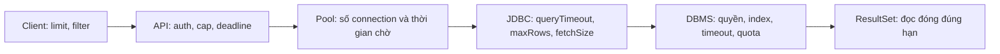
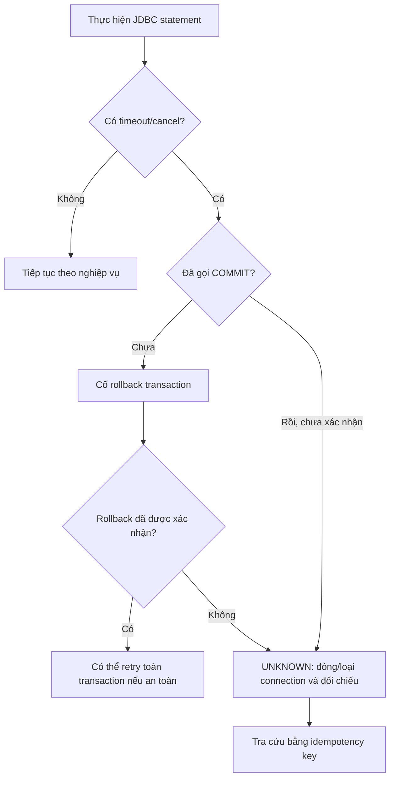

# Giới hạn thời gian, số dòng và tài nguyên cho truy vấn

## 1. Vì sao giới hạn truy vấn là một phần của bảo mật truy cập?

Trong một ứng dụng Java dùng **JDBC**, ngay cả truy vấn `SELECT` đã tham số hóa đúng cách vẫn có thể gây ảnh hưởng đến hệ thống nếu nó đọc quá nhiều dòng, thực thi quá lâu, tiêu thụ bộ nhớ lớn hoặc giữ kết nối trong pool suốt nhiều phút. Một người dùng có quyền tìm kiếm hợp lệ có thể vô tình — hoặc cố ý — gửi bộ lọc quá rộng và khiến toàn bộ dịch vụ chậm lại.

Ví dụ API `GET /documents?limit=1000000` lấy danh sách tài liệu:

```text
HTTP request
  -> Controller nhận limit = 1.000.000
    -> DAO chạy SELECT không có WHERE/LIMIT phù hợp
      -> DBMS quét bảng rất lớn
        -> JDBC tải hàng triệu dòng
          -> Java tạo List<Document> trong heap
            -> Kết nối pool bị giữ lâu, request khác phải chờ
```

Để ngăn tình huống đó, ứng dụng cần **một ngân sách tài nguyên theo nhiều lớp**:

- **Giới hạn thời gian:** câu SQL không được chiếm tài nguyên vô thời hạn.
- **Giới hạn số dòng:** không lấy hàng triệu dòng chỉ vì client yêu cầu.
- **Giới hạn kích thước dữ liệu:** mỗi hàng không chứa vô hạn nội dung `CLOB/BLOB` và không nạp kết quả vào heap thiếu kiểm soát.
- **Giới hạn kết nối và đồng thời:** request không được chiếm toàn bộ pool và làm cạn tài nguyên DBMS.
- **Phân quyền:** người dùng chỉ được truy vấn dữ liệu và nghiệp vụ mà họ có quyền, dù câu SQL chạy rất nhanh.

Giới hạn tài nguyên giúp **giảm rủi ro từ truy vấn quá đắt hoặc lỗi lập trình**, nhưng không thay thế kiểm soát truy cập, phân quyền theo tenant, tham số hóa SQL hay các chính sách chống lạm dụng ở API gateway.

## 2. Bản đồ các giới hạn: không có một “timeout JDBC” duy nhất

Các giới hạn sau tác động đến những phần khác nhau của đường đi từ request đến DBMS:

| Cơ chế | API/vị trí điển hình | Giới hạn điều gì? | Không bảo đảm điều gì? |
| --- | --- | --- | --- |
| **Query timeout** | `Statement.setQueryTimeout(seconds)` | Thời gian thực thi statement theo driver | Không phải deadline tuyệt đối của toàn request |
| **Result row cap** | `Statement.setMaxRows(int)` / `setLargeMaxRows(long)` | Số dòng tối đa mà JDBC `ResultSet` cho phép nhận | Không chứng minh DBMS không quét nhiều hơn |
| **SQL row limit** | `WHERE ... ORDER BY ... LIMIT ?` | Số hàng SQL được chọn trả về theo kế hoạch | Không giới hạn chi phí quét/join trước khi áp limit |
| **Fetch size** | `Statement.setFetchSize(int)` | Gợi ý số hàng driver lấy mỗi lượt | Không giới hạn tổng số hàng |
| **Field size** | `Statement.setMaxFieldSize(int)` | Giới hạn byte với các trường ký tự/nhị phân thuộc phạm vi hỗ trợ | Không phải giới hạn bộ nhớ chung, có thể cắt dữ liệu |
| **Pool acquire timeout** | Ví dụ HikariCP `connectionTimeout` | Thời gian đợi `DataSource.getConnection()` | Không giới hạn thời gian chạy SQL |
| **Network timeout** | `Connection.setNetworkTimeout(executor, ms)` | Giới hạn chờ I/O mạng trong phạm vi driver hỗ trợ | Không xác định kết quả commit khi mất phản hồi |
| **DBMS resource controls** | Statement/lock timeout, role/resource group/plan limit | Tài nguyên phía server theo DBMS | Không thay thế giới hạn API hoặc heap Java |
| **Request deadline** | HTTP/API/service layer | Thời gian tổng thể cho một nghiệp vụ | Không tự làm `Statement.cancel()` hoặc rollback |



**Không dùng một giới hạn làm đại diện cho giới hạn khác.** `setFetchSize(100)` không có nghĩa chỉ có 100 dòng; `setQueryTimeout(3)` không có nghĩa bộ nhớ Java sẽ bị giới hạn; `connectionTimeout=3000ms` cũng không kết thúc một câu SQL đã bắt đầu.

## 3. Giới hạn thời gian câu SQL bằng `setQueryTimeout`

API JDBC chuẩn:

```java
import java.sql.PreparedStatement;
import java.sql.SQLException;

// Giả định connection đã mở.
try (PreparedStatement statement = connection.prepareStatement(
        "SELECT document_id, title FROM tenant_documents WHERE tenant_id = ?")) {
    statement.setLong(1, tenantId);
    statement.setQueryTimeout(3); // Đơn vị GIÂY.

    try (java.sql.ResultSet rs = statement.executeQuery()) {
        while (rs.next()) {
            // Xử lý hàng thuộc tenant đã được xác thực.
        }
    }
}
```

`setQueryTimeout(int seconds)` nhận **giây**. Theo hợp đồng JDBC, giá trị `0` thường có nghĩa không giới hạn ở thuộc tính này. Một driver có thể đưa timeout xuống DBMS, dùng cơ chế hủy câu lệnh, hoặc áp dụng biện pháp nội bộ; hỗ trợ và độ chính xác phụ thuộc driver/phiên bản.

### Điều gì xảy ra khi quá thời gian?

JDBC có lớp ngoại lệ `SQLTimeoutException`, nhưng không nên viết code chỉ bắt lớp này rồi mặc định mọi timeout đều đã được xử lý sạch:

```java
import java.sql.SQLTimeoutException;
import java.sql.SQLException;

try {
    // Một lần executeQuery() hoặc executeUpdate() đã cấu hình timeout.
} catch (SQLTimeoutException timeout) {
    // Hết thời gian thực thi theo driver.
    // Không suy rằng toàn transaction đã rollback.
    throw timeout;
} catch (SQLException failure) {
    // Driver có thể báo timeout, lỗi khóa hoặc lỗi kết nối
    // qua SQLException và SQLState chuyên biệt.
    throw failure;
}
```

Khi timeout, JDBC driver có thể cố gắng hủy câu lệnh, nhưng **hủy một statement không đồng nghĩa rollback transaction**. Nếu trước đó đã có các câu `UPDATE` khác trên cùng transaction, cần quyết định rollback toàn bộ trước khi retry, theo khả năng kết nối còn hoạt động và quy tắc DBMS.

Một số driver có thể báo timeout cả khi đang nhận dữ liệu, hoặc chỉ áp dụng theo một giai đoạn thực thi nhất định. **Không mặc định `setQueryTimeout` là deadline tuyệt đối bao phủ toàn bộ việc duyệt một ResultSet dài hoặc ghi phản hồi HTTP**. Cần đo trên driver đang dùng.

Nếu DBMS thực thi câu SQL có khóa chờ lâu, nên cân nhắc **lock timeout riêng** ngắn hơn ngân sách truy vấn khi DBMS hỗ trợ, để tránh chờ khóa chiếm hết thời gian request.

## 4. Giới hạn số dòng với `setMaxRows` và `setLargeMaxRows`

`Statement.setMaxRows(int max)` giới hạn số dòng tối đa của `ResultSet` được tạo bởi statement; `0` thường có nghĩa **không giới hạn**. Từ JDBC 4.2, có `setLargeMaxRows(long max)` cho hạn mức biểu diễn bằng `long`. Đừng nhầm `setLargeMaxRows` với `executeLargeBatch()` hoặc `getLargeUpdateCount()` — những API sau liên quan tới số hàng được cập nhật; `setLargeMaxRows` giới hạn **số dòng kết quả**, không phải batch size.

```java
try (PreparedStatement ps = connection.prepareStatement(
        "SELECT document_id, title FROM tenant_documents ORDER BY document_id")) {
    ps.setMaxRows(100);

    try (java.sql.ResultSet rs = ps.executeQuery()) {
        while (rs.next()) {
            // Theo giới hạn JDBC, tối đa 100 hàng được trả qua ResultSet này.
        }
    }
}
```

Ví dụ khác:

```java
// JDBC 4.2+; đòi driver hỗ trợ.
statement.setLargeMaxRows(10_000L);
long configured = statement.getLargeMaxRows();
```

**Điểm quan trọng đối với bảo mật và hiệu năng:**

1. `setMaxRows` là **lớp phòng vệ ở JDBC**, không chắc DBMS tối ưu lại SQL thành một truy vấn `LIMIT` hiệu quả. Driver có thể giới hạn số dòng chuyển về client sau khi máy chủ đã làm công việc tốn kém.
2. Nó **không ngăn truy vấn cố ý thiếu điều kiện lọc** sử dụng CPU hoặc khóa dữ liệu trên server.
3. Giới hạn này có thể **cắt kết quả một cách hợp lệ theo API**. Nếu nghiệp vụ yêu cầu trả đầy đủ và báo lỗi khi vượt ngưỡng, cần thiết kế cách đếm/cảnh báo hoặc truy vấn `pageSize + 1` để phát hiện còn trang tiếp theo.
4. `setLargeMaxRows` có khả năng phụ thuộc mức hỗ trợ JDBC của driver; cần xác minh thay vì giả định đặt một con số `long` rất lớn sẽ giúp ứng dụng an toàn.
5. Không nên dùng một `SELECT *` không giới hạn và hy vọng `setMaxRows` sẽ thay cho thiết kế truy vấn đúng.

**Khuyến nghị:** đặt giới hạn **trong SQL và trong đầu vào API**, dùng `setMaxRows` như một biện pháp phòng vệ bổ sung — không đảo thứ tự ưu tiên.

## 5. `fetchSize` là gợi ý phân lô, không phải giới hạn số dòng

`Statement.setFetchSize(int rows)` thường đưa ra một **gợi ý** cho driver về số hàng lấy mỗi lượt từ DBMS. Nó có thể ảnh hưởng chi phí round-trip, bộ nhớ và cơ chế cursor:

```java
try (PreparedStatement ps = connection.prepareStatement(
        "SELECT document_id, title FROM tenant_documents ORDER BY document_id")) {
    ps.setFetchSize(128);  // Gợi ý theo HÀNG.
    ps.setMaxRows(1000);   // Tổng số hàng kết quả tối đa theo JDBC.
    ps.setQueryTimeout(10); // Theo GIÂY.

    try (java.sql.ResultSet rs = ps.executeQuery()) {
        while (rs.next()) {
            // Tối đa 1000 hàng nếu driver tuân thủ maxRows.
        }
    }
}
```

Ba dòng cấu hình này phục vụ **ba mục đích khác nhau**:

- `setFetchSize(128)`: tác động đến cách chia lô fetch; **không** dừng sau 128 hàng.
- `setMaxRows(1000)`: giới hạn số hàng mà ResultSet cung cấp.
- `setQueryTimeout(10)`: đặt ngưỡng thời gian cho statement.

Một số driver lấy toàn bộ dữ liệu vào client ngay cả khi fetch size được đặt; một số dùng cursor chỉ trong điều kiện transaction hoặc chế độ kết nối nhất định. Ví dụ **pgJDBC** thường cần `autoCommit=false`, `TYPE_FORWARD_ONLY` và fetch size dương để sử dụng chế độ tải theo lô dựa trên cursor server. Hãy kiểm thử trên DBMS và driver thực tế.

## 6. Giới hạn dữ liệu của từng cột và tránh `SELECT *`

Một hàng duy nhất có thể chứa cột `CLOB` hoặc `BLOB` hàng trăm MB. Vì thế, giới hạn **số hàng** chưa chắc giới hạn **số byte**. API `Statement.setMaxFieldSize(int maxBytes)` có tác dụng với các loại trường ký tự/nhị phân nằm trong phạm vi JDBC hỗ trợ:

```java
// Không nên dùng như cách duy nhất để giới hạn nội dung tài liệu.
statement.setMaxFieldSize(2048); // Byte, không phải số Unicode code point.
```

Phương thức này có thể làm dữ liệu trả về **bị cắt ngắn**, và driver có thể có hạn chế về những kiểu cột áp dụng. Nếu ứng dụng cần bảo toàn nội dung, cắt ngắn âm thầm là sai về nghiệp vụ. Đồng thời, `2048` byte không đồng nghĩa `2048` ký tự tiếng Việt: số byte phụ thuộc mã hóa và DBMS.

Ví dụ một trang kết quả chỉ hiển thị tiêu đề và ngày tạo: **không chọn cột `body` lớn**:

```sql
-- Tốt cho danh sách:
SELECT document_id, title, created_at
FROM tenant_documents
WHERE tenant_id = ?
ORDER BY document_id
LIMIT ?;

-- Không nên dùng cho danh sách nếu body rất lớn:
SELECT *
FROM tenant_documents
WHERE tenant_id = ?;
```

Nếu chỉ cần bản xem trước, có thể yêu cầu DBMS lấy một đoạn nội dung theo cú pháp và ngữ nghĩa ký tự phù hợp, ví dụ PostgreSQL:

```sql
SELECT document_id, title, LEFT(body, 160) AS preview
FROM tenant_documents
WHERE tenant_id = ?
ORDER BY document_id
LIMIT ?;
```

`LEFT(body, 160)` trả một đoạn theo quy tắc chuỗi ký tự của PostgreSQL, **không** phải 160 byte. Nếu cần bản xem trước cố định và truy vấn rất thường xuyên, có thể cân nhắc cột `summary` được chuẩn bị trước, thay vì đọc toàn bộ nội dung lớn trong truy vấn trang.

## 7. Thiết kế truy vấn có kiểm soát: bộ lọc, thứ tự, phân trang

Một API danh sách nên đặt các giới hạn **trước khi** truy vấn đến DBMS:

1. Chỉ nhận các điều kiện lọc đã được ứng dụng hỗ trợ.
2. Xác thực quyền của người gọi và lấy `tenantId` từ **ngữ cảnh xác thực đáng tin cậy**, không nhận tenant tùy ý từ query string.
3. Chuẩn hóa kích thước trang: ví dụ `1 <= pageSize <= 100`.
4. Chọn `ORDER BY` ổn định, có khóa duy nhất để phân trang.
5. Sử dụng `PreparedStatement` cho **giá trị**, bao gồm `tenantId`, `lastSeenId` và `LIMIT`.
6. Chọn các cột thực sự cần, bảo đảm chỉ mục cho bộ lọc và thứ tự.

Đối với phân trang khóa (*keyset pagination*):

```sql
SELECT document_id, title, created_at
FROM tenant_documents
WHERE tenant_id = ?
  AND document_id > ?
ORDER BY document_id
LIMIT ?;
```

Tham số thứ hai là ID của tài liệu cuối trong trang trước. Nếu `document_id` là khóa tăng và duy nhất, lần sau dùng `> lastSeenId` thay vì `OFFSET` tăng liên tục. Cách này có thể tránh chi phí bỏ qua quá nhiều dòng ở trang sâu, nhưng **không tự tạo snapshot nhất quán** khi dữ liệu đồng thời thay đổi.

Nếu client cung cấp cột sort, **không thể bind tên cột bằng dấu `?`**. Hãy ánh xạ giá trị đầu vào vào **danh sách tên cột cho phép**:

```java
String orderBy = switch (sortKey) {
    case "id" -> "document_id";
    case "created" -> "created_at";
    default -> throw new IllegalArgumentException("Sort không hợp lệ");
};

// orderBy là hằng do chương trình lựa chọn, không nối raw input.
```

Với `created_at` không duy nhất, cần thêm `document_id` làm khóa phụ và thay predicate phân trang cho tương ứng; chỉ đổi `ORDER BY` mà vẫn dùng cursor `document_id > ?` sẽ gây bỏ sót/trùng dữ liệu.

## 8. Ví dụ hoàn chỉnh: DAO JDBC trả một trang có ngân sách rõ ràng

Ví dụ sau dùng **PostgreSQL** và **Java 17+**. Mỗi request chỉ lấy tối đa 100 bản ghi metadata thuộc tenant được cấp quyền, giới hạn thời gian ở statement và đóng mọi tài nguyên JDBC. Các giá trị được tham số hóa để tránh SQL injection.

### 8.1. Schema và chỉ mục

```sql
CREATE TABLE tenant_documents (
    document_id BIGINT GENERATED ALWAYS AS IDENTITY PRIMARY KEY,
    tenant_id BIGINT NOT NULL,
    title VARCHAR(200) NOT NULL,
    created_at TIMESTAMP NOT NULL DEFAULT CURRENT_TIMESTAMP,
    body TEXT
);

CREATE INDEX idx_tenant_documents_tenant_doc
    ON tenant_documents (tenant_id, document_id);

INSERT INTO tenant_documents (tenant_id, title, body)
VALUES
    (10, 'Quy định A', 'Nội dung tài liệu A'),
    (10, 'Quy định B', 'Nội dung tài liệu B'),
    (20, 'Dữ liệu riêng', 'Không thuộc tenant 10');
```

Chỉ mục kết hợp `(tenant_id, document_id)` hỗ trợ bộ lọc theo tenant và sắp xếp theo ID trong ví dụ. Với truy vấn khác, phải kiểm tra kế hoạch thực thi và tính chọn lọc thực tế; thêm chỉ mục cũng có chi phí ghi/lưu trữ.

### 8.2. Repository

```java
import java.sql.Connection;
import java.sql.PreparedStatement;
import java.sql.ResultSet;
import java.sql.SQLException;
import java.time.LocalDateTime;
import java.util.ArrayList;
import java.util.List;
import javax.sql.DataSource;

public final class DocumentPageDao {
    private static final int MAX_PAGE_SIZE = 100;
    private static final int QUERY_TIMEOUT_SECONDS = 3;

    public record DocumentSummary(
            long id, String title, LocalDateTime createdAt) {}

    private final DataSource dataSource;

    public DocumentPageDao(DataSource dataSource) {
        this.dataSource = dataSource;
    }

    // tenantId phải do tầng xác thực/phân quyền cung cấp.
    public List<DocumentSummary> findNextPage(
            long tenantId, long lastSeenId, int pageSize)
            throws SQLException {

        if (tenantId <= 0 || lastSeenId < 0
                || pageSize < 1 || pageSize > MAX_PAGE_SIZE) {
            throw new IllegalArgumentException("Tham số không hợp lệ");
        }

        String sql = """
                SELECT document_id, title, created_at
                FROM tenant_documents
                WHERE tenant_id = ?
                  AND document_id > ?
                ORDER BY document_id
                LIMIT ?
                """;

        List<DocumentSummary> page = new ArrayList<>(pageSize);
        try (Connection c = dataSource.getConnection();
             PreparedStatement ps = c.prepareStatement(sql)) {

            ps.setLong(1, tenantId);
            ps.setLong(2, lastSeenId);
            ps.setInt(3, pageSize);

            // Lớp phòng vệ bổ sung, không thay thế LIMIT SQL.
            ps.setMaxRows(MAX_PAGE_SIZE);
            ps.setQueryTimeout(QUERY_TIMEOUT_SECONDS);
            ps.setFetchSize(32); // Gợi ý; không phải hạn mức số dòng.

            try (ResultSet rs = ps.executeQuery()) {
                while (rs.next()) {
                    page.add(new DocumentSummary(
                            rs.getLong("document_id"),
                            rs.getString("title"),
                            rs.getObject(
                                    "created_at", LocalDateTime.class)));
                }
            }
        }
        return List.copyOf(page);
    }
}
```

Ví dụ gọi trong service đã xác thực:

```java
DocumentPageDao dao = new DocumentPageDao(dataSource);

// authTenantId lấy từ principal/session đã được server xác minh.
long authTenantId = 10L;

List<DocumentPageDao.DocumentSummary> page =
        dao.findNextPage(authTenantId, 0L, 20);

for (DocumentPageDao.DocumentSummary doc : page) {
    System.out.println(doc.id() + " | " + doc.title());
}
```

**Giới hạn được bảo đảm bởi thiết kế:**

- Tham số `pageSize` bị từ chối nếu lớn hơn 100; không “chiều lòng” giá trị tùy ý từ client.
- SQL có `WHERE tenant_id = ?`, điều kiện phân trang theo khóa và `LIMIT ?`.
- Query chỉ chọn ba cột nhỏ, không tải `body` lớn lên heap.
- `setMaxRows(100)` là thêm một lớp chặn số dòng trong JDBC.
- `setQueryTimeout(3)` yêu cầu driver áp ngưỡng thời gian cho statement.
- `setFetchSize(32)` chỉ là gợi ý; DAO **không** dựa vào nó để tránh quá tải.
- `try-with-resources` đóng `ResultSet`, `PreparedStatement` và trả handle `Connection` về pool.

Một lỗi trong `executeQuery()` hoặc lúc duyệt `ResultSet` khiến phương thức **ném `SQLException` và không trả danh sách đã nạp dở như thể thành công**. Với API HTTP, nên chuyển lỗi thành mã/trạng thái phù hợp và giới hạn thông tin lỗi lộ ra cho client.

**Phân quyền nhiều tenant:** điều kiện `tenant_id = ?` chỉ an toàn khi tenant ID lấy từ nguồn được xác thực và mọi truy vấn liên quan đều áp dụng đúng. Đối với hệ thống đa tenant có yêu cầu cao, nên xem xét thêm **row-level security** ở DBMS hoặc phân tách quyền/schema để giảm rủi ro một DAO quên lọc tenant.

## 9. Phân biệt giới hạn trang API và `setMaxRows` khi cần biết “còn trang sau”

Một API phân trang thường cần trả `hasNext`. Cách phổ biến là **yêu cầu `pageSize + 1`** trong SQL, rồi chỉ hiển thị `pageSize` bản ghi:

```java
int visibleLimit = 50;
int sqlLimit = visibleLimit + 1; // 51 hàng để phát hiện còn trang.

// WHERE ... ORDER BY ... LIMIT ?
ps.setInt(limitParameterIndex, sqlLimit);
ps.setMaxRows(sqlLimit); // Không đặt maxRows=50 ở lần truy vấn này.
```

Sau khi đọc tối đa 51 hàng:

- Có 51 hàng: `hasNext = true`, trả 50 hàng đầu.
- Có tối đa 50 hàng: `hasNext = false` theo tập kết quả và thời điểm truy vấn.

Nếu `setMaxRows(50)` nhưng SQL `LIMIT 51`, JDBC có thể cắt mất hàng thứ 51 và chương trình **không phát hiện được còn trang kế tiếp**. Vì thế cần thống nhất hạn mức `maxRows` với ngữ nghĩa của API.

Với dữ liệu thay đổi liên tục, `hasNext` chỉ là thông tin tại thời điểm quan sát; không bảo đảm dữ liệu trang sau sẽ giống hệt ảnh chụp của trang trước khi thiếu snapshot/versioning.

## 10. Khi phải stream nhiều hàng, cần thêm giới hạn tài nguyên khác

Một tính năng xuất báo cáo có thể cần đọc 10.000 hàng thay vì 100. Nếu đọc toàn bộ vào `ArrayList` trước khi trả, bộ nhớ tăng theo dữ liệu. Streaming có thể phù hợp, nhưng cần **trần tổng số hàng**, deadline, độ dài transaction và cách ghi đầu ra.

Ví dụ ý tưởng với PostgreSQL/pgJDBC khi cần dùng cursor server:

```java
import java.sql.Connection;
import java.sql.PreparedStatement;
import java.sql.ResultSet;
import java.sql.SQLException;
import java.util.function.Consumer;
import javax.sql.DataSource;

public final class BoundedDocumentScan {
    private static final int MAX_EXPORT_ROWS = 10_000;

    public record Row(long id, String title) {}

    private final DataSource dataSource;

    public BoundedDocumentScan(DataSource dataSource) {
        this.dataSource = dataSource;
    }

    public void scan(
            long tenantId, Consumer<Row> consumer)
            throws SQLException {
        if (tenantId <= 0) {
            throw new IllegalArgumentException("tenantId không hợp lệ");
        }

        try (Connection c = dataSource.getConnection()) {
            // pgJDBC thường cần transaction thủ công để cursor fetch
            // hoạt động thay vì buffer toàn bộ kết quả.
            c.setReadOnly(true);
            c.setAutoCommit(false);

            try {
                String sql = """
                        SELECT document_id, title
                        FROM tenant_documents
                        WHERE tenant_id = ?
                        ORDER BY document_id
                        LIMIT ?
                        """;

                try (PreparedStatement ps = c.prepareStatement(
                        sql,
                        ResultSet.TYPE_FORWARD_ONLY,
                        ResultSet.CONCUR_READ_ONLY)) {
                    ps.setLong(1, tenantId);
                    ps.setInt(2, MAX_EXPORT_ROWS);
                    ps.setMaxRows(MAX_EXPORT_ROWS);
                    ps.setFetchSize(128);
                    ps.setQueryTimeout(20);

                    try (ResultSet rs = ps.executeQuery()) {
                        while (rs.next()) {
                            consumer.accept(new Row(
                                    rs.getLong("document_id"),
                                    rs.getString("title")));
                        }
                    }
                }
                c.commit();
            } catch (SQLException | RuntimeException failure) {
                try {
                    c.rollback();
                } catch (SQLException rollbackFailure) {
                    failure.addSuppressed(rollbackFailure);
                }
                throw failure;
            }
        }
    }
}
```

Đây là ví dụ cho **truy vấn đọc thuần** với `Consumer<Row>`. Trong ứng dụng thật:

- Nếu consumer gửi email, gọi API bên ngoài hoặc ghi ra stream HTTP, **không** coi `rollback()` có thể hoàn tác những tác dụng bên ngoài. Một lỗi giữa chừng có thể làm file/HTTP response chỉ chứa một phần dữ liệu.
- Hàm `commit()` ném lỗi thì kết quả giao dịch có thể chưa xác định; ví dụ chỉ đọc nên không có DML để áp dụng lại, nhưng quy trình xử lý giao dịch ghi phải khác.
- `setReadOnly(true)` là một hint/thuộc tính kết nối, **không phải lớp phân quyền**. Với pool, cần khôi phục trạng thái `readOnly/autoCommit` theo hợp đồng nếu connection còn lành; khi transaction không chắc chắn đã kết thúc, không tự bật `autoCommit=true`.
- Để tránh giữ kết nối quá lâu, không làm thao tác bên ngoài chậm hoặc có thể chặn trong callback. Với export lớn, cân nhắc xử lý theo **nhiều trang có kiểm soát** hoặc job được giám sát.
- Số `10_000` và `20 giây` chỉ là ngân sách ví dụ; cần đo chi phí thực tế. `setQueryTimeout` không nhất thiết bao trọn toàn bộ thời gian chạy vòng lặp trên mọi driver.

## 11. Timeout ở tầng pool, mạng và DBMS

Để một giới hạn thật sự có hiệu lực, cần hiểu **thời điểm** nó được bắt đầu:

### 11.1. Pool acquisition timeout

Ví dụ HikariCP:

```java
// Cấu hình tại lúc tạo pool, không phải mỗi truy vấn.
config.setMaximumPoolSize(8);
config.setConnectionTimeout(2_000L); // 2.000 ms chờ mượn.
```

Nếu cả tám kết nối đang được mượn và không kết nối nào sẵn sàng trong thời gian đó, `DataSource.getConnection()` có thể ném `SQLException`. **Không có câu SQL nào của lượt mượn thất bại đã chạy** qua handle mà nó không nhận được. Nhưng không vì thế mà kết luận những transaction đang hoạt động của request khác đã rollback.

Kích thước pool là **giới hạn số kết nối vật lý/đồng thời** theo cấu hình một instance, không phải hạn mức số query toàn hệ thống. Khi chạy nhiều instance, cần tính tổng và để lại ngân sách cho dịch vụ khác, job, migration và kết nối quản trị.

### 11.2. Network timeout

JDBC có `Connection.setNetworkTimeout(Executor executor, int milliseconds)`:

```java
// Ví dụ cú pháp. Dùng Executor được quản lý theo vòng đời ứng dụng
// và kiểm tra driver có hỗ trợ setNetworkTimeout hay không.
connection.setNetworkTimeout(networkExecutor, 5_000);
```

`networkExecutor` phải được ứng dụng cung cấp/quản lý; không tạo executor mới cho từng truy vấn rồi bỏ quên thread. Các driver có thể không hỗ trợ phương thức này hoặc có hành vi khác nhau. Khi vượt network timeout, connection có thể không còn sử dụng được; **không suy rằng DBMS chưa thực hiện DML hay chưa commit** chỉ từ lỗi mạng.

### 11.3. Thời gian của DBMS

Có thể đặt giới hạn gần nơi tiêu thụ tài nguyên nhất. Một số ví dụ cần kiểm tra tài liệu DBMS/phiên bản:

| DBMS | Tính năng liên quan | Lưu ý |
| --- | --- | --- |
| PostgreSQL | `statement_timeout`, `lock_timeout`, `idle_in_transaction_session_timeout` | Giới hạn thời gian statement, chờ khóa và transaction nhàn rỗi là ba loại khác nhau |
| MySQL | `max_execution_time` cho các dạng `SELECT` được hỗ trợ; `innodb_lock_wait_timeout` | Không giả định một tham số kiểm soát mọi DML và commit |
| SQL Server | `SET LOCK_TIMEOUT` và các tính năng quản lý workload | Lock timeout không phải giới hạn tổng thời gian mọi câu SQL |
| Oracle Database | Chính sách Oracle Database Resource Manager và timeout qua driver/câu lệnh | Cần cấu hình theo phiên bản/cấp quyền; không dùng cú pháp PostgreSQL |

Ví dụ riêng cho **PostgreSQL**, trong một transaction do ứng dụng kiểm soát:

```sql
SET LOCAL statement_timeout = '3s';
SET LOCAL lock_timeout = '1s';
```

`SET LOCAL` áp dụng theo phạm vi transaction hiện tại; khi transaction kết thúc, thiết lập này không phải cấu hình vĩnh viễn của phiên. Nếu sử dụng `SET` phiên thường rồi trả connection về pool mà không khôi phục, request sau có thể kế thừa hạn mức không mong đợi.

Trong PostgreSQL, một statement timeout bên trong transaction có thể khiến transaction rơi vào trạng thái **aborted**, cần `ROLLBACK` trước khi chạy nghiệp vụ tiếp. DBMS khác có thể chỉ hủy statement đang chờ khóa mà giữ transaction mở. Không suy trạng thái transaction từ chữ “timeout” một cách chung chung.

## 12. Hủy câu SQL và xử lý transaction sau timeout

JDBC có `Statement.cancel()` để yêu cầu hủy một statement đang thực thi, nếu driver và DBMS hỗ trợ:

```java
// Từ một luồng điều khiển khác có sở hữu tham chiếu statement:
statement.cancel();
```

Lệnh hủy có thể tới sau khi statement đã hoàn tất. `cancel()` không phải `rollback()`; một số câu DML trước đó trong cùng transaction có thể đã thực hiện và cần được hoàn tác bằng `Connection.rollback()`.

Quy trình hợp lý cho một transaction nhiều DML:



**Đặc biệt:** một timeout khi `Connection.commit()` đang chờ phản hồi không chứng minh commit thất bại. DBMS có thể đã commit rồi nhưng phản hồi bị mất. Với giao dịch không lũy đẳng (trừ tiền, tạo đơn), cần khóa yêu cầu duy nhất và cơ chế đối chiếu kết quả đã commit; không retry mù quáng.

`Connection.isValid(...)` giúp đánh giá liveness của kết nối, **không xác định** trạng thái commit/rollback trước đó. Một connection vẫn có thể kết nối được nhưng transaction đã ở trạng thái lỗi và phải rollback, hoặc kết nối đã được phục hồi nhưng kết quả commit cũ còn chưa rõ.

## 13. Các giới hạn tài nguyên ngoài JDBC

Ngay cả khi đã có timeout và row cap, một hệ thống vẫn có thể bị quá tải nếu số người dùng đồng thời quá lớn hoặc mọi câu SQL đều là truy vấn có chi phí cao.

| Tầng | Biện pháp | Ý nghĩa |
| --- | --- | --- |
| API gateway/controller | Rate limit, deadline, kiểm tra `pageSize` và bộ lọc | Hạn chế lưu lượng trước khi tốn kết nối DB |
| Authorization | Kiểm tra role/quyền, tenant scope, DBMS row-level security nếu có | Ngăn đọc dữ liệu ngoài quyền |
| SQL | Index, predicate chọn lọc, `ORDER BY` có chỉ mục, `LIMIT`, phân trang | Giảm số hàng và công việc cần làm |
| JDBC | `PreparedStatement`, `setQueryTimeout`, `setMaxRows`, đọc `ResultSet` theo từng phần | Chặn lỗi vô ý và giảm chi phí client |
| Connection pool | `maximumPoolSize`, acquire timeout, metrics active/pending | Giới hạn tổng số phiên/connection của ứng dụng |
| DBMS | Resource group/role quotas, statement/lock timeout, quyền tài khoản | Kiểm soát tài nguyên và phạm vi chạy ở server |
| Service | Bulkhead, giới hạn job export đồng thời, memory budget, circuit breaker khi hợp lý | Không cho một tính năng nặng chiếm toàn bộ dịch vụ |

**Không coi `setMaxRows(100)` là một biện pháp chống SQL injection.** Phải dùng `PreparedStatement` và chỉ cho phép các identifier/sort expression được kiểm soát. Nếu username DB có quyền `DROP TABLE` hoặc `SELECT` trên mọi schema không cần thiết, đặt query timeout không bù được lỗi phân quyền đó.

**Least privilege:** tài khoản ứng dụng chỉ nên có các quyền trên bảng/procedure thực sự cần dùng. Với dữ liệu nhạy cảm đa tenant, xác thực tenant ở service và áp chính sách DBMS nếu có thể là nhiều lớp bảo vệ, không chỉ phụ thuộc một điều kiện `WHERE`.

## 14. Đo lường: giới hạn phải có tác dụng quan sát được

Một cấu hình tưởng hợp lý nhưng không có telemetry sẽ khó xác định đúng khi gặp sự cố. Nên ghi nhận:

- Thời gian **chờ mượn kết nối** và số connection active/idle/pending.
- Thời gian chạy statement, độ trễ `p50/p95/p99` và số timeout theo truy vấn.
- Số hàng trả về, kích thước phản hồi và giới hạn page size được áp dụng.
- Số query bị DBMS hủy do statement/lock timeout; số truy vấn vẫn chạy sau khi client ngắt.
- Số lần `Statement.cancel()` được yêu cầu, kết quả thực tế và lỗi rollback.
- Thời gian giữ connection trong transaction và số transaction nhàn rỗi lâu.
- Dung lượng heap, GC pause, băng thông mạng, IO/CPU DBMS và query plan.

Thực hành log an toàn:

```java
catch (SQLException error) {
    System.err.printf(
            "queryName=%s sqlState=%s vendorCode=%d%n",
            "listTenantDocuments",
            error.getSQLState(),
            error.getErrorCode());
    throw error;
}
```

Đoạn mã trên chỉ minh họa đặt trong một khối `try/catch`. Không log tài liệu đầy đủ, token, mật khẩu, thông tin cá nhân hoặc SQL đã nội suy các tham số nhạy cảm. Sử dụng tên truy vấn cố định thay vì nối nội dung người dùng vào log, và truyền correlation/request ID được quản lý theo chính sách logging.

**Một truy vấn bị timeout không nhất thiết là do SQL chậm.** Nó có thể chờ khóa, chờ mạng, bị pool cạn trước lúc chạy, hoặc hệ thống DBMS hết tài nguyên. Quan sát theo từng tầng để tránh tăng `setQueryTimeout` nhằm che một deadlock hay connection leak.

## 15. Kiểm thử các ranh giới tài nguyên

Kiểm thử tích hợp trên đúng DBMS và driver mục tiêu giúp xác minh các API JDBC thật sự giới hạn như mong đợi:

| Ca kiểm thử | Cách thực hiện | Điều cần xác nhận |
| --- | --- | --- |
| `pageSize = 0` hoặc `> 100` | Gọi DAO với giá trị biên | Bị từ chối trước khi mở truy vấn |
| Đọc tenant khác | Gọi với tenant từ principal A, dữ liệu tenant B | Không trả dữ liệu ngoài tenant; kiểm tra policy DB |
| SQL trả hơn 100 hàng | Dữ liệu test lớn, gọi DAO | Trả tối đa pageSize, không tải `body` |
| Statement chạy chậm | Tạo truy vấn hoặc lock wait có kiểm soát | Driver/DBMS timeout đúng chính sách; cleanup tài nguyên |
| Row cap khác SQL limit | `LIMIT 51` và `setMaxRows(50)` | Test phát hiện mất thông tin `hasNext` |
| Fetch size 128 | Đọc nhiều hàng qua driver thật | Xác minh có streaming hay chỉ là hint |
| Giá trị LOB rất lớn | Một hàng chứa `body` lớn | Truy vấn trang không nạp cột này |
| Pool hết kết nối | Giữ số handle bằng giới hạn pool trong test | `getConnection()` timeout, không treo vô hạn |
| Hủy giữa transaction ghi | Gọi `cancel`/query timeout sau DML đầu | Có rollback hoặc trạng thái UNKNOWN được quản lý |
| Timeout lúc commit | Giả lập mất phản hồi commit | Không tự coi rollback; có cơ chế đối chiếu |
| Client đóng kết nối HTTP | Hủy request đang xử lý | Dọn JDBC và không trả connection trong trạng thái lỗi |
| Nhiều request đồng thời | Tăng tải theo kịch bản có kiểm soát | p95, heap và DBMS sessions nằm trong ngân sách |

Khi tạo lock contention, dùng **hai `Connection` độc lập** và các barrier/`CountDownLatch` để xác nhận một transaction đã giữ khóa trước khi transaction kia chờ. Tránh viết test chỉ dựa trên `Thread.sleep` rồi đoán DBMS đã đạt trạng thái mong muốn.

Không chạy test tải nặng trên cơ sở dữ liệu production. Kiểm thử deadline/cancellation và lỗi mạng nên diễn ra trên môi trường thử nghiệm có giám sát, kiểm soát tải và có thể tái tạo.

## 16. Những sai lầm thường gặp

| Sai lầm | Hậu quả | Cách sửa |
| --- | --- | --- |
| Cho client chọn `LIMIT` tùy ý | Có thể tải hàng triệu bản ghi | Kiểm tra `pageSize` và áp trần ở server |
| Chỉ đặt `setMaxRows` nhưng SQL thiếu `WHERE`/`LIMIT` | DBMS vẫn có thể tốn nhiều CPU/I/O | Giới hạn trong SQL và thiết kế index |
| Hiểu `fetchSize=100` là tối đa 100 dòng | Kết quả vẫn có thể chứa hàng triệu dòng | Dùng SQL limit/row cap thật sự |
| Đọc `SELECT *` gồm CLOB lớn để dựng danh sách | Tốn heap và mạng | Chọn cột nhỏ cho danh sách, nội dung lớn đọc riêng |
| Cắt bằng `setMaxFieldSize` mà không báo | Dữ liệu có thể bị cắt âm thầm | Thiết kế preview rõ và giới hạn theo SQL |
| Coi `setQueryTimeout` là deadline toàn request | Request có thể tiếp tục ở các tầng khác | Phối hợp deadline, DBMS timeout và cleanup |
| Dùng `Statement.cancel()` thay `rollback()` | Transaction có thể còn mở | Rollback có xác nhận và quản lý kết nối |
| Timeout ở `commit()` rồi retry ghi dữ liệu ngay | Nguy cơ ghi trùng, double charge | Idempotency key và đối chiếu outcome |
| Dùng `isValid()` để “chứng minh rollback” | Nhầm lẫn kết nối sống và trạng thái transaction | Theo dõi pha commit/rollback riêng |
| Tăng pool size khi SQL đang giữ lock lâu | Thêm tải, không chữa contention | Đo lock wait, kế hoạch truy vấn và transaction |
| Nhận tên cột sort từ client và nối vào SQL | SQL injection/đổi ý nghĩa query | Allowlist identifier, bind các giá trị |
| Dùng quyền DB admin cho DAO chỉ đọc | Phạm vi tác động khi có lỗi quá lớn | Tài khoản least privilege, quyền tách biệt |

## 17. Checklist triển khai

Trước khi phát hành một DAO tìm kiếm, báo cáo hoặc xuất dữ liệu trong ứng dụng JDBC, hãy xác nhận:

1. **Phân quyền đúng trước truy vấn:** principal, tenant và vai trò được kiểm tra; tài khoản DB có quyền tối thiểu.
2. **Input có trần:** `pageSize`, filter, sort và export size không được vượt giới hạn server.
3. **SQL được tham số hóa:** `PreparedStatement` cho giá trị, allowlist cho tên cột/cấu trúc động.
4. **Query có mục đích:** chỉ lấy cột cần, `WHERE`/`ORDER BY` rõ ràng, `LIMIT` hoặc keyset pagination.
5. **Có time budget:** `setQueryTimeout` và timeout DBMS/lock phù hợp, nhận diện timeout ở tầng pool và mạng.
6. **Số dòng được chặn đúng:** `setMaxRows` như phòng vệ, không làm mất dữ liệu `pageSize + 1` khi tính `hasNext`.
7. **Bộ nhớ được kiểm soát:** `fetchSize` chỉ là hint; không materialize vô hạn ResultSet hoặc LOB lớn.
8. **Connection có vòng đời ngắn:** đóng `ResultSet/Statement/Connection`, giới hạn số connection trong pool và export đồng thời.
9. **Cancellation an toàn:** hủy không phải rollback; khi commit UNKNOWN phải đối chiếu trước retry.
10. **Có đo lường và kiểm thử:** số hàng, thời gian, pool pending, heap, lock wait, timeout, ranh giới dữ liệu tenant và ngữ nghĩa driver thật.

**Ghi nhớ:** Trong JDBC, giới hạn tài nguyên hiệu quả là sự kết hợp **giới hạn đầu vào + thiết kế SQL + API JDBC + chính sách DBMS/pool**. `setQueryTimeout` quản lý thời gian statement, `setMaxRows` hạn chế số dòng kết quả, `setFetchSize` chỉ gợi ý cách fetch và `setMaxFieldSize` có thể cắt dữ liệu theo byte. Không cơ chế nào đơn lẻ thay thế được phân quyền, `PreparedStatement`, truy vấn chọn lọc, transaction rõ ràng và quan sát thực tế. Đặt ngân sách tại từng tầng sẽ giúp DAO giữ được cả **tính đúng đắn**, **bảo mật truy cập** và **khả năng phục vụ khi tải cao**.
