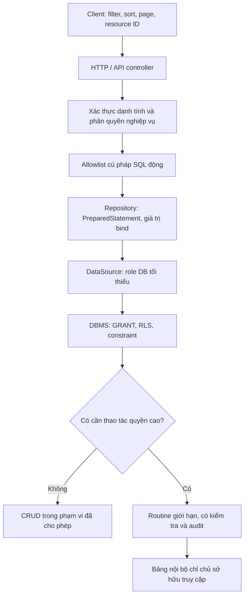
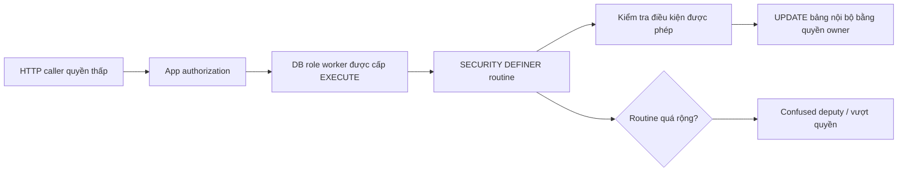

# Đánh giá rủi ro khi cho phép SQL động và thủ tục quyền cao trong JDBC

## 1. Bài toán bảo mật: dữ liệu đầu vào không được trở thành quyền thực thi

Trong ứng dụng **JDBC**, Java thường dùng `DataSource` để lấy `Connection`, `PreparedStatement` để thực thi SQL tham số hóa, `ResultSet` để đọc dữ liệu và transaction để bảo đảm nhiều thao tác được ghi nhất quán. Những API này tạo nền tảng an toàn, nhưng **không tự bảo đảm** hệ thống có phân quyền đúng khi cho phép:

- **SQL động**: ứng dụng dựng một phần câu SQL lúc chạy, ví dụ tên bảng, cột sắp xếp, điều kiện tìm kiếm, phép toán hoặc hướng `ASC/DESC`.
- **Thủ tục/hàm có quyền cao**: DBMS cho phép caller gọi một routine chạy với quyền của **chủ sở hữu** hoặc một ngữ cảnh quyền khác, kể cả khi caller không được trực tiếp đọc/sửa bảng bên trong.

Một lỗi nguy hiểm là ứng dụng kiểm tra tham số đã đúng kiểu hoặc sử dụng `PreparedStatement`, rồi cho rằng phần còn lại mặc nhiên an toàn. **Tham số hóa bảo vệ ranh giới dữ liệu/SQL; phân quyền bảo vệ ranh giới người dùng/tài nguyên.** Cần cả hai.

Mục tiêu của bài học là đánh giá **bề mặt tấn công, phạm vi đặc quyền và các điểm tin cậy**, xây một thiết kế có thể kiểm thử bằng Java và PostgreSQL. Ví dụ PostgreSQL chỉ minh họa các cơ chế cụ thể; `SECURITY DEFINER`, `search_path`, cách cấp quyền và quy tắc transaction của DBMS khác có thể không giống nhau.

| Rủi ro | Điều kiện gây ra | Tác động có thể có |
| --- | --- | --- |
| SQL injection qua giá trị | Ghép trực tiếp giá trị người dùng vào chuỗi SQL. | Bỏ qua filter, đọc/sửa dữ liệu ngoài dự kiến hoặc thực thi cấu trúc SQL khác. |
| SQL injection qua identifier | Cho phép nhập tên bảng/cột/hướng sort rồi nối vào SQL. | Truy cập tài nguyên không cho phép, thay đổi ý nghĩa câu truy vấn. |
| Vượt quyền theo hàng (*broken object-level authorization*) | Query nhận `tenant_id`/`order_id` tùy ý từ client mà không đối chiếu quyền. | Đọc/sửa bản ghi của tenant hoặc người dùng khác dù query đã tham số hóa. |
| Thủ tục quyền cao kiểu *confused deputy* | Caller quyền thấp sai khiến routine có quyền mạnh làm quá phạm vi. | Sửa bảng bị cấm, truy vấn thông tin nhạy cảm, bỏ qua quy trình phê duyệt. |
| Chiếm đoạt phân giải tên đối tượng | Routine quyền cao dùng tên bảng/hàm không định danh schema trong `search_path` thiếu an toàn. | Đối tượng do attacker tạo có thể được gọi trong ngữ cảnh quyền cao. |
| Phân quyền quá rộng | Cấp `EXECUTE` cho `PUBLIC` hoặc cấp trực tiếp `UPDATE` trên bảng nội bộ. | Caller có nhiều khả năng hơn mức nghiệp vụ cần. |
| Kênh suy luận và lộ thông tin | Lỗi, thông báo, log hoặc thời gian thực thi tiết lộ trạng thái hàng cấm. | Tiết lộ sự tồn tại hoặc thông tin về dữ liệu không được cấp quyền. |

**Nguyên tắc xuyên suốt:** coi mọi giá trị từ HTTP request, tập tin nhập, câu SQL do người khác cấu hình và token chưa xác thực là **không đáng tin**. Chỉ dùng quyền DB và quyền người dùng sau khi đã qua một cơ chế xác thực/phân quyền tin cậy.

## 2. Vẽ ranh giới tin cậy trước khi viết câu SQL



Có **hai danh tính khác nhau** cần phân biệt:

1. **Người dùng nghiệp vụ**: đã đăng nhập vào ứng dụng, có thể chỉ được xem tenant A hoặc được duyệt giao dịch trong một bộ phận.
2. **Database role**: tài khoản thực tế mà `DataSource` dùng kết nối tới DBMS, ví dụ `app_reader` hoặc `payment_worker`.

Nếu toàn bộ HTTP request đi qua một **tài khoản DB dùng chung**, `SESSION_USER` hoặc tài khoản DBMS chỉ cho biết **tài khoản kết nối chung**, không tự cho biết người dùng HTTP nào đang gọi. Một tham số `userId`/`tenantId` do client gửi cũng **không phải bằng chứng danh tính**. Khi thiết kế routine quyền cao, phải xác định ai là nguồn xác thực thực sự và cách quyền đó được chuyển sang DBMS mà không cho client tùy ý giả mạo.

### Năm câu hỏi đánh giá rủi ro

1. **Ai kiểm soát cú pháp?** Đầu vào có thể đổi tên bảng, cột, toán tử, `ORDER BY` hoặc cả khối SQL không?
2. **Ai kiểm soát phạm vi dữ liệu?** `tenant_id`, `owner_id` hay `document_id` có được kiểm tra dựa trên danh tính đã xác thực?
3. **SQL chạy bằng quyền nào?** Có quyền `SELECT`, `UPDATE`, `DELETE` trực tiếp; có được gọi routine chạy quyền chủ sở hữu không?
4. **Routine có thể làm gì ngoài dự kiến?** Có gọi SQL động, truy cập bảng nội bộ, DDL, dữ liệu tenant khác, extension hoặc external service không?
5. **Khi có lỗi, điều gì được lộ và ghi lại?** Có trả nguyên văn `SQLException`, SQL cùng tham số nhạy cảm, secret trong connection URL hay nội dung được bảo vệ không?

Đánh giá phải xét **khả năng thực tế của DB role và code path**; không chỉ đọc tên role như “read_only” hay tin rằng một route đã được đặt sau middleware xác thực.

## 3. `PreparedStatement` chỉ tham số hóa giá trị, không thay tên bảng/cột

Với filter là **giá trị**, hãy bind bằng dấu `?`:

```java
String sql = """
    SELECT order_id, total_amount
    FROM app.orders
    WHERE tenant_id = ? AND status = ?
    """;

try (PreparedStatement ps = connection.prepareStatement(sql)) {
    ps.setLong(1, authenticatedTenantId);
    ps.setString(2, requestedStatus);
    try (ResultSet rows = ps.executeQuery()) {
        while (rows.next()) {
            // Đọc các hàng thuộc tenant đã được phép.
        }
    }
}
```

Trong đoạn này, `authenticatedTenantId` phải được lấy từ **ngữ cảnh phân quyền do server tạo**, không phải tự tin vào giá trị `tenantId` nằm trong query string. `requestedStatus` là dữ liệu và không được chuyển thành cú pháp SQL.

Nhưng các placeholder không thay thế **identifier** hoặc cú pháp:

```sql
-- Không phải cách chọn bảng động hợp lệ bằng JDBC:
SELECT order_id FROM ? WHERE tenant_id = ?;

-- Dấu ? không phải cách biểu diễn một tên cột ORDER BY:
SELECT order_id FROM app.orders ORDER BY ?;
```

Ở câu thứ hai, một số DBMS có thể hiểu `?` như một **biểu thức giá trị cố định** hoặc từ chối cú pháp; nó không tự biến thành tên cột mà client yêu cầu. Tương tự, không thể bind nguyên một từ khóa `ASC` hoặc `DESC` qua `setString()`.

**Sai lầm phổ biến** là cố xử lý giới hạn này bằng cách nối thẳng đầu vào:

```java
// SAI: sortColumn và sortDirection đến trực tiếp từ request.
String sql = "SELECT order_id FROM app.orders " +
             "ORDER BY " + sortColumn + " " + sortDirection;
```

Đây là **mã sai có chủ đích**; không áp dụng cho dữ liệu không đáng tin. Ngay cả khi driver chỉ cho thực thi một statement, đầu vào vẫn có thể làm thay đổi cấu trúc và ý nghĩa của truy vấn. Việc cấm dấu chấm phẩy hoặc “escape mọi dấu nháy” không đủ để xác nhận một identifier/hướng sắp xếp là hợp lệ.

## 4. SQL động an toàn bằng allowlist cú pháp

Khi sản phẩm thật sự cần sắp xếp theo nhiều cột, hãy **chuyển lựa chọn từ client thành một trong các hằng số mà server tự định nghĩa**. Ví dụ repository sau dùng Java 17+, JDBC và schema PostgreSQL minh họa `app.orders(order_id, tenant_id, status, created_at, total_amount)`:

```java
import javax.sql.DataSource;
import java.math.BigDecimal;
import java.sql.Connection;
import java.sql.PreparedStatement;
import java.sql.ResultSet;
import java.sql.SQLException;
import java.time.OffsetDateTime;
import java.util.ArrayList;
import java.util.List;
import java.util.Objects;

public final class SafeOrderSearch {
    private final DataSource dataSource;

    public SafeOrderSearch(DataSource dataSource) {
        this.dataSource = Objects.requireNonNull(dataSource);
    }

    // Chỉ tên SQL do server kiểm soát mới được đi vào câu query.
    public enum SortColumn {
        CREATED_AT("created_at"),
        TOTAL_AMOUNT("total_amount");

        private final String sqlName;
        SortColumn(String sqlName) { this.sqlName = sqlName; }
        public String sqlName() { return sqlName; }
    }

    public enum SortDirection {
        ASC("ASC"), DESC("DESC");
        private final String keyword;
        SortDirection(String keyword) { this.keyword = keyword; }
        public String keyword() { return keyword; }
    }

    public record OrderView(
        long id, OffsetDateTime createdAt, BigDecimal totalAmount
    ) {}

    public List<OrderView> find(
            long authorizedTenantId,
            String status,
            SortColumn column,
            SortDirection direction,
            int limit) throws SQLException {

        Objects.requireNonNull(column, "column");
        Objects.requireNonNull(direction, "direction");
        if (authorizedTenantId <= 0 || status == null
                || status.isBlank() || limit < 1 || limit > 100) {
            throw new IllegalArgumentException("Tham số truy vấn không hợp lệ");
        }

        String sql = """
            SELECT o.order_id, o.created_at, o.total_amount
            FROM app.orders AS o
            WHERE o.tenant_id = ? AND o.status = ?
            ORDER BY o.%s %s, o.order_id DESC
            LIMIT ?
            """.formatted(column.sqlName(), direction.keyword());

        List<OrderView> found = new ArrayList<>();
        try (Connection connection = dataSource.getConnection();
             PreparedStatement ps = connection.prepareStatement(sql)) {
            ps.setLong(1, authorizedTenantId);
            ps.setString(2, status);
            ps.setInt(3, limit);

            try (ResultSet rs = ps.executeQuery()) {
                while (rs.next()) {
                    found.add(new OrderView(
                        rs.getLong("order_id"),
                        rs.getObject("created_at", OffsetDateTime.class),
                        rs.getBigDecimal("total_amount")
                    ));
                }
            }
        }
        return List.copyOf(found);
    }
}
```

Điểm cần nắm:

- `column.sqlName()` và `direction.keyword()` **chỉ có thể nhận giá trị do enum khai báo**, không dùng chuỗi gốc từ request.
- Controller phải **parse lựa chọn người dùng thành enum** và từ chối giá trị lạ trước khi gọi repository; không tự tạo enum hay tên cột từ text client.
- `authorizedTenantId` được cấp từ kết quả phân quyền server, còn `status` và `limit` vẫn được **bind** qua `PreparedStatement`.
- `ORDER BY ... order_id DESC` có khóa phá hòa duy nhất, giúp tránh thứ tự tùy ý khi các giá trị sort trùng nhau. Khi thay đổi tổ hợp chiều sắp xếp, cần thiết kế logic phân trang phù hợp.
- Mã chỉ đọc tối đa 100 hàng, đóng `ResultSet`, statement và connection đúng vòng đời.
- `OffsetDateTime` yêu cầu driver hỗ trợ ánh xạ JDBC 4.2 với loại thời gian của DBMS; cần kiểm thử trên driver triển khai.

### Nếu cần tìm kiếm `LIKE`

Tham số hóa vẫn đúng, nhưng `LIKE` có **ngôn ngữ pattern riêng**. Nếu người dùng muốn tìm một chuỗi **nguyên văn**, ứng dụng phải escape các ký tự wildcard của pattern, không chỉ bind giá trị:

```sql
SELECT order_id FROM app.orders
WHERE tenant_id = ?
  AND reference_code LIKE ? ESCAPE '!';
```

Quy ước ví dụ là dùng `!` làm ký tự escape, nên server cần biến `!` thành `!!`, `%` thành `!%` và `_` thành `!_` trước khi thêm dấu `%` cho thao tác tìm chứa chuỗi. Việc bind giúp tránh **SQL injection**; việc escape pattern giúp tránh **tìm rộng ngoài ý muốn**. Hai mục tiêu khác nhau.

## 5. Dynamic SQL còn có nguy cơ vượt quyền dù không có injection

Một query được bind đúng vẫn có thể sai về **object-level authorization**:

```java
// SAI về phân quyền nếu orderId đến từ client mà không kiểm tra sở hữu.
String sql = "SELECT order_id, total_amount " +
             "FROM app.orders WHERE order_id = ?";
```

Ứng dụng cần xác nhận người gọi được đọc đơn hàng đó, ví dụ thêm filter tin cậy:

```sql
SELECT order_id, total_amount
FROM app.orders
WHERE order_id = ?
  AND tenant_id = ?;
```

`order_id` có thể đến từ request, nhưng `tenant_id` phải đến từ thông tin **đã xác thực/phân quyền** hoặc được DBMS kiểm soát qua chính sách đáng tin. Với ứng dụng có role chia sẻ chung trong pool, không thể cho client tự đặt `tenant_id` rồi gọi đó là phân quyền.

Không phải mọi truy vấn cần cùng bộ lọc tenant: báo cáo tổng hợp, nghiệp vụ quản trị hoặc quy trình thanh toán có thể được cấp quyền xuyên tenant. Nhưng **phạm vi đó phải được cấp rõ**, không trở thành tác dụng phụ của một chuỗi SQL động.

### Đọc/ghi bảng động chỉ khi thực sự cần

Nếu phần mềm cần truy vấn một trong ba bảng được định nghĩa sẵn, nên dùng **ánh xạ tên logic sang identifier cố định** trên server hoặc các câu SQL cố định:

```java
enum ReportSource {
    ACTIVE("app.active_orders"),
    ARCHIVE("app.archived_orders");

    private final String qualifiedTable;
    ReportSource(String qualifiedTable) {
        this.qualifiedTable = qualifiedTable;
    }
    String qualifiedTable() { return qualifiedTable; }
}
```

**Không xây API chung kiểu “chọn bất kỳ table và column nào rồi tạo SELECT/UPDATE”** cho client. Một tính năng như vậy thường mở rộng khả năng vượt quá ranh giới nghiệp vụ, ngay cả khi đã có tên identifier được quote đúng cú pháp.

## 6. Thủ tục quyền cao: lợi ích và bề mặt tấn công

Nhiều DBMS cho phép gọi routine (stored procedure hoặc function) với quyền của **chủ sở hữu** thay vì quyền của caller. Trong PostgreSQL, cơ chế tương ứng là `SECURITY DEFINER`; mặc định routine thường dùng `SECURITY INVOKER`. DBMS khác có cơ chế như `EXECUTE AS` hoặc quyền definer/invoker với chi tiết riêng.

Thủ tục quyền cao **có thể hữu ích**: web app không có quyền `UPDATE` trực tiếp bảng tiền hoặc bảng audit, nhưng một worker chuyên trách được gọi một routine có giới hạn để thực hiện cập nhật hợp lệ. Tuy nhiên, routine trở thành **bề mặt đặc quyền**. Nếu không kiểm tra đầy đủ:

- Caller có thể truyền một ID ngoài phạm vi và sai khiến routine sửa hàng không được phép.
- Routine có thể dùng SQL động, `search_path` không an toàn hoặc function/trigger do role ít quyền tạo.
- Quyền `EXECUTE` có thể được cấp quá rộng, ví dụ mọi login đều gọi được thay vì riêng worker được ủy quyền.
- Chủ sở hữu routine có thể sở hữu bảng, bỏ qua một số chính sách row-level security hoặc có quyền DDL không cần thiết.
- Routine có thể tiết lộ số hàng, chi tiết lỗi, dữ liệu trung gian hoặc thời gian thực thi của thông tin không được phép nhìn thấy.



**Quy tắc đánh giá:** quyền `EXECUTE` không tự động tương đương quyền sửa **mọi** hàng mà routine có thể chạm tới. Trước khi cấp `EXECUTE`, cần xét tham số có thể điều khiển, điều kiện trong SQL, bảng liên quan, khả năng xâu chuỗi nhiều routine và ai tạo dữ liệu làm bằng chứng cho một hành động.

## 7. Ví dụ PostgreSQL: chỉ cấp một năng lực nghiệp vụ hẹp

Xét một hệ thống nhận kết quả thanh toán từ nhà cung cấp qua **worker đã được xác thực**. Worker có thể đánh dấu một đơn đã thanh toán **chỉ khi** DBMS đã ghi nhận một biên nhận được hệ thống thanh toán đáng tin xác minh. Worker **không cần** quyền `UPDATE` toàn bộ bảng đơn hàng hoặc quyền sửa biên nhận.

Schema minh họa:

```sql
-- Chạy phần DDL bằng role sở hữu schema/bảng được kiểm soát.
-- Các role và schema phải được DBA cấp phát đúng trước khi triển khai.
CREATE SCHEMA IF NOT EXISTS app;
CREATE SCHEMA IF NOT EXISTS api;

CREATE TABLE app.orders (
    order_id BIGINT GENERATED ALWAYS AS IDENTITY PRIMARY KEY,
    tenant_id BIGINT NOT NULL,
    status VARCHAR(24) NOT NULL,
    created_at TIMESTAMPTZ NOT NULL DEFAULT CURRENT_TIMESTAMP,
    total_amount NUMERIC(12, 2) NOT NULL,
    paid_at TIMESTAMPTZ
);

CREATE TABLE app.payment_receipts (
    receipt_id BIGINT GENERATED ALWAYS AS IDENTITY PRIMARY KEY,
    order_id BIGINT NOT NULL UNIQUE
        REFERENCES app.orders(order_id),
    verified_at TIMESTAMPTZ NOT NULL
);
```

Giả định `payment_receipts` chỉ được thêm/cập nhật bởi **một thành phần xác minh thanh toán khác**, có tài khoản và quy trình tin cậy. Nếu `payment_worker` có thể tự đặt `verified_at` hoặc tự tạo biên nhận giả, phép kiểm tra bên dưới sẽ mất ý nghĩa. Một bảng “đã xác minh” chỉ đáng tin bằng **quyền ghi và quy trình xác minh** của nó.

Ở đây procedure không nhận `tenantId` từ client để tự quyết định quyền. Nó chỉ nhận `orderId`, và DBMS kiểm tra trạng thái đơn cùng sự tồn tại của biên nhận đã xác minh. Mục tiêu không phải cho **mọi người dùng web** cập nhật bất kỳ đơn nào: chỉ tài khoản **worker xử lý thanh toán** được phép gọi procedure sau khi đã xác minh sự kiện từ nhà cung cấp.

### Procedure chạy quyền của chủ sở hữu

```sql
-- Thực hiện với role chủ sở hữu tin cậy của procedure và bảng nội bộ.
CREATE OR REPLACE PROCEDURE api.mark_order_paid(p_order_id BIGINT)
LANGUAGE plpgsql
SECURITY DEFINER
SET search_path = pg_catalog, pg_temp
AS $body$
BEGIN
    UPDATE app.orders AS o
    SET status = 'PAID',
        paid_at = clock_timestamp()
    WHERE o.order_id = p_order_id
      AND o.status = 'AUTHORIZED'
      AND EXISTS (
          SELECT 1
          FROM app.payment_receipts AS r
          WHERE r.order_id = o.order_id
            AND r.verified_at IS NOT NULL
      );

    IF NOT FOUND THEN
        RAISE EXCEPTION
            'Order is not eligible for payment completion'
            USING ERRCODE = 'P0001';
    END IF;
END;
$body$;
```

Đặc điểm an toàn có chủ đích:

- **Không dùng dynamic SQL** vì tác vụ chỉ cần cập nhật bảng cố định `app.orders`. Câu SQL tĩnh thường dễ kiểm toán quyền hơn một routine nhận tên bảng.
- `SECURITY DEFINER` khiến lệnh trong routine sử dụng quyền của chủ sở hữu routine. **Chủ sở hữu phải được chọn cẩn thận**: role tối thiểu có quyền đọc biên nhận và cập nhật bảng cần thiết, không phải tài khoản superuser hay role có `BYPASSRLS`.
- `SET search_path = pg_catalog, pg_temp` giới hạn việc phân giải tên không đủ điều kiện, còn các bảng được viết rõ schema `app.orders` và `app.payment_receipts`. Với PostgreSQL, đặt `pg_temp` về cuối là biện pháp giảm rủi ro phân giải tên bảng tạm.
- `WHERE` gắn việc cập nhật với **trạng thái hợp lệ** và **bằng chứng thanh toán**, không chỉ kiểm tra có order ID.
- `IF NOT FOUND` phát tín hiệu khi không có hàng thỏa điều kiện. Caller không tự xem lỗi này là bằng chứng đơn tồn tại hay không; thông báo phản hồi ra client cần được chuẩn hóa phù hợp phân quyền.
- Procedure **không tự tạo biên nhận**, không nhận chuỗi SQL, tên cột hoặc trạng thái đích từ caller.
- `paid_at` do server ghi, không lấy thời gian tùy ý từ client.

Đây vẫn chỉ là **một mảnh của quy trình thanh toán**. Hệ thống thực cần bảo đảm biên nhận là kết quả xác minh chính xác với nhà cung cấp, khớp số tiền/đơn/tenant và chống phát lại sự kiện. Nếu trạng thái `PAID` đã có, procedure trên báo không đủ điều kiện; quy trình thực có thể chọn **idempotency** khác dựa trên mã giao dịch duy nhất, nhưng phải thiết kế rõ trước khi triển khai.

### Chỉ cấp `EXECUTE` cho role được ủy quyền

PostgreSQL có thể mặc định cấp `EXECUTE` trên routine mới cho `PUBLIC`, vì vậy phải **thu hồi quyền rộng ngay khi tạo routine**. Ví dụ sau giả định DBA đã tạo `payment_worker_role` và tài khoản login của worker đã được gán thành viên phù hợp. Chạy việc tạo/revoke/grant trong quy trình migration có quyền quản trị:

```sql
-- Tốt nhất thực hiện CREATE PROCEDURE + REVOKE + GRANT
-- trong cùng một transaction migration.
BEGIN;

REVOKE ALL ON SCHEMA app FROM PUBLIC;
REVOKE ALL ON SCHEMA api FROM PUBLIC;

REVOKE ALL ON TABLE app.orders, app.payment_receipts
    FROM PUBLIC;

-- Worker chỉ cần khả năng định vị routine trong schema api.
GRANT USAGE ON SCHEMA api TO payment_worker_role;

-- Không để quyền EXECUTE rộng tồn tại sau triển khai.
REVOKE EXECUTE ON PROCEDURE api.mark_order_paid(BIGINT)
    FROM PUBLIC;
GRANT EXECUTE ON PROCEDURE api.mark_order_paid(BIGINT)
    TO payment_worker_role;

COMMIT;
```

Lệnh quyền ở trên là **một phần kiểm soát**, không tự bảo đảm mọi quyền khác đã bị loại. DBA cần kiểm tra `GRANT` trực tiếp, **role membership**, default privileges và các schema khác. Nếu `payment_worker_role` được thừa kế quyền sửa `app.orders` từ một group role nào đó thì thiết kế “chỉ được gọi procedure” đã bị phá vỡ, dù câu `REVOKE ... FROM PUBLIC` vẫn đúng.

**Quan trọng về triển khai nguyên tử:** Ví dụ `CREATE PROCEDURE` và các lệnh `REVOKE`/`GRANT` được tách để giải thích. Khi triển khai thực, nên đưa việc tạo routine và thu hồi `EXECUTE FROM PUBLIC` vào **cùng transaction migration**, tránh một khoảng thời gian routine mới tồn tại với quyền mặc định rộng. Cũng cần thiết lập `ALTER DEFAULT PRIVILEGES` phù hợp cho các routine tạo sau này.

### Không biến `SECURITY DEFINER` thành superuser được chia sẻ

Tốt nhất dùng **role sở hữu không đăng nhập**, chỉ có quyền đối với bảng/routine cần thiết. Không cấp `SUPERUSER`, `CREATEROLE`, `CREATEDB` hoặc quyền `BYPASSRLS` để “cho procedure chắc chắn chạy được”. Chặn `CREATE` của role không đáng tin trên schema chứa routine, bảng và function phụ trợ; đối tượng do attacker kiểm soát không được trở thành thành phần routine quyền cao.

## 8. Gọi procedure từ Java với tài khoản chuyên trách

JDBC không có một API “bật quyền cao”; **đặc quyền đến từ DB role của connection và quyền đã cấp trong DBMS**. Tầng ứng dụng nên tách `DataSource` của worker thanh toán khỏi `DataSource` của web reader nếu hai thành phần có phạm vi quyền khác nhau.

Ví dụ PostgreSQL hỗ trợ `CALL` với `PreparedStatement`:

```java
import javax.sql.DataSource;
import java.sql.Connection;
import java.sql.PreparedStatement;
import java.sql.SQLException;
import java.util.Objects;

public final class PaymentCompletionGateway {
    private final DataSource workerDataSource;

    public PaymentCompletionGateway(DataSource workerDataSource) {
        this.workerDataSource =
            Objects.requireNonNull(workerDataSource, "workerDataSource");
    }

    public void markPaid(long verifiedOrderId) throws SQLException {
        if (verifiedOrderId <= 0) {
            throw new IllegalArgumentException("orderId không hợp lệ");
        }

        // DataSource này kết nối bằng role CHỈ dành cho worker tin cậy.
        try (Connection connection = workerDataSource.getConnection();
             PreparedStatement call = connection.prepareStatement(
                 "CALL api.mark_order_paid(?)")) {

            call.setLong(1, verifiedOrderId);
            call.execute();
        }
    }
}
```

`verifiedOrderId` phải đến từ **sự kiện thanh toán đã được xác thực** và khớp với dữ liệu kinh doanh; không đặt một API công khai cho phép bất kỳ client nào gọi phương thức này với ID tùy ý. Bên trong procedure còn một lớp kiểm tra quyền **theo trạng thái/bằng chứng DBMS**. Phân quyền theo từng tenant/người dùng cần cơ chế đáng tin khác; routine minh họa được chủ động giới hạn cho worker xử lý thanh toán ở cấp hệ thống.

Nếu sử dụng `CallableStatement` với cú pháp escape `{call ...}`, phải xác minh quy tắc chuyển đổi của driver mục tiêu. Ví dụ pgJDBC có cấu hình xử lý cú pháp gọi hàm/thủ tục; không nên coi `{call ...}` và `CALL ...` có hành vi giống nhau trên mọi phiên bản/DBMS. Mã trên chọn SQL `CALL` trực tiếp và bind giá trị bằng JDBC.

**Transaction:** Procedure minh họa không có `COMMIT`/`ROLLBACK` nội bộ; khi chỉ chạy một câu `CALL` trên connection có `autoCommit=true`, DBMS quản lý transaction cho câu đó. Nếu cùng nghiệp vụ còn có cập nhật bảng khác hoặc outbox, service phải tạo **một transaction trên cùng connection** và chủ động commit/rollback. Trong PostgreSQL, `SECURITY DEFINER` procedure và procedure có `SET` clause có hạn chế riêng đối với transaction control bên trong routine; không thiết kế gọi `COMMIT` trong chính procedure này.

## 9. SQL động bên trong procedure quyền cao nguy hiểm hơn

SQL động trong routine quyền cao tạo thêm đường đưa đầu vào vào ngữ cảnh có quyền lớn. Xét ý tưởng **sai**:

```sql
-- SAI: minh họa ý tưởng, không dùng cho production.
-- p_table_name là tên bảng do caller gửi.
EXECUTE 'SELECT COUNT(*) FROM app.' || p_table_name;
```

Ngay cả khi không có payload SQL injection, một caller cũng có thể chọn **bảng khác** với bảng nghiệp vụ được phép. Việc quote tên identifier đúng cách chỉ ngăn một nhóm lỗi cú pháp/injection; nó **không cấp quyền hợp lệ để xem bảng đó**.

Trong PL/pgSQL PostgreSQL, khi **thật sự bắt buộc** chọn một bảng trong tập cố định, cách tạo lệnh an toàn hơn là:

```sql
-- Đoạn minh họa bên trong PL/pgSQL sau bước xác thực/phân quyền.
-- v_source chỉ được gán bằng các literal trong CASE.
CASE p_source
    WHEN 'active'  THEN v_source := 'orders';
    WHEN 'archive' THEN v_source := 'archived_orders';
    ELSE
        RAISE EXCEPTION 'Unsupported source';
END CASE;

EXECUTE format(
    'SELECT COUNT(*) FROM app.%I WHERE tenant_id = $1',
    v_source
) INTO v_count USING p_authorized_tenant_id;
```

Hai cơ chế ở đây có trách nhiệm khác nhau:

1. `CASE` ánh xạ tên logic client vào **allowlist bảng** do developer quyết định.
2. `format('%I', ...)` quote đúng identifier, còn `USING` bind **giá trị dữ liệu**. Không dùng `format('%s', untrusted)` để nhét tùy ý cú pháp SQL.

**Đoạn này không phải routine triển khai hoàn chỉnh**; đặc biệt, `p_authorized_tenant_id` phải là tenant đã được xác thực/phân quyền từ nguồn đáng tin. Nếu caller có thể tự chọn tenant bất kỳ, routine vẫn gây lộ số lượng hàng của tenant khác **dù hoàn toàn không có SQL injection**. Không cấp `EXECUTE` trên routine chỉ đếm dữ liệu xuyên tenant cho người dùng không có quyền.

Hãy ưu tiên **SQL tĩnh và các nhánh cố định** khi chỉ có vài bảng/câu truy vấn. SQL động không bị cấm tuyệt đối, nhưng mỗi đầu vào điều khiển cú pháp đều cần allowlist, giới hạn phạm vi và kiểm thử quyền.

## 10. `search_path`, object shadowing và chủ sở hữu routine

Một `SECURITY DEFINER` routine có thể chịu ảnh hưởng của **cách PostgreSQL phân giải tên**. Nếu routine dùng tên bảng/hàm không đủ schema và `search_path` bao gồm schema mà role ít quyền có thể tạo đối tượng, attacker có thể khiến SQL trong routine tham chiếu đối tượng **không như người viết dự định**.

Các biện pháp phòng vệ:

- **Schema-qualify** tất cả bảng, view và function ứng dụng trong routine, ví dụ `app.orders` thay vì `orders`.
- Đặt `SET search_path` an toàn cho routine, chỉ gồm schema đáng tin; đặt `pg_temp` ở cuối danh sách khi áp dụng theo đặc tính PostgreSQL, và tránh thêm schema mà caller có quyền `CREATE`.
- Xem lại quyền `CREATE`, `USAGE` trên schema, đặc biệt các schema dùng chung; không tin rằng tất cả đối tượng trong `public` luôn thuộc nguồn đáng tin.
- Dùng owner có **quyền nhỏ nhất**; không dùng superuser làm chủ routine chỉ để tránh lỗi permission.
- Kiểm tra lời gọi function/operator, type cast và SQL động: **định danh schema cho bảng thôi chưa đủ** nếu các thành phần khác vẫn có thể được phân giải ngoài ý muốn.
- Đừng dựa hoàn toàn vào `search_path` được cấu hình từ session của caller. Routine quyền cao cần cấu hình môi trường thực thi an toàn của chính nó.

Trong PostgreSQL, chủ sở hữu bảng thường có thể **bỏ qua row-level security (RLS)** của bảng đó, trừ trường hợp áp dụng cơ chế bắt buộc phù hợp (ví dụ `FORCE ROW LEVEL SECURITY`); role `BYPASSRLS` và superuser có quy tắc riêng. Vì `SECURITY DEFINER` chạy với quyền chủ sở hữu routine, nó có thể làm thay đổi hiệu lực các chính sách RLS so với truy vấn thông thường. **Không mặc định RLS của web role cũng áp dụng y hệt bên trong routine quyền cao.**

Nếu nhiều tenant dùng chung role kết nối, chính sách RLS dựa trên một biến session do client hoặc SQL tùy ý có thể đặt **không phải nguồn xác thực mạnh**. Hãy đánh giá cơ chế thiết lập context đáng tin, cách pool reset session, khả năng giả mạo `SET` và tính nhất quán khi dùng prepared statement/routine. Trường hợp cần bảo đảm cứng tại DBMS, cân nhắc mô hình quyền/schema/role tách biệt hoặc cơ chế xác thực được DBMS kiểm chứng trực tiếp.

## 11. Thiết kế ma trận quyền tối thiểu

Để đánh giá một hệ thống, nên viết rõ **ai có thể làm gì** trước khi soạn các lệnh `GRANT`. Ví dụ cho kiến trúc đọc đơn hàng và xử lý thanh toán:

| Thành phần/role | Quyền nên có | Quyền không nên có |
| --- | --- | --- |
| Web reader | `SELECT` trên view/bảng có phạm vi phù hợp, hoặc routine chỉ đọc được giới hạn. | `UPDATE` biên nhận, `EXECUTE api.mark_order_paid`, DDL và quyền chủ sở hữu. |
| Payment worker | `USAGE` trên `api` và `EXECUTE` routine thanh toán được cấp cụ thể. | Sửa trực tiếp `app.orders` và `app.payment_receipts`, tạo routine/schema tùy ý. |
| Trusted payment verifier | Ghi dữ liệu biên nhận sau khi xác minh với nhà cung cấp, theo schema/ràng buộc đã định. | Tự thay đổi trạng thái đơn qua bất kỳ SQL chung nào khi không cần. |
| Routine owner | Quyền tối thiểu để đọc biên nhận và cập nhật trạng thái đơn, sở hữu procedure cần thiết. | `SUPERUSER`, `BYPASSRLS`, quyền quản trị toàn database. |
| Migration/deployment role | Tạo/sửa schema, bảng, routine và cấp quyền theo quy trình đã phê duyệt. | Được dùng làm tài khoản kết nối của mọi HTTP request. |

**Một role chỉ có quyền `EXECUTE` vẫn có thể thực hiện một hành động rất mạnh** nếu routine được viết rộng. Vì vậy, phải đọc *nội dung routine* và các dependency, không chỉ so sánh danh sách quyền trên bảng.

Trong hệ thống Java, việc tách vai trò có thể biểu diễn bằng hai `DataSource` được cấu hình bằng **tài khoản khác nhau**:

```text
webDataSource       -> DB role app_web_reader
paymentWorkerSource -> DB role payment_worker_role
migration tool      -> DB role schema_migrator (không dùng lúc runtime)
```

Đây là kiến trúc khuyến nghị, không phải tính năng tự động của JDBC. **Credentials** nên do secret manager hoặc cấu hình triển khai bảo vệ, không ghi thẳng trong Java, URL log hoặc source code. Role của `DataSource` được xác định khi mở connection; ứng dụng không nên để client tự lựa chọn role hoặc tên `DataSource` qua một tham số HTTP.

### Tránh để trạng thái session rò rỉ qua pool

Nếu một ứng dụng cần thay đổi `SET ROLE`, `search_path`, session variable hoặc trạng thái bảo mật trong một connection, hãy tính đến **connection pool**. `Connection.close()` trên proxy thường trả physical connection vào pool; một số trạng thái session riêng của DBMS có thể không được JDBC/pool tự reset theo cách ứng dụng mong đợi.

An toàn hơn là dùng **pool/tài khoản tách biệt theo mục đích**, không cho phép một request quyền thấp tiếp nhận một physical connection còn trạng thái quyền cao của request trước. Nếu bắt buộc dùng biến transaction-local, phải hiểu đúng phạm vi `SET LOCAL` và kết thúc transaction rõ ràng; không coi một biến do caller tự gửi là nguồn xác thực.

## 12. Kiểm toán và xử lý lỗi khi chạy routine quyền cao

Một hành động đặc quyền cần **quan sát được** nhưng không được làm lộ dữ liệu. Khi thực hiện thành công, bản ghi audit tối thiểu thường gồm:

- Định danh sự kiện nghiệp vụ hoặc idempotency key đáng tin (không lấy nguyên văn và tin tưởng client).
- Tên hành động được cấp quyền, ví dụ `mark_order_paid`, và loại tài nguyên được thay đổi.
- Thời gian xử lý do server tạo, DB role/service thực thi, kết quả và mã tương quan yêu cầu.
- Người dùng nghiệp vụ nếu có, **chỉ khi danh tính được xác thực và chuyển qua ranh giới tin cậy đúng cách**.
- Thông tin lỗi được phân loại (quyền, ràng buộc, timeout, mất kết nối) thay vì chép toàn bộ exception/SQL cùng dữ liệu nhạy cảm.

**Phân biệt audit trong transaction với nhật ký lỗi ngoài transaction:**

| Loại ghi nhận | Đặc tính |
| --- | --- |
| Bảng audit cùng transaction với cập nhật đơn | Nếu transaction rollback, thay đổi đơn và hàng audit tương ứng đều rollback. Phù hợp lưu bằng chứng của thay đổi **đã commit**. |
| Log hệ thống/giám sát bên ngoài transaction | Có thể ghi lại lần gọi **bị từ chối hoặc thất bại**, ngay cả khi DB rollback; phải bảo vệ nội dung và quyền xem log. |
| Outbox cùng transaction | Hữu ích khi cần phát sự kiện sau commit mà không phát nhầm trước khi dữ liệu được ghi; consumer phải xử lý idempotent. |

Với routine `SECURITY DEFINER`, biến `current_user` phản ánh role thực thi theo quyền chủ sở hữu, còn `session_user` phản ánh tài khoản đăng nhập DB. **Cả hai đều không tự suy ra người dùng HTTP** nếu ứng dụng dùng một tài khoản DB chung. Vì vậy không nên lấy `current_user` trong definer procedure rồi ghi rằng “người dùng cuối đã thanh toán”.

### Không lộ chi tiết khi phân quyền thất bại

Một lỗi `SQLException` có thể bao gồm tên bảng, constraint, câu SQL hoặc thông tin driver. Đừng trả `e.getMessage()` nguyên văn vào HTTP response. Cách xử lý thông thường:

1. **Trong service**: giữ `SQLException` và `SQLState` để chẩn đoán; rollback nếu sở hữu transaction.
2. **Trong log riêng tư**: ghi mã tương quan, bước nghiệp vụ, loại lỗi, SQLState và vendor code; che/loại dữ liệu nhạy cảm.
3. **Ra client**: trả lỗi chuẩn hóa phù hợp (không được phép, không tìm thấy hoặc xung đột), tùy chính sách tránh tiết lộ sự tồn tại của tài nguyên.

Ví dụ, nếu cùng một API trả “đơn không tồn tại” và “đơn tồn tại nhưng bạn không có quyền” khác biệt rõ cho người không được truy cập, nó có thể trở thành kênh **liệt kê định danh đơn hàng**. Không phải mọi ứng dụng đều phải gộp mọi lỗi thành một mã, nhưng sự khác biệt cần được **đánh giá có chủ đích**.

### Lỗi transaction và kết quả commit chưa xác định

Trong JDBC, lỗi khi thực thi procedure, đọc kết quả hoặc commit cần được phân biệt. Một `SQLException` không có nghĩa là connection vật lý chắc chắn hỏng, cũng không có nghĩa transaction chắc chắn đã rollback. Nếu mạng đứt đúng lúc `commit()`, client có thể **không biết giao dịch đã commit hay chưa**.

Với thanh toán, không tự retry `CALL api.mark_order_paid(?)` trên cùng connection hỏng và không ghi một sự kiện trùng vào DB. Cần dùng mã giao dịch/biên nhận duy nhất, trạng thái DB được đối chiếu qua **connection mới** và cơ chế idempotency rõ ràng. Nếu rollback thất bại, giữ ngoại lệ gốc và đính kèm lỗi rollback qua `addSuppressed()`.

## 13. Ma trận kiểm thử bảo mật: nhìn từ quyền của caller

Test bảo mật phải chạy với **DBMS và role thực tế**, không chỉ mock `PreparedStatement`. Unit test có thể chứng minh repository không nối giá trị vào SQL; nó không chứng minh tài khoản DB bị từ chối khi cố sửa bảng.

| Kịch bản | Kết quả mong đợi |
| --- | --- |
| Sort `created_at/total_amount` và `ASC/DESC` hợp lệ | Controller chuyển sang enum và query chạy đúng thứ tự trên tenant được phép. |
| Sort bằng tên cột không nằm trong allowlist | Từ chối **trước khi** dựng SQL; không đưa chuỗi lạ vào `ORDER BY`. |
| Input chứa dấu nháy, ký tự đặc biệt hoặc cú pháp SQL | Giá trị được bind như dữ liệu; không thay cấu trúc truy vấn. |
| Tìm kiếm `LIKE` chứa `%`, `_` và dấu escape | Nếu yêu cầu tìm nguyên văn, pattern được escape đúng; không tìm rộng ngoài ý muốn. |
| Truy cập `orderId` có thật nhưng thuộc tenant khác | Không trả hoặc sửa dữ liệu; response không tiết lộ vượt chính sách. |
| `app_web_reader` gọi `api.mark_order_paid` | **Bị DBMS từ chối**, không chỉ bị router Java chặn. |
| `payment_worker_role` chạy `UPDATE app.orders` trực tiếp | **Bị DBMS từ chối** vì role chỉ có `EXECUTE` routine phù hợp. |
| Worker gọi procedure khi chưa có biên nhận đã xác minh | Không cập nhật đơn; nhận lỗi nghiệp vụ có kiểm soát. |
| Worker gọi procedure khi biên nhận đã xác minh và trạng thái hợp lệ | Cập nhật đúng một đơn; ghi kết quả/audit phù hợp. |
| Worker thử chọn order ID ngoài phạm vi công việc | Bị kiểm soát bởi nguồn sự kiện tin cậy và quyền/quy tắc DB; không mở đường từ client tùy ý. |
| Caller tạo object ở schema có thể ghi | Routine không phân giải nhầm object; `search_path` và schema qualification được kiểm chứng. |
| Role được cấp thêm quyền qua group membership | Kiểm tra lại effective privileges, không chỉ `GRANT` trực tiếp. |
| Bật RLS rồi gọi routine quyền cao | Xác minh chính sách thực tế có/không áp dụng đúng như thiết kế. |
| Ném lỗi SQL hoặc timeout giữa procedure | Transaction và connection được dọn đúng; không tự động trả lỗi nội bộ cho client. |
| Lặp sự kiện thanh toán hoặc mất kết nối khi commit | Không ghi trùng nghiệp vụ; có quy trình kiểm tra trạng thái/idempotency. |

Với PostgreSQL, có thể dùng **tài khoản test riêng** cho từng role, hoặc `SET ROLE` trong môi trường thử nghiệm với quyền được cấp hợp lệ, để kiểm tra quyền thật. Không chạy bài test tự ý tạo role, thay quyền hay ngắt kết nối trên production.

Ngoài test chức năng, cần quan sát các phụ thuộc bên trong routine: trigger, function phụ trợ, view, default expression và những bảng khác có thể bị tác động **gián tiếp**. Một stored procedure ngắn chưa chắc có bề mặt quyền nhỏ nếu nó gọi một function quyền cao khác hoặc trigger không được kiểm toán.

## 14. Cách đánh giá rủi ro theo mức độ

Đánh giá nên dựa trên **khả năng khai thác × mức độ tác động**, không chỉ đếm số lượng câu SQL động:

| Tình huống | Mức độ cần ưu tiên | Vì sao |
| --- | --- | --- |
| Dữ liệu client được nối trực tiếp thành tên bảng/fragment SQL | **Rất cao** | Client có thể điều khiển cú pháp mà không qua allowlist. |
| Routine `SECURITY DEFINER` có `EXECUTE` rộng và SQL động không kiểm soát | **Rất cao** | Kết hợp dữ liệu không đáng tin với đặc quyền DB lớn. |
| Routine quyền cao nhận ID bất kỳ mà không xác minh quyền/phạm vi | **Rất cao** | Có thể trở thành confused deputy dù không có SQL injection. |
| Routine owner có quyền superuser hoặc `BYPASSRLS` không cần thiết | **Cao** | Tăng hậu quả khi logic routine mắc lỗi. |
| `search_path` trỏ đến schema role ít quyền có thể `CREATE` | **Cao** | Tăng nguy cơ phân giải tên đối tượng bị thao túng. |
| Dùng một role DB mạnh cho mọi request qua pool | **Cao** | Mọi lỗi ứng dụng đều có phạm vi tác động rộng. |
| Có allowlist nhưng filter tenant không lấy từ ngữ cảnh đáng tin | **Cao** | Hạn chế SQL injection nhưng không ngăn vượt quyền theo hàng. |
| Query chỉ chọn giữa các enum cố định, bind giá trị và quyền DB tối thiểu | **Thấp hơn** | Cú pháp được giới hạn; vẫn phải test nghiệp vụ và tài nguyên. |

Mức độ cuối cùng còn phụ thuộc dữ liệu bị ảnh hưởng, quyền thực tế, cách xác thực, tần suất gọi, môi trường triển khai và những biện pháp phòng vệ đang hoạt động. Bảng là **hướng ưu tiên rà soát**, không phải phép tính điểm tự động cho mọi hệ thống.

### Quyết định thiết kế: từ chối, giới hạn hay chấp nhận?

- **Từ chối** khi mục tiêu là cung cấp một “SQL console” cho người dùng không đáng tin nhưng không có cơ chế sandbox, phân quyền, giới hạn câu lệnh và kiểm soát tài nguyên tương ứng.
- **Giới hạn** khi chỉ cần chọn một ít trường sort/filter: chọn câu SQL cố định hoặc enum allowlist, dùng `PreparedStatement` cho giá trị.
- **Ủy quyền có kiểm soát** khi worker thật sự cần thao tác quyền cao: cấp `EXECUTE` trên routine hẹp, owner tối thiểu, kiểm tra bất biến nghiệp vụ và ghi nhận audit.
- **Kiểm chứng trước khi mở rộng** nếu thêm bảng, schema, function hoặc quyền mới: một grant/DDL mới có thể làm thay đổi toàn bộ ranh giới tin cậy của các routine đã có.

## 15. Checklist triển khai SQL động và routine quyền cao

1. **Phân loại đầu vào:** xác định phần nào là giá trị dữ liệu, identifier, keyword, filter nghiệp vụ hoặc câu SQL hoàn chỉnh.
2. **Bind mọi giá trị:** dùng `PreparedStatement` hoặc `USING` trong PL/pgSQL; không nối giá trị không tin cậy vào SQL.
3. **Allowlist cú pháp:** chỉ cho client chọn giữa những cột, hướng sort và thao tác được server định nghĩa rõ.
4. **Kiểm tra quyền ở từng đối tượng:** `orderId`/`tenantId` phải được đối chiếu với danh tính đã xác thực; query đã bind vẫn có thể vượt quyền.
5. **Tách DB roles:** reader, writer/worker, verifier và migrator không dùng chung tài khoản quyền lớn.
6. **Cấp quyền DB tối thiểu:** chỉ `GRANT` bảng/view/routine cần thiết; xét cả `PUBLIC`, role membership và default privileges.
7. **Thu hẹp routine:** SQL tĩnh nếu có thể; chỉ nhận dữ liệu cần thiết, kiểm tra trạng thái/bằng chứng trước cập nhật.
8. **Khóa ngữ cảnh definer:** owner không phải superuser, `search_path` an toàn, schema-qualify object và chặn `CREATE` ngoài ý muốn.
9. **Đánh giá RLS:** không giả định chính sách của caller tự áp dụng trong routine chạy quyền owner.
10. **Bảo vệ session pool:** tránh rò rỉ `SET ROLE`, search path hoặc biến bảo mật giữa các request dùng lại connection.
11. **Giới hạn tài nguyên:** giới hạn `LIMIT`, độ dài filter, timeout, số lần gọi và khả năng tạo truy vấn quá đắt.
12. **Giữ lỗi và audit đúng:** không trả chi tiết driver/DB ra client; ghi nhận cả thay đổi đã commit và lần gọi bị từ chối.
13. **Xử lý transaction/idempotency:** không retry thao tác đặc quyền khi kết quả commit chưa rõ mà không đối chiếu.
14. **Test quyền thật:** chạy dưới role được phép và không được phép, với dữ liệu nhiều tenant, input lạ và các trường hợp lỗi.
15. **Rà soát sau mỗi migration:** đổi DDL, quyền, trigger, function phụ trợ hoặc driver đều có thể thay đổi bề mặt bảo mật.

## 16. Ghi nhớ

Trong **JDBC**, `PreparedStatement` giúp **tách giá trị khỏi cú pháp SQL**, nhưng không tham số hóa được tùy ý tên bảng, tên cột và keyword. Khi phải có SQL động, hãy dùng **allowlist do server kiểm soát**, bind giá trị và luôn giới hạn **phạm vi dữ liệu đã được phân quyền**. Một stored procedure hay function chạy với quyền cao là **một điểm ủy quyền mạnh**, không mặc nhiên an toàn chỉ vì logic được đặt trong DBMS: cần owner có quyền tối thiểu, thu hồi `EXECUTE` quá rộng, bảo vệ `search_path`/RLS, kiểm tra quyền và điều kiện nghiệp vụ **bên trong** routine, đồng thời kiểm chứng bằng role thật.

Kết luận thực hành: **SQL injection, vượt quyền theo hàng và vượt quyền qua routine là ba rủi ro khác nhau**. Chặn một rủi ro không tự động chặn hai rủi ro còn lại. Thiết kế vững chắc cần kết hợp **JDBC tham số hóa, xác thực và phân quyền ở service, GRANT/RLS phù hợp tại DBMS, quản lý transaction, audit và kiểm thử tích hợp** trên driver và hệ quản trị thực tế.
