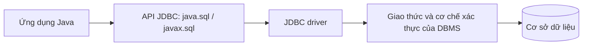

# Lựa chọn JDBC driver phù hợp với hệ quản trị và môi trường Java

## 1. Vì sao cần chọn đúng driver?

**JDBC (Java Database Connectivity)** là API chuẩn để ứng dụng Java làm việc với cơ sở dữ liệu quan hệ. Phần lớn mã ứng dụng dùng các kiểu trong `java.sql` và `javax.sql`, nhưng một **JDBC driver** cụ thể phải chuyển các lời gọi đó thành giao thức mà hệ quản trị cơ sở dữ liệu (DBMS) hiểu được.



Ví dụ, ứng dụng gọi `DriverManager.getConnection(...)` hoặc lấy `Connection` từ một `DataSource`. Driver quyết định cách thiết lập kết nối, xác thực, mã hóa đường truyền, chuyển `PreparedStatement` và đọc `ResultSet`. Dù cùng viết mã JDBC, PostgreSQL và SQL Server thường cần **hai driver khác nhau** vì giao thức và tính năng của máy chủ khác nhau.

Chọn driver chỉ theo tên cơ sở dữ liệu là chưa đủ. Một lựa chọn dùng được trong dự án thực tế phải đồng thời tương thích với:

1. **DBMS và phiên bản máy chủ**: PostgreSQL, MySQL, MariaDB, Oracle Database, SQL Server, v.v.
2. **JDK/JRE đang thực thi**: phiên bản Java mà driver hỗ trợ, không chỉ phiên bản Java dùng để biên dịch dự án.
3. **Nơi triển khai**: ứng dụng Java độc lập, Spring Boot, application server, container, cloud, native image hoặc hệ điều hành cụ thể.
4. **Yêu cầu vận hành**: TLS, cơ chế đăng nhập, connection pool, transaction, hiệu năng, bảo trì và chính sách cấp phép.

> **Mục tiêu bài học:** Sau khi học, bạn có thể chọn đúng họ driver, đọc ma trận tương thích, đưa driver vào runtime, chọn URL kết nối phù hợp và tự xác minh lựa chọn trên môi trường đích.

## 2. Hiểu các loại JDBC driver trước khi lựa chọn

Trong lịch sử, JDBC driver thường được phân thành bốn loại:

| Loại | Cách hoạt động | Khi nào cần cân nhắc? |
| --- | --- | --- |
| **Type 1 – JDBC–ODBC bridge** | Chuyển lệnh JDBC qua ODBC. | Giải pháp lịch sử; cầu nối JDBC–ODBC tích hợp đã bị loại khỏi JDK kể từ Java 8. Không nên chọn cho ứng dụng Java mới. |
| **Type 2 – Native API** | Driver Java gọi thư viện native của nhà cung cấp qua JNI hoặc cơ chế tương đương. | Khi nhà cung cấp yêu cầu native client hoặc cần tính năng riêng; phải kiểm tra OS, kiến trúc CPU, phiên bản thư viện và cách đóng gói. |
| **Type 3 – Network protocol/middleware** | Driver gửi yêu cầu tới tầng trung gian, tầng đó trao đổi với DBMS. | Chỉ thích hợp khi hệ thống có chủ đích sử dụng gateway/middleware và đã xác minh tương thích. |
| **Type 4 – Thin / pure Java** | Driver Java giao tiếp trực tiếp với giao thức mạng của DBMS. | Lựa chọn mặc định hợp lý cho phần lớn ứng dụng Java kết nối DBMS dạng máy chủ. |

**Quy tắc thực hành:** Ưu tiên driver Type 4 được nhà cung cấp hoặc cộng đồng dự án duy trì, có tài liệu tương thích rõ ràng. “Type 4” không đảm bảo mọi môi trường đều chạy được: vẫn phải kiểm tra phiên bản Java, tính năng xác thực, TLS và cách đóng gói. Đối với cơ sở dữ liệu **nhúng** như SQLite, một thư viện JDBC có thể dùng thư viện native đi kèm, nên cần xem hỗ trợ hệ điều hành/kiến trúc riêng thay vì máy móc áp dụng quy tắc Type 4.

## 3. Ghép đúng DBMS với họ JDBC driver

Bảng sau là các **tọa độ dependency và URL mẫu để nhận diện**, không khẳng định mọi phiên bản driver đều hỗ trợ mọi phiên bản DBMS/Java. Khi triển khai, hãy mở tài liệu của **phiên bản driver cụ thể** để kiểm tra phạm vi hỗ trợ.

| DBMS | Dependency Maven/Gradle thường dùng | Driver class khi cần chỉ định tường minh | Tiền tố JDBC URL | Điều cần kiểm tra thêm |
| --- | --- | --- | --- | --- |
| PostgreSQL | `org.postgresql:postgresql` | `org.postgresql.Driver` | `jdbc:postgresql:` | Phiên bản PostgreSQL server, TLS và loại xác thực. |
| MySQL | `com.mysql:mysql-connector-j` | `com.mysql.cj.jdbc.Driver` | `jdbc:mysql:` | Phiên bản MySQL server, authentication plugin, TLS và múi giờ. |
| MariaDB | `org.mariadb.jdbc:mariadb-java-client` | `org.mariadb.jdbc.Driver` | `jdbc:mariadb:` | Phiên bản MariaDB, giao thức, chế độ xác thực và độ tương thích với MySQL. |
| Microsoft SQL Server | `com.microsoft.sqlserver:mssql-jdbc` | `com.microsoft.sqlserver.jdbc.SQLServerDriver` | `jdbc:sqlserver:` | Bản build driver dành cho JRE, chính sách mã hóa và xác thực tích hợp. |
| Oracle Database | Chẳng hạn `com.oracle.database.jdbc:ojdbc11` | `oracle.jdbc.OracleDriver` | `jdbc:oracle:thin:` | Driver `ojdbc` phù hợp phiên bản Java; Thin/OCI, service name, ví hoặc TLS. |
| H2 (thường dùng khi test) | `com.h2database:h2` | `org.h2.Driver` | `jdbc:h2:` | Chế độ in-memory/file, tuổi đời dữ liệu và khác biệt SQL với DBMS production. |
| SQLite (cơ sở dữ liệu nhúng) | `org.xerial:sqlite-jdbc` | `org.sqlite.JDBC` | `jdbc:sqlite:` | Hệ điều hành/CPU, thư viện native, khóa ghi và đường dẫn file. |

**Các điểm dễ nhầm:**

- MySQL và MariaDB có quan hệ lịch sử gần gũi, nhưng **không mặc định thay thế driver của nhau**. Nếu chọn driver MariaDB để kết nối MySQL hoặc ngược lại, phải kiểm tra chính sách hỗ trợ của **phiên bản driver đang dùng**, URL mà driver chấp nhận và tính năng cụ thể của máy chủ.
- `ojdbc11` là ví dụ một **artifact** trong họ Oracle JDBC và hướng đến Java 11 trở lên; không thể suy ra rằng mọi artifact `ojdbc` đều dùng cho mọi JDK. Chọn theo ma trận do Oracle công bố cho từng bản phát hành.
- Driver SQL Server có thể phát hành các biến thể/build nhắm tới những phiên bản Java khác nhau. Kiểm tra artifact và yêu cầu runtime của **bản tải về**, thay vì chỉ nhìn tên `mssql-jdbc`.
- H2 và SQLite hữu ích cho test hoặc ứng dụng nhúng, nhưng **không phải bản sao tương đương** của PostgreSQL/MySQL/SQL Server về kiểu dữ liệu, cú pháp SQL, transaction và khóa.

### 3.1. Mẫu JDBC URL của từng hệ quản trị

```properties
# PostgreSQL
jdbc:postgresql://db.example.com:5432/appdb

# MySQL
jdbc:mysql://db.example.com:3306/appdb

# MariaDB
jdbc:mariadb://db.example.com:3306/appdb

# Microsoft SQL Server
jdbc:sqlserver://db.example.com:1433;databaseName=appdb

# Oracle Thin (service name: appdb)
jdbc:oracle:thin:@//db.example.com:1521/appdb

# H2 in-memory (phục vụ test)
jdbc:h2:mem:appdb;DB_CLOSE_DELAY=-1

# SQLite lưu trên file tương đối
jdbc:sqlite:./data/app.db
```

Các URL trên chỉ minh họa **cú pháp cơ bản**, không phải cấu hình bảo mật hoàn chỉnh. Tùy DBMS, cần khai báo thêm thuộc tính TLS, xác thực, encoding hoặc timeout theo tài liệu chính thức của driver. Tên host `db.example.com` và tên database `appdb` phải được thay bằng giá trị thực; với SQLite, cần kiểm tra thư mục chứa file và quyền đọc/ghi.

## 4. Đánh giá tương thích theo nhiều chiều

### 4.1. Phiên bản Java và mức JDBC API

JDK cung cấp **JDBC API**, còn JAR của driver là thành phần riêng được phân phối bởi nhà cung cấp. Hai yếu tố này không đồng nghĩa:

| Nền tảng Java | Phiên bản JDBC API được đưa vào nền tảng |
| --- | --- |
| Java 6 | JDBC 4.0 |
| Java 7 | JDBC 4.1 |
| Java 8 | JDBC 4.2 |
| Java 9 trở đi | JDBC 4.3 được giới thiệu từ Java 9; Java phiên bản mới tiếp tục cung cấp JDBC API. |

Một driver hỗ trợ “JDBC 4.2” không nhất thiết chạy được với mọi JDK có JDBC 4.2; nhà cung cấp còn quyết định **mức bytecode tối thiểu** và các thư viện phụ thuộc. Ví dụ, JAR được biên dịch cho Java mới hơn runtime có thể gây `UnsupportedClassVersionError` trước cả khi kết nối tới database.

Khi kiểm tra, hãy ghi riêng ba giá trị:

```text
JDK dùng để build:       ví dụ Java 21
JRE/JDK chạy production: ví dụ Java 17
Driver JAR được chọn:    bản phát hành có hỗ trợ Java 17
```

Đây là ví dụ về **hai môi trường cần đối chiếu**, không phải khuyến nghị biên dịch mã Java 21 rồi chạy trên Java 17: bytecode của ứng dụng cũng phải tương thích với runtime production (`--release` hoặc cấu hình toolchain thích hợp). Chỉ dùng cấu hình này khi đã quản lý tương thích cả ứng dụng lẫn driver.

### 4.2. Phiên bản DBMS và tính năng giao thức

Kiểm tra đúng **phiên bản server thực tế**, vì một hệ quản trị có thể thay đổi giao thức xác thực, thuật toán TLS mặc định hoặc đặc tính dữ liệu qua các bản phát hành. Với mỗi ứng viên driver, nên kiểm tra:

- Khoảng phiên bản server được nhà cung cấp driver công bố hỗ trợ; nếu server rất mới hoặc rất cũ, đừng dựa vào suy đoán rằng “cùng một DBMS thì sẽ kết nối được”.
- Phương thức đăng nhập: username/password, chứng thư khách hàng, Kerberos/SSO, token cloud/IAM hoặc driver-specific plugin.
- Hỗ trợ dữ liệu và API đang sử dụng: kiểu `TIMESTAMP WITH TIME ZONE`, `JSON`, UUID, ARRAY, LOB, batch, stored procedure, metadata và generated keys.
- Transaction, auto-commit, isolation level, savepoint; nếu cần transaction phân tán, kiểm tra **`XADataSource` thực sự được hỗ trợ**.

Khả năng mở kết nối thành công chỉ chứng minh phần đầu của tính tương thích. Một driver vẫn có thể sai khác khi ánh xạ dữ liệu hoặc thực thi một tính năng JDBC nâng cao.

### 4.3. Hệ điều hành, kiến trúc và cách chạy

Driver pure Java thường có tính di động cao, nhưng vẫn phải kiểm tra các trường hợp dưới đây:

| Môi trường | Câu hỏi kiểm tra |
| --- | --- |
| Máy chủ Windows/Linux/macOS | Driver hoặc cơ chế đăng nhập có cần DLL/SO/DYLIB hay native client không? |
| Docker/Kubernetes | Driver JAR có nằm trong **image chạy thực tế**? DNS, network policy, secret mount và chứng thư CA có được cấp đúng không? |
| Application server/Jakarta EE | Driver được cài ở classpath của ứng dụng hay vùng thư viện dùng chung? Server có quản lý `DataSource`/JTA riêng không? |
| Spring Boot | Driver có trên runtime classpath để `DataSource` nhận ra không? Cấu hình URL và pool có theo đúng loại database không? |
| JPMS (`module-info.java`) | Ứng dụng đã `requires java.sql;` và module chứa driver đã được resolve để service loader có thể nhìn thấy chưa? |
| GraalVM native image | Bản driver và cấu hình reflection/resources/native library có được hỗ trợ khi đóng gói native image không? |
| Cơ sở dữ liệu nhúng | Driver có phụ thuộc native binary đúng OS/CPU và có quyền truy cập file database không? |

Với ứng dụng dùng container, `localhost` trong JDBC URL là **chính container chạy ứng dụng**, không mặc định là máy chủ database. Thông thường cần hostname theo service/DNS trong mạng triển khai. Đây là lỗi cấu hình địa chỉ, không phải dấu hiệu phải thay driver.

### 4.4. Bảo mật và vòng đời bảo trì

Một driver phù hợp còn phải cho phép triển khai theo chính sách bảo mật:

- **TLS có kiểm tra chứng thư và tên máy chủ** khi hạ tầng yêu cầu. Chế độ chỉ mã hóa mà bỏ qua kiểm tra danh tính server không tương đương với xác minh đầy đủ.
- Không hard-code mật khẩu trong source, không commit URL có chứa mật khẩu vào Git, không ghi bí mật vào log. Lấy thông tin xác thực từ cơ chế quản lý secret của môi trường.
- Kiểm tra bản vá, lịch hỗ trợ, giấy phép sử dụng, nguồn phát hành và các cảnh báo bảo mật của đúng artifact/version.
- Chỉ bật các lựa chọn bỏ qua xác minh chứng thư trong tình huống test cô lập đã được kiểm soát; chúng không phải “cách sửa” mặc định cho lỗi TLS.

## 5. Quy trình chọn driver có thể lặp lại

Giả sử yêu cầu là: *dịch vụ Java sử dụng PostgreSQL, chạy trên JDK 17 trong container, kết nối bằng TLS và connection pool*. Một quy trình lựa chọn có căn cứ gồm:

1. **Khóa yêu cầu đầu vào.** Ghi tên DBMS, phiên bản server, phiên bản Java chạy production, OS/CPU và tính năng cần sử dụng (TLS, kiểu dữ liệu, pool, transaction).
2. **Tìm driver được hỗ trợ.** Với PostgreSQL, bắt đầu từ `org.postgresql:postgresql`; đối chiếu bảng phiên bản được hỗ trợ ở tài liệu phát hành của PostgreSQL JDBC driver.
3. **Chọn phiên bản cụ thể.** Chọn bản được duy trì, tương thích với Java 17 và server. Ghi phiên bản vào hệ thống quản lý dependency để build tái lập được; tránh version động trong production.
4. **Đọc hướng dẫn TLS/xác thực.** Chọn chế độ xác minh chứng thư và nguồn CA phù hợp; cấu hình secret bằng cơ chế của môi trường chạy.
5. **Đưa JAR vào runtime.** Kiểm tra dependency scope và artifact xuất hiện trong image/JAR triển khai, kể cả trường hợp fat JAR hoặc module path.
6. **Kiểm chứng với server thật.** Chạy thử kết nối, `SELECT 1`, đọc metadata, thử một transaction và tính năng đặc thù nếu ứng dụng cần.
7. **Ghi lại quyết định.** Lưu DBMS version, Java version, tọa độ driver, lý do chọn, cấu hình TLS và bằng chứng test để có thể nâng cấp có kiểm soát.

Một bảng quyết định nhỏ giúp tránh chọn theo cảm tính:

| Tiêu chí | Điều kiện đạt | Bằng chứng cần có |
| --- | --- | --- |
| Đúng DBMS | Driver hỗ trợ giao thức của server đích | Tài liệu driver + test kết nối |
| Đúng Java | Runtime không thấp hơn mức Java driver yêu cầu | Release notes + chạy thử trên runtime đích |
| Đúng tính năng | Authentication, TLS, transaction và kiểu dữ liệu cần dùng hoạt động | Test tích hợp có dữ liệu đại diện |
| Đúng môi trường | Dependency, chứng thư, DNS và thư viện native (nếu có) được đóng gói đầy đủ | Test với artifact/image sẽ triển khai |
| Duy trì được | Version được quản lý, có bản vá, thỏa giấy phép | Danh sách dependency và quy trình cập nhật |

## 6. Khai báo dependency và nạp driver

### 6.1. Gradle

Ví dụ Gradle Kotlin DSL cho PostgreSQL:

```kotlin
dependencies {
    // Thay VERSION_DA_XAC_MINH bằng phiên bản cụ thể hỗ trợ DBMS và JDK đích.
    runtimeOnly("org.postgresql:postgresql:VERSION_DA_XAC_MINH")
}
```

Ví dụ Gradle Groovy DSL:

```groovy
dependencies {
    runtimeOnly 'org.postgresql:postgresql:VERSION_DA_XAC_MINH'
}
```

Các chuỗi `VERSION_DA_XAC_MINH` là **chỗ trống hướng dẫn**, cần thay bằng version thật trước khi chạy build. `runtimeOnly` thường đủ khi mã ứng dụng chỉ sử dụng `java.sql`/`javax.sql` và không import lớp của PostgreSQL. Nếu mã nguồn gọi API riêng như `org.postgresql.PGConnection`, dependency phải có mặt ở **compile classpath** (`implementation` hoặc cấu hình tương đương).

### 6.2. Maven

```xml
<dependency>
    <groupId>org.postgresql</groupId>
    <artifactId>postgresql</artifactId>
    <version>${postgresql.jdbc.version}</version>
    <scope>runtime</scope>
</dependency>
```

Thuộc tính `postgresql.jdbc.version` phải được khai báo trong POM/parent POM hoặc dependency management tương ứng. Khi đổi DBMS, thay đúng artifact và kiểm tra lại URL, TLS, cấu hình máy chủ; chỉ đổi URL mà giữ nguyên driver thường là chưa đủ.

### 6.3. JDBC 4 và cơ chế tự đăng ký driver

Driver JDBC hiện đại thường công bố provider trong `META-INF/services/java.sql.Driver`. `DriverManager` dùng cơ chế **Service Provider** để khám phá driver có trong runtime; vì vậy, với các driver tuân thủ JDBC 4+, đa số ứng dụng **không cần gọi**:

```java
Class.forName("org.postgresql.Driver"); // Thường không cần với JDBC 4+.
```

Việc tự đăng ký thành công vẫn phụ thuộc vào runtime classpath/module path và cách đóng gói. Khi tạo **shaded/fat JAR**, cần bảo toàn hoặc gộp đúng các tệp `META-INF/services`; nếu bị mất, có thể gặp lỗi *No suitable driver* mặc dù thấy lớp driver trong JAR.

Với JPMS, module của ứng dụng dùng JDBC cần khai báo:

```java
module com.example.app {
    requires java.sql;
}
```

Nếu đưa driver lên module path, cần chắc chắn module provider được **resolve** và khai báo dịch vụ hợp lệ; tên module phụ thuộc artifact/version. Không tự suy tên module chỉ từ `groupId:artifactId`.

## 7. Kiểm chứng bằng ứng dụng Java nhỏ

Đặt `JDBC_URL`, `JDBC_USER` và `JDBC_PASSWORD` trong môi trường chạy, rồi dùng đoạn mã sau. Các biến user/password là tùy chọn để ví dụ cũng chạy được với những driver không yêu cầu đăng nhập, nhưng cơ sở dữ liệu server thường sẽ yêu cầu chúng.

```java
import java.sql.Connection;
import java.sql.DatabaseMetaData;
import java.sql.DriverManager;
import java.sql.ResultSet;
import java.sql.SQLException;
import java.sql.Statement;
import java.util.Properties;

public final class JdbcDriverProbe {
    public static void main(String[] args) throws SQLException {
        String url = System.getenv("JDBC_URL");
        if (url == null || url.isBlank()) {
            throw new IllegalArgumentException("Thiếu JDBC_URL");
        }

        Properties properties = new Properties();
        String user = System.getenv("JDBC_USER");
        String password = System.getenv("JDBC_PASSWORD");
        if (user != null) {
            properties.setProperty("user", user);
        }
        if (password != null) {
            properties.setProperty("password", password);
        }

        try (Connection connection = DriverManager.getConnection(url, properties);
             Statement statement = connection.createStatement();
             ResultSet result = statement.executeQuery("SELECT 1")) {

            DatabaseMetaData meta = connection.getMetaData();
            System.out.println("DBMS: " + meta.getDatabaseProductName()
                    + " " + meta.getDatabaseProductVersion());
            System.out.println("Driver: " + meta.getDriverName()
                    + " " + meta.getDriverVersion());
            System.out.println("JDBC API: " + meta.getJDBCMajorVersion()
                    + "." + meta.getJDBCMinorVersion());

            if (result.next()) {
                System.out.println("SELECT 1 = " + result.getInt(1));
            }
        }
    }
}
```

**Ý nghĩa kết quả:** Nếu chương trình mở kết nối, in đúng tên DBMS/driver và nhận `SELECT 1 = 1`, ta đã xác minh được driver được nạp và một truy vấn cơ bản hoạt động. Tuy nhiên, **đây chưa phải kiểm thử toàn bộ tính tương thích**. Hãy chạy trên JDK/image đích và bổ sung test cho TLS, quyền truy cập, prepared statement, kiểu dữ liệu, transaction, pool và các tính năng thật sự sử dụng. `SELECT 1` phù hợp các DBMS phổ biến trong bảng trên; một DBMS khác có thể cần cú pháp health-check riêng.

Ví dụ kiểm thử tiếp theo cho transaction: mở kết nối, tắt auto-commit, thực hiện một `INSERT` vào **bảng test**, kiểm tra dữ liệu trong cùng transaction rồi `rollback()`. Không thử thao tác ghi lên dữ liệu production chỉ để kiểm tra driver.

## 8. Kết nối trực tiếp hay qua `DataSource`?

| Cách dùng | Trường hợp phù hợp | Lưu ý |
| --- | --- | --- |
| `DriverManager.getConnection(...)` | Ví dụ học tập, script quản trị, kiểm tra nhanh driver. | Mỗi lần gọi có thể tạo kết nối vật lý mới; tự quản lý tài nguyên với `try-with-resources`. |
| `DataSource` của connection pool (như HikariCP) | Dịch vụ web/API có nhiều request và cần tái sử dụng kết nối. | Driver phải tương thích với pool; kiểm tra max pool size, timeout, validation, tuổi thọ kết nối và giới hạn DB server. |
| `DataSource` do application server cấp | Ứng dụng triển khai trên server quản lý kết nối/JTA. | Phối hợp vị trí cài JAR, JNDI, transaction và classloader theo hướng dẫn server. |

Driver và pool có **vai trò khác nhau**: driver nói chuyện với DBMS; pool tái sử dụng và quản lý vòng đời kết nối. Thêm pool không sửa được lỗi chọn sai driver. Trong ứng dụng Spring Boot, nên để cơ chế cấu hình `DataSource` của framework quản lý pool theo nhu cầu, đồng thời vẫn xác minh driver có mặt ở runtime.

## 9. Chẩn đoán lỗi do driver hay do môi trường?

| Triệu chứng | Nguyên nhân thường gặp | Hướng kiểm tra đầu tiên |
| --- | --- | --- |
| `No suitable driver found for jdbc:...` | Thiếu JAR khi chạy, URL không thuộc driver, service metadata bị mất hoặc module chưa resolve. | So runtime classpath/module path, tiền tố URL và `META-INF/services`. |
| `ClassNotFoundException` với tên driver | Lớp driver không có trong runtime hoặc tên class cũ/sai. | Kiểm tra artifact, version, tên class theo tài liệu. |
| `UnsupportedClassVersionError` | Driver hoặc ứng dụng biên dịch cho Java mới hơn runtime. | Đối chiếu mức Java của JAR và `java -version` trong môi trường chạy. |
| `NoClassDefFoundError` | Thiếu một dependency hoặc thư viện cần khi nạp driver. | Kiểm tra dependency tree và nội dung gói triển khai. |
| Connection refused / timeout | DB chưa lắng nghe, sai host/port, firewall, DNS hoặc network policy. | Thử độ thông suốt mạng từ **nơi chạy ứng dụng**; kiểm tra cấu hình server. |
| TLS handshake / certificate validation failed | CA không tin cậy, chứng thư hết hạn hoặc tên host không khớp. | Kiểm tra chứng thư, truststore, DNS và chế độ TLS; không vô hiệu hóa xác minh để che lỗi. |
| Authentication failed / access denied | Sai secret, thiếu quyền hoặc driver/server không thống nhất cơ chế xác thực. | Đối chiếu tài khoản, phương thức xác thực và server logs. |
| Kết nối được nhưng dữ liệu/transaction sai khác | Driver không hỗ trợ đủ tính năng, SQL khác DBMS hoặc cấu hình session không phù hợp. | Kiểm thử tích hợp với schema và luồng truy vấn thực tế. |

Để phân biệt nguyên nhân, nên chẩn đoán theo thứ tự: **nạp JAR → nhận URL → kết nối mạng → TLS → xác thực → truy vấn → hành vi nghiệp vụ**. Đổi driver một cách ngẫu nhiên thường khiến lỗi cấu hình khó truy vết hơn. Khi cần báo lỗi, ghi `SQLState`, mã lỗi của nhà cung cấp và log đã loại bỏ dữ liệu nhạy cảm; tránh in mật khẩu, token hoặc toàn bộ connection URL nếu URL chứa bí mật.

## 10. Tình huống thực hành: chọn driver theo ba môi trường

**Tình huống A — Dịch vụ PostgreSQL trên Java 17 trong Kubernetes.** Chọn `org.postgresql:postgresql` với phiên bản được công bố hỗ trợ JDK 17 và PostgreSQL server đang vận hành. Đóng gói JAR vào image, dùng tên DNS của database service, cấu hình TLS có xác minh chứng thư, truyền secret an toàn và kiểm thử kết nối qua `DataSource` của ứng dụng. Không lấy việc kết nối thành công trên laptop làm bằng chứng image production sẽ chạy.

**Tình huống B — SQL Server trong doanh nghiệp dùng đăng nhập tích hợp.** Xem `com.microsoft.sqlserver:mssql-jdbc`, kiểm tra bản driver dành cho runtime Java mục tiêu và cơ chế xác thực mà tổ chức yêu cầu (chẳng hạn Kerberos hoặc tích hợp hệ điều hành). Có trường hợp cần cấu hình/native component bổ sung; phải xác minh theo hướng dẫn của đúng phiên bản driver và OS. Kiểm tra chứng thư TLS và server identity trước khi đưa vào production.

**Tình huống C — Test repository trên máy lập trình.** Có thể dùng H2 in-memory để thử nhanh phần JDBC cơ bản, nhưng nếu production là PostgreSQL thì các truy vấn liên quan JSON, locking, index, kiểu dữ liệu hoặc transaction nên có **test tích hợp trên PostgreSQL thực** (ví dụ môi trường database tạm dành cho test). Driver H2 không xác nhận tính đúng đắn của hành vi đặc thù PostgreSQL.

## 11. Checklist trước khi chốt quyết định

- [ ] Ghi chính xác **DBMS và phiên bản server**; không chỉ ghi “SQL database”.
- [ ] Ghi **JDK/JRE production**, OS/CPU và kiểu đóng gói (JAR, container, app server, native image).
- [ ] Xác minh tài liệu tương thích của **artifact và version driver cụ thể** đối với DBMS/JDK.
- [ ] Kiểm tra TLS, xác thực, chứng thư, license và trạng thái bảo trì/cập nhật bảo mật.
- [ ] Bảo đảm driver hiện diện trên **runtime classpath/module path**, kể cả sau khi đóng gói.
- [ ] Kiểm tra URL đúng cú pháp driver, đúng host/port/service/database và không chứa secret cố định.
- [ ] Test trên môi trường giống production: kết nối, `SELECT 1`, prepared statement, transaction và dữ liệu đặc thù.
- [ ] Lưu lại version driver đã chọn và kết quả kiểm chứng để nâng cấp có thể truy vết.

**Ghi nhớ:** JDBC giúp mã Java giao tiếp với nhiều hệ quản trị qua cùng một API; **driver cụ thể** mới quyết định khả năng giao tiếp với server và runtime thực tế. Hãy chọn theo **DBMS + version server + Java runtime + yêu cầu triển khai/bảo mật**, sau đó kiểm chứng bằng test trên môi trường đích.
