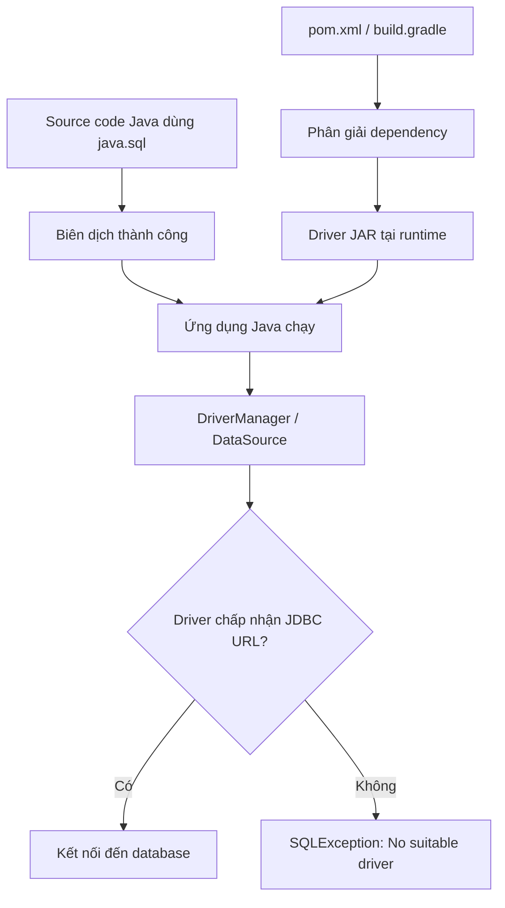
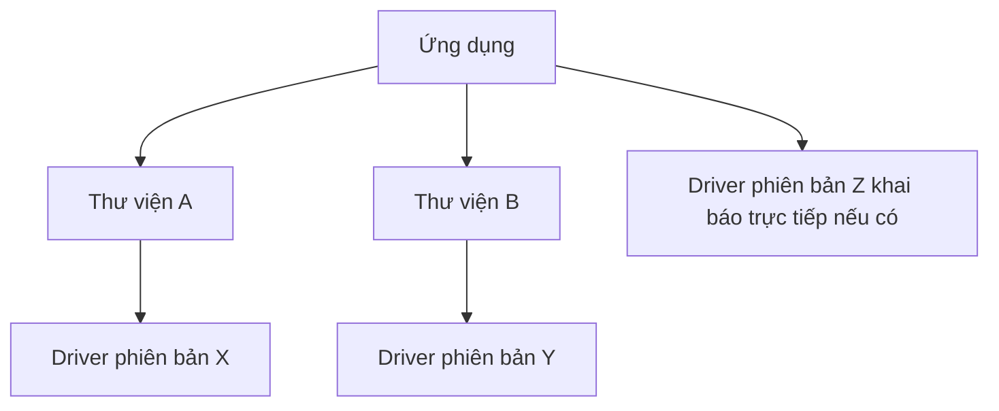

# Khai báo dependency driver và quản lý xung đột phiên bản trong JDBC

Trong chương **Driver và cấu hình**, một yêu cầu nền tảng của JDBC là khai báo đúng thư viện điều khiển cơ sở dữ liệu (*JDBC driver*) và kiểm soát phiên bản của nó xuyên suốt quá trình phát triển, xây dựng và triển khai ứng dụng. **JDBC (Java Database Connectivity)** là API chuẩn của Java để truy cập cơ sở dữ liệu quan hệ. API chuẩn định nghĩa `Connection`, `DriverManager`, `PreparedStatement` và `ResultSet`, nhưng phần giao tiếp với PostgreSQL, MySQL, SQL Server hoặc hệ quản trị cụ thể phải do driver tương ứng thực hiện.

Một dự án có thể **biên dịch thành công nhưng thất bại ngay khi mở kết nối** vì JDBC driver không nằm trên runtime classpath, URL không được driver nhận diện, driver không tương thích với JDK/server hoặc một dependency khác khiến phiên bản thư viện thực tế khác với kỳ vọng. Bài này hướng dẫn nhận diện và giải quyết những trường hợp đó bằng cách quản lý dependency có hệ thống.

## 1. JDBC API và JDBC driver là hai thành phần khác nhau

Ví dụ chương trình Java sử dụng hoàn toàn các kiểu chuẩn:

```java
import java.sql.Connection;
import java.sql.DriverManager;
import java.sql.SQLException;

public class DatabaseDemo {
    public static void main(String[] args) throws SQLException {
        String url = System.getenv("JDBC_URL");
        String user = System.getenv("DB_USER");
        String password = System.getenv("DB_PASSWORD");

        try (Connection connection =
                     DriverManager.getConnection(url, user, password)) {
            System.out.println(
                    connection.getMetaData().getDatabaseProductName());
        }
    }
}
```

Các lớp `java.sql` đã có trong Java SE. Tuy nhiên, khi `JDBC_URL` mang giá trị `jdbc:postgresql://localhost:5432/appdb`, chương trình còn cần **PostgreSQL JDBC driver** trong môi trường chạy. JDK không tự đóng gói driver cho mọi hệ quản trị bên ngoài.

| Thành phần | Nơi cung cấp | Vai trò |
| --- | --- | --- |
| `java.sql` và `javax.sql` | Java SE | Giao diện và hợp đồng JDBC chung. |
| JDBC driver | Thư viện của nhà phát hành | Hiểu URL và giao tiếp với hệ quản trị dữ liệu. |
| JDBC URL | Cấu hình ứng dụng | Xác định loại driver và database đích. |
| Build tool | Maven/Gradle | Tải dependency, phân giải phiên bản và tạo runtime classpath. |
| Database | Hệ quản trị cụ thể | Xác thực, xử lý SQL và quản lý dữ liệu. |



**Phân biệt hai thời điểm:** *compile time* cần các kiểu được source code tham chiếu; *runtime* cần mọi lớp thật sự phải được tải để kết nối. Driver chỉ dùng qua SPI/JDBC API thường không cần trên compile classpath, nhưng cần trên runtime classpath.

## 2. Chọn dependency và JDBC URL đúng nhà cung cấp

Một số tọa độ Maven phổ biến:

| Hệ cơ sở dữ liệu | Dependency `groupId:artifactId` | Ví dụ JDBC URL |
| --- | --- | --- |
| PostgreSQL | `org.postgresql:postgresql` | `jdbc:postgresql://localhost:5432/appdb` |
| MySQL | `com.mysql:mysql-connector-j` | `jdbc:mysql://localhost:3306/appdb` |
| MariaDB | `org.mariadb.jdbc:mariadb-java-client` | `jdbc:mariadb://localhost:3306/appdb` |
| SQL Server | `com.microsoft.sqlserver:mssql-jdbc` | `jdbc:sqlserver://localhost:1433;databaseName=appdb` |
| H2 | `com.h2database:h2` | `jdbc:h2:mem:testdb` |
| SQLite | `org.xerial:sqlite-jdbc` | `jdbc:sqlite:./data/app.db` |

Đây là ví dụ **tọa độ thư viện** và **URL**, không phải danh sách phiên bản được khuyến nghị. Mỗi driver có lịch phát hành, yêu cầu Java tối thiểu, hệ quản trị được hỗ trợ, quy tắc SSL/TLS và tham số URL riêng. Một số hệ thống đòi thư viện bổ sung hoặc cấu hình native; cần tra tài liệu của đúng driver đang sử dụng.

Có thể khai báo nhiều driver nếu ứng dụng thật sự làm việc với nhiều hệ cơ sở dữ liệu. Tuy nhiên, thư viện không dùng đến sẽ làm tăng dependency và có thể gây khó khăn khi chẩn đoán driver nào được đăng ký/nhận URL.

## 3. Khai báo JDBC driver bằng Maven

Maven quản lý thư viện qua `pom.xml`, xác định bằng `groupId`, `artifactId` và `version`. Ví dụ ứng dụng Java 17 dùng API JDBC chuẩn và kết nối PostgreSQL:

```xml
<project xmlns="http://maven.apache.org/POM/4.0.0"
         xmlns:xsi="http://www.w3.org/2001/XMLSchema-instance"
         xsi:schemaLocation="http://maven.apache.org/POM/4.0.0
                             https://maven.apache.org/xsd/maven-4.0.0.xsd">
    <modelVersion>4.0.0</modelVersion>
    <groupId>example</groupId>
    <artifactId>jdbc-driver-demo</artifactId>
    <version>1.0.0</version>

    <properties>
        <maven.compiler.release>17</maven.compiler.release>
    </properties>

    <dependencies>
        <dependency>
            <groupId>org.postgresql</groupId>
            <artifactId>postgresql</artifactId>
            <version>VERSION_DA_CHON</version>
            <scope>runtime</scope>
        </dependency>
    </dependencies>
</project>
```

Phải thay `VERSION_DA_CHON` bằng **phiên bản thật** tương thích với JDK và database trước khi chạy. Cố ý không gắn một số phiên bản “mới nhất” cố định vào bài vì yêu cầu hỗ trợ và khuyến nghị bảo mật thay đổi theo thời gian.

### Hiểu `scope` trong Maven

| Scope | Biên dịch | Runtime | Dùng trong trường hợp nào |
| --- | --- | --- | --- |
| `compile` (mặc định) | Có | Có | Source code gọi trực tiếp kiểu do driver cung cấp, hoặc dependency cần trong cả hai giai đoạn. |
| `runtime` | Không | Có | Source code chỉ gọi `java.sql`, driver được tìm và tải khi chạy. |
| `test` | Cho test | Chỉ trong test | Driver chỉ phục vụ unit/integration test, chẳng hạn H2 trong một module thử nghiệm. |
| `provided` | Có | Thông thường không được đóng gói như runtime dependency | Runtime/container được kỳ vọng cung cấp thư viện; phải xác minh môi trường thật. |

Nếu code dùng `DriverManager` với các kiểu `java.sql.*`, `runtime` thường phù hợp. Nếu code import một kiểu vendor như `org.postgresql.PGConnection`, dependency cần có khi **biên dịch**; `runtime` riêng lẻ không đủ.

Không lạm dụng `provided` để giảm kích thước artifact: nếu container không thực sự cung cấp JDBC driver và classloader không truy cập được, ứng dụng vẫn lỗi ở runtime.

### Quản lý phiên bản tập trung bằng `dependencyManagement`

Trong parent POM:

```xml
<dependencyManagement>
    <dependencies>
        <dependency>
            <groupId>org.postgresql</groupId>
            <artifactId>postgresql</artifactId>
            <version>VERSION_DA_CHON</version>
        </dependency>
    </dependencies>
</dependencyManagement>
```

Trong module sử dụng driver:

```xml
<dependencies>
    <dependency>
        <groupId>org.postgresql</groupId>
        <artifactId>postgresql</artifactId>
        <scope>runtime</scope>
    </dependency>
</dependencies>
```

`dependencyManagement` **quản lý phiên bản** nhưng tự nó không đưa driver vào ứng dụng. Module vẫn cần khai báo `dependency` hoặc có dependency thích hợp kéo theo thư viện ấy.

### Kiểm tra dependency Maven

```bash
mvn dependency:tree
mvn dependency:tree -Dincludes=org.postgresql:postgresql
mvn dependency:build-classpath
```

`dependency:tree` giúp tìm driver trực tiếp và các dependency bắc cầu. `build-classpath` cho thấy classpath Maven có thể dựng, nhưng vẫn cần kiểm tra artifact hoặc image **thực tế được deploy**.

## 4. Khai báo JDBC driver bằng Gradle

Với Gradle Kotlin DSL (`build.gradle.kts`):

```kotlin
plugins {
    java
    application
}

repositories {
    mavenCentral()
}

dependencies {
    runtimeOnly("org.postgresql:postgresql:VERSION_DA_CHON")
}

application {
    mainClass.set("example.DatabaseDemo")
}
```

Với Gradle Groovy DSL (`build.gradle`):

```groovy
plugins {
    id 'java'
    id 'application'
}

repositories {
    mavenCentral()
}

dependencies {
    runtimeOnly 'org.postgresql:postgresql:VERSION_DA_CHON'
}

application {
    mainClass = 'example.DatabaseDemo'
}
```

Với cả hai kiểu cú pháp, phải thay `VERSION_DA_CHON` bằng một phiên bản driver cụ thể, hợp lệ và đã xác minh hỗ trợ hệ thống.

Các cấu hình thường gặp:

- `runtimeOnly`: có ở runtime, không nằm trên compile classpath của source chính.
- `implementation`: dùng khi source chính cần lớp hoặc API của driver khi biên dịch.
- `testRuntimeOnly`: chỉ cung cấp driver khi chạy test; không đưa driver vào runtime của ứng dụng chính.

Ví dụ cần API PostgreSQL đặc thù:

```kotlin
dependencies {
    implementation("org.postgresql:postgresql:VERSION_DA_CHON")
}
```

Để xem driver được chọn ở runtime:

```bash
./gradlew dependencies --configuration runtimeClasspath
./gradlew dependencyInsight --configuration runtimeClasspath --dependency postgresql
```

Trên Windows PowerShell:

```powershell
.\gradlew.bat dependencies --configuration runtimeClasspath
.\gradlew.bat dependencyInsight --configuration runtimeClasspath --dependency postgresql
```

`dependencyInsight` đặc biệt hữu ích khi một thư viện khác cũng kéo theo driver. Nó giúp hiểu phiên bản cuối cùng và lý do Gradle chọn nó theo các quy tắc phân giải hiện hành.

## 5. Driver phải có mặt trong runtime thật

Chỉ thấy tên dependency trong file cấu hình build chưa chứng minh driver đã đến đúng nơi cần chạy.

| Nơi chạy | Điều phải kiểm tra |
| --- | --- |
| IDE | Runtime classpath của run configuration có driver đúng phiên bản. |
| `mvn exec:java` / `gradlew run` | Plugin và cấu hình chạy sử dụng runtime dependencies. |
| `java -cp` thủ công | Driver JAR và dependency cần thiết nằm trong classpath. |
| JAR phát hành | Build có lắp ghép/đóng gói dependency theo cách loader nhận được. |
| Docker/Kubernetes | Image đang deploy chứa đúng artifact và runtime classpath. |
| Servlet container/application server | Classloader có thể thấy driver, không bị trùng JAR ở tầng container và ứng dụng. |
| JPMS module path | Module ứng dụng và driver được phân giải/tải theo cơ chế module phù hợp. |

Lệnh build JAR thông thường **không tự động nhúng toàn bộ dependency vào JAR**. Một chương trình chạy được trong IDE nhưng lỗi khi copy một JAR trần lên server là tình huống phổ biến.

Ví dụ classpath thủ công trên Linux/macOS (giả định `lib/` chứa các runtime JAR):

```bash
java -cp "app.jar:lib/*" example.DatabaseDemo
```

Trên Windows:

```powershell
java -cp "app.jar;lib/*" example.DatabaseDemo
```

Dấu phân cách classpath khác nhau theo nền tảng. Trường hợp ứng dụng Spring Boot hoặc một bản phân phối có launcher riêng phải sử dụng cơ chế đóng gói và khởi chạy do framework/build cung cấp, thay vì áp dụng máy móc ví dụ trên.

## 6. JDBC driver được phát hiện tự động ra sao?

Từ JDBC 4.0, các driver hiện đại thường công bố **Service Provider** trong JAR. Java có thể tìm các triển khai `java.sql.Driver` thông qua metadata và đăng ký với `DriverManager` nếu driver được tải trong runtime phù hợp.

Với PostgreSQL driver hiện đại, mã thường chỉ cần:

```java
try (Connection connection =
             DriverManager.getConnection(
                     "jdbc:postgresql://localhost:5432/appdb",
                     System.getenv("DB_USER"),
                     System.getenv("DB_PASSWORD"))) {
    System.out.println("Kết nối thành công");
}
```

Việc gọi thủ công:

```java
Class.forName("org.postgresql.Driver");
```

thường **không bắt buộc** trong dự án JDBC hiện đại. Nó có thể hỗ trợ một số môi trường/driver cũ, nhưng không tải được JAR vốn không có trong runtime. Khi `Class.forName` thất bại, mã còn có thể phát sinh `ClassNotFoundException`.

### Liệt kê các driver JDBC đã đăng ký

```java
import java.sql.Driver;
import java.sql.DriverManager;
import java.util.Enumeration;

public class ListDrivers {
    public static void main(String[] args) {
        Enumeration<Driver> drivers = DriverManager.getDrivers();

        while (drivers.hasMoreElements()) {
            Driver driver = drivers.nextElement();
            System.out.println(driver.getClass().getName());
        }
    }
}
```

Kết quả phụ thuộc vào những driver **đã đăng ký và nhìn thấy được** trong ngữ cảnh classloader của mã gọi. Danh sách không đại diện cho mọi file JAR có trên ổ đĩa. Nếu ứng dụng dùng nhiều classloader hoặc container, driver có thể hiện diện nhưng không được `DriverManager` ở một nơi cụ thể nhìn thấy.

### Fat JAR, shading và `META-INF/services`

Nhiều driver công bố metadata dạng:

```text
META-INF/services/java.sql.Driver
```

Khi tạo fat/uber JAR bằng cách gộp các JAR, các file service metadata cùng đường dẫn có thể bị mất hoặc ghi đè. Lúc đó class driver vẫn nằm trong archive nhưng cơ chế phát hiện tự động có thể hỏng. Nếu dùng Maven Shade hoặc Gradle Shadow, cần cấu hình cơ chế **merge service providers** thích hợp, rồi kiểm tra artifact sau đóng gói.

Nếu ứng dụng dùng JPMS, mã truy cập JDBC thường cần `requires java.sql;`. Việc đưa driver lên module path phải bảo đảm driver được phân giải và đăng ký đúng. Chuyển từ classpath sang module path có thể làm thay đổi hành vi nạp lớp; cần thử trong cấu hình chạy thực tế.

## 7. Vì sao xảy ra xung đột phiên bản?

Xét một ứng dụng có hai dependency bắc cầu:



Cùng tọa độ driver có thể được các dependency yêu cầu ở nhiều phiên bản. Maven và Gradle phải **phân giải** các yêu cầu đó cho một classpath/configuration.

### Maven phân giải như thế nào?

Maven thường dùng cơ chế *nearest definition*: dependency gần dự án gốc hơn trong đồ thị có thể được ưu tiên. Khi khoảng cách như nhau, thứ tự khai báo có thể ảnh hưởng kết quả. `dependencyManagement` cho phép kiểm soát phiên bản tập trung, giảm bất ngờ từ dependency bắc cầu.

### Gradle phân giải như thế nào?

Gradle trong tình huống xung đột thông thường có xu hướng chọn phiên bản mới hơn được yêu cầu. Tuy nhiên, version constraints, platform/BOM, strict versions, dependency locking hoặc resolution strategy có thể thay đổi kết quả. Vì thế phải đọc `dependencyInsight` để xác định chính xác phiên bản được chọn.

**Không nên nhầm hai phiên bản được yêu cầu trong cây dependency với hai phiên bản chắc chắn cùng được nạp.** Với cùng một module trong một configuration, build tool thông thường chọn một phiên bản. Nhưng các JAR được sao chép thủ công, dependency đổi tên/tọa độ, shading, hoặc classloader tách biệt vẫn có thể làm nhiều bản lớp tương tự hiện diện ở runtime.

### Bảng các dạng xung đột

| Tình huống | Dấu hiệu | Cách xử lý |
| --- | --- | --- |
| Driver bị phụ thuộc bắc cầu kéo về phiên bản khác | Tree/insight cho thấy nhiều version requests. | Chọn version có kiểm chứng và quản lý tập trung. |
| Driver được build cho JDK cao hơn runtime | `UnsupportedClassVersionError`. | Dùng JDK phù hợp hoặc bản driver hỗ trợ runtime. |
| Driver và server không tương thích | Lỗi giao thức, auth hoặc tính năng ở kết nối. | Đối chiếu tài liệu tương thích driver–database. |
| Lớp bị thay bằng API không tương thích | `NoSuchMethodError`, `AbstractMethodError`. | Xem stack trace, runtime classes và dependency resolution. |
| Thiếu thư viện đi kèm driver | `ClassNotFoundException`, `NoClassDefFoundError`. | Kiểm tra runtime transitive dependencies và packaging. |
| Có driver cũ trong container | IDE chạy được nhưng server lỗi/đặc tính khác. | Kiểm tra thứ tự và phạm vi classloader, xóa sự trùng lặp đúng ownership. |
| Mất thông tin SPI khi shade | Driver class tồn tại nhưng không được tự phát hiện. | Hợp nhất `META-INF/services` đúng cách. |

Lỗi **xác thực sai**, **sai hostname**, **port bị chặn**, **cấu hình SSL/TLS** cũng có thể xuất hiện sau khi thay driver, nhưng không tự động chứng minh đang có xung đột phiên bản.

## 8. Chẩn đoán các lỗi runtime phổ biến

### `No suitable driver found`

Ví dụ:

```text
java.sql.SQLException:
No suitable driver found for jdbc:postgresql://localhost:5432/appdb
```

Trước tiên kiểm tra: driver đã khai báo? Driver JAR có ở **runtime**? URL đúng prefix? Driver đã đăng ký qua SPI? Fat JAR có giữ file service? Classloader có nhìn thấy driver? Đổi mật khẩu sẽ không giúp nếu `DriverManager` chưa xác định được driver.

### `ClassNotFoundException` và `NoClassDefFoundError`

`ClassNotFoundException` có thể xảy ra khi cố `Class.forName` một driver không có trên classpath. `NoClassDefFoundError` thường cho thấy một lớp từng được tham chiếu không thể được tìm/tải hoặc khởi tạo thành công ở runtime. Cần xem tên lớp và chuỗi nguyên nhân, vì thư viện bị thiếu có thể là dependency phụ của driver.

### `UnsupportedClassVersionError`

Đây thường là lỗi **bytecode class không tương thích Java runtime**. Dự án biên dịch bằng JDK mới nhưng môi trường deploy dùng JRE/JDK cũ, hoặc driver yêu cầu Java mới hơn. Hãy kiểm tra `java -version` ở đúng nơi chạy và tài liệu phiên bản của driver.

### `NoSuchMethodError` hoặc `AbstractMethodError`

Những lỗi này có thể phát sinh khi source/library được biên dịch với một API nhưng lúc chạy nạp class khác phiên bản hoặc implementation chưa hỗ trợ phương thức. Không đoán driver ngay: hãy tìm lớp và method trong stack trace, rồi đối chiếu dependency và nguồn nạp class.

### `Connection refused`, login failed, TLS failure

Các lỗi này thường cho thấy driver đã bắt đầu xử lý URL/kết nối nhưng database hoặc mạng không cho thiết lập phiên. Nên kiểm tra DNS, host, port, firewall, username/password, chứng chỉ và các yêu cầu TLS. Chỉ thay driver khi có bằng chứng vấn đề tương thích.

## 9. Quy trình tìm xung đột và xác minh bản sửa

Một quy trình có thể lặp lại:

1. **Ghi lại môi trường thực:** JDK runtime, hệ điều hành/container, database và phiên bản server, build tool, framework. Che thông tin nhạy cảm trong JDBC URL và log.
2. **Phân loại lỗi:** không tìm thấy driver, không tải được class, thiếu API, hay lỗi kết nối mạng/xác thực.
3. **Đọc dependency tree/insight:** xác định nguồn kéo driver và phiên bản cuối cùng đã chọn.
4. **Kiểm tra artifact chạy thực tế:** driver JAR và thư viện phụ có nằm trong image/JAR/classpath không?
5. **Kiểm tra cơ chế đăng ký:** liệt kê driver trong cùng process/classloader khi phù hợp; xem `META-INF/services` sau shading.
6. **Thử mở connection tối thiểu:** xác nhận driver name/version qua JDBC metadata khi kết nối thành công.
7. **Đối chiếu compatibility:** JDK, phiên bản database, tính năng bảo mật và framework.
8. **Áp dụng một thay đổi có kiểm soát:** sửa version, packaging hoặc URL đúng nguyên nhân; chạy test trong môi trường tương đương production.

### Mã Java kiểm tra driver đang kết nối

```java
import java.sql.Connection;
import java.sql.DriverManager;
import java.sql.SQLException;

public final class DriverDiagnostic {
    public static void main(String[] args) {
        String url = System.getenv("JDBC_URL");
        String user = System.getenv("DB_USER");
        String password = System.getenv("DB_PASSWORD");

        if (url == null || url.isBlank() || user == null || password == null) {
            System.err.println("Thiếu JDBC_URL, DB_USER hoặc DB_PASSWORD");
            return;
        }

        try (Connection connection = DriverManager.getConnection(url, user, password)) {
            System.out.println("Database: "
                    + connection.getMetaData().getDatabaseProductName());
            System.out.println("Driver: "
                    + connection.getMetaData().getDriverName());
            System.out.println("Driver version: "
                    + connection.getMetaData().getDriverVersion());
        } catch (SQLException error) {
            System.err.println("JDBC error SQLState=" + error.getSQLState()
                    + ", vendorCode=" + error.getErrorCode());
        }
    }
}
```

Đoạn ví dụ dùng **Java 11+** do `String.isBlank()`; giả định driver, database và biến môi trường đã được cấu hình đúng. `getDriverVersion()` là thông tin driver tự báo; vẫn cần kiểm tra dependency resolution hoặc nguồn tải JAR để xác nhận artifact thật. Khi có lỗi, đừng ghi mật khẩu, token hoặc thông tin xác thực ra log.

## 10. Cố định và nâng cấp phiên bản có kiểm soát

Tập trung quản lý phiên bản giúp các module dùng cùng driver, giảm nguy cơ một dependency gián tiếp vô tình làm thay đổi runtime.

| Hệ sinh thái | Cách quản lý |
| --- | --- |
| Maven | Parent POM, `dependencyManagement` và BOM. |
| Gradle | Version catalogs, platform/BOM, constraints và dependency locking. |
| CI/CD | Build bằng runtime image/JDK xác định, kiểm tra dependency và artifact cuối. |
| Bảo mật | Theo dõi advisory, kiểm tra dependency, nâng cấp có kiểm thử. |

**BOM (Bill of Materials)** quản lý một tập phiên bản nhất quán, đặc biệt hữu ích khi framework quy định phiên bản driver được hỗ trợ. Tuy nhiên, BOM không tự bảo đảm tất cả lựa chọn sẽ tương thích với database server và các thiết lập ứng dụng cụ thể.

Ví dụ khai báo Gradle version catalog (`gradle/libs.versions.toml`):

```toml
[versions]
postgresql = "VERSION_DA_CHON"

[libraries]
postgresql = { module = "org.postgresql:postgresql", version.ref = "postgresql" }
```

Sử dụng trong `build.gradle.kts`:

```kotlin
dependencies {
    runtimeOnly(libs.postgresql)
}
```

Giữ phiên bản cố định chưa đủ nếu chỉ dựa vào JAR tải thủ công từ một nơi không kiểm soát. Cần biết **nguồn artifact**, giới hạn ai được thay bản và có cơ chế tái tạo build sau này.

### Checklist trước khi nâng driver

- Driver mới hỗ trợ JDK đang dùng, kể cả **runtime thực tế** trong container.
- Driver và database server nằm trong phạm vi tương thích được công bố.
- Có thay đổi mặc định về xác thực, mã hóa TLS, timezone, encoding hoặc URL properties không?
- Driver/framework/connection pool/ORM có yêu cầu kết hợp phiên bản nào?
- Bản hiện tại có lỗi bảo mật đã được công bố? Bản mới có thay đổi API hoặc tính năng breaking?
- Integration test đã bao gồm kết nối, các lệnh đọc/ghi chính, transaction, timeout và lỗi mạng có liên quan?
- Có kế hoạch rollback/cấu hình an toàn nếu triển khai không đạt yêu cầu?

Không có một “phiên bản mới nhất” duy nhất nên áp dụng máy móc cho mọi môi trường JDBC. Phiên bản nên được chọn bằng dữ liệu tương thích và kiểm thử.

## 11. Các tình huống thực tế

### Tình huống A — Chạy trong IDE được nhưng server báo `No suitable driver`

Mã chỉ import `java.sql` và đã thêm driver trong Maven/Gradle. Khi chạy từ IDE, runtime classpath có driver; nhưng bản deploy chỉ gồm JAR ứng dụng, không có dependency. Cách khắc phục là sửa **packaging/runtime distribution** để driver có mặt, kiểm tra lại image đang chạy và cấu hình classloader. `Class.forName(...)` không tự khắc phục JAR bị thiếu.

### Tình huống B — Nâng driver và gặp `UnsupportedClassVersionError`

Driver mới yêu cầu JDK cao hơn bản trên production. Kiểm tra chính xác `java -version` trên production, chọn một phiên bản driver tương thích hoặc nâng JDK theo chính sách dự án. Đổi `sourceCompatibility`/`maven.compiler.release` mà không đổi runtime không giải quyết được bản driver đã biên dịch cho bytecode mới.

### Tình huống C — Hai thư viện yêu cầu hai version PostgreSQL driver

Dùng `mvn dependency:tree` hoặc `gradlew dependencyInsight` để xem phiên bản thực sự được chọn. Đưa phiên bản tương thích vào nguồn quản lý tập trung và chạy integration test trên database thật. Không kết luận “hai driver sẽ cùng chạy” chỉ từ hai nhánh đồ thị.

### Tình huống D — Fat JAR có lớp driver nhưng SPI không chạy

Kiểm tra `META-INF/services/java.sql.Driver` trong artifact sau shading và cơ chế merge service files của plugin đóng gói. Kiểm tra thêm classloader và JDBC URL trước khi quyết định thay driver.

### Tình huống E — Một ứng dụng dùng PostgreSQL lẫn MySQL

Khai báo hai JDBC drivers đúng hệ, cấu hình `DataSource`/URL/tài khoản rõ ràng cho từng database, kiểm tra mỗi nguồn kết nối với driver phù hợp. Không dùng một JDBC URL chung hay dựa vào thứ tự JAR để đoán driver.

## 12. Bài tập thực hành

1. **Maven:** tạo dự án Java chỉ dùng `java.sql.*`, khai báo PostgreSQL driver với `scope=runtime`. Giải thích vì sao code biên dịch khi không dùng trực tiếp lớp `org.postgresql.*`.
2. **Gradle:** thêm driver bằng `runtimeOnly`, chạy `dependencies --configuration runtimeClasspath` và `dependencyInsight`; ghi lại phiên bản được chọn.
3. **Classpath:** so sánh chạy bằng IDE với chạy bằng JAR trần. Khi bản JAR thiếu driver, tạo runtime classpath đúng rồi chạy lại.
4. **SPI:** chạy `ListDrivers` với driver đang có và khi không có; giải thích sự khác nhau giữa JAR trên ổ đĩa và driver được đăng ký/nhìn thấy trong process.
5. **Xung đột:** trong dự án thử nghiệm, tạo hai nhánh dependency yêu cầu các phiên bản khác nhau của cùng driver. Dùng công cụ resolution tìm phiên bản được chọn và quy tắc gây ra kết quả.
6. **Tương thích JDK:** xác định JDK tối thiểu của một phiên bản driver đang cân nhắc, đối chiếu với JDK thực tế trên máy chủ.
7. **Nâng cấp:** viết bảng kết quả thử cho driver dự kiến: version, JDK, database server, TLS/auth, truy vấn cơ bản, transaction và kết quả deploy.

## Tự kiểm tra

**Thêm `import java.sql.Connection` có làm driver PostgreSQL tự xuất hiện không?** Không. Java API và JDBC driver là hai thành phần khác nhau.

**Dùng `runtimeOnly` có đủ khi code import lớp `org.postgresql.PGConnection` không?** Không đối với phần source cần kiểu đó để biên dịch; cần compile dependency phù hợp.

**Maven/Gradle có luôn tải hai version khi hai dependency cùng yêu cầu một module?** Không. Thông thường build tool phân giải một phiên bản cho một classpath; phải xác minh thực tế.

**Gọi `Class.forName("org.postgresql.Driver")` có khắc phục JAR driver bị thiếu không?** Không. Nó không tự tải dependency bị thiếu từ repository vào JVM.

**Driver mới chạy được trên máy phát triển có bảo đảm production hoạt động không?** Không. Cần xác minh JDK, database, framework, packaging, cấu hình bảo mật và kiểm thử trên môi trường tương đương.

## Ghi nhớ

- **JDBC API khác JDBC driver**: `java.sql` có trong Java, còn driver tương ứng phải có mặt lúc chạy.
- **Maven/Gradle** quản lý driver theo tọa độ, scope/configuration, dependency bắc cầu và phiên bản; `runtime`/`runtimeOnly` phù hợp khi source chỉ dùng JDBC API chuẩn.
- Driver hiện đại thường được nhận diện qua **Service Provider**; sai classpath, classloader hoặc mất `META-INF/services` khi đóng gói có thể gây `No suitable driver`.
- **Xung đột phiên bản** cần được phân tích bằng dependency tree/insight và artifact đang chạy, không suy luận từ hai version requests.
- Trước khi nâng driver, đánh giá **JDK, database server, TLS/auth, framework, lỗi bảo mật và khả năng rollback**, rồi chạy integration test.
- Tập trung quản lý phiên bản, tránh JAR thủ công khó truy vết và luôn xác minh trong môi trường runtime thực tế.
