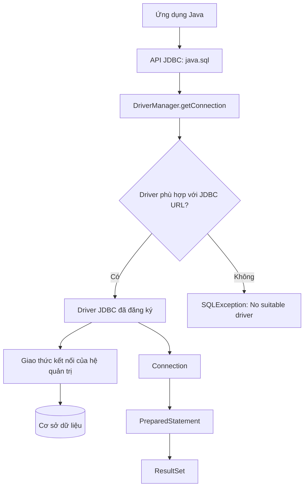
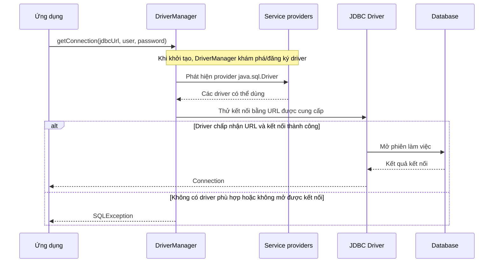
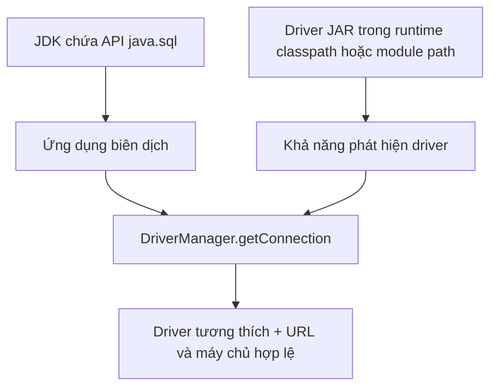

# Cơ chế phát hiện driver JDBC và vai trò của `Class.forName` trong mã cũ

## 1. Driver ở đâu trong kiến trúc JDBC?

**JDBC (Java Database Connectivity)** là API Java dùng để truy cập cơ sở dữ liệu quan hệ. Các giao diện chuẩn như `java.sql.Connection`, `Statement`, `PreparedStatement` và `ResultSet` giúp ứng dụng viết mã truy vấn theo một cách tương đối thống nhất; **JDBC driver** là phần triển khai giao tiếp giữa API đó với hệ quản trị cơ sở dữ liệu cụ thể.

Ví dụ, một ứng dụng dùng PostgreSQL cần driver JDBC tương thích PostgreSQL; ứng dụng kết nối MySQL hoặc MariaDB cần driver thích hợp với sản phẩm đích. `DriverManager` là thành phần quản lý và lựa chọn các driver đã được đăng ký, dựa trên URL JDBC và khả năng của driver.



Để hiểu vì sao mã Java cũ thường có dòng `Class.forName("...Driver")` trong khi mã hiện đại đôi khi không cần, phải phân biệt **ba bước khác nhau**:

1. **Driver có mặt tại thời điểm chạy**: file JAR hoặc module chứa driver đã nằm trong đường tải lớp phù hợp.
2. **Driver được phát hiện và đăng ký**: `DriverManager` biết đến một hoặc nhiều đối tượng triển khai `java.sql.Driver`.
3. **Driver được chọn để mở kết nối**: `DriverManager.getConnection(...)` tìm driver xử lý được URL, sau đó driver thực sự kết nối đến nguồn dữ liệu.

Có file driver JAR không nhất thiết đồng nghĩa driver đã được phát hiện trong mọi môi trường; driver được đăng ký cũng không bảo đảm URL, tài khoản, mạng hoặc máy chủ đều đúng.

## 2. Cách làm lịch sử: nạp thủ công bằng `Class.forName`

Trong nhiều tài liệu và ứng dụng JDBC đời cũ, mã mở kết nối có dạng:

```java
import java.sql.Connection;
import java.sql.DriverManager;
import java.sql.SQLException;

public class LegacyJdbcExample {
    public static void main(String[] args)
            throws ClassNotFoundException, SQLException {

        // Cách phổ biến trong mã JDBC cũ.
        Class.forName("org.postgresql.Driver");

        try (Connection connection = DriverManager.getConnection(
                "jdbc:postgresql://localhost:5432/sampledb",
                "app_user",
                System.getenv("DB_PASSWORD"))) {
            System.out.println("Connected: " + !connection.isClosed());
        }
    }
}
```

Tên `org.postgresql.Driver` trong ví dụ là tên lớp driver PostgreSQL. Tham số URL, tài khoản, cơ sở dữ liệu và biến môi trường chỉ minh họa; muốn chạy được phải cài driver và cấu hình nguồn dữ liệu thực tế. Tránh hardcode mật khẩu vào mã nguồn.

### Chính xác `Class.forName` làm gì?

Lời gọi:

```java
Class.forName("org.postgresql.Driver");
```

yêu cầu JVM **tìm, nạp và khởi tạo lớp** có tên đầy đủ được chỉ định. Với overload một tham số thông thường, JVM tiến hành khởi tạo lớp; điều này có thể chạy logic khởi tạo tĩnh (static initializer) của lớp.

Nhiều driver JDBC cổ điển tự đăng ký trong lúc lớp được khởi tạo, về mặt khái niệm tương tự:

```java
// Mã mang tính minh họa cơ chế; không phải mã nguồn cụ thể
// của PostgreSQL hay một driver đã phát hành.
public final class ExampleDriver implements java.sql.Driver {
    static {
        try {
            java.sql.DriverManager.registerDriver(new ExampleDriver());
        } catch (java.sql.SQLException error) {
            throw new ExceptionInInitializerError(error);
        }
    }

    // Các phương thức java.sql.Driver khác được lược bỏ.
}
```

Sau khi driver đã đăng ký, `DriverManager.getConnection(...)` mới có cơ sở để cân nhắc driver đó khi xử lý URL. Điểm then chốt: **`Class.forName` là API nạp/khởi tạo lớp Java; việc đăng ký driver xảy ra do mã khởi tạo của lớp driver**, không phải vì `Class.forName` tự hiểu giao thức JDBC.

Những điều `Class.forName` **không** làm:

- Không tải file driver JAR từ Internet hay tự thêm dependency còn thiếu vào ứng dụng.
- Không mở `Connection` hoặc xác nhận tài khoản/mật khẩu.
- Không bảo đảm lớp được nạp có `static initializer` tự đăng ký với `DriverManager`.
- Không kiểm tra rằng URL JDBC trỏ đúng cơ sở dữ liệu đang hoạt động.
- Không thay thế việc quản lý `Connection` và `SQLException`.

Nếu tên lớp không được tìm thấy trong class loader liên quan, lời gọi có thể ném `ClassNotFoundException`. Nếu lớp tồn tại nhưng khởi tạo thất bại, lỗi có thể khác, ví dụ `ExceptionInInitializerError`. Do đó việc dùng `Class.forName` không phải giải pháp cho mọi lỗi kết nối.

### Vì sao có mã cũ gọi `newInstance()`?

Trong một số ví dụ cũ có:

```java
Class.forName("org.postgresql.Driver").getDeclaredConstructor().newInstance();
```

Đây là bước **tạo thêm một đối tượng** qua reflection; không phải cơ chế bắt buộc để `DriverManager` tìm driver. Nếu driver đã đăng ký qua static initializer, việc tự tạo đối tượng thường thừa. Không nên sao chép thói quen này sang mã mới chỉ vì thấy xuất hiện trong tài liệu cũ.

## 3. JDBC 4.0 trở đi: tự động phát hiện driver

**Từ JDBC 4.0 (Java 6)**, một driver tương thích có thể khai báo chính nó là **service provider** cho giao diện `java.sql.Driver`. Nhờ cơ chế Java Service Provider, `DriverManager` có thể tự tìm và nạp các driver phù hợp khi được khởi tạo.

Với driver JAR được đóng gói đúng và có mặt trên runtime classpath thích hợp, mã thường chỉ cần:

```java
import java.sql.Connection;
import java.sql.DriverManager;
import java.sql.SQLException;

public class ModernJdbcExample {
    public static void main(String[] args) throws SQLException {
        String url = System.getenv("DB_URL");
        String user = System.getenv("DB_USER");
        String password = System.getenv("DB_PASSWORD");

        if (url == null || url.isBlank()
                || user == null || user.isBlank()
                || password == null) {
            throw new IllegalStateException(
                    "Cần khai báo DB_URL, DB_USER và DB_PASSWORD");
        }

        try (Connection connection =
                     DriverManager.getConnection(url, user, password)) {
            System.out.println(connection.getMetaData()
                    .getDatabaseProductName());
        }
    }
}
```

Ví dụ không có `Class.forName`. Điều kiện là driver **được cài, được nhìn thấy và được khai báo cho cơ chế phát hiện thích hợp**. Nếu có nhiều driver, `DriverManager` vẫn phải lựa chọn driver chấp nhận URL đã truyền. Mã này không có cơ chế quản lý pool; với ứng dụng server xử lý nhiều yêu cầu, thông thường nên lấy `Connection` từ `DataSource` hoặc connection pool được cấu hình đúng.

### Tệp `META-INF/services/java.sql.Driver`

Một cách khai báo service provider trên classpath là đặt tệp văn bản đúng tên:

```text
META-INF/services/java.sql.Driver
```

Nội dung liệt kê **tên đầy đủ của lớp triển khai `java.sql.Driver`**, ví dụ về mặt hình thức:

```text
com.example.jdbc.ExampleDriver
```

Tệp này nằm trong JAR của driver, không phải file ứng dụng cần tự tạo cho mỗi lần kết nối. Các JAR driver JDBC phổ biến phiên bản hiện đại thường đã cung cấp khai báo phù hợp. Với JPMS (Java Platform Module System), một module driver được thiết kế theo module có thể khai báo service provider bằng mệnh đề `provides java.sql.Driver with ...` trong `module-info.java`, thay vì chỉ dựa vào file `META-INF/services`. Việc đặt JAR ở module path cũng cần cấu hình/resolution module đúng.

Tổng thể quá trình khởi tạo và kết nối thường được hiểu như sau:



Sơ đồ mô tả **luồng logic**, không khẳng định DriverManager lặp lại khám phá tất cả provider cho mỗi lần gọi `getConnection()`. Cơ chế khám phá ban đầu gắn với quá trình khởi tạo của `DriverManager`. Tùy môi trường còn có các driver được đăng ký thủ công hoặc cấu hình qua thuộc tính hệ thống `jdbc.drivers`.

**Kết luận thực hành:** Nếu dự án dùng driver JDBC hiện đại có service provider hợp lệ và được đưa vào runtime classpath/module path đúng cách, không cần đặt `Class.forName` trước mọi `getConnection()`.

## 4. Phân biệt phát hiện driver với lựa chọn driver

Một ứng dụng có thể chứa nhiều driver JDBC cùng lúc, chẳng hạn một driver PostgreSQL và một driver MySQL. `DriverManager` không chọn dựa trên tên lớp mà ứng dụng từng viết trong mã; khi gọi `getConnection(url, ...)`, nó xét các driver đã đăng ký và khả dụng với caller, cho đến khi tìm được driver tạo kết nối thích hợp hoặc trả lỗi.

### URL JDBC là tín hiệu chọn driver

Các URL sau chỉ là ví dụ về **cú pháp nhận diện driver**, không phải địa chỉ hệ thống thật:

| Hệ quản trị | Ví dụ URL JDBC | Tiền tố |
| --- | --- | --- |
| PostgreSQL | `jdbc:postgresql://localhost:5432/shop` | `jdbc:postgresql:` |
| MySQL | `jdbc:mysql://localhost:3306/shop` | `jdbc:mysql:` |
| MariaDB | `jdbc:mariadb://localhost:3306/shop` | `jdbc:mariadb:` |
| H2 (in-memory) | `jdbc:h2:mem:demo` | `jdbc:h2:` |

Tên driver và kiểu URL cần được lấy từ tài liệu của **driver/phiên bản cụ thể**; không mặc định hai sản phẩm có tiền tố khác nhau nhưng dùng chung mọi lựa chọn cấu hình. Với URL không được driver nào đang hiển thị chấp nhận, `DriverManager` thường báo `SQLException` có thông điệp **“No suitable driver”**.

### Dùng `acceptsURL` để khảo sát

Giao diện `java.sql.Driver` có phương thức `acceptsURL(String)` để cho biết driver có hiểu URL được đưa vào không. Trong thực hành, có thể kiểm tra danh sách driver **mà lớp gọi nhìn thấy**:

```java
import java.sql.Driver;
import java.sql.DriverManager;
import java.sql.SQLException;
import java.util.Enumeration;

public final class DriverInspector {
    public static void inspect(String url) throws SQLException {
        Enumeration<Driver> drivers = DriverManager.getDrivers();

        while (drivers.hasMoreElements()) {
            Driver driver = drivers.nextElement();
            System.out.printf(
                    "%s | accepts URL: %s%n",
                    driver.getClass().getName(),
                    driver.acceptsURL(url));
        }
    }
}
```

Có thể gọi `DriverInspector.inspect("jdbc:postgresql://localhost:5432/shop")` để quan sát kết quả. Các dòng in ra phản ánh **driver được đăng ký và có thể truy cập từ class loader của mã kiểm tra**. Chúng không phải bằng chứng cho thấy máy chủ đã mở, tài khoản đúng hoặc một connection chắc chắn được tạo.

Muốn tìm driver phù hợp cho URL mà không tự mở kết nối, có thể dùng:

```java
Driver chosen = DriverManager.getDriver(
        "jdbc:postgresql://localhost:5432/shop");
System.out.println(chosen.getClass().getName());
```

`getDriver(url)` tìm một driver phù hợp hoặc ném `SQLException` khi không tìm được; nó **không thay thế** `getConnection(...)` và không xác thực kết nối đến máy chủ.

### Phát hiện, chọn và kết nối có ba kiểu lỗi khác nhau

| Giai đoạn | Dấu hiệu lỗi | Điều nên kiểm tra |
| --- | --- | --- |
| Có lớp driver | `ClassNotFoundException` khi gọi `Class.forName` | JAR có đúng ở runtime classpath/module path? Tên lớp có đúng? |
| Driver được phát hiện/chọn | `No suitable driver` | Khai báo service provider, class loader và URL JDBC có đúng? |
| Mở kết nối | Connection refused, timeout, xác thực thất bại, `SQLException` khác | Máy chủ/port, mạng, SSL, user/password, quyền truy cập và cấu hình hệ quản trị |

Điều khác nhau của các lỗi này rất quan trọng: **thêm `Class.forName` không sửa được máy chủ đang tắt hoặc mật khẩu sai**.

## 5. Vai trò của runtime classpath và dependency

Tự động phát hiện chỉ có tác dụng khi JVM thật sự thấy driver tại **thời điểm chạy**. Việc chương trình biên dịch thành công không chứng minh driver đã có lúc chạy, vì mã ứng dụng có thể chỉ import các giao diện thuộc JDK như `java.sql.Connection` và `DriverManager`.



Ví dụ, ở dự án dùng Gradle Groovy DSL, dependency JDBC driver có thể được khai báo dưới dạng runtime dependency:

```groovy
dependencies {
    // Thay <version> bằng phiên bản driver hợp lệ đã kiểm tra.
    runtimeOnly 'org.postgresql:postgresql:<version>'
}
```

Hoặc Gradle Kotlin DSL:

```kotlin
dependencies {
    // Thay <version> bằng phiên bản driver hợp lệ đã kiểm tra.
    runtimeOnly("org.postgresql:postgresql:<version>")
}
```

Đây là minh họa **dependency cho driver PostgreSQL**, không phải yêu cầu module JDBC luôn phải dùng PostgreSQL. Khi mã Java chỉ dùng các interface JDBC của JDK và để `DriverManager` phát hiện driver, có thể không cần import trực tiếp lớp implementation lúc biên dịch. Nếu mã **tham chiếu trực tiếp** đến lớp của driver, dependency phải sẵn có ở compile classpath phù hợp (thường dùng `implementation` thay vì chỉ `runtimeOnly`).

Với Maven, thông thường khai báo dependency driver ở `pom.xml` và tùy nhu cầu có thể dùng scope `runtime`:

```xml
<dependency>
    <groupId>org.postgresql</groupId>
    <artifactId>postgresql</artifactId>
    <version>DRIVER_VERSION</version>
    <scope>runtime</scope>
</dependency>
```

Thay `DRIVER_VERSION` bằng phiên bản thực tế của dự án. Khi đóng gói ứng dụng để triển khai, cần đảm bảo dependency runtime được đóng gói hoặc cung cấp theo cách runtime có thể truy cập. Việc thêm dependency thành công vào cấu hình build chưa đủ nếu bản JAR chạy thực tế bỏ sót driver.

### Các tình huống dễ làm mất service provider

- **Fat JAR/shaded JAR:** công cụ gộp JAR có thể làm mất hoặc ghi đè tệp `META-INF/services/java.sql.Driver`. Nếu có nhiều provider, bước đóng gói cần bảo toàn/merge các tệp service phù hợp.
- **Ứng dụng có nhiều class loader:** servlet container, ứng dụng plugin hoặc application server có thể tải driver từ class loader khác lớp gọi `DriverManager`. Driver đã đăng ký nhưng không hiển thị với caller vẫn có thể không được chọn.
- **Driver được thêm động sau khi `DriverManager` đã khởi tạo:** không nên mặc định sẽ tự được quét lại. Tùy kiến trúc, có thể phải nạp/đăng ký trong class loader phù hợp.
- **Module path:** file JAR/module cần có service declaration và được resolve theo cấu hình module của ứng dụng; chỉ sao chép JAR sang một thư mục tùy ý là chưa đủ.

Nếu một ứng dụng cũ phụ thuộc vào `Class.forName` để kích hoạt driver, có thể giữ lời gọi ấy tạm thời sau khi nâng phiên bản Java. Nhưng khi muốn xóa, phải xác nhận cách đóng gói JAR, service metadata và mô hình class loader trong đúng môi trường triển khai.

## 6. Khi nào `Class.forName` vẫn có ích?

Mặc dù không cần trong trường hợp phổ biến của JDBC 4+, việc nạp lớp rõ ràng vẫn có ý nghĩa trong một số tình huống:

1. **Driver cũ không có service provider:** mã khởi tạo của driver có thể cần được kích hoạt để tự gọi `DriverManager.registerDriver(...)`.
2. **Ứng dụng có cơ chế class loading riêng:** cần xác định đúng class loader nạp driver trong plugin/container và cách đăng ký/huỷ đăng ký phù hợp.
3. **Cần phát hiện lỗi tên lớp ngay từ đầu:** gọi `Class.forName` có thể giúp kiểm tra rằng một lớp xác định tồn tại và khởi tạo được, dù việc đó vẫn chưa xác nhận có thể kết nối.
4. **Chuyển đổi từng phần ứng dụng cũ:** có thể giữ lớp nạp cũ trong thời gian thay cơ chế phân phối driver rồi loại bỏ khi đã kiểm thử cơ chế tự động.

Không phải mọi trường hợp trên đều được sửa chỉ với đúng một dòng `Class.forName`. Ví dụ driver tự định nghĩa nhưng không có logic `registerDriver` thì việc nạp lớp vẫn chưa đăng ký driver. Trong trường hợp cần đăng ký thủ công, API tương ứng là `DriverManager.registerDriver(Driver)`; đây là quyết định cấu hình/integration có quản lý vòng đời, không phải bước nên thêm vào mọi repository.

### Về overload ba tham số của `Class.forName`

```java
Class<?> type = Class.forName(
        "com.example.jdbc.ExampleDriver",
        false,  // Không yêu cầu khởi tạo lớp ở bước này.
        customClassLoader);
```

Đối số `initialize = false` có nghĩa là thao tác chỉ tìm/nạp lớp, **không chủ động chạy static initializer**. Vì vậy nếu dựa vào static initializer để tự đăng ký driver, overload này có thể chưa đủ. Ngược lại, gọi `Class.forName(name, true, loader)` với class loader thích hợp yêu cầu khởi tạo lớp; vẫn phải kiểm tra việc driver thật sự đăng ký và được `DriverManager` nhìn thấy.

Việc chọn class loader ở hệ thống modular/container cần dựa trên cơ chế của runtime. Cố ép nhiều lớp loader chia sẻ một đối tượng driver có thể gây lỗi hiển thị hoặc rò rỉ class loader, nhất là khi ứng dụng được hot-redeploy.

### Chú ý khi tự đăng ký driver

`DriverManager` giữ tham chiếu tới các driver được đăng ký. Với môi trường triển khai lại ứng dụng mà class loader được thay mới, một driver được đăng ký bằng mã ứng dụng có thể cần được **hủy đăng ký đúng vòng đời** qua `DriverManager.deregisterDriver(...)` nếu ứng dụng là bên sở hữu đăng ký và API/permission cho phép. Không tự hủy driver do container hoặc thành phần khác sở hữu.

## 7. `DriverManager` và `DataSource`: lớp gọi khác nhau, driver vẫn cần thiết

`DriverManager.getConnection(...)` là API trực tiếp, thích hợp cho ví dụ nhỏ và tiện ích đơn giản. Trong ứng dụng có nhiều request, mã thường dùng `DataSource`:

```java
import java.sql.Connection;
import java.sql.SQLException;
import javax.sql.DataSource;

public final class CustomerRepository {
    private final DataSource dataSource;

    public CustomerRepository(DataSource dataSource) {
        this.dataSource = dataSource;
    }

    public void verifyConnection() throws SQLException {
        try (Connection connection = dataSource.getConnection()) {
            System.out.println(
                    connection.getMetaData().getDriverName());
        }
    }
}
```

`DataSource` có thể là datasource do driver cung cấp, một wrapper của connection pool hoặc datasource do server/container cấu hình. Nó trừu tượng hóa cách lấy connection và thường cho phép quản lý pool hoặc cấu hình tập trung. **Việc chuyển từ `DriverManager` sang `DataSource` không làm driver JDBC biến mất**; cơ chế khởi tạo và liên kết driver phụ thuộc datasource/pool cụ thể.

Nói cách khác:

| Câu hỏi | `DriverManager` | `DataSource` |
| --- | --- | --- |
| Ai được gọi để lấy connection? | `DriverManager.getConnection(...)` | `dataSource.getConnection()` |
| URL/user/password được cung cấp bằng cách nào? | Truyền vào lời gọi hoặc properties | Cấu hình datasource/pool/container |
| Có pooling mặc định theo API không? | Không | `DataSource` tự nó không bảo đảm có pool; tùy triển khai |
| Có cần JDBC driver phù hợp không? | Có | Có, qua cơ chế datasource/driver tương ứng |
| Thường dùng ở đâu? | Demo, tiện ích nhỏ, kiểm thử thủ công | Ứng dụng server và môi trường quản lý kết nối |

Không nên tạo `DataSource` mới cho từng thao tác và không giả định mọi triển khai `DataSource` đều tự quản lý pool. Cấu hình pool, SSL, network timeout và transaction nên thuộc tầng cấu hình/infrastructure, thay vì đặt rải rác trong từng phương thức repository.

## 8. Chẩn đoán lỗi driver từng bước

Giả sử chương trình ném:

```text
java.sql.SQLException: No suitable driver found for jdbc:postgresql://localhost:5432/shop
```

Quy trình kiểm tra hữu ích:

1. **Xem URL**: bắt đầu bằng `jdbc:` đúng kiểu driver, dùng host/port/database hợp lệ; không trộn nhầm tiền tố `jdbc:postgresql:` và `jdbc:mysql:`.
2. **Xác nhận dependency ở runtime**: chạy đúng artifact đã đóng gói với driver JAR đúng phiên bản; không chỉ kiểm tra IDE build thành công.
3. **Xác nhận khả năng phát hiện**: nếu driver dự kiến có Service Provider, xem JAR cuối cùng có giữ service descriptor; dùng `DriverManager.getDrivers()` ở **đúng chỗ gọi** để quan sát các driver được thấy.
4. **Xem class loader/module**: đặc biệt khi chạy ứng dụng web, plugin, app server, shaded JAR hoặc module path.
5. **Nếu đang dùng driver cũ**, kiểm tra tên lớp và thử `Class.forName("...")` khi driver có cơ chế tự đăng ký phù hợp.
6. **Sau khi đã chọn được driver**, thử mở connection thật và xử lý lỗi network/xác thực/SSL như một nhóm vấn đề riêng.

Một đoạn kiểm tra nhỏ, không cần gọi vào database để kiểm tra URL được driver nào chấp nhận:

```java
import java.sql.Driver;
import java.sql.DriverManager;
import java.sql.SQLException;

public static void verifyDriverForUrl(String jdbcUrl) {
    try {
        Driver driver = DriverManager.getDriver(jdbcUrl);
        System.out.println("Matched driver: "
                + driver.getClass().getName());
    } catch (SQLException error) {
        System.err.println("Chưa tìm được driver phù hợp với URL");
        // Ghi chi tiết chẩn đoán trong logger nội bộ nếu cần.
    }
}
```

Mã minh họa phương thức tĩnh đặt trong một class, với import như trên. Nếu tìm được driver, bước kế là `getConnection(...)` rồi kiểm tra `connection.getMetaData().getDatabaseProductName()`. **Không log toàn bộ JDBC URL khi nó có thể chứa user/password hoặc token trong query parameters.**

### Những lỗi dễ bị chẩn đoán nhầm

| Lỗi / triệu chứng | Nguyên nhân khả dĩ | Điều nên làm |
| --- | --- | --- |
| `ClassNotFoundException: ...Driver` | Tên lớp không tồn tại trong class loader đang dùng | Kiểm tra dependency runtime, JAR, tên lớp |
| `No suitable driver` | Driver chưa đăng ký/không hiển thị, hoặc URL không được chấp nhận | Kiểm tra service provider, loader, URL |
| Kết nối bị từ chối (connection refused) | Không liên lạc được server/port | Kiểm tra server, host, port, firewall, container network |
| Authentication failed/access denied | User/password hoặc quyền truy cập sai | Kiểm tra secret/config và quyền trên DB |
| Timeout trong lúc kết nối | Mạng, DNS, proxy, SSL hoặc máy chủ không phản hồi | Kiểm tra mạng và timeout cấu hình |
| `NoClassDefFoundError` khi nạp driver | Thiếu dependency phụ hoặc xung đột thư viện/phiên bản | Xem dependency tree và lỗi class loading gốc |
| Chạy IDE được, chạy JAR lỗi | Đóng gói bỏ sót driver hoặc service descriptor | Kiểm tra runtime artifact và service metadata |
| Sau redeploy driver không hoạt động | Class loader cũ còn đăng ký hoặc class loader mới không nhìn thấy driver | Quản lý lifecycle của driver/container |

Các thông điệp lỗi là ví dụ thường gặp, có thể khác nhau theo driver và sản phẩm. Không dựa duy nhất vào chuỗi thông điệp để quyết định cách sửa.

## 9. Kiểm tra hiểu biết với ba tình huống

### Tình huống A: `Class.forName` chạy thành công nhưng vẫn `No suitable driver`

Hãy phân tích theo thứ tự:

- Lớp đó có thực sự triển khai `java.sql.Driver` và tự đăng ký khi khởi tạo không?
- Driver có được `DriverManager` nhìn thấy từ class loader của mã gọi không?
- URL JDBC có đúng tiền tố và định dạng mà driver hỗ trợ không?

**Kết quả `Class.forName` thành công chỉ cho biết bước nạp/khởi tạo lớp thành công**, không chứng minh ba điều còn lại.

### Tình huống B: Xóa `Class.forName` nhưng chương trình vẫn kết nối được

Đây là kết quả mong đợi trong nhiều ứng dụng hiện đại: driver JAR đã có service provider, `DriverManager` tự phát hiện driver phù hợp và `getConnection` sử dụng driver đó. Nếu dự án đã xác minh môi trường triển khai hoạt động đúng với cơ chế này, có thể loại bỏ lời gọi nạp lớp cũ thừa thãi.

### Tình huống C: Maven/Gradle có driver dependency nhưng chạy production lại lỗi

Hãy phân biệt **dependency đã khai báo** với **dependency thực sự được mang vào runtime**. Kiểm tra container image, boot JAR, fat JAR hoặc module path. Nếu có công cụ shading, xem tệp service provider có được bảo toàn. Không sửa bằng cách thêm `Class.forName` vào mọi nơi trước khi xác định nguyên nhân.

## 10. Bài tập thực hành

1. **Đọc mã cũ:** giải thích chính xác sự khác biệt giữa `Class.forName("org.postgresql.Driver")` và `DriverManager.getConnection(url, user, password)`. Hai lời gọi thuộc bước nào trong chuỗi *nạp lớp → đăng ký driver → chọn driver → kết nối*?
2. **Tự quan sát:** tạo ứng dụng nhỏ chỉ import `java.sql`, thêm một driver JDBC tương thích JDBC 4+ vào runtime, in danh sách lớp từ `DriverManager.getDrivers()`. Sau đó dùng `getDriver(url)` để tìm driver cho một URL hợp lệ, kể cả khi máy chủ chưa chạy.
3. **Thử trường hợp thiếu driver:** chạy ứng dụng khi không có driver tương ứng tại runtime và quan sát lỗi từ `getDriver(url)` hoặc `getConnection(...)`. Phân biệt với lỗi network xuất hiện khi driver đã được nhận diện.
4. **Kiểm tra đóng gói:** ở dự án có fat JAR, xác nhận JAR cuối cùng chứa khai báo service provider JDBC phù hợp; giải thích điều có thể xảy ra nếu bước build ghi đè tệp service.
5. **Giải thích overload:** tại sao `Class.forName(driverName, false, loader)` không nên được coi là bước chủ động kích hoạt static initializer đăng ký driver?

### Ghi nhớ

- `Class.forName("...Driver")` là một cách **nạp và khởi tạo lớp driver** trong Java; ở driver đời cũ, khởi tạo lớp thường kích hoạt `DriverManager.registerDriver(...)`.
- Từ **JDBC 4.0**, driver có thể được phát hiện tự động qua **Service Provider** nếu đã được khai báo và phân phối đúng tại runtime.
- `DriverManager` chỉ có thể cân nhắc driver được đăng ký/hiển thị, rồi dùng **JDBC URL** để lựa chọn driver thích hợp khi `getConnection(...)`.
- Việc phát hiện driver thành công **không bảo đảm kết nối thành công**: cấu hình URL, mạng, bảo mật và quyền truy cập vẫn cần được xử lý và kiểm thử riêng.
- Ứng dụng server thường cấu hình `DataSource`/pool, nhưng vẫn cần triển khai driver JDBC phù hợp với môi trường.

Tư duy quan trọng nhất khi đọc mã JDBC cũ là: **`Class.forName` là thủ thuật lịch sử để kích hoạt việc đăng ký driver; cơ chế phát hiện tự động của JDBC hiện đại thường giúp loại bỏ bước này khi runtime đã đóng gói driver đúng cách.**
