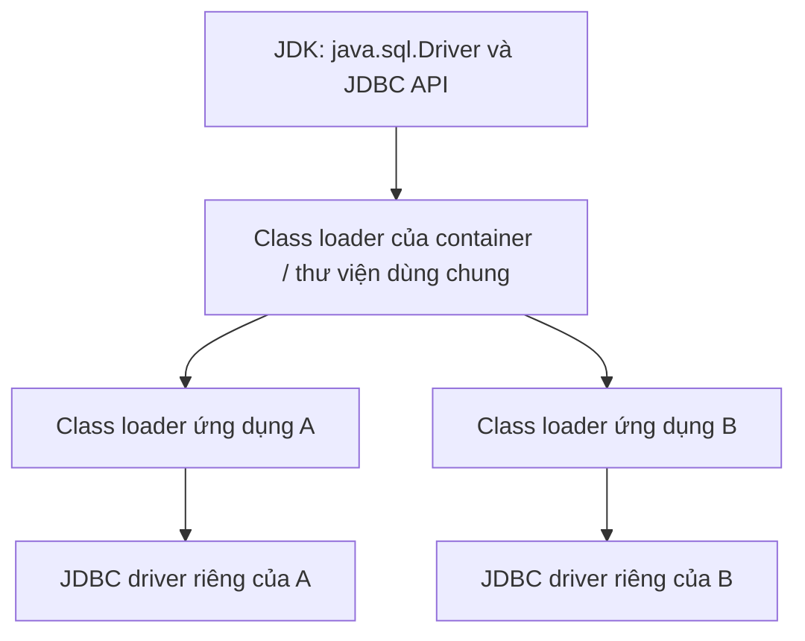
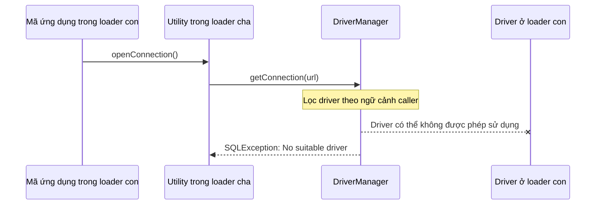
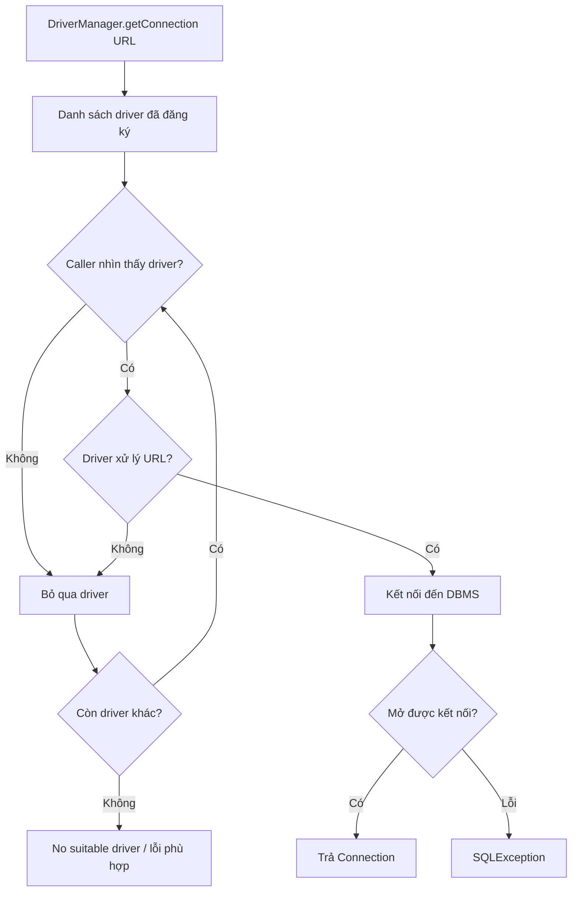
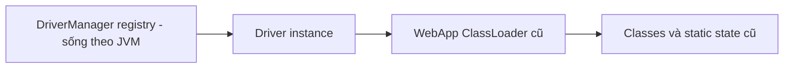

# Quản lý JDBC driver trong môi trường có nhiều bộ nạp lớp

## 1. Bài toán: thư viện driver đã có nhưng Java vẫn không kết nối được

**JDBC (Java Database Connectivity)** là API chuẩn giúp ứng dụng Java truy cập cơ sở dữ liệu quan hệ. Ứng dụng gọi các kiểu chung như `DriverManager`, `DataSource`, `Connection` và `PreparedStatement`, còn **JDBC driver** thực hiện phần giao tiếp cụ thể với PostgreSQL, MySQL, SQL Server hoặc hệ quản trị được chọn.

Trong một chương trình Java nhỏ, chỉ cần thêm JAR driver vào runtime classpath, cấu hình JDBC URL rồi gọi `DriverManager.getConnection(...)` thường là đủ. Nhưng trong **application server, ứng dụng web, hệ thống plugin, trình chạy nhiều module hoặc môi trường nạp lại ứng dụng**, cùng một JVM có thể có nhiều **class loader (bộ nạp lớp)**. Lúc này, việc một JAR tồn tại trên đĩa **không bảo đảm** đoạn mã gọi JDBC nhìn thấy driver đó.

Các dấu hiệu điển hình là:

- `java.sql.SQLException: No suitable driver found for jdbc:...` dù JAR driver đã được đóng gói;
- `ClassNotFoundException` khi cố nạp tên class của driver;
- ứng dụng A kết nối thành công nhưng ứng dụng B trong cùng application server thất bại;
- sau khi redeploy nhiều lần, số lượng class loader, kết nối hoặc bộ nhớ tăng bất thường;
- plugin có JDBC driver riêng nhưng tầng mã chung của host không chọn được driver của plugin.

Muốn chẩn đoán đúng, cần phân biệt **driver được nạp (loaded)**, **driver được đăng ký (registered)**, **driver hiển thị đối với caller (visible/allowed)** và **driver thực sự chấp nhận JDBC URL**. Bốn điều kiện này liên quan nhưng không đồng nghĩa.

## 2. Class loader quyết định lớp Java nào được nhìn thấy

Trong JVM, class loader chịu trách nhiệm tìm và định nghĩa class. Một lớp được xác định bằng **tên đầy đủ kết hợp với class loader đã định nghĩa nó**. Hai bộ nạp khác nhau có thể cùng nạp class tên `org.example.Driver` nhưng tạo ra hai kiểu runtime khác nhau.

Các loại loader thường gặp:

| Loader hoặc phạm vi | Vai trò tiêu biểu |
| --- | --- |
| Bootstrap/platform class loader | Nạp các lớp nền tảng của Java theo cấu trúc runtime; các API JDBC chuẩn do JDK cung cấp. |
| Application/system class loader | Nạp mã và thư viện trên classpath hoặc module path của ứng dụng Java thông thường. |
| Loader của web application | Cô lập các thư viện nằm trong từng WAR hoặc vùng ứng dụng của container. |
| Loader của plugin/module | Nạp thư viện riêng của một plugin, có thể không hiển thị với mã host. |
| **Thread context class loader (TCCL)** | Loader gắn với thread, được một số API khám phá service dùng để tìm implementation trong ngữ cảnh ứng dụng. |

Trong mô hình ủy quyền cha–con phổ biến, loader con thường nhìn thấy lớp do loader cha nạp, còn loader cha **không tự động nhìn thấy** lớp chỉ có trong loader con. Một số container sử dụng quy tắc ủy quyền riêng, vì vậy không được giả định mọi môi trường đều tuân theo một cách ưu tiên tìm class duy nhất.



Các mũi tên biểu thị quan hệ nạp/phụ thuộc khái niệm. Nếu driver nằm trong vùng thư viện dùng chung của container, cả A và B có thể nhìn thấy cùng một class driver. Nếu mỗi ứng dụng có bản JAR riêng, chúng có thể nạp hai class driver có cùng tên qua hai loader khác nhau.

## 3. Cơ chế phát hiện và đăng ký driver của JDBC

`java.sql.Driver` là interface mà một JDBC driver triển khai. `java.sql.DriverManager` quản lý các driver đã đăng ký trong JVM và cố tìm driver thích hợp khi ứng dụng gọi `getConnection(...)`.

### 3.1. Tự động khám phá bằng cơ chế Service Provider

Từ **JDBC 4.0**, driver hiện đại thường công bố implementation qua cơ chế Java Service Provider. Với JAR trên classpath, thông tin service có thể nằm ở:

```text
META-INF/services/java.sql.Driver
```

Nội dung có thể là tên đầy đủ của class triển khai driver, ví dụ với PostgreSQL:

```text
org.postgresql.Driver
```

Khi `DriverManager` được khởi tạo, nó dùng cơ chế khám phá service để tìm các JDBC driver có sẵn trong ngữ cảnh nạp lớp thích hợp. Trên module path, service còn có thể được công bố bằng khai báo `provides ... with ...` của module. Vì thế, với một driver được đóng gói chuẩn và có khả năng nhìn thấy, ứng dụng thường **không phải** tự gọi `Class.forName("...")` để nạp driver.

**Hai điểm dễ bỏ sót:**

1. Cơ chế khám phá service phụ thuộc vào nơi có thể tìm thấy JAR/provider. Nếu đóng gói lại fat JAR mà làm mất hoặc ghi đè `META-INF/services/java.sql.Driver`, driver có thể không được tự phát hiện.
2. `DriverManager` được khởi tạo tại một thời điểm trong JVM. Nếu một class loader plugin chỉ xuất hiện *sau khi* cơ chế khám phá ban đầu đã chạy, không nên kỳ vọng `DriverManager` tự khám phá lại mọi provider mới trong mọi tình huống.

### 3.2. Đăng ký driver với `DriverManager`

Một driver có thể đăng ký thông qua `DriverManager.registerDriver(...)`; nhiều driver cũng tự đăng ký khi class driver được khởi tạo. Sau khi đăng ký, đối tượng driver có mặt trong registry do `DriverManager` quản lý.

```java
// Minh họa API: không nên đăng ký thủ công nếu driver đã được
// khám phá và đăng ký đúng bằng cơ chế JDBC 4+.
DriverManager.registerDriver(new org.postgresql.Driver());
```

Đăng ký thủ công có thể tạo **đăng ký trùng** nếu provider đã có trong registry. Hãy dùng một cơ chế đăng ký do thư viện/framework hỗ trợ, kiểm tra tài liệu driver, và chỉ dùng cách thủ công khi thực sự cần kiểm soát vòng đời. Có thể hủy một đăng ký hợp lệ bằng `DriverManager.deregisterDriver(driver)` khi thành phần sở hữu driver dừng hoạt động.

### 3.3. `DriverManager` kiểm tra cả khả năng nhìn thấy từ caller

Registry có thể chứa driver của nhiều ứng dụng, nhưng `DriverManager` **không tự do trả mọi driver đã đăng ký cho mọi caller**. Khi lựa chọn driver, nó áp dụng cơ chế kiểm tra class loader của mã gọi để chỉ cho phép các driver mà caller có thể nhìn thấy theo quy tắc của JDBC.

Do đó, một driver **đã đăng ký toàn JVM** vẫn có thể bị bỏ qua khi `DriverManager.getConnection(...)` được gọi từ đoạn mã thuộc class loader không nhìn thấy class driver tương ứng. Đây là nguyên nhân quan trọng của lỗi `No suitable driver` trong môi trường đa class loader.

## 4. Phân biệt class loader của caller và TCCL

Hai loader dễ bị nhầm trong quá trình xử lý JDBC:

| Khái niệm | Được xác định như thế nào? | Liên quan JDBC ra sao? |
| --- | --- | --- |
| **Loader của caller** | Loader định nghĩa class chứa lời gọi đến API nhạy cảm với caller. | `DriverManager.getConnection(...)` lọc các driver có thể dùng dựa trên khả năng nhìn thấy từ ngữ cảnh caller. |
| **Thread context class loader (TCCL)** | Có thể xem qua `Thread.currentThread().getContextClassLoader()`. | Có thể ảnh hưởng quá trình khám phá service của `ServiceLoader`, trong đó có quá trình khởi tạo/khám phá driver. |

Một số container thiết lập TCCL thành loader của ứng dụng khi thực thi request, nhờ đó code framework có thể tìm service trong các thư viện của ứng dụng. Tuy nhiên, **thay TCCL không bảo đảm sửa được mọi lỗi của `DriverManager.getConnection()`**: kiểm tra khả năng nhìn thấy từ caller và quá trình khám phá service là hai vấn đề khác nhau.

Ví dụ: ứng dụng A dùng loader con có JAR PostgreSQL; một utility dùng chung nằm ở loader cha gọi trực tiếp `DriverManager.getConnection()`. Utility có thể không nhìn thấy class driver chỉ tồn tại ở A, ngay cả khi A đã khiến driver được đăng ký. Đổi TCCL của thread không tự động làm loader cha nhìn thấy class của loader con.



Cách xử lý tốt hơn là đặt logic tạo kết nối trong một thành phần/`DataSource` được khởi tạo ở đúng phạm vi có thể nhìn thấy driver, rồi **truyền `DataSource` qua interface chung** đến mã cần sử dụng. Với application server, cũng có thể để container sở hữu driver và cấp `DataSource` được cấu hình theo cơ chế của server.

## 5. Ba cách bố trí driver thường gặp

### 5.1. Driver nằm trong ứng dụng độc lập

Ở ứng dụng Java chạy riêng, driver JAR thường nằm trong runtime classpath hoặc module path của chính ứng dụng:

```text
Ứng dụng Java
  ├─ Các class ứng dụng
  ├─ JDBC API từ JDK
  └─ PostgreSQL JDBC driver JAR
```

Trong cách bố trí đơn giản này, phần lớn lời gọi JDBC của ứng dụng và JAR driver đều nằm trong phạm vi hiển thị thích hợp. Với driver JDBC 4+ có service provider chuẩn, `DriverManager.getConnection(...)` thường hoạt động mà không cần nạp class driver thủ công.

### 5.2. Driver nằm trong thư viện chung của application server

Container có thể cung cấp driver trên loader dùng chung và cấu hình một `DataSource` qua cơ chế quản trị/JNDI. Nhiều ứng dụng truy cập cùng nguồn kết nối nhưng mỗi ứng dụng chỉ biết interface `javax.sql.DataSource`.

```text
Container / loader chung
  ├─ JDBC driver JAR
  └─ DataSource do container quản lý
       ├─ Ứng dụng A sử dụng
       └─ Ứng dụng B sử dụng
```

Đây là cấu hình phù hợp khi container cần tập trung quản trị pool, tài khoản, TLS hoặc transaction. Driver và pool do container sở hữu nên **ứng dụng không tự ý deregister hay đóng tài nguyên dùng chung của container** khi undeploy.

### 5.3. Mỗi ứng dụng hoặc plugin mang driver riêng

Ví dụ ứng dụng A dùng driver PostgreSQL, ứng dụng B dùng MySQL, hoặc hai ứng dụng đóng gói các phiên bản driver khác nhau:

```text
Loader của ứng dụng A
  └─ driver-postgresql.jar

Loader của ứng dụng B
  └─ driver-mysql.jar
```

Khi đó mỗi loader chỉ nhìn thấy các thư viện nó được quyền truy cập. Để tránh lỗi lựa chọn driver, hoạt động tạo kết nối cần diễn ra trong ngữ cảnh phù hợp với loader sở hữu JAR driver. Khi ứng dụng hoặc plugin bị gỡ, cần dọn những tài nguyên chính nó đã tạo để tránh giữ tham chiếu tới loader cũ.

## 6. Quy trình chọn driver khi gọi `getConnection()`

Khi gọi:

```java
Connection connection = DriverManager.getConnection(
    "jdbc:postgresql://localhost:5432/shop_db",
    username,
    password
);
```

`DriverManager` xem xét các driver đã đăng ký mà caller được phép sử dụng. Driver sẽ nhận diện URL (thường qua `acceptsURL(...)` hoặc cơ chế `connect(...)`); driver phù hợp cố mở kết nối và trả về `Connection`. Driver không hỗ trợ URL có thể bỏ qua và để `DriverManager` thử driver khác.



Sơ đồ tập trung vào hai điều kiện dễ bị nhầm: **driver được phép dùng** và **driver hiểu URL**. Một URL sai prefix có thể thất bại dù driver đã nạp đúng. Ngược lại, URL chính xác vẫn thất bại nếu driver không hiển thị với caller.

Với một hệ quản trị cụ thể, dùng JDBC URL đúng theo tài liệu driver. Ví dụ:

| Hệ quản trị | Dạng URL minh họa |
| --- | --- |
| PostgreSQL | `jdbc:postgresql://localhost:5432/shop_db` |
| MySQL | `jdbc:mysql://localhost:3306/shop_db` |
| SQL Server | `jdbc:sqlserver://localhost:1433;databaseName=shop_db` |

Đây là các ví dụ cú pháp; các tùy chọn TLS, xác thực, ký tự đặc biệt, schema hoặc tài khoản cần tuân theo tài liệu driver tương ứng. **Không ghi mật khẩu trực tiếp vào bài log chẩn đoán** hoặc hiển thị toàn bộ URL nếu URL chứa thông tin nhạy cảm.

## 7. Chẩn đoán `No suitable driver` ở đúng class loader

Khi gặp `SQLException: No suitable driver found`, đừng chỉ hỏi “JAR đã được copy vào thư mục nào?”. Hãy kiểm tra lần lượt:

1. **Runtime dependency:** driver có nằm trong classpath/module path *của đúng tiến trình và đúng loader* không? Dependency khai báo chỉ dành cho compile/test có thể không có lúc chạy.
2. **Metadata provider:** JAR có công bố `META-INF/services/java.sql.Driver` hoặc service tương đương, và quá trình đóng gói có bảo toàn metadata không?
3. **Thời điểm khởi tạo:** loader chứa driver có tồn tại và đã khả dụng khi quá trình khám phá driver diễn ra không?
4. **Caller:** lời gọi `DriverManager.getConnection(...)` thực sự thực hiện trong class nào và loader của class đó có thấy driver không?
5. **JDBC URL:** prefix, tên database, thông số driver có đúng không? Nếu sai, driver có thể từ chối URL dù đã nạp/đăng ký.
6. **Quản lý vòng đời:** có bản JAR trùng ở container và ứng dụng, hoặc driver của lần deploy cũ vẫn đăng ký nhưng không còn phù hợp với loader hiện tại không?

Đoạn mã sau giúp kiểm tra **loader của lớp chẩn đoán**, **TCCL**, các driver được `DriverManager` cho phép liệt kê và driver phù hợp với URL. Nên gọi mã này từ **chính nơi tạo kết nối** trong ứng dụng đang gặp sự cố:

```java
import java.sql.Driver;
import java.sql.DriverManager;
import java.sql.SQLException;
import java.util.Enumeration;

public final class JdbcDriverDiagnostics {
    public static void inspect(String jdbcUrlWithoutSecrets) {
        ClassLoader callerLoader = JdbcDriverDiagnostics.class.getClassLoader();
        ClassLoader contextLoader = Thread.currentThread().getContextClassLoader();

        System.out.println("Diagnostics class loader: " + callerLoader);
        System.out.println("Thread context loader: " + contextLoader);

        Enumeration<Driver> drivers = DriverManager.getDrivers();
        while (drivers.hasMoreElements()) {
            Driver driver = drivers.nextElement();
            System.out.printf(
                "Visible driver: %s | defining loader: %s%n",
                driver.getClass().getName(),
                driver.getClass().getClassLoader()
            );
        }

        try {
            Driver selected = DriverManager.getDriver(jdbcUrlWithoutSecrets);
            System.out.println("Driver for URL: " + selected.getClass().getName());
        } catch (SQLException e) {
            System.err.println("No visible driver accepts the JDBC URL: "
                    + e.getClass().getSimpleName());
        }
    }
}
```

Ví dụ gọi:

```java
JdbcDriverDiagnostics.inspect("jdbc:postgresql://localhost:5432/shop_db");
```

`DriverManager.getDriver(url)` **chỉ xác định một driver hỗ trợ URL trong tập được phép nhìn thấy**; nó không mở kết nối đến database và không xác nhận tài khoản/mạng đang hoạt động. Nếu đã tìm được driver nhưng `getConnection()` vẫn lỗi, cần xem `SQLException` thật để phân biệt lỗi xác thực, SSL/TLS, DNS, cổng, timeout và quyền database.

`DriverManager.getDrivers()` cũng **không phải danh sách đầy đủ tuyệt đối của mọi driver trong JVM**. Nó chỉ cho thấy các driver thỏa kiểm tra khả năng nhìn thấy từ caller ở vị trí thực thi phương thức đó. Không thấy driver trong danh sách này chưa chứng minh driver chưa được đăng ký ở ngữ cảnh ứng dụng khác.

## 8. `Class.forName(...)` hỗ trợ chẩn đoán nhưng không phải phép sửa vạn năng

Trong hệ thống cũ, có thể bắt gặp mã:

```java
Class.forName("org.postgresql.Driver");
```

Lệnh này tìm và khởi tạo class bằng cơ chế class loader áp dụng cho lời gọi. Nhiều driver truyền thống tự đăng ký với `DriverManager` trong lúc khởi tạo class, nên nó có thể khiến driver trở nên khả dụng nếu driver vốn đã nằm trong phạm vi hiển thị đúng.

Tuy nhiên:

- `Class.forName(...)` ném `ClassNotFoundException` nếu loader của caller không tìm được class driver. Nó không tự thêm JAR vào classpath.
- Một class được nạp thành công **không bảo đảm** `DriverManager` sẽ chọn được driver từ một caller thuộc loader khác.
- Đăng ký tự động qua SPI vốn đã hoạt động thì gọi `Class.forName(...)` chỉ bổ sung thao tác không cần thiết.
- Việc khởi tạo class có thể gây tác dụng phụ đăng ký driver mà ứng dụng cần dọn khi undeploy; đừng thử tải driver từ nhiều loader một cách tùy tiện.

Nếu thực sự cần xác minh khả năng hiển thị của một loader cụ thể, có thể dùng overload có loader tường minh:

```java
ClassLoader appLoader = SomeApplicationClass.class.getClassLoader();
Class<?> driverType = Class.forName(
    "org.postgresql.Driver", false, appLoader
);
System.out.println(driverType.getClassLoader());
```

Tham số `false` nghĩa là không yêu cầu khởi tạo class ngay trong lời gọi này; ví dụ chỉ dùng để **kiểm tra khả năng tìm class**, tránh vô tình thực hiện static initializer của driver. Cần bắt `ClassNotFoundException` khi triển khai. Việc in loader giúp tìm ra driver có được nạp ở loader dự kiến hay do một loader cha đảm nhiệm. Mã trên là một đoạn chẩn đoán bổ sung, không phải bước luôn cần trong ứng dụng JDBC hiện đại.

## 9. Tải driver cho hệ thống plugin và module động

Hệ thống plugin có một tình huống đặc biệt: host được khởi động trước, còn plugin mang driver có thể chỉ xuất hiện khi người dùng bật chức năng kết nối đến một DBMS nhất định.

```text
Host application (loader cha)
  ├─ API java.sql / javax.sql dùng chung
  ├─ Plugin A (loader riêng) → PostgreSQL driver
  └─ Plugin B (loader riêng) → MySQL driver
```

Nếu host gọi `DriverManager.getConnection()` từ một class được định nghĩa bởi loader cha, nó có thể không dùng được driver chỉ có trong plugin con. **Thay TCCL sau đó không tự sửa quan hệ nhìn thấy class**. Hướng thiết kế vững hơn:

- Định nghĩa interface chung ở vùng host (ví dụ factory trả về `DataSource` hoặc `Connection`).
- Cho từng plugin tạo/điều khiển driver và `DataSource` của chính mình trong ngữ cảnh loader phù hợp.
- Host gọi qua interface chung; logic tạo kết nối và dọn pool vẫn thuộc plugin hoặc thành phần được plugin ủy quyền.
- Khi tháo plugin, ngừng các tác vụ mới, kết thúc các tác vụ đang dùng kết nối, đóng pool rồi dọn đúng các driver/đăng ký thuộc plugin.

Ở các hệ thống dùng Java Platform Module System (JPMS), còn phải xét module path, khai báo `requires`, `uses`, `provides` và module layer nơi provider được định nghĩa. Việc module JAR hiện diện ở một layer khác chưa bảo đảm service tự khả dụng trong mọi layer. Cách đóng gói và nạp provider cần bám theo tài liệu driver/module/framework đang dùng.

## 10. Vấn đề redeploy: driver giữ lại class loader cũ

`DriverManager` là thành phần có vòng đời ở mức JVM. Nếu một JDBC driver được nạp bởi loader riêng của ứng dụng rồi **đăng ký** vào `DriverManager`, registry có thể tiếp tục giữ tham chiếu đến driver sau khi ứng dụng bị undeploy. Tham chiếu đó có thể ngăn JVM giải phóng class loader cũ cùng các class/tài nguyên của nó.



Trong thực tế, driver hoặc thư viện pool cũng có thể dùng thread nền, timer, `ThreadLocal` hay tài nguyên mạng. **Deregister driver không tự thay thế việc đóng pool, hủy thread và giải phóng các tài nguyên khác** do ứng dụng sở hữu.

Một quy trình dừng ứng dụng thường cần:

1. Ngăn phát sinh yêu cầu mới và kết thúc công việc đang dùng kết nối.
2. Đóng `DataSource` có pool theo API triển khai và hoàn tất/rollback transaction còn dang dở.
3. Dọn các driver **do chính application class loader sở hữu và đăng ký**, nếu ứng dụng chịu trách nhiệm vòng đời của chúng.
4. Giải phóng các task/thread và tài nguyên còn lại do ứng dụng khởi tạo.

Ví dụ một phương thức dọn registry trong mã **thuộc class loader của ứng dụng**:

```java
import java.sql.Driver;
import java.sql.DriverManager;
import java.sql.SQLException;
import java.util.Enumeration;

public final class JdbcDriverLifecycle {
    public static void deregisterDriversOwnedByApplication() throws SQLException {
        ClassLoader ownLoader = JdbcDriverLifecycle.class.getClassLoader();
        Enumeration<Driver> registered = DriverManager.getDrivers();

        while (registered.hasMoreElements()) {
            Driver driver = registered.nextElement();
            if (driver.getClass().getClassLoader() == ownLoader) {
                DriverManager.deregisterDriver(driver);
            }
        }
    }
}
```

**Phạm vi quan trọng:** Ví dụ chỉ xử lý driver có class được định nghĩa **trực tiếp bởi đúng loader `ownLoader`** và hiển thị cho code thực thi. Nó không bao quát tự động các loader con của plugin, không quản lý pool, và không thay thế cơ chế shutdown chính thức của container. Với driver do container cấp ở loader chung, **không gọi `deregisterDriver` thay container**. Với plugin nằm ở loader con, mỗi plugin cần quản lý tài nguyên và đăng ký theo phạm vi sở hữu của mình.

`DriverManager.deregisterDriver(...)` cũng thực hiện kiểm tra quyền truy cập/khả năng nhìn thấy, nên không phải đoạn mã ở loader bất kỳ đều có thể hủy mọi driver trong registry. Tốt nhất giữ trách nhiệm đăng ký và dọn dẹp gần nhau, đồng thời ưu tiên lifecycle hook của framework/container.

## 11. Tránh JAR trùng, xung đột phiên bản và cấu hình sai runtime

Một số lỗi không xuất phát từ SQL mà từ cách thư viện driver được triển khai:

| Tình huống | Hệ quả có thể xảy ra | Hướng khắc phục |
| --- | --- | --- |
| Driver chỉ có trong dependency dùng để biên dịch | Runtime không tìm thấy provider/class. | Bảo đảm driver có trên **runtime classpath/module path** của đúng ứng dụng. |
| Cùng JAR driver vừa ở container chung vừa trong WAR | Có thể nạp nhiều bản driver, gây nhầm class loader/lifecycle hoặc xung đột phiên bản. | Chọn rõ container quản lý hay ứng dụng tự quản lý, theo hợp đồng triển khai. |
| Fat JAR làm mất file `META-INF/services/java.sql.Driver` | Cơ chế tự khám phá service có thể thất bại. | Cấu hình công cụ đóng gói bảo toàn/merge service descriptors. |
| Chỉ đặt driver trong loader con nhưng factory JDBC nằm ở loader cha | Caller có thể không nhìn thấy driver dù đã đăng ký. | Đưa factory vào đúng phạm vi hoặc truyền `DataSource` do thành phần sở hữu driver tạo. |
| Plugin được thêm sau khi DriverManager khởi tạo | Provider mới có thể chưa được tự khám phá. | Dùng lifecycle/factory chuyên trách của plugin; không dựa vào việc tự quét lại. |
| Undeploy mà không đóng pool/driver | Rò rỉ tài nguyên hoặc class loader cũ. | Dọn đúng tài nguyên ứng dụng/plugin sở hữu trong shutdown hook. |
| URL dùng sai scheme, ví dụ `jdbc:postgres://...` | Driver có thể từ chối URL. | Kiểm tra mẫu JDBC URL chính thức của driver. |

Nếu môi trường dùng Gradle hoặc Maven, cần phân biệt phụ thuộc ở **compile time** và **runtime**. Đối với JDBC, ứng dụng thường biên dịch dựa vào `java.sql`/`javax.sql`, còn class của driver được sử dụng lúc chạy, nên driver có thể được khai báo ở phạm vi runtime thích hợp. Nếu mã Java tham chiếu trực tiếp class cụ thể của driver (ví dụ `org.postgresql.Driver`) thì còn phải có dependency tương ứng khi biên dịch mã đó. Chọn cấu hình dựa trên cơ chế build và framework của dự án.

## 12. `DataSource` giúp giảm phụ thuộc vào `DriverManager`

Trong ứng dụng có nhiều class loader, **tách phần mã nghiệp vụ khỏi cách tìm/đăng ký driver** thường là lựa chọn dễ bảo trì. Repository chỉ phụ thuộc vào interface chuẩn `DataSource`:

```java
import java.sql.Connection;
import java.sql.PreparedStatement;
import java.sql.ResultSet;
import java.sql.SQLException;
import javax.sql.DataSource;

public final class AccountReader {
    private final DataSource dataSource;

    public AccountReader(DataSource dataSource) {
        this.dataSource = dataSource;
    }

    public int readBalance(long accountId) throws SQLException {
        String sql = "SELECT balance FROM accounts WHERE id = ?";

        try (Connection connection = dataSource.getConnection();
             PreparedStatement statement = connection.prepareStatement(sql)) {
            statement.setLong(1, accountId);

            try (ResultSet results = statement.executeQuery()) {
                if (!results.next()) {
                    throw new SQLException("Khong tim thay tai khoan " + accountId);
                }
                return results.getInt("balance");
            }
        }
    }
}
```

Giả sử bảng `accounts` có `id` và `balance`. Lớp trên **không tham chiếu trực tiếp** class của PostgreSQL/MySQL driver và không biết driver nằm trong loader nào. Nguồn cấp `DataSource` được cấu hình tại ranh giới ứng dụng/container/plugin, nơi có thể nhìn thấy driver tương ứng. Khi `DataSource` sử dụng pool, việc đóng `Connection` theo `try-with-resources` thường trả lại kết nối logic cho pool.

Lưu ý: `DataSource` **không tự động giải quyết** mọi vấn đề class loader. Nếu mã tạo và cấu hình `DataSource` vẫn nằm trong loader không thể nhìn thấy implementation hoặc provider thì việc khởi tạo vẫn có thể lỗi. Giá trị chính của thiết kế này là **chuyển trách nhiệm cấp kết nối đến đúng thành phần sở hữu driver**, thay vì để repository tự tìm driver qua `DriverManager`.

## 13. Bảo mật và vận hành khi làm việc với nhiều driver

- **Không để lộ thông tin xác thực:** lưu mật khẩu/secret ở cơ chế cấu hình an toàn; tránh ghi cả JDBC URL nếu có credential hoặc token.
- **Chỉ tải driver đáng tin cậy:** driver là mã Java chạy trong tiến trình và có thể thực hiện tác vụ khi được khởi tạo. Không nạp JAR do người dùng không tin cậy chỉ để thử một JDBC URL.
- **Giữ phiên bản tương thích:** dùng driver hỗ trợ phiên bản Java và DBMS đang triển khai, đồng thời theo dõi cập nhật bảo mật của nhà cung cấp.
- **Kiểm soát quyền DB:** tài khoản dùng cho ứng dụng chỉ có quyền cần thiết, bất kể driver được đặt ở loader chung hay loader riêng.
- **Theo dõi tài nguyên theo ứng dụng:** số pool active/idle, kết nối đang sử dụng, thread nền, lỗi khởi tạo và số lần redeploy giúp phát hiện rò rỉ sớm.
- **Không sửa môi trường toàn JVM tùy tiện:** tránh thay global classpath, TCCL hoặc driver registry của ứng dụng khác khi chưa hiểu phạm vi sở hữu và ảnh hưởng tương thích.

## 14. Bài tập và câu hỏi tự kiểm tra

### Bài tập 1: chẩn đoán từ log

Ứng dụng web A chứa PostgreSQL JDBC driver trong `WEB-INF/lib`, trong khi class `SharedJdbcFactory` của container nằm ở loader cha và gọi `DriverManager.getConnection(...)`. Driver đã được ứng dụng A tự đăng ký, nhưng factory vẫn nhận `No suitable driver`.

Hãy giải thích tại sao **driver đã đăng ký** mà **factory không dùng được**, sau đó đề xuất bố trí driver ở loader chung của container **hoặc** để ứng dụng A sở hữu `DataSource` và truyền nó vào các thành phần cần dùng. Khi kiểm tra, đặt mã `JdbcDriverDiagnostics` ở đúng caller nghi ngờ và so sánh loader cùng danh sách driver hiển thị.

### Bài tập 2: lỗi sau redeploy

Một web application được redeploy nhiều lần. Sau mỗi lần, bộ nhớ tăng và container cảnh báo JDBC driver do webapp đăng ký chưa được deregister. Hãy nêu kế hoạch shutdown gồm dừng request, đóng connection pool, hủy đúng driver do app sở hữu và giải phóng thread/tài nguyên còn lại. Giải thích tại sao **không** nên hủy driver do container dùng chung cấp cho nhiều ứng dụng.

### Câu hỏi tự kiểm tra

1. **Một JDBC driver JAR nằm trên đĩa có bảo đảm mọi class trong JVM sử dụng được không?** Không. JAR phải được nạp vào phạm vi class loader thích hợp, provider phải được tìm/đăng ký và caller phải nhìn thấy driver.
2. **JDBC 4+ thường tìm driver bằng cơ chế nào?** Cơ chế Service Provider, thường qua `META-INF/services/java.sql.Driver` trên classpath hoặc provider module tương ứng.
3. **`Class.forName("org.postgresql.Driver")` có tự sửa được class loader visibility không?** Không. Nó chỉ tìm class trong ngữ cảnh loader của lời gọi và có thể khởi tạo driver nếu tìm thấy.
4. **TCCL và loader của caller có luôn giống nhau không?** Không. TCCL có thể được container đặt cho thread; loader của caller do class chứa lời gọi được định nghĩa.
5. **Vì sao driver đã đăng ký vẫn có thể bị `DriverManager` bỏ qua?** Vì caller không được phép dùng driver theo kiểm tra khả năng nhìn thấy, hoặc vì driver không hỗ trợ URL yêu cầu.
6. **Vì sao phải dọn driver khi undeploy?** Registry toàn JVM giữ tham chiếu driver có thể giữ luôn class loader cũ; cần dọn đúng đăng ký và các tài nguyên ứng dụng sở hữu.
7. **Vì sao `DataSource` là ranh giới kiến trúc hữu ích?** Nó cho phép mã nghiệp vụ lấy `Connection` qua interface chung, còn container/ứng dụng/plugin kiểm soát việc chọn driver, pool và vòng đời ở nơi có quyền truy cập thích hợp.

Việc quản lý JDBC driver trong môi trường đa class loader trở nên rõ ràng khi kiểm tra theo thứ tự: **driver nằm ở loader nào → provider có được khám phá/đăng ký không → caller có nhìn thấy driver không → URL có được driver chấp nhận không → ai sở hữu vòng đời và trách nhiệm cleanup**. Làm rõ năm câu hỏi này giúp xử lý lỗi kết nối chính xác và tránh rò rỉ tài nguyên khi ứng dụng được thay thế hoặc nạp lại.
