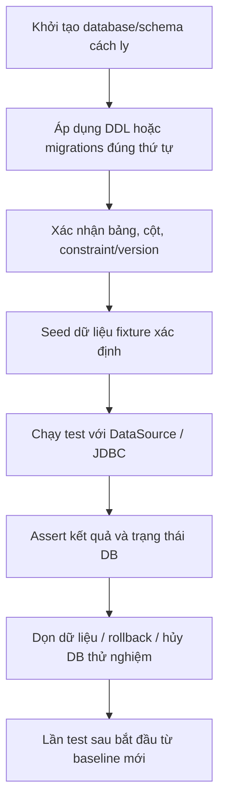
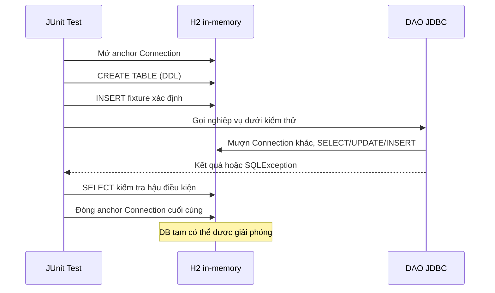
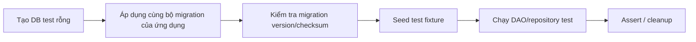

# Thiết lập cơ sở dữ liệu thử nghiệm có lược đồ xác định

Khi kiểm thử mã **JDBC**, kết quả không chỉ phụ thuộc câu `SELECT` hay `UPDATE`. Cùng một DAO có thể chạy đúng trên máy lập trình viên nhưng thất bại trên CI vì bảng chưa được tạo, cột có kiểu khác, thiếu ràng buộc `UNIQUE`, dữ liệu còn sót từ lần chạy trước hoặc thứ tự tạo bảng không đúng. Vì vậy, trước khi kiểm thử `DataSource`, `Connection`, `PreparedStatement`, `ResultSet` và transaction, cần thiết lập **cơ sở dữ liệu thử nghiệm với lược đồ xác định, có thể dựng lại được**.

Bài học thuộc chương **Kiểm thử JDBC** của module **JDBC**. Mục tiêu là thiết kế một môi trường kiểm thử lặp lại được: mỗi lần chạy bắt đầu từ một schema đã biết, dữ liệu khởi tạo do bài kiểm thử kiểm soát, các ràng buộc quan hệ hoạt động và tài nguyên được dọn sạch. Ta sẽ dùng ví dụ Java với **JUnit 5**, **H2 in-memory database**, `DataSource` và SQL tham số hóa; sau đó phân biệt ví dụ đơn giản này với kiểm thử tích hợp trên **DBMS thực tế của môi trường triển khai**.

> **Nguyên tắc:** Một bài kiểm thử JDBC đáng tin phải biết **schema nào đang chạy, phiên bản schema từ đâu đến, dữ liệu ban đầu là gì và sau mỗi test trạng thái được khôi phục như thế nào**. Không dùng ngẫu nhiên một database đang có sẵn rồi hy vọng dữ liệu và cấu trúc giống mong đợi.

## 1. “Lược đồ xác định” nghĩa là gì?

Một **schema xác định** (*deterministic schema*) là tập cấu trúc cơ sở dữ liệu được mô tả và khởi tạo theo quy trình rõ ràng, để các lần chạy có cùng điều kiện đầu vào tạo ra cùng một cấu trúc mong đợi. Nó bao gồm nhiều hơn chỉ tên bảng.

| Thành phần cần xác định | Ví dụ | Vì sao ảnh hưởng bài kiểm thử? |
|---|---|---|
| Bảng và tên cột | `catalog_item.item_id`, `stock_reservation.quantity` | Câu SQL của DAO phải tham chiếu đúng đối tượng. |
| Kiểu dữ liệu | `BIGINT`, `VARCHAR(40)`, `INTEGER`, `DECIMAL(12,2)` | Ảnh hưởng `setXxx/getXxx`, độ chính xác và chuyển kiểu. |
| Khóa chính | `PRIMARY KEY(item_id)` | Bảo đảm danh tính bản ghi và hành vi trùng khóa. |
| Ràng buộc duy nhất | `UNIQUE(sku)` | Đảm bảo không tạo hai sản phẩm có cùng SKU. |
| Khóa ngoại | `FOREIGN KEY(item_id) REFERENCES catalog_item(item_id)` | Kiểm tra quan hệ và thứ tự tạo/xóa dữ liệu. |
| Ràng buộc kiểm tra | `CHECK (quantity > 0)` | Đảm bảo DB thực thi một quy tắc dữ liệu. |
| Default, nullability | `NOT NULL`, `DEFAULT 0` | Quyết định một `INSERT` thiếu giá trị có hợp lệ không. |
| Index và view cần dùng | Index cho các điều kiện tra cứu, view có hợp đồng rõ | Ảnh hưởng kế hoạch truy vấn và một số test hiệu năng. |
| Schema/catalog, collation, timezone | Cấu hình DBMS và phiên | Có thể thay đổi cách so sánh chuỗi, ngày giờ và tên định danh. |
| Phiên bản migration | `V1`, `V2` theo công cụ migration của dự án | Giúp test dùng đúng cấu trúc đã được phát hành. |

Cần phân biệt ba lớp ổn định:

1. **Schema xác định:** cùng định nghĩa bảng/cột/constraint/migration.
2. **Fixture xác định:** cùng dữ liệu thử nghiệm do test chuẩn bị, không phụ thuộc dữ liệu còn sót.
3. **Môi trường xác định:** cùng loại DBMS/driver phiên bản được kiểm soát và cấu hình quan trọng.

**Schema giống nhau chưa đủ để mọi kết quả test giống nhau** nếu dữ liệu, transaction isolation, locale hoặc phiên bản JDBC driver khác nhau.

## 2. Các mức kiểm thử liên quan tới cơ sở dữ liệu

Không phải bài kiểm thử nào cũng cần khởi động một DBMS đầy đủ. Nhưng khi mục tiêu là xác minh **SQL, mapping và transaction JDBC**, chỉ mock `Connection` hoặc `ResultSet` sẽ không phát hiện được lỗi thực thi SQL và constraint ở máy chủ.

| Cấp kiểm thử | Môi trường | Được kiểm chứng | Không đủ để chứng minh |
|---|---|---|---|
| Unit test với mock/fake | Không có DBMS thực | Nhánh xử lý Java, cách gọi API khi giả lập kết quả | Cú pháp SQL, khóa ngoại, isolation, hành vi driver. |
| JDBC test với in-memory DB | H2 hoặc DB nhúng khác được cấu hình | DML, mapping, transaction, constraint theo **engine thử nghiệm** | Toàn bộ tương thích với PostgreSQL/MySQL/Oracle/SQL Server thật. |
| Integration test với DBMS mục tiêu | Instance/container DB giống sản xuất | Dialect SQL, driver, migration, ràng buộc, nhiều tình huống concurrency | Mọi giới hạn hiệu năng sản xuất hoặc lỗi mạng ngẫu nhiên. |
| End-to-end test | Ứng dụng và nhiều thành phần thực | Luồng nghiệp vụ đi qua tầng JDBC | Chẩn đoán chính xác mọi lỗi schema nếu dữ liệu khó kiểm soát. |

Trong bài này, **H2** minh họa cách dựng DB tạm nhanh và cô lập. Khi ứng dụng triển khai trên một DBMS cụ thể, cần bổ sung kiểm thử tích hợp chạy **đúng sản phẩm/phiên bản cơ sở dữ liệu đó** cho các tính năng phụ thuộc dialect, khóa, migration và kiểu SQL nâng cao.

## 3. Thiết kế một schema nhỏ nhưng có ràng buộc rõ ràng

Giả sử ứng dụng có chức năng **giữ hàng trong kho**. Một schema thử nghiệm đủ nhỏ để hiểu nhưng vẫn kiểm tra được thao tác nhiều bảng:

```sql
CREATE TABLE catalog_item (
    item_id BIGINT PRIMARY KEY,
    sku VARCHAR(40) NOT NULL UNIQUE,
    available INTEGER NOT NULL,
    CONSTRAINT ck_catalog_available CHECK (available >= 0)
);

CREATE TABLE stock_reservation (
    reservation_id BIGINT PRIMARY KEY,
    item_id BIGINT NOT NULL,
    quantity INTEGER NOT NULL,
    CONSTRAINT ck_reservation_quantity CHECK (quantity > 0),
    CONSTRAINT fk_reservation_item
        FOREIGN KEY (item_id) REFERENCES catalog_item (item_id)
);
```

Các tên được chọn để dễ kiểm tra bằng JDBC và tránh tên quá chung như `user` hoặc `order` có thể là từ khóa của DBMS. Bài học dùng `BIGINT`/`INTEGER`/`VARCHAR` và cú pháp constraint thông dụng. **Không có bảo đảm DDL trên chạy nguyên văn ở mọi DBMS**; cần xác minh cú pháp và khả năng thực thi `CHECK`, thứ tự khóa ngoại và ngữ nghĩa kiểu dữ liệu ở driver/engine triển khai.

### Các bất biến (*invariants*) của schema

| Bất biến | Nơi thực thi | Test cần kiểm chứng |
|---|---|---|
| Mỗi `item_id` xác định một sản phẩm | `PRIMARY KEY` | Chèn trùng ID phải thất bại. |
| Không có hai sản phẩm cùng `sku` | `UNIQUE(sku)` | Chèn SKU trùng phải thất bại. |
| Không được để tồn kho âm | `CHECK (available >= 0)` | Cập nhật thành `-1` phải thất bại trên DBMS hỗ trợ. |
| Mỗi reservation có định danh duy nhất | `PRIMARY KEY(reservation_id)` | Reservation ID trùng phải thất bại. |
| Reservation phải tham chiếu một sản phẩm có thật | `FOREIGN KEY` | Chèn reservation với `item_id` không tồn tại phải thất bại. |
| Số lượng giữ phải dương | `CHECK (quantity > 0)` | Chèn số lượng 0/âm phải thất bại. |

Không chỉ kiểm thử câu SQL thành công. Những **test âm** (negative tests) cho ràng buộc là bằng chứng quan trọng rằng schema thực sự được dựng đúng.

### Tại sao không bỏ hết constraint để test chạy nhanh?

Bỏ constraint có thể làm các test đơn giản chạy qua nhưng khiến ứng dụng vô tình tạo dữ liệu mà DB sản xuất sẽ từ chối. Nếu tính đúng đắn của nghiệp vụ phụ thuộc `FOREIGN KEY`, `NOT NULL` hoặc `UNIQUE`, môi trường kiểm thử cần có các ràng buộc đó. Có thể dùng một schema tối giản cho **unit-like integration test**, nhưng phải biết rõ phần khác biệt và có bộ kiểm thử trên schema production thực tế.

## 4. Quy trình dựng database thử nghiệm có thể lặp lại

Quy trình chuẩn:



**Thứ tự thực hiện quan trọng:**

1. Tạo một database hoặc schema **dành riêng cho test**.
2. Áp dụng **một nguồn định nghĩa schema có kiểm soát**: DDL phiên bản hóa hoặc migration thực tế của ứng dụng.
3. Chờ schema sẵn sàng và **báo lỗi ngay** nếu DDL/migration thất bại.
4. Seed chỉ các bản ghi mà test cần, dùng `PreparedStatement`.
5. Chạy thao tác cần kiểm chứng, xác nhận qua một truy vấn mới hoặc đúng transaction theo mục tiêu.
6. Dọn tài nguyên và **không để test tiếp theo thừa hưởng trạng thái không xác định**.

Một test tạo bảng lỗi nhưng vẫn tiếp tục chạy các test còn lại sẽ gây thông báo khó hiểu kiểu “table not found” hoặc “column not found”. Phải để lỗi setup hiện rõ tại bước nó xảy ra, không bắt `SQLException` rồi bỏ qua.

## 5. Chọn chiến lược cô lập phù hợp

Có ba cách phổ biến để mỗi test bắt đầu từ trạng thái biết trước:

| Chiến lược | Ưu điểm | Rủi ro/cần chú ý |
|---|---|---|
| **Database/schema mới cho mỗi test** | Cô lập tốt; hỗ trợ chạy song song; không cần đoán dữ liệu còn sót. | Dựng lại schema tốn thời gian; cần lifecycle quản lý tài nguyên. |
| **Một DB test dùng chung, reset fixture trước mỗi test** | Ít tốn chi phí khởi tạo; có thể tiện cho bộ test lớn. | Dễ sai thứ tự `DELETE`, sequence và dữ liệu nền; khó song song. |
| **Transaction bao mỗi test rồi rollback** | Nhanh với test chỉ dùng một kết nối/transaction. | Không rollback được DDL commit ngầm; mã mở kết nối khác có thể không nằm trong transaction test; một số DBMS không hỗ trợ mọi thao tác rollback. |

Với ví dụ đơn giản trong bài, ta dùng **H2 in-memory database có tên ngẫu nhiên riêng cho mỗi test**. Cách này tránh test phụ thuộc vào thứ tự chạy hoặc dữ liệu của test khác.

Với production schema lớn, có thể tạo **mỗi test class một DB riêng** và reset dữ liệu giữa các test, hoặc dùng database template/snapshot được quản lý cẩn thận. Mức cô lập cần phản ánh tốc độ test, rủi ro song song và yêu cầu kiểm thử transaction.

### Không nhầm tên database ngẫu nhiên với dữ liệu ngẫu nhiên

Tên database tạm có thể mang một `UUID` để **tránh va chạm tài nguyên**. Dữ liệu fixture bên trong vẫn nên dùng giá trị cố định, dễ kiểm tra, chẳng hạn `item_id = 101` và `available = 3`. Một schema xác định không bắt buộc **tên database** giống nhau ở mọi lần chạy; điều quan trọng là cấu trúc và trạng thái đầu vào đã được xác định.

## 6. Thiết lập H2 in-memory để chạy test JDBC

Để có ví dụ chạy được trên một máy Java, ta dùng:

- **JUnit Jupiter (JUnit 5)** để quản lý vòng đời `@BeforeEach`, `@AfterEach` và `@Test`.
- **H2 JDBC driver** trong phạm vi dependency kiểm thử, cung cấp `org.h2.jdbcx.JdbcDataSource`.
- **JDBC API chuẩn**: `DataSource`, `Connection`, `Statement`, `PreparedStatement` và `ResultSet`.

Dự án phải khai báo JUnit Jupiter và H2 trong **test scope/testImplementation** và dùng test runner của JUnit Jupiter. Các phiên bản dependency do build của dự án quản lý; ví dụ không tự đặt phiên bản thư viện hay cấu hình build ngoài phạm vi bài này.

### Cơ chế tồn tại của H2 in-memory

H2 hỗ trợ URL dạng:

```text
jdbc:h2:mem:jdbc_test_abc123
```

Với H2, **database in-memory có tên** thường tồn tại khi còn ít nhất một kết nối mở. Nếu đóng kết nối cuối cùng mà không có cấu hình giữ database, DB sẽ bị giải phóng. Đó là lý do ví dụ mở một **anchor connection** trong `@BeforeEach` và đóng nó trong `@AfterEach`:



**Anchor connection chỉ là kỹ thuật quản lý vòng đời test với H2**, không phải hướng dẫn giữ một connection trong production. DAO vẫn phải **mượn và đóng connection theo từng thao tác**. Ví dụ không dùng `DB_CLOSE_DELAY=-1` để tránh giữ lại vô hạn nhiều database in-memory có tên duy nhất cho tới khi JVM kết thúc.

## 7. Ví dụ JUnit 5 hoàn chỉnh: mỗi test có schema và fixture riêng

Đoạn dưới chứa một lớp kiểm thử tự thiết lập database, seed dữ liệu, thực thi nghiệp vụ và xác nhận trạng thái. Để đơn giản, phương thức `reserve(...)` đóng vai trò code JDBC cần kiểm chứng; dự án thật nên đặt nó trong DAO/service riêng và inject `DataSource`.

```java
import org.h2.jdbcx.JdbcDataSource;
import org.junit.jupiter.api.AfterEach;
import org.junit.jupiter.api.BeforeEach;
import org.junit.jupiter.api.Test;

import java.sql.Connection;
import java.sql.PreparedStatement;
import java.sql.ResultSet;
import java.sql.SQLException;
import java.sql.Statement;
import java.util.UUID;

import static org.junit.jupiter.api.Assertions.assertEquals;
import static org.junit.jupiter.api.Assertions.assertFalse;
import static org.junit.jupiter.api.Assertions.assertThrows;
import static org.junit.jupiter.api.Assertions.assertTrue;

class ReservationJdbcTest {

    private JdbcDataSource dataSource;
    private Connection anchorConnection;

    @BeforeEach
    void setUp() throws SQLException {
        // Mỗi test một tên database riêng, không chia dữ liệu.
        String dbName = "jdbc_test_"
                + UUID.randomUUID().toString().replace("-", "");

        dataSource = new JdbcDataSource();
        dataSource.setURL("jdbc:h2:mem:" + dbName);
        dataSource.setUser("sa");
        dataSource.setPassword("");

        // Giữ H2 in-memory còn tồn tại trong suốt một test.
        anchorConnection = dataSource.getConnection();

        try (Statement statement = anchorConnection.createStatement()) {
            statement.executeUpdate(
                    "CREATE TABLE catalog_item ("
                    + "item_id BIGINT PRIMARY KEY, "
                    + "sku VARCHAR(40) NOT NULL UNIQUE, "
                    + "available INTEGER NOT NULL, "
                    + "CONSTRAINT ck_catalog_available "
                    + "CHECK (available >= 0))");

            statement.executeUpdate(
                    "CREATE TABLE stock_reservation ("
                    + "reservation_id BIGINT PRIMARY KEY, "
                    + "item_id BIGINT NOT NULL, "
                    + "quantity INTEGER NOT NULL, "
                    + "CONSTRAINT ck_reservation_quantity "
                    + "CHECK (quantity > 0), "
                    + "CONSTRAINT fk_reservation_item "
                    + "FOREIGN KEY (item_id) REFERENCES catalog_item(item_id))");
        }

        // Fixture có giá trị cố định, không phụ thuộc test khác.
        try (PreparedStatement insert = anchorConnection.prepareStatement(
                "INSERT INTO catalog_item (item_id, sku, available) "
                + "VALUES (?, ?, ?)")) {
            insert.setLong(1, 101L);
            insert.setString(2, "BOOK-A");
            insert.setInt(3, 3);
            assertEquals(1, insert.executeUpdate());
        }
    }

    @AfterEach
    void tearDown() throws SQLException {
        if (anchorConnection != null) {
            anchorConnection.close();
            anchorConnection = null;
        }
    }

    @Test
    void reserveSuccessUpdatesStockAndAddsReservation()
            throws SQLException {
        assertTrue(reserve(9001L, 101L, 2));

        assertEquals(1, available(101L));
        assertEquals(1, countReservations());
    }

    @Test
    void insufficientStockLeavesDatabaseUnchanged()
            throws SQLException {
        assertFalse(reserve(9002L, 101L, 4));

        assertEquals(3, available(101L));
        assertEquals(0, countReservations());
    }

    @Test
    void uniqueSkuConstraintIsReallyEnabled() {
        assertThrows(SQLException.class, () -> {
            try (Connection connection = dataSource.getConnection();
                 PreparedStatement ps = connection.prepareStatement(
                         "INSERT INTO catalog_item "
                         + "(item_id, sku, available) VALUES (?, ?, ?)")) {

                ps.setLong(1, 102L);
                ps.setString(2, "BOOK-A"); // Trùng SKU của fixture.
                ps.setInt(3, 10);
                ps.executeUpdate();
            }
        });
    }

    @Test
    void foreignKeyRejectsUnknownItem() {
        assertThrows(SQLException.class, () -> {
            try (Connection connection = dataSource.getConnection();
                 PreparedStatement ps = connection.prepareStatement(
                         "INSERT INTO stock_reservation "
                         + "(reservation_id, item_id, quantity) "
                         + "VALUES (?, ?, ?)")) {

                ps.setLong(1, 9003L);
                ps.setLong(2, 999L); // item_id không tồn tại.
                ps.setInt(3, 1);
                ps.executeUpdate();
            }
        });
    }

    private boolean reserve(long reservationId, long itemId, int quantity)
            throws SQLException {
        String updateStock = "UPDATE catalog_item "
                + "SET available = available - ? "
                + "WHERE item_id = ? AND available >= ?";
        String insertReservation = "INSERT INTO stock_reservation "
                + "(reservation_id, item_id, quantity) VALUES (?, ?, ?)";

        try (Connection connection = dataSource.getConnection()) {
            connection.setAutoCommit(false);
            try {
                try (PreparedStatement update =
                             connection.prepareStatement(updateStock)) {
                    update.setInt(1, quantity);
                    update.setLong(2, itemId);
                    update.setInt(3, quantity);

                    if (update.executeUpdate() != 1) {
                        connection.rollback();
                        return false;
                    }
                }

                try (PreparedStatement insert =
                             connection.prepareStatement(insertReservation)) {
                    insert.setLong(1, reservationId);
                    insert.setLong(2, itemId);
                    insert.setInt(3, quantity);

                    if (insert.executeUpdate() != 1) {
                        throw new SQLException("Không thể tạo reservation");
                    }
                }

                connection.commit();
                return true;
            } catch (SQLException | RuntimeException failure) {
                try {
                    connection.rollback();
                } catch (SQLException rollbackError) {
                    failure.addSuppressed(rollbackError);
                }
                throw failure;
            }
        }
    }

    private int available(long itemId) throws SQLException {
        try (Connection connection = dataSource.getConnection();
             PreparedStatement ps = connection.prepareStatement(
                     "SELECT available FROM catalog_item WHERE item_id = ?")) {
            ps.setLong(1, itemId);
            try (ResultSet rs = ps.executeQuery()) {
                if (!rs.next()) {
                    throw new SQLException("Không có item " + itemId);
                }
                return rs.getInt("available");
            }
        }
    }

    private int countReservations() throws SQLException {
        try (Connection connection = dataSource.getConnection();
             PreparedStatement ps = connection.prepareStatement(
                     "SELECT COUNT(*) FROM stock_reservation");
             ResultSet rs = ps.executeQuery()) {
            rs.next();
            return rs.getInt(1);
        }
    }
}
```

### Vì sao ví dụ tái lập được?

- **Mỗi `@Test` một database khác nhau:** tên H2 được tạo riêng trong `@BeforeEach`; test không đọc dữ liệu của test khác.
- **Schema cố định:** hai lệnh `CREATE TABLE` chạy theo thứ tự **bảng cha trước bảng con** vì bảng `stock_reservation` có khóa ngoại trỏ tới `catalog_item`.
- **Không dựa vào ID tự sinh:** fixture cố định `item_id=101`, `sku=BOOK-A`, `available=3`. Kết quả kỳ vọng rõ ràng.
- **Bind SQL có tham số:** các câu DML dùng `?` với `PreparedStatement`; không nối dữ liệu đầu vào trực tiếp vào SQL.
- **Giao dịch tường minh:** trừ tồn và tạo reservation trên **cùng một `Connection`**, rollback nếu không đủ tồn hoặc xảy ra lỗi.
- **Assert trạng thái DB:** test không chỉ dựa vào boolean trả về mà còn truy vấn lại số lượng tồn và reservation.
- **Đóng tài nguyên:** `ResultSet`, statement và connection của DAO đều nằm trong `try-with-resources`. Anchor chỉ đóng ở `@AfterEach`, khi các kết nối tác nghiệp đã được đóng.

**Giới hạn của ví dụ:** class kiểm thử dùng **DDL định nghĩa trực tiếp trong mã** để chủ đề dễ hiểu. Đây **không phải khuyến nghị duy trì lâu dài một bản sao DDL độc lập** với migration của ứng dụng. Trong test tích hợp thực tế, nên chạy chính các migration/schema scripts được dùng để triển khai, thay vì viết lại DDL bằng tay trong từng test rồi để chúng lệch nhau.

### Điều gì xảy ra nếu test bị lỗi giữa chừng?

JUnit Jupiter vẫn thực thi cơ chế `@AfterEach` theo lifecycle của framework; ví dụ cố đóng `anchorConnection`. Các connection mở trong DAO đã được bảo vệ bởi `try-with-resources`. Nếu việc tạo schema hoặc seed thất bại, test phải báo lỗi ngay; không bỏ qua `SQLException` để cố chạy tiếp trên database chưa hoàn chỉnh.

Đối với môi trường tích hợp phức tạp, hãy quản lý cả trường hợp JVM bị dừng đột ngột hoặc CI job bị hủy: container/instance database thử nghiệm cần có chính sách cleanup độc lập, không chỉ phụ thuộc `@AfterEach`.

## 8. Seed dữ liệu xác định bằng PreparedStatement

Một fixture tốt **chứa dữ liệu tối thiểu đủ để mô tả tình huống**. Ví dụ:

```text
catalog_item
+---------+---------+-----------+
| item_id | sku     | available |
+---------+---------+-----------+
| 101     | BOOK-A  | 3         |
+---------+---------+-----------+

stock_reservation
(tập rỗng)
```

Nếu muốn kiểm thử hai sản phẩm, dùng ID cố định khác biệt như `102`, `103` và mô tả rõ số lượng tương ứng. Đừng dùng `SELECT MAX(id) + 1` để chọn ID fixture, vì kết quả phụ thuộc dữ liệu còn sót và có thể xảy ra tranh chấp.

Ví dụ thêm nhiều fixture với batch tham số hóa:

```java
String sql = "INSERT INTO catalog_item "
        + "(item_id, sku, available) VALUES (?, ?, ?)";

try (Connection connection = dataSource.getConnection()) {
    connection.setAutoCommit(false);

    try {
        try (PreparedStatement ps = connection.prepareStatement(sql)) {
            long[] ids = {102L, 103L};
            String[] skus = {"PEN-B", "NOTE-C"};
            int[] quantities = {5, 0};

            for (int i = 0; i < ids.length; i++) {
                ps.setLong(1, ids[i]);
                ps.setString(2, skus[i]);
                ps.setInt(3, quantities[i]);
                ps.addBatch();
            }

            int[] counts = ps.executeBatch();
            if (counts.length != ids.length) {
                throw new SQLException("Fixture batch không đầy đủ");
            }
            for (int count : counts) {
                if (count != 1
                        && count != java.sql.Statement.SUCCESS_NO_INFO) {
                    throw new SQLException(
                            "Không thể seed đủ dữ liệu: " + count);
                }
            }
        }

        connection.commit();

    } catch (SQLException | RuntimeException failure) {
        try {
            connection.rollback();
        } catch (SQLException rollbackError) {
            failure.addSuppressed(rollbackError);
        }
        throw failure;
    }
}
```

Đoạn trên minh họa việc seed trong **một transaction**. Nếu test chuẩn bị nhiều bảng, đảm bảo chèn **bảng cha trước bảng con**, kiểm tra kết quả và chỉ commit khi toàn bộ fixture hợp lệ. Với engine hỗ trợ transaction, lỗi seed không nên để lại nửa bộ dữ liệu.

**Lưu ý với batch:** `SUCCESS_NO_INFO` là thành công nhưng không rõ số dòng, không phải dấu hiệu chỉ cập nhật 0 hàng. Nếu driver ném `BatchUpdateException`, cần rollback transaction nếu yêu cầu fixture atomic.

### Dữ liệu có thời gian và số thực

Để test tái lập:

- Tránh dựa vào `CURRENT_TIMESTAMP` hoặc `LocalDateTime.now()` trong kết quả kỳ vọng nếu không kiểm soát clock. Dùng thời điểm cố định hoặc inject `Clock` vào nghiệp vụ.
- Nếu cần timestamp, xác định rõ UTC/múi giờ phiên và ánh xạ JDBC (`Timestamp`, `OffsetDateTime`, `LocalDate` tùy kiểu SQL/driver).
- Dùng `BigDecimal` cho tiền thay vì `double` khi cần tính chính xác; kiểm tra `DECIMAL(12,2)` và scale theo DBMS.
- Với chuỗi Unicode, có fixture gồm ký tự tiếng Việt và kiểm tra charset/collation thực tế khi ứng dụng phụ thuộc.
- Không dùng dữ liệu ngẫu nhiên không có seed cho những trường mà assert cần so sánh chính xác.

**Schema xác định** kết hợp **fixture xác định** giúp một lỗi test tái hiện được thay vì biến mất ở lần chạy sau.

## 9. Dùng migration của ứng dụng làm nguồn sự thật

Trong dự án thực tế, schema thường thay đổi theo thời gian. Nếu môi trường test viết một DDL riêng, sớm muộn có thể xuất hiện **schema drift**:

```text
Production migration V3:
    ALTER TABLE catalog_item ADD COLUMN active BOOLEAN NOT NULL ...

DDL trong test vẫn chỉ có:
    item_id, sku, available

=> Test DAO trên H2 chạy xanh, nhưng SQL triển khai thật đã yêu cầu cột active.
```

Giải pháp tốt là dùng **cùng bộ migration đã được phiên bản hóa** như khi triển khai. Các công cụ phổ biến có thể là **Flyway** hoặc **Liquibase**, hoặc một bộ script migration nội bộ được quản lý có quy trình rõ ràng.

Một luồng integration test dùng migration:



**Những nguyên tắc cần giữ:**

1. Có một **nguồn sự thật** cho schema triển khai (script/migration), không tự tạo nhiều bản DDL bằng tay không liên kết.
2. Test trên database rỗng và **chạy các migration theo đúng thứ tự**.
3. Fail-fast nếu migration không thành công, thiếu phiên bản, lỗi checksum hoặc thiếu đối tượng DB.
4. Đảm bảo fixture thích nghi có chủ đích với schema hiện tại, thay vì âm thầm bỏ constraint để test qua.
5. Thỉnh thoảng kiểm chứng **migrating từ phiên bản cũ** lên phiên bản mới, không chỉ dựng fresh DB; thao tác nâng cấp dữ liệu có thể thất bại dù schema mới từ đầu chạy được.

Trong ví dụ học tập ta viết DDL inline vì chỉ có hai bảng; trong ứng dụng lớn, khâu setup nên **gọi migration runner của dự án** thay vì sao chép câu `CREATE TABLE` vào Java.

### Có nên dùng `CREATE TABLE IF NOT EXISTS` trong test setup?

Cần thận trọng. Lệnh đó có thể giúp chạy script nhiều lần, nhưng cũng có thể **che giấu một bảng cũ với cấu trúc sai**: database tồn tại và test tiếp tục dù cột/constraint không đúng kỳ vọng.

Nếu mục tiêu là một baseline sạch, tốt hơn là dùng một database/schema mới, chạy migration với kiểm tra phiên bản và báo lỗi khi môi trường không như dự kiến. `IF NOT EXISTS` chỉ phù hợp khi bạn đã có **chiến lược nâng cấp/kiểm tra cấu trúc riêng**.

## 10. Kiểm tra schema sau khi dựng bằng DatabaseMetaData

Sau khi DDL/migration chạy, ta có thể xác minh thông tin thực tế của DB bằng API chuẩn `DatabaseMetaData`.

Các phương thức đáng biết:

| API | Kiểm tra |
|---|---|
| `connection.getMetaData().getTables(...)` | Tên bảng và loại đối tượng trong catalog/schema. |
| `getColumns(...)` | Tên cột, mã kiểu SQL, nullability, kích thước và thứ tự cột. |
| `getPrimaryKeys(...)` | Các cột thuộc khóa chính. |
| `getImportedKeys(...)` | Khóa ngoại mà bảng tham chiếu tới bảng khác. |
| `getIndexInfo(...)` | Thông tin chỉ mục mà driver công bố. |

Ví dụ với H2, **định danh không đặt dấu nháy** thường được lưu ở dạng chữ hoa trong metadata. Có thể kiểm tra kiểu của cột `AVAILABLE`:

```java
import java.sql.Connection;
import java.sql.DatabaseMetaData;
import java.sql.ResultSet;
import java.sql.SQLException;
import java.sql.Types;
import javax.sql.DataSource;

// dataSource là instance dùng cho database test H2 đã dựng.
try (Connection connection = dataSource.getConnection()) {
    DatabaseMetaData db = connection.getMetaData();

    try (ResultSet columns = db.getColumns(
            null,       // catalog
            null,       // schemaPattern
            "CATALOG_ITEM",
            "AVAILABLE")) {

        if (!columns.next()) {
            throw new SQLException(
                    "Schema test thiếu catalog_item.available");
        }

        int sqlType = columns.getInt("DATA_TYPE");
        if (sqlType != Types.INTEGER) {
            throw new SQLException(
                    "Sai kiểu available; JDBC type = " + sqlType);
        }
    }
}
```

Đoạn trên mô tả cách kiểm tra kỹ thuật. Với JUnit có thể dùng `assertTrue(columns.next())` và `assertEquals(Types.INTEGER, ...)`. Chọn catalog/schema và cách viết hoa tên bảng theo **driver đang dùng**; không mặc định mọi DBMS trả `CATALOG_ITEM` chữ hoa. JDBC còn có `DatabaseMetaData.storesUpperCaseIdentifiers()`, `storesLowerCaseIdentifiers()` và khả năng identifier quoting để hỗ trợ việc xác định tên đúng.

**Không nên chỉ nhìn bảng có tồn tại**. Một bảng `catalog_item` thiếu `UNIQUE(sku)` vẫn có thể vượt qua test tạo/đọc đơn giản. Hãy kết hợp metadata với **test hành vi constraint** ở phần 7, bởi một số driver báo metadata hạn chế hoặc DBMS có chế độ không thực thi đầy đủ constraint mà DDL đã khai báo.

### Kiểm tra schema bằng truy vấn không trả hàng

Nếu chỉ muốn xác nhận projection mà DAO mong đợi, có thể thực thi một câu `SELECT` không trả dữ liệu:

```java
String sql = "SELECT item_id, sku, available "
        + "FROM catalog_item WHERE 1 = 0";

try (Connection connection = dataSource.getConnection();
     PreparedStatement ps = connection.prepareStatement(sql);
     ResultSet rs = ps.executeQuery()) {

    java.sql.ResultSetMetaData md = rs.getMetaData();
    if (md.getColumnCount() != 3) {
        throw new SQLException("Projection không đúng");
    }
}
```

`ResultSetMetaData` mô tả **cột kết quả của câu SELECT**; nó không tự chứng minh đủ khóa chính/khóa ngoại trong schema. Khi test cần kiểm tra constraint, dùng `DatabaseMetaData` và test thao tác SQL gây vi phạm tương ứng.

## 11. Reset database dùng chung: các điểm dễ làm sai

Không phải test suite nào cũng đủ nhanh để tạo database mới cho từng test. Nếu dùng một DB test chung, cần định nghĩa cách làm sạch **trước** mỗi test (hoặc sau mỗi test cộng với bước setup đảm bảo baseline).

### Xóa theo thứ tự khóa ngoại

Với schema ví dụ:

```sql
DELETE FROM stock_reservation;
DELETE FROM catalog_item;
```

Bảng con được xóa **trước** vì chứa khóa ngoại trỏ tới bảng cha. Khi seed lại, chèn theo thứ tự **cha trước, con sau**.

Lệnh `DELETE` tôn trọng transaction và constraint theo DBMS. Lệnh `TRUNCATE` có thể nhanh hơn, nhưng hành vi commit, identity/sequence reset, khóa và khả năng dùng khi có FK **khác nhau giữa hệ quản trị**. Không dùng `TRUNCATE ... CASCADE` một cách thiếu kiểm soát nếu có nguy cơ xóa dữ liệu ngoài phạm vi bài test.

### Không dựa vào ID tự tăng ở trạng thái cũ

Nếu bảng có `IDENTITY`/`AUTO_INCREMENT`/sequence, xóa hết hàng không nhất thiết reset bộ đếm. Hai test chạy nối tiếp có thể thấy ID khác nhau dù seed cùng số bản ghi. Các cách tránh:

- Dùng **ID tường minh** cho fixture, như ví dụ ở đây.
- Hoặc reset sequence/identity bằng cú pháp **của DBMS**, trong phạm vi test database được cô lập.
- Không viết assert “ID tiếp theo chắc chắn là 1” trừ khi setup bảo đảm đúng điều đó.

### Tránh test thứ tự thực thi

Một bài test không được cần bài test khác chạy trước mới có bảng hoặc dữ liệu. Dùng `@BeforeEach`, fixture factory, migration hoặc một reset độc lập. Không dựa vào thứ tự sắp xếp tên `@Test` hay thời điểm thread chạy.

Nếu test suite bật chạy song song trên **cùng database/schema**, reset bằng `DELETE` có thể xóa dữ liệu của test đang chạy. Khi đó phải dùng database/schema riêng cho từng test hoặc cơ chế cách ly có hợp đồng rõ, thay vì cố vá bằng `Thread.sleep(...)`.

## 12. Rollback sau mỗi test: nhanh nhưng có giới hạn

Một chiến lược là:

```text
@BeforeEach:
    Mượn Connection A
    setAutoCommit(false)
    Seed dữ liệu trong transaction A

@Test:
    DAO chạy SQL trên Connection A

@AfterEach:
    rollback() trên Connection A
    close()
```

Chiến lược này **chỉ đáng tin** khi mọi thao tác cần rollback thực sự nằm trong **cùng transaction**. Nếu DAO tự gọi `dataSource.getConnection()` và nhận **Connection B**, transaction test trên A **không rollback thay đổi đã commit từ B**.

Một số framework cung cấp **transaction test context** hoặc connection binding để các DAO tham gia transaction chung. Với JDBC thuần, không có cơ chế mặc định làm mọi kết nối từ một `DataSource` tự động cùng chung transaction. Vì vậy, đừng dùng `@AfterEach` rollback một connection rồi mặc định nó dọn sạch toàn bộ các thay đổi do ứng dụng thực hiện.

Đặc biệt:

- DDL có thể tự commit theo DBMS, không thể giả định rollback `CREATE TABLE` an toàn trên mọi hệ.
- Kết nối riêng do background worker hoặc async task sử dụng có thể không tham gia test transaction.
- Sequence/identity và session state có thể không rollback giống dữ liệu hàng.
- Nếu muốn test **tính bền vững sau commit**, rollback mọi test còn có thể che giấu lỗi mà production gặp.

Dùng DB/schema mới hoặc reset dữ liệu có kiểm soát khi cần kiểm chứng transaction thật giữa **nhiều kết nối**.

## 13. H2 test và DBMS sản xuất: vì sao cần cả hai?

H2 giúp dựng database nhanh, nhưng nó **không phải PostgreSQL, MySQL, SQL Server hay Oracle**. Có thể có khác biệt về:

- Cú pháp SQL và từ khóa được phép, kiểu dữ liệu/ép kiểu.
- `BOOLEAN`, `JSON`, `UUID`, `TIMESTAMP WITH TIME ZONE`, `ARRAY` và các kiểu SQL nâng cao.
- Quy tắc `AUTO_INCREMENT`/identity, sequence, giá trị mặc định.
- Collation, Unicode, phân biệt chữ hoa/thường, phép so sánh chuỗi.
- `ON CONFLICT`, `RETURNING`, upsert và cú pháp phân trang.
- Mức isolation, MVCC, khóa, deadlock và xử lý transaction lỗi.
- Ràng buộc `CHECK`, unique null semantics, partial index, trigger và stored routine.
- DDL transactional, migration và khả năng rollback.
- Hành vi JDBC driver khi dùng `getGeneratedKeys()`, batching, fetch size, SQLXML hoặc cursor.

Một **compatibility mode** của H2 có thể giúp chấp nhận một số cú pháp giống DBMS khác, nhưng **không biến H2 thành cùng một engine**. Một test H2 chạy xanh không phải chứng cứ đầy đủ cho behavior production.

### Khi cần DBMS thật trong kiểm thử

Dùng một DBMS thử nghiệm cùng loại với môi trường triển khai khi cần kiểm chứng:

1. **Migration thật** của ứng dụng từ database rỗng và từ schema phiên bản cũ.
2. Constraint, unique index, FK, trigger, generated keys, default và kiểu dữ liệu đặc thù.
3. Isolation, locking, deadlock, transaction state và rollback sau lỗi.
4. `PreparedStatement` với SQL dialect, `ResultSet` mapping và driver thực tế.
5. Hiệu năng truy vấn, index và `EXPLAIN` với dữ liệu có quy mô đại diện.

Có thể tạo DB test tạm bằng container (ví dụ Testcontainers hoặc môi trường CI cấp instance tách biệt). Mỗi test/job dùng database hoặc schema được **đặt tên riêng, có vòng đời rõ**; không dùng production credentials và không chạy `DROP` nguy hiểm trên một kết nối chưa được xác minh là test-only.

**Chú ý:** Container DBMS cùng phiên bản giúp gần với production hơn nhưng vẫn không tái tạo toàn bộ mạng, storage, dữ liệu và tải thực. Những kiểm thử hiệu năng/khả năng chịu tải cần môi trường phù hợp hơn.

## 14. Configuration và an toàn: không trỏ nhầm vào production

Khởi tạo database test cần được thiết kế **fail-closed** nếu cấu hình thiếu hoặc bất thường.

Các biện pháp quan trọng:

- Dùng **URL, username và secret riêng** cho test; test không có quyền truy cập production.
- Không lấy thông tin kết nối mặc định từ biến môi trường production khi thiếu biến test; tốt hơn là báo lỗi setup.
- Nếu test có thao tác `DROP TABLE`, `TRUNCATE` hoặc reset schema, chỉ chạy sau khi xác định connection trỏ đúng database thử nghiệm.
- Giới hạn quyền tài khoản test trong schema/database tạm; không trao quyền xóa database khác.
- Không in password hoặc URL chứa credential vào log.
- Khi chạy song song, gắn database/schema với một định danh test/job để tránh va chạm.
- Kiểm soát lifecycle: đóng `ResultSet`, `PreparedStatement`, `Connection`, pool và container theo framework, kể cả khi test thất bại.

Một guard ở tầng setup có thể kiểm tra tên database/schema và metadata của connection trước khi chạy DDL phá hủy. **Guard chỉ là lớp bảo vệ bổ sung**; biện pháp tốt nhất vẫn là dùng tài khoản và endpoint không thể truy cập dữ liệu sản xuất.

### Đừng chia sẻ DataSource sống dài một cách thiếu kiểm soát

Bản thân `DataSource` có thể là thành phần dùng chung trong ứng dụng hoặc test suite, nhưng **mỗi test cần xác định nó đang trỏ tới schema/database nào**. Nếu một test thay đổi catalog/schema của connection rồi trả về pool, test khác có thể nhận trạng thái phiên không mong đợi tùy khả năng reset của pool. Nếu dùng pool trong test, phải đóng pool theo lifecycle của suite và kiểm chứng việc reset trạng thái kết nối.

## 15. Checklist dữ liệu và schema sau từng bài kiểm thử

Bài test nghiệp vụ không nên chỉ assert Java trả `true`; cần xác nhận **hậu điều kiện dữ liệu** và **không có thay đổi ngoài dự kiến**.

Ví dụ với lệnh đặt chỗ thành công:

| Kiểm tra | Kỳ vọng |
|---|---|
| Số lượng `catalog_item.available` trước test | `3` |
| Gọi `reserve(9001, 101, 2)` | Thành công |
| `catalog_item.available` sau commit | `1` |
| Số hàng trong `stock_reservation` | `1` |
| `reservation_id` của hàng mới | `9001` |
| `item_id/quantity` ở hàng mới | `101` và `2` |
| Ràng buộc `CHECK/FK/UNIQUE` | Vẫn tồn tại và hoạt động |

Với lệnh đặt chỗ thất bại do thiếu tồn:

| Kiểm tra | Kỳ vọng |
|---|---|
| Fixture ban đầu | `available = 3`, reservation rỗng |
| Gọi `reserve(9002, 101, 4)` | Trả `false` |
| Tồn kho sau lời gọi | Vẫn là `3` |
| Reservation sau lời gọi | Vẫn `0` hàng |
| Transaction | Không có thay đổi bán dở được commit |

Nếu một test có nhiều câu SQL, nên quan sát hậu điều kiện qua **một connection/transaction mới sau commit** khi muốn chứng minh tính bền vững của thay đổi. Đọc dữ liệu chưa commit trên chính connection đang sửa không đủ để chứng minh `commit()` đã xảy ra.

## 16. Lỗi setup thường gặp và cách chẩn đoán

| Lỗi | Triệu chứng | Cách xử lý |
|---|---|---|
| Không áp dụng DDL trước khi chạy DAO | `Table not found` hoặc SQLState tương đương | Tạo DB và chạy migration/setup trước fixture/test. |
| Tạo bảng con trước bảng cha | FK tham chiếu tới đối tượng chưa tồn tại | Sắp thứ tự DDL theo phụ thuộc. |
| DDL copy riêng bị lệch production | Test xanh nhưng ứng dụng thật lỗi cột/kiểu | Chạy migration chung và integration test trên DB mục tiêu. |
| Dùng `CREATE TABLE IF NOT EXISTS` che schema cũ | Bảng tồn tại nhưng thiếu constraint mới | Dựng DB rỗng, kiểm tra phiên bản và metadata. |
| Test dùng DB chung không reset | Một số test qua hoặc lỗi tùy thứ tự | Database/schema riêng, reset xác định hoặc transaction đúng phạm vi. |
| Test dùng sequence/identity không reset | Assert về ID tự sinh không ổn định | Gán ID fixture cố định hoặc reset sequence đúng DBMS. |
| Rollback trên Connection A nhưng DAO ghi qua B | Dữ liệu vẫn tồn tại sau test | Cô lập DB hoặc bảo đảm transaction binding thực sự. |
| H2 in-memory bị hủy giữa setup và test | Test không thấy bảng dù DDL từng thành công | Giữ một anchor connection hoặc cấu hình lifecycle có chủ đích. |
| H2 giữ DB mãi do `DB_CLOSE_DELAY=-1` với tên tạo liên tục | Tài nguyên bộ nhớ test tăng theo số test | Dùng anchor và đóng cuối test hoặc chiến lược cleanup phù hợp. |
| `DELETE` sai thứ tự FK | Vi phạm ràng buộc khi reset | Xóa bảng con trước, seed bảng cha trước. |
| Test dùng thời gian/mã ngẫu nhiên không kiểm soát | Kết quả phụ thuộc lúc chạy | Clock cố định, ID/fixture xác định, seed randomness nếu có. |
| Bắt rồi bỏ qua `SQLException` trong setup | Lỗi thực xuất hiện ở assert phía sau, khó chẩn đoán | Fail-fast tại bước DDL/migration/seed thất bại. |
| Test trỏ nhầm endpoint production | Nguy cơ làm thay đổi dữ liệu thật | Tài khoản test riêng, allowlist/guard và quyền tối thiểu. |
| Test H2 cho rằng đặc tính khóa giống DB thực | Lỗi concurrency chỉ xảy ra khi triển khai | Chạy test trên đúng DBMS/driver. |

### Log đủ để phân tích nhưng không lộ thông tin nhạy cảm

Khi setup thất bại, hữu ích nhất là biết **bước nào lỗi**: tạo DB, migration, tạo bảng, seed fixture, gọi DAO hay assertion. Với `SQLException`, ghi:

- `getSQLState()` và `getErrorCode()`.
- Tên migration/statement setup (không ghi tham số nhạy cảm).
- DBMS và JDBC driver phiên bản lấy từ `DatabaseMetaData`.
- Tên **database test đã được xác minh** và schema hiện tại nếu cần.

Ví dụ:

```java
try (Connection connection = dataSource.getConnection()) {
    java.sql.DatabaseMetaData meta = connection.getMetaData();

    System.out.println("DBMS: " + meta.getDatabaseProductName());
    System.out.println("DB version: " + meta.getDatabaseProductVersion());
    System.out.println("Driver: " + meta.getDriverName());
    System.out.println("Driver version: " + meta.getDriverVersion());
}
```

Không in mật khẩu, token hoặc connection URL chứa secret. Test có thể chạy trong CI mà log được lưu giữ lâu và nhiều người truy cập.

## 17. Bài thực hành để củng cố

### Thực hành A — Schema chưa tồn tại

1. Tạo một database test rỗng nhưng **không** chạy `CREATE TABLE`.
2. Gọi DAO `SELECT` trên `catalog_item` và ghi nhận `SQLException`.
3. Sau đó chạy DDL đúng thứ tự, seed fixture và chạy lại test.
4. Kết luận: schema phải được dựng trước khi kiểm thử logic DAO; lỗi setup không thể sửa bằng cách bắt exception rồi trả danh sách rỗng.

### Thực hành B — Thiếu constraint

1. Tạo một bảng `catalog_item` thử nghiệm **không có `UNIQUE(sku)`** trong database riêng.
2. Chèn hai dòng cùng SKU và quan sát DB có thể nhận cả hai.
3. Dựng lại schema chuẩn có `UNIQUE` và thử lại.
4. Giải thích tại sao kiểm tra cấu trúc và test âm về constraint quan trọng.

### Thực hành C — Cô lập hai test

1. Cho test A chèn thêm sản phẩm `102`; test B chỉ kỳ vọng fixture `101`.
2. Chạy hai test theo mọi thứ tự, sau đó bật JUnit parallel execution nếu môi trường cho phép.
3. Với database riêng mỗi test, B không được nhìn thấy sản phẩm do A tạo.
4. So sánh với việc dùng chung DB mà không reset, và ghi nhận sự phụ thuộc thứ tự.

### Thực hành D — Transaction rollback khi bước thứ hai thất bại

1. Seed `catalog_item(101, 'BOOK-A', 3)`.
2. Trong một transaction, giảm tồn 2 rồi cố `INSERT` reservation có `reservation_id` trùng.
3. Bắt `SQLException` và rollback.
4. Đọc lại qua một connection mới, xác nhận tồn vẫn `3` và không có reservation mới.

### Thực hành E — Dùng migration thay DDL copy

1. Chuyển schema thành migration đầu tiên trong quy trình của dự án.
2. Cho test chạy migration trên database rỗng thay vì gọi hai câu `CREATE TABLE` hard-coded.
3. Thêm một cột/constraint qua migration tiếp theo và kiểm tra fixture cùng DAO phản ánh thay đổi đó.
4. Thử migration từ một database đang ở phiên bản cũ, ghi nhận lỗi nếu dữ liệu cũ không tương thích.

### Thực hành F — So sánh H2 với DBMS mục tiêu

1. Chạy cùng test CRUD cơ bản trên H2 và DBMS tương ứng môi trường triển khai.
2. Chọn thêm một đặc tính như generated keys, unique với `NULL`, khóa cạnh tranh hoặc kiểu thời gian.
3. Ghi lại khác biệt và xác định test nào bắt buộc phải dùng DBMS thật.
4. Không dùng kết quả H2 để kết luận mọi hành vi driver đều giống production.

### Thực hành G — Thử reset fixture

1. Dùng database chung trong môi trường test riêng, seed bảng cha và con.
2. Thử dọn bảng cha trước và quan sát lỗi FK.
3. Xóa con trước, cha sau; seed ngược lại theo thứ tự cha trước, con sau.
4. Nếu dùng sequence, kiểm tra lại bộ đếm sau reset theo DBMS.

## 18. Câu hỏi tự kiểm tra

**1. “Schema xác định” có phải chỉ cần câu `CREATE TABLE IF NOT EXISTS` không?**

Không. Cần biết đúng bảng, cột, kiểu, ràng buộc, chỉ mục và phiên bản migration; `IF NOT EXISTS` có thể che cấu trúc cũ không đúng.

**2. Vì sao test nên tạo một database mới hoặc reset dữ liệu trước mỗi test?**

Để kết quả không phụ thuộc thứ tự chạy, dữ liệu còn sót hoặc các test song song, giúp lỗi có thể tái hiện.

**3. Vì sao rollback một connection trong `@AfterEach` không luôn làm sạch dữ liệu DAO?**

Vì DAO có thể dùng connection khác và commit trên transaction khác. Transaction JDBC cục bộ có phạm vi một `Connection`.

**4. H2 chạy xanh có chứng minh SQL và transaction đúng trên PostgreSQL/MySQL/Oracle không?**

Không. H2 có driver, dialect và engine riêng; các khác biệt về DDL, constraint, isolation, lock và kiểu dữ liệu cần được test trên DBMS mục tiêu.

**5. Tại sao test `UNIQUE` và `FOREIGN KEY` bằng một `INSERT` gây lỗi lại hữu ích?**

Vì nó xác nhận constraint **được DBMS thực thi**, không chỉ có một đoạn DDL trong tài liệu hoặc một tên bảng tồn tại.

**6. Tại sao fixture nên có ID cố định thay vì phụ thuộc ID tự tăng?**

Vì sequence/identity có thể không reset khi xóa dữ liệu. Giá trị cố định giúp test dễ hiểu, lặp lại được và không phụ thuộc trạng thái trước.

**7. Tại sao H2 test trong ví dụ giữ anchor connection mở?**

Để một database in-memory có tên còn tồn tại giữa setup và các connection mà DAO mở; đóng anchor ở `@AfterEach` giúp giải phóng khi các connection khác đã đóng.

**8. Khi nào cần chạy migration thật thay vì tự viết DDL trong test?**

Khi kiểm chứng integration của ứng dụng thực tế, nhất là sau thay đổi schema hoặc có nhiều version. Migration chung giảm schema drift giữa test và triển khai.

## 19. Checklist cho bộ kiểm thử JDBC

- Đã phân biệt unit mock, in-memory test và integration test trên DBMS mục tiêu?
- Test dùng database/schema dành riêng, không có đường kết nối nhầm tới dữ liệu sản xuất?
- Có **một nguồn sự thật** cho lược đồ triển khai, và test áp dụng migration đúng phiên bản khi cần?
- Schema có tạo đủ `PRIMARY KEY`, `UNIQUE`, `FOREIGN KEY`, `NOT NULL`, `CHECK` cùng các kiểu SQL phù hợp?
- DDL có chạy theo đúng thứ tự phụ thuộc, fail-fast khi setup lỗi, không để `IF NOT EXISTS` che sự sai lệch?
- Fixture có dùng dữ liệu ít nhưng xác định, ID rõ ràng, thời gian/múi giờ và số thập phân có kiểm soát?
- Mỗi test có trạng thái đầu vào độc lập nhờ DB riêng, reset có quy tắc hoặc transaction đúng phạm vi?
- Đã xác nhận thay đổi bằng SQL đọc lại từ DB và test những trường hợp bị constraint từ chối?
- Tất cả `Connection`, `PreparedStatement`, `ResultSet` và tài nguyên H2/pool/container có được đóng đúng lifecycle?
- Các tình huống driver, migration, SQL dialect, generated keys và isolation có được kiểm tra trên DBMS thực tế?
- Bộ test có chạy được theo thứ tự bất kỳ và song song theo thiết kế, không dựa vào `sleep` hoặc state của test trước?
- Khi lỗi, có thông tin bước setup, SQLState, phiên bản DBMS/driver mà không lộ credentials?

**Ghi nhớ:** Muốn kiểm thử **JDBC** đáng tin cậy, hãy bắt đầu từ **cơ sở dữ liệu thử nghiệm cô lập, schema được định nghĩa và phiên bản hóa, fixture xác định, cùng quy trình setup/cleanup lặp lại được**. Dùng `DataSource` để cấp kết nối, `PreparedStatement` để thực hiện SQL có tham số, `ResultSet` để kiểm tra trạng thái và transaction để xác minh tính nguyên tử. H2 thích hợp cho những test nhanh, nhưng các tính năng phụ thuộc DBMS phải được xác nhận bằng chính migration, driver và cơ sở dữ liệu mục tiêu. Một test xanh chỉ có ý nghĩa khi ta biết chắc nó đã chạy trên **đúng lược đồ và điều kiện đầu vào**.
