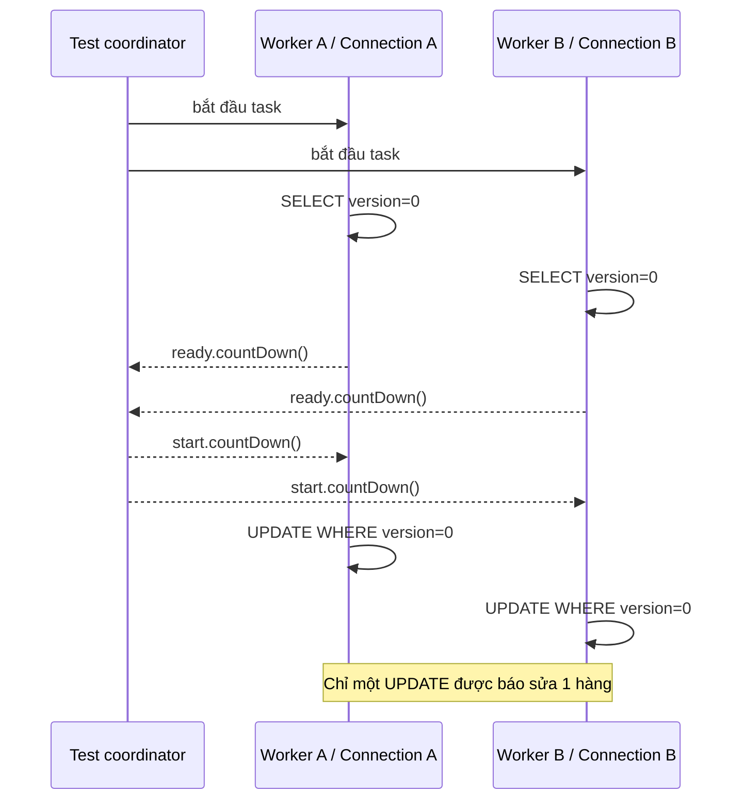

# Kiểm thử cô lập và xung đột bằng nhiều Connection

Một câu lệnh `SELECT` hoặc `UPDATE` chạy đúng khi chỉ có một người dùng **chưa chứng minh** ứng dụng JDBC hoạt động đúng khi nhiều transaction cùng đọc và ghi. Lỗi **lost update**, đọc không lặp lại (*non-repeatable read*), hàng ảo (*phantom read*), chờ khóa hoặc deadlock thường chỉ xuất hiện khi có **ít nhất hai `Connection` vật lý độc lập** và các thao tác được xen kẽ theo một lịch cụ thể.

Trong chương **Kiểm thử JDBC**, bài này hướng dẫn xây **integration test có kiểm soát** cho transaction isolation và xung đột truy cập cơ sở dữ liệu quan hệ. Ta sử dụng `DataSource`, `Connection.setTransactionIsolation()`, `setAutoCommit(false)`, `PreparedStatement`, `ResultSet`, `commit()`, `rollback()` cùng `CountDownLatch` khi cần chạy đồng thời. Mục tiêu là kiểm tra **hành vi thật của DBMS và JDBC driver**, không dựa vào giả định rằng mọi hệ quản trị hiện thực các mức cô lập giống hệt nhau.

> **Nguyên tắc:** Hai biến Java tham chiếu cùng một `Connection` không tạo ra hai transaction độc lập. Mỗi phía của phép thử phải mượn **một `Connection` riêng** từ `DataSource`, kiểm tra cấu hình isolation thực tế và kết thúc transaction rõ ràng.

## 1. Kiểm thử cô lập không giống unit test repository

Với unit test, ta có thể mock `DataSource`, `Connection`, `PreparedStatement` và mô phỏng một lần gọi `executeUpdate()` trả `1`. Cách này giúp xác minh mã xử lý kết quả và nhánh lỗi, nhưng **không kiểm chứng khóa, snapshot hay xung đột thật**.

| Loại kiểm thử | Kiểm tra được | Không thể kết luận từ đó |
| --- | --- | --- |
| Unit test dùng mock JDBC | Hàm có gọi đúng SQL, set tham số, xử lý số hàng và exception hay không. | DBMS có chặn đọc bẩn, phát hiện deadlock, rollback hoặc serialize giao dịch đúng không. |
| Integration test với một `Connection` | SQL, ràng buộc bảng, mapping kiểu, commit/rollback cơ bản. | Hành vi khi hai transaction tranh chấp cùng dữ liệu. |
| Integration test với **hai hoặc nhiều `Connection`** | Dữ liệu mỗi transaction quan sát, chờ khóa, xung đột ghi, retry sau abort. | Tự động đại diện cho mọi DBMS, mọi mức isolation hoặc mọi tải production. |
| Load test nhiều request/connection | Throughput, độ trễ, pool exhaustion, lock waits và deadlock dưới tải. | Tự chứng minh từng lịch xen kẽ đã xảy ra theo cách mong muốn. |

Ưu tiên **DBMS và phiên bản driver giống môi trường triển khai**. Cơ sở dữ liệu in-memory tiện cho unit/integration test nhanh nhưng có thể có MVCC, khóa, transaction và kiểu SQL khác PostgreSQL, MySQL, SQL Server hoặc Oracle thực tế. Có thể dùng một DB chuyên dành cho integration test hoặc container DB cô lập; không chạy thử nghiệm xóa/sửa dữ liệu trên môi trường production.

## 2. Chuẩn bị bảng và dữ liệu kiểm thử

Để các kịch bản dễ đọc, dùng bảng tài khoản nhỏ:

```sql
CREATE TABLE test_accounts (
    id BIGINT PRIMARY KEY,
    balance INTEGER NOT NULL,
    version INTEGER NOT NULL
);

INSERT INTO test_accounts (id, balance, version)
VALUES (1, 100, 0);

INSERT INTO test_accounts (id, balance, version)
VALUES (2, 200, 0);
```

Đây là SQL khởi tạo **minh họa cho một database test trống**. Cú pháp tạo bảng và cách hủy bảng tùy DBMS. Trong các phép thử dưới đây, `id=1` bắt đầu với `balance=100`, `version=0`. Hai bản ghi giúp tạo xung đột giữa hai khóa trong bài tập deadlock.

Trước **mỗi** phép thử, phục hồi dữ liệu gốc và tránh chạy các phép thử sửa cùng bảng song song:

```sql
UPDATE test_accounts
SET balance = 100, version = 0
WHERE id = 1;

UPDATE test_accounts
SET balance = 200, version = 0
WHERE id = 2;
```

Nếu cần một phép thử hoàn toàn độc lập và có thể chạy song song, dùng **schema hoặc database riêng cho từng test** thay vì chia sẻ hai hàng cố định. Fixture phải được xác nhận commit **trước khi** mở transaction A/B; không dùng một transaction setup chưa commit rồi mong kết nối khác nhìn thấy.

### Các thành phần của một phép thử có thể tin cậy

1. **Fixture ổn định:** tạo bảng, seed dữ liệu, kiểm tra giá trị ban đầu.
2. **Connection riêng:** `DataSource` phải có khả năng cấp ít nhất hai kết nối đồng thời; tránh pool tối đa 1.
3. **Isolation có kiểm tra:** xem `DatabaseMetaData.supportsTransactionIsolationLevel(...)` và `getTransactionIsolation()` sau khi thiết lập.
4. **Lịch xen kẽ rõ ràng:** ghi cụ thể A đọc, B ghi, B commit, A đọc lại; dùng latch/barrier thay vì `Thread.sleep()` khi cần song song.
5. **Assertion đúng phạm vi:** phân biệt “được phép xảy ra” với “bắt buộc xảy ra” theo hợp đồng DBMS.
6. **Cleanup chắc chắn:** `commit`/`rollback`, đóng `ResultSet`/`Statement`/`Connection` và reset fixture; giữ lại lỗi rollback bằng `addSuppressed` nếu cần.

## 3. Phân biệt các bất thường khi hai transaction xen kẽ

| Hiện tượng | Lịch đơn giản | Câu hỏi cần kiểm tra |
| --- | --- | --- |
| **Dirty read** | B sửa hàng nhưng **chưa commit**; A đọc. | A có nhìn thấy dữ liệu chưa commit của B không? |
| **Non-repeatable read** | A đọc hàng; B sửa và commit; A đọc lại **cùng hàng** trong transaction A. | Giá trị đọc lần hai có đổi không? |
| **Phantom read** | A đếm các hàng thỏa `WHERE`; B chèn một hàng phù hợp rồi commit; A đếm lại. | Tập hàng thỏa điều kiện có thay đổi không? |
| **Lost update** | A và B cùng đọc `balance=100`, sau đó lần lượt ghi lại giá trị tính từ bản đọc cũ. | Giá trị của một người ghi có bị ghi đè mất không? |
| **Write-write conflict** | Hai transaction muốn sửa cùng hàng hoặc các hàng được khóa theo thứ tự khác nhau. | Một bên chờ, bị abort, gặp serialization failure hay deadlock? |
| **Write skew** | Hai transaction đọc cùng một điều kiện tổng thể, nhưng sửa **hai hàng khác nhau**. | Có thể phá bất biến liên hàng dù không đụng cùng hàng không? |

### Mức isolation JDBC thường gặp

| Hằng JDBC | Giá trị | Cần nhớ khi kiểm thử |
| --- | ---: | --- |
| `Connection.TRANSACTION_READ_UNCOMMITTED` | `1` | Có thể cho phép dirty read theo mô hình tiêu chuẩn, nhưng DBMS có thể thực thi hành vi mạnh hơn. |
| `Connection.TRANSACTION_READ_COMMITTED` | `2` | Không đọc dữ liệu chưa commit; non-repeatable read có thể xuất hiện tùy DBMS/cơ chế đọc. |
| `Connection.TRANSACTION_REPEATABLE_READ` | `4` | Ngăn một số kiểu đọc thay đổi trong transaction, nhưng cơ chế lock/MVCC và hiện tượng phantom khác nhau theo DBMS. |
| `Connection.TRANSACTION_SERIALIZABLE` | `8` | Nhắm đến kết quả tương đương một thứ tự chạy tuần tự; có thể **chặn** hoặc **hủy một transaction** để bảo toàn tính đúng đắn. |

`Connection.TRANSACTION_NONE` báo trường hợp DBMS không hỗ trợ transaction, **không phải mức cô lập dùng để yêu cầu kiểm thử cạnh tranh thông thường**.

**Đặc biệt:** không viết test “`REPEATABLE_READ` phải luôn có phantom” hoặc “`READ_UNCOMMITTED` phải luôn thấy dữ liệu bẩn”. Những mức này mô tả giới hạn bảo đảm và/hoặc hành vi do DBMS cung cấp; có hệ thống dùng MVCC ngăn phantom ngay ở `REPEATABLE_READ`, hoặc xử lý `READ_UNCOMMITTED` như `READ_COMMITTED`. Phải đối chiếu tài liệu DBMS và kiểm thử trên đúng engine.

## 4. Kịch bản A/B: đọc lại cùng hàng tại READ_COMMITTED

Giả sử `test_accounts.id=1` đang có `balance=100`. Sắp lịch:

| Bước | Connection A | Connection B | Giá trị DB đã commit |
| ---: | --- | --- | ---: |
| 1 | Đặt `READ_COMMITTED`, `autoCommit=false`. | Chưa có thao tác. | 100 |
| 2 | `SELECT balance WHERE id=1` → thường là 100. | — | 100 |
| 3 | Giữ transaction A mở. | `UPDATE balance=balance+10 WHERE id=1`, commit. | 110 |
| 4 | `SELECT` lại cùng hàng trong transaction A. | — | 110 |
| 5 | `rollback()`/kết thúc A. | — | 110 |

Nếu DBMS thực hiện `READ_COMMITTED` theo kiểu snapshot mỗi statement, A thường quan sát `100` rồi `110`. Đây là ví dụ **non-repeatable read** được phép ở mức này. Một số biến thể/hệ thống có khóa hoặc semantics mạnh hơn có thể không cho lịch trên diễn ra như vậy; nếu B phải đợi A thả khóa, **không được coi timeout đó là test thất bại của JDBC**. Cần áp dụng assertion theo hệ quản trị đang kiểm thử.

Lịch tương ứng:

```mermaid
sequenceDiagram
    participant A as Connection A
    participant DB as Cơ sở dữ liệu
    participant B as Connection B
    A->>DB: setAutoCommit(false); SELECT id=1
    DB-->>A: balance=100
    B->>DB: UPDATE id=1 balance=balance+10
    B->>DB: COMMIT
    A->>DB: SELECT id=1 lần hai
    DB-->>A: balance theo isolation của A
    A->>DB: ROLLBACK (chỉ kết thúc transaction A)
```

**Điểm kiểm thử:** `rollback()` của A không hoàn tác `UPDATE` đã commit bởi B, bởi đó là **hai transaction khác nhau**.

## 5. Ví dụ Java đầy đủ: quan sát hai Connection và chống lost update

Ví dụ sau có hai phép thử tích hợp:

- `observeReadCommitted(1)`: mở transaction trên A, B thực hiện một `UPDATE` tự commit, A đọc lại và trả hai giá trị quan sát.
- `simulateOptimisticConflict(1)`: A và B cùng đọc `version=0` trước khi ghi; A cập nhật `version` lên 1, còn B dùng version cũ trong `WHERE` nên phải nhận số hàng cập nhật `0`.

Mã kỳ vọng bảng ở mục 2 đã được reset và `DataSource` kết nối đến DB test:

```java
import java.sql.Connection;
import java.sql.DatabaseMetaData;
import java.sql.PreparedStatement;
import java.sql.ResultSet;
import java.sql.SQLException;
import java.sql.SQLFeatureNotSupportedException;
import java.util.Objects;
import javax.sql.DataSource;

public final class JdbcIsolationProbe {
    private final DataSource dataSource;

    public JdbcIsolationProbe(DataSource dataSource) {
        this.dataSource = Objects.requireNonNull(dataSource);
    }

    public ReadPair observeReadCommitted(long id) throws SQLException {
        try (Connection a = dataSource.getConnection();
             Connection b = dataSource.getConnection()) {
            requireAutoCommit(a);
            requireAutoCommit(b);
            DatabaseMetaData db = a.getMetaData();
            int level = Connection.TRANSACTION_READ_COMMITTED;
            if (!db.supportsTransactionIsolationLevel(level)) {
                throw new SQLFeatureNotSupportedException(
                        "DB không hỗ trợ READ_COMMITTED");
            }

            int originalIsolation = a.getTransactionIsolation();
            a.setTransactionIsolation(level);
            a.setAutoCommit(false);
            boolean transactionEnded = false;
            Throwable primaryFailure = null;

            try {
                int first = readRow(a, id).balance;
                // B ở autoCommit=true: UPDATE là transaction riêng.
                int changed = increaseBalance(b, id, 10);
                if (changed != 1) {
                    throw new SQLException("Không cập nhật được hàng test");
                }
                int second = readRow(a, id).balance;

                // A chỉ đọc nên rollback để kết thúc transaction ngắn.
                a.rollback();
                transactionEnded = true;
                return new ReadPair(first, second);
            } catch (SQLException | RuntimeException failure) {
                primaryFailure = failure;
                try {
                    a.rollback();
                    transactionEnded = true;
                } catch (SQLException rollbackError) {
                    failure.addSuppressed(rollbackError);
                }
                throw failure;
            } finally {
                // Chỉ reset cấu hình sau khi transaction đã kết thúc.
                if (transactionEnded) {
                    try {
                        a.setAutoCommit(true);
                        a.setTransactionIsolation(originalIsolation);
                    } catch (SQLException resetError) {
                        if (primaryFailure != null) {
                            primaryFailure.addSuppressed(resetError);
                        } else {
                            throw resetError;
                        }
                    }
                }
            }
        }
    }

    public ConflictResult simulateOptimisticConflict(long id)
            throws SQLException {
        try (Connection a = dataSource.getConnection();
             Connection b = dataSource.getConnection()) {
            requireAutoCommit(a);
            requireAutoCommit(b);

            Row initialA = readRow(a, id);
            Row initialB = readRow(b, id);

            // B vẫn giữ version cũ đã đọc trước khi A commit.
            int changedA = updateWithVersion(
                    a, id, initialA.balance + 10, initialA.version);
            int changedB = updateWithVersion(
                    b, id, initialB.balance + 10, initialB.version);
            Row actual = readRow(a, id);

            return new ConflictResult(
                    changedA, changedB, actual.balance, actual.version);
        }
    }

    private static void requireAutoCommit(Connection c)
            throws SQLException {
        if (!c.getAutoCommit()) {
            throw new SQLException(
                    "Ví dụ yêu cầu Connection ban đầu autoCommit=true");
        }
    }

    private static Row readRow(Connection c, long id)
            throws SQLException {
        String sql = "SELECT balance, version "
                   + "FROM test_accounts WHERE id = ?";
        try (PreparedStatement ps = c.prepareStatement(sql)) {
            ps.setLong(1, id);
            ps.setQueryTimeout(5);
            try (ResultSet rs = ps.executeQuery()) {
                if (!rs.next()) {
                    throw new SQLException("Thiếu hàng fixture id=" + id);
                }
                return new Row(rs.getInt("balance"),
                               rs.getInt("version"));
            }
        }
    }

    private static int increaseBalance(Connection c, long id, int delta)
            throws SQLException {
        String sql = "UPDATE test_accounts "
                   + "SET balance = balance + ? WHERE id = ?";
        try (PreparedStatement ps = c.prepareStatement(sql)) {
            ps.setInt(1, delta);
            ps.setLong(2, id);
            ps.setQueryTimeout(5);
            return ps.executeUpdate();
        }
    }

    private static int updateWithVersion(
            Connection c, long id, int newBalance, int expectedVersion)
            throws SQLException {
        String sql = "UPDATE test_accounts "
                   + "SET balance = ?, version = version + 1 "
                   + "WHERE id = ? AND version = ?";
        try (PreparedStatement ps = c.prepareStatement(sql)) {
            ps.setInt(1, newBalance);
            ps.setLong(2, id);
            ps.setInt(3, expectedVersion);
            ps.setQueryTimeout(5);
            return ps.executeUpdate();
        }
    }

    private static final class Row {
        final int balance;
        final int version;

        Row(int balance, int version) {
            this.balance = balance;
            this.version = version;
        }
    }

    public static final class ReadPair {
        public final int first;
        public final int second;

        ReadPair(int first, int second) {
            this.first = first;
            this.second = second;
        }
    }

    public static final class ConflictResult {
        public final int changedA;
        public final int changedB;
        public final int finalBalance;
        public final int finalVersion;

        ConflictResult(int changedA, int changedB,
                       int finalBalance, int finalVersion) {
            this.changedA = changedA;
            this.changedB = changedB;
            this.finalBalance = finalBalance;
            this.finalVersion = finalVersion;
        }
    }
}
```

Cách gọi khi đã có `dataSource` chứa **ít nhất hai kết nối khả dụng** và fixture vừa được reset:

```java
JdbcIsolationProbe probe = new JdbcIsolationProbe(dataSource);

JdbcIsolationProbe.ReadPair read = probe.observeReadCommitted(1L);
System.out.println("Lần đọc 1: " + read.first);
System.out.println("Lần đọc 2: " + read.second);
// Với DB thực hiện READ_COMMITTED theo snapshot từng statement:
// thường thấy 100, 110.

// Reset hàng id=1 về balance=100, version=0 trước phép thử kế tiếp.
JdbcIsolationProbe.ConflictResult conflict =
        probe.simulateOptimisticConflict(1L);
System.out.println("A sửa: " + conflict.changedA);       // 1
System.out.println("B sửa: " + conflict.changedB);       // 0
System.out.println("balance: " + conflict.finalBalance); // 110
System.out.println("version: " + conflict.finalVersion); // 1
```

### Điều gì làm ví dụ này có ý nghĩa?

1. **Hai lần `getConnection()` tạo ra hai handle độc lập.** Nếu pool trả cùng một connection vật lý đồng thời, pool đã vi phạm cách dùng thông thường; phép thử cần tối thiểu hai kết nối hoạt động.
2. `setTransactionIsolation(READ_COMMITTED)` được gọi **trước `setAutoCommit(false)`**; không đổi isolation giữa chừng khi transaction đang chạy. `supportsTransactionIsolationLevel` là kiểm tra khả năng chung, còn `getTransactionIsolation()` có thể dùng để xác nhận mức thực tế.
3. A mở transaction đọc; B ở `autoCommit=true` nên `UPDATE` của B được DBMS commit như một statement riêng. B không chia sẻ `commit`/`rollback` của A.
4. Trước khi test xung đột phiên bản, **phải reset fixture**; nếu không, phép thử kế tiếp đọc `balance=110` và kết quả mong đợi thay đổi.
5. Xung đột phiên bản được tạo bằng **lịch xen kẽ tuần tự có chủ đích**: cả A và B đọc trước, rồi A ghi, sau đó B ghi bằng version cũ. Không cần may rủi từ việc thread scheduler có thực sự cho hai lần đọc chạy đồng thời hay không.
6. `changedB == 0` thể hiện **phát hiện xung đột nhờ câu SQL có điều kiện**, không phải JDBC tự phát hiện lost update bằng một ngoại lệ đặc biệt.

**Lưu ý:** `setQueryTimeout(5)` chỉ là giới hạn thực thi statement theo khả năng driver, không phải deadline toàn phép thử. Nếu B bị chặn bởi khóa đọc của A trên DBMS cụ thể, lịch ở `observeReadCommitted` không tiến đến bước tiếp theo được; hãy xác định tình huống đó là **quan sát locking** và thiết kế phép thử async phù hợp, thay vì đơn giản tăng timeout.

## 6. JUnit integration test: assertion khác nhau cho isolation và xung đột

Ví dụ dùng **JUnit Jupiter (JUnit 5)**. Giả định test fixture đã cấu hình `DataSource testDataSource` trỏ đến DB chuyên kiểm thử và đã reset hàng `id=1` trước mỗi test; cách tạo DB/container, dependency và teardown phụ thuộc dự án:

```java
import static org.junit.jupiter.api.Assertions.assertEquals;
import org.junit.jupiter.api.Test;

class JdbcIsolationIT {
    // Được cấp qua @BeforeEach, extension hoặc test fixture của dự án.
    private javax.sql.DataSource testDataSource;

    @Test
    void staleVersionCannotOverwriteNewerUpdate() throws Exception {
        // Fixture đã có id=1, balance=100, version=0.
        JdbcIsolationProbe probe = new JdbcIsolationProbe(testDataSource);
        JdbcIsolationProbe.ConflictResult result =
                probe.simulateOptimisticConflict(1L);

        assertEquals(1, result.changedA);
        assertEquals(0, result.changedB);
        assertEquals(110, result.finalBalance);
        assertEquals(1, result.finalVersion);
    }

    @Test
    void inspectReadCommittedBehavior() throws Exception {
        // Fixture được reset độc lập trước test này.
        JdbcIsolationProbe probe = new JdbcIsolationProbe(testDataSource);
        JdbcIsolationProbe.ReadPair pair =
                probe.observeReadCommitted(1L);

        assertEquals(100, pair.first);
        // Chỉ assertEquals(110, pair.second) nếu hợp đồng DBMS
        // được kiểm thử cho phép lịch A/B này chạy và nhìn thấy B.
        System.out.println("Observed second read: " + pair.second);
    }
}
```

Đoạn code minh họa **thân các test**, không phải một test suite copy-chạy ngay: phải cấp `testDataSource` và tạo/reset fixture, đồng thời dùng dependency JUnit 5. Nếu dự án dùng transaction-per-test và framework tự rollback, phải kiểm tra cách transaction manager cấp connection: **không tự cho rằng B có thể nhìn thấy fixture được tạo bên trong transaction chưa commit của test framework**.

### Assertion nào là chắc chắn?

| Assertion | Điều kiện |
| --- | --- |
| Version cũ không được ghi đè: A cập nhật `1` hàng, B cập nhật `0`. | Bảng có `PRIMARY KEY` và `version`; hai phép đọc xảy ra trước phép ghi; lệnh `WHERE id=? AND version=?` chạy với auto-commit thật. |
| `balance` cuối cùng bằng `110`, `version=1`. | Fixture khởi tạo đúng, không có worker khác sửa cùng hàng trong phép thử. |
| `READ_COMMITTED` đọc lại thấy `110`. | Phụ thuộc DBMS, chế độ khóa/snapshot và lịch thực thi; chỉ áp assertion cứng sau khi xác minh hợp đồng môi trường. |
| `SERIALIZABLE` phải ném một SQLState cụ thể. | **Không portable**; DBMS có thể chặn, serialize theo thứ tự khác hoặc abort với mã riêng. |

Không nên làm cho một test “xanh” bằng cách `assertTrue(value == 100 || value == 110)` nếu mục tiêu là chứng minh đúng một hợp đồng DBMS cụ thể. Phép thử có thể **thu thập quan sát** trên nhiều DBMS, nhưng test của một sản phẩm cần nói rõ trạng thái và hành vi mà sản phẩm đó cam kết.

## 7. Kiểm thử lost update và optimistic locking

### Lost update với phép ghi dựa trên số đã đọc

Nếu A và B cùng đọc `balance=100` rồi đều chạy:

```sql
UPDATE test_accounts
SET balance = 110
WHERE id = 1;
```

thì giá trị cuối có thể là `110`, trong khi mỗi phía tưởng đã cộng thêm `10`. Một phép thử có thể dàn lịch A đọc, B đọc, A ghi và commit, B ghi số tuyệt đối đã tính trước rồi commit. Điều này minh họa **ghi đè dựa trên dữ liệu cũ**; cơ sở dữ liệu không thể đoán rằng cả hai phía đều muốn cộng `10` nếu SQL không biểu đạt ý định hoặc điều kiện chống xung đột.

Hai cách tránh:

**Cách 1 — diễn đạt phép cộng trong DBMS:**

```sql
UPDATE test_accounts
SET balance = balance + 10
WHERE id = 1;
```

Tùy transaction/locking, hai phép cộng thường được serialize trên cùng hàng, giúp tránh *stale read → absolute overwrite*. Tuy nhiên, với bất biến phức tạp và isolation khác nhau vẫn phải xem xét khóa và xung đột.

**Cách 2 — optimistic locking bằng version:**

```sql
UPDATE test_accounts
SET balance = ?, version = version + 1
WHERE id = ? AND version = ?;
```

`executeUpdate() == 1` nghĩa là điều kiện version còn khớp và có một hàng được cập nhật; `0` là tín hiệu **xung đột hoặc không tìm thấy hàng** (cần nghiệp vụ phân biệt). Retry khi xung đột phải **đọc lại trạng thái và tính lại thao tác**, không gửi lại `newBalance` cũ với version mới một cách máy móc.

### Tình huống write skew

Giả sử hai nhân viên trực ca được lưu ở **hai hàng khác nhau**. Quy tắc nghiệp vụ: “phải luôn có ít nhất một người trực”. A và B cùng đọc thấy có hai người, rồi mỗi transaction chuyển người của mình sang nghỉ. Hai lệnh `UPDATE` không sửa cùng hàng, nên optimistic version **chỉ trên từng hàng** có thể không phát hiện xung đột ở bất biến liên hàng. Test cần kiểm tra mức `SERIALIZABLE`, khóa phù hợp hoặc **một hàng tổng hợp/constraint** được cập nhật có điều kiện để bảo vệ bất biến.

## 8. Khi cần chạy đồng thời: dùng CountDownLatch, không sleep

Một phép thử race condition ngẫu nhiên kiểu “chạy hai thread cùng lúc rồi hy vọng xung đột” rất dễ chập chờn. `CountDownLatch` giúp **hai worker chắc chắn cùng đọc version ban đầu trước khi được phép ghi**:



Ví dụ độc lập, dùng Java `ExecutorService` và `CountDownLatch`:

```java
import java.sql.Connection;
import java.sql.PreparedStatement;
import java.sql.ResultSet;
import java.sql.SQLException;
import java.util.concurrent.CountDownLatch;
import java.util.concurrent.ExecutorService;
import java.util.concurrent.Executors;
import java.util.concurrent.Future;
import java.util.concurrent.TimeUnit;
import java.util.concurrent.TimeoutException;
import javax.sql.DataSource;

public final class VersionRaceProbe {
    public static int[] run(DataSource dataSource, long id)
            throws Exception {
        ExecutorService workers = Executors.newFixedThreadPool(2);
        CountDownLatch bothRead = new CountDownLatch(2);
        CountDownLatch startWrite = new CountDownLatch(1);

        Future<Integer> fa = workers.submit(
                () -> attempt(dataSource, id, bothRead, startWrite));
        Future<Integer> fb = workers.submit(
                () -> attempt(dataSource, id, bothRead, startWrite));
        try {
            if (!bothRead.await(5, TimeUnit.SECONDS)) {
                throw new TimeoutException(
                        "Không đủ hai worker đọc fixture đúng hạn");
            }
            startWrite.countDown();
            int changedA = fa.get(10, TimeUnit.SECONDS);
            int changedB = fb.get(10, TimeUnit.SECONDS);
            return new int[] {changedA, changedB};
        } finally {
            startWrite.countDown(); // Tránh worker chờ mãi nếu test lỗi.
            fa.cancel(true);
            fb.cancel(true);
            workers.shutdownNow();
        }
    }

    private static int attempt(
            DataSource source, long id,
            CountDownLatch ready, CountDownLatch startWrite)
            throws Exception {
        try (Connection c = source.getConnection()) {
            if (!c.getAutoCommit()) {
                throw new SQLException("Race test yêu cầu autoCommit=true");
            }

            int version;
            try (PreparedStatement ps = c.prepareStatement(
                    "SELECT version FROM test_accounts WHERE id = ?")) {
                ps.setLong(1, id);
                ps.setQueryTimeout(5);
                try (ResultSet rs = ps.executeQuery()) {
                    if (!rs.next()) {
                        throw new SQLException("Thiếu hàng fixture");
                    }
                    version = rs.getInt(1);
                }
            }
            ready.countDown();

            if (!startWrite.await(5, TimeUnit.SECONDS)) {
                throw new TimeoutException("Worker không được phép ghi");
            }

            String sql = "UPDATE test_accounts "
                       + "SET balance = balance + 10, "
                       + "version = version + 1 "
                       + "WHERE id = ? AND version = ?";
            try (PreparedStatement ps = c.prepareStatement(sql)) {
                ps.setLong(1, id);
                ps.setInt(2, version);
                ps.setQueryTimeout(5);
                return ps.executeUpdate();
            }
        }
    }
}
```

Với fixture `id=1` bắt đầu `version=0` và không có tác nhân thứ ba sửa hàng, kỳ vọng một task có kết quả `1`, task còn lại `0`. Thứ tự A/B thắng **không xác định**:

```java
int[] changed = VersionRaceProbe.run(dataSource, 1L);
if (changed[0] + changed[1] != 1) {
    throw new AssertionError("Không phát hiện đúng một bên thắng");
}
// Kiểm tra thêm trên kết nối MỚI: balance=110, version=1.
```

**Cảnh báo kiểm thử:**

- Nếu pool chỉ cho tối đa một connection, một worker sẽ chờ lấy connection và `bothRead` không bao giờ đủ hai; test cần cấu hình pool ít nhất `2`.
- Dùng `Future.get(timeout)` ngăn luồng điều phối chờ vô hạn, nhưng `Future.cancel(true)` **không bảo đảm JDBC driver lập tức hủy SQL/lock wait**. Phải cấu hình statement/DB lock timeout, cuối cùng để driver/pool đóng hoặc loại kết nối lỗi.
- `setQueryTimeout(5)` được driver hỗ trợ khác nhau. Không sử dụng đúng một mốc timeout cho mọi môi trường CI; vẫn cần giới hạn tổng test và log thời điểm xảy ra sự cố.
- Worker sử dụng connection riêng, ở `autoCommit=true` để mỗi `SELECT` kết thúc trước barrier và không cố tình giữ transaction đọc gây khóa giữa các worker. Các kết quả `UPDATE` là phép kiểm thử **khóa version**, không phải minh chứng độc lập rằng một isolation level nào đó luôn ngăn lost update.

## 9. Kiểm thử dirty read, phantom và SERIALIZABLE có kiểm soát

### Dirty read: phải để B chưa commit

Lịch thử:

1. B mở `autoCommit=false`, sửa `balance` từ `100` sang `999` nhưng **chưa commit**.
2. A dùng mức isolation cần kiểm tra và thử `SELECT balance`.
3. Ghi kết quả A thấy `100`, `999`, bị chờ khóa hoặc gặp lỗi timeout.
4. B `rollback()`, A kết thúc transaction và đối soát DB quay về `100`.

Nếu A quan sát `999` trước commit của B, đó là một dirty read. Nhưng `READ_UNCOMMITTED` không bắt buộc mọi DBMS phải phơi bày dữ liệu chưa commit, và ở mức cao hơn A có thể **chờ** B. Vì vậy không triển khai phép thử bằng cách giữ B trong cùng thread rồi đọc A đồng bộ không giới hạn: nó có thể tự chặn chính test. Hãy chạy câu đọc A trong worker riêng với timeout, sau đó luôn thả B và cleanup trong `finally`.

### Phantom: chú ý truy vấn và thời điểm chèn

Ví dụ một bảng `test_orders` có cột `status`, A đếm các hàng `status='NEW'`; B chèn một hàng phù hợp rồi commit; A đếm lại trong **cùng transaction**. Kịch bản có thể nhìn như sau:

```sql
SELECT COUNT(*)
FROM test_orders
WHERE status = 'NEW';

-- Trên Connection B, trong transaction riêng:
INSERT INTO test_orders (id, status)
VALUES (999, 'NEW');
-- COMMIT trên Connection B.

-- Trên Connection A, đọc lại:
SELECT COUNT(*)
FROM test_orders
WHERE status = 'NEW';
```

`test_orders` là bảng ví dụ độc lập cần tạo trong fixture nếu muốn chạy kịch bản này. Trên DBMS dùng khóa phạm vi (*range locks*) hoặc serializable locking, B có thể phải **chờ** A trước khi insert, nên test cần hai thread và timeout hợp lý. Trên DBMS dùng snapshot, A có thể thấy count không đổi ở mức repeatable read; đó không phải lỗi test.

### Serializable không có nghĩa mọi giao dịch đều thành công

Ở `TRANSACTION_SERIALIZABLE`, DBMS có thể giữ các khóa cần thiết, hoặc phát hiện một lịch không tuần tự hóa được rồi **abort một transaction**. Test nên chấp nhận **các kết quả hợp lệ theo cơ chế DBMS**, ví dụ:

- B bị chặn đến khi A kết thúc và hai transaction commit theo một thứ tự tương đương tuần tự;
- Một trong hai transaction nhận lỗi serialization và phải rollback, sau đó tầng nghiệp vụ có thể retry **toàn bộ transaction**;
- Với lịch đơn giản không có xung đột, cả hai commit bình thường.

Mã SQLState có thể giúp phân loại: `40001` thường biểu thị serialization failure, một số DBMS dùng mã khác cho deadlock (ví dụ PostgreSQL `40P01`). Không assert mọi vendor đều ném cùng loại ngoại lệ hay cùng SQLState cho một lịch tranh chấp.

## 10. Kiểm thử deadlock bằng hai hàng và hai chiều khóa

Đây là lịch kinh điển trên DBMS có khóa hàng:

| Bước | Connection A | Connection B |
| ---: | --- | --- |
| 1 | `setAutoCommit(false)`. | `setAutoCommit(false)`. |
| 2 | `UPDATE test_accounts SET ... WHERE id=1`, chưa commit. | — |
| 3 | — | `UPDATE ... WHERE id=2`, chưa commit. |
| 4 | Cả hai báo sẵn sàng, coordinator mở barrier. | Cả hai báo sẵn sàng. |
| 5 | Muốn `UPDATE ... WHERE id=2`. | Muốn `UPDATE ... WHERE id=1`. |
| 6 | DBMS phát hiện deadlock, abort một bên hoặc có timeout. | Bên còn lại có thể tiếp tục sau khi khóa được giải phóng. |

Mục tiêu kiểm thử **không phải bảo đảm A luôn thắng**, mà là ứng dụng:

1. Không để cả hai thread/connection bị giữ vô hạn.
2. Ghi lại `SQLState`/mã vendor, phân biệt deadlock với lỗi kết nối.
3. `rollback()` transaction thất bại (nếu kết nối còn hợp lệ), kết thúc transaction bên còn lại bằng `commit` hoặc `rollback` tùy ý định test.
4. Retry **cả đơn vị nghiệp vụ**, không chỉ câu `UPDATE` thứ hai trong transaction đã lỗi.
5. Sau khi các giao dịch kết thúc, đọc lại dữ liệu để xác nhận bất biến và không để connection bẩn quay lại pool.

Để dàn lịch, dùng `CountDownLatch` sau mỗi lần UPDATE hàng thứ nhất, rồi phát tín hiệu bắt đầu UPDATE hàng thứ hai. **Không dùng `Thread.sleep` để mong khóa đang tồn tại**. Một số DBMS/driver có cơ chế khóa khác, deadlock detector khác hoặc serialization failure thay thế; kiểm tra behavior trên đúng môi trường trước khi đưa assertion cứng vào CI.

## 11. Transaction, cleanup và tính ổn định của phép thử

Một test concurrency có thể thất bại vì logic JDBC sai **hoặc vì test được thiết kế không ổn định**. Những bẫy phổ biến:

| Sai lầm | Vì sao nguy hiểm | Cách làm tốt hơn |
| --- | --- | --- |
| Dùng cùng một `Connection` trong hai thread. | Các lệnh chia sẻ session/transaction, driver không hứa hẹn an toàn khi truy cập song song. | Mỗi worker tự mượn/đóng kết nối riêng. |
| Pool chỉ có một kết nối. | Hai worker không thể tiến đến barrier, gây timeout giả. | Dành tối thiểu hai connection cho bài thử A/B. |
| Chỉ `Thread.sleep(100)` để tạo race. | Scheduler, CI và DB load làm thứ tự không ổn định. | Dùng latch/barrier, log từng mốc xen kẽ. |
| Seed fixture nhưng chưa commit. | Connection B có thể không thấy hàng ban đầu. | Setup commit hoàn tất trước khi bắt đầu A/B. |
| Đổi isolation giữa transaction. | JDBC/DBMS có thể commit ngầm hoặc xử lý không portable. | Thiết lập isolation trước khi bắt đầu transaction. |
| Bắt timeout rồi coi transaction chắc chắn rollback. | Timeout/hủy statement không bảo đảm rollback, lỗi commit có thể chưa rõ. | Kết thúc transaction rõ ràng và đối soát khi kết quả commit mơ hồ. |
| Test phụ thuộc chính xác bên nào thắng deadlock. | Scheduler/DBMS có thể chọn transaction nạn nhân khác. | Assert bất biến, xung đột được xử lý, không cần cố định bên thắng. |
| Không đóng `ResultSet`/`PreparedStatement`. | Leak cursor/connection, làm các test sau nhiễu. | Dùng `try-with-resources` và `finally`. |
| Reset dữ liệu trong lúc test khác cùng dùng. | Assertion thay đổi ngẫu nhiên do fixture bị sửa. | Isolation test data/schema hoặc chạy tuần tự. |
| Dùng DB in-memory làm oracle cho production. | Khác isolation, lock, MVCC, timeout, kiểu SQL và driver. | Integration test trên DBMS/driver sản phẩm, tách unit test mock. |
| Chỉ assert số hàng `executeUpdate` mà không truy vấn lại. | Có thể bỏ sót lỗi commit hoặc thay đổi ngoài mong đợi. | Kiểm tra final DB state trên connection mới. |

### Lưu ý khi tái sử dụng Connection từ pool

Trong test độc lập, thường có thể quản lý `setAutoCommit(false)`/`commit()`/`rollback()` trực tiếp. Nhưng khi dùng framework transaction manager, đừng tự ý đổi `autoCommit` hoặc mức isolation trên connection do framework sở hữu. Với connection pool, nên xác minh **reset isolation, read-only và auto-commit** khi trả connection; việc `close()` trên handle pool không nhất thiết đóng socket vật lý.

Nếu `commit()`/`rollback()` lỗi và trạng thái transaction chưa rõ, đừng thử ép `setAutoCommit(true)` vô điều kiện vì việc chuyển chế độ có thể làm commit ngầm một transaction còn mở. Pool phải có cơ chế loại hoặc reset connection lỗi. Ghi log correlation ID/test ID và SQLState để giải thích thất bại trong CI, không ghi dữ liệu bí mật vào log.

## 12. Thiết kế bộ test tối thiểu theo mức độ quan trọng

| Test | Chuẩn bị | Thao tác A/B | Assertion chính |
| --- | --- | --- | --- |
| **Rollback isolation** | Hàng `id=1` có `100`. | B UPDATE trong transaction rồi rollback; A đọc sau rollback. | Giá trị đã commit vẫn `100`. |
| **READ_COMMITTED observation** | Hai Connection; A READ_COMMITTED. | A đọc, B cập nhật+commit, A đọc lại. | Quan sát đúng hợp đồng DBMS; xác nhận rollback A không hủy commit B. |
| **REPEATABLE_READ observation** | Driver hỗ trợ mức này. | A đọc, B cập nhật+commit trong lúc A còn mở. | Snapshot/locking tuân theo DBMS; tránh chờ vô hạn. |
| **Optimistic conflict** | `version=0`. | Hai lần đọc version trước; A cập nhật có điều kiện, B dùng version cũ. | Một update `1`, update còn lại `0`; final state nhất quán. |
| **Concurrent optimistic race** | Pool ≥2, fixture ổn định. | Hai worker đọc trước barrier, sau đó ghi theo version. | Tổng hai update counts bằng `1`, final `version=1`. |
| **Deadlock handling** | Hai hàng, hai transaction. | Khóa theo thứ tự đối nghịch với barrier. | Không treo; phát hiện/cleanup/retry theo DBMS. |
| **Commit failure ambiguity** | Có idempotency key hoặc log giao dịch. | Fault injection khi commit hoặc mất phản hồi. | Không retry mù quáng, đối soát trạng thái trước khi thử lại. |

Một bộ test tốt không cần ép mọi bất thường xảy ra ở mọi mức isolation. Nó cần xác định rõ **cái gì là hợp đồng của ứng dụng**, **cái gì là cơ chế của DBMS**, và **cái gì chỉ là quan sát của lịch thử**.

## 13. Bài tập thực hành

Giả sử ứng dụng chuyển điểm thưởng giữa hai tài khoản. Bảng `test_accounts` bắt đầu có `balance=100` ở `id=1` và `balance=200` ở `id=2`. Hai tác vụ đồng thời cùng cần chuyển `10` điểm từ tài khoản 1 sang 2.

Hãy trả lời:

1. Vì sao một unit test chỉ mock `executeUpdate()` trả `1` không phát hiện được lost update hoặc deadlock?
2. Để kiểm thử non-repeatable read, hãy viết lịch A/B với `SELECT` hai lần trên cùng hàng, B commit ở giữa. Nếu B bị chờ khóa thì nên tổ chức test như thế nào để không treo?
3. Nếu A và B cùng đọc `balance=100` rồi cùng chạy `UPDATE ... SET balance=90 WHERE id=1`, điều gì có thể sai về ý định chuyển điểm?
4. Nếu dùng `WHERE id=? AND version=?`, hai worker cùng đọc `version=0`, bạn kỳ vọng những số đếm nào sau khi cả hai cố gắng ghi? Khi một bên trả `0`, có được coi tự động chuyển điểm thành công không?
5. Nếu toàn bộ thao tác chuyển điểm gồm **trừ tài khoản 1 và cộng tài khoản 2**, transaction cần được đặt như thế nào? Có thể chia hai lần commit để giảm lock time không?
6. Khi tạo test deadlock với hai transaction khóa hàng theo thứ tự ngược nhau, có nên assert chính xác A là nạn nhân không? Khi test timeout, có thể cho rằng mọi thay đổi đã rollback không?
7. Khi chạy lại một transaction sau serialization failure, vì sao phải đọc lại dữ liệu và retry **toàn bộ logic**, không chỉ câu SQL thất bại cuối cùng?

**Đáp án định hướng:**

1. Mock không mô phỏng khóa, transaction isolation, thời điểm commit và lịch xen kẽ thực của DBMS.
2. A đọc trong transaction; B sửa+commit qua connection khác; A đọc lại. Nếu B có thể bị khóa, dùng hai worker và timeout/latch, sau đó cleanup an toàn thay vì chờ trong một thread.
3. Cả hai có thể ghi số tuyệt đối `90` từ trạng thái cũ, chỉ trừ được `10` thay vì `20`; cần SQL cộng/trừ trực tiếp phù hợp hoặc optimistic locking.
4. Một worker `1`, worker kia `0` khi có ràng buộc version đúng và fixture độc lập. Bên nhận `0` **phải xử lý xung đột**, không coi là thành công.
5. Trừ/cộng phải thuộc **cùng transaction** nếu bất biến tổng điểm phải được giữ. Commit riêng hai nửa có thể để lại dữ liệu mất cân đối.
6. Không. DBMS chọn nạn nhân deadlock theo chính sách riêng; timeout statement cũng không tự chứng minh rollback transaction.
7. Transaction lỗi có thể đã bị abort hoặc dựa trên snapshot cũ. Retry phải tính lại điều kiện trên dữ liệu mới, trong transaction mới và có giới hạn số lần.

**Ghi nhớ:** Kiểm thử cô lập trong **JDBC** cần **nhiều `Connection` độc lập**, fixture đã commit, lịch xen kẽ được kiểm soát và cleanup transaction rõ ràng. `READ_COMMITTED`/`REPEATABLE_READ`/`SERIALIZABLE` chỉ có ý nghĩa khi kiểm tra **driver + DBMS thật**; một số lịch tạo thay đổi quan sát được, một số tạo chờ khóa hoặc transaction abort. Dùng `CountDownLatch` để đồng bộ test, `PreparedStatement` tham số hóa và `version`/`executeUpdate()` để phát hiện xung đột, rồi kiểm tra trạng thái cuối trên kết nối mới thay vì chỉ dựa vào kết quả một statement.
