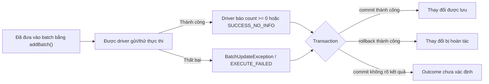

# Kiểm thử batch thất bại và cập nhật một phần trong JDBC

## 1. Tại sao phải kiểm thử trường hợp batch lỗi giữa chừng?

Trong ứng dụng Java dùng **JDBC**, `PreparedStatement.addBatch()` và `executeBatch()` giúp gửi nhiều bộ tham số cho một câu SQL. Cách làm này hữu ích khi nhập dữ liệu, cập nhật tồn kho, đồng bộ trạng thái đơn hàng và xử lý dữ liệu định kỳ. Nhưng một batch gồm 1.000 thao tác **không mặc nhiên là một transaction nguyên tử**. Nếu thao tác thứ 400 vi phạm khóa duy nhất, có ít nhất ba câu hỏi độc lập:

1. **Driver đã thử những lệnh nào?** Có dừng ở lệnh lỗi hay tiếp tục thực thi những lệnh khác?
2. **Driver báo kết quả gì?** Những phần tử của `BatchUpdateException.getUpdateCounts()` có thể nói gì về từng lệnh?
3. **Database đã lưu những thay đổi nào?** Những lệnh chạy thành công có được `commit` hay đã bị `rollback`?

Đây là nội dung trọng tâm của bài **“Kiểm thử batch thất bại và cập nhật một phần”**, thuộc chương **Kiểm thử JDBC** của module **JDBC**. Phạm vi bao gồm driver, `DataSource`, `PreparedStatement`, `ResultSet`, SQL tham số hóa, CRUD, transaction, batching, xử lý lỗi và kiểm chứng dữ liệu bằng API chuẩn.

Một bài kiểm thử chỉ xác nhận `executeBatch()` ném exception là **chưa đủ**. Bài kiểm thử tốt phải quan sát dữ liệu bằng **kết nối độc lập sau khi transaction kết thúc**, phân biệt lỗi lệnh với kết quả transaction và ghi rõ điều gì phụ thuộc driver/DB.

Sau bài học, bạn sẽ có thể:

- Thiết kế fixture có một lệnh lỗi nằm giữa các lệnh hợp lệ.
- Đọc và giải thích `getUpdateCounts()`, `SUCCESS_NO_INFO` và `EXECUTE_FAILED`.
- Kiểm chứng all-or-nothing khi dùng `autoCommit=false` và `rollback()`.
- Khảo sát cập nhật một phần khi dùng `autoCommit=true` mà **không hardcode** kết quả riêng của một driver.
- Kiểm thử chính sách chủ động chấp nhận thành công từng phần theo bản ghi hoặc theo chunk.
- Bảo vệ hệ thống trước retry mù, kết quả commit chưa xác định, sai khác giữa database in-memory và hệ quản trị triển khai.

## 2. Phân biệt bốn trạng thái của một phần tử batch

Một phần tử có thể đi qua các trạng thái:



Sơ đồ này diễn giải logic xử lý, không yêu cầu mọi driver có cùng thứ tự giao tiếp với server. Đặc biệt:

- **Queued:** gọi `addBatch()` không chứng minh SQL đã thực thi.
- **Attempted/executed:** driver có thể đã gửi lệnh và nhận kết quả, nhưng chưa chắc transaction đã commit.
- **Reported success:** một update count không âm hoặc `SUCCESS_NO_INFO` mô tả điều driver biết về một lệnh, không phải chứng cứ bền vững sau rollback.
- **Committed:** dữ liệu đã được transaction commit thành công và quan sát được theo quy tắc isolation/visibility của DB.
- **Unknown:** mất kết nối quanh `commit()` hoặc thất bại dọn dẹp có thể khiến client không biết chắc trạng thái cuối; không được tự gắn nhãn đã rollback.

| Câu hỏi kiểm thử | Nguồn bằng chứng đúng |
|---|---|
| Driver nói lệnh nào chạy thành công/thất bại? | `executeBatch()` hoặc `BatchUpdateException.getUpdateCounts()` |
| Có lỗi về constraint, dữ liệu hay kết nối? | `SQLException`, `SQLState`, mã lỗi DB, exception chain |
| Transaction đã rollback được chưa? | Kết quả `connection.rollback()` và truy vấn lại sau khi đóng transaction |
| Hàng nào vẫn tồn tại sau lỗi? | `SELECT` bằng **Connection mới**, không chỉ đọc counts |
| Hành vi có ổn định khi đổi driver không? | Integration test trên đúng engine/version/driver/cấu hình |

**Quy tắc cốt lõi:** *thành công về thực thi* không đồng nghĩa *thành công về commit*.

## 3. BatchUpdateException và hình dạng update counts

### 3.1. API cần biết

Khi một lệnh trong batch bị lỗi, JDBC thường ném `java.sql.BatchUpdateException`, một lớp con của `SQLException`. Những phương thức hữu ích:

```java
int[] counts = failure.getUpdateCounts();
long[] largeCounts = failure.getLargeUpdateCounts();

String state = failure.getSQLState();
int vendorCode = failure.getErrorCode();
SQLException next = failure.getNextException();
```

`failure` ở đây là một `BatchUpdateException`. `getUpdateCounts()` trả các giá trị kiểu `int`; với khối lượng cập nhật rất lớn, nên xem `executeLargeBatch()` và `getLargeUpdateCounts()` theo mức hỗ trợ của driver.

Các giá trị quan trọng trong mảng:

| Giá trị | Hằng JDBC | Ý nghĩa |
|---:|---|---|
| `0` | Không có hằng riêng | Lệnh SQL đã được xử lý và báo 0 hàng tác động; có thể hợp lệ với `UPDATE` không khớp |
| `1, 2, ...` | Không có hằng riêng | Số hàng tác động theo báo cáo của driver; **chưa chắc đã commit** |
| `-2` | `Statement.SUCCESS_NO_INFO` | Driver báo lệnh thành công nhưng không biết/chưa công bố số hàng cụ thể |
| `-3` | `Statement.EXECUTE_FAILED` | Driver báo lệnh tương ứng thất bại |

**Không được** cộng `-2` hoặc `-3` như số hàng bị tác động. Nếu code đang đếm các bản ghi insert thành công, `SUCCESS_NO_INFO` chỉ chứng minh driver báo thành công mà **không** cho biết chính xác tổng hàng.

### 3.2. Driver có thể dừng hoặc tiếp tục sau lỗi

Giả sử input có bốn phần tử; phần tử thứ ba (index 2) trùng khóa của phần tử đầu:

```text
index        0       1       2       3
input       A       B       A       C
            |       |       |       |
              khóa A bị chèn lần thứ hai -> vi phạm UNIQUE
```

Hai kiểu báo cáo có thể xảy ra:

**Driver dừng tại lỗi:**

```text
getUpdateCounts() -> [1, 1]
                          |
   Hai lệnh đầu được báo thành công trước điểm dừng.
   Lệnh index 2 là lệnh gây lỗi theo chính sách dừng;
   index 3 chưa được thử theo chính sách này.
```

**Driver tiếp tục sau lỗi:**

```text
getUpdateCounts() -> [1, 1, -3, 1]
                               |
                       index 2 EXECUTE_FAILED
```

Một driver/DB khác có thể báo `[1, 1, -3, -3]` vì sau lỗi constraint, transaction bị đánh dấu lỗi và các lệnh sau không được chấp nhận. Trong trường hợp rewrite nhiều insert thành một lệnh SQL nội bộ, hình dạng và độ chính xác của counts còn phụ thuộc driver.

Theo hợp đồng JDBC, driver dừng sẽ báo các lệnh thành công trước lỗi; driver tiếp tục có thể báo mỗi lệnh bằng số hàng, `SUCCESS_NO_INFO` hoặc `EXECUTE_FAILED`. **Không yêu cầu test luôn nhận chính xác `[1, 1]` hoặc `[1, 1, -3, 1]` trên mọi DB.**

Một số lỗi `executeBatch()` có thể đến dưới dạng `SQLException` không phải `BatchUpdateException` trong tình huống driver hoặc connection lỗi. Bài test cần ghi nhận loại thực tế, thay vì ép kiểu mọi `SQLException` sang `BatchUpdateException`.

### 3.3. Mảng counts không thay thế kiểm tra DB

| Nhận định | Kết luận |
|---|---|
| `counts[0] == 1` nên hàng 0 chắc chắn tồn tại sau rollback | **Sai** |
| `counts[2] == EXECUTE_FAILED` nghĩa là hàng index 2 có lỗi | Đúng theo báo cáo của driver |
| Batch ném exception nên toàn bộ phần trước chắc chắn được rollback | **Sai** |
| `autoCommit=true` nghĩa là mọi lệnh thành công chắc chắn đều được commit độc lập | **Không bảo đảm chung**: driver có thể gộp câu lệnh, DB có tính nguyên tử theo statement |
| `autoCommit=false` và rollback thành công, DB có transaction cho những thao tác đó | Những thay đổi thuộc transaction được hoàn tác |
| Không nhận được count cho một lệnh thì có thể gửi lại ngay mà không cần kiểm tra | **Sai**, đặc biệt khi lỗi mạng hoặc kết quả commit chưa rõ |

## 4. Chuẩn bị fixture có lỗi ở giữa batch

### 4.1. Schema dành riêng cho integration test

Dùng bảng nhỏ nhưng có ràng buộc thật:

```sql
CREATE TABLE jdbc_batch_test_items (
    item_id BIGINT PRIMARY KEY,
    label VARCHAR(80) NOT NULL
);
```

Cú pháp ở đây được nhiều RDBMS hỗ trợ, nhưng vẫn cần xem dialect nếu dùng engine đặc thù. Tạo bảng trong **database test** hoặc schema test cô lập, không chạy phá dữ liệu trên DB sản xuất.

Để mọi thứ dễ quan sát, một test sẽ dùng bốn dòng:

| Vị trí (0-based) | `item_id` | `label` | Trạng thái dự kiến |
|---:|---:|---|---|
| 0 | `base + 1` | `first` | Hợp lệ |
| 1 | `base + 2` | `second` | Hợp lệ |
| 2 | `base + 2` | `duplicate` | Trùng khóa của vị trí 1 |
| 3 | `base + 3` | `last` | Riêng lẻ hợp lệ, nhưng có được thử hay không còn tùy driver |

Ở ví dụ này, **trùng khóa xảy ra tại index 2**. Việc nó có được báo là `BatchUpdateException` với số counts nhất định phụ thuộc DB/driver, nhưng ràng buộc `PRIMARY KEY` cho phép kích hoạt lỗi thực bằng dữ liệu thay vì mock exception.

Chọn `base` từ một **vùng ID dành riêng cho lần chạy test** và xác nhận các ID `base+1..base+3` chưa tồn tại trước khi chạy. Không dùng cùng giá trị `base` giữa các test song song. Với test chạy lặp lại, fixture phải dọn dữ liệu có kiểm soát hoặc tạo schema/bảng riêng cho mỗi suite.

### 4.2. Điều kiện để test kết luận đúng

Một kiểm thử batch thất bại cần giữ ổn định:

- DB engine, JDBC driver, phiên bản, cấu hình auto-commit và tùy chọn batch rewrite.
- Dữ liệu fixture trước khi bắt đầu, gồm các khóa có sẵn.
- Thứ tự `addBatch()` và statement SQL giống nhau.
- Chính sách transaction của phương thức đang được kiểm thử.
- Việc có hay không chạy test song song trên cùng khóa/bảng.
- Nơi kiểm tra kết quả: Connection cũ trong transaction hay Connection mới sau transaction.

Nếu một test trùng ID do **test khác** đã chạy trước, việc `executeBatch()` ném lỗi không chứng minh scenario dự định đã xảy ra. Đó là lý do fixture cô lập và cleanup cũng quan trọng như phần assertion.

## 5. Xây dựng helper kiểm thử dùng JDBC chuẩn

Đoạn mã sau là tiện ích Java 17+ nhận `DataSource` do môi trường test cung cấp. Nó không dùng driver riêng và không yêu cầu thư viện mock; SQL cố định, giá trị được truyền qua `PreparedStatement`.

### 5.1. Thực thi một batch chắc chắn có khóa trùng

```java
import java.sql.BatchUpdateException;
import java.sql.Connection;
import java.sql.PreparedStatement;
import java.sql.SQLException;
import java.util.Arrays;

public final class BatchFailureProbe {
    public record ErrorReport(
            boolean batchUpdateException,
            String sqlState,
            int vendorCode,
            int[] reportedCounts
    ) {
        public ErrorReport {
            reportedCounts = reportedCounts.clone();
        }

        @Override
        public int[] reportedCounts() {
            return reportedCounts.clone();
        }
    }

    private static final String INSERT_SQL = """
            INSERT INTO jdbc_batch_test_items (item_id, label)
            VALUES (?, ?)
            """;

    private BatchFailureProbe() {}

    /**
     * Giả định các ID base+1 .. base+3 chưa có trong DB.
     * Không commit hoặc rollback Connection của caller.
     */
    public static ErrorReport runExpectedFailure(
            Connection connection, long base
    ) throws SQLException {
        long[] ids = {
                base + 1, base + 2, base + 2, base + 3
        };
        String[] labels = {
                "first", "second", "duplicate", "last"
        };

        try (PreparedStatement ps =
                     connection.prepareStatement(INSERT_SQL)) {
            for (int i = 0; i < ids.length; i++) {
                ps.setLong(1, ids[i]);
                ps.setString(2, labels[i]);
                ps.addBatch();
            }

            try {
                ps.executeBatch();

                // Không xảy ra lỗi là vấn đề của fixture/test:
                // kiểm tra schema, khóa chính, auto-commit và input.
                throw new AssertionError(
                        "Dự kiến lỗi PRIMARY KEY nhưng batch thành công");
            } catch (SQLException failure) {
                if (failure instanceof BatchUpdateException batch) {
                    int[] counts = batch.getUpdateCounts();
                    return new ErrorReport(
                            true,
                            batch.getSQLState(),
                            batch.getErrorCode(),
                            counts == null ? new int[0] : counts
                    );
                }

                return new ErrorReport(
                        false,
                        failure.getSQLState(),
                        failure.getErrorCode(),
                        new int[0]
                );
            }
        }
    }
}
```

**Tính chất cố ý của helper:**

1. Bốn phần tử đều được thêm bằng `setLong`/`setString` rồi `addBatch()`, không xây dựng SQL bằng nối dữ liệu từ người dùng.
2. Helper bắt `SQLException` từ `executeBatch()`, giữ thông tin `SQLState`, mã lỗi DB và counts nếu có.
3. Helper **không** gọi `connection.commit()`, `rollback()` hoặc `close()`. Connection là tài nguyên của caller; giúp cùng một helper được thử trong cả auto-commit và transaction thủ công.
4. Nếu batch chạy không lỗi, `AssertionError` khiến test thất bại: với fixture đúng, trùng khóa phải bị DB từ chối.
5. `ErrorReport` clone mảng counts để caller không vô tình sửa thông tin diagnostic; đây chỉ là báo cáo của **driver**, không phải trạng thái commit.

Ví dụ trên dùng thêm `java.util.Arrays` ở danh sách import nhưng không cần sử dụng trong helper; có thể bỏ import đó khi đưa vào codebase. Nó không ảnh hưởng ngữ nghĩa JDBC.

### 5.2. Helper quan sát những hàng thực sự còn trong DB

Để xác minh kết quả **sau khi kết nối ghi đã đóng**, dùng một Connection **khác** từ DataSource:

```java
import javax.sql.DataSource;
import java.sql.Connection;
import java.sql.PreparedStatement;
import java.sql.ResultSet;
import java.sql.SQLException;
import java.util.LinkedHashSet;
import java.util.Set;

public final class BatchStateReader {
    private BatchStateReader() {}

    public static Set<Long> presentIds(
            DataSource dataSource, long base
    ) throws SQLException {
        String sql = """
                SELECT item_id
                FROM jdbc_batch_test_items
                WHERE item_id >= ? AND item_id <= ?
                ORDER BY item_id
                """;

        Set<Long> ids = new LinkedHashSet<>();

        try (Connection connection = dataSource.getConnection();
             PreparedStatement ps = connection.prepareStatement(sql)) {
            ps.setLong(1, base + 1);
            ps.setLong(2, base + 3);

            try (ResultSet rs = ps.executeQuery()) {
                while (rs.next()) {
                    ids.add(rs.getLong("item_id"));
                }
            }
        }

        return Set.copyOf(ids);
    }
}
```

Hàm trên trả các ID tồn tại sau khi query kết thúc; caller không giữ `ResultSet` sống ngoài phạm vi `try-with-resources`. Để suy ra dữ liệu do **batch hiện tại** tạo, test phải bảo đảm các khóa trong vùng `base+1..base+3` **chưa tồn tại từ trước** và không có writer khác xen vào. Nếu có dữ liệu nền, nên so sánh snapshot **trước/sau** thay vì chỉ kiểm tra tập ID cuối.

## 6. Kiểm thử all-or-nothing: autoCommit=false và rollback

### 6.1. Kịch bản

Mục tiêu: một batch gồm những phần tử đầu hợp lệ và một phần tử vi phạm khóa chính phải khiến **toàn bộ những thao tác thuộc transaction đó được hoàn tác** khi code gọi `rollback()`.

Điều kiện:

- Database/table hỗ trợ transaction đúng cho loại `INSERT` đang thử.
- Connection chỉ dùng cho transaction test này.
- Auto-commit được tắt trước khi thực thi batch.
- Dù driver dừng hay tiếp tục sau lỗi, code **không commit** mà rollback.
- Kiểm tra lại sau khi rollback và đóng connection.

### 6.2. Phương thức kiểm tra rollback

```java
import javax.sql.DataSource;
import java.sql.Connection;
import java.sql.SQLException;
import java.util.Set;

public final class AtomicBatchCheck {
    private final DataSource dataSource;

    public AtomicBatchCheck(DataSource dataSource) {
        this.dataSource = dataSource;
    }

    public BatchFailureProbe.ErrorReport verifyRollback(long base)
            throws SQLException {
        // Fixture phải có vùng ID trống trước khi gọi.
        if (!BatchStateReader.presentIds(dataSource, base).isEmpty()) {
            throw new AssertionError(
                    "Fixture không trống ở vùng ID " + base);
        }

        BatchFailureProbe.ErrorReport report;

        try (Connection connection = dataSource.getConnection()) {
            if (!connection.getAutoCommit()) {
                throw new SQLException(
                        "Fixture này yêu cầu autoCommit ban đầu là true");
            }

            connection.setAutoCommit(false);

            try {
                report = BatchFailureProbe.runExpectedFailure(
                        connection, base);
            } finally {
                // Luôn cố gắng rollback, ngay cả khi helper hoặc
                // một assertion bên trong gặp lỗi.
                connection.rollback();

                // Chỉ đến đây khi rollback thành công.
                connection.setAutoCommit(true);
            }
        }

        Set<Long> persisted =
                BatchStateReader.presentIds(dataSource, base);

        if (!persisted.isEmpty()) {
            throw new AssertionError(
                    "Rollback không hoàn tác toàn bộ: " + persisted);
        }
        return report;
    }
}
```

Ví dụ này đủ cho một **integration check cơ bản**: lệnh rollback được thực hiện trong `finally`; nếu rollback ném lỗi, test không đi tới assertion “không còn hàng” và phải được báo thất bại. Sau khi đóng connection, một Connection mới truy vấn lại vùng khóa để xác nhận không có thay đổi từ lô.

**Không nên đơn giản hóa thành** `assertThrows(BatchUpdateException.class, ...)` mà bỏ bước kiểm tra DB. Test đó chỉ cho biết driver báo lỗi, không kiểm chứng all-or-nothing của ứng dụng.

### 6.3. Giới hạn của mẫu và điểm cần tăng cường

- Nếu `rollback()` lỗi, trạng thái transaction có thể chưa rõ. Mẫu trên để lỗi đi lên, không bật `autoCommit(true)` nếu rollback không hoàn tất. Trong production cần giữ **nguyên nhân ban đầu** và thêm lỗi rollback bằng `addSuppressed(...)` khi có cả hai; không để cleanup che mất nguyên nhân gốc.
- Nếu code product của bạn sử dụng `DataSource` có pool mặc định `autoCommit=false`, ví dụ từ chối để tránh vô tình chiếm một transaction có sẵn. Hãy viết runner riêng theo hợp đồng pool/framework.
- Test này kiểm tra dữ liệu sau khi rollback, nhưng không chứng minh driver nhất thiết đã **thực thi hai lệnh đầu** trước lỗi. Cần kết hợp counts và kiểm thử riêng theo driver nếu muốn xác minh chế độ dừng/tiếp tục.
- Một số loại DDL, engine/table không hỗ trợ transaction hoặc stored procedure có commit riêng có thể không rollback như mong đợi. Đừng suy từ một database thử nghiệm khác sang production.
- Nếu ứng dụng có nhiều thao tác trong cùng transaction, phải kiểm tra **tất cả bảng** bị ảnh hưởng, không chỉ `jdbc_batch_test_items`.

### 6.4. JUnit 5 có thể dùng helper như thế nào?

Trong một integration test đã có `testDataSource` từ fixture riêng:

```java
@Test
void batchFailureRollsBackAllRows() throws SQLException {
    long base = fixture.allocateUnusedIdBlock();

    AtomicBatchCheck check =
            new AtomicBatchCheck(testDataSource);

    BatchFailureProbe.ErrorReport report =
            check.verifyRollback(base);

    assertNotNull(report);
    assertTrue(
            BatchStateReader.presentIds(testDataSource, base).isEmpty()
    );
}
```

Đây là **đoạn mã trong lớp JUnit 5**, sử dụng các phương thức static của `org.junit.jupiter.api.Assertions` và annotation `org.junit.jupiter.api.Test`. `fixture.allocateUnusedIdBlock()` là hàm do test suite cung cấp, phải cấp các ID không trùng với test chạy song song; `testDataSource` là DataSource nối tới database test. Không tồn tại một factory DataSource chuẩn trong JDK để tự động tạo DB thật mà không cần driver/cấu hình.

Mẫu không hardcode số phần tử hay giá trị counts cụ thể; mục tiêu ở đây là bảo đảm **sau rollback dữ liệu không còn**.

## 7. Kiểm thử cập nhật một phần với autoCommit=true

### 7.1. Điều gì có thể xảy ra?

Khi không bao transaction tường minh, driver và DB có thể xử lý các thao tác batch theo cách khác nhau:

- Một số lệnh được thực thi và commit, rồi batch gặp lỗi.
- Driver dừng ở phần tử lỗi, chưa thử các phần tử sau.
- Driver tiếp tục gửi phần tử sau và báo `EXECUTE_FAILED` cho một hoặc nhiều phần tử.
- Driver tối ưu hóa nhiều bộ tham số thành một SQL nhiều hàng; DB có thể từ chối nguyên statement, làm không có hàng mới nào từ nhóm đó.
- Mất kết nối khi thực thi hoặc ở ranh giới commit khiến trạng thái một số thao tác **không thể suy ra hoàn toàn từ counts**.

Vì vậy, test portability **không được** đặt assertion rằng với bốn input `A, B, B, C`, chắc chắn hai hàng đầu phải tồn tại sau lỗi. Đó có thể là hành vi của một cấu hình cụ thể, không phải hợp đồng chung.

### 7.2. Hàm quan sát thay vì ép một kết quả

```java
import javax.sql.DataSource;
import java.sql.Connection;
import java.sql.SQLException;
import java.util.Set;

public final class AutoCommitBatchCheck {
    public record Observation(
            BatchFailureProbe.ErrorReport error,
            Set<Long> persistedIds
    ) {}

    private final DataSource dataSource;

    public AutoCommitBatchCheck(DataSource dataSource) {
        this.dataSource = dataSource;
    }

    public Observation observePartialExecution(long base)
            throws SQLException {
        if (!BatchStateReader.presentIds(dataSource, base).isEmpty()) {
            throw new AssertionError(
                    "Vùng ID của fixture đã có dữ liệu");
        }

        BatchFailureProbe.ErrorReport report;

        try (Connection connection = dataSource.getConnection()) {
            if (!connection.getAutoCommit()) {
                throw new SQLException(
                        "Kịch bản này cần autoCommit=true");
            }

            report = BatchFailureProbe.runExpectedFailure(
                    connection, base);
        }

        // Quan sát kết quả sau khi đóng connection ghi.
        Set<Long> persisted =
                BatchStateReader.presentIds(dataSource, base);

        return new Observation(report, persisted);
    }
}
```

Ví dụ gọi trong một test chẩn đoán:

```java
AutoCommitBatchCheck.Observation observed =
        new AutoCommitBatchCheck(testDataSource)
                .observePartialExecution(base);

System.out.println(
        "counts=" + Arrays.toString(
                observed.error().reportedCounts()));

System.out.println(
        "persisted=" + observed.persistedIds());
```

Ở đoạn này `testDataSource` và `base` do fixture cấp; import `java.util.Arrays`. Trong CI, thay `System.out` bằng logger/test report để giữ được phiên bản DB/driver, trạng thái auto-commit, bật/tắt batch rewrite và số ID thực sự còn trong DB.

**Đây là một phép quan sát.** Khi xây dựng bộ test hồi quy cho **driver/version cụ thể đã được chọn**, đội dự án có thể chốt kỳ vọng đã kiểm chứng, chẳng hạn một vài hàng có thể đã được commit. Nhưng kỳ vọng đó phải được ghi là **hợp đồng riêng của tổ hợp cấu hình**, không nâng thành luật chung của JDBC.

### 7.3. Test phải dọn phần đã commit thật

Sau kịch bản auto-commit, những hàng của vùng `base` có thể vẫn tồn tại. Cleanup nên:

1. Dùng **kết nối mới** (không tái sử dụng connection có trạng thái lỗi).
2. Xóa **chỉ** vùng ID của fixture, không chạy `DELETE` thiếu điều kiện hoặc `TRUNCATE` trên bảng dùng chung.
3. Nếu cleanup có lỗi, **fail test** hoặc báo trạng thái fixture bẩn để tránh làm lượt sau sai.
4. Bảo đảm test không chạy trên production và không xóa dữ liệu của test song song.

Một chiến lược tốt hơn là mỗi suite được cấp schema/bảng riêng, có cơ chế tạo và dọn rõ ràng, và có thể tái tạo môi trường test khi lỗi quá nặng. Vì bản ghi auto-commit có thể đã lưu, **rollback được gọi sau đó trên một transaction mới không tự xóa phần đã commit**.

## 8. Kiểm thử chính sách “cho phép thành công một phần”

Cập nhật một phần có thể là **lỗi ngoài ý muốn**, nhưng cũng có thể là **quy tắc nghiệp vụ hợp lệ**: nhập 10.000 hàng CSV và chấp nhận các hàng đúng, trả báo cáo những hàng sai.

Không nên dựa vào việc driver “có thể tiếp tục sau lỗi” để thiết kế chính sách này. Thay vào đó, chọn **đơn vị commit rõ ràng**.

### 8.1. Ba chính sách và điều cần kiểm thử

| Chính sách | Ranh giới transaction | Assertion chính |
|---|---|---|
| **All-or-nothing** | Một transaction cho toàn batch | Lỗi một item → không thay đổi nào của batch được commit |
| **Từng chunk** | Mỗi chunk có transaction riêng | Chunk đã commit giữ nguyên; chunk thất bại rollback toàn bộ chunk |
| **Từng item** | Mỗi item dùng transaction riêng | Item hợp lệ được commit; item sai bị rollback và báo lỗi độc lập |

Khi chuyển từ tất-cả-hoặc-không sang từng chunk/từng item, kết quả “một phần đã lưu” là hành vi **thiết kế có chủ đích**, không phải tình cờ do driver.

### 8.2. Kiểm thử chunk nguyên tử

Giả sử sáu input được chia làm hai chunk:

```text
Chunk 1 (transaction T1):
    item 1 hợp lệ
    item 2 hợp lệ
    item 3 hợp lệ
    -> commit T1

Chunk 2 (transaction T2):
    item 4 hợp lệ
    item 5 trùng khóa
    item 6 hợp lệ
    -> rollback T2
```

Sau khi job kết thúc, dùng Connection mới xác nhận:

- Ba item của chunk 1 tồn tại (nếu test bắt đầu với vùng ID trống).
- Không item mới nào của chunk 2 còn tồn tại.
- Số chunk thành công/thất bại khớp báo cáo nghiệp vụ.
- Nếu chunk 2 có `BatchUpdateException`, mảng update counts được ghi lại để phân tích nhưng **không** được dùng thay việc kiểm tra DB.
- Retry chunk 2 chỉ sau khi lỗi dữ liệu đã được sửa hoặc đã có chính sách bỏ/đánh dấu item lỗi.

**Không** khẳng định toàn job là một transaction: chunk 1 đã commit nên không thể được `rollback()` trên Connection của chunk 2.

### 8.3. Kiểm thử từng item với transaction độc lập

Một phương án đơn giản khi số item không quá lớn:

```java
for (InputRow item : items) {
    try (Connection connection = dataSource.getConnection()) {
        connection.setAutoCommit(false);

        try {
            repository.insertOne(connection, item);
            connection.commit();
            outcomes.add(success(item.id()));
        } catch (SQLException failure) {
            try {
                connection.rollback();
                outcomes.add(rejected(item.id(), failure));
            } catch (SQLException rollbackFailure) {
                failure.addSuppressed(rollbackFailure);
                outcomes.add(unknown(item.id(), failure));
            }
        }
    }
}
```

Đây là **pseudocode Java minh họa chính sách**: `InputRow`, `items`, `repository`, `outcomes`, `success`, `rejected` và `unknown` là các thành phần ứng dụng tự định nghĩa. Mã production phải kiểm tra kết nối ban đầu/khôi phục trạng thái, phân biệt lỗi `commit()` không chắc chắn với lỗi SQL trước commit, và bảo đảm resource cleanup. Đặc biệt, nếu `commit()` ném exception sau khi server có thể đã commit, **không được lập tức coi item là REJECTED** chỉ vì `rollback()` tiếp theo thành công hoặc được thử.

Test cần xác minh **outcome model** có ít nhất ba trạng thái khi cần độ tin cậy cao: `COMMITTED`, `REJECTED` và `UNKNOWN`. Một lỗi mạng quanh commit đòi hỏi đối soát bằng ID nghiệp vụ; không thể suy ra chắc chắn chỉ từ exception.

### 8.4. Savepoint không phải transaction con độc lập

Nếu muốn thử một số item riêng trong **một transaction** và bỏ qua item xấu, JDBC có `Savepoint`:

```java
Savepoint point = connection.setSavepoint();

try {
    insertOne(connection, item);
} catch (SQLException itemError) {
    connection.rollback(point);
    // Chỉ tiếp tục nếu rollback tới savepoint thành công
    // và chính sách nghiệp vụ cho phép bỏ item này.
}
```

Đoạn này giả định `connection` đang ở chế độ `autoCommit=false`, DB hỗ trợ savepoints, `insertOne` và `item` do ứng dụng định nghĩa. Savepoint không tự commit những phần trước; toàn transaction vẫn cần kết thúc sau khi xử lý các item.

Kiểm thử savepoint nên xác nhận item lỗi bị hoàn tác, các item trước/sau được lưu **chỉ khi outer transaction commit**, và rollback toàn bộ outer transaction vẫn xóa tất cả thay đổi thuộc nó. Không dùng savepoint để “chữa” lỗi connection bị mất hoặc trạng thái commit không rõ.

## 9. Kiểm thử logic phân tích counts mà không phụ thuộc DB

Một phần của batch testing có thể tách thành **unit test thuần Java**, không cần DB: phân loại các mã update counts. Đây là việc mock hoặc mảng giả lập làm tốt.

### 9.1. Bộ phân tích đơn giản

```java
import java.sql.Statement;
import java.util.ArrayList;
import java.util.List;

public final class UpdateCountClassifier {
    public enum Status {
        REPORTED_SUCCESS,
        SUCCESS_WITHOUT_COUNT,
        REPORTED_FAILURE,
        NOT_REPORTED,
        UNKNOWN_CODE
    }

    public record Entry(int index, Status status, int updateCount) {}

    private UpdateCountClassifier() {}

    public static List<Entry> classify(
            int submitted, int[] counts
    ) {
        if (submitted < 0 || counts == null
                || counts.length > submitted) {
            throw new IllegalArgumentException(
                    "Input của bộ phân tích không hợp lệ");
        }

        List<Entry> result = new ArrayList<>();

        for (int i = 0; i < submitted; i++) {
            if (i >= counts.length) {
                result.add(new Entry(
                        i, Status.NOT_REPORTED, 0));
                continue;
            }

            int count = counts[i];
            Status status;

            if (count == Statement.SUCCESS_NO_INFO) {
                status = Status.SUCCESS_WITHOUT_COUNT;
            } else if (count == Statement.EXECUTE_FAILED) {
                status = Status.REPORTED_FAILURE;
            } else if (count >= 0) {
                status = Status.REPORTED_SUCCESS;
            } else {
                status = Status.UNKNOWN_CODE;
            }

            result.add(new Entry(i, status, count));
        }

        return List.copyOf(result);
    }
}
```

**Lưu ý về ý nghĩa:** `REPORTED_SUCCESS` cho count không âm, kể cả `0`, chỉ có nghĩa driver báo SQL đã được xử lý. Nó **không khẳng định** item đã đạt hợp đồng nghiệp vụ (ví dụ `UPDATE` phải tác động đúng một hàng) hoặc đã commit.

`NOT_REPORTED` nghĩa là không có phần tử tương ứng trong mảng counts. Khi driver dừng theo quy tắc chuẩn, nó liên quan các lệnh từ vị trí lỗi trở đi; nhưng thiếu thông tin do mất kết nối hoặc rewrite yêu cầu chẩn đoán thêm. Không tự đánh dấu mọi `NOT_REPORTED` là “chắc chắn chưa chạy và an toàn retry”.

### 9.2. Các unit test minh họa

Với JUnit 5:

```java
@Test
void stopOnErrorReportsOnlyPrefix() {
    var result = UpdateCountClassifier.classify(
            4, new int[] {1, 1});

    assertEquals(
            UpdateCountClassifier.Status.REPORTED_SUCCESS,
            result.get(0).status());

    assertEquals(
            UpdateCountClassifier.Status.NOT_REPORTED,
            result.get(2).status());
}

@Test
void continueOnErrorContainsFailureMarker() {
    var result = UpdateCountClassifier.classify(
            4,
            new int[] {1, 1, Statement.EXECUTE_FAILED,
                       Statement.SUCCESS_NO_INFO});

    assertEquals(
            UpdateCountClassifier.Status.REPORTED_FAILURE,
            result.get(2).status());

    assertEquals(
            UpdateCountClassifier.Status.SUCCESS_WITHOUT_COUNT,
            result.get(3).status());
}

@Test
void zeroCountIsNotExecuteFailed() {
    var result = UpdateCountClassifier.classify(
            1, new int[] {0});

    assertEquals(
            UpdateCountClassifier.Status.REPORTED_SUCCESS,
            result.get(0).status());
    assertEquals(0, result.get(0).updateCount());
}
```

Các đoạn trên nằm trong một lớp JUnit đã import `org.junit.jupiter.api.Test`, các assertion từ `org.junit.jupiter.api.Assertions` và `java.sql.Statement`. Unit test này xác minh **quy tắc diễn giải**, không kiểm tra DB đã commit hoặc driver có thực sự trả mảng như vậy.

## 10. Các loại lỗi batch cần đưa vào integration test

### 10.1. Vi phạm ràng buộc

- **PRIMARY KEY/UNIQUE:** hai item cùng khóa, như fixture ở mục 4.
- **FOREIGN KEY:** insert dòng con tham chiếu khóa cha không tồn tại.
- **NOT NULL:** gửi SQL NULL vào cột bắt buộc có giá trị.
- **CHECK:** nhập số lượng âm vào cột ràng buộc `quantity > 0`.

Lỗi ràng buộc thường được phân loại vào SQLState class `23`, nhưng mã cụ thể phụ thuộc DB. PostgreSQL, MySQL và SQL Server có mã vendor và cách viết thông điệp khác nhau; **đừng hardcode mã PostgreSQL `23505` trong bộ test dùng nhiều DB**.

Kiểm tra thêm tình huống constraint **deferrable**, nếu DB hỗ trợ. Với ràng buộc được trì hoãn đến commit, `executeBatch()` có thể báo thành công nhưng `commit()` mới thất bại. Test phải bao gồm ranh giới commit, không chỉ assert ở `executeBatch()`.

### 10.2. Lỗi chuyển kiểu và giới hạn dữ liệu

Ví dụ gửi chuỗi dài hơn cột `VARCHAR(80)` hoặc số vượt miền giá trị. Một số DB từ chối, một số cơ chế có cảnh báo/cắt dữ liệu theo cấu hình SQL mode. Nếu mục tiêu test là một lỗi chắc chắn, hãy chọn ràng buộc **được DB mục tiêu thực thi xác định**, tránh trông chờ vào hành vi cắt chuỗi không đồng nhất.

SQLState class `22` thường biểu diễn lỗi dữ liệu/chuyển đổi; nếu exception là `SQLDataException` thì đó là một tín hiệu, nhưng driver có thể dùng subclass khác.

### 10.3. Lỗi cú pháp

Nếu SQL trong `PreparedStatement` sai cú pháp hoặc tên cột không tồn tại, câu lệnh có thể thất bại **trước khi batch thực sự được gửi**, trong `prepareStatement()` hoặc khi `executeBatch()` tùy driver. Test “lỗi giữa batch” nên ưu tiên dùng ràng buộc dữ liệu chứ không dùng lỗi cú pháp, bởi lỗi cú pháp có thể làm toàn bộ batch không chạy từ đầu.

### 10.4. Lỗi kết nối, timeout và cancellation

Khi connection bị ngắt, `SQLException` có thể không chứa đầy đủ counts, hoặc transaction outcome không xác định. Thử nghiệm cần mô phỏng có kiểm soát:

- Mất kết nối trước khi gửi batch.
- Mất kết nối sau khi driver đã gửi một phần.
- Connection bị ngắt trong `executeBatch()`.
- Timeout/hủy statement trong lúc DB thực thi.
- Mất mạng ngay khi `commit()` hoặc đọc phản hồi commit.
- Lỗi `rollback()` hoặc `close()` sau lỗi chính.

Không thể suy ra từ một thử nghiệm mất mạng đơn lẻ rằng mọi hệ quản trị có hành vi giống nhau. Dùng **fault injection** trong môi trường cô lập, không cố tình chặn kết nối production.

## 11. Driver rewrite và vì sao ánh xạ từng input có thể phức tạp

Một số JDBC driver có tùy chọn tối ưu batch, ví dụ gộp nhiều bộ tham số `INSERT` thành lệnh SQL nhiều hàng. Tùy chọn này có thể giúp hiệu năng nhưng cũng thay đổi cách DB báo lỗi, số counts và số khóa sinh.

Ví dụ logic ban đầu:

```sql
INSERT INTO items (id, label) VALUES (?, ?); -- item 0
INSERT INTO items (id, label) VALUES (?, ?); -- item 1
INSERT INTO items (id, label) VALUES (?, ?); -- item 2
```

Driver có thể chọn một hình thức tương đương với:

```sql
INSERT INTO items (id, label)
VALUES (?, ?), (?, ?), (?, ?);
```

Nếu một hàng trong SQL nhiều hàng vi phạm constraint, DB có thể từ chối **cả statement đó**. Vì thế, kết quả không nhất thiết giống việc gửi ba statement độc lập với `autoCommit=true`.

Trong test, cần ghi lại:

| Yếu tố | Ý nghĩa |
|---|---|
| Phiên bản JDBC driver | Nhiều hành vi batching có thể đổi qua phiên bản |
| Thuộc tính rewrite/batch optimize | Ảnh hưởng số statement SQL thực sự gửi |
| DB engine/version | Ngữ nghĩa transaction, constraint, update count |
| Auto-commit và isolation | Quyết định phạm vi có thể rollback |
| Số item và kiểu SQL | Insert một hàng, upsert, update hoặc stored procedure |
| Có generated keys hay không | Có thể ảnh hưởng cách driver rewrite |
| Kích thước chunk | Driver có thể tách batch ở ngưỡng riêng |

Nếu ứng dụng phải biết chính xác item nào hợp lệ, một batch thất bại với counts không đủ chi tiết có thể cần **rollback chunk rồi kiểm tra lại từng item trong transaction riêng**, hoặc validation trước đó, thay vì suy đoán từ mảng `getUpdateCounts()`.

### 11.1. Generated keys khi batch lỗi

Nếu câu insert dùng `Statement.RETURN_GENERATED_KEYS`, một số driver hỗ trợ lấy khóa sinh bằng `getGeneratedKeys()` sau batch. Nhưng với batch lỗi, tiếp tục sau lỗi, hoặc rewrite, **không** mặc định số khóa được trả bằng số input thành công hay thứ tự khớp 1–1.

Với nhu cầu idempotency/đối soát, nên dùng **mã yêu cầu ổn định do ứng dụng cấp** bên cạnh khóa sinh. Test phải xác minh mapping theo hợp đồng driver thực tế, không ghép mù danh sách generated keys với thứ tự input.

## 12. Kiểm thử retry sau khi batch thất bại

### 12.1. Không retry theo phản xạ

| Nguyên nhân | Có nên retry nguyên batch? | Lý do |
|---|---|---|
| Vi phạm `UNIQUE` | Không mặc định | Dữ liệu trùng vẫn trùng |
| Vi phạm `CHECK`/`NOT NULL` | Không | Đầu vào vi phạm hợp đồng dữ liệu |
| Sai SQL/cột/schema | Không | Phải sửa code/migration |
| Deadlock hoặc serialization failure | Có thể | Chỉ sau khi transaction cũ được xử lý, mở transaction mới, giới hạn retry |
| Mất kết nối trước khi thực thi SQL | Có thể | Nếu chắc chắn chưa có tác động, cân nhắc backoff |
| Mất kết nối trong batch hoặc quanh commit | Không mù quáng | Có thể có thay đổi đã commit hoặc outcome chưa biết |
| Batch theo chunk, chunk trước đã commit | Không tự gửi lại toàn job | Cần checkpoint và idempotency theo chunk/item |

`SQLTransientException` chỉ gợi ý một lỗi có thể tạm thời. Nó **không chứng minh** một `INSERT` đã gửi là an toàn khi thực hiện lại.

### 12.2. Kiểm thử idempotency bằng khóa yêu cầu

Một thiết kế import đáng tin cậy nên có `request_id` hoặc khóa nghiệp vụ ổn định, lưu trạng thái/xử lý phù hợp. Trong test:

1. Gửi một batch hợp lệ có request IDs xác định, commit thành công.
2. Giả lập caller **không nhận được** phản hồi cuối; đừng xóa dữ liệu để làm test trông sạch.
3. Gửi lại cùng yêu cầu theo chính sách idempotency của ứng dụng.
4. Xác minh số bản ghi hoặc tác động nghiệp vụ **không bị nhân đôi**.
5. Gửi lại cùng request ID với payload **khác**; xác minh ứng dụng phát hiện xung đột thay vì âm thầm coi là cùng một yêu cầu.
6. Kiểm tra trạng thái “đang xử lý/đã hoàn tất/không rõ kết quả” nếu workflow có các trạng thái đó.

Chỉ thêm constraint `UNIQUE(request_id)` có thể ngăn trùng hàng, nhưng **chưa đủ** để bảo đảm mọi tác động phụ của nghiệp vụ không chạy hai lần. Nếu import cộng tồn kho, phát thông báo hay ghi sang hệ thống khác, phải kiểm tra toàn bộ chuỗi tác động.

## 13. Kiểm thử ở ba cấp độ

| Cấp độ | Kiểm tra gì? | Không thay thế được |
|---|---|---|
| **Unit test** | Phân loại counts, mapping lỗi, quyết định retry, gọi `rollback()` ở tầng điều phối bằng mock | Hành vi thực của database và driver |
| **Integration test DB thật** | Constraint, counts do driver trả, transaction rollback/commit, dữ liệu tồn tại sau lỗi | Hệ thống vận hành dưới tải lớn hoặc lỗi mạng đa dạng |
| **Fault/load test có kiểm soát** | Mất kết nối, timeout, batch rewrite, contention, pool exhaustion, kết quả commit chưa rõ | Kiểm thử tính đúng đắn của logic từng câu SQL |

### 13.1. Ma trận integration test tối thiểu

| Kịch bản | Cấu hình | Assertion quan trọng |
|---|---|---|
| Batch thành công toàn bộ | `autoCommit=false`, không có lỗi | Kết quả sau commit có đủ hàng, kiểm tra số hàng và dữ liệu |
| Lỗi index đầu tiên | Trùng khóa ở item 0 | Không giả định các item sau đã được thử; rollback và kiểm tra DB |
| Lỗi index giữa | Item 2 trùng khóa | Ghi counts, rollback toàn bộ và xác minh không hàng mới |
| Lỗi index cuối | Item cuối trùng khóa | Dù có counts trước đó, rollback loại mọi thay đổi của transaction |
| Driver dừng | Driver/config có chính sách dừng | Counts tiền tố như hợp đồng driver; item sau không được kết luận chung |
| Driver tiếp tục | Driver/config thực sự hỗ trợ | `EXECUTE_FAILED` hoặc diagnostic phù hợp; kiểm chứng DB |
| `SUCCESS_NO_INFO` | Driver/config tạo tín hiệu này | Không tính `-2` thành số hàng; vẫn xem là reported success |
| `UPDATE` ảnh hưởng 0 hàng | `WHERE` không khớp | Xử lý theo hợp đồng nghiệp vụ, không nhầm là lỗi SQL |
| Partial commit ở auto-commit | Không có transaction bao toàn batch | Quan sát những hàng thực sự đã lưu; không khẳng định chung một tập |
| All-or-nothing | Transaction bao toàn batch | Rollback thành công → không còn thay đổi mới |
| Chia chunk | Chunk 1 commit, chunk 2 lỗi | Giữ chunk 1, rollback chunk 2 |
| Từng item | Lỗi một item, item sau hợp lệ | Bản ghi hợp lệ được lưu nếu chính sách cho phép |
| Lỗi ở commit | Constraint deferrable hoặc fault injection | Kiểm tra outcome, không chỉ exception từ executeBatch |
| Mất kết nối ở giữa | Fault injection | Không suy đoán phần nào commit từ counts thiếu |
| Retry sau rollback | Lỗi tạm thời có thể phục hồi | Chỉ chạy transaction mới, đúng chính sách retry |
| Retry khi commit chưa rõ | Idempotency key và đối soát | Không nhân đôi tác động nghiệp vụ |
| Hai test cùng chạy | Fixture ID/bảng tách biệt | Không nhiễu dữ liệu hoặc cleanup của nhau |
| Driver rewrite bật/tắt | Cùng query/dataset, khác cấu hình | Ghi rõ khác biệt counts và trạng thái cuối |

### 13.2. Assertion âm và dương đều quan trọng

Ví dụ với transaction bị rollback:

- **Dương:** xác nhận đã có `SQLException` tại lệnh trùng khóa; ghi nhận SQLState/vendor code của driver.
- **Âm:** xác nhận **không có** hàng mới thuộc vùng test sau rollback.
- **Cấu trúc:** xác nhận Connection đã đóng/trả pool; không có `ResultSet` hoặc statement rò rỉ.
- **Nghiệp vụ:** nếu thao tác cùng transaction còn ghi bảng audit hoặc thay đổi tồn kho, xác nhận chúng cũng không còn tác động.
- **Tái lập:** chạy lại trên một vùng ID mới; kết quả không phụ thuộc lần test trước.

Bộ kiểm thử chỉ có assertion “ném exception” dễ bỏ lọt bug như gọi `commit()` trong `catch`, trả connection về pool khi còn transaction chưa rollback, hoặc tự mở connection mới cho một phần batch.

## 14. Kiểm soát transaction cleanup và lỗi thứ cấp

Một tình huống khó là `executeBatch()` đã ném `BatchUpdateException`, sau đó `rollback()` lại thất bại. Tầng điều phối nên giữ **nguyên nhân đầu tiên** và gắn lỗi cleanup:

```java
SQLException primary = null;

try {
    statement.executeBatch();
    connection.commit();
} catch (SQLException failure) {
    primary = failure;

    try {
        connection.rollback();
    } catch (SQLException rollbackFailure) {
        failure.addSuppressed(rollbackFailure);
    }

    throw failure;
}
```

Đây là ví dụ trích đoạn trong một transaction do caller đã tạo; `statement` và `connection` vẫn phải được đóng đúng cách bởi tầng sở hữu. Nếu `commit()` đã thành công rồi cleanup sau đó thất bại, caller có thể nhận lỗi dù thay đổi đã lưu; đừng gộp mọi exception vào “transaction chắc chắn thất bại”.

Trong test, mô phỏng:

- Lỗi `executeBatch()` rồi rollback thành công.
- Lỗi `executeBatch()` rồi rollback cũng lỗi.
- Commit báo lỗi do mất mạng.
- Đóng statement/connection gặp lỗi sau khi commit.
- Hệ quản trị đánh dấu transaction bị abort sau lỗi SQL và từ chối lệnh tiếp theo cho đến rollback.

**Không bao giờ** bật `autoCommit(true)` để “reset” connection nếu transaction còn chưa được giải quyết: theo hợp đồng JDBC, chuyển auto-commit trong khi transaction đang hoạt động có thể dẫn tới commit. Nếu connection không rõ trạng thái, pool/driver cần có chính sách loại bỏ hoặc xử lý an toàn.

Cũng cần phân biệt kiểm thử “rollback thành công” với “rollback đã được gọi”: mock xác nhận một lời gọi `rollback()` không chứng minh DB đã thực sự hoàn tác.

## 15. Đo hiệu năng trong kịch bản lỗi, không chỉ happy path

Batch processing thường được chọn để giảm round-trip và tăng throughput. Nhưng nếu 1% phần tử lỗi, hiệu năng toàn hệ thống có thể khác nhiều so với benchmark chỉ toàn hàng hợp lệ.

Các biến cần đo:

| Biến | Giá trị thử | Điều cần quan sát |
|---|---|---|
| Kích thước batch | 10, 100, 1.000 | Thời gian gửi, rollback, khả năng truy lỗi |
| Vị trí item lỗi | Đầu, giữa, cuối | Số lệnh đã thử và chi phí mất đi |
| Tỷ lệ lỗi | 0%, 0,1%, 1%, 10% | Throughput thực, số item được commit |
| Loại lỗi | Constraint, chuyển kiểu, deadlock, connection | Retry/rollback khác nhau |
| Auto-commit | `true` so với `false` | Ngữ nghĩa partial commit |
| Rewrite | Bật/tắt nếu driver hỗ trợ | SQL thực thi, counts, tốc độ và atomicity |
| Concurrency | 1, 5, 20 worker | Lock wait, deadlock, pool wait |
| Dữ liệu | Nhỏ, lớn, có skew theo khóa | Tác động index/lock và độ dài transaction |

Chỉ số hữu ích gồm: hàng/giây **được commit thành công**, số batch lỗi, thời gian rollback, p95/p99, thời gian chiếm connection, số retry và số item phải kiểm tra lại. Không chỉ đo số lệnh `executeBatch()` được gọi mỗi giây.

Nếu benchmark bỏ qua cleanup giữa các lượt, các ID sẽ dần trùng khóa và kết quả sau khác trước; khi đó phép đo không còn tái lập. Cũng không chạy fault injection làm mất kết nối trên DB production.

## 16. Những anti-pattern nên phát hiện qua code review

| Anti-pattern | Vì sao sai | Cách kiểm thử/phòng tránh |
|---|---|---|
| `catch(BatchUpdateException) { log; }` rồi `commit()` | Có thể commit phần dữ liệu không mong muốn hoặc DB đang transaction lỗi | Integration test lỗi ở giữa và kiểm tra toàn bộ bảng |
| `counts.length == items.size()` là điều bắt buộc trên mọi lỗi | Driver dừng có thể trả mảng ngắn | Test cả stop-vs-continue, không hardcode hình dạng |
| `counts[i] > 0` nghĩa là item đã commit | Count chỉ nói kết quả thực thi | Kiểm tra sau commit/rollback bằng connection khác |
| `SUCCESS_NO_INFO == lỗi` | `-2` có nghĩa thành công không rõ số hàng | Unit test phân loại counts |
| `EXECUTE_FAILED == -3 hàng` | Mã trạng thái, không phải số hàng | Không cộng vào tổng |
| `executeBatch()` lỗi thì mặc nhiên tự rollback | Auto-commit, driver rewrite và DB khác nhau | Test dữ liệu sau lỗi với autoCommit=true/false |
| Sau lỗi trong transaction vẫn chạy SQL tiếp | DB có thể ở trạng thái aborted | Rollback toàn bộ hoặc về savepoint hợp lệ |
| Dùng connection khác cho một bước trong transaction | Thay đổi nằm ngoài transaction của batch | Test rollback cả các bảng/liên quan |
| Gửi lại toàn batch sau timeout | Có thể ghi trùng nếu kết quả commit chưa rõ | Idempotency và kiểm thử retry |
| Chỉ mock JDBC rồi khẳng định rollback đúng | Mock không mô phỏng transaction DB thật | Integration test đúng engine/driver |
| Cleanup test bằng `TRUNCATE` trên bảng chung | Phá dữ liệu test khác, có thể có commit implicit | Schema/ID riêng và cleanup có phạm vi |
| Bỏ qua lỗi rollback/close | Che lỗi ban đầu hoặc che trạng thái không rõ | Kiểm tra suppressed exceptions và outcome |
| Đo batch lỗi trên 10 hàng khi production hàng triệu | Không thấy skew, index và tải đồng thời | Dữ liệu đại diện và stress/fault test |

## 17. Bài tập thực hành

### Bài 1 — Chứng minh rollback toàn batch

Tạo bảng `jdbc_batch_test_items` ở database thử nghiệm, chọn một vùng ID chưa dùng rồi:

1. Gọi `AtomicBatchCheck.verifyRollback(base)`.
2. Ghi loại `SQLException`, `SQLState`, vendor code và `reportedCounts`.
3. Kiểm tra `BatchStateReader.presentIds(dataSource, base)` là tập rỗng.
4. Đổi vị trí phần tử lỗi thành đầu hoặc cuối batch và kiểm tra rollback lại.
5. Giải thích vì sao counts có thể có hai phần tử thành công nhưng DB vẫn không chứa hai hàng đó sau rollback.

### Bài 2 — Quan sát cập nhật một phần

Chạy `AutoCommitBatchCheck.observePartialExecution(base)` trên **vùng ID khác**. Lưu bản báo cáo:

```text
DB / driver version:
batch rewrite config:
autoCommit:
SQLState / vendor code:
getUpdateCounts:
persisted IDs from new Connection:
conclusion:
```

Sau đó:

1. Kiểm tra tất cả ID mà driver báo và tất cả ID thực tế đang tồn tại.
2. Đổi tùy chọn rewrite nếu driver hỗ trợ và đo lại trên vùng ID mới.
3. Không ép kết quả của driver này thành kết luận cho mọi DB.
4. Cleanup dữ liệu đã commit bằng fixture có phạm vi và chạy lại để chứng minh test tái lập.

### Bài 3 — Định nghĩa rõ kết quả thành công từng phần

Tạo hai phiên bản import:

- **Chunk transaction:** chunk 1 gồm hàng hợp lệ; chunk 2 chứa một hàng trùng khóa.
- **Per-item transaction:** mỗi hàng độc lập; lỗi một hàng không loại bỏ các hàng hợp lệ đã commit.

Viết test đếm hàng mới của từng nhóm bằng Connection mới. Bổ sung một test mất kết nối ở giai đoạn commit (trong môi trường fault injection) và diễn giải vì sao cần `UNKNOWN` thay cho kết luận “thất bại chắc chắn”.

### Bài 4 — Unit test bộ phân tích counts

Kiểm tra `UpdateCountClassifier.classify()` với các mảng:

```text
[1, 1]               cho 4 input
[1, 1, -3, 1]         cho 4 input
[-2, 0, -3]          cho 3 input
[]                    cho 4 input
```

Xác minh các kết quả không được báo **không** bị gán nhãn chắc chắn đã rollback hoặc có thể retry. Từ các kết quả phân tích, thiết kế báo cáo có **hai trường độc lập**: trạng thái driver và trạng thái transaction.

## 18. Tổng kết

- **Kiểm thử batch thất bại phải quan sát cả exception, update counts và dữ liệu sau transaction**, không chỉ assert `executeBatch()` ném lỗi.
- **`BatchUpdateException.getUpdateCounts()` có thể là tiền tố ngắn hoặc mảng chứa `EXECUTE_FAILED`**, tùy chính sách dừng/tiếp tục của driver; `SUCCESS_NO_INFO` là báo thành công nhưng thiếu số hàng cụ thể.
- **Đã thực thi không đồng nghĩa đã commit.** Với transaction phù hợp và rollback thành công, phần đã chạy trước lỗi vẫn bị hoàn tác.
- **Auto-commit có thể để lại dữ liệu một phần**, nhưng không được áp đặt chính xác những hàng nào tồn tại trên mọi engine/driver. Hãy kiểm tra bằng connection mới.
- **Muốn chấp nhận partial success thì định nghĩa đơn vị commit rõ ràng**: từng chunk hoặc từng bản ghi, cùng mô hình outcome và cleanup/retry tương ứng.
- **Lỗi mạng/quanh commit có thể khiến kết quả không chắc chắn**; cần mã yêu cầu ổn định, idempotency, đối soát và retry có giới hạn.
- **Integration test trên đúng DB/driver là bắt buộc** để xác nhận transaction, batch rewrite, constraint và phần đã lưu; mock chỉ phù hợp kiểm tra logic thuần Java.
- **Fixture độc lập và dữ liệu đại diện** giúp test vừa tái lập vừa an toàn; luôn kiểm tra cả trường hợp lỗi ở đầu/giữa/cuối và tài nguyên JDBC được đóng đúng.
