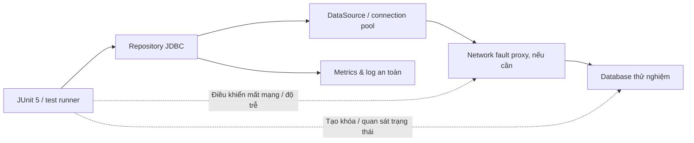
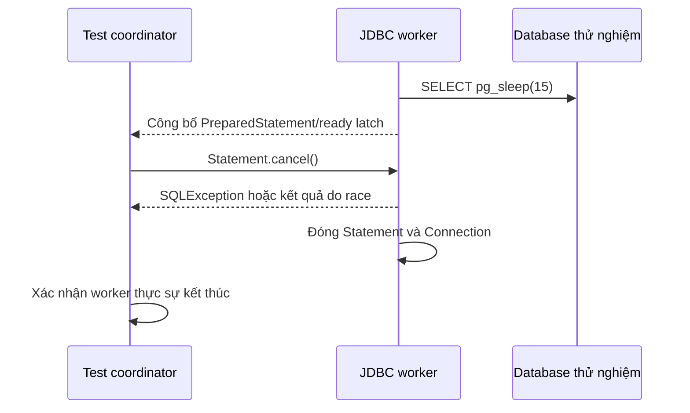
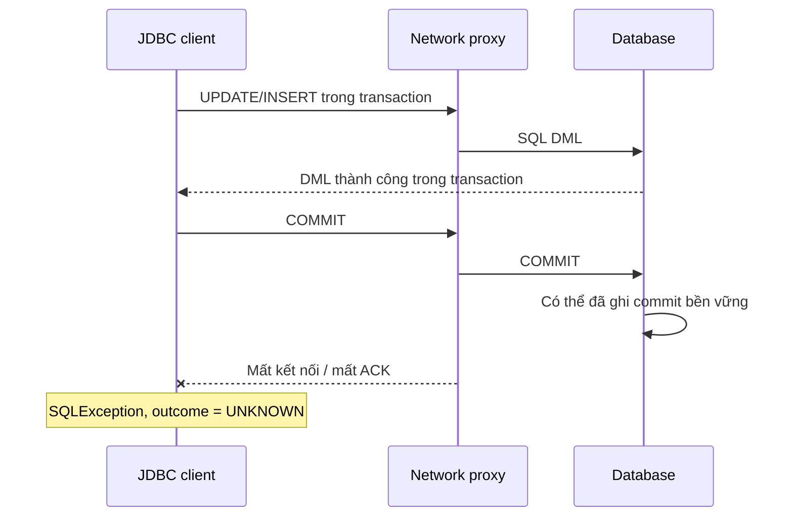

# Kiểm thử timeout, hủy và mất kết nối

## 1. Vì sao JDBC cần được kiểm thử khi đường đi không còn thuận lợi?

Trong một ứng dụng Java sử dụng **JDBC**, hầu hết các bài kiểm thử CRUD bắt đầu bằng dữ liệu mẫu, thực thi câu SQL qua `DataSource`, `Connection` và `PreparedStatement`, rồi xác nhận kết quả qua `ResultSet`. Những bài kiểm thử này quan trọng, nhưng chưa đủ cho ứng dụng chạy lâu dài dưới tải thực tế.

Khi cơ sở dữ liệu bị chậm, kết nối mạng bị gián đoạn hoặc người dùng hủy yêu cầu, chương trình có thể phải xử lý các trường hợp khó hơn:

- Câu `SELECT` chờ lâu hơn thời gian cho phép.
- `PreparedStatement.executeUpdate()` bị timeout trong lúc DB đang ghi.
- Người dùng nhấn “Hủy”, nhưng worker Java vẫn đang đợi `ResultSet.next()`.
- `Future.cancel(true)` báo đã hủy, dù câu SQL trên server chưa dừng.
- `Statement.cancel()` được gọi từ một thread khác, nhưng tín hiệu tới DB sau khi lệnh đã kết thúc.
- Socket mất kết nối trước, trong hoặc ngay sau `Connection.commit()`.
- Một connection lỗi được đưa trở lại pool và gây thất bại cho request sau.
- Chương trình thử lại một thao tác ghi không an toàn, vô tình tạo dữ liệu trùng.

**Kiểm thử timeout, hủy và mất kết nối** không chỉ hỏi “có ném `SQLException` không?”. Bài kiểm thử tốt cần chứng minh **ngữ nghĩa nghiệp vụ, ranh giới transaction, khả năng giải phóng tài nguyên và chính sách phục hồi**.

Sau bài học, bạn sẽ biết cách:

1. Tách các lớp timeout và lựa chọn phép thử tương ứng.
2. Dựng kiểm thử JDBC trên database thật, kết hợp test đơn vị cho logic điều phối.
3. Gây câu lệnh chậm có kiểm soát; xác minh `setQueryTimeout()` mà không phụ thuộc tuyệt đối vào thời gian chính xác.
4. Hủy câu lệnh qua `Statement.cancel()` và phân biệt với `Thread.interrupt()`/`Future.cancel(true)`.
5. Chèn lỗi mạng, phát hiện connection không còn dùng được và kiểm tra pool.
6. Kiểm tra rollback, trạng thái commit không rõ và cơ chế retry/idempotency.
7. Viết ma trận kiểm thử có thể chạy lại khi nâng cấp JDBC driver, DB hoặc connection pool.

## 2. Đặt đúng câu hỏi cho từng loại timeout

Không tồn tại một “timeout JDBC” bao trùm tất cả các giai đoạn. Một request có thể chờ mượn connection từ pool, bắt tay TLS, chờ khóa DB, thực thi SQL, nhận dữ liệu hoặc commit.

| Giai đoạn | Công cụ/thuộc tính thường dùng | Kiểu lỗi cần mô phỏng | Điều cần xác nhận |
|---|---|---|---|
| Mượn connection từ pool | Borrow/acquisition timeout của pool | Pool hết connection rảnh | Request ngừng chờ có giới hạn; không tạo vô hạn kết nối |
| Mở kết nối và đăng nhập | `DataSource.setLoginTimeout()` hoặc driver connect timeout | Endpoint không trả lời/kết nối bị từ chối | Có lỗi theo thời hạn cấu hình; không vô tình log credential |
| Thực thi SQL | `Statement.setQueryTimeout(seconds)` | Truy vấn dài hoặc chờ khóa | Lệnh bị dừng/báo lỗi theo driver, tài nguyên được dọn |
| Đọc mạng | `Connection.setNetworkTimeout(executor, ms)`, socket timeout riêng của driver | Mạng chậm hoặc mất gói | Không chờ vô hạn; connection lỗi được loại bỏ |
| Chờ khóa phía server | Lock timeout hoặc statement timeout của DB | Transaction khác giữ khóa lâu | Phân biệt chờ khóa với truy vấn CPU chậm |
| Chờ tương tác từ ứng dụng | Request deadline, `Future.get(timeout, unit)` | HTTP hết hạn hoặc người dùng hủy | Không đánh đồng hết thời gian chờ với SQL đã kết thúc |
| Commit transaction | Timeout mạng, lỗi kết nối, server crash | Mất phản hồi trong `commit()` | Không suy diễn commit hay rollback khi kết quả chưa xác định |

Chẳng hạn:

```java
statement.setQueryTimeout(3); // Giây, mức Statement.
```

khác với:

```java
connection.setNetworkTimeout(managedExecutor, 3000); // Mili giây.
```

`setQueryTimeout(0)` thường có nghĩa không giới hạn query timeout, **không phải 0 giây chờ**. `Connection.setNetworkTimeout()` có thể không được driver hỗ trợ hoặc khiến connection không còn dùng được sau timeout. Trong ứng dụng có pool, cấu hình các thuộc tính này nên thuộc nơi sở hữu kết nối vật lý.

**Hợp đồng kiểm thử:** không chỉ ghi “timeout sau ba giây”. Hãy xác định **timeout nào**, giai đoạn xảy ra, trạng thái worker, trạng thái connection, kết quả transaction và giới hạn thời gian tối đa của chính bài test.

## 3. Tách kiểm thử đơn vị và kiểm thử tích hợp

Kiểm thử đơn vị với mock/fake rất hữu ích cho các quyết định của service:

- Khi nhận tín hiệu hủy, tầng điều phối có đánh dấu yêu cầu hay không?
- Khi repository ném lỗi, service có đưa transaction vào nhánh rollback không?
- Khi trạng thái commit không rõ, service có tránh retry DML tự động không?
- Khi nhận một mã lỗi được phân loại là có thể retry, vòng lặp có giới hạn số lần thử không?

Nhưng mock `PreparedStatement` không thể chứng minh:

- Driver có thực sự gửi yêu cầu `cancel()` đến database.
- `SQLTimeoutException` hay một `SQLException` riêng xuất hiện.
- Driver có chặn ở `ResultSet.next()` hoặc `Connection.commit()` khi mạng mất.
- Driver/pool có đóng hoặc loại bỏ connection không còn lành mạnh.
- Transaction ở DB đã commit, rollback hay vẫn còn chờ xử lý.

Vì vậy, cần **kiểm thử tích hợp trên DB thật** với đúng họ driver và cách triển khai dự kiến. Database nhúng hoặc fake có thể không phản ánh hành vi lock, socket và cancel của môi trường đích.

### Mô hình môi trường kiểm thử



Có thể chạy database trong container dùng riêng cho test; ví dụ PostgreSQL và pgJDBC phù hợp để minh họa `pg_sleep()`, `pg_stat_activity` và SQLState hủy truy vấn. Phần lớn nguyên tắc áp dụng cho MySQL, SQL Server hoặc các DB khác, nhưng **cú pháp gây chậm và cách báo lỗi là riêng từng DB**.

Không gây `pg_sleep()` dài, khóa table hoặc ngắt network trên database production. Không dùng tài khoản DBA thật cho các bài thử phá kết nối.

## 4. Chuẩn bị fixture và tiêu chí tránh test không ổn định

Một bộ kiểm thử có thể thất bại ngẫu nhiên nếu tác vụ điều phối thread chưa thực sự bắt đầu, thời gian chờ trên CI khác máy cá nhân hoặc kết nối bị dùng chung giữa các ca.

Trước khi viết test, nên xác định:

| Thành phần | Quy tắc thiết kế |
|---|---|
| Database | Instance/schema riêng cho test, dữ liệu được tạo và dọn theo từng ca |
| Connection | Mỗi tác vụ có connection riêng; không chia sẻ một connection giữa các phép thử không liên quan |
| Statement | Tạo mới cho mỗi phép thử hủy; không tái sử dụng sau `cancel()` |
| Đồng bộ thread | Dùng `CountDownLatch`, `Future`, sự kiện quan sát server khi cần; hạn chế `Thread.sleep()` để đoán trạng thái |
| Thời hạn test | Có giới hạn tổng lớn hơn query timeout mong đợi, nhưng không để worker chạy vô hạn |
| Assertion | Kiểm tra loại kết quả, transaction, tài nguyên và bằng chứng server; không chỉ kiểm tra class exception |
| SQL tạo tải | Câu đọc chậm có kiểm soát hoặc chờ khóa trên hàng test; không quét bảng thật |
| Network fault | Proxy cho đúng connection/endpoint trong test; tách lỗi ngắt lập tức và blackhole |
| Secret | Chỉ dùng credential test, không ghi password hoặc toàn bộ JDBC URL vào log |

### Các mốc đo nên thu thập

```text
requestStarted
connectionBorrowStarted / connectionBorrowFinished
statementExecuteStarted
cancelRequested
statementReturnedOrThrew
transactionEnded
connectionClosedOrInvalidated
workerTerminated
```

Dùng `System.nanoTime()` để đo **khoảng thời gian**, không dùng `System.currentTimeMillis()` để tính timeout dưới tác động thay đổi đồng hồ máy. Thời hạn của test không nhất thiết bằng đúng query timeout: CI, JVM scheduling, DB load và mạng đều có độ trễ.

## 5. Kiểm thử query timeout với PostgreSQL và JUnit 5

PostgreSQL có hàm `pg_sleep(seconds)` phù hợp để tạo một câu SQL chậm có kiểm soát. Đây là tính năng **riêng PostgreSQL**, không phải SQL/JDBC chuẩn.

Ví dụ JUnit 5 sau giả định bộ test đã có dependency `org.junit.jupiter:junit-jupiter` và PostgreSQL JDBC driver. Thông tin kết nối được cấp bằng biến môi trường test:

```text
TEST_PG_JDBC_URL
TEST_PG_JDBC_USER
TEST_PG_JDBC_PASSWORD
```

Đừng đặt credential thật trong source code hay bản ghi CI công khai.

```java
import java.sql.Connection;
import java.sql.DriverManager;
import java.sql.PreparedStatement;
import java.sql.SQLException;
import java.util.concurrent.TimeUnit;
import org.junit.jupiter.api.Assumptions;
import org.junit.jupiter.api.Test;
import org.junit.jupiter.api.Timeout;

import static org.junit.jupiter.api.Assertions.*;

class PgQueryTimeoutIT {
    private Connection openTestConnection() throws SQLException {
        String url = System.getenv("TEST_PG_JDBC_URL");
        String username = System.getenv("TEST_PG_JDBC_USER");
        String password = System.getenv("TEST_PG_JDBC_PASSWORD");
        Assumptions.assumeTrue(
                url != null && url.startsWith("jdbc:postgresql:")
                        && username != null && password != null,
                "Requires an isolated PostgreSQL test database");
        return DriverManager.getConnection(url, username, password);
    }

    @Test
    @Timeout(20) // Giới hạn tổng cho test; không phải timeout JDBC.
    void slowStatementIsInterruptedByQueryTimeout() throws Exception {
        try (Connection connection = openTestConnection();
             PreparedStatement ps = connection.prepareStatement(
                     "SELECT pg_sleep(?)")) {
            ps.setDouble(1, 8.0);
            ps.setQueryTimeout(1);

            // Chỉ đo thời gian thực thi, không tính lúc mở connection.
            long startedAt = System.nanoTime();
            SQLException error = assertThrows(
                    SQLException.class, ps::execute);

            long elapsedMs = TimeUnit.NANOSECONDS.toMillis(
                    System.nanoTime() - startedAt);
            assertTrue(elapsedMs < 10_000,
                    "JDBC execution did not honor a practical upper bound");

            // pgJDBC/PostgreSQL thường báo 57014 cho query canceled.
            // Điều này KHÔNG phải quy tắc dùng cho mọi JDBC driver.
            assertEquals("57014", error.getSQLState());
        }
    }
}
```

**Đọc kết quả đúng cách:**

1. `setQueryTimeout(1)` yêu cầu driver timeout câu lệnh; test kỳ vọng nó ngừng sớm hơn `pg_sleep(8)`.
2. `@Timeout(20)` chỉ giới hạn thời gian test theo khả năng thực thi của JUnit; nó không chứng minh SQL đã dừng khi thread JUnit kết thúc.
3. Driver có thể ném `SQLTimeoutException` hoặc một loại `SQLException` khác. Ví dụ trên **cố tình assert SQLState riêng PostgreSQL** trong môi trường pgJDBC đã xác định; nếu thay driver, cập nhật kỳ vọng theo hợp đồng driver.
4. Chỉ nên chọn ngưỡng thời gian đủ rộng để không thất bại vì scheduling thông thường. Không assert “chính xác 1.000 ms”.
5. `try-with-resources` đóng `PreparedStatement` và `Connection` trong mọi nhánh. Sau timeout, nếu cần biết connection còn dùng được hay không, hãy kiểm tra bằng một test riêng và luôn để pool/driver quyết định khả năng tái sử dụng.

Lỗi thường thấy là chỉ viết:

```java
assertThrows(SQLException.class, ps::execute);
```

Điều này quá yếu nếu không phân loại: lỗi sai SQL, sai credential, mất mạng hoặc thiếu quyền cũng có thể tạo `SQLException`. Trước hết phải biết test đang chạy trên database đúng loại, câu SQL hợp lệ và kết nối đã mở thành công.

## 6. Kiểm thử chờ khóa để phân biệt query timeout và lock timeout

`pg_sleep()` kiểm thử câu SQL chạy lâu, nhưng trong nghiệp vụ JDBC thực tế một câu `UPDATE` có thể bị chậm chỉ vì **đang chờ khóa**. Ta nên có thêm kịch bản dùng hai connection độc lập:

1. Connection A bắt đầu transaction, khóa hàng thử bằng `SELECT ... FOR UPDATE` và **chưa commit**.
2. Connection B chạy `UPDATE` lên chính hàng đó, có `setQueryTimeout()`.
3. Xác nhận B bị chờ hoặc timeout/hủy trong khi A còn giữ khóa.
4. Kết thúc A bằng `rollback()` hoặc `commit()`, sau đó xác nhận không còn khóa treo.
5. Đọc lại hàng để kiểm tra có thay đổi ngoài ý muốn hay không.

Ví dụ thiết lập:

```sql
CREATE TABLE jdbc_fault_test (
    id      BIGINT PRIMARY KEY,
    counter INTEGER NOT NULL
);

INSERT INTO jdbc_fault_test (id, counter)
VALUES (1, 0);
```

Trong connection A:

```java
connectionA.setAutoCommit(false);
try (PreparedStatement ps = connectionA.prepareStatement(
        "SELECT id FROM jdbc_fault_test WHERE id = ? FOR UPDATE")) {
    ps.setLong(1, 1L);
    try (java.sql.ResultSet rs = ps.executeQuery()) {
        if (!rs.next()) {
            throw new java.sql.SQLException("Missing fixture row");
        }
    }
}
// Giữ transaction A mở khi B bắt đầu chờ khóa.
```

Trong connection B:

```java
try (PreparedStatement ps = connectionB.prepareStatement(
        "UPDATE jdbc_fault_test SET counter = counter + 1 WHERE id = ?")) {
    ps.setLong(1, 1L);
    ps.setQueryTimeout(2);
    ps.executeUpdate(); // Có thể timeout khi A vẫn giữ khóa.
}
```

Mã này minh họa **hai đoạn trong một test fixture**, không phải hai thao tác được chạy tuần tự trên cùng thread. Nếu B chỉ bắt đầu **sau** khi A đã rollback, sẽ không tạo chờ khóa. Cần dùng `CountDownLatch` hoặc cơ chế điều phối hai worker để đảm bảo thứ tự.

Với PostgreSQL, có thể quan sát `pg_stat_activity.wait_event_type = 'Lock'` cho session B nếu tài khoản test có quyền đọc trạng thái tương ứng. Quan sát server giúp phép thử “hủy khi đang chờ khóa” có bằng chứng tốt hơn một lệnh `Thread.sleep(200)` và hy vọng worker đã bị khóa.

**Đừng coi timeout của B đã tự rollback transaction A.** A và B là hai connection với các transaction khác nhau. Fixture phải luôn kết thúc transaction A trong `finally`, kể cả khi assertion thất bại.

## 7. Kiểm thử `Statement.cancel()` từ thread khác

Theo JDBC, `Statement.cancel()` có thể được gọi từ một thread để yêu cầu hủy statement do thread khác đang thực thi. Nhưng nó là thao tác **best effort**: có thể đến trước lúc SQL thực sự bắt đầu, đến sau khi SQL đã kết thúc hoặc ném `SQLException`.

Thiết kế kiểm thử nên tách vai trò:



Sơ đồ diễn tả vai trò, không có nghĩa `CountDownLatch` tự chứng minh server đang thực thi `pg_sleep()`; nếu cần assert chắc chắn “đang chạy”, dùng thêm quan sát server hoặc một hàng bị khóa như mục 6.

### Ví dụ JUnit 5 điều phối hai thread

```java
import java.sql.Connection;
import java.sql.DriverManager;
import java.sql.PreparedStatement;
import java.sql.SQLException;
import java.util.concurrent.CountDownLatch;
import java.util.concurrent.ExecutorService;
import java.util.concurrent.Executors;
import java.util.concurrent.Future;
import java.util.concurrent.TimeUnit;
import java.util.concurrent.atomic.AtomicReference;
import org.junit.jupiter.api.Assumptions;
import org.junit.jupiter.api.Test;

import static org.junit.jupiter.api.Assertions.*;

class PgCancelIT {
    // Cần được cấu hình cùng các biến TEST_PG_JDBC_* như mục 5.
    private Connection open() throws SQLException {
        return DriverManager.getConnection(
                System.getenv("TEST_PG_JDBC_URL"),
                System.getenv("TEST_PG_JDBC_USER"),
                System.getenv("TEST_PG_JDBC_PASSWORD"));
    }

    @Test
    void cancelShouldNotLeaveWorkerRunningIndefinitely() throws Exception {
        String url = System.getenv("TEST_PG_JDBC_URL");
        Assumptions.assumeTrue(
                url != null && url.startsWith("jdbc:postgresql:")
                        && System.getenv("TEST_PG_JDBC_USER") != null
                        && System.getenv("TEST_PG_JDBC_PASSWORD") != null,
                "Requires an isolated PostgreSQL test database");

        ExecutorService executor = Executors.newSingleThreadExecutor();
        AtomicReference<PreparedStatement> current =
                new AtomicReference<>();
        CountDownLatch statementReady = new CountDownLatch(1);

        Future<String> worker = executor.submit(() -> {
            try (Connection connection = open();
                 PreparedStatement ps = connection.prepareStatement(
                         "SELECT pg_sleep(?)")) {
                ps.setDouble(1, 15.0);
                ps.setQueryTimeout(20); // Lớp dự phòng độc lập.
                current.set(ps);
                statementReady.countDown();
                try {
                    ps.execute();
                    return "COMPLETED";
                } catch (SQLException canceledOrFailed) {
                    return "SQL_ERROR:" + canceledOrFailed.getSQLState();
                } finally {
                    current.compareAndSet(ps, null);
                }
            }
        });

        try {
            assertTrue(statementReady.await(5, TimeUnit.SECONDS),
                    "Worker did not prepare the statement");
            PreparedStatement active = current.get();
            assertNotNull(active);

            // Thử gửi cancel. Đây là yêu cầu, không phải xác nhận DB dừng.
            active.cancel();

            String outcome = worker.get(12, TimeUnit.SECONDS);
            assertTrue(outcome.equals("COMPLETED")
                            || outcome.startsWith("SQL_ERROR:"),
                    "Unexpected worker outcome");

            // Nếu phải chứng minh server đã nhận cancel, cần
            // đồng bộ/quan sát statement thực sự active trước khi cancel.
            // Không coi outcome COMPLETED là một ca hủy thành công.
        } finally {
            worker.cancel(true);
            executor.shutdownNow();
            assertTrue(executor.awaitTermination(10, TimeUnit.SECONDS),
                    "JDBC worker did not terminate");
        }
    }
}
```

Ví dụ làm rõ **cấu trúc quản lý thread và tài nguyên**, không phải một phép kiểm chứng chính xác tuyệt đối “cancel luôn có hiệu lực”. `statementReady` được đánh dấu **trước** `ps.execute()`, nên thread test có thể gọi cancel quá sớm. Kết quả `COMPLETED` vì race không chứng minh driver sai; kết quả `SQL_ERROR:*` cũng có thể do nguyên nhân khác cancel.

Để viết ca bắt buộc kiểm tra **cancel thực sự chặn một truy vấn đang chạy**, cần bổ sung đồng bộ bằng chứng server: ví dụ xác định backend PID của worker, dùng một connection giám sát quan sát `pg_stat_activity` cho đúng session đang `active`/`wait_event_type = 'Lock'`, rồi mới phát lệnh `cancel()`. Chỉ sau đó mới assert SQLState/hành vi kết thúc phù hợp driver. Khi không có quyền quan sát server, ghi rõ giới hạn của test thay vì làm giả độ chắc chắn bằng một `sleep()` cố định.

Ngoài ra, `cancel()` có thể race với `close()`; nếu worker vừa đóng statement, lệnh hủy có thể ném lỗi do statement không còn mở. Trong test thật, cần tách **lỗi cạnh tranh lúc dọn tài nguyên** với lỗi timeout của câu SQL.

## 8. Kiểm thử `Thread.interrupt()` và `Future.cancel(true)` riêng biệt

Khi gọi:

```java
Future<?> task = executor.submit(() -> {
    // Làm việc qua JDBC.
});
boolean accepted = task.cancel(true);
```

`accepted == true` chỉ phản ánh lời gọi hủy được `Future` chấp nhận theo hợp đồng của nó. **Không bảo đảm** database đã dừng SQL, driver đã thoát blocking I/O hoặc connection đã được trả về pool.

Một bộ kiểm thử nên phân biệt ba tín hiệu:

| Tín hiệu | Cách xác minh |
|---|---|
| `future.isCancelled()` | Task đã chuyển trạng thái hủy ở phía `Future` |
| Worker đã thực sự kết thúc | Worker phát `finally`/`CountDownLatch` khi đã ra khỏi JDBC và dọn tài nguyên |
| SQL đã thực sự chấm dứt ở server | Quan sát đúng DB session/statement, hoặc driver trả lỗi cancel đã được phân loại |

Trên test chạy với DB thật, thực hiện hai biến thể:

1. Gọi `Future.cancel(true)` nhưng **không** gọi `Statement.cancel()`; đo xem worker và SQL có tự dừng theo driver đang dùng không.
2. Gọi `Statement.cancel()` qua handle có kiểm soát, sau đó gọi `Future.cancel(true)` khi cần dừng chờ ở phía ứng dụng; kiểm tra trạng thái kết thúc của worker **riêng** với trạng thái `Future`.

Không coi việc `future.get()` ném `CancellationException` là bằng chứng JDBC đã dọn xong: một `Future` bị hủy có thể hoàn tất về mặt trạng thái trước khi tác vụ nền rời khỏi đoạn mã blocking.

Khi bắt `InterruptedException` trong code điều phối đang đợi `CountDownLatch.await()` hoặc `Future.get()`, nên khôi phục cờ interrupt bằng `Thread.currentThread().interrupt()` rồi chuyển tín hiệu hủy theo hợp đồng của ứng dụng. Không nuốt interrupt và tiếp tục chờ vô hạn.

## 9. Kiểm thử mất kết nối: phân biệt RST, blackhole và DB shutdown

Một test “tắt DB” chưa mô tả hết các dạng sự cố mạng. Có ít nhất ba tình huống cần phân biệt:

| Tình huống | Cách mô phỏng trong test | Hành vi thường cần quan sát |
|---|---|---|
| Kết nối bị từ chối / TCP reset | Proxy đóng kết nối hoặc DB đóng phiên | JDBC có thể ném lỗi nhanh; connection không được tái sử dụng |
| Mất gói/đường truyền im lặng (blackhole) | Proxy chặn truyền mà không trả phản hồi | Có nguy cơ blocking tới network/socket timeout |
| DB shutdown/restart | Dừng instance thử nghiệm khi query đang chạy | Driver báo lỗi session; pool phải tạo connection mới sau phục hồi |
| Độ trễ cao | Proxy thêm latency có kiểm soát | Query/network deadline và ngưỡng test được đánh giá độc lập |
| Mất mạng ngay lúc commit | Proxy chặn hoặc đóng đường phản hồi ở giai đoạn commit | Trạng thái commit có thể chưa xác định |

Để điều khiển các tình huống này, có thể đặt một proxy kiểm thử như **Toxiproxy** giữa ứng dụng và DB. Những công cụ kiểu này cho phép tạo latency, reset hoặc gián đoạn lưu lượng trong môi trường test. Cấu hình cụ thể tùy phiên bản công cụ; không cần và không nên thay firewall/mạng của máy phát triển hoặc production.

### Các bước của một ca network fault

1. Mở connection qua proxy, xác nhận truy vấn cơ bản `SELECT 1` thành công.
2. Bắt đầu một câu SQL dài hoặc transaction có kiểm soát, ghi nhận backend/session ID nếu DB hỗ trợ.
3. Đợi trạng thái mục tiêu: query đang active, đang chờ network, hoặc vừa gửi commit.
4. Áp dụng lỗi **chỉ cho endpoint/connection test**.
5. Thu thập thời điểm driver trả kết quả/`SQLException`, trạng thái `SQLState`, thời gian giải phóng worker và tình trạng connection.
6. Phục hồi proxy/network trong `finally` để các test sau không bị ảnh hưởng.
7. Mở **connection mới** để kiểm chứng dữ liệu còn lại; không dựa vào connection đã mất đường truyền để đối soát.

Không dùng `Thread.sleep(2000)` để khẳng định chắc chắn yêu cầu commit đã tới DB. Nếu cần test đúng cửa sổ lỗi “đã xử lý commit nhưng chưa nhận ACK”, phải có cơ chế điều phối/failpoint ở proxy hoặc DB đủ chính xác.

### `setNetworkTimeout()` có ý nghĩa gì trong bài test?

```java
import java.sql.Connection;
import java.util.concurrent.Executor;

// managedExecutor thuộc test harness hoặc tầng cấu hình kết nối.
connection.setNetworkTimeout(managedExecutor, 3_000);
int configuredMs = connection.getNetworkTimeout();
```

Network timeout có đơn vị **mili giây**, khác `Statement.setQueryTimeout()` tính bằng giây. Khả năng hỗ trợ và cách xử lý tùy driver; có thể phát sinh `SQLFeatureNotSupportedException`. Khi network timeout thực sự xảy ra, connection có thể bị đóng/không còn dùng được. Bài test cần xác nhận **pool không phát lại kết nối đó như một kết nối khỏe mạnh**.

Đối với pool, cấu hình timeout ở lớp pool và driver phải được xem xét cùng nhau; không tự thay đổi network timeout trên một connection thuộc transaction do framework khác quản lý.

## 10. Kiểm thử mất kết nối khi ghi và trạng thái commit không chắc chắn

Đây là trường hợp nguy hiểm nhất: một câu `INSERT` hoặc `UPDATE` đã được gửi tới database, ứng dụng gọi `commit()`, nhưng kết nối bị mất trước khi nhận được phản hồi.



**Một `SQLException` từ `commit()` không chứng minh rollback đã diễn ra.** DML có thể đã được commit ở DB rồi phản hồi mới bị mất. Việc gọi `rollback()` sau đó trên connection lỗi cũng không chứng minh giao dịch chưa từng commit.

### Lược đồ kiểm thử với định danh yêu cầu

Để kiểm chứng đúng trạng thái nghiệp vụ, sử dụng một ID do test tạo và ràng buộc duy nhất:

```sql
CREATE TABLE test_requests (
    request_id VARCHAR(80) PRIMARY KEY,
    payload    VARCHAR(40) NOT NULL
);
```

Test logic:

```text
requestId = một UUID duy nhất cho mỗi ca

1. Bắt đầu transaction trên Connection A.
2. INSERT INTO test_requests(request_id, payload) VALUES (?, ?).
3. Gửi COMMIT và chủ động gây sự cố mạng ở giai đoạn được kiểm soát.
4. Nếu nhận kết quả commit bình thường: outcome = COMMITTED.
5. Nếu commit ném lỗi kết nối: outcome = UNKNOWN (không tự suy rollback).
6. Khôi phục DB/proxy, mở Connection B MỚI.
7. SELECT theo request_id để đối soát trạng thái đã lưu.
8. Nếu cần thử lại, dùng quy tắc idempotent dựa vào request_id duy nhất,
   không tạo một request ID khác cho cùng tác vụ nghiệp vụ.
```

Nếu bước 7 tìm thấy hàng, chứng tỏ giao dịch đã được ghi trong DB tại thời điểm kiểm tra. Nếu không tìm thấy, cần phân biệt transaction thực sự rollback với commit còn đang diễn ra hoặc các tình huống đồng bộ/replica bị trễ. Tránh đọc replica chưa bắt kịp rồi kết luận sai; trong test nên đọc trên primary/nguồn đáng tin cậy theo chính sách DB.

Ví dụ truy vấn đối soát JDBC:

```java
String sql = """
        SELECT payload
        FROM test_requests
        WHERE request_id = ?
        """;

try (Connection fresh = dataSource.getConnection();
     PreparedStatement ps = fresh.prepareStatement(sql)) {
    ps.setString(1, requestId);
    try (ResultSet rs = ps.executeQuery()) {
        boolean exists = rs.next();
        // Xác nhận theo quy tắc nghiệp vụ, không dựa vào SQLException
        // từ một kết nối bị đứt trước đó.
    }
}
```

`requestId` phải đi qua đường xử lý **idempotent** của ứng dụng. Ràng buộc duy nhất giúp từ chối một bản ghi trùng khóa, nhưng với quy trình nghiệp vụ gồm nhiều side effect, chỉ một cột unique chưa đủ cho “chính xác một lần”. Cần transaction/outbox, hợp đồng xử lý lặp và đối soát phù hợp.

## 11. Kiểm thử rollback sau timeout/hủy trong transaction

Giả sử service phải thực hiện hai bước nguyên tử: giảm tồn kho và ghi một đơn hàng. Nếu bước thứ hai bị timeout hoặc hủy, service phải quyết định rollback theo chính sách nghiệp vụ.

```text
BEGIN
  UPDATE inventory ...       -- count = 1
  INSERT INTO orders ...     -- timeout / cancel
ROLLBACK
```

Phép thử nên kiểm tra **trạng thái sau cùng trong database**, không chỉ kiểm tra rằng phương thức service đã gọi `rollback()` trên mock.

### Test transaction có rollback tường minh

Ví dụ phương thức JDBC không phụ thuộc framework, sử dụng một `Connection` cho cả transaction:

```java
import java.sql.Connection;
import java.sql.PreparedStatement;
import java.sql.SQLException;
import javax.sql.DataSource;

public final class JdbcTransactionProbe {
    private final DataSource dataSource;

    public JdbcTransactionProbe(DataSource dataSource) {
        this.dataSource = dataSource;
    }

    public void updateThenFail(long id) throws SQLException {
        try (Connection connection = dataSource.getConnection()) {
            if (!connection.getAutoCommit()) {
                throw new SQLException("Expected a fresh auto-commit connection");
            }
            connection.setAutoCommit(false);
            boolean ended = false;

            try {
                try (PreparedStatement ps = connection.prepareStatement(
                        "UPDATE jdbc_fault_test SET counter = counter + 1 " +
                        "WHERE id = ?")) {
                    ps.setLong(1, id);
                    if (ps.executeUpdate() != 1) {
                        throw new SQLException("Fixture row missing");
                    }
                }

                try (PreparedStatement ps = connection.prepareStatement(
                        "SELECT pg_sleep(?)")) {
                    ps.setDouble(1, 6.0);
                    ps.setQueryTimeout(1);
                    ps.execute();
                }

                connection.commit();
                ended = true;
            } catch (SQLException | RuntimeException error) {
                try {
                    connection.rollback();
                    ended = true;
                } catch (SQLException rollbackError) {
                    error.addSuppressed(rollbackError);
                }
                throw error;
            } finally {
                // Không bật auto-commit nếu rollback thất bại.
                if (ended) {
                    connection.setAutoCommit(true);
                }
            }
        }
    }
}
```

Sau khi chạy, bài test mở connection khác và `SELECT counter` để kiểm tra nó **không tăng** nếu rollback thật sự thành công. Trên PostgreSQL, một statement bị hủy/timeout thường làm transaction hiện tại ở trạng thái thất bại và cần rollback; nhưng **không được khái quát hóa y nguyên cho mọi RDBMS**.

Đoạn ví dụ giả định PostgreSQL (vì dùng `pg_sleep`), bảng test từ mục 6 và transaction do phương thức sở hữu. Với framework quản lý transaction, không tự gọi `setAutoCommit(false)` hoặc `commit()/rollback()` trên connection do framework cấp.

### Trường hợp rollback cũng thất bại

Nếu mạng đứt và `connection.rollback()` ném `SQLException`:

- Giữ lại cả lỗi gốc và lỗi rollback (`Throwable.addSuppressed()` là một cách).
- Không tự bật lại auto-commit; việc đó có thể tạo commit ngoài ý muốn nếu transaction còn tồn tại.
- Đánh dấu connection không an toàn hoặc để pool/transaction manager loại bỏ theo cơ chế đã hỗ trợ.
- Không khẳng định dữ liệu đã trở lại trạng thái ban đầu khi chưa đối soát trên connection mới.

## 12. Kiểm thử connection pool và giới hạn tài nguyên

Một kết nối bị kẹt trong JDBC không chỉ ảnh hưởng một request: nó giữ một slot trong connection pool, làm tăng thời gian chờ của các request khác. Do đó bài test phải kiểm tra **vòng đời tài nguyên**.

### Test pool cạn có chủ đích

Với pool test có kích thước tối đa `2`:

1. Mượn hai connection và giữ chúng, nhưng không phát sinh các transaction dài không cần thiết.
2. Từ một worker khác, gọi `DataSource.getConnection()`.
3. Kiểm tra worker này thất bại sau acquisition timeout mà pool đã cấu hình, thay vì chờ vô hạn.
4. Trả hai connection trong `finally`.
5. Xác nhận có thể mượn connection mới và truy vấn `SELECT 1` thành công.

**Pool timeout không phải login timeout JDBC.** Một số pool có API riêng để cấu hình `connectionTimeout`, `acquireTimeout` hoặc thời gian mượn kết nối; tên và đơn vị tùy thư viện.

### Sau một lỗi cancel/network, cần quan sát gì?

| Quan sát | Kỳ vọng |
|---|---|
| Số worker JDBC đang hoạt động | Trở về mức nền sau khi bài test kết thúc |
| Số active connection trong pool | Giảm về mức nền, không tăng dần qua nhiều vòng |
| Số connection vật lý bị lỗi | Được loại bỏ/tạo lại theo cơ chế pool |
| Session trên DB | Không để lại query hoặc transaction test chạy vô hạn |
| Lệnh `SELECT 1` trên connection mới | Hoạt động sau khi DB/proxy phục hồi |
| Log lỗi | Có mã thao tác, `SQLState`/vendor code khi hữu ích, không có password hoặc payload nhạy cảm |

Chỉ kiểm tra `connection.isClosed()` không đủ nếu connection là **proxy logic của pool**. Một đối tượng connection đóng ở phía Java không nhất thiết chứng minh kết nối vật lý đã bị loại bỏ. Hãy dùng metrics của pool và quan sát DB khi test cần bảo đảm không leak.

Với `Statement.cancel()`, worker có thể vẫn đang block. Đừng trả connection về pool từ thread điều phối trước khi worker chấm dứt hoặc trước khi cơ chế loại bỏ connection của pool đã hoàn tất.

## 13. Phân loại lỗi, retry và giới hạn độ chắc chắn

Đối với JDBC, các trường chẩn đoán quan trọng gồm:

```java
String sqlState = error.getSQLState();
int vendorCode = error.getErrorCode();
String type = error.getClass().getSimpleName();
SQLException next = error.getNextException();
```

`SQLState` thường có hai ký tự đầu biểu thị lớp lỗi, nhưng driver có thể trả `null` hoặc dùng mã riêng. Một số nhóm thường gặp:

| Lớp SQLState | Ngữ nghĩa thường thấy | Chiến lược kiểm thử |
|---|---|---|
| `08` | Lỗi kết nối | Kiểm tra connection không dùng lại, outcome của DML/commit có thể không rõ |
| `40` | Transaction rollback, serialization/deadlock | Xác nhận transaction bị hủy đúng cách; thử retry toàn transaction khi an toàn |
| `HYT00` / mã timeout riêng | Một số driver dùng mã liên quan timeout | Kiểm tra chính xác tài liệu driver; không áp dụng như SQLState phổ quát |
| `57014` | PostgreSQL: query canceled | Phù hợp với test `pg_sleep` và cancel của pgJDBC |

Không dựa vào **chỉ một tên exception** như `SQLTimeoutException` cho mọi driver. Khi phát sinh timeout, driver có thể báo `SQLException` riêng; nếu connection lỗi, bạn còn phải quan sát trạng thái connection/transaction.

### Khi nào có thể retry?

| Hoàn cảnh | Retry có thể hợp lý? | Lý do |
|---|---|---|
| `SELECT` chỉ đọc, không có side effect | Thường có, nếu deadline còn và tính nhất quán cho phép | Có thể thực hiện lại truy vấn |
| Transaction bị rollback xác nhận do deadlock/serialization | Có thể retry **toàn transaction** với giới hạn số lần và backoff | Kết quả trước đã bị hủy theo hợp đồng DB |
| Lỗi mất kết nối trước khi gửi SQL | Có thể thử lại sau khi có connection mới | Cần xác minh DB chưa nhận thao tác nếu đó là DML |
| Mất phản hồi trong `commit()` | **Không retry mù quáng** | DB có thể đã commit; cần idempotency và đối soát |
| Người dùng đã chủ động hủy request | Thường không tự retry | Làm trái ý định hủy nếu tự bắt đầu lại |
| `Statement.cancel()` đã được yêu cầu nhưng chưa biết kết quả | Chưa quyết định | Cần chờ hoàn tất/đối soát |

Một policy retry nên có **ngân sách thời gian**, số lần thử tối đa, backoff khi phù hợp, phân loại lỗi và định danh nghiệp vụ ngăn side effect trùng. Hãy kiểm thử cả trường hợp **retry không được phép**; nhiều hệ thống mắc lỗi ở việc tự động thử lại thao tác ghi.

## 14. Thiết kế assertion có ý nghĩa

Với fault test, assertion tốt trả lời nhiều câu hỏi:

```text
Input:
  Loại SQL, transaction mode, timeout, hành động gây lỗi

Expected:
  1. Ứng dụng kết thúc hoặc báo trạng thái lỗi có kiểm soát.
  2. Không vượt quá ngân sách tổng đã định cho test.
  3. Có tín hiệu lỗi/cancel đúng nhóm của driver.
  4. Dữ liệu nghiệp vụ sau cùng đúng theo transaction outcome.
  5. Worker và JDBC resources đã dọn/loại bỏ.
  6. Pool và DB phục hồi hoạt động bình thường.
  7. Không có retry DML gây tác dụng kép.
```

Nên ghi nhận ba trạng thái riêng:

- `CANCEL_REQUESTED`: người dùng/framework/điều phối đã phát tín hiệu hủy.
- `EXECUTION_TERMINATED`: JDBC worker đã thực sự ra khỏi câu lệnh và giải phóng tài nguyên.
- `TRANSACTION_OUTCOME`: `COMMITTED`, `ROLLED_BACK`, `NOT_STARTED` hoặc `UNKNOWN` sau khi đối chiếu bằng chứng.

Không dùng `future.isCancelled()` làm biểu diễn duy nhất của cả ba trạng thái. Không dùng `SQLException` để ngầm suy transaction đã rollback; ngữ nghĩa phụ thuộc thời điểm lỗi, driver và server.

### Quan sát mà không rò rỉ bí mật

Một log test/production có thể gồm:

```text
jdbc.fault_test
  operation=orders.create.v2
  phase=COMMIT
  fault=NETWORK_DISCONNECT
  queryTimeoutSeconds=5
  sqlState=UNAVAILABLE
  workerTerminated=true
  transactionOutcome=UNKNOWN
```

Không ghi mật khẩu, token, chuỗi JDBC URL chứa credential, giá trị bind, nội dung `ResultSet` hoặc toàn bộ `SQLException.getMessage()` vào log chia sẻ; message của driver đôi khi chứa SQL hoặc thông tin hạ tầng.

## 15. Ma trận kiểm thử tối thiểu trước khi triển khai

| Ca kiểm thử | Kích hoạt | Xác nhận cốt lõi |
|---|---|---|
| Query nhanh thành công | `SELECT 1` | Không báo timeout giả |
| Query chậm vượt hạn | `pg_sleep` + `setQueryTimeout` | Driver trả lỗi đúng loại, worker/tài nguyên kết thúc |
| Query chậm chưa vượt hạn | Sleep ngắn hơn timeout | Không hủy nhầm câu lệnh hợp lệ |
| Chờ khóa | A giữ `FOR UPDATE`, B ghi cùng hàng | Timeout/cancel đúng đường; A không bị rollback vô cớ |
| Hủy trước khi statement chạy | Gửi cancel token trước khi execute | Không bắt đầu tác vụ không còn cần thiết |
| Hủy khi statement đang chạy | Quan sát session active rồi gọi `cancel()` | Lệnh kết thúc và driver báo kết quả phù hợp |
| Hủy sau khi SQL đã kết thúc | Cancel đến muộn | Không báo sai “đã rollback” |
| Chỉ `Future.cancel(true)` | Interrupt worker | Phân biệt trạng thái Future với kết thúc JDBC |
| Mạng reset | Proxy đóng kết nối | Connection lỗi không được tái sử dụng |
| Mạng im lặng | Proxy chặn response | Network timeout/giới hạn tổng có hiệu lực |
| DB restart | Dừng DB test | Pool phục hồi sau khi DB lên lại |
| Timeout trong transaction | DML trước, lệnh sau lỗi | Rollback toàn bộ khi rollback thành công |
| Mất response khi commit | Fault chính xác tại commit | Outcome có thể UNKNOWN; đối soát theo request ID |
| Pool hết slot | Mượn hết connection | Borrow timeout có giới hạn, tài nguyên được trả |
| Retry có thể gây trùng | Gửi lại cùng request ID | Ràng buộc/idempotency ngăn tác dụng phụ kép |

Ma trận này cần điều chỉnh theo DB và driver dự án. Nếu môi trường không có khả năng fault injection chính xác ở commit, **không tuyên bố đã kiểm thử trường hợp đó chỉ bằng cách tắt DB ngẫu nhiên**. Ghi rõ giới hạn bao phủ test và bổ sung công cụ phù hợp.

## 16. Một bộ tiêu chí đánh giá khi chạy trên CI

Các chỉ số nên được đo và báo cáo cùng phiên bản driver/DB:

| Chỉ số | Vì sao cần |
|---|---|
| Thời gian từ execute tới timeout | Phát hiện hồi quy khi driver không hủy đúng hạn |
| Thời gian từ cancel request tới worker exit | Phân biệt API hủy với dọn tài nguyên thực tế |
| Số session còn active sau test | Phát hiện query/transaction bị bỏ lại |
| Số active/idle connection trong pool | Phát hiện connection leak hoặc evict sai |
| Số lỗi SQLState theo nhóm | Phân biệt connection failure, deadlock và timeout |
| Số transaction có kết quả UNKNOWN | Đánh giá nhu cầu đối soát và idempotency |
| Số lần retry và số duplicate bị chặn | Kiểm chứng chính sách xử lý lặp |
| Tỷ lệ test thất bại do race/scheduling | Cảnh báo phép thử chưa đồng bộ đủ |

Không đưa toàn bộ fault test phá mạng vào mọi lần chạy unit test. Thực tế có thể tách:

- **Unit suite:** nhanh, kiểm tra quyết định hủy/retry và tài nguyên giả.
- **JDBC integration suite:** chạy database test thật cho timeout, cancel, rollback và SQLState.
- **Fault-injection suite:** có proxy/DB restart, chạy trong CI có môi trường cách ly với thời hạn và cơ chế dọn rõ ràng.

Test timeout và mạng nên có giới hạn tổng cho mỗi ca, nhưng không nhầm một timeout ở test runner với biện pháp dọn được query hay connection ở database.

## 17. Bài thực hành tự kiểm chứng

### Thực hành A — Timeout khi đọc

1. Chuẩn bị PostgreSQL test và pgJDBC, cấu hình kết nối từ biến môi trường.
2. Chạy `SELECT pg_sleep(5)` với `setQueryTimeout(1)`.
3. Xác nhận lỗi đúng nhóm, đo thời gian bằng `System.nanoTime()`, kiểm tra worker và connection được giải phóng.
4. Chạy lại với `pg_sleep(0.1)` và timeout lớn hơn để xác nhận trường hợp thành công.
5. Đổi JDBC driver/version trên môi trường thử nghiệm và ghi lại khác biệt SQLState hoặc cách đóng connection.

### Thực hành B — Hủy khi chờ khóa

1. Tạo `jdbc_fault_test`, connection A giữ khóa `FOR UPDATE` trên hàng `id = 1`.
2. Từ worker B, chạy `UPDATE` cùng hàng, xác nhận B thực sự đang chờ khóa bằng quan sát session khi có quyền.
3. Gọi `Statement.cancel()` từ coordinator; xác nhận B thoát trong giới hạn cho phép, log lỗi JDBC đã được phân loại.
4. Xác nhận A không bị rollback ngoài ý muốn; kết thúc A trong `finally`.
5. Thử gọi cancel trước/sau thời điểm B bắt đầu chờ để quan sát race.

### Thực hành C — Fault mạng và pool

1. Đưa một network proxy test giữa JDBC và DB.
2. Gây TCP reset, sau đó thử blackhole phản hồi; đo thời gian thoát JDBC.
3. Kiểm tra pool loại bỏ connection hỏng và có thể cấp connection mới sau khi proxy phục hồi.
4. So sánh `setQueryTimeout()`, `setNetworkTimeout()` và acquisition timeout của pool.
5. Lặp nhiều lần và xác nhận số connection/worker không tăng không giới hạn.

### Thực hành D — Commit không xác định

1. Tạo bảng `test_requests` với `request_id` là khóa duy nhất.
2. Trong transaction test, chèn một hàng bằng một UUID mới.
3. Dùng cơ chế fault injection đủ chính xác để làm mất response ở giai đoạn commit.
4. Nếu `commit()` báo lỗi, lưu trạng thái `UNKNOWN`; **không** gọi lại lệnh chèn với một UUID mới.
5. Mở connection mới tới primary, đối soát theo UUID và xác định quy tắc retry idempotent.
6. Báo cáo riêng kết quả “đã commit”, “đã rollback”, “chưa đủ bằng chứng”, không gộp làm một.

### Câu hỏi tự đánh giá

- Tại sao `Future.cancel(true)` trả `true` không chứng minh server đã dừng câu SQL?
- Khi `Statement.cancel()` được gọi ngay trước `executeQuery()`, vì sao test có thể gặp race?
- Sự khác nhau giữa `setQueryTimeout()` và `setNetworkTimeout()` là gì?
- Tại sao dùng mock `PreparedStatement` không đủ kiểm thử cancel của driver?
- Khi transaction A đang giữ khóa và B bị timeout, điều gì chứng minh rollback của A không bị ảnh hưởng?
- Mất kết nối trong lúc `commit()` cho phép suy ra trạng thái nào nếu chưa đối soát?
- Vì sao phải kiểm tra connection pool và session DB sau lỗi, thay vì chỉ assert `SQLException`?
- Nếu test cần xác nhận mọi hàng được rollback, vì sao phải truy vấn lại database bằng connection khác?

### Ghi nhớ

**Kiểm thử timeout, hủy và mất kết nối trong JDBC** phải đánh giá cả **tín hiệu hủy**, **kết thúc thực thi** và **kết quả transaction**. `Statement.setQueryTimeout()` giới hạn câu lệnh theo khả năng driver; `Statement.cancel()` yêu cầu hủy best effort; `Thread.interrupt()` và `Future.cancel(true)` không bảo đảm DB đã dừng SQL. Mất kết nối và lỗi trong `commit()` có thể để lại kết quả **UNKNOWN**, nên cần idempotency và đối soát. Hãy kết hợp JUnit với database thử nghiệm thật, điều phối thread có bằng chứng, fault injection mạng, kiểm tra pool/session và đọc lại dữ liệu sau rollback. Một bộ test tốt không chỉ tạo được lỗi, mà còn chứng minh ứng dụng **dọn tài nguyên, không ghi trùng và không tuyên bố thành công hoặc rollback khi chưa có bằng chứng**.
