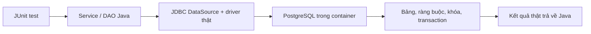

# Sử dụng cơ sở dữ liệu thật trong container cho kiểm thử tích hợp

> **Chương:** Kiểm thử JDBC  
> **Phạm vi:** Java 17+, JDBC, `DataSource`, `Connection`, `PreparedStatement`, `ResultSet`, transaction và Testcontainers kết hợp JUnit Jupiter. Các ví dụ thực hành dùng **PostgreSQL** trong container để kiểm tra SQL/driver thực, không phải database giả lập.

Một DAO dùng `PreparedStatement` có thể vượt qua mọi unit test với mock `ResultSet`, nhưng thất bại khi triển khai: PostgreSQL từ chối dữ liệu vì `CHECK`, driver trả SQLState khác dự kiến, một câu `INSERT` vi phạm khóa ngoại, hoặc thao tác rollback không thực sự hoàn tác hai thay đổi đã chạy trước đó. Các lỗi này xuất phát từ tương tác **Java ↔ JDBC driver ↔ DBMS**, không thể được kiểm chứng đầy đủ chỉ bằng mock.

Giải pháp là chạy **kiểm thử tích hợp JDBC trên cơ sở dữ liệu thật trong container**: mỗi lần test, công cụ có thể khởi động một instance PostgreSQL cô lập, tạo schema, nạp dữ liệu mẫu, thực hiện JDBC thật và đối chiếu trạng thái database. Khi xong, container được dọn dẹp theo vòng đời test.

Mục tiêu của bài:

- Phân biệt unit test, integration test với database thật và end-to-end test.
- Chạy PostgreSQL bằng Testcontainers, nối bằng driver PostgreSQL thật và một `DataSource`.
- Tạo schema/fixture và kiểm thử CRUD, khóa, ràng buộc, transaction commit/rollback.
- Giữ test **lặp lại được, độc lập, không dùng database production**.
- Hiểu vòng đời container, port động, migration, connection pool, concurrency và CI.
- Nhận diện những gì container test **chứng minh được** và những gì vẫn cần kiểm thử trong môi trường khác.

Ví dụ dùng API **Testcontainers Java 1.x** (`org.testcontainers.containers.PostgreSQLContainer`) và **JUnit Jupiter 5.x**. Khi chọn Testcontainers 2.x hoặc phiên bản driver mới hơn, kiểm tra package/artifact và hướng dẫn tương ứng; không sao chép mù quáng import từ phiên bản khác. Các phiên bản dependency trong bài chỉ là một bộ ví dụ tương thích để thực hành, **không phải tuyên bố về phiên bản mới nhất**.

## 1. Vì sao mock hoặc database in-memory chưa đủ?

Khi repository đọc/ghi SQL, một kết quả đúng phụ thuộc vào nhiều lớp:



Bảng so sánh:

| Loại kiểm thử | Thành phần thật | Thích hợp để kiểm tra | Không chứng minh đầy đủ |
|---|---|---|---|
| **Unit test với fake/mock JDBC** | Logic Java do test cung cấp | Rẽ nhánh, validate tham số, mapping nếu mock đúng contract | SQL có hợp lệ trên DBMS thật, constraint/transaction/locking |
| **Test với H2 hoặc database in-memory khác DB production** | JDBC driver và DBMS in-memory | Thử nhanh một số query đơn giản, hành vi repository cơ bản | SQL dialect, isolation, index, generated keys hoặc SQLState của DBMS production |
| **Integration test với DBMS thật trong container** | JDBC driver, DBMS, schema, transaction thật | SQL tham số hóa, CRUD, constraint, rollback, batch, một phần concurrency | Hệ thống production có cùng latency, dung lượng, topology hay sự cố mạng hay không |
| **End-to-end test** | API, authentication, service, DB, hạ tầng liên quan | Luồng người dùng qua nhiều thành phần | Chi tiết nguyên nhân lỗi JDBC nếu không có test nhỏ hơn |

**Không cần xóa bỏ unit test.** Unit test nhanh và hữu ích cho logic thuần Java. Kiểm thử tích hợp bổ sung bằng chứng tại đúng ranh giới nơi bug thường xảy ra: driver, SQL, DBMS và transaction.

Ví dụ một câu `INSERT` “thành công” trong mock có thể không đáp ứng `FOREIGN KEY` ở PostgreSQL thật. Hoặc repository bỏ `rollback()` trong nhánh lỗi nhưng fake connection vẫn trả dữ liệu như mong đợi. Container test có thể phát hiện các vấn đề đó.

## 2. “Database thật trong container” có nghĩa gì?

Một container PostgreSQL chạy **PostgreSQL server thật** trên Docker-compatible runtime. Nó không phải bản mô phỏng JDBC API và cũng không phải PostgreSQL embedded giả lập. Testcontainers là thư viện Java điều phối quá trình tạo/dừng container, kiểm tra readiness và cung cấp thông tin kết nối cho test.

Thành phần thường có:

- **Container runtime:** Docker Engine, Docker Desktop hoặc runtime tương thích mà Testcontainers hỗ trợ.
- **Database image:** chẳng hạn `postgres:16-alpine`, được tải từ registry và chạy cô lập.
- **Testcontainers:** tạo container, chờ DB sẵn sàng, ánh xạ port, dọn resource.
- **JDBC driver thật:** ví dụ PostgreSQL JDBC `org.postgresql:postgresql`.
- **JUnit Jupiter:** điều phối setup, test và teardown.
- **Schema/migration:** tạo bảng và ràng buộc đúng môi trường cần kiểm thử.

```text
Test JVM
  ├── JUnit Jupiter
  ├── Testcontainers lifecycle
  └── DAO/Service under test
        └── JDBC driver
              └── localhost:hostMappedPort (tùy runtime)
                    └── PostgreSQL container:5432
                          ├── accounts
                          └── transfer_log
```

**Không hardcode `localhost:5432`** khi sử dụng Testcontainers. Port container `5432` có thể được ánh xạ sang **host port khác nhau ở mỗi lần chạy**. Lấy URL/host/port từ `PostgreSQLContainer` sau khi container đã khởi động.

Container giúp môi trường test nhất quán hơn, nhưng **không tự bảo đảm mọi phép thử hoàn toàn deterministic**. Các test vẫn có thể bị ảnh hưởng bởi thứ tự chạy, dữ liệu dùng chung, thời gian thực tế, transaction chưa đóng và concurrency.

## 3. Chuẩn bị môi trường và dependency

Để theo bài cần có:

1. **JDK 17+** và công cụ build Maven (hoặc Gradle tương đương).
2. Runtime container được cấp quyền cho tiến trình test, có thể chạy image PostgreSQL.
3. Quyền tải image lần đầu hoặc image đã có sẵn trong cache.
4. Các dependency JUnit Jupiter, Testcontainers PostgreSQL module/JUnit integration và PostgreSQL JDBC driver.

Ví dụ một `pom.xml` tối thiểu cho bài thực hành **Testcontainers 1.x**:

```xml
<project xmlns="http://maven.apache.org/POM/4.0.0"
         xmlns:xsi="http://www.w3.org/2001/XMLSchema-instance"
         xsi:schemaLocation="http://maven.apache.org/POM/4.0.0
                             https://maven.apache.org/xsd/maven-4.0.0.xsd">
    <modelVersion>4.0.0</modelVersion>
    <groupId>edu.jdbc</groupId>
    <artifactId>jdbc-container-integration</artifactId>
    <version>1.0-SNAPSHOT</version>

    <properties>
        <maven.compiler.release>17</maven.compiler.release>
        <project.build.sourceEncoding>UTF-8</project.build.sourceEncoding>
    </properties>

    <dependencies>
        <dependency>
            <groupId>org.junit.jupiter</groupId>
            <artifactId>junit-jupiter</artifactId>
            <version>5.11.4</version>
            <scope>test</scope>
        </dependency>
        <dependency>
            <groupId>org.testcontainers</groupId>
            <artifactId>junit-jupiter</artifactId>
            <version>1.20.6</version>
            <scope>test</scope>
        </dependency>
        <dependency>
            <groupId>org.testcontainers</groupId>
            <artifactId>postgresql</artifactId>
            <version>1.20.6</version>
            <scope>test</scope>
        </dependency>
        <dependency>
            <groupId>org.postgresql</groupId>
            <artifactId>postgresql</artifactId>
            <version>42.7.5</version>
            <scope>test</scope>
        </dependency>
    </dependencies>

    <build>
        <plugins>
            <plugin>
                <groupId>org.apache.maven.plugins</groupId>
                <artifactId>maven-surefire-plugin</artifactId>
                <version>3.5.2</version>
            </plugin>
        </plugins>
    </build>
</project>
```

Các phiên bản trên là **bộ ví dụ có chủ đích**, không phải gợi ý cố định cho dự án. Dự án production nên quản lý các dependency bằng BOM hoặc dependency-management thống nhất, kiểm tra cập nhật bảo mật và tương thích giữa Testcontainers, JUnit, driver và JDK. Trong ví dụ này, driver PostgreSQL có `scope=test` vì chỉ test cần nó; dự án dùng PostgreSQL ở runtime thật phải khai báo driver ở scope phù hợp với ứng dụng.

Bố trí tệp minh họa:

```text
src/
  main/java/edu/jdbc/
    TransferService.java
  test/java/edu/jdbc/
    JdbcTransferIntegrationTest.java
```

Tên `*Test.java` giúp Maven Surefire nhận test theo cấu hình phổ biến. Nếu đặt tên `*IT.java` và dùng Maven Failsafe, cần cấu hình riêng và thường chạy `mvn verify`; không nên mặc định `mvn test` sẽ tìm ra mọi file `*IT.java`.

### Quyền chạy container trong CI

Testcontainers cần **truy cập runtime container** từ tiến trình chạy test. Một CI runner không có Docker socket hoặc API phù hợp sẽ không thể khởi động PostgreSQL. Đó là **điều kiện hạ tầng**, không phải `SQLException` từ DAO.

Không cấu hình test để tự kết nối nhầm database development/production khi Docker không chạy. Hãy **fail rõ ràng** khi thiếu runtime, hoặc phân tách profile test một cách tường minh và được kiểm soát.

## 4. Lấy URL và port động từ container

Một container PostgreSQL cho test JUnit 5:

```java
import org.testcontainers.containers.PostgreSQLContainer;
import org.testcontainers.junit.jupiter.Container;
import org.testcontainers.junit.jupiter.Testcontainers;

@Testcontainers
class JdbcTransferIntegrationTest {

    @Container
    static final PostgreSQLContainer<?> POSTGRES =
        new PostgreSQLContainer<>("postgres:16-alpine")
            .withDatabaseName("jdbc_it")
            .withUsername("it_user")
            .withPassword("it_password");

    // Các test và fixture nằm ở những mục sau.
}
```

Với `@Testcontainers` và `@Container`:

- **Field `static`:** một container được quản lý xuyên suốt **test class**; Testcontainers extension khởi động trước các method cần dùng và dừng theo lifecycle lớp.
- **Field instance:** thông thường container được tạo/dừng cho từng test method, tăng isolation nhưng chi phí khởi động cao hơn.
- **`POSTGRES.getJdbcUrl()`:** trả URL JDBC của container đang chạy, gồm host/port ánh xạ.
- **`POSTGRES.getUsername()` và `getPassword()`:** thông tin đăng nhập test, không dùng credential production.

Một cách mở connection:

```java
import java.sql.Connection;
import java.sql.DriverManager;
import java.sql.SQLException;

try (Connection connection = DriverManager.getConnection(
        POSTGRES.getJdbcUrl(),
        POSTGRES.getUsername(),
        POSTGRES.getPassword())) {
    // Chạy SQL với driver PostgreSQL thật.
}
```

Để khớp kiến trúc ứng dụng dùng `DataSource`, ta có thể tạo `PGSimpleDataSource` bằng **host/port động** từ container:

```java
import org.postgresql.ds.PGSimpleDataSource;
import javax.sql.DataSource;

PGSimpleDataSource source = new PGSimpleDataSource();
source.setServerNames(new String[] { POSTGRES.getHost() });
source.setPortNumbers(
    new int[] { POSTGRES.getMappedPort(5432) }
);
source.setDatabaseName(POSTGRES.getDatabaseName());
source.setUser(POSTGRES.getUsername());
source.setPassword(POSTGRES.getPassword());

DataSource dataSource = source;
```

`PGSimpleDataSource` là **DataSource không pool** do PostgreSQL JDBC driver cung cấp. Đối với test repository/transaction cơ bản, nó là một lựa chọn đơn giản. Nếu nội dung test liên quan riêng đến HikariCP, connection reuse hoặc pool state, cần sử dụng **pool thật** ở test tương ứng, không coi `PGSimpleDataSource` là HikariCP.

**Quan trọng:** `getMappedPort(5432)` chỉ có ý nghĩa khi container đã start. Trong JUnit, khởi tạo `DataSource` trong `@BeforeAll` là một cách rõ ràng để bảo đảm vòng đời đúng; đừng gọi `getMappedPort()` khi constructor của static field vừa chạy mà container chưa được extension khởi động.

## 5. Schema thật: ràng buộc và transaction cần được kiểm chứng

Bài thực hành dùng nghiệp vụ chuyển tiền từ tài khoản A sang B:

1. Trừ số dư A **nếu đủ tiền**.
2. Cộng số dư B.
3. Ghi nhật ký chuyển tiền bằng `transfer_id` duy nhất.
4. Commit **cả ba bước**; nếu bất kỳ bước nào lỗi, rollback toàn bộ.

Schema PostgreSQL:

```sql
CREATE TABLE accounts (
    account_id BIGINT PRIMARY KEY,
    balance NUMERIC(14, 2) NOT NULL CHECK (balance >= 0)
);

CREATE TABLE transfer_log (
    transfer_id UUID PRIMARY KEY,
    source_account BIGINT NOT NULL REFERENCES accounts(account_id),
    target_account BIGINT NOT NULL REFERENCES accounts(account_id),
    amount NUMERIC(14, 2) NOT NULL CHECK (amount > 0)
);
```

Những điều cần kiểm thử **trên PostgreSQL thật**:

- `NUMERIC(14,2)` và `BigDecimal` được bind/đọc đúng, không chuyển qua `double` gây sai số nhị phân.
- `CHECK (balance >= 0)`, `CHECK (amount > 0)`, `PRIMARY KEY` và `FOREIGN KEY` được DBMS thực thi.
- `SQLException.getSQLState()` phản ánh lỗi PostgreSQL thật, chẳng hạn `23505` khi vi phạm unique/primary key, `23514` khi vi phạm CHECK.
- Hai `UPDATE` và `INSERT` nằm trên **cùng connection với `autoCommit=false`**, để rollback có tác dụng lên toàn use case.
- Kết quả sau commit được nhìn thấy khi mở **connection khác**; kết quả sau rollback không còn thay đổi.

**Chọn đúng DBMS là thiết yếu.** Một test chạy trên H2 có thể chấp nhận cú pháp hoặc transaction behavior khác với PostgreSQL. Container PostgreSQL giúp kiểm chứng hành vi của đúng engine, dù vẫn cần kiểm tra phiên bản, extension, collation và cấu hình gần với môi trường triển khai.

## 6. Mã ứng dụng được kiểm thử: JDBC service thật

Ví dụ service dưới đây là mã ứng dụng **không biết Testcontainers**. Nó chỉ nhận `javax.sql.DataSource`, dùng `PreparedStatement` tham số hóa và quản lý transaction. Nhờ vậy có thể dùng **cùng implementation** trong production lẫn integration test.

```java
package edu.jdbc;

import java.math.BigDecimal;
import java.sql.Connection;
import java.sql.PreparedStatement;
import java.sql.SQLException;
import java.util.Objects;
import java.util.UUID;
import javax.sql.DataSource;

public final class TransferService {
    private final DataSource dataSource;

    public TransferService(DataSource dataSource) {
        this.dataSource = Objects.requireNonNull(dataSource);
    }

    public void transfer(
            UUID transferId,
            long sourceAccount,
            long targetAccount,
            BigDecimal amount
    ) throws SQLException {
        Objects.requireNonNull(transferId, "transferId");
        Objects.requireNonNull(amount, "amount");

        if (sourceAccount == targetAccount
                || amount.signum() <= 0
                || amount.scale() > 2) {
            throw new IllegalArgumentException(
                "Invalid transfer request"
            );
        }

        try (Connection connection = dataSource.getConnection()) {
            // Ví dụ dùng local JDBC transaction tự quản lý.
            if (!connection.getAutoCommit()) {
                throw new SQLException(
                    "Expected a fresh auto-commit connection"
                );
            }

            connection.setAutoCommit(false);
            boolean transactionEnded = false;
            Throwable primaryFailure = null;

            try {
                int debited = updateBalance(
                    connection,
                    """
                    UPDATE accounts
                    SET balance = balance - ?
                    WHERE account_id = ? AND balance >= ?
                    """,
                    sourceAccount, amount, true
                );
                if (debited != 1) {
                    throw new IllegalStateException(
                        "Source account missing or insufficient balance"
                    );
                }

                int credited = updateBalance(
                    connection,
                    """
                    UPDATE accounts
                    SET balance = balance + ?
                    WHERE account_id = ?
                    """,
                    targetAccount, amount, false
                );
                if (credited != 1) {
                    throw new IllegalStateException(
                        "Target account missing"
                    );
                }

                insertTransfer(
                    connection, transferId, sourceAccount,
                    targetAccount, amount
                );

                connection.commit();
                transactionEnded = true;

            } catch (SQLException | RuntimeException failure) {
                primaryFailure = failure;

                try {
                    connection.rollback();
                    transactionEnded = true;
                } catch (SQLException rollbackFailure) {
                    failure.addSuppressed(rollbackFailure);
                }

                throw failure;

            } finally {
                // Không bật auto-commit sau rollback thất bại:
                // setAutoCommit(true) có thể commit transaction còn mở.
                if (transactionEnded) {
                    try {
                        connection.setAutoCommit(true);
                    } catch (SQLException resetFailure) {
                        if (primaryFailure != null) {
                            primaryFailure.addSuppressed(resetFailure);
                        } else {
                            throw resetFailure;
                        }
                    }
                }
            }
        }
    }

    private static int updateBalance(
            Connection connection,
            String sql,
            long accountId,
            BigDecimal amount,
            boolean checkAvailable
    ) throws SQLException {

        try (PreparedStatement statement =
                 connection.prepareStatement(sql)) {

            statement.setBigDecimal(1, amount);
            statement.setLong(2, accountId);

            if (checkAvailable) {
                statement.setBigDecimal(3, amount);
            }
            return statement.executeUpdate();
        }
    }

    private static void insertTransfer(
            Connection connection,
            UUID transferId,
            long sourceAccount,
            long targetAccount,
            BigDecimal amount
    ) throws SQLException {

        String sql = """
            INSERT INTO transfer_log (
                transfer_id, source_account, target_account, amount
            ) VALUES (?, ?, ?, ?)
            """;

        try (PreparedStatement statement =
                 connection.prepareStatement(sql)) {

            statement.setObject(1, transferId);
            statement.setLong(2, sourceAccount);
            statement.setLong(3, targetAccount);
            statement.setBigDecimal(4, amount);

            if (statement.executeUpdate() != 1) {
                throw new SQLException(
                    "Transfer log insert did not affect one row"
                );
            }
        }
    }
}
```

Phần cần quan sát:

- `TransferService` không import Testcontainers hay JUnit; nó chỉ dùng JDBC và `DataSource`.
- Mỗi `PreparedStatement` được đóng bằng `try-with-resources`; service là chủ `Connection`.
- Lệnh trừ tiền có điều kiện `balance >= ?` để tránh trừ âm ở mức SQL trong tình huống cạnh tranh; DBMS còn có `CHECK`.
- Nếu `insertTransfer()` lỗi **sau khi cả hai UPDATE thành công**, service vẫn rollback cả ba bước.
- `transfer_id` có ràng buộc unique do `PRIMARY KEY`. Khi retry, caller phải dùng **ID ổn định** và đối soát kết quả nếu commit không rõ trạng thái; mã mẫu chưa triển khai giao thức idempotent hoàn chỉnh.

**Giới hạn:** service giả định `DataSource` trả connection ở `autoCommit=true` và chính service sở hữu local transaction. Với transaction được framework/JTA quản lý, không tự tắt auto-commit hoặc commit độc lập theo mã này; phải tham gia transaction manager. Nếu mất kết nối ngay lúc commit, rollback tiếp theo không luôn chứng minh kết quả cuối cùng trên database.

## 7. Một test JUnit tích hợp hoàn chỉnh với Testcontainers

Ví dụ sau nằm trong `src/test/java/edu/jdbc/JdbcTransferIntegrationTest.java`. Nó khởi động PostgreSQL bằng Testcontainers 1.x, tạo bảng thật trong `@BeforeAll`, reset dữ liệu trước mỗi test và kiểm tra cả tình huống commit lẫn rollback.

```java
package edu.jdbc;

import static org.junit.jupiter.api.Assertions.*;

import java.math.BigDecimal;
import java.sql.Connection;
import java.sql.PreparedStatement;
import java.sql.ResultSet;
import java.sql.SQLException;
import java.sql.Statement;
import java.util.UUID;
import javax.sql.DataSource;

import org.junit.jupiter.api.BeforeAll;
import org.junit.jupiter.api.BeforeEach;
import org.junit.jupiter.api.Test;
import org.postgresql.ds.PGSimpleDataSource;
import org.testcontainers.containers.PostgreSQLContainer;
import org.testcontainers.junit.jupiter.Container;
import org.testcontainers.junit.jupiter.Testcontainers;

@Testcontainers
class JdbcTransferIntegrationTest {

    @Container
    static final PostgreSQLContainer<?> POSTGRES =
        new PostgreSQLContainer<>("postgres:16-alpine")
            .withDatabaseName("jdbc_it")
            .withUsername("it_user")
            .withPassword("it_password");

    private static DataSource dataSource;
    private static TransferService service;

    @BeforeAll
    static void createSchema() throws SQLException {
        PGSimpleDataSource source = new PGSimpleDataSource();
        source.setServerNames(
            new String[] { POSTGRES.getHost() }
        );
        source.setPortNumbers(
            new int[] { POSTGRES.getMappedPort(5432) }
        );
        source.setDatabaseName(POSTGRES.getDatabaseName());
        source.setUser(POSTGRES.getUsername());
        source.setPassword(POSTGRES.getPassword());

        dataSource = source;
        service = new TransferService(dataSource);

        try (Connection connection = dataSource.getConnection();
             Statement statement = connection.createStatement()) {

            statement.execute("""
                CREATE TABLE accounts (
                    account_id BIGINT PRIMARY KEY,
                    balance NUMERIC(14, 2) NOT NULL
                        CHECK (balance >= 0)
                )
                """);

            statement.execute("""
                CREATE TABLE transfer_log (
                    transfer_id UUID PRIMARY KEY,
                    source_account BIGINT NOT NULL
                        REFERENCES accounts(account_id),
                    target_account BIGINT NOT NULL
                        REFERENCES accounts(account_id),
                    amount NUMERIC(14, 2) NOT NULL
                        CHECK (amount > 0)
                )
                """);
        }
    }

    @BeforeEach
    void resetFixture() throws SQLException {
        try (Connection connection = dataSource.getConnection();
             Statement statement = connection.createStatement()) {
            statement.execute(
                "TRUNCATE TABLE transfer_log, accounts"
            );
        }

        try (Connection connection = dataSource.getConnection();
             PreparedStatement insert = connection.prepareStatement(
                 "INSERT INTO accounts (account_id, balance) VALUES (?, ?)"
             )) {

            insert.setLong(1, 1L);
            insert.setBigDecimal(2, new BigDecimal("100.00"));
            assertEquals(1, insert.executeUpdate());

            insert.setLong(1, 2L);
            insert.setBigDecimal(2, new BigDecimal("25.00"));
            assertEquals(1, insert.executeUpdate());
        }
    }

    @Test
    void successCommitsAllSteps() throws SQLException {
        UUID transferId = UUID.randomUUID();

        service.transfer(
            transferId, 1L, 2L, new BigDecimal("10.00")
        );

        // Mở connection KHÁC để xác nhận dữ liệu đã commit.
        try (Connection verify = dataSource.getConnection()) {
            assertEquals(
                new BigDecimal("90.00"), balanceOf(verify, 1L)
            );
            assertEquals(
                new BigDecimal("35.00"), balanceOf(verify, 2L)
            );
            assertEquals(1, countTransfers(verify, transferId));
        }
    }

    @Test
    void insufficientBalanceRollsBack() throws SQLException {
        UUID transferId = UUID.randomUUID();

        assertThrows(
            IllegalStateException.class,
            () -> service.transfer(
                transferId, 1L, 2L, new BigDecimal("200.00")
            )
        );

        try (Connection verify = dataSource.getConnection()) {
            assertEquals(
                new BigDecimal("100.00"), balanceOf(verify, 1L)
            );
            assertEquals(
                new BigDecimal("25.00"), balanceOf(verify, 2L)
            );
            assertEquals(0, countTransfers(verify, transferId));
        }
    }

    @Test
    void duplicateTransferIdRollsBackBothUpdates()
            throws SQLException {

        UUID alreadyUsedId = UUID.randomUUID();

        // Một bản ghi log đã được commit trước khi gọi service.
        // Đây là fixture cố ý tạo vi phạm PRIMARY KEY ở bước cuối.
        try (Connection connection = dataSource.getConnection();
             PreparedStatement insert = connection.prepareStatement("""
                 INSERT INTO transfer_log (
                     transfer_id, source_account, target_account, amount
                 ) VALUES (?, 1, 2, 1.00)
                 """)) {

            insert.setObject(1, alreadyUsedId);
            assertEquals(1, insert.executeUpdate());
        }

        SQLException failure = assertThrows(
            SQLException.class,
            () -> service.transfer(
                alreadyUsedId, 1L, 2L, new BigDecimal("10.00")
            )
        );

        assertEquals("23505", failure.getSQLState());

        try (Connection verify = dataSource.getConnection()) {
            // Hai UPDATE đã chạy TRƯỚC INSERT lỗi,
            // nhưng cả hai phải bị rollback.
            assertEquals(
                new BigDecimal("100.00"), balanceOf(verify, 1L)
            );
            assertEquals(
                new BigDecimal("25.00"), balanceOf(verify, 2L)
            );
            assertEquals(1, countTransfers(verify, alreadyUsedId));
        }
    }

    @Test
    void checkConstraintIsEnforcedByRealPostgres()
            throws SQLException {

        try (Connection connection = dataSource.getConnection();
             PreparedStatement insert = connection.prepareStatement(
                 "INSERT INTO accounts (account_id, balance) VALUES (?, ?)"
             )) {

            insert.setLong(1, 3L);
            insert.setBigDecimal(2, new BigDecimal("-1.00"));

            SQLException failure = assertThrows(
                SQLException.class,
                insert::executeUpdate
            );

            assertEquals("23514", failure.getSQLState());
        }
    }

    private static BigDecimal balanceOf(
            Connection connection, long accountId
    ) throws SQLException {

        try (PreparedStatement statement = connection.prepareStatement(
                 "SELECT balance FROM accounts WHERE account_id = ?"
             )) {

            statement.setLong(1, accountId);

            try (ResultSet result = statement.executeQuery()) {
                assertTrue(result.next(), "Account must exist");
                return result.getBigDecimal("balance");
            }
        }
    }

    private static int countTransfers(
            Connection connection, UUID transferId
    ) throws SQLException {

        try (PreparedStatement statement = connection.prepareStatement(
                 "SELECT COUNT(*) FROM transfer_log WHERE transfer_id = ?"
             )) {

            statement.setObject(1, transferId);

            try (ResultSet result = statement.executeQuery()) {
                assertTrue(result.next());
                return result.getInt(1);
            }
        }
    }
}
```

**Không cần chạy một PostgreSQL server cố định trước test.** Với container runtime khả dụng, extension khởi động container; `@BeforeAll` dùng host/port được cấp và tạo schema; `@BeforeEach` chuẩn bị dữ liệu xác định cho từng test; `@Container` giúp quản lý dừng container sau lớp test.

Chạy bài thực hành trong project Maven có cấu hình ví dụ:

```bash
mvn test
```

**Đây là hướng dẫn chạy để người học tự thực hành**, không phải kết quả thực thi đã được xác nhận trong tài liệu. Nếu test thất bại trước khi JDBC được mở, kiểm tra Docker runtime, quyền truy cập container API và khả năng pull image trước khi sửa câu SQL.

### Tại sao test `duplicateTransferId...` quan trọng?

Trong transaction thử nghiệm, hai `UPDATE` số dư **đã thực thi thành công** trước khi `INSERT transfer_log` bị từ chối do trùng `PRIMARY KEY`. Nếu service thiếu `rollback()` hoặc vô tình bật lại auto-commit quá sớm, số dư A/B có thể không trở lại `100.00`/`25.00`. Đây là phép thử có giá trị thực tế hơn nhiều so với mock `Connection.rollback()` rồi chỉ `verify(mock).rollback()`: nó **đọc dữ liệu thật sau lỗi** để kiểm tra bất biến nghiệp vụ.

Chú ý test trả về một bản ghi log có sẵn sau rollback vì bản ghi đó được chèn **trước** khi service bắt đầu transaction lỗi. Đó là kết quả mong muốn: rollback chỉ hủy các thay đổi của transaction thất bại, không hủy dữ liệu đã commit trước đó.

## 8. Cô lập dữ liệu giữa các test: một container chưa đủ

Dù container tách database test khỏi môi trường bên ngoài, các test **trong cùng một class** vẫn đang chia sẻ database bên trong container. Nếu test A để lại bản ghi và test B giả định bảng rỗng, kết quả có thể phụ thuộc thứ tự chạy.

Trong ví dụ trên, `@BeforeEach`:

```java
try (Connection connection = dataSource.getConnection();
     Statement statement = connection.createStatement()) {

    statement.execute("TRUNCATE TABLE transfer_log, accounts");
}
```

giúp mỗi test bắt đầu từ dữ liệu xác định. `TRUNCATE` có semantics riêng theo PostgreSQL, có thể lấy lock mạnh và không phù hợp nếu các test chạy **song song trên cùng schema**.

Các cách cô lập phổ biến:

| Chiến lược | Ưu điểm | Giới hạn |
|---|---|---|
| **`TRUNCATE`/xóa fixture trong `@BeforeEach`** | Nhanh, dễ hiểu cho test tuần tự | Dễ race khi test song song; chú ý FK và transaction |
| **Rollback transaction của test** | Thường nhanh nếu toàn bộ code dùng cùng connection/transaction | Không hoàn tác khi service tự mượn connection khác và tự commit |
| **Schema riêng theo test** | Có thể cô lập test song song mà không cần container riêng | Phải định tuyến schema, migration và cleanup; chú ý search path |
| **Database/container riêng mỗi test** | Cô lập mạnh | Tăng thời gian startup và tài nguyên |
| **Reset database từ snapshot/migration + fixture** | Lặp lại cao, sát schema thật | Tốn công quản lý snapshot và version |

**Bẫy thường gặp:** viết `@Transactional` ở lớp test và tin rằng mọi thao tác của service sẽ bị rollback sau test. Nếu service gọi `DataSource.getConnection()` để lấy **connection mới không tham gia transaction của test**, nó có thể đã commit độc lập. Test cần xác minh transaction ownership thực tế, không chỉ nhìn annotation.

### Kiểm thử song song cần chiến lược rõ

JUnit Jupiter có thể được cấu hình chạy song song. Nếu nhiều test cùng `TRUNCATE` một bảng, dữ liệu test A có thể bị test B xóa ngay trong lúc A chạy. Với fixture chia sẻ, giữ test tuần tự hoặc dùng schema/container riêng cho mỗi test hay nhóm test.

Không nên “sửa flaky test” bằng cách chèn `Thread.sleep(1000)`. Hãy xác định dependency về dữ liệu, thứ tự, lock, startup readiness hoặc sự kiện bất đồng bộ rồi đồng bộ đúng điều kiện thay vì ngủ một khoảng bất kỳ.

## 9. Schema thực tế: dùng migration của ứng dụng, không chỉ DDL thủ công

Trong ví dụ tự chứa, `@BeforeAll` tạo bảng bằng `Statement.execute()` để người học nhìn thấy các ràng buộc. Một dự án production thường đã có **Flyway/Liquibase** hoặc migration tool khác.

Nên chạy **cùng bộ migration mà ứng dụng thật sử dụng** trên container test:

```text
PostgreSQL container started
    |
    v
Migration tool applies schema V1...Vn
    |
    v
Fixture inserts deterministic test records
    |
    v
DAO/service tests
    |
    v
Verify DB state and cleanup
```

Lợi ích:

- Phát hiện migration bị thiếu thứ tự, không chạy được trên DBMS thật.
- Kiểm thử đúng index, unique constraint, foreign key, default và trigger.
- Tránh tình trạng DDL dành cho test khác DDL production làm test “xanh” giả.
- Bắt incompatibility khi nâng PostgreSQL JDBC driver hoặc version database.

**Không tạo schema bằng cách copy thủ công các định nghĩa đã lệch so với production** nếu mục tiêu là kiểm chứng schema hiện tại. Trong CI, container thường bắt đầu sạch, migration giúp test từ database trống tới version hiện hành. Với test migration nâng cấp, cần dữ liệu/schema phiên bản cũ và chạy đường upgrade riêng; một DB trống không đủ kiểm chứng mọi trường hợp.

### Khi nào dùng seed SQL hoặc init script?

Testcontainers hỗ trợ các cách khởi tạo schema/dữ liệu, trong đó có init script theo module/phiên bản. Nhưng việc nạp nhiều fixture cố định ngay khi container start có thể khiến test chia sẻ state khó kiểm soát. Nên phân biệt:

- **Schema migration:** áp dụng một lần theo lifecycle container.
- **Dữ liệu fixture:** thiết lập trước mỗi test hoặc dùng dataset cô lập.
- **Dữ liệu phát sinh của test:** để test tự tạo với ID riêng và cleanup theo chiến lược.

Không nạp mật khẩu, token hoặc dữ liệu khách hàng thật vào image/fixture của test.

## 10. Test gì bằng PostgreSQL thật ngoài CRUD cơ bản?

### 10.1. SQL dialect, kiểu dữ liệu và mapping

Những điểm phù hợp để test tích hợp:

- `UUID` ↔ `java.util.UUID`, `NUMERIC` ↔ `BigDecimal`.
- `TIMESTAMPTZ` ↔ `OffsetDateTime`/`Instant` tùy API và driver.
- `NULL` và `ResultSet.wasNull()`; không coi `getInt() == 0` là NULL khi cột cho phép 0.
- `BYTEA`/BLOB hoặc CLOB với luồng dữ liệu lớn.
- `INSERT ... RETURNING ...` của PostgreSQL hoặc `getGeneratedKeys()` theo driver.
- SQL array, JSONB, enum hoặc các kiểu mở rộng mà ứng dụng thực sự dùng.

Ví dụ test `NULL`:

```java
try (Connection connection = dataSource.getConnection();
     PreparedStatement statement =
         connection.prepareStatement("""
             SELECT CAST(NULL AS INTEGER) AS optional_value
             """);
     ResultSet result = statement.executeQuery()) {

    assertTrue(result.next());
    int value = result.getInt("optional_value");

    assertEquals(0, value); // Getter primitive trả 0 cho NULL.
    assertTrue(result.wasNull()); // Đây mới là kiểm tra NULL.
}
```

Bài test này xác nhận hành vi `ResultSet` thực trên driver. Với các kiểu số nullable, code application có thể dùng `getObject("optional_value", Integer.class)` nếu driver hỗ trợ để tránh nhầm NULL/0.

### 10.2. Constraint và SQLState

Một bảng có `PRIMARY KEY`, `UNIQUE`, `CHECK`, `FOREIGN KEY` nên được kiểm thử với:

- Dữ liệu hợp lệ được chấp nhận.
- Dữ liệu vi phạm ràng buộc bị từ chối.
- `SQLState` phù hợp database mục tiêu (ví dụ PostgreSQL `23505`, `23503`, `23514`).
- Transaction sau lỗi được xử lý đúng (một số DBMS, như PostgreSQL, đánh dấu transaction đang lỗi cho tới khi rollback).

**Không viết test dựa trên chuỗi nguyên văn `SQLException.getMessage()`** nếu có thể dùng `SQLState`, vendor code, constraint name hoặc hậu điều kiện dữ liệu. Message có thể thay đổi do version, locale hay driver.

### 10.3. Batch và update counts

Với `PreparedStatement.addBatch()`/`executeBatch()`:

- Xác minh thứ tự ánh xạ input với `getUpdateCounts()`.
- Phân biệt số hàng `0`, `Statement.SUCCESS_NO_INFO` và `Statement.EXECUTE_FAILED`.
- Khi `BatchUpdateException` xuất hiện, kiểm tra mảng update counts và `getNextException()`.
- Thử rollback toàn batch trong transaction do service sở hữu nếu yêu cầu nghiệp vụ là all-or-nothing.

Không dùng fake driver để “ấn định” cách PostgreSQL JDBC xử lý batch; cấu hình như batch rewrite có thể ảnh hưởng hành vi driver, cần test cùng cấu hình thật. Update counts không tự chứng minh transaction đã commit.

### 10.4. Lock, isolation và concurrency

Một container PostgreSQL cũng cho phép tạo **hai connection thật** để thử lock và transaction:

```java
try (Connection first = dataSource.getConnection();
     Connection second = dataSource.getConnection()) {

    first.setAutoCommit(false);
    second.setAutoCommit(false);

    // Trong test đầy đủ:
    // 1. first UPDATE một hàng và giữ transaction chưa commit.
    // 2. second thử UPDATE cùng hàng với lock timeout giới hạn.
    // 3. Đánh giá exception/SQLState và hậu điều kiện.
    // 4. Rollback trong finally, đóng cả hai connection.
}
```

Đoạn này chỉ là **khung tổ chức**, không phải một test concurrency hoàn chỉnh. Để tránh deadlock của chính test, phải dùng executor/cơ chế đồng bộ kiểm soát, timeout của statement/server và `finally` rollback ở hai connection. Không block vô hạn một thread chờ khóa do thread test khác đang giữ.

Kiểm thử concurrency thật có thể phát hiện lost update, deadlock, phantoms hoặc lỗi transaction boundary; các hành vi còn phụ thuộc isolation và cấu hình DBMS. Không suy từ test tuần tự rằng mã an toàn khi hai request chạy cùng lúc.

## 11. Kiểm thử connection pool với database container

Nếu application production dùng HikariCP hoặc pool khác, nên có **một nhóm integration test sử dụng đúng pool**, bên cạnh nhóm test JDBC cơ bản dùng `PGSimpleDataSource`.

Ví dụ cấu hình nguyên tắc:

```java
// Chỉ dùng khi project đã khai báo dependency HikariCP.
HikariConfig config = new HikariConfig();
config.setJdbcUrl(POSTGRES.getJdbcUrl());
config.setUsername(POSTGRES.getUsername());
config.setPassword(POSTGRES.getPassword());
config.setMaximumPoolSize(2);
config.setConnectionTimeout(1_000);

try (HikariDataSource pool = new HikariDataSource(config)) {
    // Kiểm tra borrow/close, timeout khi giữ đủ 2 connection,
    // rollback và trạng thái autoCommit/isolation giữa các lần mượn.
}
```

`HikariConfig` và `HikariDataSource` thuộc thư viện **HikariCP**, không thuộc JDK hay Testcontainers; cần thêm dependency khi thực hành đoạn này. Khi test pool:

- Sau `Connection.close()`, logical handle phải được trả về pool; không tự gọi `pool.close()` sau từng DAO.
- Giữ hết connection trong test rồi thử mượn thêm để kiểm tra acquisition timeout.
- Gây lỗi SQL rồi xác minh rollback/reset trạng thái và connection không bị giữ mãi.
- Với connection bị hỏng, kiểm tra pool có cơ chế loại bỏ/validation theo driver; không nên restart Docker hoặc kill DB cho tất cả test bình thường.

Nếu muốn kiểm tra **connection leak**, sử dụng test scope có giới hạn thời gian, `try-with-resources` và metrics của pool. Một test cố tình giữ connection không đóng phải dọn hết tài nguyên trong `finally` để không làm hỏng các test sau.

## 12. Vòng đời container và tốc độ chạy test

Container cần thời gian pull image, start database, health check và thực thi migration. Không cần khởi động PostgreSQL mới cho **mỗi assertion**.

| Cách quản lý | Độ cô lập | Chi phí | Thích hợp |
|---|---|---|---|
| Static `@Container` theo class | Chung database trong class, có reset fixture | Một lần start/class | Test suite vừa phải |
| Instance `@Container` theo method | Cô lập container giữa test | Nhiều lần start | Test nhạy với state hoặc isolation mạnh |
| Container chung cho nhóm test | Cần schema/dataset isolation rõ | Startup ít hơn | Suite lớn, kiểm soát lifecycle tốt |
| Container dùng lại giữa nhiều lần chạy local | Có thể sót state | Nhanh hơn khi được cấu hình | Phát triển cục bộ; **không mặc định trong CI** |

**Testcontainers reuse** có tính tùy chọn và semantics/lifecycle riêng theo phiên bản. Không bật reuse vô điều kiện trong CI để tối ưu tốc độ: test có thể phụ thuộc state của lần chạy trước, và resource không được dọn như kỳ vọng.

Khi cần rút thời gian:

1. Dùng image phù hợp, cache image ở CI nếu môi trường cho phép.
2. Giảm số lần start bằng container scope phù hợp.
3. Giảm dữ liệu fixture lớn không cần thiết.
4. Tách test thật sự cần DB và unit test chỉ xử lý Java.
5. Dùng transaction/schema isolation nếu có thể, thay vì luôn tạo container mới.
6. Chạy parallel chỉ khi test đã cô lập state và database đủ tài nguyên.

Không “tối ưu” bằng cách thay DBMS production bằng một DB khác rồi cho rằng mọi vấn đề JDBC đã được test.

## 13. Đưa test vào CI một cách an toàn

Một pipeline CI có thể thực hiện:

```text
Checkout code
   |
   v
Install/select JDK + Maven
   |
   v
Ensure Docker-compatible runtime is accessible
   |
   v
mvn test
   |
   v
Testcontainers pulls/starts PostgreSQL
   |
   v
Migrate schema, load fixtures, run integration tests
   |
   v
JUnit reports + container cleanup
```

Yêu cầu vận hành:

- CI worker có đủ tài nguyên CPU/RAM/disk và quyền container runtime.
- Chính sách network/registry cho phép tải image, hoặc có registry mirror đáng tin cậy.
- **Không cần password của database production**: credential được tạo cho container test.
- Pin image tag/digest và bộ dependency để hạn chế sự khác biệt không chủ ý. Ví dụ `postgres:16-alpine` cố định major version nhưng **không cố định toàn bộ bản vá**; muốn tái lập chính xác cần dùng tag chi tiết hoặc digest theo chính sách.
- Không đưa Docker socket ra môi trường không tin cậy nếu không có cơ chế cô lập phù hợp; quyền điều khiển container runtime có rủi ro bảo mật cao.
- Thu log test/container khi thất bại nhưng không ghi secret hoặc dữ liệu nhạy cảm.
- Theo dõi container rác, cleanup khi job bị hủy, và tránh dùng volume/database production.
- Nếu Docker không khả dụng, báo **lỗi hạ tầng test** thay vì chạy fallback sang một database có dữ liệu thật.

Testcontainers có cơ chế dọn resource theo cấu hình (bao gồm resource reaper ở nhiều môi trường/phiên bản), nhưng đừng dựa vào cleanup để bảo vệ dữ liệu production. **Cô lập URL/credential ở ngay cấu hình test** mới là hàng rào quan trọng.

### Tại sao không hardcode database URL trong CI?

Ví dụ sau là cách dễ gây nhầm môi trường:

```java
// Sai đối với một integration test được kỳ vọng tự tạo container:
String url = System.getenv().getOrDefault(
    "JDBC_URL", "jdbc:postgresql://localhost:5432/app"
);
```

Nếu biến môi trường thiếu hoặc bị cấu hình nhầm, test có thể truy cập database mà người viết không dự kiến. Với Testcontainers, lấy `POSTGRES.getJdbcUrl()` sau start và truyền trực tiếp vào DataSource test; không có fallback tới database “gần đúng”.

## 14. Khi test thất bại: phân biệt lỗi hạ tầng và lỗi nghiệp vụ

Một lỗi thất bại có thể phát sinh trước hoặc sau khi SQL chạy:

| Giai đoạn | Dấu hiệu | Nên kiểm tra |
|---|---|---|
| Docker/runtime | Testcontainers không tạo container được | Docker daemon/socket, quyền, disk, CI runner |
| Kéo image | Timeout/không pull được | Registry, proxy, network policy, image tag |
| Container start | PostgreSQL không readiness đúng hạn | Container logs, image, CPU/RAM, health check |
| Kết nối JDBC | `SQLException` khi lấy connection | URL/mapped port, credential, driver version |
| Migration/schema | Table/column/constraint không tồn tại | Thứ tự migration, DB name/schema, role/GRANT |
| Fixture | Vi phạm constraint hoặc state từ test trước | Reset fixture, FK order, song song |
| DAO SQL | Sai cú pháp/kiểu, SQLState từ PostgreSQL | Câu SQL, bind tham số, schema, mapping |
| Transaction test | Dữ liệu sau lỗi không như mong đợi | Connection ownership, auto-commit, rollback/commit |
| Cleanup | Container/connection không được đóng | `try-with-resources`, JUnit lifecycle, test bị hủy |

Khi thấy `SQLException`, ghi có giới hạn `getSQLState()`, `getErrorCode()`, `getCause()`, `getNextException()` và `getSuppressed()`. Không so sánh trực tiếp chuỗi message hoặc log SQL chứa dữ liệu nhạy cảm. Với test timeout/deadlock, ghi cả giai đoạn (acquisition, execute, fetch, commit, rollback) để không quy lỗi mạng thành lỗi ràng buộc.

### Flaky test không phải lúc nào cũng do container

Một số nguyên nhân khác:

- Assertion chạy **trước khi thao tác async hoàn tất**.
- Test A và B cùng xóa fixture trong lúc chạy song song.
- Code dùng thời gian hệ thống/ngày giờ/timezone không cố định.
- Transaction commit chưa hoàn thành nhưng test đọc từ connection khác.
- Thứ tự `SELECT` không có `ORDER BY` nhưng test đòi danh sách theo thứ tự.
- Test sử dụng port cố định bị process khác chiếm.
- Chu kỳ start/stop pool/container bị quản lý sai.
- SQL phụ thuộc collation/locale/schema mặc định khác giữa môi trường.

Khắc phục bằng dữ liệu/đồng bộ rõ ràng, truy vấn có thứ tự, transaction scope đúng và cấu hình DBMS tái lập được; không chỉ tăng timeout khi test fail.

## 15. Bài thực hành mở rộng

1. **Khởi động DB thật:** tạo project Java 17/JUnit Jupiter/Testcontainers, chạy `PostgreSQLContainer`, in `getJdbcUrl()` và tên database test (không in password). Giải thích vì sao không hardcode port host.
2. **Tái sử dụng DataSource:** cấu hình `PGSimpleDataSource` từ host/port động, inject vào `TransferService`. Chứng minh service không import Testcontainers.
3. **Kiểm thử commit:** chuyển `10.00` từ A sang B, đọc bằng connection mới, xác nhận hai số dư và một hàng `transfer_log`.
4. **Kiểm thử rollback:** tạo bản ghi log trùng `transfer_id`, gọi service để lỗi ở bước cuối, xác nhận các số dư **không đổi**. Phân biệt SQLState của lỗi với trạng thái transaction cuối.
5. **Ràng buộc thật:** thử chèn số dư âm, `transfer_id` trùng và tham chiếu FK không tồn tại. Ghi lại SQLState PostgreSQL; không dùng message làm điều kiện test.
6. **Generated keys:** bổ sung bảng `users(id BIGINT GENERATED BY DEFAULT AS IDENTITY)`, dùng `RETURN_GENERATED_KEYS` hoặc `INSERT ... RETURNING` và kiểm tra giá trị trả về.
7. **Batch:** viết `addBatch()` trên một connection, chèn một dòng vi phạm unique, xem `BatchUpdateException.getUpdateCounts()` và xác minh rollback theo yêu cầu nghiệp vụ.
8. **NULL và thời gian:** kiểm thử `ResultSet.wasNull()`, `BigDecimal`, `OffsetDateTime`/`TIMESTAMPTZ` với giá trị biên. Đặt timezone rõ ràng khi test cần điều kiện đó.
9. **Cô lập test:** cố ý để một test không dọn dữ liệu, quan sát tác động tới test khác. Áp dụng `@BeforeEach` reset hoặc schema riêng rồi chạy lặp lại.
10. **So sánh H2:** thử một truy vấn đặc thù PostgreSQL trên H2 và container PostgreSQL. Ghi nhận khác biệt thay vì giả định H2 luôn tương thích.
11. **Pool test:** thay `PGSimpleDataSource` bằng HikariCP trong một test riêng, đặt `maximumPoolSize=1` và kiểm tra acquisition timeout khi connection đang được mượn.
12. **Concurrency:** dùng hai JDBC connection để tạo lock wait trong môi trường test, đặt timeout và đảm bảo `finally` rollback/close; không để test treo vô hạn.
13. **CI:** cấu hình runner có container runtime, chạy `mvn test`, lưu JUnit report và logs khi thất bại. Thử tình huống Docker không khả dụng và xác nhận test fail rõ ràng, không nối tới DB khác.
14. **Schema migration:** thay DDL trong `@BeforeAll` bằng Flyway/Liquibase migration thật của ứng dụng; xác minh test từ database trống vẫn chạy ổn định.

### Checklist trước khi coi bộ integration test là đáng tin cậy

- [ ] Dùng **DBMS thật cùng họ/cấu hình quan trọng** với production.
- [ ] JDBC driver thật, không mock ở tầng cần kiểm thử SQL/transaction.
- [ ] Connection URL/port/credential lấy từ container test, không trỏ tới production.
- [ ] Có schema đúng version hoặc migration thật của ứng dụng.
- [ ] Fixture xác định; không dựa vào thứ tự chạy hoặc state sót lại.
- [ ] Test kiểm tra **hậu điều kiện dữ liệu sau commit/rollback**, không chỉ mock method call.
- [ ] CRUD, `PRIMARY KEY`, `FOREIGN KEY`, `CHECK`, SQLState và các kiểu dữ liệu quan trọng được kiểm thử.
- [ ] Transaction service dùng một connection hoặc tham gia transaction manager đúng hợp đồng.
- [ ] Test dùng đúng nguyên tắc `try-with-resources` để đóng statement/result set/connection.
- [ ] Test song song được cô lập dữ liệu, không cùng `TRUNCATE` bất ngờ.
- [ ] Test về connection pool/timeout dùng đúng pool và giới hạn thời gian.
- [ ] Container lifecycle được quản lý, image/dependency có chính sách pin version.
- [ ] CI có runtime container và không fallback sang database ngoài dự kiến.
- [ ] Không dùng dữ liệu khách hàng thật, password hoặc token production.
- [ ] Kiểm thử tích hợp không bị thay thế hoàn toàn bởi unit test hoặc smoke test đơn lẻ.

**Tiêu chí hoàn thành:** người học có thể chạy PostgreSQL thật trong container bằng Testcontainers và JUnit Jupiter, lấy JDBC URL/port động, cấp `DataSource` cho DAO/service không phụ thuộc test framework, tạo schema và fixture lặp lại được, kiểm chứng constraint cùng transaction commit/rollback bằng dữ liệu thật, đồng thời thiết kế vòng đời, cô lập test, CI và cách chẩn đoán lỗi nhằm có bộ kiểm thử tích hợp JDBC đáng tin cậy.
