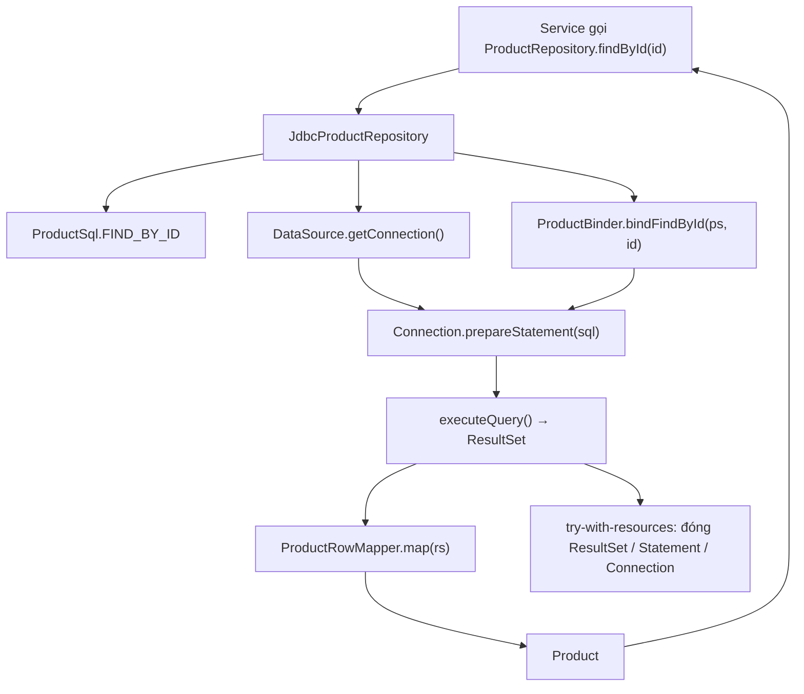

# Tách SQL, gán tham số và ánh xạ kết quả trong DAO và Repository

Khi ứng dụng Java truy cập cơ sở dữ liệu quan hệ bằng **JDBC**, một phương thức nghiệp vụ có thể phải làm ba việc: **xác định câu SQL cần chạy**, **gán dữ liệu vào các placeholder** và **chuyển hàng trong `ResultSet` thành đối tượng Java**. Nếu cả ba trách nhiệm nằm lẫn trong một khối mã dài, chỉ cần thay đổi alias, bổ sung cột hoặc sửa thứ tự dấu `?` là rất dễ tạo lỗi khó phát hiện.

Bài học thuộc chương **DAO và Repository** của module **JDBC**. Ta sẽ tổ chức mã sử dụng `DataSource`, `Connection`, `PreparedStatement` và `ResultSet` theo ranh giới rõ ràng, để thực hành SQL tham số hóa, CRUD, ánh xạ kiểu SQL sang Java, quản lý tài nguyên và phối hợp transaction khi nhiều thao tác phải thành công cùng nhau.

> **Ý chính:** Tách **câu SQL** (mô tả dữ liệu cần truy cập), **binder** (gán giá trị cho dấu `?`), **row mapper** (đọc một hàng kết quả) khỏi **DAO/Repository** (điều phối truy cập và vòng đời JDBC). Đây là cách tổ chức mã, **không phải các interface bắt buộc của JDBC**; chỉ những interface như `DataSource`, `Connection`, `PreparedStatement` và `ResultSet` mới thuộc API JDBC chuẩn.

## 1. Vấn đề của phương thức trộn nhiều trách nhiệm

Hãy xem một ví dụ dễ gặp khi dự án bắt đầu nhỏ:

```java
public Product findProduct(DataSource dataSource, long id)
        throws SQLException {

    Connection connection = dataSource.getConnection();
    PreparedStatement ps = connection.prepareStatement(
            "SELECT product_id, sku, display_name, unit_price, stock "
            + "FROM product WHERE product_id = " + id);

    ResultSet rs = ps.executeQuery();

    if (rs.next()) {
        return new Product(
                rs.getLong("product_id"),
                rs.getString("sku"),
                rs.getString("display_name"),
                rs.getBigDecimal("unit_price"),
                rs.getInt("stock"));
    }
    return null;
}
```

Đoạn này chứa một số điểm đáng lo:

- Tự nối `id` vào SQL thay vì bind bằng `?`. Với `long` đã kiểm tra, nguy cơ injection ở chính biểu thức này thấp, nhưng **thói quen ghép dữ liệu vào SQL** sẽ gây lỗ hổng khi áp dụng sang chuỗi đầu vào.
- Không đóng `ResultSet`, `PreparedStatement` và `Connection`. Nếu có connection pool, handle có thể bị giữ mãi và request khác phải chờ.
- Câu `SELECT` và tên cột được nhúng trong phương thức; khi thay projection hoặc alias, mã Java phải sửa nhiều nơi.
- Quy tắc chuyển một hàng `ResultSet` thành `Product` nằm trong truy vấn. Nếu thêm `findBySku` hoặc `findAll`, logic mapping có thể bị sao chép.
- Không định nghĩa rõ trường hợp không tìm thấy bản ghi: trả `null` có thể khiến caller quên kiểm tra.

Một phiên bản tốt hơn không chỉ dùng `try-with-resources`, mà còn **phân tách các quyết định** để dễ kiểm tra, tái sử dụng và thay đổi.

## 2. DAO và Repository khác nhau ở điểm nào?

**DAO** (*Data Access Object*) tập trung đóng gói thao tác với nguồn dữ liệu: thực thi truy vấn, cập nhật, dùng cursor và chuyển kết quả. **Repository** là một khái niệm thiết kế ở tầng miền: cung cấp giao diện để tìm và lưu các thực thể hoặc aggregate theo ngôn ngữ nghiệp vụ, hạn chế để mã gọi phải hiểu chi tiết lưu trữ.

Trong ứng dụng JDBC nhỏ, một lớp `JdbcProductRepository` thường đồng thời làm vai trò DAO và triển khai giao diện Repository. Không cần tạo hai lớp chỉ vì tên gọi; điều đáng quan tâm là **tầng nghiệp vụ không trực tiếp xử lý `ResultSet` hoặc ghép SQL**.

| Thành phần | Trách nhiệm chính | Không nên ôm thêm |
|---|---|---|
| `Product` | Biểu diễn dữ liệu/đối tượng miền. | Mở connection, chứa câu SQL hay đọc `ResultSet`. |
| `ProductRepository` | Khai báo thao tác mà tầng gọi cần: tìm, thêm, thay đổi. | Chi tiết câu SQL hoặc API kết nối của driver. |
| `ProductSql` | Lưu các câu SQL và hợp đồng alias/placeholder. | Tự mượn connection hoặc quyết định transaction. |
| `ProductBinder` | Gán tham số `PreparedStatement` theo hợp đồng của từng câu SQL. | Ghép chuỗi SQL từ dữ liệu người dùng hoặc đọc `ResultSet`. |
| `ProductRowMapper` | Chuyển **hàng hiện tại** của `ResultSet` thành `Product`. | Gọi `rs.next()`, `commit()` hoặc giữ connection. |
| `JdbcProductRepository` | Điều phối `DataSource`, statement, binder, mapper và kết quả CRUD. | Các quy tắc nghiệp vụ phức tạp không thuộc truy cập dữ liệu. |
| Service / transaction boundary | Phối hợp nhiều thao tác, kiểm tra invariant và quyết định commit/rollback. | Lặp lại SQL, mapping hay tự phụ thuộc tên cột nếu không cần. |

Sơ đồ luồng đọc:



**Ranh giới rõ không có nghĩa mọi câu SQL đều phải có một class riêng.** Với DAO chỉ có một truy vấn ngắn, để hằng SQL và một mapper private trong cùng lớp vẫn có thể tốt. Ta tách thành nhiều lớp ở đây để quan sát từng trách nhiệm khi hệ thống có nhiều thao tác.

## 3. CSDL mẫu: bảng sản phẩm và hợp đồng dữ liệu

Xét bảng `product`:

```sql
CREATE TABLE product (
    product_id BIGINT PRIMARY KEY,
    sku VARCHAR(40) NOT NULL UNIQUE,
    display_name VARCHAR(120) NOT NULL,
    unit_price DECIMAL(12, 2) NOT NULL,
    stock INTEGER NOT NULL,
    CONSTRAINT ck_product_price CHECK (unit_price >= 0),
    CONSTRAINT ck_product_stock CHECK (stock >= 0)
);
```

Đây là SQL minh họa dùng kiểu và constraint tương đối phổ biến. Khả năng thực thi `CHECK`, cách viết DDL và kiểu dữ liệu thực tế phải được kiểm chứng trên DBMS đang dùng; ví dụ không nhằm cung cấp một migration chung chạy không sửa trên mọi hệ.

| Cột SQL | Kiểu SQL | Trường Java dự kiến | Ghi chú |
|---|---|---|---|
| `product_id` | `BIGINT` | `long id` | Khóa chính; dùng `setLong/getLong`. |
| `sku` | `VARCHAR(40)` | `String sku` | Giá trị không được `NULL`, duy nhất. |
| `display_name` | `VARCHAR(120)` | `String name` | Tên hiển thị. |
| `unit_price` | `DECIMAL(12,2)` | `BigDecimal price` | Tránh `double` cho tiền. |
| `stock` | `INTEGER` | `int stock` | Không âm và không `NULL`. |

Ta sẽ thực hành bốn thao tác chính: tìm sản phẩm theo ID, liệt kê sản phẩm còn tồn, thêm sản phẩm mới và cập nhật giá.

### Bước đầu tiên: mô hình Java không chứa JDBC

```java
import java.math.BigDecimal;
import java.util.Objects;

public final class Product {
    private final long id;
    private final String sku;
    private final String name;
    private final BigDecimal price;
    private final int stock;

    public Product(
            long id,
            String sku,
            String name,
            BigDecimal price,
            int stock
    ) {
        if (id <= 0 || stock < 0) {
            throw new IllegalArgumentException("ID hoặc tồn kho không hợp lệ");
        }

        this.id = id;
        this.sku = Objects.requireNonNull(sku, "sku");
        this.name = Objects.requireNonNull(name, "name");
        this.price = Objects.requireNonNull(price, "price");

        if (price.signum() < 0) {
            throw new IllegalArgumentException("Giá không được âm");
        }

        this.stock = stock;
    }

    public long getId() {
        return id;
    }

    public String getSku() {
        return sku;
    }

    public String getName() {
        return name;
    }

    public BigDecimal getPrice() {
        return price;
    }

    public int getStock() {
        return stock;
    }
}
```

`Product` không import `java.sql.*`. Điều này giúp kiểm thử quy tắc miền hoặc hiển thị dữ liệu mà không cần cơ sở dữ liệu. Trong một dự án Java 17+, có thể dùng `record` cho một DTO bất biến; ví dụ trên dùng class thông thường để dễ áp dụng với nhiều phiên bản Java.

**Lưu ý:** Validation trong constructor chỉ kiểm tra vài bất biến cơ bản. Ràng buộc về độ dài `sku`, độ chính xác của `unit_price` hay việc SKU có duy nhất không vẫn cần được xác nhận bởi schema và logic ứng dụng phù hợp. Validation phía Java **không thay thế** constraint của CSDL.

## 4. Tách SQL: xác định projection và thứ tự dấu hỏi

Lớp `ProductSql` lưu tất cả câu SQL của ví dụ, đồng thời đặt alias kết quả ổn định để row mapper không lệ thuộc vào tên cột vật lý.

```java
public final class ProductSql {
    private ProductSql() {
    }

    static final String COLUMNS =
            "product_id AS id, "
            + "sku, "
            + "display_name AS name, "
            + "unit_price AS price, "
            + "stock";

    static final String FIND_BY_ID =
            "SELECT " + COLUMNS
            + " FROM product WHERE product_id = ?";

    static final String FIND_IN_STOCK =
            "SELECT " + COLUMNS
            + " FROM product WHERE stock >= ? ORDER BY product_id";

    static final String INSERT =
            "INSERT INTO product "
            + "(product_id, sku, display_name, unit_price, stock) "
            + "VALUES (?, ?, ?, ?, ?)";

    static final String UPDATE_PRICE =
            "UPDATE product SET unit_price = ? WHERE product_id = ?";

    static final String DECREASE_STOCK =
            "UPDATE product SET stock = stock - ? "
            + "WHERE product_id = ? AND stock >= ?";
}
```

Dấu `?` là **placeholder cho giá trị**, không phải tên cột, tên bảng hoặc toàn bộ một mệnh đề SQL. `ProductSql.FIND_BY_ID` có đúng **một** placeholder; `INSERT` có **năm** placeholder theo thứ tự cố định.

### Hợp đồng alias cho ResultSet

Các truy vấn đọc dùng projection:

```sql
SELECT
    product_id AS id,
    sku,
    display_name AS name,
    unit_price AS price,
    stock
FROM product
WHERE product_id = ?;
```

Như vậy `ResultSet` có các **column label**: `id`, `sku`, `name`, `price`, `stock`. Mapper sẽ đọc bằng label này thay vì trộn `product_id`, `display_name`, `unit_price` với tên trường Java.

Nếu sau này schema đổi tên `display_name`, ta có thể sửa SQL để tiếp tục xuất alias `name` mà mapper không cần đổi. Đây là một ví dụ về **hợp đồng giữa SQL projection và mapping**, không có nghĩa mọi thay đổi schema đều che giấu được.

### Hợp đồng tham số phải được ghi rõ

| Hằng SQL | Vị trí `?` | Dữ liệu gán |
|---|---|---|
| `FIND_BY_ID` | 1 | `productId` |
| `FIND_IN_STOCK` | 1 | `minimumStock` |
| `INSERT` | 1, 2, 3, 4, 5 | `id, sku, name, price, stock` |
| `UPDATE_PRICE` | 1, 2 | `newPrice, productId` |
| `DECREASE_STOCK` | 1, 2, 3 | `quantity, productId, quantity` |

Trong JDBC, tham số được đánh số **từ 1**, không phải từ 0. Nếu ai đó đổi thứ tự cột trong `INSERT` hoặc điều kiện `UPDATE` mà quên sửa binder, câu SQL vẫn có thể chạy nhưng ghi nhầm dữ liệu. Vì thế, **SQL và binder phải được xem như một hợp đồng duy nhất**, dù mã đặt ở hai thành phần để rõ trách nhiệm.

## 5. Tách gán tham số: `ProductBinder`

Binder nhận một `PreparedStatement` đã được tạo và gán các giá trị bằng `setXxx(...)`. Nó **không** tự mượn connection hay thực thi câu SQL.

```java
import java.math.BigDecimal;
import java.sql.PreparedStatement;
import java.sql.SQLException;

public final class ProductBinder {
    private ProductBinder() {
    }

    static void bindFindById(
            PreparedStatement ps,
            long productId
    ) throws SQLException {
        ps.setLong(1, productId);
    }

    static void bindFindInStock(
            PreparedStatement ps,
            int minimumStock
    ) throws SQLException {
        ps.setInt(1, minimumStock);
    }

    static void bindInsert(
            PreparedStatement ps,
            Product product
    ) throws SQLException {
        ps.setLong(1, product.getId());
        ps.setString(2, product.getSku());
        ps.setString(3, product.getName());
        ps.setBigDecimal(4, product.getPrice());
        ps.setInt(5, product.getStock());
    }

    static void bindUpdatePrice(
            PreparedStatement ps,
            BigDecimal newPrice,
            long productId
    ) throws SQLException {
        ps.setBigDecimal(1, newPrice);
        ps.setLong(2, productId);
    }

    static void bindDecreaseStock(
            PreparedStatement ps,
            int quantity,
            long productId
    ) throws SQLException {
        ps.setInt(1, quantity);
        ps.setLong(2, productId);
        ps.setInt(3, quantity);
    }
}
```

Hàm `bindDecreaseStock(...)` gán `quantity` **hai lần**, tương ứng vế giảm tồn và điều kiện `stock >= ?`. Việc dùng một giá trị ở hai chỗ **không** có nghĩa JDBC tự nhân bản tham số: mỗi `?` vẫn cần một lệnh `setXxx` đúng index.

### Lợi ích của binder tách biệt

- Một câu `INSERT` có nhiều tham số không làm rối vòng đời connection ở DAO.
- Khi thứ tự placeholder thay đổi, có một nơi rõ ràng để kiểm tra mapping index.
- Dùng lại binder `bindInsert` trong các thao tác cùng hợp đồng, kể cả khi thêm `addBatch()`.
- Kiểm tra được null/type/validation ngay trước khi bind nếu hợp đồng SQL yêu cầu.
- Tránh ghép chuỗi từ dữ liệu người dùng vào SQL, giúp hạn chế **SQL injection** ở vị trí giá trị.

Tuy nhiên, **đừng trừu tượng quá mức**. Một binder riêng cho câu `SELECT id FROM product WHERE id = ?` có thể là không cần thiết trong ứng dụng rất nhỏ. Khi bài toán mở rộng và có nhiều truy vấn, tách binder giúp các review tập trung vào tính đúng đắn của dữ liệu gán.

## 6. Tách ánh xạ kết quả: `RowMapper<T>`

Một row mapper có trách nhiệm chuyển **hàng hiện tại** của `ResultSet` thành một đối tượng Java. Nó **không gọi `rs.next()`** và không đóng `ResultSet`, vì việc duyệt/đóng cursor thuộc về DAO đang sở hữu kết quả.

`RowMapper` dưới đây là **interface tự định nghĩa cho bài học**; nó không nằm trong JDBC chuẩn. Một số framework có interface cùng tên nhưng hợp đồng có thể khác.

```java
import java.sql.ResultSet;
import java.sql.SQLException;

@FunctionalInterface
public interface RowMapper<T> {
    T map(ResultSet rs) throws SQLException;
}
```

Mapper cho `Product`:

```java
import java.sql.ResultSet;
import java.sql.SQLException;

public final class ProductRowMapper implements RowMapper<Product> {
    @Override
    public Product map(ResultSet rs) throws SQLException {
        return new Product(
                rs.getLong("id"),
                rs.getString("sku"),
                rs.getString("name"),
                rs.getBigDecimal("price"),
                rs.getInt("stock")
        );
    }
}
```

Các label `id`, `sku`, `name`, `price` và `stock` khớp `ProductSql.COLUMNS`. `ResultSet.getBigDecimal("price")` trả `BigDecimal`, phù hợp với cột `DECIMAL(12,2)`.

### Vì sao mapper không gọi `rs.next()`?

Vì DAO có thể dùng cùng mapper cho truy vấn một hàng và nhiều hàng:

```java
// Một hàng:
if (rs.next()) {
    Product product = mapper.map(rs);
}

// Nhiều hàng:
while (rs.next()) {
    products.add(mapper.map(rs));
}
```

Nếu mapper tự gọi `next()`, vòng lặp bên ngoài có thể **bỏ qua hàng** hoặc đọc sai vị trí cursor. Hợp đồng mapper nên là: **“con trỏ đã ở một hàng hợp lệ; hãy đọc một hàng này và không làm thay đổi vị trí”**.

### Không dùng vị trí cột nếu không có lý do

`rs.getLong(1)` có thể nhanh và tiện trong mã xử lý kết quả động, nhưng khi projection được sửa thứ tự, mã dễ đọc nhầm. Với DTO/Repository cụ thể, alias có ý nghĩa thường dễ bảo trì hơn:

```java
long id = rs.getLong("id");        // Phù hợp hợp đồng projection.
String name = rs.getString("name");
```

Đừng nhầm `ResultSetMetaData.getColumnName()` và `getColumnLabel()`. Các getter dạng `getXxx(String)` tra **column label**; bí danh `AS` nên được coi là tên đầu ra của SQL. Với `JOIN`, cần đặt alias duy nhất như `customer_id` và `order_id` để tránh trùng nhãn.

## 7. Định nghĩa giao diện Repository

Lớp service thường chỉ cần **thao tác nghiệp vụ**, không cần biết SQL query cụ thể được viết thế nào. Ta khai báo:

```java
import java.math.BigDecimal;
import java.sql.SQLException;
import java.util.List;
import java.util.Optional;

public interface ProductRepository {
    Optional<Product> findById(long productId) throws SQLException;

    List<Product> findInStock(int minimumStock) throws SQLException;

    void insert(Product product) throws SQLException;

    boolean updatePrice(long productId, BigDecimal newPrice)
            throws SQLException;
}
```

Ở đây `Optional.empty()` biểu thị **không tìm thấy hàng**. Đó là kết quả bình thường, khác với lỗi truy vấn hoặc lỗi kết nối cần được biểu diễn bằng `SQLException`.

**Vì sao interface vẫn `throws SQLException`?** Đây là ví dụ JDBC trực tiếp, giữ nguyên kiểu lỗi để người học thấy nguồn gốc. Trong kiến trúc phân tầng lớn, có thể chuyển `SQLException` thành ngoại lệ lưu trữ riêng hoặc phân loại lỗi tại adapter; không nên để tầng UI phân tích SQLState của từng driver. Chọn chính sách lỗi một cách nhất quán, **không bắt mọi lỗi SQL rồi trả `Optional.empty()` hoặc `false`**.

## 8. Triển khai Repository: nơi điều phối ba trách nhiệm

Lớp `JdbcProductRepository` sử dụng `DataSource` được tiêm vào constructor. Mỗi phương thức mượn một `Connection`, tạo statement, gán tham số, thực thi và đóng tài nguyên.

```java
import java.math.BigDecimal;
import java.sql.Connection;
import java.sql.PreparedStatement;
import java.sql.ResultSet;
import java.sql.SQLException;
import java.util.ArrayList;
import java.util.List;
import java.util.Objects;
import java.util.Optional;
import javax.sql.DataSource;

public final class JdbcProductRepository implements ProductRepository {
    private final DataSource dataSource;
    private final RowMapper<Product> mapper = new ProductRowMapper();

    public JdbcProductRepository(DataSource dataSource) {
        this.dataSource = Objects.requireNonNull(dataSource, "dataSource");
    }

    @Override
    public Optional<Product> findById(long productId)
            throws SQLException {
        if (productId <= 0) {
            throw new IllegalArgumentException("productId phải dương");
        }

        try (Connection connection = dataSource.getConnection();
             PreparedStatement ps = connection.prepareStatement(
                     ProductSql.FIND_BY_ID)) {

            ProductBinder.bindFindById(ps, productId);

            try (ResultSet rs = ps.executeQuery()) {
                if (!rs.next()) {
                    return Optional.empty();
                }

                Product found = mapper.map(rs);

                // Không bắt buộc vì khóa chính đảm bảo duy nhất;
                // kiểm tra thêm giúp phát hiện sai hợp đồng truy vấn.
                if (rs.next()) {
                    throw new SQLException(
                            "Query findById trả nhiều hơn một hàng");
                }

                return Optional.of(found);
            }
        }
    }

    @Override
    public List<Product> findInStock(int minimumStock)
            throws SQLException {
        if (minimumStock < 0) {
            throw new IllegalArgumentException(
                    "minimumStock không được âm");
        }

        try (Connection connection = dataSource.getConnection();
             PreparedStatement ps = connection.prepareStatement(
                     ProductSql.FIND_IN_STOCK)) {

            ProductBinder.bindFindInStock(ps, minimumStock);

            try (ResultSet rs = ps.executeQuery()) {
                List<Product> products = new ArrayList<>();
                while (rs.next()) {
                    products.add(mapper.map(rs));
                }
                return products;
            }
        }
    }

    @Override
    public void insert(Product product) throws SQLException {
        Objects.requireNonNull(product, "product");

        try (Connection connection = dataSource.getConnection();
             PreparedStatement ps = connection.prepareStatement(
                     ProductSql.INSERT)) {

            ProductBinder.bindInsert(ps, product);

            int count = ps.executeUpdate();
            if (count != 1) {
                throw new SQLException(
                        "INSERT dự kiến một hàng nhưng được " + count);
            }
        }
    }

    @Override
    public boolean updatePrice(
            long productId,
            BigDecimal newPrice
    ) throws SQLException {
        Objects.requireNonNull(newPrice, "newPrice");

        if (productId <= 0 || newPrice.signum() < 0) {
            throw new IllegalArgumentException("Đầu vào không hợp lệ");
        }

        try (Connection connection = dataSource.getConnection();
             PreparedStatement ps = connection.prepareStatement(
                     ProductSql.UPDATE_PRICE)) {

            ProductBinder.bindUpdatePrice(ps, newPrice, productId);

            int count = ps.executeUpdate();
            if (count == 0) {
                // Bản ghi không tồn tại, không phải SQLException.
                return false;
            }
            if (count != 1) {
                throw new SQLException("UPDATE tác động số hàng bất thường");
            }
            return true;
        }
    }
}
```

### Kết quả của việc tách trách nhiệm

Trong `findById`:

- `ProductSql.FIND_BY_ID` quyết định **truy vấn gì**.
- `ProductBinder.bindFindById(...)` quyết định **tham số nào gắn với placeholder nào**.
- `mapper.map(rs)` quyết định **một hàng trở thành `Product` thế nào**.
- `JdbcProductRepository` quyết định **mượn/đóng tài nguyên, duyệt ResultSet, xử lý số hàng và trả kết quả**.

Trong `insert` và `updatePrice`, không có `ResultSet` thông thường để mapper đọc; `executeUpdate()` trả **số hàng tác động** theo API JDBC. Việc kiểm tra `count` giúp phát hiện bất thường thay vì giả định cứ không ném exception là đã cập nhật đúng một hàng.

### Có phải mọi thao tác đều đã nằm trong transaction?

Các phương thức trên **không gọi `setAutoCommit(false)`**, nên phụ thuộc auto-commit do kết nối cấp phát quy định. Với một `DataSource` theo cấu hình phổ biến (`autoCommit=true`), mỗi câu DML đơn lẻ được xác nhận theo quy tắc JDBC. Nếu pool hoặc framework cấp kết nối với auto-commit tắt và không có transaction manager, việc chỉ gọi `executeUpdate()` mà không commit sẽ **không đủ**.

Vì vậy, giao diện trên phù hợp để học cách tách trách nhiệm và dùng cho thao tác đơn lẻ **khi hợp đồng DataSource xác định rõ auto-commit**. Với nghiệp vụ gồm nhiều câu SQL bắt buộc nguyên tử, cần thiết kế transaction boundary riêng (xem phần 12); **không gọi hai phương thức Repository mở hai kết nối riêng rồi kỳ vọng một transaction**.

## 9. Đọc theo alias, xử lý SQL NULL và kiểu dữ liệu

Một phần lớn lỗi mapper đến từ khác biệt giữa kiểu SQL và kiểu Java. Với schema hiện tại, `product_id` và `stock` là `NOT NULL`, nên getter primitive như `getLong/getInt` phù hợp. Nhưng nếu bổ sung trường tùy chọn, cách đọc phải thay đổi.

### Cột INTEGER nullable

Giả sử có cột `reorder_level INTEGER NULL`. Khi gọi `rs.getInt("reorder_level")`, JDBC trả `0` cho cả giá trị thực `0` và SQL `NULL`. Phải gọi `wasNull()` **ngay sau getter**:

```java
int rawLevel = rs.getInt("reorder_level");
Integer reorderLevel = rs.wasNull() ? null : rawLevel;
```

Với `String` hoặc `BigDecimal`, getter thường trả Java `null` khi cột SQL là `NULL`:

```java
String note = rs.getString("note");
BigDecimal discount = rs.getBigDecimal("discount");
```

Không tự chuyển `NULL` thành giá trị 0 hoặc chuỗi rỗng nếu nghiệp vụ cần phân biệt “chưa có dữ liệu” với “dữ liệu bằng 0”.

### Bind SQL NULL đúng kiểu

Khi có một tham số `VARCHAR` hoặc `INTEGER` cho phép null, có thể dùng:

```java
import java.sql.Types;

// Ví dụ minh họa; ps có placeholder tương ứng và chưa thực thi.
if (note == null) {
    ps.setNull(1, Types.VARCHAR);
} else {
    ps.setString(1, note);
}

if (reorderLevel == null) {
    ps.setNull(2, Types.INTEGER);
} else {
    ps.setInt(2, reorderLevel);
}
```

Đây là đoạn mã minh họa cho câu SQL có **hai placeholder**, không thuộc `ProductSql.INSERT` trong ví dụ chính. Không chèn nó nguyên dạng vào `bindInsert` của schema chỉ có năm cột `NOT NULL`. `setObject(index, null, sqlType)` cũng là lựa chọn khi driver hỗ trợ phù hợp.

### Ngày giờ và số thập phân

- Với SQL `DECIMAL/NUMERIC`, dùng `setBigDecimal/getBigDecimal` và kiểm tra precision/scale. Tránh `double` khi tính tiền.
- Với `DATE`, có thể dùng `getDate(...).toLocalDate()` hoặc `getObject(..., LocalDate.class)` khi JDBC driver hỗ trợ.
- Với `TIMESTAMP` và giá trị thời điểm tuyệt đối, phải xác định loại cột, ngữ nghĩa múi giờ, phiên DBMS và cách ánh xạ Java. Không tự giả định mọi `TIMESTAMP` đã là UTC.
- Với `BLOB/CLOB` lớn, mapper gọi `getBytes/getString` vô điều kiện có thể tăng bộ nhớ; cân nhắc streaming hoặc API riêng khi phù hợp.

**Mapper là nơi quy tắc chuyển kiểu trở nên nhìn thấy được.** Nếu driver có hành vi đặc thù, có thể đặt kiểm thử vào đúng mapper thay vì phát hiện lỗi khi render giao diện.

## 10. SQL injection: bind giá trị, allowlist định danh

`PreparedStatement` cho phép truyền **giá trị** an toàn qua placeholder:

```java
String sql = "SELECT product_id AS id, sku, "
        + "display_name AS name, unit_price AS price, stock "
        + "FROM product WHERE sku = ?";

try (Connection connection = dataSource.getConnection();
     PreparedStatement ps = connection.prepareStatement(sql)) {

    ps.setString(1, skuFromRequest);

    try (ResultSet rs = ps.executeQuery()) {
        // Dùng ProductRowMapper với đúng các alias của SELECT.
    }
}
```

Nếu `skuFromRequest` chứa dấu nháy hoặc chuỗi giống SQL, driver vẫn xử lý nó là **giá trị của tham số**, không coi là cấu trúc SQL để thực thi.

**Không thể** dùng placeholder để đại diện tên cột, tên bảng hoặc hướng sắp xếp:

```sql
-- Không phải cách bind tên cột:
SELECT * FROM product ORDER BY ?;
```

Dấu `?` ở đây biểu thị một **giá trị**, không phải định danh cột. Nếu UI cho chọn cách sắp xếp, phải lập allowlist:

```java
String orderBy;
switch (sortKey) {
    case "name":
        orderBy = "display_name";
        break;
    case "price":
        orderBy = "unit_price";
        break;
    default:
        throw new IllegalArgumentException("Cột sắp xếp không hợp lệ");
}

String sql = "SELECT product_id AS id, sku, "
        + "display_name AS name, unit_price AS price, stock "
        + "FROM product ORDER BY " + orderBy + " ASC";
```

Đoạn ví dụ chỉ nối chuỗi từ **những giá trị hằng được lựa chọn bởi ứng dụng**. Không nối trực tiếp `sortKey`, input người dùng hoặc một biểu thức SQL tùy ý vào truy vấn.

## 11. Cập nhật có điều kiện: trách nhiệm SQL và binder phối hợp

Một thao tác giảm tồn kho an toàn cần đặt quy tắc **không âm** ngay trong câu `UPDATE`:

```sql
UPDATE product
SET stock = stock - ?
WHERE product_id = ? AND stock >= ?;
```

Binder có thể:

```java
ProductBinder.bindDecreaseStock(ps, quantity, productId);
int affected = ps.executeUpdate();
```

Với `product_id` là khóa chính:

- `affected == 1`: có hàng phù hợp điều kiện và được cập nhật.
- `affected == 0`: sản phẩm không tồn tại hoặc không đủ tồn tại thời điểm DBMS đánh giá điều kiện.
- Bất kỳ trường hợp bất thường nào khác: cần xem xét hợp đồng DBMS/driver và quy tắc nghiệp vụ.

Đừng làm:

```text
SELECT stock trước
→ if stock >= quantity ở Java
→ UPDATE stock = giá trị đã tính sẵn
```

mà không có cơ chế đồng thời. Hai transaction có thể cùng đọc tồn cũ, dẫn tới lost update hoặc vượt lượng hàng thực. Câu `UPDATE ... WHERE stock >= ?` giúp DBMS kiểm tra và sửa trong **một thao tác SQL**, với ngữ nghĩa khóa/isolation do DBMS thực thi.

Tách câu SQL vào `ProductSql` và logic bind vào `ProductBinder` không làm mất tính nguyên tử của câu `UPDATE`. Điều quan trọng là test phải xác nhận hai phần luôn dùng cùng thứ tự placeholder.

## 12. Transaction nhiều DAO: ai sở hữu Connection?

Đây là điểm cần thiết kế từ đầu. Nếu service làm:

```java
repository.updatePrice(101L, newPrice);
reservationRepository.insert(reservation);
```

và **mỗi phương thức tự gọi `dataSource.getConnection()`**, các thao tác có thể chạy trên **hai kết nối và hai transaction riêng**. Nếu thao tác thứ hai lỗi, câu `UPDATE` đầu có thể đã commit, không thể hoàn tác bằng cách rollback trên kết nối thứ hai.

Có ba mô hình chính:

| Mô hình | Ranh giới connection/transaction | Khi nào phù hợp? |
|---|---|---|
| Mỗi DAO method tự mượn kết nối | Đơn vị một câu SQL, thường auto-commit | CRUD đơn lẻ, không đòi hỏi nhiều câu SQL nguyên tử. |
| Service/Unit of Work nhận một `Connection` rồi truyền vào DAO | Service sở hữu transaction, DAO chỉ thực thi | JDBC thuần có nghiệp vụ nhiều bước cần atomicity. |
| Transaction manager/framework điều phối | Framework liên kết connection với transaction context | Ứng dụng có cơ chế transaction được cấu hình rõ ràng. |

Một thiết kế nhỏ có thể thêm **DAO method nhận `Connection` từ caller**. Khi đó method **không được đóng connection** mà nó không sở hữu; nó chỉ đóng statement/result set do mình tạo.

### Ví dụ thao tác nội bộ nhận Connection

```java
import java.sql.Connection;
import java.sql.PreparedStatement;
import java.sql.SQLException;

public final class ProductCommands {
    private ProductCommands() {
    }

    public static boolean decreaseStock(
            Connection connection,
            long productId,
            int quantity
    ) throws SQLException {
        if (quantity <= 0) {
            throw new IllegalArgumentException("quantity phải dương");
        }

        try (PreparedStatement ps = connection.prepareStatement(
                ProductSql.DECREASE_STOCK)) {

            ProductBinder.bindDecreaseStock(ps, quantity, productId);
            return ps.executeUpdate() == 1;
        }
    }
}
```

Hàm này **không** gọi `connection.close()`, `commit()` hoặc `rollback()` vì nó không sở hữu giao dịch. Nó chỉ làm đúng một thao tác ghi thuộc câu SQL đã xác định.

### Ví dụ service phối hợp hai câu SQL nguyên tử

Giả sử ngoài bảng `product` còn có:

```sql
CREATE TABLE stock_reservation (
    reservation_id BIGINT PRIMARY KEY,
    product_id BIGINT NOT NULL,
    quantity INTEGER NOT NULL CHECK (quantity > 0),
    CONSTRAINT fk_stock_reservation_product
        FOREIGN KEY (product_id) REFERENCES product(product_id)
);
```

Service phải trừ tồn và ghi reservation bằng **cùng một connection**:

```java
import java.sql.Connection;
import java.sql.PreparedStatement;
import java.sql.SQLException;
import javax.sql.DataSource;

public final class ReservationService {
    private final DataSource dataSource;

    public ReservationService(DataSource dataSource) {
        this.dataSource = dataSource;
    }

    public boolean reserve(
            long reservationId,
            long productId,
            int quantity
    ) throws SQLException {
        if (reservationId <= 0 || productId <= 0 || quantity <= 0) {
            throw new IllegalArgumentException("Đầu vào không hợp lệ");
        }

        // Tính toán không cần DB nên hoàn thành trước khi mượn Connection.
        try (Connection connection = dataSource.getConnection()) {
            connection.setAutoCommit(false);

            try {
                boolean available = ProductCommands.decreaseStock(
                        connection, productId, quantity);

                if (!available) {
                    connection.rollback();
                    return false;
                }

                String insertSql = "INSERT INTO stock_reservation "
                        + "(reservation_id, product_id, quantity) "
                        + "VALUES (?, ?, ?)";

                try (PreparedStatement insert =
                             connection.prepareStatement(insertSql)) {
                    insert.setLong(1, reservationId);
                    insert.setLong(2, productId);
                    insert.setInt(3, quantity);

                    if (insert.executeUpdate() != 1) {
                        throw new SQLException("Không thể tạo reservation");
                    }
                }

                connection.commit();
                return true;

            } catch (SQLException | RuntimeException failure) {
                try {
                    connection.rollback();
                } catch (SQLException rollbackError) {
                    failure.addSuppressed(rollbackError);
                }
                throw failure;
            }
        }
    }
}
```

Mẫu trên tập trung minh họa **quyền sở hữu transaction**. Trong dự án thật, câu SQL của reservation cũng nên tách vào `ReservationSql` và binder tương ứng; tránh biến service thành nơi chứa toàn bộ SQL khi số câu lệnh tăng.

**Không đưa câu `commit()` vào `ProductCommands.decreaseStock`**, vì làm vậy sẽ khiến service không thể rollback cả hai thao tác khi chèn reservation thất bại. Nếu một framework đã quản lý transaction, không tự ý gọi commit/rollback trên connection do framework sở hữu.

### Lưu ý về lỗi commit và retry

Nếu `commit()` ném `SQLException` do mất kết nối, kết quả commit đôi khi **không xác định**: DBMS có thể đã xác nhận nhưng client không nhận phản hồi. Không retry yêu cầu giữ hàng ngay chỉ vì thấy exception. Cần idempotency theo `reservation_id` hoặc business key và bước đối soát trạng thái trước khi quyết định thử lại.

## 13. Dùng mapper cho truy vấn phức tạp và nhiều bảng

Tách mapper sẽ có lợi hơn khi truy vấn dùng `JOIN`, nhưng cũng dễ phát sinh **nhãn cột trùng nhau**:

```sql
SELECT p.product_id, r.reservation_id, p.product_id
FROM product p
JOIN stock_reservation r ON r.product_id = p.product_id;
```

Dù SQL trên hợp lệ, mapper đọc bằng label có thể không biết đang lấy trường nào khi hai cột dùng cùng một tên/alias. Nên chỉ lấy các cột cần thiết và đặt alias duy nhất:

```sql
SELECT
    p.product_id AS product_id,
    p.display_name AS product_name,
    r.reservation_id AS reservation_id,
    r.quantity AS reserved_quantity
FROM product AS p
JOIN stock_reservation AS r
    ON r.product_id = p.product_id
WHERE r.reservation_id = ?;
```

Với kết quả này, có thể định nghĩa một DTO dành riêng cho read model:

```java
public final class ReservationView {
    public final long reservationId;
    public final long productId;
    public final String productName;
    public final int quantity;

    public ReservationView(
            long reservationId,
            long productId,
            String productName,
            int quantity
    ) {
        this.reservationId = reservationId;
        this.productId = productId;
        this.productName = productName;
        this.quantity = quantity;
    }
}
```

Mapper:

```java
RowMapper<ReservationView> reservationViewMapper = rs ->
        new ReservationView(
                rs.getLong("reservation_id"),
                rs.getLong("product_id"),
                rs.getString("product_name"),
                rs.getInt("reserved_quantity")
        );
```

**Không cố nhồi kết quả mọi câu `JOIN` vào `Product`** nếu projection chứa thông tin của đơn vị khác. Một repository có thể trả DTO đọc riêng cho báo cáo và giữ entity miền riêng cho các thao tác thay đổi dữ liệu.

### Tập kết quả có nhiều hàng thuộc cùng một thực thể

Ví dụ query `JOIN` một sản phẩm với nhiều reservation trả **một hàng cho mỗi reservation**, không phải một hàng cho mỗi sản phẩm. Một mapper một-hàng-thành-một-Product có thể tạo **nhiều Product trùng nhau**. Khi dựng aggregate một-nhiều, phải có logic nhóm theo khóa (`Map<Long, ...>`) hoặc tách truy vấn; đây là trách nhiệm cấp cao hơn một `RowMapper<T>` đơn giản.

## 14. Kiểm thử ba phần tách biệt

Tách trách nhiệm chỉ có ích nếu ta có cách kiểm tra **câu SQL, binder và mapper có cùng hợp đồng**. Có ba nhóm test:

1. **Contract test SQL + binder:** chạy câu `INSERT/UPDATE/SELECT` thật trên database thử nghiệm; xác nhận số placeholder và thứ tự gán đúng.
2. **Mapper test:** tạo những hàng có giá trị biết trước và xác nhận `ProductRowMapper` đọc đúng alias, kiểu số thập phân và `NULL`.
3. **Repository integration test:** dùng `DataSource` thực để kiểm chứng find/insert/update, trường hợp không tìm thấy, constraint và tài nguyên kết nối.

Với JDBC trực tiếp, **integration test trên DB kiểm thử** thường đem lại tín hiệu đáng tin hơn việc mock mọi lệnh `setInt(1, ...)`. Mock có thể giúp test tương tác Java, nhưng không chứng minh SQL chạy đúng trên DBMS.

### Kịch bản test ngắn với dữ liệu xác định

Giả sử schema `product` đã được dựng và fixture trống:

```java
// productRepository là JdbcProductRepository dùng DataSource của test.
Product input = new Product(
        101L,
        "BOOK-A",
        "Sách JDBC",
        new java.math.BigDecimal("129.90"),
        4
);

productRepository.insert(input);

Product loaded = productRepository.findById(101L)
        .orElseThrow(() -> new AssertionError("Thiếu product"));

if (!"BOOK-A".equals(loaded.getSku())) {
    throw new AssertionError("Bind hoặc mapper sai SKU");
}
if (loaded.getPrice().compareTo(
        new java.math.BigDecimal("129.90")) != 0) {
    throw new AssertionError("Sai giá DECIMAL");
}

boolean changed = productRepository.updatePrice(
        101L, new java.math.BigDecimal("149.50"));

if (!changed) {
    throw new AssertionError("UPDATE không tìm thấy product");
}
```

Mẫu này minh họa ý tưởng test, không phải một file `@Test` độc lập: `productRepository` và database fixture cần được khởi tạo bởi framework kiểm thử. Đối với test thực tế, thêm assert đọc lại giá đã cập nhật, kiểm tra `Optional.empty()` với ID không tồn tại, thử trùng `sku` và đảm bảo transaction không để dữ liệu dư sang test sau.

### Kiểm tra schema và alias

Khi thay đổi projection hoặc tên cột, có thể chạy `ProductSql.FIND_BY_ID` với một ID không tồn tại rồi đọc `ResultSetMetaData` dù truy vấn trả 0 hàng:

```java
try (Connection connection = dataSource.getConnection();
     PreparedStatement ps = connection.prepareStatement(
             ProductSql.FIND_BY_ID)) {

    ProductBinder.bindFindById(ps, 9999L);

    try (ResultSet rs = ps.executeQuery()) {
        java.sql.ResultSetMetaData md = rs.getMetaData();

        String[] expected = {"id", "sku", "name", "price", "stock"};
        if (md.getColumnCount() != expected.length) {
            throw new SQLException("Sai số cột projection");
        }

        for (int i = 1; i <= expected.length; i++) {
            String actual = md.getColumnLabel(i);
            if (!expected[i - 1].equalsIgnoreCase(actual)) {
                throw new SQLException(
                        "Sai alias tại cột " + i + ": " + actual);
            }
        }
    }
}
```

Đây là test **hợp đồng projection**, không thay thế test thực tế trên hàng có dữ liệu. Một alias đúng không chứng minh bind đã đúng kiểu hoặc giá trị mapper đã đúng; cần phối hợp cả hai.

### Test rollback nhiều câu SQL

Trên CSDL test hỗ trợ transaction:

1. Seed `product(101, ..., stock = 4)`.
2. Gọi `ReservationService.reserve(...)` với reservation ID đã tồn tại để gây lỗi khóa chính ở bước `INSERT`.
3. Kiểm tra `SQLException` được truyền ra.
4. Mở connection mới đọc lại `stock`; giá trị phải vẫn là `4` sau rollback thành công.
5. Xác nhận không có reservation mới bị thêm.

Với test chạy trên H2, hãy nhớ H2 không đại diện hoàn toàn cho PostgreSQL, MySQL hay Oracle về lock, isolation, kiểu SQL và cú pháp. Những hành vi thuộc DBMS/driver cụ thể cần integration test trên DB mục tiêu.

## 15. Ngoại lệ và hợp đồng trả kết quả

Một Repository tốt nên phân biệt **kết quả hợp lệ** và **lỗi hệ thống**:

| Tình huống | Cách biểu diễn minh họa | Điều cần tránh |
|---|---|---|
| Tìm ID không tồn tại | `Optional.empty()` | Ném lỗi “database hỏng” cho trường hợp bình thường. |
| `UPDATE` không tìm thấy hàng | `false` khi `affected == 0` | Coi `0` hàng là thành công đã thay đổi dữ liệu. |
| CSDL từ chối SKU trùng | `SQLException` (hoặc ngoại lệ tầng repository đã phân loại) | Bắt rồi trả `false` chung không biết nguyên nhân. |
| Mapper đọc sai label/kiểu cột | `SQLException` hoặc lỗi chuyển dữ liệu | Bắt lỗi rồi trả một Product toàn trường mặc định. |
| Mất kết nối, deadlock, timeout | `SQLException` và SQLState/vendor code phù hợp | Retry vô hạn hoặc giả định transaction chưa tác động gì. |
| `commit()` mất phản hồi | Kết quả commit có thể không xác định | Gọi lại thao tác ghi mà không có idempotency/đối soát. |

Trong hệ thống lớn, có thể chuyển `SQLException` thành nhóm lỗi như `DataAccessException`, `DuplicateKeyException` hay `OptimisticLockFailure` do dự án định nghĩa, nhưng **phân loại phải căn cứ vào SQLState/mã driver và nghiệp vụ**, không nên đoán từ mọi câu `SQLException.getMessage()`.

### Không nuốt lỗi trong mapper

Sai:

```java
try {
    return new Product(...);
} catch (SQLException e) {
    return new Product(0, "", "", BigDecimal.ZERO, 0);
}
```

Ngoài việc ví dụ còn không hợp lệ với validation `id > 0`, cách này che mất lỗi truy vấn/mapping và tạo dữ liệu giả. Mapper nên **ném tiếp `SQLException`** để DAO/service quyết định rollback, ghi log và phản hồi phù hợp.

### Ai log lỗi SQL?

Thường nên log ở **ranh giới xử lý lỗi có ngữ cảnh đầy đủ**, không log trùng cùng một exception tại binder, mapper, DAO và service. Có thể ghi tên thao tác (`findById`, `updatePrice`), SQLState, mã lỗi DBMS và trace ID; tránh ghi secret hoặc dữ liệu cá nhân vào log. Câu SQL tham số hóa giúp không cần ghi trực tiếp giá trị nhạy cảm vào chuỗi SQL khi chẩn đoán.

## 16. Hiệu năng: tách trách nhiệm nhưng không tạo thêm round trip

Phân lớp Java không làm câu SQL trở nên nhanh/chậm đáng kể nếu chỉ gọi các helper thuần. Nhưng cách Repository tổ chức truy vấn có thể ảnh hưởng số lượt mạng, bộ nhớ và thời gian giữ kết nối.

### Tránh N+1 query

Nếu ứng dụng liệt kê 1.000 sản phẩm rồi gọi `findById` hoặc truy vấn reservation riêng cho mỗi sản phẩm, có thể sinh hàng nghìn round trip. Cách giải quyết tùy dữ liệu:

- SQL `JOIN` hoặc truy vấn theo tập khóa phù hợp.
- Batch lấy dữ liệu liên quan và nhóm bằng khóa trong Java.
- Chọn projection riêng cho read model thay vì truy vấn từng object khi không cần.
- Dùng phân trang với thứ tự ổn định cho màn hình danh sách.
- Tách Mapper của projection phức tạp thay vì cố tái dùng sai một mapper đơn giản.

### Không mặc định trả `List<Product>` khi dữ liệu rất lớn

`findInStock` trong ví dụ trả `List<Product>`, nên bộ nhớ tăng theo số hàng. Điều này phù hợp với danh sách nhỏ hoặc đã giới hạn bởi nghiệp vụ. Với hàng triệu hàng, cân nhắc:

- Thêm pagination vào SQL với tham số hóa đúng dialect.
- Duyệt `ResultSet` theo luồng trong một callback, xử lý khi connection còn mở.
- Sử dụng `setFetchSize(...)` như hint dựa trên driver, không coi nó là giới hạn số hàng.
- Chuyển sang keyset pagination/checkpoint nếu job dài và cần resume.

**Không trả trực tiếp `ResultSet` ra ngoài Repository rồi đóng connection trước khi caller đọc.** Việc này phá vỡ quyền sở hữu tài nguyên. Nếu có API streaming, nó phải biểu thị rõ vòng đời connection/cursor hoặc xử lý callback trong một phạm vi do repository sở hữu.

### Batch insert vẫn dùng cùng binder

`ProductBinder.bindInsert(...)` có thể tái sử dụng trong một `PreparedStatement` batch:

```java
// products là danh sách Product của một lô, connection đang mở.
try (PreparedStatement ps = connection.prepareStatement(
        ProductSql.INSERT)) {

    for (Product product : products) {
        ProductBinder.bindInsert(ps, product);
        ps.addBatch();
    }

    int[] counts = ps.executeBatch();
    // Kiểm tra SUCCESS_NO_INFO / EXECUTE_FAILED và transaction.
}
```

Ở batch, cần chọn kích thước lô phù hợp với driver/DBMS, kiểm tra `BatchUpdateException`, và quản lý transaction khi yêu cầu toàn bộ nhóm thành công hoặc rollback. `addBatch()` không thay thế binder: mỗi bộ tham số vẫn cần được bind trước khi được thêm vào batch.

## 17. Sai lầm phổ biến khi tách SQL, binder và mapper

| Sai lầm | Hậu quả | Cách xử lý |
|---|---|---|
| Ghép giá trị request vào `WHERE` thay vì bind | SQL injection, lỗi dấu nháy, giảm khả năng tái sử dụng truy vấn. | Dùng `?` và `setXxx`. |
| Sửa thứ tự placeholder nhưng không sửa binder | Có thể ghi nhầm cột hoặc sinh lỗi kiểu SQL. | Duy trì bảng hợp đồng index; integration test. |
| Mapper gọi `rs.next()` | Duyệt sai hàng, có thể bỏ qua hàng đầu. | Mapper chỉ đọc hàng hiện tại; DAO điều khiển cursor. |
| Mapper gọi `rs.close()` | DAO không thể duyệt thêm hàng; khó quản lý vòng đời. | DAO giữ quyền sở hữu ResultSet. |
| Mapper dùng cột vật lý khi SQL đã đặt alias khác | `SQLException` không tìm thấy column label. | Đọc theo alias projection. |
| Hai cột của `JOIN` cùng tên `id` | Mapper có thể lấy nhầm ID. | Đặt alias duy nhất. |
| Chuyển SQL `NULL` thành 0 mà không kiểm tra | Mất thông tin nullable. | Dùng `wasNull()` ngay sau getter primitive. |
| Repository bắt mọi `SQLException` rồi trả rỗng | Không phân biệt không có hàng và DB hỏng. | Trả `Optional.empty()` chỉ sau truy vấn thành công không có hàng. |
| Mỗi DAO mở connection riêng nhưng service nghĩ có một transaction | Thao tác đầu có thể commit khi thao tác sau thất bại. | Service/manager phải sở hữu transaction và connection chung. |
| DAO tự `commit()` khi caller đang điều phối transaction | Phá atomicity của nghiệp vụ nhiều bước. | Xác định rõ ai sở hữu commit/rollback. |
| Repository trả `ResultSet` đã gắn với connection sắp đóng | Caller đọc lỗi hoặc connection leak. | Trả DTO/List hoặc callback streaming có vòng đời rõ. |
| Tạo class generic phức tạp cho mọi câu SQL | Trừu tượng khó hiểu, vẫn không giảm lặp có ý nghĩa. | Bắt đầu từ SQL + binder + mapper đơn giản. |
| Xem `updatePrice` thành công vì không có exception, bỏ qua update count | Có thể không có bản ghi nào bị sửa. | Kiểm tra `executeUpdate()`. |
| Kiểm thử chỉ bằng mock `ResultSet` | Không kiểm tra SQL dialect, constraint hay parameter index thực. | Integration test với DB test có schema xác định. |
| Đặt SQL trong service và mapper trong controller | Phá ranh giới dữ liệu, khó test và bảo trì. | Giữ chi tiết JDBC trong DAO/Repository. |

## 18. Bài tập thực hành

### Bài 1 — Tách phương thức trộn trách nhiệm

Từ một phương thức `findProductBySku(...)` viết toàn bộ SQL, bind và mapping trong một khối, hãy refactor thành:

- `ProductSql.FIND_BY_SKU`.
- `ProductBinder.bindFindBySku(...)`.
- `ProductRowMapper.map(rs)`.
- `JdbcProductRepository.findBySku(...)`.

Kiểm tra SKU có dấu nháy được bind như dữ liệu, không bị ghép vào SQL. Khi không tìm thấy hàng, trả `Optional.empty()`; khi SQL lỗi, không trả một kết quả rỗng giả.

### Bài 2 — Kiểm tra thứ tự tham số trong INSERT

Tạo schema `product` và chèn một sản phẩm `id=101, sku='BOOK-A', price=129.90, stock=4`. Đọc lại bằng `findById` để xác nhận từng trường. Sau đó cố ý đổi thứ tự gọi `setString(2, ...)` và `setString(3, ...)` trong test riêng, ghi nhận kiểu sai dữ liệu có thể xảy ra ngay cả khi câu SQL không ném ngoại lệ.

### Bài 3 — Sửa projection nhưng giữ alias ổn định

Đổi tên một cột vật lý trong schema test hoặc tạo view phù hợp, sau đó sửa chỉ `ProductSql.COLUMNS` để tiếp tục xuất alias `id/name/price`. Xác nhận `ProductRowMapper` không cần thay đổi nếu contract vẫn giống nhau. Nếu alias đổi, viết test thất bại để biết hợp đồng mapping đã bị phá.

### Bài 4 — Kiểm tra nullable

Bổ sung cột `reorder_level INTEGER NULL` và thay mapper để trả `Integer` thay vì `int`. Chèn một hàng `reorder_level = NULL` và một hàng `reorder_level = 0`; dùng `wasNull()` để chứng minh hai trạng thái không bị nhầm.

### Bài 5 — Dùng cùng Connection cho hai DAO

Viết `ReservationRepository.insert(Connection, ...)` không đóng connection, rồi phối hợp cùng `ProductCommands.decreaseStock(...)` trong một transaction ở service. Cố tình gây lỗi trùng reservation ID ở bước hai; xác nhận tồn kho được rollback. So sánh với phiên bản mỗi DAO tự mở connection và auto-commit để nhận thấy khác biệt.

### Bài 6 — Batch cùng binder

Cho danh sách 100 `Product`, dùng `ProductBinder.bindInsert(...)` trước mỗi `addBatch()`. Kiểm tra `executeBatch()` và số hàng sau commit; xử lý lỗi trùng SKU bằng rollback toàn nhóm. Xác định điều kiện nào khiến việc chia batch theo nhóm là cần thiết.

### Bài 7 — Giới hạn dữ liệu lớn

Chạy `findInStock(0)` trên bảng nhiều hàng và đo heap. Thiết kế thêm phương thức phân trang có `ORDER BY product_id` ổn định, hoặc callback streaming giữ connection trong phạm vi ngắn có kiểm soát. Giải thích vì sao `setFetchSize(100)` không tự ngăn một `List<Product>` tăng bộ nhớ.

## 19. Câu hỏi tự kiểm tra

**1. Vì sao tách `ProductSql` khỏi `ProductBinder`?**

Vì SQL quyết định cấu trúc truy vấn và thứ tự placeholder; binder quyết định giá trị/kiểu gán vào từng vị trí. Tách giúp xem xét và kiểm thử rõ trách nhiệm, nhưng phải duy trì hợp đồng index giữa hai phần.

**2. Tại sao `RowMapper.map(rs)` không nên gọi `rs.next()`?**

Vì nó chỉ chuyển hàng hiện tại thành đối tượng. DAO điều khiển vòng lặp, do đó cùng mapper dùng được cho một hàng hoặc nhiều hàng mà không bỏ sót dữ liệu.

**3. `rs.getString("name")` đọc tên trường Java hay cột SQL vật lý?**

Nó đọc **column label** của `ResultSet`. SQL `display_name AS name` cung cấp label `name`; getter không biết tên trường Java nếu không có code mapper.

**4. Vì sao `getBigDecimal("price")` phù hợp hơn `getDouble("price")` cho `DECIMAL(12,2)`?**

Vì `BigDecimal` biểu diễn số thập phân chính xác, hạn chế sai số nhị phân của `double` khi xử lý tiền.

**5. Tại sao `findById` dùng `Optional.empty()` còn lỗi kết nối vẫn ném exception?**

Không có hàng là kết quả hợp lệ của truy vấn thành công. Kết nối hỏng là lỗi thực thi; trả rỗng sẽ đánh lừa caller rằng sản phẩm không tồn tại.

**6. Hai phương thức Repository đều được gọi trong một service có tự thuộc cùng transaction không?**

Không. Nếu mỗi phương thức mượn connection riêng và auto-commit, chúng có thể là hai transaction độc lập. Cần cùng connection hoặc transaction manager có cơ chế liên kết rõ ràng.

**7. `ProductBinder.bindDecreaseStock` gán `quantity` hai lần vì sao?**

Vì câu `UPDATE` dùng giá trị đó ở hai placeholder: phép trừ `stock - ?` và điều kiện `stock >= ?`. JDBC không tự đồng nhất hai placeholder.

**8. Khi nào nên tạo read model/mapper mới?**

Khi projection khác biệt đáng kể (ví dụ kết quả `JOIN` chứa reservation và sản phẩm), một `ProductRowMapper` chỉ hiểu các label của `Product` có thể không đúng hợp đồng.

## 20. Checklist trước khi đưa DAO/Repository vào ứng dụng

- **SQL:** Đã tập trung hoặc tổ chức câu SQL ở nơi rõ ràng, projection có alias ổn định và không dùng `SELECT *` vô điều kiện?
- **Tham số:** Mọi giá trị từ request đều bind bằng `PreparedStatement`; binder có khớp số lượng, thứ tự và kiểu của các placeholder?
- **Định danh động:** Tên bảng/cột/sort nếu được chọn động có qua allowlist, không ghép trực tiếp input?
- **Mapper:** Chỉ đọc **hàng hiện tại** của `ResultSet`, không tự điều khiển cursor hay đóng tài nguyên?
- **Kiểu SQL/Java:** Đã dùng `BigDecimal` cho decimal, `wasNull()` cho primitive nullable, xử lý thời gian và LOB đúng kiểu?
- **Kết quả:** Có phân biệt `Optional.empty()`/update count 0 với lỗi `SQLException`; không nuốt lỗi dữ liệu?
- **Tài nguyên:** `ResultSet`, `PreparedStatement` và `Connection` được đóng bằng `try-with-resources` ở nơi sở hữu?
- **Transaction:** Đã xác định service/DAO/manager nào sở hữu connection và `commit()/rollback()`; không vô tình mở nhiều transaction cho một nghiệp vụ nguyên tử?
- **Hiệu năng:** Có tránh N+1, giới hạn danh sách lớn và giữ connection đúng vòng đời?
- **Kiểm thử:** SQL, binder, mapper, constraint, rollback và hợp đồng alias đã được integration test trên database thử nghiệm có schema xác định, cùng DBMS/driver thật khi cần?
- **Bảo trì:** Các lớp tách biệt có thực sự làm mã dễ thay đổi/test hơn, thay vì tạo quá nhiều tầng trừu tượng không mang lại giá trị?

**Ghi nhớ:** Với JDBC, **DAO/Repository nên điều phối truy cập dữ liệu**, còn **SQL xác định truy vấn**, **binder gán đúng giá trị vào `?`**, và **row mapper chuyển một hàng `ResultSet` thành đối tượng Java**. Duy trì hợp đồng giữa projection, alias, placeholder và kiểu dữ liệu; đóng tài nguyên đúng nơi sở hữu; đặt ranh giới transaction ở tầng có đủ thông tin nghiệp vụ. Tách ba trách nhiệm này giúp các thao tác CRUD, truy vấn tham số hóa và xử lý lỗi trở nên dễ đọc, dễ kiểm thử và an toàn hơn khi hệ thống phát triển.
