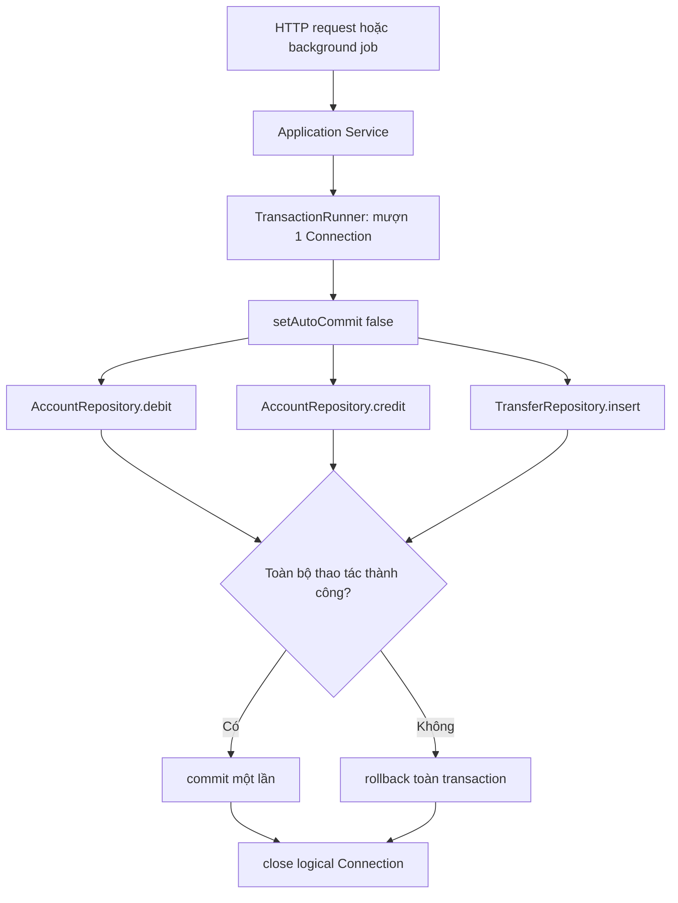

# Thiết kế quyền sở hữu Connection và ranh giới giao dịch trong DAO/Repository JDBC

## 1. Bài toán: ai mở, ai đóng và ai được commit?

Trong ứng dụng Java dùng **JDBC**, một lớp DAO (*Data Access Object*) hoặc Repository thường chịu trách nhiệm thực hiện SQL, gán tham số qua `PreparedStatement`, đọc `ResultSet` và chuyển hàng dữ liệu thành đối tượng Java. Nhưng khi một nghiệp vụ gồm **nhiều thao tác dữ liệu phải thành công hoặc thất bại cùng nhau**, câu hỏi quan trọng hơn cách viết `SELECT` là:

- Ai lấy `Connection` từ `DataSource`?
- Ai **sở hữu** connection, nghĩa là chịu trách nhiệm kết thúc phạm vi sử dụng và gọi `close()`?
- Ai mở **ranh giới transaction**, gọi `commit()` và `rollback()`?
- Repository có được tự tạo connection, tự commit hoặc đóng connection mà caller truyền vào không?

Ví dụ chuyển tiền 200.00 từ tài khoản A sang B gồm **ghi nợ A**, **ghi có B** và **ghi nhật ký chuyển khoản**. Nếu mỗi DAO tự lấy connection rồi commit riêng, A có thể bị trừ tiền trong khi B không được cộng khi bước sau thất bại. Đây là lỗi **ranh giới giao dịch**, không phải lỗi cú pháp SQL.

**Quy tắc cốt lõi:** thành phần tạo ra hoặc được giao quyền quản lý **phạm vi transaction** phải quyết định `commit/rollback`; DAO/Repository chỉ thực hiện thao tác dữ liệu trong transaction đó. Một Repository nhận `Connection` do caller cung cấp **không sở hữu** connection và **không được tự đóng hoặc commit nó**.

| Trách nhiệm | Nên đặt tại | Vì sao |
| --- | --- | --- |
| Kết hợp nhiều thao tác thành một nghiệp vụ | **Service/Application use case** | Hiểu bất biến nghiệp vụ cần giữ nguyên tử. |
| Mượn và trả một connection cho toàn nghiệp vụ | **Service hoặc TransactionRunner/Unit of Work** | Xác định một phạm vi tài nguyên duy nhất. |
| `setAutoCommit(false)`, `commit()`, `rollback()` | **Chủ sở hữu transaction** | Một nơi quyết định thành công/thất bại toàn bộ. |
| SQL `SELECT/INSERT/UPDATE/DELETE` và bind `?` | **DAO/Repository** | Tập trung thao tác dữ liệu và mapping. |
| Đóng `PreparedStatement` và `ResultSet` được DAO tạo | **DAO/Repository** | Tài nguyên cục bộ không phải vòng đời transaction. |
| Đóng `Connection` được service/runner truyền vào | **Chủ sở hữu connection** | Tránh kết thúc transaction của caller giữa chừng. |

## 2. Quyền sở hữu Connection và quyền sở hữu transaction khác nhau thế nào?

Một `Connection` JDBC là **phiên làm việc** với DBMS, chứa trạng thái như `autoCommit`, isolation, read-only, schema và transaction đang mở. Khi sử dụng connection pool, `dataSource.getConnection()` thường trả về **logical handle** đại diện cho một physical connection. `connection.close()` thường có nghĩa **trả handle về pool**, không đồng nghĩa mọi tình huống sẽ đóng TCP socket.

**Quyền sở hữu connection** nghĩa là biết khi nào handle được mượn và phải được trả. **Quyền sở hữu transaction** nghĩa là quyết định thời điểm bắt đầu/kết thúc tính nguyên tử. Trong thiết kế JDBC thủ công, hai quyền đó thường được giao **cùng một service/transaction runner**.



Cùng một `Connection` được **truyền** cho cả ba repository, vì vậy chúng nằm trong **một JDBC transaction cục bộ** nếu DBMS và driver hỗ trợ giao dịch cho những thao tác ấy. Mỗi repository đóng statement và result set do chính mình tạo, nhưng không gọi `close()` trên connection.

Nếu một repository tự gọi `dataSource.getConnection()` trong khi service đã mượn connection khác, nó có thể mở **một transaction khác**. Việc hai connection cùng lấy từ **một DataSource/pool** không chứng minh chúng cùng transaction.

### Ba quy ước sở hữu cần viết thành hợp đồng

1. **Borrower owns:** phương thức tự gọi `getConnection()` thì tự có trách nhiệm đóng handle, kể cả khi ném exception.
2. **Caller owns:** phương thức nhận `Connection` từ tham số thì không đóng, không `commit()`, không `rollback()` và không đổi trạng thái transaction trừ khi hợp đồng cho phép.
3. **Transaction owner owns completion:** chỉ tầng bao ngoài quyết định hoàn tất transaction; repository **đưa lỗi lên**, không tự nuốt lỗi rồi trả “thành công”.

Quy ước thứ hai tránh được lỗi khó phát hiện nhất: repository dùng `try (Connection c = callerConnection)` và vô tình đóng connection mà service vẫn cần cho bước kế tiếp.

## 3. `autoCommit`: vì sao mỗi câu SQL có thể là một transaction riêng?

Theo JDBC, connection thông thường bắt đầu ở chế độ `autoCommit=true`, trừ khi `DataSource`, pool hoặc môi trường quản lý transaction cấu hình khác. Ở chế độ này, DBMS tự commit mỗi statement khi statement **hoàn tất** theo ngữ nghĩa JDBC. Với truy vấn trả `ResultSet`, thời điểm hoàn tất còn liên quan đến việc đọc/đóng result set, nên không nên tự suy luận rằng transaction đã kết thúc ngay sau lệnh `executeQuery()` trong mọi trường hợp.

```java
try (Connection connection = dataSource.getConnection()) {
    // Nếu autoCommit=true, các lệnh DML có thể commit riêng biệt.
    accountDao.debit(connection, fromAccount, amount);
    accountDao.credit(connection, toAccount, amount);
}
```

Mẫu trên **không bảo đảm nguyên tử** nếu `autoCommit=true`: ghi nợ có thể commit trước khi ghi có ném lỗi.

Để sở hữu một transaction thủ công:

```java
try (Connection connection = dataSource.getConnection()) {
    connection.setAutoCommit(false);
    try {
        accountDao.debit(connection, fromAccount, amount);
        accountDao.credit(connection, toAccount, amount);
        connection.commit();
    } catch (SQLException | RuntimeException failure) {
        try {
            connection.rollback();
        } catch (SQLException rollbackFailure) {
            failure.addSuppressed(rollbackFailure);
        }
        throw failure;
    }
}
```

Đây là khung minh họa: `accountDao`, các ID và `amount` là những giá trị đã có. Nó thể hiện **một connection, một lần commit**, và rollback nếu một bước lỗi. Không được gọi `setAutoCommit(true)` tùy tiện ở `finally` trước khi chắc chắn transaction đã kết thúc: **chuyển từ `false` sang `true` có thể tự commit transaction đang hoạt động theo JDBC**, khiến công việc chưa rollback được lưu ngoài ý muốn.

Trong ví dụ đầy đủ ở phần sau, tầng quản lý transaction sẽ chủ động kiểm tra tiền điều kiện `autoCommit`, và việc trả/reset connection sẽ tuân theo hợp đồng pool đang sử dụng.

## 4. Các cách chia trách nhiệm: chọn một mô hình nhất quán

| Mô hình | Ai tạo connection? | Ai commit/rollback? | Khi nào phù hợp? |
| --- | --- | --- | --- |
| Repository tự mượn và đóng cho **một thao tác độc lập** | Repository | Thường `autoCommit` của connection hoặc repository có transaction riêng. | Tác vụ đơn lẻ, không cần ghép nhiều DAO vào một đơn vị nguyên tử. |
| Service mượn một connection và truyền cho các DAO | Service | Service | Ứng dụng nhỏ/vừa, JDBC thủ công, flow rõ ràng. |
| `TransactionRunner`/Unit of Work nhận callback | Runner | Runner | Muốn tránh lặp mẫu `try/commit/rollback` ở nhiều use case. |
| Framework quản lý transaction | Transaction manager của framework | Framework | Spring/JTA hoặc môi trường tương tự; repository phải tham gia **đúng context** do framework quản lý. |

**Không trộn mô hình khi không có hợp đồng rõ:** chẳng hạn service mở transaction thủ công nhưng một DAO lại mượn connection mới từ pool hoặc một phương thức framework `@Transactional` lại không bao phủ connection được tạo trực tiếp bằng đường khác. Với môi trường framework, thao tác lấy connection và tích hợp pool/transaction manager phải theo **cách thức được framework hỗ trợ**; không tự giả định bất kỳ `DataSource.getConnection()` nào đều tự tham gia transaction.

Một thiết kế tốt không nhất thiết bắt buộc mọi DAO có chữ ký nhận `Connection`. Điều quan trọng là **phạm vi transaction được bảo đảm bằng cơ chế thực tế**. Trong JDBC thuần, truyền connection tường minh là cách dễ đọc, dễ kiểm thử và ít phép màu.

## 5. Dữ liệu minh họa: chuyển tiền phải nguyên tử

Sử dụng PostgreSQL với hai bảng:

```sql
CREATE TABLE bank_accounts (
    account_id BIGINT PRIMARY KEY,
    balance NUMERIC(18, 2) NOT NULL CHECK (balance >= 0)
);

CREATE TABLE bank_transfers (
    transfer_key VARCHAR(80) PRIMARY KEY,
    from_account_id BIGINT NOT NULL REFERENCES bank_accounts(account_id),
    to_account_id BIGINT NOT NULL REFERENCES bank_accounts(account_id),
    amount NUMERIC(18, 2) NOT NULL CHECK (amount > 0),
    created_at TIMESTAMPTZ NOT NULL DEFAULT CURRENT_TIMESTAMP,
    CHECK (from_account_id <> to_account_id)
);
```

`transfer_key` là khóa nghiệp vụ duy nhất giúp tránh tạo **hai bản ghi chuyển khoản cùng mã**. Nó **không tự tạo ra cơ chế retry idempotent hoàn chỉnh**: khi bị trùng khóa, caller phải đối chiếu trạng thái giao dịch đã ghi, không coi mọi lần retry là chuyển tiền an toàn.

Yêu cầu nghiệp vụ:

- Không cho chuyển số tiền `<= 0`, không chuyển từ một tài khoản sang chính nó.
- Giảm số dư tài khoản nguồn **chỉ nếu** còn đủ tiền.
- Tăng số dư tài khoản đích nếu tài khoản tồn tại.
- Ghi bản ghi giao dịch với cùng khóa chuyển khoản.
- Nếu bất kỳ bước nào thất bại, **không chấp nhận trạng thái chỉ trừ tiền hoặc chỉ cộng tiền**.

Một transaction giải quyết tính nguyên tử của ba thay đổi **trong cùng database**. Transaction không tự biến nghiệp vụ chuyển tiền thành an toàn trên nhiều database, không bảo đảm người dùng không gửi yêu cầu trùng mã và không loại trừ deadlock khi hai giao dịch cập nhật tài khoản theo thứ tự đối nghịch.

## 6. DAO nhận Connection từ caller và chỉ sở hữu statement

Repository không inject `DataSource` cho những thao tác thuộc cùng một use case, mà nhận `Connection` trực tiếp. Các phương thức có SQL cố định và tham số hóa:

```java
import java.math.BigDecimal;
import java.sql.Connection;
import java.sql.PreparedStatement;
import java.sql.SQLException;
import java.util.Objects;

public final class AccountDao {
    public void debit(Connection connection, long accountId, BigDecimal amount)
            throws SQLException {
        Objects.requireNonNull(connection, "connection");

        String sql = """
            UPDATE bank_accounts
            SET balance = balance - ?
            WHERE account_id = ? AND balance >= ?
            """;

        try (PreparedStatement ps = connection.prepareStatement(sql)) {
            ps.setBigDecimal(1, amount);
            ps.setLong(2, accountId);
            ps.setBigDecimal(3, amount);
            if (ps.executeUpdate() != 1) {
                throw new IllegalStateException(
                    "Tài khoản nguồn không tồn tại hoặc không đủ tiền");
            }
        }
    }

    public void credit(Connection connection, long accountId, BigDecimal amount)
            throws SQLException {
        Objects.requireNonNull(connection, "connection");

        String sql = """
            UPDATE bank_accounts
            SET balance = balance + ?
            WHERE account_id = ?
            """;

        try (PreparedStatement ps = connection.prepareStatement(sql)) {
            ps.setBigDecimal(1, amount);
            ps.setLong(2, accountId);
            if (ps.executeUpdate() != 1) {
                throw new IllegalStateException(
                    "Tài khoản đích không tồn tại");
            }
        }
    }
}
```

`executeUpdate()` trả số hàng bị ảnh hưởng; với `UPDATE` khóa chính ở ví dụ, mong đợi `1`. Nếu tài khoản nguồn thiếu hoặc số dư không đủ thì điều kiện trong `WHERE` không khớp và kết quả là `0`. Điều kiện `balance >= ?` nằm **trong chính lệnh UPDATE**: không phải đọc số dư trước rồi kiểm tra trong Java, vì hai thao tác tách rời có thể gặp race khi nhiều yêu cầu đồng thời.

DAO này không gọi `Connection.close()`, `commit()`, `rollback()` hoặc `setAutoCommit()`. Nó chỉ đóng `PreparedStatement` do nó tạo. Lỗi nghiệp vụ được biểu diễn bằng `IllegalStateException` để ví dụ đơn giản; trong ứng dụng thật nên có loại exception domain riêng, phân biệt rõ với `SQLException`.

DAO ghi nhật ký chuyển khoản:

```java
import java.math.BigDecimal;
import java.sql.Connection;
import java.sql.PreparedStatement;
import java.sql.SQLException;
import java.util.Objects;

public final class TransferDao {
    public void insert(
            Connection connection, String key, long from, long to,
            BigDecimal amount) throws SQLException {
        Objects.requireNonNull(connection, "connection");

        String sql = """
            INSERT INTO bank_transfers (
                transfer_key, from_account_id, to_account_id, amount
            ) VALUES (?, ?, ?, ?)
            """;

        try (PreparedStatement ps = connection.prepareStatement(sql)) {
            ps.setString(1, key);
            ps.setLong(2, from);
            ps.setLong(3, to);
            ps.setBigDecimal(4, amount);
            if (ps.executeUpdate() != 1) {
                throw new SQLException(
                    "Không ghi được đúng một giao dịch chuyển khoản");
            }
        }
    }
}
```

Nhờ cùng nhận `Connection`, ba lời gọi DAO sẽ sử dụng **một transaction** khi service/runner đã tắt auto-commit. Bảng nhật ký được ghi trước `commit()` nên nó rollback cùng với thay đổi số dư nếu một bước lỗi.

## 7. TransactionRunner tập trung quyền sở hữu và dọn tài nguyên

Thay vì lặp `setAutoCommit(false)`, `commit()` và `rollback()` trong mọi service, tạo một **TransactionRunner** có hợp đồng rõ ràng:

- Mượn **một** `Connection` từ `DataSource`.
- Chỉ chấp nhận connection có trạng thái đầu vào phù hợp; ở ví dụ này yêu cầu `autoCommit=true`, vì runner chủ động sở hữu transaction mới.
- Tắt auto-commit và truyền connection cho callback của nghiệp vụ.
- `commit()` **một lần**, sau khi callback hoàn tất thành công.
- Nếu callback hoặc commit ném lỗi, **thử rollback**; nếu rollback cũng lỗi, bảo toàn ngoại lệ gốc.
- Đóng logical connection bằng `try-with-resources` trong mọi trường hợp.

```java
import javax.sql.DataSource;
import java.sql.Connection;
import java.sql.SQLException;
import java.util.Objects;

public final class JdbcTransactionRunner {
    private final DataSource dataSource;

    public JdbcTransactionRunner(DataSource dataSource) {
        this.dataSource = Objects.requireNonNull(dataSource);
    }

    @FunctionalInterface
    public interface SqlWork<T> {
        T run(Connection connection) throws SQLException;
    }

    public <T> T inTransaction(SqlWork<T> work) throws SQLException {
        Objects.requireNonNull(work, "work");

        try (Connection connection = dataSource.getConnection()) {
            // Hợp đồng: đây là một transaction MỚI thuộc runner.
            // Không mượn connection đã có transaction bên ngoài.
            if (!connection.getAutoCommit()) {
                throw new SQLException(
                    "DataSource phải cấp connection autoCommit=true");
            }
            connection.setAutoCommit(false);

            try {
                T value = work.run(connection);
                connection.commit();
                return value;
            } catch (SQLException | RuntimeException | Error failure) {
                try {
                    connection.rollback();
                } catch (SQLException rollbackFailure) {
                    failure.addSuppressed(rollbackFailure);
                }
                throw failure;
            }
            // try-with-resources gọi close() kể cả khi commit/rollback lỗi.
        }
    }
}
```

### Vì sao không tự gọi `setAutoCommit(true)` trong `finally`?

Theo hợp đồng JDBC, chuyển auto-commit từ `false` sang `true` có thể **commit transaction đang mở**. Nếu `rollback()` thất bại do sự cố mạng, gọi `setAutoCommit(true)` để “reset trạng thái” có thể gây thêm tác dụng không mong muốn. Ví dụ chọn **đóng handle** và yêu cầu DataSource/pool được cấu hình để reset/rollback hoặc loại connection hỏng khi trả về pool.

Điều này không có nghĩa mọi pool sẽ tự chữa mọi sai trạng thái. Cần kiểm chứng chính sách cleanup của **pool/driver thực tế**, đặc biệt sau lỗi network, timeout hoặc kết nối bị cắt giữa chừng. Nếu dùng connection vật lý không có pool, `close()` sẽ kết thúc phạm vi tài nguyên đó. Khi dùng framework quản lý transaction, **không dùng runner này song song** với một transaction manager đang sở hữu cùng connection.

### Quy tắc xử lý exception

Ở nhánh lỗi, `failure` có thể là:

- `SQLException` do một lệnh SQL thất bại.
- `RuntimeException` do vi phạm quy tắc nghiệp vụ.
- `Error` ngoài dự kiến. Mã cố gắng dọn transaction rồi ném lại nguyên nhân gốc; không nuốt hoặc chuyển một lỗi nghiêm trọng thành thành công.

Nếu rollback thất bại, ngoại lệ rollback được gắn vào `failure.getSuppressed()`. Nếu quá trình `Connection.close()` lại ném lỗi trong `try-with-resources`, Java cũng gắn lỗi dọn tài nguyên thích hợp theo cơ chế exception suppression.

**Lưu ý rất quan trọng:** một ngoại lệ từ `connection.commit()` **không cho phép khẳng định chắc chắn transaction đã rollback**. Mạng có thể hỏng sau khi DBMS đã commit nhưng trước khi Java nhận được xác nhận. Việc tiếp tục thử `rollback()` là xử lý nỗ lực tốt nhất, không phải bằng chứng dữ liệu chưa ghi; xem mục 12 về retry.

## 8. Service định nghĩa transaction cho toàn bộ use case

Service là nơi **biết ba thao tác phải nguyên tử**, nên nó là thành phần gọi runner. Các DAO được inject để tái sử dụng, nhưng chúng **không giữ connection trong field**:

```java
import java.math.BigDecimal;
import java.math.RoundingMode;
import java.sql.SQLException;
import java.util.Objects;

public final class TransferService {
    private final JdbcTransactionRunner transactions;
    private final AccountDao accounts;
    private final TransferDao transfers;

    public TransferService(
            JdbcTransactionRunner transactions,
            AccountDao accounts,
            TransferDao transfers) {
        this.transactions = Objects.requireNonNull(transactions);
        this.accounts = Objects.requireNonNull(accounts);
        this.transfers = Objects.requireNonNull(transfers);
    }

    public record TransferReceipt(String transferKey) {}

    public TransferReceipt transfer(
            String transferKey, long from, long to, BigDecimal amount)
            throws SQLException {
        if (transferKey == null || transferKey.isBlank()
                || transferKey.length() > 80
                || from <= 0 || to <= 0 || from == to
                || amount == null || amount.signum() <= 0) {
            throw new IllegalArgumentException(
                "Tham số chuyển khoản không hợp lệ");
        }

        // Không làm tròn âm thầm số tiền có quá 2 chữ số thập phân.
        BigDecimal normalized;
        try {
            normalized = amount.setScale(2, RoundingMode.UNNECESSARY);
        } catch (ArithmeticException badScale) {
            throw new IllegalArgumentException(
                "Số tiền có quá 2 chữ số thập phân", badScale);
        }

        return transactions.inTransaction(connection -> {
            accounts.debit(connection, from, normalized);
            accounts.credit(connection, to, normalized);
            transfers.insert(
                connection, transferKey, from, to, normalized);

            // Receipt chỉ được trả cho caller SAU commit thành công.
            return new TransferReceipt(transferKey);
        });
    }
}
```

Như vậy, `JdbcTransactionRunner` là **owner** của connection và transaction; `TransferService` là **owner** của quyết định nghiệp vụ; `AccountDao` và `TransferDao` là **người mượn** connection để thực thi SQL. Khi DAO báo lỗi, callback kết thúc bằng exception và runner quyết định rollback.

Ví dụ khởi tạo và gọi, giả sử `dataSource` đã được cấu hình:

```java
JdbcTransactionRunner runner = new JdbcTransactionRunner(dataSource);
TransferService service = new TransferService(
    runner, new AccountDao(), new TransferDao());

TransferService.TransferReceipt receipt = service.transfer(
    "transfer-2026-1001",
    100L,
    200L,
    new BigDecimal("200.00"));

System.out.println("Transfer committed: " + receipt.transferKey());
```

Khi thực thi mã minh họa, phải có hai tài khoản nguồn/đích tồn tại trong DBMS. Đây là ví dụ về **tính nguyên tử trong một database**, không phải mô hình chuyển tiền production đầy đủ: production còn cần xác thực quyền nguồn tiền, giới hạn giao dịch, chống gian lận, kiểm soát concurrency, journal/audit bất biến, kiểm toán số dư và xử lý idempotency.

### Theo dõi ba tình huống lỗi

| Bước lỗi | Việc đã xảy ra trước đó | Kỳ vọng của transaction |
| --- | --- | --- |
| `accounts.debit` báo không đủ tiền | Chưa ghi nhật ký hay ghi có. | Rollback (thường không có thay đổi), trả lỗi nghiệp vụ. |
| `accounts.credit` báo tài khoản đích không tồn tại | Lệnh ghi nợ đã chạy trong cùng transaction. | Rollback để **không lưu** khoản trừ tiền. |
| `transfers.insert` bị trùng `transfer_key` | Đã chạy ghi nợ và ghi có nhưng chưa commit. | Rollback cả hai thay đổi số dư cùng lệnh journal lỗi. |
| `commit()` lỗi do mất kết nối | Các lệnh có thể đã được gửi tới DBMS. | **Kết quả có thể không xác định**; cần đối chiếu trạng thái, không retry mù quáng. |

Những kết luận rollback trên giả định DBMS hỗ trợ transaction cho các bảng liên quan và `rollback()` thực sự thành công. **Không nuốt** lỗi rollback rồi vẫn báo “đã hoàn tác chắc chắn”.

## 9. Vì sao DAO không nên tự quyết định transaction?

### 9.1. Anti-pattern: mỗi DAO tự mượn connection rồi auto-commit

```java
// SAI nếu các thao tác này phải nguyên tử với nhau.
void debit(DataSource source, long accountId, BigDecimal amount)
        throws SQLException {
    try (Connection connection = source.getConnection();
         PreparedStatement ps = connection.prepareStatement(
             "UPDATE bank_accounts SET balance = balance - ? " +
             "WHERE account_id = ?")) {
        ps.setBigDecimal(1, amount);
        ps.setLong(2, accountId);
        ps.executeUpdate();
    }
}
```

Nếu service gọi DAO ghi nợ này rồi gọi một DAO ghi có có `getConnection()` riêng, hai bước có thể thuộc **hai transaction khác nhau**. Tắt auto-commit trên connection ở service **không thay đổi** connection mà DAO tự mượn.

Điều này không có nghĩa mọi DAO tự lấy connection đều sai. Với thao tác đọc độc lập hoặc một lệnh DML được thiết kế là **một transaction riêng**, DAO có thể sở hữu connection và đóng nó. Vấn đề là **giao diện không cho caller ghép nhiều thao tác vào cùng một ranh giới giao dịch**.

### 9.2. Anti-pattern: DAO đóng connection do service truyền vào

```java
// SAI: callerConnection do service sở hữu.
void debitWrong(Connection callerConnection, BigDecimal amount)
        throws SQLException {
    try (Connection connection = callerConnection) {
        // ... thực thi câu SQL ...
    }
}
```

`try-with-resources` sẽ đóng `callerConnection` ngay khi phương thức kết thúc. Service không còn một connection còn hợp lệ để ghi có/commit. **Không đặt một tài nguyên được mượn vào `try-with-resources` nếu quyền sở hữu thuộc caller.** Hãy chỉ đặt `PreparedStatement` và `ResultSet` do DAO tự tạo vào đó.

### 9.3. Anti-pattern: Repository tự commit để “chắc chắn lưu”

```java
// SAI nếu service sở hữu transaction.
repository.updateSomething(connection);
connection.commit(); // Được gọi trong repository.
```

Nếu service phải tiếp tục làm bước sau và bước đó lỗi, dữ liệu bước đầu đã commit nên `rollback()` của service không còn hoàn tác được nó. DAO chỉ nên **trả kết quả hoặc ném lỗi**, không hoàn tất transaction thay service.

### 9.4. Anti-pattern: bắt SQLException rồi trả kết quả thành công giả

```java
// SAI: lỗi ghi nợ bị nuốt và callback có thể tiếp tục tới commit.
try {
    accountDao.debit(connection, accountId, amount);
} catch (SQLException ignored) {
    // Không làm gì.
}
```

Khi service không nhận được lỗi, nó có thể commit các bước khác dù một bước thất bại. Nếu muốn xử lý một lỗi có thể bỏ qua, cần **quy tắc nghiệp vụ tường minh**, hiểu trạng thái transaction của DBMS và cân nhắc savepoint; không mặc định mọi `SQLException` đều an toàn để bỏ qua.

## 10. Service gọi service khác: truyền transaction hay mở transaction mới?

Một hệ thống thực tế thường có use case A gọi use case B. Ví dụ `CheckoutService` tạo đơn rồi gọi `InventoryService.reserve()`. Nếu cả hai đều gọi `transactions.inTransaction()` như trong ví dụ trên, mỗi lần sẽ **mượn một connection mới**. Đó là **hai transaction độc lập**, không có khả năng rollback chung bằng `Connection.rollback()` của transaction A.

Trong JDBC thủ công, có ba lựa chọn cần phân biệt:

| Thiết kế | Điều gì xảy ra? | Khuyến nghị |
| --- | --- | --- |
| Service A gọi service B; B tự gọi `DataSource.getConnection()` | B có transaction riêng; commit của B không phụ thuộc commit của A. | Chỉ dùng khi hai công việc **thực sự độc lập**. |
| Service A truyền cùng `Connection` cho component B | Mọi SQL thuộc cùng transaction của A; A quyết định commit/rollback. | Phù hợp khi các bước phải **nguyên tử** trong một database. |
| B dùng `Savepoint` trên cùng connection | Có thể hoàn tác một phần từ mốc đã tạo, **vẫn trong transaction của A**. | Chỉ dùng khi nghiệp vụ cho phép một bước không thành công mà toàn transaction tiếp tục. |

Một cách đặt tên API để tránh vô tình mở transaction lồng:

```java
// Public entry point: xác định transaction.
public void checkout(CheckoutCommand command) throws SQLException {
    transactions.inTransaction(connection -> {
        reserveInventoryInCurrentTransaction(connection, command);
        insertOrderInCurrentTransaction(connection, command);
        return null;
    });
}

// Hàm nội bộ: dùng Connection của caller, KHÔNG gọi getConnection().
private void reserveInventoryInCurrentTransaction(
        Connection connection, CheckoutCommand command)
        throws SQLException {
    inventoryDao.reserve(connection, command.sku(), command.quantity());
}
```

Đoạn này minh họa cách đặt tên và luồng gọi, giả định `CheckoutCommand` và `inventoryDao` được định nghĩa tại ứng dụng. Không phải một chương trình chạy độc lập. Ý quan trọng là phương thức “trong transaction hiện tại” **không tự mở transaction khác**.

### So sánh với propagation của framework

Trong framework có transaction manager, thuật ngữ như `REQUIRED`, `REQUIRES_NEW` hoặc `NESTED` có ngữ nghĩa riêng:

- `REQUIRED` thường tham gia transaction đang có, hoặc tạo mới nếu chưa có.
- `REQUIRES_NEW` thường tạm dừng transaction hiện tại và tạo **transaction độc lập**, nên commit của transaction mới **không** bị rollback bởi transaction ngoài.
- `NESTED` có thể dùng savepoint nếu transaction manager và driver hỗ trợ, không phải một transaction database độc lập.

Đây chỉ là **so sánh khái niệm**, không phải các chế độ có sẵn trên `java.sql.Connection`. `JdbcTransactionRunner` mẫu ở mục 7 có hợp đồng **luôn tạo transaction mới trên connection mới**, không tự nhận biết transaction đang có. Muốn hỗ trợ propagation thực sự phải thiết kế thêm API/context rõ ràng hoặc sử dụng transaction manager phù hợp.

## 11. Savepoint: rollback một phần nhưng không phá ranh giới bao ngoài

JDBC có `Connection.setSavepoint()`, `Connection.rollback(Savepoint)` và `Connection.releaseSavepoint()` khi driver/DBMS hỗ trợ. Một savepoint là **mốc trong transaction hiện tại**, không phải một transaction thứ hai có `commit()` độc lập.

Ví dụ minh họa khi một bước phụ thực sự **được phép thất bại**:

```java
// connection do transaction owner truyền vào, đã autoCommit=false.
// auxiliaryDao và businessEvent đã được tạo trước đoạn mã.
Savepoint optionalStep = connection.setSavepoint("optional_step");
try {
    auxiliaryDao.writeOptionalMetadata(connection, businessEvent);
} catch (SQLException optionalFailure) {
    // Chỉ cho phép tiếp tục nếu nghiệp vụ CHẤP NHẬN thiếu metadata này.
    try {
        connection.rollback(optionalStep);
    } catch (SQLException rollbackFailure) {
        optionalFailure.addSuppressed(rollbackFailure);
        throw optionalFailure; // Để owner rollback toàn transaction.
    }
    // Ghi nhận lỗi theo chính sách, không nuốt mà không có dấu vết.
}
// Sau đó có thể release savepoint theo khả năng driver;
// transaction owner vẫn là bên commit/rollback TOÀN BỘ.
```

Đây là đoạn mã nằm trong use case đã có connection, DAO và biến nghiệp vụ. Để xử lý production, cần bổ sung **chính sách log/đối chiếu**, và kiểm tra `DatabaseMetaData.supportsSavepoints()` trên driver mục tiêu. Nếu `releaseSavepoint()` ném lỗi, không để lỗi cleanup che mất nguyên nhân lỗi chính; nếu transaction không còn tin cậy, chuyển lỗi cho transaction owner để rollback toàn bộ.

**Không dùng savepoint để lách bất biến cốt lõi.** Trong ví dụ chuyển tiền, không có bước nào trong ba bước ghi nợ/ghi có/journal được phép bỏ qua. Nếu một bước lỗi, phải rollback **toàn giao dịch**. Savepoint phù hợp hơn với thao tác tùy chọn mà việc thiếu nó đã được nghiệp vụ chấp nhận.

Một số DBMS coi transaction đang ở trạng thái thất bại sau `SQLException` và yêu cầu rollback tới savepoint trước khi tiếp tục; DBMS khác có hành vi khác. Không bắt mọi lỗi SQL rồi cố thực thi câu mới trên connection như chưa có chuyện gì xảy ra.

## 12. Isolation, concurrency và ranh giới transaction

Một transaction đúng về **tính nguyên tử** vẫn cần xem xét **isolation** và tương tác giữa nhiều giao dịch:

- `READ COMMITTED` thường cho phép mỗi statement nhìn dữ liệu đã commit ở thời điểm riêng. Một phép đọc trước rồi update sau có thể chịu race nếu không có khóa hoặc điều kiện SQL phù hợp.
- `REPEATABLE READ`/`SERIALIZABLE` có thể cung cấp bảo đảm mạnh hơn nhưng mức cụ thể phụ thuộc DBMS; các mức cao hơn có thể tạo thêm xung đột hoặc lỗi serialization cần xử lý.
- `SELECT ... FOR UPDATE` hoặc lệnh `UPDATE` có điều kiện có thể khóa dữ liệu trong database. Thời điểm giữ/nhả khóa liên quan tới **toàn transaction**, không chỉ thời gian chạy DAO.
- Hai giao dịch chuyển A → B và B → A có thể giành khóa theo thứ tự ngược nhau và gây **deadlock** nếu không thiết kế thứ tự khóa thống nhất.

Ví dụ `AccountDao.debit()` dùng:

```sql
UPDATE bank_accounts
SET balance = balance - ?
WHERE account_id = ? AND balance >= ?;
```

Điều kiện số dư và phép trừ nằm trong **cùng một statement**, tránh mẫu nguy hiểm `SELECT balance` rồi tính lại ở Java mà không kiểm soát concurrency. Tuy nhiên, hai lệnh ghi nợ/ghi có vẫn có thể deadlock khi giao dịch khác cập nhật hai tài khoản theo thứ tự ngược.

Một biện pháp là đặt **quy tắc thứ tự khóa nhất quán** (ví dụ khóa tài khoản có ID nhỏ hơn trước), đồng thời giới hạn thời gian giữ transaction và xử lý deadlock/serialization failure theo chính sách. Không coi bản demo là thuật toán xử lý mọi tình huống ngân hàng sản xuất.

### Ai thiết lập isolation?

Nếu cần thay đổi isolation, **transaction owner** là nơi quyết định và thực hiện trên connection **trước khi các câu SQL của transaction bắt đầu**:

```java
// Minh họa cấu hình trước khi bắt đầu công việc trong transaction.
int supportedLevel = Connection.TRANSACTION_READ_COMMITTED;
connection.setTransactionIsolation(supportedLevel);
connection.setAutoCommit(false);
// ... gọi các DAO, rồi commit/rollback tại owner ...
```

Không để một DAO vô tình đổi isolation giữa chừng; hành vi đổi isolation khi đang có transaction có thể phụ thuộc driver/DBMS hoặc làm thay đổi trạng thái ngoài dự kiến. Với pool, isolation và các thuộc tính session phải được khôi phục theo **hợp đồng pool/transaction manager**, tránh rò rỉ cài đặt của request trước sang request sau. Nếu DBMS không hỗ trợ mức yêu cầu, cần fail fast hoặc lựa chọn mức khác **có chủ đích**, không giả định thành công.

### Giữ transaction ngắn

Transaction đang mở có thể giữ lock, snapshot MVCC, buffer hoặc tài nguyên server. **Không** giữ connection/transaction trong lúc chờ HTTP API chậm, chờ người dùng xác nhận, upload tệp lớn hoặc ngủ để retry. Thực hiện kiểm tra đầu vào trước, mở transaction gần thời điểm cần SQL, hoàn tất nhanh rồi đóng connection.

Nếu cần gọi dịch vụ bên ngoài, thiết kế lại ranh giới nghiệp vụ: transaction của một DBMS **không rollback được một email đã gửi** hay một lệnh thanh toán đã được hệ thống khác xử lý.

## 13. Không trộn side effect bên ngoài vào transaction JDBC

Giả sử sau khi chuyển tiền, service gọi API gửi thông báo:

```java
transactions.inTransaction(connection -> {
    accounts.debit(connection, fromId, amount);
    accounts.credit(connection, toId, amount);
    notificationClient.sendTransferEmail(); // SAI nếu cần nguyên tử.
    transfers.insert(connection, key, fromId, toId, amount);
    return null;
});
```

Đoạn trên là **mã sai có chủ đích**: email có thể đã được gửi nhưng transaction SQL sau đó rollback. Ngược lại, nếu gửi email **sau commit** mà tiến trình chết ngay trước khi gửi, dữ liệu có thể đã commit nhưng thông báo không được phát đi.

Một cách phổ biến để giải bài toán này là **transactional outbox**: service chèn một bản ghi sự kiện cần gửi vào **cùng transaction** với cập nhật dữ liệu, sau đó một worker riêng đọc outbox và gửi thông báo theo cơ chế có retry/idempotency:

```text
Transaction JDBC trong một DB:
    debit(A)
    credit(B)
    insert(transfer_journal)
    insert(outbox_event)
    COMMIT

Worker độc lập:
    đọc outbox_event đã commit
    gửi thông báo
    ghi nhận đã xử lý / retry theo chính sách
```

Outbox không bảo đảm bên nhận chỉ nhận đúng một lần; consumer phải thiết kế **idempotent** hoặc chấp nhận at-least-once delivery phù hợp yêu cầu. Nhưng nó cho phép lưu **ý định phát sự kiện** cùng với giao dịch dữ liệu một cách nguyên tử trong một database.

### Hai DataSource không tự tạo transaction phân tán

```java
Connection dbA = dataSourceA.getConnection();
Connection dbB = dataSourceB.getConnection();
```

Hai connection trên không trở thành **một transaction chung** chỉ vì có cùng thread hoặc cùng request. Muốn tính nguyên tử giữa hai DBMS/tài nguyên khác nhau cần cơ chế phân tán được hỗ trợ (ví dụ transaction manager/JTA/XA khi phù hợp và được cấu hình đúng), hoặc thiết kế eventual consistency/saga/outbox với bước bù trừ. Một `Connection.commit()` cục bộ chỉ hoàn tất transaction của connection tương ứng.

## 14. Connection pool, vòng đời và các trạng thái dễ bị rò rỉ

Với pool, `DataSource` có thể duy trì physical connection lâu hơn một request. Vì thế ranh giới quan trọng không chỉ là “đã gọi `close()` chưa” mà còn là **có trả connection về pool ở trạng thái sạch và an toàn hay không**.

| Trạng thái tài nguyên | Ai chịu trách nhiệm? | Kiểm soát cần có |
| --- | --- | --- |
| Logical `Connection` đang mượn | Service/TransactionRunner | `try-with-resources` để luôn trả handle. |
| `PreparedStatement`, `ResultSet` | DAO/Repository tạo ra chúng | Đóng trong phạm vi DAO, không chuyển result set đang mở ra ngoài. |
| `autoCommit`, isolation, read-only, schema | Transaction owner hoặc transaction manager | Không thay đổi tùy tiện trong DAO; khôi phục/reset theo hợp đồng của pool. |
| Transaction chưa commit | Transaction owner | Commit khi thành công; rollback khi lỗi, ghi nhận nếu rollback không chắc chắn. |
| Physical connection hỏng sau lỗi mạng | Pool/driver và thành phần tích hợp | Phát hiện, loại bỏ khỏi pool trước khi dùng lại; không tự động retry trên handle hỏng. |
| Đối tượng dữ liệu trả từ DAO | Service/caller | Trả DTO/value object đã materialize, không trả `ResultSet` cần connection còn mở. |

### Một `Connection` không phải tài nguyên để lưu trong singleton

```java
// SAI: singleton DAO giữ một Connection dùng chung giữa request.
public final class UnsafeAccountDao {
    private final Connection sharedConnection;

    public UnsafeAccountDao(Connection connection) {
        this.sharedConnection = connection;
    }
}
```

Vì connection có trạng thái transaction và các API JDBC thường **không bảo đảm dùng đồng thời an toàn** theo mọi driver, nhiều thread có thể bind, execute, rollback hoặc đóng nhầm phạm vi của nhau. Hãy inject **`DataSource` vào transaction owner** hoặc truyền connection trong phạm vi một use case; không giữ một connection mượn từ pool trong object sống suốt vòng đời ứng dụng.

### Luồng bất đồng bộ và phạm vi request

Không truyền một `Connection` đã mượn sang `CompletableFuture` hoặc thread background rồi **đóng connection ở thread gọi trước khi tác vụ hoàn tất**. Ngược lại, cũng không giữ connection qua một tác vụ chạy hàng phút chỉ vì API trả về future. Một background job nên tự có **phạm vi mượn connection và transaction riêng**, hoặc chạy công việc JDBC trong một callback có điểm kết thúc rõ ràng trước khi trả handle.

Khi ứng dụng có transaction manager dựa vào context/thread, chuyển công việc sang thread khác có thể **không mang theo transaction**; phụ thuộc framework và cách cấu hình. Không giả định giao dịch được kế thừa tự động qua ranh giới async.

## 15. Retry, timeout và kết quả commit chưa xác định

Trong hệ thống kết nối qua mạng, một `SQLException` có thể phát sinh khi:

- Mượn connection thất bại vì pool đang hết, DBMS chưa sẵn sàng hoặc thông tin xác thực sai.
- Một statement timeout, bị deadlock, vi phạm ràng buộc hoặc mất kết nối.
- `commit()` gửi tới DBMS nhưng response không đến Java.
- `rollback()` hoặc `close()` thất bại sau khi một lỗi khác đã xảy ra.

**Không retry từng DAO trong cùng một transaction đã lỗi**. Sau một số lỗi SQL, transaction có thể bị đánh dấu không thể tiếp tục; sau lỗi kết nối, handle có thể không còn hợp lệ. Retry, nếu được phép, phải được quyết định bởi tầng use case và thực hiện qua **transaction mới, connection mới**, dựa trên tính idempotent của **toàn nghiệp vụ**.

| Tình huống | Hành động phù hợp |
| --- | --- |
| `debit` không đủ tiền | Trả lỗi nghiệp vụ; không tự retry với cùng số dư và không commit bước khác. |
| Mã chuyển khoản trùng `transfer_key` | Rollback và **đối chiếu** bản ghi theo khóa; không trừ tiền thêm lần nữa. |
| Deadlock hoặc serialization failure | DBMS có thể rollback transaction; cân nhắc retry **toàn use case** có giới hạn, backoff và idempotency. |
| Lỗi kết nối trước khi gửi SQL | Có thể thử lại nếu lỗi là tạm thời và policy cho phép; phân biệt lỗi cấu hình vĩnh viễn. |
| Timeout `executeUpdate()` | Trạng thái kết quả có thể phụ thuộc DBMS/driver; không mặc định statement đã bị hủy hoàn toàn. |
| Mất phản hồi `commit()` | **Kết quả chưa xác định**: có thể DBMS đã commit. Kiểm tra trạng thái dựa trên khóa nghiệp vụ qua connection mới. |
| Rollback thất bại | Giữ ngoại lệ gốc, bổ sung lỗi rollback bằng `addSuppressed()`, không tuyên bố đã hoàn tác chắc chắn. |

Trong ví dụ chuyển tiền, `transfer_key` là một nền tảng để **đối chiếu** sau sự cố. Nhưng vì transaction có thể commit rồi client mất phản hồi, một lần retry nhận lỗi trùng khóa không nên được hiểu là “chuyển tiền thất bại”; nó có thể là bằng chứng lần trước đã commit. Quy trình cần đọc lại journal và số liệu liên quan, kiểm tra đúng người gửi/nhận/số tiền và quyết định kết quả theo policy.

### Timeout không phải transaction boundary

`Statement.setQueryTimeout(seconds)` giới hạn thời gian chạy statement theo driver, không phải điểm commit/rollback transaction. `Connection.setNetworkTimeout(executor, millis)` điều khiển timeout mạng ở tầng connection khi hỗ trợ, có thể khiến connection không dùng lại được. Timeout mượn connection từ pool lại là giới hạn **chờ cấp handle**. Ba loại timeout này có tác dụng khác nhau và **không thay thế** vòng đời transaction do runner/service sở hữu.

## 16. Kiểm thử quyền sở hữu và tính nguyên tử

Unit test với fake/spy có thể xác nhận giao ước gọi hàm: DAO **không gọi `Connection.close()`**, service gọi chung một connection cho mọi DAO, runner gọi `commit()` một lần khi callback thành công và `rollback()` khi lỗi. Tuy nhiên, mock JDBC không chứng minh DBMS thực sự rollback các hàng đã cập nhật.

**Kiểm thử tích hợp** cần chạy với driver và DBMS thật, dùng database dành cho test:

| Kịch bản | Kết quả cần xác minh |
| --- | --- |
| Chuyển tiền thành công | A giảm đúng số tiền, B tăng đúng số tiền, journal có đúng một hàng sau commit. |
| Tài khoản nguồn không đủ tiền | Không đổi số dư, không thêm journal. |
| Tài khoản đích không tồn tại | Ghi nợ đã chạy nhưng **bị rollback**; số dư A vẫn như cũ. |
| `transfer_key` đã tồn tại | Không có lần ghi nợ/ghi có mới; journal cũ không bị thay đổi. |
| DAO ném `SQLException` ở bước giữa | Runner rollback toàn giao dịch, connection được đóng/trả pool. |
| DAO ném `RuntimeException` | Runner vẫn rollback; lỗi gốc được giữ. |
| `rollback()` cũng ném lỗi | Ngoại lệ gốc có lỗi rollback trong `getSuppressed()`. |
| `commit()` ném lỗi | Không tự xác nhận transaction thất bại; luồng nghiệp vụ có trạng thái cần đối chiếu. |
| Hai giao dịch ngược chiều A→B và B→A | Quan sát deadlock, lock order và chính sách retry toàn use case. |
| Nhiều request đồng thời dùng pool | Không dùng chung logical connection đang mượn; trạng thái auto-commit/isolation không bị rò rỉ. |
| Tác vụ service A gọi service B | Xác nhận B **tham gia cùng connection** nếu yêu cầu nguyên tử. |
| Service gửi thông báo ngoài DB | Kiểm tra outbox và cơ chế gửi sau commit, không phát thông báo cho transaction đã rollback. |

### Một phép kiểm tra thủ công dễ hiểu

Khởi tạo dữ liệu thử:

```sql
INSERT INTO bank_accounts (account_id, balance)
VALUES (100, 500.00), (200, 100.00);
```

Gọi `service.transfer("tx-001", 100, 200, new BigDecimal("200.00"))`, rồi truy vấn bằng **connection mới** sau khi service kết thúc:

```sql
SELECT account_id, balance
FROM bank_accounts
WHERE account_id IN (100, 200)
ORDER BY account_id;

SELECT transfer_key, from_account_id, to_account_id, amount
FROM bank_transfers
WHERE transfer_key = 'tx-001';
```

Sau lần chuyển thành công, số dư mong đợi là **300.00** và **300.00**, với một journal tương ứng. Tiếp theo, thực hiện một chuyển khoản cố tình sai đích, ví dụ từ 100 tới tài khoản chưa tồn tại 999. Kiểm tra **số dư nguồn không bị trừ** sau khi service ném lỗi. Các test cần dùng khóa chuyển khoản khác nhau và **dọn dữ liệu test giữa các ca**, không chạy trên tài khoản hay database sản xuất.

### Đừng chỉ đếm lời gọi `commit()`

Một spy xác nhận runner gọi `commit()` không thể chứng minh dữ liệu đã lưu đúng. Cần phối hợp **unit test cho trách nhiệm**, **integration test cho tính nguyên tử** và **concurrency test** cho lock/isolation. Đặc biệt, kiểm thử với connection pool thật giúp phát hiện trạng thái auto-commit hoặc isolation rò rỉ giữa các lần mượn connection.

## 17. Checklist thiết kế DAO/Repository và transaction

1. **Đặt ranh giới transaction ở use case.** Xác định rõ tập câu SQL phải thành công/thất bại cùng nhau.
2. **Đặt một owner cho mỗi `Connection`.** Caller mở/nhận connection để quản lý thì caller có trách nhiệm đóng; DAO được truyền connection chỉ là người sử dụng.
3. **Truyền cùng connection** cho mọi DAO cần tham gia một transaction JDBC cục bộ; không tự mở connection khác ở giữa use case.
4. **Đóng tài nguyên đúng tầng.** DAO đóng statement/result set; transaction owner đóng connection; không trả `ResultSet` sống ra ngoài phạm vi connection.
5. **Quản lý auto-commit chủ động.** Không trông chờ vào mặc định pool; không gọi `setAutoCommit(true)` trên transaction có thể còn chưa rollback.
6. **Chỉ owner commit/rollback.** Repository không tự hoàn tất transaction và không nuốt lỗi khiến service commit sai.
7. **Phân biệt lỗi nghiệp vụ và lỗi SQL.** Bắt lỗi ở tầng có đủ ngữ cảnh để quyết định rollback, retry hoặc thông báo cho caller.
8. **Giữ lỗi gốc.** Nếu rollback/close cũng lỗi, dùng suppressed exception và giữ thông tin chẩn đoán.
9. **Kiểm soát isolation và lock order.** Chọn mức isolation trước khi thực thi SQL; tránh transaction quá dài và quản lý deadlock.
10. **Không giả định nested transaction tự tồn tại.** Muốn tham gia transaction hiện tại, truyền connection/context; savepoint không phải commit độc lập.
11. **Tách side effect ngoài DB.** Dùng outbox hoặc quy trình nhất quán đã được thiết kế thay vì gửi email trong transaction và tin rollback sẽ thu hồi nó.
12. **Đừng retry commit mù quáng.** Dùng khóa nghiệp vụ/idempotency và đối chiếu trạng thái trên connection mới khi kết quả chưa rõ.
13. **Đo và kiểm thử.** Dùng integration test thật cho rollback, pool, concurrent update và đường lỗi.

## 18. Ghi nhớ

Trong mô hình **DAO/Repository của JDBC**, Repository hiểu **SQL và mapping**, còn service/transaction runner hiểu **ranh giới một nghiệp vụ**. Khi các thao tác phải nguyên tử, mượn **một `Connection`**, truyền nó tới nhiều DAO, dùng `PreparedStatement` với tham số hóa, đóng `ResultSet`/statement tại DAO, rồi **commit một lần hoặc rollback toàn bộ** ở owner. `Connection.close()` luôn phải được gọi đúng phạm vi; với pool nó thường trả logical handle, không tự bảo đảm transaction đã được commit hay rollback.

Điểm quyết định là **quyền sở hữu được viết thành hợp đồng**, không phải chỉ có lớp mang tên `Repository`. Tránh DAO tự commit, tự đóng connection được mượn hoặc âm thầm mở connection khác trong cùng use case. Khi có lỗi mạng, savepoint, transaction lồng nhau, isolation, nhiều database hoặc side effect bên ngoài, hãy mở rộng kiến trúc ở **ranh giới transaction**, chứ không để từng DAO quyết định riêng. Đó là nền tảng để ứng dụng Java dùng JDBC thực hiện CRUD nhất quán, kiểm thử được và vận hành an toàn với connection pool.
