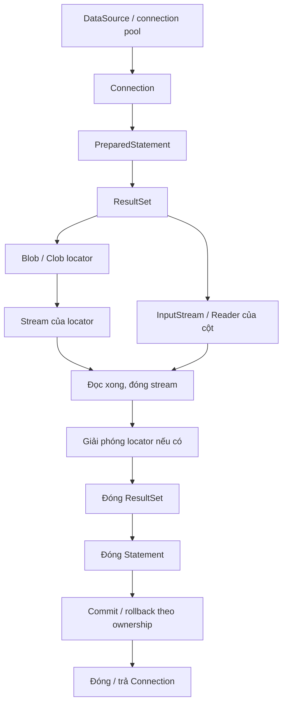

# Tránh trả ResultSet hoặc luồng dữ liệu đã mất kết nối

## Mục tiêu học tập

Trong ứng dụng Java sử dụng **JDBC**, tầng **DAO (Data Access Object)** hoặc **Repository** thường là nơi sở hữu việc truy cập cơ sở dữ liệu: lấy `Connection` từ `DataSource`, tạo `PreparedStatement`, đọc `ResultSet`, ánh xạ kết quả thành dữ liệu nghiệp vụ và đóng các tài nguyên. Một lỗi thiết kế rất dễ gặp là **trả thẳng `ResultSet`, `InputStream`, `Reader` hoặc một `Stream<T>` đọc lười từ JDBC** ra ngoài phương thức, trong khi `Connection` hoặc `Statement` tạo ra chúng đã bị đóng.

Lỗi không chỉ gây `SQLException` kiểu “ResultSet closed”. Nó còn có thể làm kết quả đọc dở dang, giữ connection pool quá lâu, đứt luồng tải tệp, rò rỉ cursor, kéo dài transaction hoặc khiến hành vi phụ thuộc driver: một triển khai đệm sẵn dữ liệu có thể tình cờ chạy, còn môi trường khác thất bại khi chuyển sang đọc streaming.

Bài thuộc chương **DAO và Repository** hướng dẫn cách định nghĩa **hợp đồng sở hữu tài nguyên** để code gọi repository **không cần biết** chi tiết vòng đời `ResultSet`; đồng thời xử lý được các truy vấn JDBC lớn qua driver, `DataSource`, `PreparedStatement`, `ResultSet`, transaction và dữ liệu LOB.

Sau bài này, bạn có thể:

- Giải thích mối quan hệ vòng đời giữa `Connection`, `Statement`, `ResultSet` và stream của cột.
- Nhận diện phản ví dụ trả đối tượng JDBC đã bị đóng hoặc vẫn phụ thuộc connection.
- Trả về **DTO/record, `Optional<T>` hoặc danh sách dữ liệu đã ánh xạ** thay vì trả `ResultSet` trực tiếp.
- Thiết kế API **callback** để xử lý dữ liệu nhiều hàng khi JDBC resources còn mở.
- Sao chép `Blob`/`Clob` qua `InputStream`/`Reader` với thứ tự cleanup đúng, không trả locator đã hết hạn.
- Tách dữ liệu lớn khỏi thời gian giữ connection bằng phân trang hoặc spool.
- Xử lý lỗi, ngắt kết nối và kiểm thử vòng đời tài nguyên với connection pool.

## 1. Cấu trúc vòng đời trong JDBC

Khi một repository thực hiện truy vấn:

```java
try (Connection connection = dataSource.getConnection();
     PreparedStatement ps = connection.prepareStatement(
         "SELECT id, name FROM customers WHERE id = ?")) {

    ps.setLong(1, customerId);

    try (ResultSet rs = ps.executeQuery()) {
        if (rs.next()) {
            // Đọc và ánh xạ dữ liệu khi resources còn mở.
        }
    }
}
```

Có ba mức tài nguyên cơ bản:

| Tài nguyên | Tạo từ đâu? | Thường phụ thuộc vào | Kết thúc |
| --- | --- | --- | --- |
| `Connection` | `DataSource.getConnection()` | Pool, session và DBMS | `close()`, thường trả connection về pool |
| `Statement` / `PreparedStatement` | `Connection` | Connection và trạng thái SQL | `close()` |
| `ResultSet` | `executeQuery()` hoặc API statement khác | Statement, cursor và đôi khi transaction | `close()` |
| `InputStream`/`Reader` từ `ResultSet` | `getBinaryStream()`/`getCharacterStream()` | ResultSet/driver/cursor | `close()` trước khi ResultSet đóng |
| `Blob`/`Clob`/`NClob` | `getBlob()`/`getClob()` | Driver, session, locator và đôi khi transaction | `free()` sau khi đọc xong |
| `Array`/`SQLXML` | Getter JDBC tương ứng | Driver và các tài nguyên đi kèm | `free()` khi hết dùng |

**Tài nguyên tầng dưới không thể được giả định sống độc lập với tầng tạo ra nó.** Đóng một `Statement` thông thường cũng đóng `ResultSet` hiện hành của nó. Đóng `Connection` làm các statement/result set thuộc connection không còn hợp lệ để tiếp tục sử dụng theo hợp đồng JDBC. Một result set cũng có thể bị đóng khi statement được thực thi lại hoặc điều kiện đóng khác xảy ra.

Với connection pool, `connection.close()` trên **logical connection** thường trả quyền sở hữu connection về pool. Điều đó **không** giữ cursor cũ hợp lệ để caller tiếp tục đọc: pool có thể reset transaction và cho request khác mượn session vật lý.



Đây là **thứ tự thận trọng minh họa**: nếu repository dùng transaction tường minh, thường cần hoàn tất việc đọc và đóng cursor trước khi kết thúc transaction; cuối cùng đóng connection. Với truy vấn ngắn ở chế độ auto-commit, transaction boundary có thể do DBMS/driver quản lý khác nhau.

### 1.1. Vì sao lỗi có thể không tái hiện trên máy phát triển?

JDBC driver có nhiều chiến lược lấy kết quả:

- **Đệm toàn bộ:** có thể tải phần lớn dữ liệu trước khi trả quyền điều khiển cho Java.
- **Server-side cursor/fetch từng nhóm:** đọc thêm hàng đòi connection, cursor hoặc transaction còn hoạt động.
- **Streaming LOB:** khi đọc nội dung lớn, driver có thể tiếp tục giao tiếp với database sau lúc gọi getter.
- **Đối tượng proxy:** biến Java chỉ giữ tham chiếu tới trạng thái bên trong driver, không phải bản sao độc lập.

Nếu một đoạn code trả `ResultSet` mà “vẫn chạy” sau khi đóng connection trong một cấu hình cụ thể, **đó không phải hợp đồng di động**. Đừng dựa vào hiện tượng này để thiết kế API.

## 2. Phản ví dụ: trả ResultSet rồi đóng tài nguyên

Mẫu sau là lỗi phổ biến:

```java
// SAI: phương thức trả ResultSet nhưng đóng cả statement/connection.
public ResultSet findAll() throws SQLException {
    try (Connection c = dataSource.getConnection();
         PreparedStatement ps = c.prepareStatement(
             "SELECT id, name FROM customers ORDER BY id")) {
        return ps.executeQuery();
    } // c và ps bị đóng trước khi caller gọi rs.next().
}
```

Caller nhận đối tượng `ResultSet` nhưng không sở hữu những tài nguyên mà nó cần.

```java
try (ResultSet rs = repository.findAll()) {
    while (rs.next()) { // Có thể ném SQLException: ResultSet closed.
        System.out.println(rs.getString("name"));
    }
}
```

**Đảo lại và không đóng connection trong repository cũng không phải lời giải tốt:**

```java
// CŨNG SAI: không rõ ai chịu trách nhiệm đóng các tài nguyên.
public ResultSet findAllUnsafe() throws SQLException {
    Connection c = dataSource.getConnection();
    PreparedStatement ps = c.prepareStatement(
        "SELECT id, name FROM customers");
    return ps.executeQuery();
}
```

Đoạn thứ hai che mất cả `Connection` lẫn `PreparedStatement` khỏi caller. Caller chỉ biết đóng `ResultSet`, vì vậy connection có thể vẫn bị mượn khỏi pool. Nếu nhiều request gọi phương thức này, service dễ gặp **pool exhaustion**.

### 2.1. Quy tắc quyền sở hữu

> **Ai tạo hoặc mượn tài nguyên thường phải biết ai sẽ đóng nó, đóng vào thời điểm nào và xử lý ra sao khi có exception.**

Trong ứng dụng thông thường, cách đơn giản nhất là **repository mở và đóng JDBC resources, chỉ trả dữ liệu nghiệp vụ đã tách rời**. Nếu kiến trúc cố ý trả một resource sống, phải có hợp đồng ownership tường minh, một wrapper quản lý đầy đủ tài nguyên và cơ chế gọi `close()` bắt buộc; đây là lựa chọn nâng cao, cần tránh với API công khai không có vòng đời xác định.

## 3. Thiết kế ưu tiên: ánh xạ ResultSet thành DTO độc lập

Với truy vấn trả một hàng hoặc một số lượng hàng vừa phải, repository nên chuyển dữ liệu sang **record/DTO** trước khi đóng connection.

Giả sử schema:

```sql
CREATE TABLE customers (
    id BIGINT PRIMARY KEY,
    display_name VARCHAR(200) NOT NULL,
    email VARCHAR(255),
    active BOOLEAN NOT NULL
);
```

DDL chỉ mang tính minh họa; tên kiểu boolean và cú pháp tạo bảng có thể cần điều chỉnh cho DBMS cụ thể. Mã Java dưới đây dùng **Java 17+** để minh họa `record`.

### 3.1. Ví dụ hoàn chỉnh: Repository.findById

```java
import java.sql.Connection;
import java.sql.PreparedStatement;
import java.sql.ResultSet;
import java.sql.SQLException;
import java.util.Objects;
import java.util.Optional;
import javax.sql.DataSource;

public final class CustomerRepository {
    private final DataSource dataSource;

    public CustomerRepository(DataSource dataSource) {
        this.dataSource = Objects.requireNonNull(dataSource);
    }

    public record Customer(
        long id, String displayName, String email, boolean active
    ) {}

    public Optional<Customer> findById(long id) throws SQLException {
        String sql = """
            SELECT id, display_name, email, active
              FROM customers
             WHERE id = ?
            """;

        try (Connection c = dataSource.getConnection();
             PreparedStatement ps = c.prepareStatement(sql)) {
            ps.setLong(1, id);

            try (ResultSet rs = ps.executeQuery()) {
                if (!rs.next()) {
                    return Optional.empty();
                }

                Customer customer = mapCustomer(rs);

                // Khóa chính id đảm bảo một hàng theo schema.
                if (rs.next()) {
                    throw new SQLException(
                        "Nhiều hàng cùng id, dữ liệu không hợp lệ"
                    );
                }
                return Optional.of(customer);
            }
        }
    }

    private static Customer mapCustomer(ResultSet rs)
            throws SQLException {
        return new Customer(
            rs.getLong("id"),
            rs.getString("display_name"),
            rs.getString("email"), // Có thể là null nếu cột SQL NULL.
            rs.getBoolean("active")
        );
    }
}
```

`Customer` ở đây chỉ chứa `long`, `String` và `boolean`; không chứa `ResultSet`, `Blob`, `Array` hoặc đối tượng driver. Sau khi `findById()` trả về, caller có thể dùng DTO ngay cả khi connection đã được trả về pool.

```java
CustomerRepository repo = new CustomerRepository(dataSource);

CustomerRepository.Customer customer =
    repo.findById(101L).orElseThrow();

System.out.println(customer.displayName());
// Không cần giữ Connection/ResultSet đang mở.
```

Một `record` có thể vẫn chứa **tham chiếu tới đối tượng mutable** nếu field là `byte[]`, `List` hoặc đối tượng từ driver. Để trở thành DTO thực sự tách rời, phải bảo đảm tất cả trường đã được sao chép/chuyển đổi thích hợp. `record` **không tự động deep-copy**.

### 3.2. Quy tắc ánh xạ dữ liệu

| Kiểu ở database | Nên trả ra tầng service | Cần chú ý |
| --- | --- | --- |
| `VARCHAR`/`TEXT` nhỏ | `String` | SQL `NULL` thành Java `null`, theo contract |
| `BIGINT` không null | `long` | Không nhầm khóa 0 với SQL NULL nếu schema cho phép null |
| `BOOLEAN` không null | `boolean` | Với cột nullable, cần kiểm tra `wasNull()` hoặc kiểu wrapper |
| `DECIMAL` | `BigDecimal` | Scale/precision, dữ liệu trả về không phụ thuộc cursor |
| `DATE`/`TIMESTAMP` | `LocalDate`/`LocalDateTime`/`Instant` theo ngữ nghĩa | Vấn đề timezone và driver hỗ trợ `getObject(..., Class)` |
| `BLOB` nhỏ | `byte[]` đã có giới hạn/kích thước hợp lệ | Không tải toàn bộ BLOB lớn vào heap |
| `BLOB` lớn | Đích độc lập (tệp/kho đối tượng) hoặc API copy | Không giữ `Blob`/stream JDBC trong DTO |
| SQL `ARRAY`/`STRUCT` | Java collection/value object độc lập | Không trả locator/kiểu driver khi chưa chuyển đổi/giải phóng |

Đặc biệt với `ResultSet.getObject()`, **giá trị trả về chưa chắc là DTO độc lập**: cột SQL `ARRAY` có thể trả `java.sql.Array` cần `free()`, còn `BLOB` có thể trả `Blob` phụ thuộc transaction. Không đưa trực tiếp `Object` chưa kiểm tra vào DTO rồi đóng connection.

## 4. Đọc nhiều hàng: List<T> có giới hạn

Nếu kết quả nhỏ và được giới hạn rõ, có thể trả một danh sách DTO:

```java
public List<CustomerRepository.Customer> findRecent(
        DataSource ds, int limit) throws SQLException {
    if (limit < 1 || limit > 500) {
        throw new IllegalArgumentException("limit phải trong [1, 500]");
    }

    String sql = """
        SELECT id, display_name, email, active
          FROM customers
         ORDER BY id DESC
         LIMIT ?
        """;

    List<CustomerRepository.Customer> result = new ArrayList<>();

    try (Connection c = ds.getConnection();
         PreparedStatement ps = c.prepareStatement(sql)) {
        ps.setInt(1, limit);

        try (ResultSet rs = ps.executeQuery()) {
            while (rs.next()) {
                result.add(new CustomerRepository.Customer(
                    rs.getLong("id"),
                    rs.getString("display_name"),
                    rs.getString("email"),
                    rs.getBoolean("active")
                ));
            }
        }
    }

    return List.copyOf(result);
}
```

Đây là ví dụ **bên trong lớp đã import `java.sql.*`, `java.util.List`, `java.util.ArrayList`, `javax.sql.DataSource`**. Truy vấn dùng `LIMIT`, là cú pháp của nhiều DBMS nhưng **không chung cho mọi hệ quản trị**; có thể cần `FETCH FIRST` hoặc cú pháp vendor tương ứng. Đoạn mã không mở connection sau khi trả về.

`List.copyOf(result)` tạo một danh sách không thể sửa cấu trúc qua API thông thường; các `Customer` trong danh sách là record bất biến theo các kiểu field đang dùng. Hãy nhớ rằng một danh sách không thể sửa **không** đồng nghĩa deep immutability nếu các phần tử vẫn chứa đối tượng mutable.

**Không dùng cách này với hàng triệu hàng:** toàn bộ DTO được giữ trong heap đến khi method trả về. Một `List` tách rời tài nguyên JDBC vẫn có thể gây OOM nếu không giới hạn số bản ghi và kích thước trường. Khi dữ liệu lớn, hãy dùng callback trong scope hoặc phân trang.

### 4.1. Hợp đồng của danh sách trả về

Khi thiết kế API, nên ghi rõ:

- Danh sách có thể rỗng khi không có hàng.
- Tất cả phần tử đều là dữ liệu đã ánh xạ, không cần connection.
- Thứ tự chỉ được đảm bảo nếu SQL có `ORDER BY` xác định.
- Giới hạn số hàng và tổng kích thước dữ liệu.
- Giá trị `NULL` được biểu diễn như thế nào.
- Dữ liệu đã đọc là một bản chụp theo ngữ nghĩa truy vấn/transaction, không tự cập nhật khi DBMS thay đổi.

## 5. Trả Stream<T> từ một ResultSet đang đóng: lỗi tinh vi hơn

Java `Stream<T>` thường tính toán **lười (*lazy*)**. Repository có thể trông rất tự nhiên nếu chuyển `ResultSet` thành iterator rồi trả Stream:

```java
// Phản ví dụ minh họa: tạo stream lười phụ thuộc ResultSet.
public Stream<Customer> streamCustomersUnsafe() throws SQLException {
    try (Connection c = dataSource.getConnection();
         PreparedStatement ps = c.prepareStatement(
             "SELECT id, display_name FROM customers");
         ResultSet rs = ps.executeQuery()) {

        return someLazyStreamOver(rs);
        // Các resources bị đóng khi method trả về.
    }
}
```

`someLazyStreamOver(rs)` là hàm **giả định**, nhằm cho thấy lỗi vòng đời, không phải API JDBC có sẵn. Caller chỉ bắt đầu đọc hàng khi gọi terminal operation:

```java
Stream<Customer> stream = repo.streamCustomersUnsafe();
List<Customer> all = stream.toList(); // JDBC resources đã đóng.
```

Ngược lại, nếu repository **không đóng** resources mà trả một Stream lười, caller phải đóng Stream để giải phóng tất cả connection/statement/result set. Nhưng:

- Terminal operation như `toList()`, `forEach()` **không tự động gọi `Stream.close()`**.
- Caller có thể bỏ dở stream, không gọi `close()` hoặc lưu stream vào cache.
- `stream.parallel()` có thể làm truy cập đồng thời một `ResultSet` không được thiết kế thread-safe.
- Nếu mapping bị lỗi giữa stream, cần bảo đảm cleanup vẫn xảy ra.
- Transaction/cursor có thể bị giữ suốt thời gian stream không được tiêu thụ.

**Tránh trả `Stream<T>` phụ thuộc trực tiếp JDBC làm giao diện repository mặc định.** Nếu muốn dùng Stream API, hãy trả stream từ dữ liệu **đã được materialize có giới hạn**, ví dụ `findRecent(100).stream()`; hoặc xây wrapper `AutoCloseable` có ownership rõ ràng và kiểm thử kỹ.

## 6. Thay thế cho Stream lười: callback chạy trong phạm vi tài nguyên

Với kết quả lớn nhưng muốn xử lý từng hàng, Repository có thể nhận một **consumer callback** và gọi callback **ngay khi `ResultSet` còn mở**, thay vì trả `ResultSet` ra ngoài.

### 6.1. Ví dụ hoàn chỉnh: duyệt từng DTO

```java
import java.io.IOException;
import java.sql.Connection;
import java.sql.PreparedStatement;
import java.sql.ResultSet;
import java.sql.SQLException;
import java.util.Objects;
import javax.sql.DataSource;

public final class CustomerScanner {
    @FunctionalInterface
    public interface RowConsumer<T> {
        void accept(T row) throws SQLException, IOException;
    }

    public record CustomerRow(long id, String name, String email) {}

    private final DataSource dataSource;

    public CustomerScanner(DataSource dataSource) {
        this.dataSource = Objects.requireNonNull(dataSource);
    }

    public long scanActive(RowConsumer<CustomerRow> consumer)
            throws SQLException, IOException {
        Objects.requireNonNull(consumer, "consumer");

        String sql = """
            SELECT id, display_name, email
              FROM customers
             WHERE active = ?
             ORDER BY id
            """;

        try (Connection c = dataSource.getConnection();
             PreparedStatement ps = c.prepareStatement(
                 sql,
                 ResultSet.TYPE_FORWARD_ONLY,
                 ResultSet.CONCUR_READ_ONLY)) {
            ps.setBoolean(1, true);
            ps.setFetchSize(200); // Hint, không phải giới hạn heap cứng.

            long count = 0;
            try (ResultSet rs = ps.executeQuery()) {
                while (rs.next()) {
                    CustomerRow row = new CustomerRow(
                        rs.getLong("id"),
                        rs.getString("display_name"),
                        rs.getString("email")
                    );

                    consumer.accept(row);
                    count++;
                }
            }
            return count;
        }
    }
}
```

Cách gọi:

```java
CustomerScanner scanner = new CustomerScanner(dataSource);

long scanned = scanner.scanActive(row -> {
    System.out.println(row.id() + ": " + row.name());
});
```

Ưu điểm:

1. `ResultSet` không rời phạm vi sở hữu của repository.
2. Callback chỉ nhận `CustomerRow` đã ánh xạ, không nhận driver resource.
3. `try-with-resources` đóng `ResultSet`, `PreparedStatement` và `Connection` ngay khi quét xong **hoặc khi callback ném exception**.
4. Callback khai báo có thể ném `IOException`/`SQLException`, nên repository không phải biến mọi lỗi thành `RuntimeException`.
5. `setFetchSize(200)` có thể hỗ trợ tối ưu đọc từng nhóm nếu driver/cấu hình cho phép; vẫn cần đo thực tế.

**Giới hạn quan trọng:** callback thực thi **trong lúc connection đang được mượn**. Nếu callback chậm (gọi HTTP, ghi object storage, chờ người dùng, nén nhiều giây), connection cũng bị giữ lâu tương ứng. Đừng dùng callback để giữ tham chiếu tới `ResultSet` hoặc mở công việc bất đồng bộ rồi trả về trước khi việc đó dùng xong các tài nguyên JDBC.

### 6.2. Hợp đồng của callback

| Quy tắc | Ý nghĩa |
| --- | --- |
| Callback chạy **đồng bộ** với vòng lặp `rs.next()` | Repository kiểm soát vòng đời connection |
| Callback nhận DTO độc lập | Không có getter JDBC dùng sau khi đóng ResultSet |
| Callback ném exception thì scan dừng | Tài nguyên đóng bằng try-with-resources |
| Callback không được giữ connection ra ngoài | Transaction và pool ownership không bị trôi qua tầng khác |
| Không có thao tác tự động commit dữ liệu đích | Nếu callback gửi dữ liệu sang broker/file, cần kiểm tra mức độ hoàn tất |
| Không chạy callback song song trên cùng ResultSet | Tránh sử dụng cursor đa luồng không an toàn |

Callback có thể thu thập DTO vào một danh sách, nhưng khi đó **chính caller** phải bảo đảm số phần tử được giữ không vượt ngân sách bộ nhớ. Repository chỉ tránh rò rỉ JDBC resources, không tự động giải quyết mọi vấn đề backpressure.

## 7. ResultSet.getBinaryStream và getCharacterStream cũng phụ thuộc vòng đời

Với dữ liệu nhị phân hoặc ký tự lớn, `ResultSet` có các getter:

- `getBinaryStream(column)` → `InputStream`.
- `getCharacterStream(column)` → `Reader`.
- `getBlob(column)` / `getClob(column)` → đối tượng LOB, có thể là locator.

Phản ví dụ:

```java
// SAI: trả InputStream đã tách khỏi scope ResultSet/Connection.
public InputStream openDocumentUnsafe(long id) throws SQLException {
    try (Connection c = dataSource.getConnection();
         PreparedStatement ps = c.prepareStatement(
             "SELECT content FROM documents WHERE id = ?")) {
        ps.setLong(1, id);
        try (ResultSet rs = ps.executeQuery()) {
            if (!rs.next()) {
                return null;
            }
            return rs.getBinaryStream("content");
        }
    }
}
```

Với stream này, caller chỉ bắt đầu `read()` sau khi `ResultSet` và `Connection` đã đóng. Nếu driver cần lấy byte tiếp từ DBMS, việc đọc sẽ thất bại. **Một `InputStream` không mặc nhiên là một bản sao độc lập** chỉ vì nó có API Java I/O.

### 7.1. Thứ tự getter quan trọng

Theo hợp đồng `ResultSet`, các stream lấy trực tiếp qua getter có thể bị **đóng ngầm khi gọi một getter khác trên cùng ResultSet** hoặc khi di chuyển con trỏ. Vì vậy:

```java
// Nên lấy metadata trước khi mở stream của cột LOB.
long documentId = rs.getLong("document_id");
String filename = rs.getString("filename");

try (InputStream content = rs.getBinaryStream("content")) {
    if (content != null) {
        byte[] buffer = new byte[64 * 1024];
        int size;
        while ((size = content.read(buffer)) != -1) {
            output.write(buffer, 0, size);
        }
    }
}

// Chỉ rs.next() sau khi stream được tiêu thụ và đóng.
```

Đây là **đoạn trong scope đã có `ResultSet rs` và `OutputStream output`**. Không đóng output vì nó do caller cấp. Nếu `content IS NULL`, getter trả `null`; chính sách xử lý phải theo hợp đồng nghiệp vụ, không đồng nhất `NULL` với tệp rỗng.

## 8. Ví dụ chuẩn: sao chép BLOB khi Connection còn mở

Thay vì trả `InputStream` ra ngoài, Repository có thể có API:

```text
copyDocumentTo(documentId, OutputStream output) -> số byte đã sao chép
```

Phương thức này **không trả stream JDBC**. Nó sở hữu connection và sao chép nội dung vào một đích do caller quản lý.

### 8.1. Code Java đầy đủ

Giả sử bảng `documents(document_id BIGINT PRIMARY KEY, filename VARCHAR(...), content BLOB)`; kiểu `BLOB` cần được điều chỉnh theo DBMS. Ví dụ dưới đây dùng `Blob` và một wrapper `AutoCloseable` để gọi `free()` **sau khi stream đã đóng**.

```java
import java.io.IOException;
import java.io.InputStream;
import java.io.OutputStream;
import java.sql.Blob;
import java.sql.Connection;
import java.sql.PreparedStatement;
import java.sql.ResultSet;
import java.sql.SQLException;
import java.util.Objects;
import javax.sql.DataSource;

public final class DocumentRepository {
    private static final int BUFFER_BYTES = 64 * 1024;

    private final DataSource dataSource;

    public DocumentRepository(DataSource dataSource) {
        this.dataSource = Objects.requireNonNull(dataSource);
    }

    public long copyDocumentTo(long documentId, OutputStream destination)
            throws SQLException, IOException {
        Objects.requireNonNull(destination, "destination");

        String sql = """
            SELECT content
              FROM documents
             WHERE document_id = ?
            """;

        try (Connection c = dataSource.getConnection();
             PreparedStatement ps = c.prepareStatement(sql)) {
            ps.setLong(1, documentId);

            try (ResultSet rs = ps.executeQuery()) {
                if (!rs.next()) {
                    throw new SQLException(
                        "Không tìm thấy documentId=" + documentId
                    );
                }

                Blob blob = rs.getBlob("content");
                if (blob == null) {
                    throw new SQLException(
                        "Nội dung tài liệu là SQL NULL"
                    );
                }

                // Tài nguyên được đóng ngược thứ tự khai báo:
                // InputStream trước, BlobLease (free) sau.
                try (BlobLease lease = new BlobLease(blob);
                     InputStream source = blob.getBinaryStream()) {

                    byte[] buffer = new byte[BUFFER_BYTES];
                    long copied = 0;
                    int n;

                    while ((n = source.read(buffer)) != -1) {
                        destination.write(buffer, 0, n);
                        copied += n;
                    }
                    return copied;
                }
            }
        }
    }

    private static final class BlobLease implements AutoCloseable {
        private final Blob blob;

        BlobLease(Blob blob) {
            this.blob = Objects.requireNonNull(blob);
        }

        @Override
        public void close() throws SQLException {
            blob.free();
        }
    }
}
```

Nếu `destination.write(...)` ném `IOException`, `try-with-resources` vẫn cố đóng stream, gọi `blob.free()`, đóng `ResultSet`, statement và connection. Nếu cleanup cũng lỗi, Java giữ lỗi chính và thêm lỗi cleanup vào `getSuppressed()`.

**Đừng gọi `destination.close()` trong repository** khi caller sở hữu output. Caller có thể muốn ghi thêm checksum/trailer hoặc thực hiện publish một tệp sau khi sao chép. Hợp đồng nên ghi rõ ai đóng output, ai xử lý dữ liệu dở dang.

**Lưu ý:** `Blob` có thể phụ thuộc transaction. Một số DBMS/driver yêu cầu transaction tường minh còn mở khi đọc locator. Ví dụ dùng auto-commit theo cấu hình connection; để chạy với DBMS có locator scoped theo transaction, bạn phải đặt giao dịch đọc phù hợp và chỉ `commit()/rollback()` **sau khi stream và locator đã giải phóng**, đồng thời giữ đúng ownership của tầng gọi.

### 8.2. CLOB và NClob

Với `Clob`, ý tưởng tương tự:

```java
java.sql.Clob clob = rs.getClob("text_content");

if (clob != null) {
    try {
        try (java.io.Reader reader = clob.getCharacterStream()) {
            char[] chars = new char[16 * 1024];
            int n;

            while ((n = reader.read(chars)) != -1) {
                writer.write(chars, 0, n);
            }
        }
    } finally {
        clob.free();
    }
}
```

Đoạn này giả định `rs` và `writer` đã tồn tại trong scope hợp lệ; `writer` do caller sở hữu. Với `NClob`, có thể dùng `rs.getNClob()` nếu driver/DBMS hỗ trợ và giải phóng tương tự.

**Không dùng `getBytes()` hoặc `getSubString()` để tải nguyên một LOB nhiều gigabyte** vào một mảng/chuỗi duy nhất. Đọc theo khối giúp giới hạn bộ đệm **của ứng dụng**, dù driver vẫn có thể tự buffer thêm tùy cách triển khai.

## 9. Nếu cần trả dữ liệu để dùng sau: spool ra tài nguyên độc lập

Không phải lúc nào caller cũng có `OutputStream` sẵn. Ví dụ controller muốn trả một tệp lớn trong callback bất đồng bộ; nếu repository trả JDBC stream rồi đóng connection ngay, callback có thể đọc từ stream đã hết hạn.

Một lựa chọn là **spool sang tệp tạm** khi connection còn mở:

```java
import java.io.IOException;
import java.io.OutputStream;
import java.nio.file.Files;
import java.nio.file.Path;
import java.sql.SQLException;

public Path exportToTemporaryFile(long documentId)
        throws SQLException, IOException {
    Path temporary = Files.createTempFile(
        "jdbc-document-", ".bin"
    );

    boolean completed = false;
    try {
        try (OutputStream out = Files.newOutputStream(temporary)) {
            documentRepository.copyDocumentTo(documentId, out);
        }
        completed = true;
        return temporary;
    } finally {
        if (!completed) {
            Files.deleteIfExists(temporary);
        }
    }
}
```

Đây là ví dụ trong một lớp có trường `DocumentRepository documentRepository` được khởi tạo từ trước. Sau khi phương thức trả `Path`, **tệp thuộc sở hữu của caller**; caller phải xóa khi dùng xong và không công bố một đường dẫn tạm có thể bị người khác truy cập không kiểm soát.

Cách làm này:

- Sao chép toàn bộ nội dung **trước khi** đóng connection.
- Cho phép truyền tệp tới HTTP client sau đó **mà không giữ connection JDBC**.
- Chuyển chi phí từ việc giữ DB session lâu sang dung lượng đĩa/tệp tạm.
- Cần quota, cleanup khi crash, quyền truy cập filesystem, chống path traversal và kiểm soát dữ liệu nhạy cảm.

Nếu không muốn spool lên ổ đĩa, có thể dùng object storage trung gian với xác thực và lifecycle policy phù hợp. Không nên chọn `ByteArrayOutputStream` cho mọi tệp lớn: kết quả cuối là `byte[]` trong heap, có thể gây OOM.

### 9.1. Stream HTTP bất đồng bộ: ai sở hữu thời điểm đóng?

Sai lầm thường gặp là:

```java
// Mô tả lỗi: request handler đã trả về thì connection đóng,
// nhưng framework mới bắt đầu consume InputStream ở callback sau.
InputStream body = repository.openDocumentUnsafe(id);
return frameworkStreamResponse(body);
```

`frameworkStreamResponse` là **hàm giả định**, không phải API JDBC. Nếu framework dùng cơ chế lazy/async, callback có thể chạy ở thread khác hoặc sau khi method tạo response kết thúc.

Lựa chọn an toàn hơn:

1. Mọi thao tác đọc JDBC diễn ra trong callback **sở hữu đầy đủ connection/statement/result set** và có cleanup khi client hủy; hoặc
2. Sao chép dữ liệu sang tệp/kho độc lập trước, rồi framework chỉ stream từ nguồn độc lập đó.

Cách (1) có thể giữ connection dài bằng thời gian client tải file. Cách (2) dùng thêm storage nhưng trả connection sớm hơn. Hãy đo tải đồng thời và chọn theo yêu cầu nghiệp vụ.

## 10. Phân trang thay vì trả một ResultSet sống cho hàng triệu bản ghi

Khi truy vấn trả rất nhiều hàng, callback trực tiếp vẫn có nhược điểm: connection bị giữ cho đến khi consumer xử lý hết. **Phân trang** cho phép repository trả một page DTO độc lập rồi đóng JDBC resources.

Ví dụ SQL keyset theo khóa tăng ổn định:

```sql
-- Cú pháp LIMIT của một số DBMS; cần điều chỉnh theo DBMS thật.
SELECT id, display_name, email, active
  FROM customers
 WHERE id > ?
 ORDER BY id
 LIMIT ?;
```

### 10.1. Ví dụ Java: repository trả page DTO

```java
public List<CustomerRepository.Customer> pageAfter(
        DataSource ds, long afterId, int pageSize)
        throws SQLException {

    if (pageSize < 1 || pageSize > 500) {
        throw new IllegalArgumentException(
            "pageSize phải trong [1, 500]"
        );
    }

    String sql = """
        SELECT id, display_name, email, active
          FROM customers
         WHERE id > ?
         ORDER BY id
         LIMIT ?
        """;

    List<CustomerRepository.Customer> page =
        new ArrayList<>(pageSize);

    try (Connection c = ds.getConnection();
         PreparedStatement ps = c.prepareStatement(sql)) {
        ps.setLong(1, afterId);
        ps.setInt(2, pageSize);

        try (ResultSet rs = ps.executeQuery()) {
            while (rs.next()) {
                page.add(new CustomerRepository.Customer(
                    rs.getLong("id"),
                    rs.getString("display_name"),
                    rs.getString("email"),
                    rs.getBoolean("active")
                ));
            }
        }
    }

    return List.copyOf(page);
}
```

Đoạn ví dụ nằm trong lớp có import `java.sql.*`, `java.util.List`, `java.util.ArrayList` và `javax.sql.DataSource`. Hàm trả một danh sách dữ liệu **đã tách rời**; caller dùng bao lâu tùy ý mà không giữ connection.

Consumer thực hiện:

```java
long cursor = 0L;
while (true) {
    List<CustomerRepository.Customer> page =
        pageAfter(dataSource, cursor, 200);

    if (page.isEmpty()) {
        break;
    }

    processPage(page); // Chậm cũng không giữ Connection.
    cursor = page.get(page.size() - 1).id();
}
```

`processPage` là hàm nghiệp vụ do ứng dụng định nghĩa. **Chỉ lấy trang tiếp theo khi consumer hoàn thành trang trước** là một dạng backpressure trực tiếp, không cần queue vô hạn.

Các điều kiện quan trọng:

- `id` được giả định dương, duy nhất và không thay đổi. Nếu khóa sắp xếp gồm nhiều trường hoặc có giá trị `NULL`, cần thiết kế điều kiện keyset phù hợp.
- SQL `ORDER BY` là bắt buộc để tiến trang ổn định.
- Các trang truy vấn khác thời điểm **không mặc nhiên thuộc một snapshot nhất quán**; dữ liệu có thể bị thêm/sửa/xóa giữa các lần lấy trang.
- `pageSize` giới hạn số hàng, **không giới hạn byte**; một cột LOB lớn cần chính sách riêng.
- Nếu consumer chỉ enqueue page vào queue không giới hạn rồi trả về ngay, backpressure cuối-cuối bị mất.
- Nếu phải đảm bảo xử lý đúng-một-lần sau crash, checkpoint phải gắn với **xác nhận hoàn tất ở đích**, không chỉ ID cuối đã đọc.

## 11. Quyền sở hữu Connection khi service đang điều phối transaction

Có hai mô hình hợp lý nhưng không được trộn tùy tiện.

### Mô hình A — Repository tự lấy và đóng Connection

```text
service -> repository.findById(id)
             -> dataSource.getConnection()
             -> SELECT + map DTO
             -> ResultSet.close()
             -> PreparedStatement.close()
             -> Connection.close()  [trả pool]
service <- Customer record
```

Phù hợp với truy vấn độc lập hoặc một thao tác có transaction boundary do repository quản lý.

### Mô hình B — Service sở hữu transaction, truyền Connection vào DAO

```java
public CustomerRepository.Customer loadInTransaction(
        Connection connection, long id) throws SQLException {

    String sql = """
        SELECT id, display_name, email, active
          FROM customers
         WHERE id = ?
        """;

    try (PreparedStatement ps = connection.prepareStatement(sql)) {
        ps.setLong(1, id);

        try (ResultSet rs = ps.executeQuery()) {
            if (!rs.next()) {
                throw new SQLException("Không tìm thấy customer");
            }
            return new CustomerRepository.Customer(
                rs.getLong("id"),
                rs.getString("display_name"),
                rs.getString("email"),
                rs.getBoolean("active")
            );
        }
    }
    // KHÔNG đóng connection: caller sở hữu connection này.
}
```

Trong mô hình B, DAO chỉ đóng các `PreparedStatement`/`ResultSet` do mình tạo. Service chịu trách nhiệm `commit()`, `rollback()` và `close()` của connection. Cách này hữu ích khi nhiều DAO phải tham gia **một local transaction**.

### 11.1. Khung transaction

```java
try (Connection c = dataSource.getConnection()) {
    c.setAutoCommit(false);
    try {
        // Các DAO sử dụng cùng Connection c.
        updateAccount(c, accountId);
        insertAudit(c, accountId);
    } catch (SQLException | RuntimeException failure) {
        try {
            c.rollback();
        } catch (SQLException rollbackError) {
            failure.addSuppressed(rollbackError);
        }
        throw failure;
    }

    // Lỗi ngay tại commit có thể mang trạng thái chưa xác định.
    c.commit();
}
```

Đây là khung minh họa, giả định `updateAccount` và `insertAudit` được định nghĩa bởi ứng dụng. Nếu DAO tự gọi `connection.close()` hoặc `commit()` khi service đang dùng nó, transaction boundary sẽ bị phá vỡ.

**Dù service sở hữu connection, DAO vẫn không nên trả `ResultSet`** nếu caller sẽ tiếp tục sau khi service đóng transaction. Tầng nào chịu trách nhiệm trả resource phải có lifecycle rõ ràng; cách an toàn vẫn là ánh xạ dữ liệu khi scope còn hợp lệ.

### 11.2. Không dùng Connection như giá trị session dài hạn

Một số cách làm bất lợi:

- Đặt `Connection` vào field singleton repository rồi nhiều request dùng chung.
- Lưu `Connection` trong HTTP session hoặc DTO để gọi lại sau khi người dùng bấm nút.
- Giữ `ResultSet` trong cache hoặc gửi qua thread khác để tiêu thụ dần.
- Dùng một `Connection` cho nhiều virtual thread đọc/ghi đồng thời mà không có contract thread safety.

Những cách đó khiến trạng thái transaction, cursor và ownership rối rắm, đồng thời có thể làm pool bị giữ tài nguyên. Một transaction local không tự lan sang connection khác chỉ vì chúng được dùng trong cùng service hoặc cùng request.

## 12. Khi nào cần một wrapper cursor có AutoCloseable?

Có trường hợp đặc biệt buộc phải xử lý một cursor sống qua nhiều phương thức, ví dụ một thư viện nội bộ thiết kế **resource scope** giống `Iterator` có thể đóng. Khi đó có thể trả **một wrapper sở hữu đồng thời**:

- `Connection`,
- `PreparedStatement`,
- `ResultSet`,
- cùng phương thức `close()` đóng tất cả theo thứ tự.

Hợp đồng sẽ phải bắt caller sử dụng:

```java
try (CloseableCursor<Customer> cursor = repository.openCursor()) {
    while (cursor.hasNext()) {
        process(cursor.next());
    }
}
```

`CloseableCursor` ở đây là **kiểu giả định do thư viện ứng dụng tự thiết kế**, không phải interface sẵn có của JDBC/JDK. Để xây nó đúng cần xử lý rất nhiều chi tiết:

1. Nếu tạo statement thành công nhưng `executeQuery()` thất bại, phải đóng statement/connection ngay.
2. Nếu ánh xạ một hàng lỗi ở giữa, vẫn phải đóng mọi resources.
3. Nếu caller bỏ dở, `close()` phải idempotent hoặc có quy tắc rõ.
4. Nếu nhiều lời gọi `close()` cùng lỗi, phải giữ đầy đủ suppressed exceptions.
5. Không cho truy cập từ nhiều thread nếu driver/cursor không hỗ trợ.
6. Không cho caller dùng sau `close()`; cần trạng thái đã đóng.
7. Nếu cursor sống trong transaction, scope phải kết thúc transaction đúng cách.
8. Phải có timeout, cancellation và leak detection; không chờ GC để trả pool.
9. Nếu caller dùng Stream facade, `Stream.onClose(...)` là **cơ chế tùy chọn**, không thay thế việc caller thật sự gọi `close()`.

Vì vậy, **callback hoặc phân trang thường ít rủi ro hơn** so với xuất một cursor sống qua API. Wrapper là trường hợp có chủ đích và cần test vòng đời, không phải lời giải mặc định cho việc repository đóng connection quá sớm.

## 13. Hiệu năng và áp lực ngược: tránh đổi một lỗi thành lỗi khác

Việc **không trả `ResultSet` sống** không có nghĩa phải nạp toàn bộ kết quả vào RAM. Hãy chọn chiến lược theo dung lượng và tốc độ consumer.

| Quy mô và yêu cầu | Hướng API | Phạm vi giữ Connection | Chi phí chính |
| --- | --- | --- | --- |
| Một hàng | `Optional<DTO>` | Vài câu SQL và mapping | Nhỏ, đơn giản |
| Vài trăm hàng | `List<DTO>` có giới hạn | Trong lúc truy vấn và materialize | RAM theo số DTO |
| Rất nhiều hàng, consumer nhanh | Callback `forEachRow(consumer)` | Trong suốt vòng lặp | Giữ connection lâu |
| Rất nhiều hàng, consumer chậm | `pageAfter(cursor, n)` | Mỗi trang một lần mượn | Nhất quán giữa trang, nhiều round-trip |
| LOB lớn | `copyTo(OutputStream)` hoặc spool | Trong lúc copy | I/O và thời gian giữ connection |
| HTTP streaming bất đồng bộ | Tệp/kho độc lập hoặc callback có owner | Tùy thiết kế | Cleanup và hủy khi client ngắt |
| Cursor cần kiểm soát giao dịch | Wrapper tài nguyên `AutoCloseable` nội bộ | Caller quyết định, phải đóng tường minh | Complexity/leak risk cao |

### 13.1. Fetch size không thay ownership

`ps.setFetchSize(200)` chỉ đưa **gợi ý** cho JDBC driver về số hàng lấy mỗi lần; nó không thay đổi thực tế là `ResultSet` cần connection còn hợp lệ. Một số driver đòi cấu hình cursor hoặc transaction tường minh để thực sự fetch theo nhóm. Không dùng `fetchSize` để biện minh cho việc trả result set đã đóng.

### 13.2. Consumer chậm làm tăng thời gian giữ connection

Nếu `scanActive()` gọi callback ghi HTTP và client nhận rất chậm, một connection của pool sẽ bị giữ cho đến khi callback hoàn tất. Với 20 request đồng thời và pool chỉ có 10 connection, các request khác có thể phải chờ pool dù SQL đơn lẻ nhanh.

Giải pháp tùy ngữ cảnh:

- Giới hạn số export đang chạy đồng thời.
- Tách phần truy vấn thành các page DTO độc lập.
- Spool ra tệp/kho dữ liệu trung gian trước khi trả HTTP response.
- Đặt timeout/chính sách hủy, bảo đảm resources được đóng khi callback ném lỗi.
- Theo dõi connection acquisition wait, hold time, active/idle và database cursor count.

**Không tạo queue không giới hạn** để “giải phóng” repository nhanh hơn: producer có thể đọc nhanh rồi dồn DTO vào RAM. Nếu dùng producer–consumer, queue phải có dung lượng/byte budget hữu hạn và cơ chế backpressure thực sự.

## 14. Lỗi và hủy: tài nguyên phải đóng ngay cả khi đọc chưa hết

Một vòng đọc có thể thất bại ở:

- `executeQuery()`,
- `rs.next()` sau vài nghìn hàng,
- getter đọc một cột,
- `InputStream.read()` của LOB,
- `OutputStream.write()` tới HTTP/tệp,
- callback chuyển DTO sang hệ thống khác,
- `Connection.commit()/rollback()`,
- cleanup `ResultSet.close()`/`blob.free()`/`Connection.close()`.

Dùng `try-with-resources` cho những đối tượng `AutoCloseable` giúp JVM đóng tài nguyên **kể cả khi đang thoát do exception**. Khi cả tác vụ chính và cleanup cùng lỗi, ngoại lệ cleanup thường nằm trong `getSuppressed()` của ngoại lệ chính; cần giữ thông tin này cho chẩn đoán được kiểm soát.

### 14.1. Khi một consumer dừng sớm

Một callback có thể dừng bằng cách ném exception có chủ đích, nhưng đừng lạm dụng exception để điều khiển luồng bình thường nếu có thể định nghĩa một API có tín hiệu tiếp tục/dừng rõ ràng. Dù dừng thế nào, repository phải đóng cursor và connection.

Nếu cần kiểm soát hủy rất lâu:

- Thêm deadline và kiểm tra hủy ở những điểm phù hợp.
- Xem xét `Statement.setQueryTimeout(...)`, cancellation và network timeout của driver.
- Không mặc định `Thread.interrupt()` làm JDBC dừng tức thời trong mọi driver.
- Không tự báo “transaction đã rollback” chỉ vì request bị hủy; phải kết thúc transaction theo contract và kiểm tra lỗi rollback.
- Nếu data sink đã nhận một phần dữ liệu, rollback database **không thể thu hồi** byte đã gửi.

### 14.2. Lỗi ở commit khác lỗi ở bước truy vấn

Nếu service thực hiện DML trong transaction rồi `commit()` ném lỗi mạng, database có thể đã commit dù Java không nhận được xác nhận. Không tự động chạy lại nghiệp vụ bằng request ID mới. Đối soát theo khóa nghiệp vụ/idempotency và chỉ retry theo quy tắc đã định.

Lỗi vòng đời resource không nên làm ứng dụng “nuốt” mọi `SQLException` rồi trả danh sách rỗng: danh sách rỗng có nghĩa **không có dữ liệu**, không phải **không thể đọc dữ liệu**.

## 15. Kiểm thử để bắt lỗi trả ResultSet/stream đã đóng

Không nên chỉ kiểm tra repository hoạt động khi connection còn mở ở môi trường development. Cần tích hợp DBMS/driver thực tế hoặc test double theo dõi tài nguyên.

### 15.1. Ma trận kiểm thử cơ bản

| Test | Thao tác | Kỳ vọng |
| --- | --- | --- |
| `findById` có hàng | Query rồi sử dụng DTO **sau** khi method kết thúc | DTO đọc được độc lập |
| `findById` không có hàng | Query ID không tồn tại | `Optional.empty()`, không phải lỗi giả |
| `findRecent` | Gọi query và duyệt List sau khi connection đóng | Không còn dependency JDBC |
| `scanActive` đầy đủ | Callback xử lý toàn bộ hàng | Tài nguyên được đóng đúng |
| Callback ném `IOException` ở hàng thứ hai | Quét dừng giữa chừng | ResultSet/Statement/Connection vẫn đóng |
| Getter ném `SQLException` | Lỗi khi đang map hàng | Exception được truyền, cleanup đầy đủ |
| `copyDocumentTo` thành công | Copy BLOB lớn sang output | Byte/checksum đúng, stream/Blob được đóng |
| `copyDocumentTo` gặp lỗi output | `OutputStream.write()` ném lỗi | Không rò connection/locator |
| BLOB SQL NULL | `rs.getBlob()` trả `null` | Xử lý theo contract, không `NullPointerException` |
| Client hủy HTTP response | Consumer dừng sớm | Không còn connection bị mượn lâu vô hạn |
| Test pool nhỏ | Chạy đồng thời nhiều request | Không pool exhaustion do resources bị bỏ quên |
| Transaction do service sở hữu | DAO chỉ đóng statement/result set | Service vẫn còn connection để commit/rollback |

### 15.2. Test JUnit: DTO độc lập sau scope repository

Một integration test đơn giản có thể được viết như sau, với fixture `customers(id=101, ...)` được tạo trước trong **database test**:

```java
import static org.junit.jupiter.api.Assertions.*;

import java.sql.SQLException;
import org.junit.jupiter.api.Test;

final class CustomerRepositoryIT {
    private final CustomerRepository repo =
        new CustomerRepository(TestDataSources.integration());

    @Test
    void dtoRemainsUsableAfterRepositoryReturns() throws SQLException {
        CustomerRepository.Customer customer =
            repo.findById(101L).orElseThrow();

        assertEquals(101L, customer.id());
        assertNotNull(customer.displayName());

        // Repo đã hoàn tất truy vấn và đóng JDBC resources.
        // Các field vẫn đọc được từ DTO độc lập.
        assertFalse(customer.displayName().isBlank());
    }
}
```

`TestDataSources.integration()` là **helper do dự án phải cung cấp**, không phải lớp JDBC/JUnit có sẵn. Trong test thật, nên tạo fixture có khóa riêng và cleanup phù hợp; không dựa vào dữ liệu production hoặc người dùng khác. Test này minh họa contract đầu ra nhưng chưa đủ để chứng minh không rò connection.

### 15.3. Kiểm tra leak và lỗi callback

Với một pool cung cấp metrics, test nên đo số connection đang active **trước và sau** nhiều lượt gọi. Cùng với đó, test double/proxy `DataSource` có thể ghi nhận:

- `getConnection()` được gọi bao nhiêu lần;
- `Connection.close()` có được gọi kể cả khi callback ném exception;
- `ResultSet.close()`/`PreparedStatement.close()` có chạy;
- không có getter nào được gọi **sau khi** tài nguyên đã đóng.

Trong một test tích hợp khác, cố ý cho callback ném `IOException` ở một hàng và kiểm tra pool không tích lũy connection active. **Chỉ số pool bằng 0 tại một thời điểm không tự chứng minh mọi resource đã được đóng đúng** nếu pool reset bất đồng bộ; nên kết hợp metrics, proxy theo dõi và phép thử tải có giới hạn.

### 15.4. Cần test cùng driver và chế độ fetch thật

Một driver đệm toàn bộ hàng có thể che giấu lỗi stream/lifecycle. Khi hệ thống dùng cursor hoặc streaming LOB trong production, test cần dùng cùng cấu hình driver, `autoCommit`/transaction, fetch size và kiểu cột thực tế. Đặc biệt thử:

- Kết quả rất lớn, vượt bộ đệm mặc định.
- Stream LOB chưa đọc hết thì caller hủy.
- Cột khác được đọc trước/sau khi mở stream.
- Lỗi network hoặc timeout giữa quá trình đọc.
- Tình huống connection bị trả về pool trong khi callback bên ngoài vẫn muốn dùng một stream.

## 16. Những sai lầm thường gặp

| Sai lầm | Hậu quả | Cách sửa |
| --- | --- | --- |
| Trả `ResultSet` từ khối `try-with-resources` | Caller nhận result set đã đóng | Map DTO trong scope |
| Bỏ `close()` để `ResultSet` còn sống | Rò cursor, statement, connection | Callback hoặc wrapper owner rõ ràng |
| Trả `InputStream` từ `rs.getBinaryStream()` rồi đóng connection | Đọc thất bại giữa chừng | `copyTo(OutputStream)` hoặc spool |
| Trả `Blob`/`Clob` như field DTO | Locator có thể hết hạn, không `free()` | Đọc và chuyển đổi trong scope |
| Trả lazy `Stream<T>` mà quên `close()` | Giữ connection vô thời hạn | Callback, paging hoặc CloseableCursor có kỷ luật |
| Gọi `stream.toList()` và nghĩ Stream auto-close | Terminal operation không đóng stream | Nếu dùng resource-backed Stream, caller phải `close()` |
| Dùng `List` toàn bộ hàng triệu kết quả | Heap tăng rất lớn | Phân trang, callback, queue hữu hạn |
| Gọi network API chậm trong callback `ResultSet` | Giữ connection và transaction quá lâu | Copy page DTO rồi đóng connection trước |
| Tách cùng transaction thành các connection khác nhau | Không còn một local transaction | Service truyền cùng Connection xuống DAO |
| Đóng Connection do service sở hữu ngay trong DAO | Transaction của caller bị gián đoạn | DAO chỉ đóng resources tự tạo |
| Mở JDBC resources trong constructor singleton | Tồn tại qua request, không thread-safe | Mượn connection ngắn theo lần gọi |
| Cho `ResultSet` đi qua virtual thread khác | Cursor ownership/cạnh tranh khó kiểm soát | DTO độc lập, không chia sẻ ResultSet |
| Coi `setFetchSize` là giải pháp cho leak | Fetch hint không đổi lifecycle | Quản lý resource đúng, đo pool |
| Nuốt lỗi rồi trả danh sách rỗng | Không phân biệt lỗi DB với không có dữ liệu | Truyền exception hoặc typed result |
| Dựa vào GC để đóng JDBC resources | Thu hồi không đúng lúc, pool cạn | `try-with-resources` và `free()` |
| Quên dọn spool file sau lỗi | Rò đĩa, lộ dữ liệu | `finally` cleanup, quota và retention |

## 17. Bài luyện tập

**Bài 1 — ResultSet hết hạn.** Tại sao `return ps.executeQuery()` trong phương thức có `try (Connection c; PreparedStatement ps)` là lỗi, dù IDE không báo lỗi biên dịch?

*Đáp án:* Java cho phép trả object, nhưng trước khi caller dùng, `try-with-resources` đã đóng statement/connection và result set phụ thuộc chúng; runtime có thể báo đóng hoặc không truy cập được cursor.

**Bài 2 — Không đóng để tránh lỗi.** Developer bỏ `try-with-resources` và trả thẳng ResultSet, không trả Connection/Statement. Vấn đề gì xuất hiện?

*Đáp án:* Caller không có ownership và cách đóng đầy đủ resource; connection có thể không được trả về pool, gây leak và timeout.

**Bài 3 — DTO hay locator?** Một `record Photo(long id, Blob data)` có chắc tách rời JDBC chỉ vì là `record` không?

*Đáp án:* Không. Field `Blob` có thể là locator gắn với connection/transaction và cần `free()`. Nên copy dữ liệu theo scope hoặc dùng tham chiếu tới nguồn độc lập có quyền sở hữu rõ ràng.

**Bài 4 — Callback chậm.** Repository gọi consumer ngay trong vòng `while (rs.next())`; consumer phải gửi từng hàng tới API mất một giây. API có tránh rò ResultSet không, và còn vấn đề nào?

*Đáp án:* Có thể giữ đúng vòng đời khi callback và JDBC resources nằm trong scope, nhưng connection bị giữ rất lâu. Nên cân nhắc page DTO độc lập hoặc spool.

**Bài 5 — Stream<T>.** Nếu Repository trả một lazy Stream gắn với JDBC resources và caller gọi `stream.toList()`, connection có được đóng tự động không?

*Đáp án:* Không. Terminal operation không mặc định gọi `Stream.close()`; resource-backed stream cần ownership/try-with-resources rõ ràng.

**Bài 6 — ResultSet stream.** Bạn gọi `rs.getBinaryStream("content")` rồi gọi `rs.getString("filename")` trước khi đọc stream. Có nguy cơ gì?

*Đáp án:* Getter tiếp theo có thể đóng stream hiện tại; nên đọc metadata trước khi mở stream và tiêu thụ stream trước `rs.next()`.

**Bài 7 — Page DTO.** Tại sao phân trang keyset giúp khi consumer HTTP chậm, dù có nhiều lượt truy vấn hơn?

*Đáp án:* Repository đóng connection sau mỗi page; consumer giữ DTO độc lập nên không chiếm connection trong lúc truyền. Đổi lại cần xử lý tính nhất quán giữa các trang và checkpoint.

**Bài 8 — Transaction ownership.** Service truyền connection đã `setAutoCommit(false)` vào DAO. DAO có nên tự `close()` hoặc `commit()` connection này không?

*Đáp án:* Không, trừ khi contract giao ownership rõ cho DAO. Tầng service đang quản lý transaction phải quyết định commit/rollback/close; DAO đóng statement/result set do nó tạo.

**Bài 9 — Lỗi sao chép.** `DocumentRepository.copyDocumentTo(...)` gặp `IOException` khi output ghi được 70%. Rollback JDBC có xóa 70% dữ liệu đã ghi ra HTTP/tệp không?

*Đáp án:* Không. Dữ liệu bên ngoài DB có thể dở dang; cần file tạm, trạng thái job, checksum hoặc protocol xử lý lỗi.

## Kết luận

**DAO/Repository nên trả dữ liệu nghiệp vụ đã tách rời, không trả `ResultSet` hoặc luồng JDBC đã mất connection.** `ResultSet`, `InputStream`/`Reader` từ cột và `Blob`/`Clob` locator có vòng đời gắn với statement, connection và đôi khi transaction; một biến Java còn tồn tại không có nghĩa tài nguyên database còn hợp lệ. Với truy vấn nhỏ, ánh xạ thành `record`/DTO hoặc `Optional<T>` trước khi đóng resources. Với kết quả lớn, dùng callback đồng bộ trong scope, **phân trang trả DTO độc lập** để tránh giữ connection khi consumer chậm, hoặc sao chép LOB sang `OutputStream`/tệp được caller sở hữu. Khi thật sự cần xuất cursor sống, phải có wrapper `AutoCloseable` cùng hợp đồng cleanup rõ ràng và kiểm thử nghiêm túc. Những ranh giới này vừa giữ cách viết JDBC tham số hóa dễ hiểu, vừa bảo vệ connection pool, transaction và tính đúng đắn của dữ liệu khi ứng dụng mở rộng.
