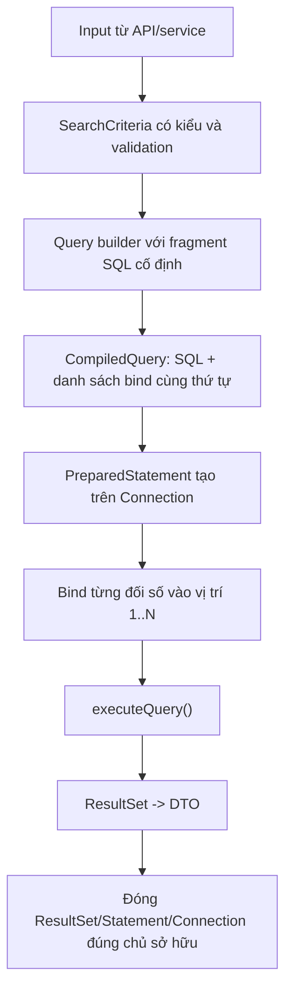

# Thiết kế truy vấn động có cấu trúc và tham số rõ ràng trong JDBC

## 1. Vấn đề: bộ lọc linh hoạt nhưng SQL phải an toàn và dễ kiểm chứng

Trong ứng dụng Java dùng **JDBC**, một repository thường phục vụ các màn hình tìm kiếm cho phép người dùng bật/tắt nhiều điều kiện:

- Lọc tin đăng theo thành phố.
- Chọn một hoặc nhiều trạng thái tin đăng.
- Chọn khoảng giá thuê.
- Tìm một đoạn văn bản trong tiêu đề.
- Sắp xếp theo tin mới nhất hoặc theo giá.
- Lấy một trang kết quả với giới hạn hàng và vị trí bắt đầu.

Nếu lập trình viên viết một câu SQL cố định cho mọi tổ hợp bộ lọc, số phương án có thể tăng rất nhanh. Nhưng nếu ghép trực tiếp input vào SQL, ứng dụng có nguy cơ **SQL injection**, lỗi thứ tự dấu `?`, lỗi thiếu khoảng trắng và truy vấn khó bảo trì.

Ví dụ **không an toàn**:

```java
String sql = "SELECT * FROM rental_listings WHERE city = '"
        + cityFromRequest
        + "' ORDER BY "
        + sortFromRequest;
```

Cả `cityFromRequest` lẫn `sortFromRequest` có thể làm thay đổi cú pháp SQL. Input chứa dấu nháy đơn có thể làm câu lệnh lỗi; input được tạo có chủ đích có thể làm điều kiện lọc đổi nghĩa. Việc chỉ dùng `StringBuilder` thay cho dấu `+` **không giải quyết** vấn đề nếu vẫn chèn giá trị không tin cậy trực tiếp vào câu SQL.

Bài thuộc chương **DAO và Repository** của module **JDBC**, với phạm vi truy cập cơ sở dữ liệu quan hệ qua driver, `DataSource`, `PreparedStatement` và `ResultSet`; thực hành SQL tham số hóa, CRUD, quản lý kết nối, transaction, batching, xử lý lỗi và hiệu năng bằng các API Java chuẩn.

Sau bài học, bạn có thể:

1. Mô hình hóa điều kiện tìm kiếm bằng một đối tượng criteria rõ kiểu và quy tắc hợp lệ.
2. Xây dựng câu SQL động bằng **những mảnh cú pháp có kiểm soát** thay vì chèn chuỗi tùy ý.
3. Gắn **mỗi dấu `?` với một đối số có kiểu và thứ tự xác định**, bảo đảm bind đủ, đúng vị trí.
4. Xử lý an toàn bộ lọc tùy chọn, danh sách `IN`, ký tự đặc biệt của `LIKE`, `ORDER BY` và phân trang.
5. Tách trách nhiệm DAO/repository, tầng nghiệp vụ và tầng sở hữu transaction.
6. Thiết kế unit test, integration test và phép đo truy vấn động với JDBC driver/DB mục tiêu.

**Nguyên tắc trung tâm:** *SQL động có thể thay đổi cấu trúc theo điều kiện nghiệp vụ, nhưng mọi **giá trị dữ liệu** từ caller phải được truyền bằng tham số của `PreparedStatement`. Mọi **mảnh cú pháp** thay đổi phải xuất phát từ tập lựa chọn được kiểm soát.*

## 2. Tách ba loại thông tin trước khi xây SQL

Một truy vấn tìm kiếm chứa ba nhóm thông tin có mức độ tin cậy và cách xử lý khác nhau:

| Loại | Ví dụ | Cách xử lý |
|---|---|---|
| **Giá trị dữ liệu** | `"Hà Nội"`, `15000000`, `"ACTIVE"`, `"100%"` | Truyền qua placeholder `?` và setter có kiểu |
| **Cấu trúc truy vấn** | Có/không có `WHERE city = ?`, có `IN (?, ?)`, có thêm `EXISTS (...)` | Tạo từ các nhánh code đã xác định và kiểm thử |
| **SQL identifier / keyword** | Tên bảng, tên cột sort, `ASC`, `DESC` | Chọn từ **allowlist** hoặc enum ánh xạ tới SQL cố định; không bind bằng `?` |

Một ví dụ thường bị nhầm:

```java
// Không phải cách chọn cột sắp xếp đúng.
String sql = """
        SELECT listing_id, title
        FROM rental_listings
        ORDER BY ?
        """;
ps.setString(1, sortColumnFromUser);
```

Placeholder đại diện cho **một giá trị SQL**, không đại diện cho tên cột. `ORDER BY ?` không cho phép caller chọn tùy ý cột sắp xếp; trên nhiều DB, nó bị coi như một biểu thức hằng và không tạo thứ tự mong muốn, hoặc bị từ chối.

Tương tự:

```sql
SELECT * FROM ? WHERE listing_id = ?
```

không dùng placeholder đầu tiên làm tên bảng theo JDBC chuẩn. Nếu ứng dụng thật sự cần chọn bảng/cột động, phải xác định những lựa chọn được cho phép và ánh xạ chúng sang **chuỗi SQL cố định do code kiểm soát**. Nếu yêu cầu nằm ngoài allowlist, trả lỗi validation, không nối thẳng tên từ HTTP request vào SQL.

### 2.1. Sơ đồ xử lý đề xuất



Cặp **SQL + bind arguments** phải được coi như một đơn vị. Không nên tạo SQL ở một phương thức rồi tự xây mảng giá trị ở phương thức khác bằng logic điều kiện lặp lại: chỉ cần một nhánh bị thay đổi là số dấu `?` có thể không còn khớp thứ tự setter.

## 3. Bài toán thực hành: tìm kiếm tin đăng cho thuê

Giả sử hệ thống có bảng sau trong **PostgreSQL**:

```sql
CREATE TABLE rental_listings (
    listing_id   BIGINT PRIMARY KEY,
    title        VARCHAR(200) NOT NULL,
    city         VARCHAR(80) NOT NULL,
    status       VARCHAR(16) NOT NULL
                 CHECK (status IN ('ACTIVE', 'PAUSED', 'RENTED')),
    monthly_rent NUMERIC(12, 2) NOT NULL
                 CHECK (monthly_rent >= 0),
    posted_at    TIMESTAMPTZ NOT NULL
);

CREATE INDEX idx_listings_city_status_newest
ON rental_listings (
    city,
    status,
    posted_at DESC,
    listing_id DESC
);
```

DDL này chỉ minh họa cho một hệ quản trị cụ thể. Kiểu `TIMESTAMPTZ`, cú pháp index và đặc tính query planner có thể khác ở MySQL, SQL Server hoặc Oracle. Chỉ mục ở đây là một **ứng viên cần đo**, không phải bảo đảm mọi tổ hợp bộ lọc đều nhanh.

Một số bản ghi mẫu:

```sql
INSERT INTO rental_listings
    (listing_id, title, city, status, monthly_rent, posted_at)
VALUES
    (101, 'Căn hộ gần công viên', 'Hà Nội',
     'ACTIVE', 12000000.00, TIMESTAMPTZ '2026-01-10 09:00:00+07'),
    (102, 'Studio trung tâm', 'Hà Nội',
     'PAUSED', 9000000.00, TIMESTAMPTZ '2026-01-12 10:00:00+07'),
    (103, 'Phòng đầy đủ nội thất', 'Đà Nẵng',
     'ACTIVE', 7000000.00, TIMESTAMPTZ '2026-01-11 08:00:00+07'),
    (104, 'Căn hộ 100% ánh sáng', 'Hà Nội',
     'ACTIVE', 15000000.00, TIMESTAMPTZ '2026-01-13 08:00:00+07');
```

Chúng ta muốn hỗ trợ những tiêu chí tùy chọn:

| Tiêu chí | Kiểu Java dự kiến | Quy tắc |
|---|---|---|
| Thành phố | `String city` | `null`/trống nghĩa là không lọc; nếu có thì so sánh chính xác |
| Tìm trong tiêu đề | `String titleContains` | Tìm chuỗi nguyên văn; `%`, `_` phải được escape |
| Tập trạng thái | `Set<ListingStatus>` | `null` nghĩa là không lọc, tập rỗng nghĩa là **không trạng thái nào hợp lệ** |
| Giá tối thiểu | `BigDecimal minRent` | Có thể không có; không âm |
| Giá tối đa | `BigDecimal maxRent` | Có thể không có; không thấp hơn giá tối thiểu |
| Cách sắp xếp | `SortOrder` enum | Chọn đúng một trường hợp cho phép |
| Giới hạn trang | `int limit` | Từ 1 đến 200 |
| Vị trí bắt đầu | `int offset` | Không âm; có thể đặt giới hạn để tránh offset quá lớn |

Các quy tắc `null`, trống và tập rỗng là **hợp đồng nghiệp vụ được công bố rõ**, không phải hành vi tự nhiên duy nhất của JDBC. Một ứng dụng khác có thể chọn trả lỗi nếu nhận tập trạng thái rỗng, nhưng không nên âm thầm hiểu rỗng thành “tất cả trạng thái”.

## 4. Thiết kế một đối tượng SearchCriteria có kiểu

Thay vì nhận `Map<String, Object>` hoặc danh sách chuỗi không rõ nghĩa, nên tạo đối tượng tiêu chí với các trường rõ ràng.

```java
public enum ListingStatus {
    ACTIVE,
    PAUSED,
    RENTED
}

public enum SortOrder {
    NEWEST,
    RENT_ASC,
    RENT_DESC
}
```

Ở đây, cả hai enum là các **loại Java do ứng dụng kiểm soát**, không phải chuỗi SQL từ request. Tầng API có thể chuyển giá trị chuỗi của người dùng sang enum và trả lỗi 400 nếu tên không nằm trong danh sách.

Tiêu chí tìm kiếm:

```java
import java.math.BigDecimal;
import java.util.Objects;
import java.util.Set;

public record SearchCriteria(
        String city,
        String titleContains,
        Set<ListingStatus> statuses,
        BigDecimal minRent,
        BigDecimal maxRent,
        SortOrder sort,
        int limit,
        int offset
) {
    public SearchCriteria {
        city = normalize(city);
        titleContains = normalize(titleContains);

        // null: không lọc; Set.of(): không khớp hàng nào.
        statuses = statuses == null ? null : Set.copyOf(statuses);

        Objects.requireNonNull(sort, "sort");

        if (city != null && city.length() > 80) {
            throw new IllegalArgumentException("city quá dài");
        }
        if (titleContains != null && titleContains.length() > 120) {
            throw new IllegalArgumentException(
                    "titleContains quá dài");
        }
        if (minRent != null && minRent.signum() < 0) {
            throw new IllegalArgumentException("minRent âm");
        }
        if (maxRent != null && maxRent.signum() < 0) {
            throw new IllegalArgumentException("maxRent âm");
        }
        if (minRent != null && maxRent != null
                && minRent.compareTo(maxRent) > 0) {
            throw new IllegalArgumentException(
                    "minRent lớn hơn maxRent");
        }
        if (limit < 1 || limit > 200) {
            throw new IllegalArgumentException(
                    "limit phải nằm trong khoảng 1..200");
        }
        if (offset < 0 || offset > 100_000) {
            throw new IllegalArgumentException(
                    "offset không hợp lệ hoặc quá lớn");
        }
    }

    private static String normalize(String text) {
        if (text == null) {
            return null;
        }
        String cleaned = text.trim();
        return cleaned.isEmpty() ? null : cleaned;
    }
}
```

**Điểm cần hiểu:**

- `SearchCriteria` là record Java 17+, là một **đối tượng dữ liệu**, không giữ `Connection`, `PreparedStatement` hay tài nguyên JDBC.
- `Set.copyOf(statuses)` tạo bản sao không chỉnh sửa được. Người gọi không thể đổi tập trạng thái sau khi repository bắt đầu xây query, và các phần tử `null` bị từ chối.
- Validation thực hiện trước khi mở connection, giảm số request không hợp lệ đi vào DB.
- Dùng `BigDecimal` thay vì `double` cho giá tiền để tránh sai số nhị phân.
- Giới hạn `offset <= 100_000` là một **chính sách minh họa**, cần chọn dựa trên SLA và quy mô thật; offset lớn thường nên chuyển sang keyset pagination.
- `trim()` được dùng cho ví dụ chuẩn hóa input. Với một nghiệp vụ cho phép tìm chính xác chuỗi có khoảng trắng đầu/cuối, phải thiết kế quy tắc khác.
- Enum không tự bảo đảm người dùng có quyền tìm mọi trạng thái. Phân quyền và tenant isolation vẫn phải được áp dụng ở tầng truy vấn/service.

## 5. Mẫu QueryPlan: SQL và tham số luôn đi cùng nhau

Để tránh lỗi “thêm `?` nhưng quên bind”, repository có thể dùng một cấu trúc trung gian gồm:

1. SQL hoàn chỉnh, sau khi chọn những predicate cần thiết.
2. Danh sách bind có **thứ tự trùng với thứ tự placeholder**.
3. Mỗi bind biết setter JDBC phù hợp với kiểu dữ liệu.

Ví dụ khung Java:

```java
private sealed interface SqlArg
        permits TextArg, DecimalArg, IntArg {
    void bind(PreparedStatement ps, int index) throws SQLException;
}

private record TextArg(String value) implements SqlArg {
    @Override
    public void bind(PreparedStatement ps, int index)
            throws SQLException {
        ps.setString(index, value);
    }
}

private record DecimalArg(BigDecimal value) implements SqlArg {
    @Override
    public void bind(PreparedStatement ps, int index)
            throws SQLException {
        ps.setBigDecimal(index, value);
    }
}

private record IntArg(int value) implements SqlArg {
    @Override
    public void bind(PreparedStatement ps, int index)
            throws SQLException {
        ps.setInt(index, value);
    }
}

private record QueryPlan(String sql, List<SqlArg> args) {
    private QueryPlan {
        args = List.copyOf(args);
    }
}
```

Đây là các **kiểu lồng bên trong lớp repository**, vì chúng được khai báo `private`. Các import cần thiết là `java.sql.PreparedStatement`, `java.sql.SQLException`, `java.math.BigDecimal` và `java.util.List`.

Cách bind:

```java
int parameterIndex = 1;

for (SqlArg arg : query.args()) {
    arg.bind(statement, parameterIndex);
    parameterIndex++;
}
```

Chỉ số của JDBC bắt đầu từ **1**, khác index 0-based trong `List`. Mỗi tham số được thêm vào `QueryPlan.args` **cùng lúc** với fragment SQL tạo ra dấu `?` tương ứng.

### 5.1. Vì sao không chỉ dùng List<Object> và setObject?

`PreparedStatement.setObject(index, value)` là một API hữu ích, nhưng việc chỉ dùng `List<Object>` cho mọi kiểu đôi khi gây thiếu rõ ràng khi cần truyền SQL `NULL`, `DECIMAL`, `TIMESTAMP WITH TIME ZONE`, array, enum hay các kiểu đặc thù của DB.

Các đối tượng `TextArg`, `DecimalArg`, `IntArg` giúp cố định quyết định binding ngay khi xây query. Với giá trị `NULL`, có thể thiết kế một binder riêng:

```java
private record NullArg(int sqlType) implements SqlArg {
    @Override
    public void bind(PreparedStatement ps, int index)
            throws SQLException {
        ps.setNull(index, sqlType);
    }
}
```

Muốn dùng binder này, cần thêm `NullArg` vào danh sách `permits` của `SqlArg`. Dùng `java.sql.Types` hoặc `JDBCType` phù hợp với schema. Không nên tự thay SQL NULL bằng chuỗi rỗng hoặc số 0 nếu ý nghĩa nghiệp vụ khác nhau.

Với một ứng dụng nhỏ, các setter trực tiếp trong repository cũng hợp lệ. **Mục tiêu của QueryPlan không phải xây framework phức tạp**, mà là giữ cấu trúc SQL và thứ tự bind được quản lý tập trung, rõ ràng và dễ kiểm tra.

## 6. Repository hoàn chỉnh: tạo SQL động bằng các mảnh có cấu trúc

Dưới đây là một phiên bản Java 17+ sử dụng `DataSource` và JDBC chuẩn. Để giữ ví dụ tự chứa, phần này bao gồm các enum, criteria và binder tương đương mục 4–5 dưới dạng **nested types trong một lớp**.

### 6.1. Mã ListingRepository

```java
import javax.sql.DataSource;
import java.math.BigDecimal;
import java.sql.Connection;
import java.sql.PreparedStatement;
import java.sql.ResultSet;
import java.sql.SQLException;
import java.sql.SQLDataException;
import java.sql.Timestamp;
import java.time.Instant;
import java.util.ArrayList;
import java.util.List;
import java.util.Objects;
import java.util.Set;
import java.util.StringJoiner;

public final class ListingRepository {
    public enum ListingStatus {
        ACTIVE, PAUSED, RENTED
    }

    public enum SortOrder {
        NEWEST, RENT_ASC, RENT_DESC
    }

    public record SearchCriteria(
            String city,
            String titleContains,
            Set<ListingStatus> statuses,
            BigDecimal minRent,
            BigDecimal maxRent,
            SortOrder sort,
            int limit,
            int offset
    ) {
        public SearchCriteria {
            city = normalize(city);
            titleContains = normalize(titleContains);
            statuses = statuses == null
                    ? null : Set.copyOf(statuses);
            Objects.requireNonNull(sort, "sort");

            if (city != null && city.length() > 80) {
                throw new IllegalArgumentException("city quá dài");
            }
            if (titleContains != null
                    && titleContains.length() > 120) {
                throw new IllegalArgumentException(
                        "titleContains quá dài");
            }
            if (minRent != null && minRent.signum() < 0) {
                throw new IllegalArgumentException("minRent âm");
            }
            if (maxRent != null && maxRent.signum() < 0) {
                throw new IllegalArgumentException("maxRent âm");
            }
            if (minRent != null && maxRent != null
                    && minRent.compareTo(maxRent) > 0) {
                throw new IllegalArgumentException(
                        "Khoảng giá không hợp lệ");
            }
            if (limit < 1 || limit > 200) {
                throw new IllegalArgumentException(
                        "limit phải trong khoảng 1..200");
            }
            if (offset < 0 || offset > 100_000) {
                throw new IllegalArgumentException(
                        "offset ngoài phạm vi cho phép");
            }
        }

        private static String normalize(String value) {
            if (value == null) {
                return null;
            }
            String trimmed = value.trim();
            return trimmed.isEmpty() ? null : trimmed;
        }
    }

    public record Listing(
            long id,
            String title,
            String city,
            ListingStatus status,
            BigDecimal monthlyRent,
            Instant postedAt
    ) {}

    private sealed interface SqlArg
            permits TextArg, DecimalArg, IntArg {
        void bind(PreparedStatement ps, int index)
                throws SQLException;
    }

    private record TextArg(String value) implements SqlArg {
        @Override
        public void bind(PreparedStatement ps, int index)
                throws SQLException {
            ps.setString(index, value);
        }
    }

    private record DecimalArg(BigDecimal value) implements SqlArg {
        @Override
        public void bind(PreparedStatement ps, int index)
                throws SQLException {
            ps.setBigDecimal(index, value);
        }
    }

    private record IntArg(int value) implements SqlArg {
        @Override
        public void bind(PreparedStatement ps, int index)
                throws SQLException {
            ps.setInt(index, value);
        }
    }

    private record QueryPlan(String sql, List<SqlArg> args) {
        private QueryPlan {
            args = List.copyOf(args);
        }
    }

    private final DataSource dataSource;

    public ListingRepository(DataSource dataSource) {
        this.dataSource = Objects.requireNonNull(dataSource);
    }

    public List<Listing> search(SearchCriteria criteria)
            throws SQLException {
        try (Connection connection = dataSource.getConnection()) {
            return search(connection, criteria);
        }
    }

    /**
     * Sử dụng Connection do caller sở hữu.
     * Không tự commit, rollback hoặc close connection.
     */
    public List<Listing> search(
            Connection connection, SearchCriteria criteria
    ) throws SQLException {
        Objects.requireNonNull(connection, "connection");
        Objects.requireNonNull(criteria, "criteria");

        QueryPlan query = compile(criteria);

        try (PreparedStatement ps =
                     connection.prepareStatement(query.sql())) {
            int parameterIndex = 1;
            for (SqlArg arg : query.args()) {
                arg.bind(ps, parameterIndex++);
            }

            List<Listing> results = new ArrayList<>();
            try (ResultSet rs = ps.executeQuery()) {
                while (rs.next()) {
                    long id = rs.getLong("listing_id");
                    if (rs.wasNull()) {
                        throw new SQLDataException(
                                "listing_id là SQL NULL");
                    }

                    String title = rs.getString("title");
                    String city = rs.getString("city");
                    String rawStatus = rs.getString("status");
                    BigDecimal rent =
                            rs.getBigDecimal("monthly_rent");
                    Timestamp posted =
                            rs.getTimestamp("posted_at");

                    if (title == null || city == null
                            || rawStatus == null || rent == null
                            || posted == null) {
                        throw new SQLDataException(
                                "Kết quả thiếu cột bắt buộc");
                    }

                    ListingStatus status;
                    try {
                        status = ListingStatus.valueOf(rawStatus);
                    } catch (IllegalArgumentException invalid) {
                        throw new SQLDataException(
                                "Trạng thái tin đăng không hợp lệ",
                                invalid);
                    }

                    results.add(new Listing(
                            id,
                            title,
                            city,
                            status,
                            rent,
                            posted.toInstant()
                    ));
                }
            }
            return List.copyOf(results);
        }
    }

    private static QueryPlan compile(SearchCriteria c) {
        StringBuilder sql = new StringBuilder("""
                SELECT listing_id, title, city, status,
                       monthly_rent, posted_at
                FROM rental_listings
                """);

        List<String> predicates = new ArrayList<>();
        List<SqlArg> args = new ArrayList<>();

        if (c.city() != null) {
            predicates.add("city = ?");
            args.add(new TextArg(c.city()));
        }

        if (c.titleContains() != null) {
            // SQL ESCAPE '!' làm %/_/! trong input thành ký tự.
            predicates.add("title LIKE ? ESCAPE '!'");
            args.add(new TextArg(
                    "%" + escapeLike(c.titleContains()) + "%"));
        }

        if (c.statuses() != null) {
            if (c.statuses().isEmpty()) {
                // Quy ước: tập trạng thái rỗng -> 0 hàng.
                predicates.add("1 = 0");
            } else {
                StringJoiner slots =
                        new StringJoiner(", ", "status IN (", ")");

                // Dùng thứ tự enum, không phụ thuộc thứ tự Set.
                for (ListingStatus status : ListingStatus.values()) {
                    if (c.statuses().contains(status)) {
                        slots.add("?");
                        args.add(new TextArg(status.name()));
                    }
                }
                predicates.add(slots.toString());
            }
        }

        if (c.minRent() != null) {
            predicates.add("monthly_rent >= ?");
            args.add(new DecimalArg(c.minRent()));
        }

        if (c.maxRent() != null) {
            predicates.add("monthly_rent <= ?");
            args.add(new DecimalArg(c.maxRent()));
        }

        if (!predicates.isEmpty()) {
            sql.append("\nWHERE ")
                    .append(String.join(" AND ", predicates));
        }

        // Chỉ các fragment cố định do enum cho phép.
        String orderBy = switch (c.sort()) {
            case NEWEST ->
                    "posted_at DESC, listing_id DESC";
            case RENT_ASC ->
                    "monthly_rent ASC, listing_id ASC";
            case RENT_DESC ->
                    "monthly_rent DESC, listing_id DESC";
        };

        sql.append("\nORDER BY ").append(orderBy);

        // LIMIT/OFFSET là cú pháp PostgreSQL của ví dụ.
        sql.append("\nLIMIT ? OFFSET ?");
        args.add(new IntArg(c.limit()));
        args.add(new IntArg(c.offset()));

        return new QueryPlan(sql.toString(), args);
    }

    private static String escapeLike(String value) {
        // Phải escape ký tự escape trước % và _.
        return value.replace("!", "!!")
                .replace("%", "!%")
                .replace("_", "!_");
    }
}
```

Đây là **một lớp đầy đủ** với những nested types của nó. Nếu đã tự tạo các enum/record rời ở mục 4, không cần tạo trùng tên bên ngoài; khi sử dụng ví dụ nguyên khối, tham chiếu `ListingRepository.SearchCriteria`, `ListingRepository.ListingStatus` và `ListingRepository.SortOrder`.

### 6.2. Gọi repository

Ví dụ chọn tin đang hoạt động tại Hà Nội, có giá từ 8 đến 15 triệu, sắp xếp từ giá thấp tới cao:

```java
ListingRepository repository =
        new ListingRepository(configuredDataSource);

var criteria = new ListingRepository.SearchCriteria(
        "Hà Nội",
        null,
        Set.of(ListingRepository.ListingStatus.ACTIVE),
        new BigDecimal("8000000.00"),
        new BigDecimal("15000000.00"),
        ListingRepository.SortOrder.RENT_ASC,
        20,
        0
);

List<ListingRepository.Listing> listings =
        repository.search(criteria);
```

`configuredDataSource` phải được ứng dụng tạo/cấu hình trước. Đoạn sử dụng cần import `java.math.BigDecimal`, `java.util.List` và `java.util.Set`.

Query được tạo về mặt logic:

```sql
SELECT listing_id, title, city, status, monthly_rent, posted_at
FROM rental_listings
WHERE city = ?
  AND status IN (?)
  AND monthly_rent >= ?
  AND monthly_rent <= ?
ORDER BY monthly_rent ASC, listing_id ASC
LIMIT ? OFFSET ?;
```

Thứ tự bind là:

| Vị trí JDBC | Kiểu setter | Giá trị trong ví dụ |
|---:|---|---|
| 1 | `setString` | `"Hà Nội"` |
| 2 | `setString` | `"ACTIVE"` |
| 3 | `setBigDecimal` | `8000000.00` |
| 4 | `setBigDecimal` | `15000000.00` |
| 5 | `setInt` | `20` |
| 6 | `setInt` | `0` |

Không có bất kỳ input nào được ghép trực tiếp vào cấu trúc SQL. Chỉ có các fragment như `city = ?`, `status IN (?)` và `ORDER BY monthly_rent ASC, listing_id ASC` được tạo từ code đã định nghĩa.

### 6.3. Vì sao query builder giữ đúng thứ tự?

Xét đoạn:

```java
if (c.city() != null) {
    predicates.add("city = ?");
    args.add(new TextArg(c.city()));
}

if (c.minRent() != null) {
    predicates.add("monthly_rent >= ?");
    args.add(new DecimalArg(c.minRent()));
}
```

Mỗi khi thêm predicate có placeholder, code thêm **đối số tương ứng ngay bên cạnh**. Khi một predicate không xuất hiện, cả dấu `?` lẫn bind biến mất. Nhờ vậy, người bảo trì không phải tính lại index thủ công cho hàng chục tổ hợp điều kiện.

Tuy nhiên, builder vẫn cần kiểm thử khi thêm fragment phức tạp có nhiều dấu `?`, đặc biệt `BETWEEN ? AND ?`, subquery có placeholder hoặc tổ hợp `OR`. Một mảnh SQL với hai dấu `?` phải đăng ký **hai đối số đúng thứ tự**. Không phải vì dùng `List<SqlArg>` mà mọi lỗi đồng bộ tự biến mất.

## 7. Các trường hợp động dễ bị xử lý sai

### 7.1. Bộ lọc tùy chọn: không có, rỗng và giá trị thật

Nếu API quy ước:

- `city == null`: **không có điều kiện thành phố**.
- `city == ""` hoặc chỉ có khoảng trắng: được chuẩn hóa thành null.
- `city == "Hà Nội"`: thêm `city = ?` và bind giá trị đó.

Ba trạng thái này không nhất thiết giống nhau cho mọi trường nghiệp vụ. Ví dụ một trường “mã phụ” có thể cần tìm chuỗi rỗng thật sự, khi đó bước chuẩn hóa phải khác.

Với tập trạng thái:

- `statuses == null`: không lọc trạng thái.
- `statuses.isEmpty()`: kết quả phải rỗng, builder thêm `1 = 0`.
- `statuses = Set.of(ACTIVE, PAUSED)`: `status IN (?, ?)` với hai bind.

**Đừng** vô tình bỏ qua tập rỗng vì vòng lặp không thêm dấu `?`: như vậy có thể trả về **tất cả trạng thái** thay vì không hàng nào, trái với hợp đồng caller.

### 7.2. SQL NULL cần một trạng thái riêng nếu nghiệp vụ yêu cầu

Trong SQL:

```sql
column_name = NULL
```

không phải phép kiểm tra giá trị null đúng. Muốn lọc null thường dùng:

```sql
column_name IS NULL
```

Nếu một cột như `archived_at` có thể null và bộ lọc cần phân biệt “không lọc”, “chỉ chưa lưu trữ”, “chỉ đã lưu trữ”, một enum ba trạng thái rõ nghĩa dễ hơn việc dùng một `Boolean` mơ hồ:

```java
enum ArchivedFilter {
    ALL, ONLY_NOT_ARCHIVED, ONLY_ARCHIVED
}
```

Các fragment tương ứng:

```sql
-- ALL: không thêm predicate.

-- ONLY_NOT_ARCHIVED:
archived_at IS NULL

-- ONLY_ARCHIVED:
archived_at IS NOT NULL
```

Những fragment này không cần placeholder vì không có giá trị dữ liệu mới. Nếu chọn lọc theo một mốc thời gian, ví dụ `archived_at >= ?`, mới cần bind timestamp. Cách biểu diễn `NULL` phải được xác định trong tiêu chí tìm kiếm, không suy ra từ việc Java field có null.

### 7.3. Nhiều điều kiện OR phải có dấu ngoặc

Nếu muốn tìm tiêu đề chứa từ khóa **hoặc** thành phố chính xác, đồng thời tin phải đang hoạt động:

```sql
WHERE status = ?
  AND (title LIKE ? ESCAPE '!' OR city = ?)
```

Bỏ ngoặc:

```sql
WHERE status = ?
  AND title LIKE ? ESCAPE '!'
  OR city = ?
```

sẽ khiến các hàng của thành phố được chấp nhận ngay cả khi `status` không khớp, do `AND` có độ ưu tiên cao hơn `OR`.

Builder nên tạo cả nhóm `OR` thành **một fragment** kèm bind đúng vị trí, thay vì nối chuỗi các mệnh đề lẻ rồi để SQL tự áp dụng độ ưu tiên theo cách ngoài ý muốn.

### 7.4. BETWEEN và ranh giới bao gồm

Bộ lọc giá trong ví dụ dùng:

```sql
monthly_rent >= ?
AND monthly_rent <= ?
```

Tức là **bao gồm cả** giá tối thiểu lẫn giá tối đa. `BETWEEN ? AND ?` cũng có ngữ nghĩa bao gồm hai đầu với những loại dữ liệu SQL thông thường, nhưng có thể làm code kém linh hoạt khi chỉ có một đầu. Hai điều kiện độc lập giúp biểu diễn dễ dàng “có min nhưng không có max” hoặc ngược lại.

Với timestamp, ranh giới nửa mở `created_at >= ? AND created_at < ?` thường thuận tiện để tránh chồng ngày giữa hai khoảng liên tiếp; ký hiệu và timezone phải rõ ràng trong hợp đồng API.

## 8. Danh sách IN động: số dấu hỏi phải khớp số phần tử

Một danh sách giá trị động không thể được truyền bằng cách gọi:

```java
// Không đúng trong JDBC chuẩn cho danh sách SQL IN tùy ý.
ps.setString(1, "ACTIVE,PAUSED");
```

với SQL:

```sql
WHERE status IN (?)
```

Dấu `?` đó đại diện cho **một giá trị chuỗi** `"ACTIVE,PAUSED"`, không biến thành hai giá trị `"ACTIVE"` và `"PAUSED"`.

Cách JDBC đơn giản cho danh sách nhỏ:

```sql
WHERE status IN (?, ?)
```

và bind mỗi giá trị bằng một setter tương ứng. Builder ở mục 6 tạo số placeholder từ `Set<ListingStatus>` đã được giới hạn bởi enum.

### 8.1. Tập rỗng và danh sách quá lớn

`IN ()` không phải cú pháp SQL hợp lệ/được hỗ trợ đồng nhất giữa các DB. Khi đầu vào rỗng, phải chọn rõ một trong hai chính sách:

- **Không kết quả:** thêm `1 = 0` hoặc trả một danh sách rỗng trước khi chạy SQL, nếu phù hợp.
- **Không có điều kiện lọc:** chỉ áp dụng nếu hợp đồng API định nghĩa đầu vào rỗng mang nghĩa này.

Không tự tiện chuyển từ chính sách thứ nhất sang thứ hai vì đây có thể là bug về dữ liệu hoặc phân quyền.

Với hàng nghìn ID, một câu `IN (?, ?, ...?)` rất dài có thể gặp giới hạn số parameter, tăng chi phí parse và làm plan cache chứa nhiều shape khác nhau. Tùy DB/driver, cân nhắc:

- Chia danh sách theo chunk phù hợp với nghiệp vụ.
- Dùng **SQL array parameter** nếu dialect/driver hỗ trợ, chẳng hạn cơ chế `Connection.createArrayOf(...)` rồi bind `java.sql.Array`.
- Dùng bảng tạm hoặc bảng staging chứa ID và `JOIN`/`EXISTS`.
- Dùng table-valued parameter hoặc cơ chế tương đương do DB hỗ trợ.

Không đưa một danh sách ID thành chuỗi `"1,2,3"` rồi nối vào SQL. Việc tất cả phần tử được parse thành số ở Java chưa đủ thay thế cho placeholder và kiểm soát schema/quyền.

### 8.2. Chọn thứ tự deterministic cho các giá trị IN

`Set` không có thứ tự cố định theo hợp đồng chung. Nếu tạo SQL từ thứ tự duyệt của `HashSet`, danh sách bind có thể đổi thứ tự giữa các lần. Kết quả `IN` thường không thay đổi về mặt tập hợp, nhưng việc ghi log, kiểm thử và đối chiếu query plan khó hơn.

Trong ví dụ, builder duyệt `ListingStatus.values()` theo thứ tự enum rồi thêm những phần tử có trong set. Điều đó bảo đảm đầu vào `Set.of(PAUSED, ACTIVE)` và `Set.of(ACTIVE, PAUSED)` tạo cùng cấu trúc SQL và cùng thứ tự bind.

Khi danh sách là các ID dạng `long`, có thể sắp xếp bản sao của danh sách trước khi thêm bind nếu việc đổi thứ tự không ảnh hưởng nghiệp vụ. **Không** sắp xếp nếu thứ tự chính là một phần hợp đồng khác, ví dụ cần giữ thứ tự ưu tiên do người dùng chọn.

## 9. LIKE là truy vấn tham số hóa nhưng vẫn có ký tự wildcard

`PreparedStatement.setString()` ngăn dữ liệu bị diễn giải như **cú pháp SQL tùy ý**, nhưng `LIKE` vẫn có ngữ nghĩa riêng:

- `%`: khớp một chuỗi có độ dài bất kỳ.
- `_`: khớp một ký tự.
- Ký tự dùng làm `ESCAPE`: giúp chỉ rõ wildcard là ký tự thông thường.

Ví dụ người dùng muốn tìm chính xác đoạn `"100%"` trong tiêu đề. Nếu code chỉ dùng:

```java
ps.setString(1, "%" + titleContains + "%");
```

thì pattern `%100%%` sẽ khớp cả tiêu đề chứa `"1000"`, không chỉ những tiêu đề có dấu phần trăm. Đây là **lỗi ngữ nghĩa tìm kiếm**, không nhất thiết là SQL injection.

### 9.1. Escape ký tự wildcard trong dữ liệu

Ví dụ dùng ký tự `!` làm ký tự escape:

```sql
title LIKE ? ESCAPE '!'
```

Hàm Java:

```java
static String escapeLike(String value) {
    return value.replace("!", "!!")
            .replace("%", "!%")
            .replace("_", "!_");
}

// Input: "100%"
// Bind:  "%100!%%"
String pattern = "%" + escapeLike("100%") + "%";
ps.setString(1, pattern);
```

Trong SQL hỗ trợ cú pháp `ESCAPE '!'`, `!%` là dấu `%` literal, còn hai `%` ngoài cùng là wildcard do **ứng dụng chủ động thêm** cho phép khớp đoạn ở bất kỳ vị trí nào.

Nếu input chứa `!`, phải escape thành `!!` trước; làm ngược thứ tự replace có thể khiến ký tự escape mới tạo bị xử lý lần nữa.

### 9.2. LIKE có thể ảnh hưởng chỉ mục và hiệu năng

Pattern `'%keyword%'` có wildcard ở đầu nên các B-tree index thông thường không phải lúc nào cũng giúp tìm nhanh. Với dữ liệu lớn và nhiều lần tìm full-text, cân nhắc full-text search, trigram index hoặc một công nghệ chỉ mục phù hợp với DB/ứng dụng.

Tính phân biệt chữ hoa/thường của `LIKE` phụ thuộc DB/collation. PostgreSQL có `ILIKE` nhưng đó là cú pháp riêng của PostgreSQL, không phải JDBC SQL chung. Nếu yêu cầu tìm case-insensitive, phải xác định cách chuẩn hóa và loại index phù hợp.

**Đừng dùng `LOWER(column) LIKE LOWER(?)` vô điều kiện** mà không đo ảnh hưởng lên index; một function trên cột có thể khiến một số index không được dùng nếu thiếu functional index thích hợp.

## 10. Sắp xếp động: chỉ được chọn từ enum/allowlist

Truy vấn ở mục 6 có ba lựa chọn:

| `SortOrder` | SQL được phép |
|---|---|
| `NEWEST` | `ORDER BY posted_at DESC, listing_id DESC` |
| `RENT_ASC` | `ORDER BY monthly_rent ASC, listing_id ASC` |
| `RENT_DESC` | `ORDER BY monthly_rent DESC, listing_id DESC` |

Mọi fragment sau `ORDER BY` nằm **trong code**. Người dùng không được gửi `"monthly_rent DESC; DROP TABLE ..."` rồi cho chuỗi ấy đi thẳng vào SQL.

Nếu API nhận:

```json
{"sort": "rent_ascending"}
```

tầng controller/service ánh xạ từ chuỗi `rent_ascending` sang `SortOrder.RENT_ASC`. Nếu input không nằm trong bảng ánh xạ, trả lỗi validation hoặc dùng một **giá trị mặc định đã công bố**. Không cố “lọc ký tự nguy hiểm” của chuỗi sort rồi đưa chuỗi còn lại vào SQL.

### 10.1. Tie-breaker để kết quả có thứ tự ổn định

Nếu 50 tin đăng có cùng `monthly_rent`, chỉ:

```sql
ORDER BY monthly_rent ASC
```

không bảo đảm thứ tự giữa những hàng bằng giá. Khi pagination dựa vào offset, các hàng bằng khóa sắp xếp có thể xuất hiện trùng hoặc bị bỏ qua giữa các lần chạy.

Thêm khóa duy nhất:

```sql
ORDER BY monthly_rent ASC, listing_id ASC
```

tạo thứ tự xác định hoàn toàn trong **một tập dữ liệu nhất định**. Nó không tự bảo đảm pagination vẫn không trùng/bỏ hàng nếu dữ liệu thay đổi giữa các request; đó là vấn đề snapshot/isolation và thiết kế phân trang.

### 10.2. Không cho phép tên cột tùy ý

Ngay cả khi nhận chỉ số cột kiểu số nguyên, code:

```java
sql.append(" ORDER BY ").append(userColumnIndex);
```

vẫn đặt quyền chọn expression/cột vào đầu vào người dùng và khó kiểm soát quyền hiển thị. Nên ánh xạ một số lựa chọn đã thẩm định sang fragment rõ ràng. Với báo cáo nội bộ cần cột động, tạo enum/allowlist riêng theo quyền và query được phép.

## 11. Phân trang động: LIMIT/OFFSET và keyset

Ví dụ PostgreSQL ở mục 6 sử dụng:

```sql
ORDER BY posted_at DESC, listing_id DESC
LIMIT ? OFFSET ?
```

Các giá trị `limit` và `offset` được bind bằng `setInt`; chúng được validation để tránh request yêu cầu quá nhiều dữ liệu. Tuy nhiên, cú pháp phân trang khác nhau giữa DB. Một số hệ quản trị dùng `OFFSET ... FETCH NEXT ...` hoặc biểu thức SQL riêng, và không phải mọi vị trí cú pháp đều hỗ trợ placeholder như nhau.

Nếu cần ứng dụng chạy trên nhiều RDBMS, hãy tách **pagination dialect** thành một abstraction nhỏ có các triển khai đã kiểm thử. Đừng nối các phần syntax không được phép đến từ người dùng. Chuỗi SQL tĩnh theo từng dialect có thể khác nhau, nhưng giá trị phân trang vẫn nên được bind khi driver/DB hỗ trợ.

### 11.1. Nhược điểm của OFFSET lớn

Với `OFFSET 100000`, nhiều DB phải xử lý hoặc đi qua một lượng lớn hàng trước khi trả trang tiếp theo. Khi dữ liệu nhiều, offset lớn có thể chậm dù chỉ lấy 20 hàng.

Nếu màn hình cần đi tuần tự theo thời gian, **keyset pagination** có thể phù hợp hơn. Ví dụ PostgreSQL với khóa `(posted_at, listing_id)`, cùng thứ tự giảm dần:

```sql
SELECT listing_id, title, city, status, monthly_rent, posted_at
FROM rental_listings
WHERE (posted_at, listing_id) < (?, ?)
ORDER BY posted_at DESC, listing_id DESC
LIMIT ?;
```

Hai tham số đầu là vị trí của hàng cuối trên trang trước, theo kiểu timestamp và ID; tham số cuối là số hàng muốn lấy. Với các filter khác, vẫn phải thêm những predicate đó và giữ cùng quy tắc order. Đừng tái sử dụng query plan của offset khi chuyển sang keyset mà quên cập nhật thứ tự bind.

### 11.2. Keyset không tự tạo snapshot nhất quán

Nếu tin đăng được chèn/xóa hoặc đổi `posted_at` trong lúc người dùng duyệt nhiều trang, kết quả có thể thay đổi. Keyset giúp tránh chi phí OFFSET lớn và nhiều trường hợp trùng do vị trí hàng thay đổi, nhưng không tự cung cấp một snapshot cố định xuyên nhiều request HTTP.

Khi nghiệp vụ cần một bản chụp đồng nhất, phải thiết kế thêm isolation/snapshot hoặc bookmark dữ liệu phù hợp với DB. Không giữ một `Connection`/`ResultSet` mở vô hạn chỉ để người dùng bấm trang tiếp theo trên giao diện.

## 12. DAO, Repository và transaction: trách nhiệm của từng tầng

Có thể tổ chức một module theo sơ đồ:

```text
Controller / API
    |
    v
Validation + SearchCriteria
    |
    v
Service (quy tắc nghiệp vụ, phân quyền)
    |
    v
ListingRepository
    |           |
    |           +-- QueryPlan / SqlArg
    |
    +-- DataSource / Connection
                |
                v
      PreparedStatement -> ResultSet -> Listing DTO
```

**DAO** thường nhấn mạnh thao tác truy cập dữ liệu và cấu trúc SQL/row mapping. **Repository** thường cung cấp API theo khái niệm domain, ví dụ `search(criteria)`, `findById(id)`, `save(listing)`. Ranh giới và tên gọi có thể khác nhau giữa dự án; điều quan trọng là tránh để controller ghép SQL trực tiếp và tránh để repository ôm toàn bộ logic nghiệp vụ.

### 12.1. Hai kiểu ownership Connection

Mẫu repository ở mục 6 hỗ trợ:

```java
repository.search(criteria);
```

Ở cách này, repository **tự lấy và đóng Connection** cho một truy vấn độc lập.

Nó cũng hỗ trợ:

```java
repository.search(existingConnection, criteria);
```

Ở cách này, caller sở hữu `existingConnection`. Repository **chỉ** tạo/đóng `PreparedStatement` và `ResultSet`; nó không gọi `commit()`, `rollback()` hoặc `close()` trên connection mà caller truyền vào.

Phân biệt này rất quan trọng khi tầng service cần đọc nhiều dữ liệu trong cùng transaction hoặc kết hợp query động với CRUD. Không được để mỗi repository con tự mở connection mới rồi cho rằng chúng thuộc cùng giao dịch.

### 12.2. Ví dụ service sở hữu transaction

Một service có thể điều phối như sau (khung code đơn giản):

```java
try (Connection connection = dataSource.getConnection()) {
    if (!connection.getAutoCommit()) {
        throw new SQLException(
                "Cần transaction owner phù hợp với cấu hình pool");
    }

    connection.setAutoCommit(false);

    try {
        // updateRepository.updateSomething(connection, ...);
        List<ListingRepository.Listing> items =
                listingRepository.search(connection, criteria);

        // Kiểm tra nghiệp vụ với items trong transaction này.
        connection.commit();
        return items;
    } catch (SQLException | RuntimeException failure) {
        try {
            connection.rollback();
        } catch (SQLException rollbackFailure) {
            failure.addSuppressed(rollbackFailure);
        }
        throw failure;
    }
}
```

Đây là **khung minh họa trong phương thức service**, giả định `dataSource`, `listingRepository` và `criteria` đã có. Đối với code production, phải có chính sách khôi phục trạng thái connection, xử lý lỗi khi `commit()` có kết quả không xác định, quy định isolation và tương tác với pool/framework transaction. Nếu `commit()` báo lỗi kết nối, việc gọi rollback sau đó không chứng minh chắc chắn giao dịch đã bị hoàn tác.

Đối với chỉ một lệnh `SELECT` không có yêu cầu snapshot/transaction riêng, không nhất thiết phải mở transaction thủ công. Tạo transaction chỉ để “bao” query động có thể làm giữ snapshot/khóa lâu hơn khi truy vấn lớn.

### 12.3. Bảo mật phải được áp dụng trước khi chạy truy vấn

Các điều kiện tenant, trạng thái phân quyền và visibility không nên chỉ là bộ lọc tùy ý caller có thể bỏ qua:

```sql
WHERE tenant_id = ?
  AND visibility = 'PUBLIC'
  -- Sau đó mới ghép những bộ lọc tìm kiếm tùy chọn.
```

`tenant_id` phải đến từ **ngữ cảnh xác thực được server tin cậy**, không đơn thuần lấy từ request body. Query builder nên đặt predicate bảo mật bắt buộc vào một phần không thể bị bỏ bởi criteria từ người dùng.

Lọc kết quả bằng Java sau khi đã tải mọi hàng không phải ranh giới phân quyền phù hợp: dữ liệu không được phép đã đi từ DB vào tiến trình ứng dụng. Nếu có chính sách row-level security trong DB, vẫn phải kiểm thử kết hợp với quyền tài khoản DB và session context thực tế.

## 13. Khi truy vấn trở nên phức tạp: phân tách fragment mà không tạo framework quá lớn

Với 5 bộ lọc, một builder trong repository thường đủ. Với nhiều màn hình và nhiều nhóm điều kiện, có thể tách thành các thành phần có cấu trúc:

```java
record Fragment(String sql, List<SqlArg> args) {
    Fragment {
        args = List.copyOf(args);
    }
}
```

Quy tắc ghép:

1. `Fragment.sql` chỉ được sinh từ **template/enum đã thẩm định**, không nhận chuỗi SQL từ người dùng.
2. `Fragment.args` chứa đúng các bind mà fragment yêu cầu, theo thứ tự xuất hiện.
3. Ghép fragment luôn ghép **cả SQL lẫn args**; không chỉ ghép một bên.
4. Nhóm `AND`/`OR` phải có dấu ngoặc đúng thứ tự ưu tiên.
5. Dùng một nơi chịu trách nhiệm cuối cùng để thêm `ORDER BY`, pagination và kiểm tra giới hạn.

Ví dụ khái niệm:

```text
BASE SELECT
+ required tenant predicate
+ optional city fragment
+ optional status IN fragment
+ optional price range fragments
+ allowlisted ORDER BY
+ pagination fragment
= CompiledQuery(sql, params)
```

Điều cần tránh là biến bộ lọc thành một “mini SQL language” cho phép input tự cung cấp toán tử, tên cột, chuỗi JOIN hay biểu thức bất kỳ. Càng nhiều thứ cho caller quyết định, càng khó bảo đảm bảo mật, correctness và performance.

### 13.1. Dynamic JOIN: cân nhắc EXISTS để tránh nhân bản hàng

Giả sử bảng `listing_photos` có nhiều ảnh cho một tin đăng. Nếu tiêu chí là “chỉ các tin có ít nhất một ảnh được duyệt”, không nhất thiết phải `JOIN` mọi ảnh:

```sql
SELECT l.listing_id, l.title
FROM rental_listings AS l
WHERE EXISTS (
    SELECT 1
    FROM listing_photos AS p
    WHERE p.listing_id = l.listing_id
      AND p.approved = ?
);
```

`EXISTS` phản ánh điều kiện “có ít nhất một hàng” mà không nhân bản tin đăng theo số ảnh khớp. Nếu cần lấy cả thông tin ảnh, `JOIN` hoặc truy vấn thứ hai có thể phù hợp hơn, nhưng phải xử lý cardinality và mapping 1–N.

Với query builder, hãy cân nhắc **ngữ nghĩa đầu ra**, không chỉ việc nối một fragment `JOIN` cho dễ. Một filter động tưởng như đơn giản có thể làm số hàng, phân trang hoặc tổng đếm thay đổi vì JOIN nhân bản bản ghi.

### 13.2. Tách query lấy trang và query đếm tổng

Một giao diện có thể cần:

- Query lấy dữ liệu trang: `SELECT ... ORDER BY ... LIMIT ? OFFSET ?`.
- Query đếm tổng: `SELECT COUNT(*) ... WHERE ...`.

Hai query cần **cùng nhóm predicate lọc** nhưng không nhất thiết cùng projection, join, sort hoặc pagination. Có thể tái sử dụng các fragment predicate và bind theo thứ tự, đồng thời tạo hai query plan riêng. Không dùng `List.size()` của một trang 20 hàng làm tổng số hàng khớp.

Nếu hai query chạy ở các thời điểm khác nhau, số đếm và danh sách có thể không hoàn toàn khớp khi dữ liệu thay đổi. Nhu cầu nhất quán tuyệt đối cần transaction/isolation phù hợp; không tự giả định hai query độc lập là cùng snapshot.

### 13.3. Tránh UPDATE/DELETE không có WHERE ngoài ý muốn

Query động không chỉ áp dụng cho `SELECT`. Với câu lệnh ghi, việc một criteria tùy chọn bị bỏ qua có thể dẫn tới:

```sql
UPDATE rental_listings
SET status = ?
-- Không có WHERE: toàn bảng có thể bị cập nhật!
```

Với thao tác update/delete theo bộ lọc, nên có quy tắc **bắt buộc** ít nhất một điều kiện khóa/tenant/owner đã được xác thực; nếu thiếu, **từ chối xây query**. Có thể thêm giới hạn phạm vi và kiểm tra update count, nhưng không dựa vào update count để sửa một câu SQL đã tác động quá nhiều hàng.

`PreparedStatement` ngăn injection cho **giá trị**, không tự ngăn việc bỏ quên predicate nghiệp vụ hoặc dùng sai điều kiện.

## 14. Hiệu năng: truy vấn động có nhiều hình dạng SQL

### 14.1. Mỗi tập predicate có thể tạo một query shape khác nhau

Các ví dụ:

```sql
SELECT ... FROM rental_listings WHERE city = ? ORDER BY ...;

SELECT ... FROM rental_listings
WHERE city = ? AND status IN (?, ?) ORDER BY ...;

SELECT ... FROM rental_listings
WHERE monthly_rent >= ? AND monthly_rent <= ?
ORDER BY ...;
```

Mỗi câu có cấu trúc khác nhau nên DB có thể tạo, cache và tối ưu kế hoạch thực thi khác nhau. Nếu builder tạo hàng nghìn shape do hàng loạt tổ hợp điều kiện/`IN` list kích cỡ khác nhau, lợi ích của prepared statement/plan cache có thể giảm.

Tuy nhiên, ép mọi điều kiện vào một câu SQL duy nhất như:

```sql
WHERE (? IS NULL OR city = ?)
  AND (? IS NULL OR status = ?)
```

**không tự nhiên tốt hơn**. Các predicate kiểu `OR` với tham số optional có thể làm optimizer khó dùng index hoặc tạo plan kém phù hợp với độ chọn lọc khác nhau. Lựa chọn giữa **ít SQL shape** và **predicate phù hợp, sargable** phải dựa trên phép đo thực tế.

### 14.2. Dữ liệu đại diện quan trọng hơn benchmark mock

Một query chạy rất nhanh trên DB in-memory với 100 hàng chưa chứng minh sẽ nhanh với hàng triệu bản ghi và phân bố lệch theo thành phố/trạng thái/giá.

Nên kiểm thử trên đúng engine/driver, có:

- Số tin đăng gần quy mô thật, gồm thành phố rất nhiều tin và thành phố ít tin.
- Phân bố giá thuê và trạng thái không đồng đều.
- Những tiêu đề dài/ngắn và các trường hợp Unicode/`LIKE`.
- Index và thống kê optimizer gần deployment.
- Các tổ hợp lọc phổ biến và hiếm.
- Query có `LIMIT` nhỏ, trang sâu, và số người dùng đồng thời phù hợp.
- Dữ liệu chèn/sửa/xóa trong khi truy vấn nếu ứng dụng thực có workload đó.

### 14.3. Đo đầy đủ chu kỳ JDBC

Với một lần tìm kiếm, nên đo riêng:

| Giai đoạn | Điểm đo |
|---|---|
| Mượn connection | `DataSource.getConnection()` |
| Chuẩn bị query/bind | Xây `QueryPlan`, `prepareStatement()`, gọi setter |
| Thực thi | `executeQuery()` |
| Tiêu thụ | `ResultSet.next()`, các getter, tạo `Listing` |
| Cleanup | Đóng `ResultSet`, statement và trả connection về pool |
| Tổng | Từ đầu request repository đến khi hoàn thành |

`executeQuery()` trả về `ResultSet` không bảo đảm tất cả dữ liệu đã được truyền đến Java. Driver có thể lấy dữ liệu ở các lần `next()`; chỉ đo thời gian `executeQuery()` có thể bỏ sót phần lớn chi phí.

Nên báo p50/p95/p99, tỷ lệ lỗi, số hàng, pool wait và DB CPU/I/O khi workload có đồng thời. Sử dụng `EXPLAIN`/execution plan phù hợp với DB để xem query thật, không chỉ nhìn số mili giây ở Java.

### 14.4. Query plan và dữ liệu lệch

Nếu thành phố A có 1 triệu tin và thành phố B chỉ có 10 tin, cùng query `city = ?` có thể phù hợp với các kế hoạch khác nhau. Đối với PostgreSQL và nhiều DB khác, chiến lược prepared statement, generic/custom plan và thống kê có thể ảnh hưởng hiệu năng theo giá trị bind.

Khi tối ưu, phải đo các **input đại diện**, không chỉ input trung bình. Đừng log toàn bộ giá trị nhạy cảm trong hệ thống production để phục vụ profiling; có thể dùng scenario ID, query shape và thống kê tổng hợp được phép lưu.

## 15. Kiểm thử thiết kế query động

### 15.1. Unit test cho criteria và query composition

Không cần DB để kiểm tra các bất biến cấu trúc:

| Trường hợp | Điều cần kiểm tra |
|---|---|
| Không bộ lọc tùy chọn | Không có `WHERE` không hợp lệ; có `ORDER BY` và pagination |
| Chỉ city | Có `city = ?` và đúng một bind city |
| Có min/max | Hai placeholder theo đúng thứ tự và kiểu `BigDecimal` |
| Chỉ min hoặc chỉ max | Không cần giá trị giả cho đầu còn thiếu |
| Trạng thái `null` | Không lọc trạng thái |
| Tập trạng thái rỗng | Tạo điều kiện không khớp, không sinh `IN ()` |
| Tập có 2 trạng thái | `IN (?, ?)` và hai bind có thứ tự cố định |
| `titleContains = "100%"` | Pattern escape đúng và giữ ký tự phần trăm literal |
| `titleContains` chứa `_` hoặc `!` | Escape không làm thay đổi ý nghĩa mong muốn |
| Sort `NEWEST/RENT_ASC/RENT_DESC` | Chỉ một trong các fragment allowlist |
| Giá min > max | Validation từ chối trước khi mở connection |
| Limit 0 hoặc > 200 | Validation từ chối |
| Offset âm hoặc quá lớn | Validation từ chối |
| Chuỗi input có dấu nháy hoặc SQL-like text | Chỉ nằm trong bind, không xuất hiện như SQL syntax |

Trong phiên bản lớp mục 6, `compile(...)` là private. Nếu muốn test riêng cấu trúc SQL/bind, có thể trích nó thành một **package-private query compiler** không có quyền truy cập DB và chỉ cho test cùng package đọc kết quả. Đừng thay đổi visibility của toàn bộ API repository chỉ để unit test chi tiết nội bộ; kiểm thử hành vi qua repository với DB thật vẫn cần thiết.

### 15.2. Integration test với dữ liệu mẫu

Đây là nơi cần JDBC driver và DB thật:

1. Khởi tạo schema/test fixture `rental_listings` bằng dữ liệu riêng cho test.
2. Gọi `search(...)` với thành phố `"Hà Nội"` và `statuses = {ACTIVE}`; xác nhận chỉ những tin đúng điều kiện xuất hiện.
3. Đặt khoảng giá từ 10 đến 15 triệu, xác nhận ranh giới được bao gồm.
4. Tìm `"100%"` trong tiêu đề: chỉ những hàng có dấu `%` literal cần khớp, không phải chuỗi `1000`.
5. Dùng `titleContains = "' OR 1=1 --"` để xác nhận input không làm thay đổi cấu trúc SQL hoặc làm trả cả bảng.
6. Chọn mỗi sort, xác nhận thứ tự bằng giá và khóa `listing_id`.
7. Lấy trang thứ nhất, thứ hai với dữ liệu **cố định**; xác nhận không lặp/bỏ trong điều kiện test.
8. Gửi `statuses = Set.of()`; xác nhận kết quả rỗng theo hợp đồng.
9. Với filter không có kết quả, xác nhận trả `List.of()`, không ném lỗi vì `ResultSet` rỗng.
10. Cố tình đưa dữ liệu status ngoài enum vào DB thử nghiệm (khi schema cho phép hoặc fixture riêng) và kiểm tra mapper báo lỗi rõ ràng.
11. Giả lập lỗi khi `ResultSet.next()` hoặc getter đọc dữ liệu; xác nhận statement/connection được đóng.
12. Chạy trong transaction do caller sở hữu; xác nhận repository không commit/rollback/đóng connection của caller.
13. Thử trên đúng dialect/driver mục tiêu để kiểm tra `LIMIT ? OFFSET ?`, `LIKE ... ESCAPE '!'` và timestamp mapping.

### 15.3. Ví dụ JUnit 5 theo hợp đồng kết quả

Giả sử một fixture cung cấp `testDataSource`, seed các bản ghi mục 3 và cleanup sau mỗi test:

```java
@Test
void activeListingsInHaNoiAreFilteredAndSorted() throws SQLException {
    ListingRepository repo =
            new ListingRepository(testDataSource);

    var criteria = new ListingRepository.SearchCriteria(
            "Hà Nội",
            null,
            Set.of(ListingRepository.ListingStatus.ACTIVE),
            new BigDecimal("10000000"),
            new BigDecimal("15000000"),
            ListingRepository.SortOrder.RENT_ASC,
            20,
            0
    );

    var result = repo.search(criteria);

    assertEquals(List.of(101L, 104L),
            result.stream()
                    .map(ListingRepository.Listing::id)
                    .toList());
}

@Test
void emptyStatusSetMeansNoMatches() throws SQLException {
    ListingRepository repo =
            new ListingRepository(testDataSource);

    var criteria = new ListingRepository.SearchCriteria(
            null, null, Set.of(),
            null, null,
            ListingRepository.SortOrder.NEWEST,
            20, 0
    );

    assertTrue(repo.search(criteria).isEmpty());
}
```

Đây là **các phương thức nằm trong một lớp test JUnit 5**, dùng `org.junit.jupiter.api.Test` và assertion static từ `org.junit.jupiter.api.Assertions`. Cần import `java.sql.SQLException`, `java.math.BigDecimal`, `java.util.List`, `java.util.Set` cùng một nguồn `testDataSource` do test setup cung cấp.

Fixture không được dùng chung dữ liệu với môi trường sản xuất. Nếu chạy test song song, mỗi test nên có schema/bộ khóa độc lập hoặc cách reset có kiểm soát. Kiểm thử query động phải xác nhận **giá trị hàng trả về**, không chỉ kiểm tra rằng `PreparedStatement.executeQuery()` đã được gọi.

### 15.4. Đừng dùng mock để khẳng định hiệu năng SQL

Mock có thể chứng minh binder gọi `setBigDecimal` đúng index, nhưng không chứng minh PostgreSQL có dùng index hay trả 100.000 hàng trong thời gian chấp nhận được. Hãy tách:

- **Unit test:** compiler, validation, typed binding, mapping lỗi.
- **Integration test:** SQL dialect, số hàng thật, thứ tự, escape, transaction và resource cleanup.
- **Performance/load test:** execution plan, phân bố dữ liệu, độ trễ/throughput, pool và tải đồng thời.

## 16. Debug và quan sát query động an toàn

Khi một truy vấn không trả hàng hoặc quá chậm, cần biết **query shape** nào đã chạy. Nhưng ghi toàn bộ câu SQL đã nội suy giá trị người dùng vào log vừa có thể rò dữ liệu vừa làm việc debug sai khác với cách driver bind thật.

Nên ghi:

- Tên operation: `ListingRepository.search`.
- Query template/shape do code tạo ra, có placeholder `?`.
- Số lượng bind và **kiểu** của từng bind; giá trị thật chỉ theo chính sách bảo mật/logging được phép.
- Các cờ có filter hay không: `hasCity`, `statusCount`, `hasMinRent`, `hasMaxRent`.
- Sort enum, limit, offset sau validation.
- Thời gian mượn connection, prepare, execute, consume và tổng.
- Số hàng trả về, SQLState/vendor code khi có lỗi.
- Request/trace ID đã được quản lý an toàn.

**Không** log password DB, token, dữ liệu cá nhân hoặc nguyên nội dung free-text search nếu quy định dữ liệu không cho phép. Không log statement đã thay tham số thành literal nếu không có nhu cầu và biện pháp bảo vệ rõ ràng.

Một query builder dễ đọc cũng giúp truy vết: có thể in hoặc quan sát cấu trúc `QueryPlan.sql` trong test, còn bind được giữ riêng thay vì phải tìm kiếm chuỗi trong SQL.

### 16.1. Bảng chẩn đoán lỗi phổ biến

| Triệu chứng | Nguyên nhân có thể | Hướng xử lý |
|---|---|---|
| “No value specified for parameter 3” | Thêm `?` nhưng quên bind | Ghép SQL + args cùng lúc, test tổ hợp filter |
| “Parameter index out of range” | Bind nhiều hơn placeholder hoặc sai thứ tự | Kiểm tra fragment/binder và JDBC index bắt đầu từ 1 |
| Chỉ có một giá trị trong `IN (?)` | Đưa chuỗi dấu phẩy vào một placeholder | Tạo N dấu `?` cho N giá trị hoặc dùng DB array hợp lệ |
| `IN ()` gây lỗi cú pháp | Danh sách đầu vào rỗng | Chọn `1=0` hoặc xử lý theo hợp đồng |
| Sort không đúng | Dùng `ORDER BY ?` để truyền tên cột | Ánh xạ enum sang fragment SQL cố định |
| SQL injection ở `ORDER BY` | Nối chuỗi cột từ request | Allowlist, không nối trực tiếp |
| Tiêu đề chứa `%` khớp quá nhiều | Quên escape wildcard `LIKE` | Dùng `ESCAPE` và escape đầu vào đúng |
| Kết quả trùng khi phân trang | Không có tie-breaker, dữ liệu thay đổi | Thứ tự duy nhất, chiến lược phân trang/snapshot |
| Đếm tổng khác số hàng trang | Dùng size của page hoặc hai query không nhất quán | Query `COUNT(*)` cùng predicate, xem isolation |
| Query chậm khi thêm optional OR | SQL không còn dễ dùng index, plan khác | Đo với dữ liệu đại diện, xem execution plan |
| Lộ dữ liệu tenant khác | Predicate tenant là optional từ caller | Áp dụng tenant bắt buộc từ ngữ cảnh tin cậy |
| Rò connection khi lỗi mapping | Không dùng scope tài nguyên | `try-with-resources`, kiểm thử exception paths |
| Query khác DB chạy không được | Dùng dialect `LIMIT`/`ILIKE` không phù hợp | Tách dialect và integration test từng DB |

## 17. Checklist thiết kế cho code review

Trước khi chấp nhận một query động trong DAO/repository, hãy trả lời:

1. **Các input có mô hình rõ kiểu không?** Dùng record/criteria/enum thay vì một loạt `Map`/`String` mơ hồ.
2. **Mỗi field có hợp đồng null/rỗng rõ ràng không?** Đặc biệt collection rỗng, khoảng giá chỉ có một đầu và tìm SQL NULL.
3. **Mọi giá trị do caller cung cấp đều đi qua `?` không?** Không nối chuỗi, số tiền hoặc ngày giờ trực tiếp vào SQL.
4. **Mọi identifier/ORDER BY/JOIN fragment đều đến từ allowlist không?** Không coi placeholder là cách bind tên bảng/cột.
5. **SQL và bind có được xây cùng nhau không?** Có bảo đảm thứ tự placeholder theo vị trí JDBC bắt đầu từ 1?
6. **`IN` có xử lý N=0, N lớn và thứ tự ổn định không?** Không tự sinh `IN ()` hoặc coi danh sách là chuỗi CSV.
7. **`LIKE` có escape wildcard theo yêu cầu tìm literal không?** Có kiểm thử `%`, `_`, ký tự escape và Unicode không?
8. **Thứ tự phân trang có tie-breaker duy nhất không?** Giới hạn page size và chi phí offset sâu thế nào?
9. **Có predicate bắt buộc về tenant/quyền/owner không?** Chúng không được phụ thuộc bộ lọc do người dùng tùy ý bỏ.
10. **Mapper chỉ trả DTO và đóng ResultSet/Statement đúng cách không?** Connection thuộc về repository hay caller, có hợp đồng không?
11. **Transaction có một chủ sở hữu không?** Repository không tự commit hay đóng Connection được caller cấp.
12. **Các tổ hợp quan trọng đã có unit/integration test chưa?** Có kiểm tra cả kết quả dữ liệu, không chỉ câu SQL?
13. **Hiệu năng đã được kiểm chứng bằng dữ liệu đại diện chưa?** Có đo plan, số hàng, p95/p99 và tình huống nhiều user không?
14. **Logging có bảo vệ dữ liệu nhạy cảm không?** Chỉ quan sát query shape và bind metadata được phép.
15. **Query builder có còn dễ hiểu không?** Nếu có quá nhiều fragment lồng nhau, cân nhắc chia repository hoặc dùng thư viện query builder đáng tin cậy, thay vì xây một bộ diễn giải SQL riêng thiếu kiểm thử.

## 18. Bài tập tự thực hành

### Bài 1 — Thêm lọc khoảng thời gian

Mở rộng `SearchCriteria` với `postedFrom` và `postedBefore` kiểu `Instant`. Tạo predicate:

```sql
posted_at >= ?
AND posted_at < ?
```

nếu hai giá trị có mặt. Sử dụng binder timestamp/offset-time phù hợp với DB; không truyền `Instant.toString()` như fragment SQL. Kiểm thử ranh giới **bao gồm đầu, không bao gồm cuối** và timezone.

### Bài 2 — Thêm bộ lọc “có ảnh đã duyệt”

Thêm tiêu chí `hasApprovedPhoto` dạng enum ba trạng thái hoặc `Boolean` có hợp đồng null rõ ràng. Dùng `EXISTS` hoặc `NOT EXISTS` với subquery cố định, kiểm tra số kết quả không bị nhân bản do một tin có nhiều ảnh. Nếu có tham số `approved = ?`, đăng ký bind cùng fragment.

### Bài 3 — Kiểm thử input cố ý gây sai cấu trúc

Thử tìm tiêu đề với:

```text
' OR 1=1 --
100%
a_b
a!b
"đường Nguyễn Trãi"
```

Xác nhận dữ liệu được xử lý như giá trị, `LIKE` giữ đúng ý nghĩa literal và câu SQL không bị thay đổi bởi dấu nháy, dấu phần trăm, gạch dưới hay Unicode.

### Bài 4 — So sánh query động với query có optional OR

Trên DB thử nghiệm có hàng trăm nghìn tin với phân bố lệch theo thành phố:

1. Chạy builder tạo `WHERE city = ? AND status IN (?, ?)`.
2. So sánh với một mẫu query cố định có điều kiện optional `(? IS NULL OR city = ?)`.
3. Đo query plan, số hàng thực tế, p95, số lần parse/plan và tốc độ dưới các giá trị hot/cold.
4. Không kết luận từ một tenant/thành phố duy nhất hoặc DB mock nhỏ.

### Bài 5 — Xây một API compiler có test riêng

Tách logic `compile(criteria)` thành đối tượng nhỏ trong package nội bộ, trả về `QueryPlan` bất biến. Thêm unit test cho các tổ hợp:

- Không filter, chỉ thành phố, chỉ khoảng giá.
- Hai/ba trạng thái, tập rỗng, input title chứa wildcard.
- Mọi sort enum.
- Pagination giới hạn hợp lệ/không hợp lệ.
- Số placeholder/bind và đúng thứ tự theo **SQL của từng fragment**.

Sau đó chạy integration test bằng `DataSource` trên DB thật để bảo đảm compiler không chỉ tạo SQL “trông hợp lệ” mà trả đúng hàng.

## 19. Ghi nhớ

- **Truy vấn động tốt là tổ hợp các mảnh cấu trúc được kiểm soát và danh sách giá trị bind có thứ tự rõ ràng.** Không ghép input người dùng trực tiếp vào SQL.
- **`PreparedStatement` chỉ bind giá trị, không bind tên cột, tên bảng hoặc từ khóa SQL.** Dùng enum/allowlist cho sort và các lựa chọn cấu trúc.
- **Dùng đối tượng criteria có kiểu và validation**; định nghĩa khác biệt giữa `null`, chuỗi trống, collection rỗng và SQL NULL.
- **Mỗi fragment có dấu `?` phải thêm đúng số đối số ngay cùng lúc.** JDBC đánh số bind từ 1.
- **`IN` cần N placeholder cho N giá trị**, trừ khi dùng cơ chế array/table-valued parameter riêng đã được driver/DB hỗ trợ; tránh `IN ()`.
- **`LIKE` an toàn về injection vẫn có wildcard**, vì vậy cần escape `%`, `_` và ký tự escape nếu yêu cầu tìm chuỗi nguyên văn.
- **`ORDER BY` cần sort allowlist và khóa phụ duy nhất** để phân trang ổn định; offset sâu có thể cần keyset pagination.
- **Repository quản lý ResultSet/Statement, còn quyền sở hữu Connection/transaction phải rõ ràng** giữa repository và caller.
- **Bắt buộc áp dụng điều kiện quyền/tenant từ nguồn tin cậy**, không để người dùng bỏ bằng một bộ lọc tùy ý.
- **Kiểm thử cả SQL shape, thứ tự bind, kết quả DB, vòng đời tài nguyên và hiệu năng trên dữ liệu đại diện.** Mock không thay thế integration test với JDBC driver và hệ quản trị thực tế.
