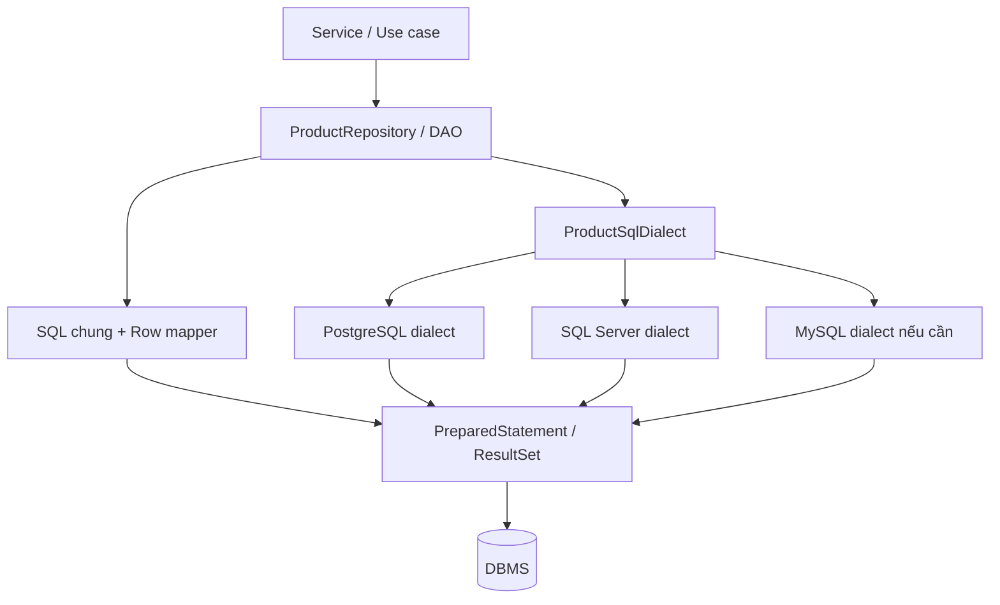

# Cô lập phần SQL đặc thù của hệ quản trị

Trong **JDBC**, ứng dụng Java dùng các API chuẩn như `DataSource`, `Connection`, `PreparedStatement` và `ResultSet` để truy cập cơ sở dữ liệu quan hệ. Tuy nhiên, **JDBC chuẩn hóa cách Java giao tiếp với DBMS, không chuẩn hóa toàn bộ cú pháp SQL của mọi hệ quản trị**. Một câu truy vấn chạy được trên PostgreSQL có thể không chạy nguyên vẹn trên SQL Server, MySQL hoặc Oracle; ngay cả khi cú pháp giống nhau, kết quả của thao tác cập nhật, kiểu dữ liệu hoặc cách trả khóa sinh vẫn có thể khác.

Trong chương **DAO và Repository**, bài này hướng dẫn cách **cô lập các khác biệt SQL vào một ranh giới nhỏ, có thể thay thế và kiểm thử**. Lớp nghiệp vụ chỉ làm việc với các thao tác như “lấy trang sản phẩm tiếp theo”, “tìm sản phẩm”, “cập nhật giá” hoặc “lưu hoặc cập nhật sản phẩm”, thay vì phải biết `LIMIT`, `FETCH NEXT`, `ON CONFLICT` hay `ON DUPLICATE KEY UPDATE`. Các ví dụ dùng **SQL tham số hóa**, quản lý kết nối và transaction rõ ràng, đồng thời chỉ ra khi nào nên giữ SQL chuẩn chung thay vì trừu tượng hóa quá mức.

> **Nguyên tắc:** Đưa **phần thay đổi theo DBMS** vào một *SQL dialect* hoặc adapter cụ thể; giữ **hợp đồng nghiệp vụ, ánh xạ dữ liệu, kiểm soát transaction và kiểm thử hành vi** ở ranh giới chung. Không cố che giấu những khác biệt về ngữ nghĩa bằng cách chỉ thay một chuỗi SQL.

## 1. Vì sao một DAO vẫn phụ thuộc DBMS dù đã dùng JDBC?

Ví dụ, ứng dụng cần lấy tối đa 50 sản phẩm có `id` lớn hơn `lastId`, sắp tăng dần:

```sql
-- PostgreSQL, MySQL: dạng phân trang theo khóa với LIMIT.
SELECT id, name, unit_price
FROM products
WHERE id > ?
ORDER BY id
LIMIT ?;
```

```sql
-- SQL Server: dạng OFFSET/FETCH (yêu cầu ORDER BY).
SELECT id, name, unit_price
FROM products
WHERE id > ?
ORDER BY id
OFFSET 0 ROWS FETCH NEXT ? ROWS ONLY;
```

Cả hai truy vấn đều dùng dấu `?` của `PreparedStatement` theo **cùng thứ tự tham số**: `1` là `lastId`, `2` là `pageSize`. Nhưng `LIMIT` không phải cú pháp áp dụng nguyên xi cho mọi DBMS. Nếu chuỗi SQL đặt trực tiếp ở lớp service, việc thay đổi DBMS khiến code nghiệp vụ phải sửa.

Các khác biệt còn có thể sâu hơn cú pháp:

| Nhóm khác biệt | Ví dụ thường gặp | Điều cần cô lập hoặc kiểm tra |
| --- | --- | --- |
| **Phân trang** | `LIMIT ?`, `OFFSET ... FETCH NEXT ?`, `TOP`, row limiting khác. | Cú pháp, vị trí tham số, điều kiện `ORDER BY` và độ ổn định thứ tự. |
| **Upsert** | PostgreSQL `ON CONFLICT`; MySQL `ON DUPLICATE KEY UPDATE`; những cách khác trên SQL Server/Oracle. | Điều kiện xung đột, câu lệnh, số hàng trả về, trigger và concurrency. |
| **Khóa sinh** | Identity, sequence, `RETURNING`, `OUTPUT INSERTED`. | Cách lấy khóa mới; driver có thể hỗ trợ `getGeneratedKeys()` khác nhau. |
| **Kiểu dữ liệu** | `BOOLEAN`, `JSONB`, `DATETIMEOFFSET`, `UUID`, loại binary/LOB. | Getter/setter, ánh xạ Java và dữ liệu `NULL`. |
| **Hàm SQL** | Nối chuỗi, tính ngày, JSON extraction, phân biệt chữ hoa/thường. | Biểu thức có cùng ý nghĩa nghiệp vụ và timezone. |
| **Khóa và isolation** | `FOR UPDATE` hoặc khóa/hint đặc thù; MVCC/lock behavior khác nhau. | Điều kiện transaction, deadlock, retry và bảo đảm đồng thời. |
| **Tên định danh** | Dấu quote `"..."`, backtick hoặc `[...]`, quy tắc chữ hoa/thường. | Tên schema/bảng/cột, từ khóa dành riêng và whitelist. |
| **Lỗi SQL** | SQLState và mã lỗi vendor cho duplicate key, deadlock, timeout. | Phân loại lỗi theo driver/DBMS; không dựa vào chuỗi thông báo. |

Không có nghĩa mọi DAO cần một dialect. Các lệnh chuẩn như `SELECT ... WHERE id = ?` hoặc `UPDATE ... SET ... WHERE id = ?` thường có thể dùng chung. **Chỉ phần nào thực sự khác mới phải tách**.

## 2. Phân chia trách nhiệm giữa service, repository, dialect và JDBC

Một kiến trúc đơn giản:



| Tầng | Trách nhiệm nên có | Không nên làm |
| --- | --- | --- |
| **Service** | Quy tắc nghiệp vụ, thứ tự thao tác, quyết định transaction và xử lý trường hợp xung đột. | Nối chuỗi `LIMIT`/`ON CONFLICT` vào SQL hoặc bắt ngoại lệ bằng tên vendor ở mọi use case. |
| **Repository/DAO** | Cung cấp thao tác CRUD có kiểu, bind tham số, gọi JDBC, ánh xạ `ResultSet`, đọc số hàng. | Tự đoán hệ quản trị ở mọi phương thức hoặc ngầm commit giữa workflow nhiều bước. |
| **SQL dialect** | Cung cấp phần SQL **thật sự khác** giữa DBMS; khi cần, chỉ rõ quy tắc bind/đọc kết quả khác. | Chứa chính sách nghiệp vụ, giữ state của request hoặc dựng SQL từ chuỗi người dùng không tin cậy. |
| **Connection/transaction owner** | Mượn/trả connection, đặt isolation khi cần, `commit`/`rollback` đúng đơn vị công việc. | Chia transaction giữa các DAO không có phối hợp, để dialect âm thầm commit. |
| **Integration test** | Chạy SQL thực trên driver/DBMS mục tiêu, xác minh cùng kết quả và tác động. | Chỉ so chuỗi SQL rồi kết luận mọi dialect có ngữ nghĩa tương đương. |

Ở dự án nhỏ, DAO có thể được khởi tạo với `DataSource` và tự mượn connection cho mỗi thao tác đọc/ghi độc lập. Nhưng với use case **cần nhiều DAO cùng một transaction**, nên để **caller/transaction manager sở hữu `Connection`**, còn DAO nhận connection để thực thi. Hai cách đều hợp lý nếu vòng đời connection và trách nhiệm commit được quy định rõ.

## 3. Ví dụ schema và hợp đồng nghiệp vụ chung

Ta dùng bảng tối giản (DDL chỉ minh họa; migration thật cần kiểm thử theo DBMS):

```sql
CREATE TABLE products (
    id BIGINT PRIMARY KEY,
    name VARCHAR(200) NOT NULL,
    unit_price DECIMAL(18, 2) NOT NULL
);
```

Giả sử nghiệp vụ có ba thao tác:

1. Lấy **trang sản phẩm tiếp theo** theo `id` tăng dần, không dùng `OFFSET` lớn.
2. Tìm sản phẩm bằng khóa chính.
3. Đổi giá sản phẩm, từ chối giá âm; kết quả trả về cho biết có hàng khớp hay không.

Hai thao tác (2) và (3) có SQL dùng chung, trong khi (1) có cú pháp giới hạn số hàng khác giữa một số DBMS. Đây là trường hợp tốt để bắt đầu với **dialect chỉ có một phương thức**, không cần xây một SQL framework tổng quát.

**Hợp đồng phân trang:** `id` là khóa chính duy nhất, `afterId` là ID cuối đã xử lý và `pageSize` bị giới hạn. Kết quả theo `ORDER BY id` có thứ tự ổn định trong một lần truy vấn. Tuy vậy, nhiều lần đọc qua các transaction riêng **không tự tạo snapshot nhất quán** khi dữ liệu thay đổi đồng thời; nếu cần, phải thiết kế snapshot hoặc mốc giới hạn trên riêng.

## 4. Tạo ranh giới SqlDialect nhỏ và tường minh

Trong ví dụ Java dưới đây, mỗi lớp `public` được đặt ở một tệp `.java` riêng trong cùng package. Interface chỉ trả về câu SQL cho một thao tác đã định nghĩa:

```java
// ProductSqlDialect.java
public interface ProductSqlDialect {
    // Có đúng hai dấu ?:
    // 1 = id sau cùng, 2 = số hàng tối đa.
    String pageAfterIdSql();
}
```

```java
// PostgresProductDialect.java
public final class PostgresProductDialect implements ProductSqlDialect {
    @Override
    public String pageAfterIdSql() {
        return "SELECT id, name, unit_price "
             + "FROM products WHERE id > ? ORDER BY id LIMIT ?";
    }
}
```

```java
// SqlServerProductDialect.java
public final class SqlServerProductDialect implements ProductSqlDialect {
    @Override
    public String pageAfterIdSql() {
        return "SELECT id, name, unit_price "
             + "FROM products WHERE id > ? ORDER BY id "
             + "OFFSET 0 ROWS FETCH NEXT ? ROWS ONLY";
    }
}
```

Hai implementation giữ **cùng thứ tự và số lượng tham số** nên DAO chỉ cần một đoạn bind. Nếu dialect khác yêu cầu thứ tự tham số khác hoặc lệnh nhiều bước, đừng ép chúng vào interface đơn giản bằng cách nối SQL ngẫu nhiên: tạo một adapter có **phương thức thực thi/bind riêng** hoặc một đối tượng kế hoạch truy vấn có mô tả tham số rõ ràng.

Với MySQL, truy vấn dùng `LIMIT ?` tương tự PostgreSQL trong ví dụ; vẫn có thể tạo `MySqlProductDialect` riêng vì các tính năng khác như upsert và ánh xạ lỗi sẽ khác. SQL Server yêu cầu `ORDER BY` cho `OFFSET/FETCH`. Hãy kiểm tra phiên bản DBMS và JDBC driver thực tế thay vì coi các ví dụ là bảo đảm cho mọi phiên bản.

### Không chọn dialect bằng cách tin vào đầu vào request

Chọn dialect lúc khởi tạo `DataSource` hoặc lúc cấu hình repository, ví dụ:

```java
ProductSqlDialect dialect = new PostgresProductDialect();
JdbcProductDao dao = new JdbcProductDao(dialect);
```

Nếu ứng dụng có nhiều database, mỗi `DataSource` nên được ghép với dialect đúng DBMS mà nó trỏ tới. `Connection.getMetaData().getDatabaseProductName()` có thể hỗ trợ **kiểm tra cấu hình lúc khởi động**, nhưng không nên phân nhánh dựa trên chuỗi tên product trong mỗi request hoặc tự suy đoán mọi biến thể/version từ chuỗi đó. Nếu mismatch, nên **fail fast** với thông báo cấu hình rõ ràng.

## 5. Ví dụ DAO hoàn chỉnh: chia sẻ CRUD, cô lập SQL phân trang

Lớp `JdbcProductDao` sau không chứa `if (postgres) ... else if (sqlServer)` và **không tự quản lý transaction**. Caller đưa vào một `Connection` còn mở; DAO chỉ tạo `PreparedStatement`/`ResultSet` và đóng chúng bằng `try-with-resources`.

```java
// JdbcProductDao.java
import java.math.BigDecimal;
import java.sql.Connection;
import java.sql.PreparedStatement;
import java.sql.ResultSet;
import java.sql.SQLException;
import java.util.ArrayList;
import java.util.List;
import java.util.Objects;
import java.util.Optional;

public final class JdbcProductDao {
    private final ProductSqlDialect dialect;

    public JdbcProductDao(ProductSqlDialect dialect) {
        this.dialect = Objects.requireNonNull(dialect);
    }

    public List<Product> findAfterId(
            Connection connection, long afterId, int pageSize)
            throws SQLException {
        Objects.requireNonNull(connection);
        if (afterId < 0 || pageSize < 1 || pageSize > 500) {
            throw new IllegalArgumentException("Trang không hợp lệ");
        }

        List<Product> page = new ArrayList<>(pageSize);
        try (PreparedStatement ps = connection.prepareStatement(
                dialect.pageAfterIdSql())) {
            ps.setLong(1, afterId);
            ps.setInt(2, pageSize);
            ps.setQueryTimeout(15); // Giây; tùy khả năng driver.

            try (ResultSet rs = ps.executeQuery()) {
                while (rs.next()) {
                    page.add(mapProduct(rs));
                }
            }
        }
        return page;
    }

    public Optional<Product> findById(
            Connection connection, long id) throws SQLException {
        Objects.requireNonNull(connection);
        String sql = "SELECT id, name, unit_price "
                   + "FROM products WHERE id = ?";

        try (PreparedStatement ps = connection.prepareStatement(sql)) {
            ps.setLong(1, id);
            try (ResultSet rs = ps.executeQuery()) {
                if (!rs.next()) {
                    return Optional.empty();
                }
                return Optional.of(mapProduct(rs));
            }
        }
    }

    public boolean updatePrice(
            Connection connection, long id, BigDecimal newPrice)
            throws SQLException {
        Objects.requireNonNull(connection);
        Objects.requireNonNull(newPrice);
        if (newPrice.signum() < 0) {
            throw new IllegalArgumentException("Giá không được âm");
        }
        String sql = "UPDATE products SET unit_price = ? WHERE id = ?";
        try (PreparedStatement ps = connection.prepareStatement(sql)) {
            ps.setBigDecimal(1, newPrice);
            ps.setLong(2, id);
            int count = ps.executeUpdate();
            if (count > 1) {
                throw new SQLException("UPDATE ảnh hưởng hơn một khóa chính");
            }
            return count == 1;
        }
    }

    private static Product mapProduct(ResultSet rs) throws SQLException {
        return new Product(
                rs.getLong("id"),
                rs.getString("name"),
                rs.getBigDecimal("unit_price"));
    }

    public static final class Product {
        public final long id;
        public final String name;
        public final BigDecimal unitPrice;

        public Product(long id, String name, BigDecimal unitPrice) {
            this.id = id;
            this.name = Objects.requireNonNull(name);
            this.unitPrice = Objects.requireNonNull(unitPrice);
        }
    }
}
```

Ví dụ gọi từ service đã nhận `DataSource` có pool:

```java
// dataSource trỏ đến DBMS phù hợp với dialect.
JdbcProductDao dao = new JdbcProductDao(
        new PostgresProductDialect());

try (Connection connection = dataSource.getConnection()) {
    List<JdbcProductDao.Product> page =
            dao.findAfterId(connection, 100L, 50);
    for (JdbcProductDao.Product product : page) {
        System.out.println(product.id + ": " + product.name);
    }
}
```

**Điều cần quan sát:**

- **SQL chung** (`findById` và `updatePrice`) nằm trong DAO; SQL **thật sự khác** (`findAfterId`) được dialect cung cấp.
- `PreparedStatement` vẫn tham số hóa `afterId`, `pageSize`, `id` và giá; dialect chỉ trả về **chuỗi SQL tĩnh do lập trình viên kiểm soát**.
- `mapProduct` ánh xạ theo tên cột được chọn chung và dùng `getBigDecimal` để tránh mất độ chính xác tiền tệ. Nếu các DBMS trả kiểu/alias khác nhau, xử lý ở tầng mapping thích hợp và kiểm thử.
- DAO không gọi `commit`, `rollback` hay `Connection.close()`. **Caller** phải đóng hoặc trả kết nối về pool và quản lý transaction khi cần.
- `setQueryTimeout(15)` không bảo đảm mọi driver có cùng deadline, không thay thế giới hạn thời gian request hoặc transaction.
- Với production, nên có `CHECK`/validation về giá, precision và scale phù hợp bảng; ví dụ chỉ kiểm tra không âm để tập trung vào ranh giới dialect.

Nếu một DBMS không hỗ trợ tham số hóa số hàng `FETCH NEXT ?` như kỳ vọng ở một phiên bản cụ thể, phải **điều chỉnh đúng adapter và test**. Không đưa giá trị `pageSize` chưa kiểm tra vào chuỗi SQL bằng phép nối tùy tiện.

## 6. Khi một thao tác phải được thực hiện theo cú pháp khác hẳn: upsert

**Upsert** có nghĩa là thêm bản ghi khi khóa chưa tồn tại hoặc cập nhật bản ghi khi trùng khóa. Nhu cầu giống nhau, nhưng cách biểu đạt khác nhau giữa các DBMS.

PostgreSQL:

```sql
INSERT INTO products (id, name, unit_price)
VALUES (?, ?, ?)
ON CONFLICT (id) DO UPDATE
SET name = EXCLUDED.name,
    unit_price = EXCLUDED.unit_price;
```

MySQL, cú pháp truyền thống:

```sql
INSERT INTO products (id, name, unit_price)
VALUES (?, ?, ?)
ON DUPLICATE KEY UPDATE
    name = VALUES(name),
    unit_price = VALUES(unit_price);
```

Trong MySQL phiên bản mới, `VALUES(col)` bên trong `ON DUPLICATE KEY UPDATE` đã bị **deprecate**; cú pháp dùng row alias sau `VALUES` là hướng thay thế trên các phiên bản hỗ trợ. Không sao chép nguyên mẫu MySQL ở trên vào môi trường production mà chưa kiểm tra phiên bản server. Với SQL Server, cú pháp và chiến lược upsert lại khác; không được giả định một lệnh `MERGE` tự động giải quyết mọi race condition nếu thiếu kiểm thử concurrent writes và các ràng buộc khóa/transaction thích hợp.

Ngay cả khi SQL đều chấp nhận, **ngữ nghĩa xung đột khác nhau**: `ON CONFLICT (id)` chỉ định mục tiêu xung đột; MySQL `ON DUPLICATE KEY UPDATE` có thể kích hoạt khi trùng **một khóa duy nhất bất kỳ**. Nếu bảng có nhiều unique index, hãy kiểm tra rõ hành vi nào phù hợp với nghiệp vụ.

### Cô lập câu SQL upsert nhưng vẫn chia sẻ binding

```java
// ProductUpsertDialect.java
public interface ProductUpsertDialect {
    // Thứ tự dấu ?: id, name, unit_price.
    String upsertSql();
}
```

```java
// PostgresUpsertDialect.java
public final class PostgresUpsertDialect
        implements ProductUpsertDialect {
    @Override
    public String upsertSql() {
        return "INSERT INTO products (id, name, unit_price) "
             + "VALUES (?, ?, ?) "
             + "ON CONFLICT (id) DO UPDATE SET "
             + "name = EXCLUDED.name, "
             + "unit_price = EXCLUDED.unit_price";
    }
}
```

```java
// MySqlUpsertDialect.java — phiên bản dùng VALUES() để minh họa.
public final class MySqlUpsertDialect
        implements ProductUpsertDialect {
    @Override
    public String upsertSql() {
        return "INSERT INTO products (id, name, unit_price) "
             + "VALUES (?, ?, ?) "
             + "ON DUPLICATE KEY UPDATE "
             + "name = VALUES(name), "
             + "unit_price = VALUES(unit_price)";
    }
}
```

```java
// Hàm có thể đặt trong lớp DAO/adapter dùng cho ghi.
import java.sql.Connection;
import java.sql.PreparedStatement;
import java.sql.SQLException;
import java.util.Objects;

static void upsert(
        Connection connection,
        ProductUpsertDialect dialect,
        JdbcProductDao.Product product) throws SQLException {
    Objects.requireNonNull(connection);
    Objects.requireNonNull(dialect);
    Objects.requireNonNull(product);
    try (PreparedStatement ps = connection.prepareStatement(
            dialect.upsertSql())) {
        ps.setLong(1, product.id);
        ps.setString(2, product.name);
        ps.setBigDecimal(3, product.unitPrice);
        ps.executeUpdate();
    }
}
```

Đây là **đoạn phương thức minh họa trong một lớp Java**, các `import` đặt đầu file khi triển khai. Nó giữ chung quá trình bind vì hai mẫu SQL có cùng ba tham số. Việc **không** yêu cầu `executeUpdate() == 1` là có chủ ý: số hàng bị ảnh hưởng khi upsert có thể khác nhau giữa DBMS, tùy thao tác thêm/cập nhật, cấu hình driver và việc giá trị có thực sự thay đổi. Nếu API cần trả kết quả như `CREATED`, `UPDATED` hoặc `UNCHANGED`, adapter phải định nghĩa và kiểm thử **một cách xác định sự khác biệt đó**, không tự suy ra từ cùng một số đếm portable.

Khi upsert thực hiện nhiều thao tác hoặc có side effect như trigger, cần kiểm tra transaction, unique constraint, idempotency và đường retry; đưa chuỗi SQL vào dialect chỉ giải quyết **khác biệt cú pháp**, không tự bảo đảm tính đúng đắn đồng thời.

## 7. Khóa tự sinh và RETURNING: không bắt repository đoán cách đọc ID

Giả sử bảng sản phẩm dùng khóa do DBMS sinh, thay vì `id` được ứng dụng truyền:

| DBMS/kỹ thuật | Một cách lấy khóa mới | Ghi chú |
| --- | --- | --- |
| **JDBC chuẩn** | `prepareStatement(sql, Statement.RETURN_GENERATED_KEYS)` rồi `getGeneratedKeys()`. | Phụ thuộc hỗ trợ và cách ánh xạ của driver; hữu ích khi có thể. |
| **PostgreSQL** | `INSERT ... RETURNING id`. | Trả một tập kết quả theo cú pháp PostgreSQL, xử lý bằng cách phù hợp với driver. |
| **SQL Server** | `INSERT ... OUTPUT INSERTED.id ...`. | Cú pháp riêng SQL Server, xem giới hạn khi có trigger. |
| **MySQL** | API generated keys qua JDBC driver; một số cách đặc thù cho identity. | Không áp `RETURNING` kiểu PostgreSQL một cách mặc định. |

Với JDBC chuẩn:

```java
String sql = "INSERT INTO products (name, unit_price) VALUES (?, ?)";
try (PreparedStatement ps = connection.prepareStatement(
        sql, java.sql.Statement.RETURN_GENERATED_KEYS)) {
    ps.setString(1, "Bàn học");
    ps.setBigDecimal(2, new java.math.BigDecimal("450.00"));
    if (ps.executeUpdate() != 1) {
        throw new SQLException("Không tạo được sản phẩm");
    }
    try (ResultSet keys = ps.getGeneratedKeys()) {
        if (!keys.next()) {
            throw new SQLException("Driver không trả khóa đã sinh");
        }
        long id = keys.getLong(1);
    }
}
```

**Giả định khác schema bài trước:** ví dụ này chỉ chạy khi bảng `products.id` được định nghĩa để DBMS tự sinh khóa và phần cột còn lại phù hợp. Bảng ban đầu khai báo `id BIGINT PRIMARY KEY` **không tự động** có identity ở mọi DBMS. Cần migration riêng cho cách sinh khóa.

Nếu một DBMS hoặc driver không hỗ trợ `getGeneratedKeys()` theo hợp đồng, có thể đưa logic lấy khóa vào adapter riêng, ví dụ:

```java
public interface ProductInsertPort {
    // Trả id của bản ghi đã được ghi; caller quản lý transaction.
    long insert(Connection connection, String name,
                java.math.BigDecimal unitPrice)
            throws java.sql.SQLException;
}
```

Một implementation có thể dùng `RETURNING`, implementation khác dùng generated keys hoặc API khác. **Không lấy khóa sinh bằng cách `SELECT MAX(id)`**: nhiều connection chèn đồng thời sẽ làm câu trả về sai, dù các test một luồng có vẻ chạy đúng.

## 8. Cô lập lỗi DBMS, nhưng giữ nguyên nguyên nhân SQL

Khi DAO phát sinh `SQLException`, không nên kiểm tra bằng chuỗi thông báo như `"duplicate key"` hoặc `"deadlock"` rồi áp vào mọi driver. Thông điệp có thể được bản địa hóa, thay đổi theo phiên bản hoặc chứa tên constraint nhạy cảm. Thay vào đó, phân loại dựa trên:

- `SQLException.getSQLState()`: hữu ích khi DBMS dùng nhóm SQLState chuẩn, nhưng mã cụ thể vẫn cần kiểm tra theo vendor.
- `SQLException.getErrorCode()`: mã lỗi đặc thù driver/DBMS, không portable.
- `SQLIntegrityConstraintViolationException`, `SQLTransactionRollbackException` hoặc các lớp con `SQLException` khi driver sử dụng đúng taxonomy.
- `getNextException()` và `getCause()`: chuỗi lỗi/nguồn gốc, đặc biệt với batch hoặc lỗi SQL lồng nhau.

Ví dụ thiết kế một port:

```java
public interface SqlErrorClassifier {
    boolean isUniqueViolation(java.sql.SQLException error);
    boolean isRetryableTransactionConflict(
            java.sql.SQLException error);
}
```

PostgreSQL thường dùng SQLState `23505` cho unique violation và `40001` cho serialization failure; deadlock thường là `40P01`. **Đây không phải bảng mã áp dụng cho mọi DBMS**. MySQL/SQL Server có mã và trạng thái khác, đôi khi phải xem vendor code hoặc các ngoại lệ lồng nhau.

Tầng repository có thể chuyển lỗi constraint đã nhận diện thành ngoại lệ ứng dụng có ý nghĩa, nhưng phải **giữ lại `SQLException` gốc làm cause** để log/tracing có SQLState và stack trace. Không chuyển mọi lỗi kết nối, timeout hoặc deadlock thành một lỗi `CONFLICT` chung; chiến lược retry của service cần phân biệt **xung đột nghiệp vụ**, **vi phạm dữ liệu cố định** và **lỗi tạm thời**.

Với timeout hoặc `commit()` mất phản hồi, có thể **không biết giao dịch đã commit hay chưa**. Việc phân loại là “retryable” không cho phép gửi lại thao tác không có khóa idempotency. Kết quả ghi, transaction và chính sách thử lại thuộc hợp đồng của service, không được dialect tự ý che đi.

## 9. Transaction phải xuyên qua các DAO, không nằm ngầm trong dialect

Ví dụ một service phải đổi giá sản phẩm và ghi lịch sử thay đổi. Nếu mỗi DAO tự mở/commit connection riêng:

```text
ProductDao.updatePrice() → COMMIT
AuditDao.insertAudit()  → lỗi

Kết quả: đã đổi giá nhưng không ghi lịch sử.
```

Để bảo đảm nguyên tử, caller nên sử dụng **cùng một `Connection` và transaction**, ví dụ dưới đây có `AuditDao` được giả định đã triển khai với phương thức `insertPriceChange(Connection, id, oldPrice, newPrice)`:

```java
try (Connection c = dataSource.getConnection()) {
    if (!c.getAutoCommit()) {
        throw new SQLException(
                "Ví dụ yêu cầu Connection ban đầu autoCommit=true");
    }
    c.setAutoCommit(false);

    boolean commitAttempted = false;
    boolean transactionEnded = false;
    Throwable originalError = null;
    try {
        JdbcProductDao.Product current =
                dao.findById(c, productId)
                   .orElseThrow(() ->
                           new IllegalArgumentException("Không thấy sản phẩm"));

        if (!dao.updatePrice(c, productId, requestedPrice)) {
            throw new SQLException("Giá chưa được thay đổi: thiếu sản phẩm");
        }
        auditDao.insertPriceChange(
                c, productId, current.unitPrice, requestedPrice);

        commitAttempted = true;
        c.commit();
        transactionEnded = true;
    } catch (SQLException | RuntimeException failure) {
        originalError = failure;
        if (!commitAttempted) {
            try {
                c.rollback();
                transactionEnded = true;
            } catch (SQLException rollbackError) {
                failure.addSuppressed(rollbackError);
            }
        }
        // Nếu commit() đã được gọi và lỗi, trạng thái có thể chưa rõ.
        throw failure;
    } finally {
        if (transactionEnded) {
            try {
                c.setAutoCommit(true);
            } catch (SQLException resetError) {
                if (originalError != null) {
                    originalError.addSuppressed(resetError);
                } else {
                    throw resetError;
                }
            }
        }
        // Khi commit/rollback chưa rõ, pool cần reset hoặc loại kết nối.
    }
}
```

Đây là **đoạn mã cấp service** có `dataSource`, `dao`, `auditDao`, `productId` và `requestedPrice` do ứng dụng cung cấp. Một framework có transaction manager sẽ quản lý ranh giới này thay cho code thủ công; khi ấy DAO **không tự đổi `autoCommit`/isolation** trên kết nối do framework sở hữu.

Điểm chính của bài: dù `ProductDao` dùng `LIMIT` hay `FETCH NEXT` trong dialect, **transaction vẫn do caller quyết định**. Không để từng dialect âm thầm gọi `commit()`, thay isolation, hay mượn connection mới khiến các DAO không còn cùng một transaction.

## 10. Không dùng SQL động thiếu kiểm soát để thay thế dialect

Đôi khi lập trình viên cố “tổng quát hóa” bằng cách để request chọn tên bảng/cột:

```java
// Không an toàn nếu tableName lấy trực tiếp từ input bên ngoài:
String sql = "SELECT * FROM " + tableName + " WHERE id = ?";
```

`PreparedStatement` chỉ bind **giá trị** tại dấu `?`; nó **không** bind tên bảng, cột, keyword hoặc một đoạn SQL. Một dialect đúng không phải chiếc máy nối chuỗi SQL tùy ý. Nếu ứng dụng cần chọn thứ tự sắp xếp, hãy dùng **whitelist từ tên thuộc tính nghiệp vụ sang fragment SQL cố định**:

```java
static String orderByFor(String sortKey) {
    switch (sortKey) {
        case "name":
            return "name ASC, id ASC";
        case "price":
            return "unit_price ASC, id ASC";
        default:
            throw new IllegalArgumentException("Trường sort không hợp lệ");
    }
}
```

Các chuỗi trả về đều do **code kiểm soát**, không lấy nguyên văn từ người dùng. Khi sắp xếp theo `name` hoặc `unit_price` mà muốn phân trang keyset, phải đổi cả **điều kiện tiếp tục trang** để dùng cùng khóa ghép, ví dụ (`name`, `id`), chứ không chỉ thay `ORDER BY` mà vẫn giữ `WHERE id > ?`. Mẫu này minh họa **bảo mật danh sách cho phép**, không phải phép phân trang tương đương mọi khóa sắp xếp.

Với schema/table thay đổi theo tenant, kiểm soát tenant ở tầng xác thực và cấu hình định danh đã kiểm duyệt; ưu tiên tách `DataSource`/schema đã biết, không nối tenant ID trực tiếp thành identifier. Việc quote tên cột bằng `DatabaseMetaData.getIdentifierQuoteString()` có thể hữu ích cho code sinh SQL, nhưng **không làm chuỗi không đáng tin cậy trở thành an toàn** và vẫn có khác biệt về chữ hoa/thường, escape và reserved words.

## 11. Kiểm thử từng dialect: cùng hợp đồng, DBMS thật

Unit test có thể đảm bảo `PostgresProductDialect.pageAfterIdSql()` chứa `LIMIT` và `SqlServerProductDialect.pageAfterIdSql()` chứa `FETCH NEXT`. Nhưng **so sánh chuỗi SQL không kiểm chứng** câu lệnh chạy được, driver bind tham số đúng hay dữ liệu trả về giống nhau.

Một ma trận kiểm thử tích hợp:

| Hợp đồng cần kiểm tra | PostgreSQL | SQL Server | MySQL nếu hỗ trợ |
| --- | --- | --- | --- |
| `findById` với ID tồn tại/không tồn tại. | Dữ liệu và `Optional` đúng. | Cùng hợp đồng. | Cùng hợp đồng. |
| `findAfterId` sau `id=100`, `pageSize=2`. | Đúng thứ tự, tối đa 2 hàng. | Đúng thứ tự, tối đa 2 hàng. | Đúng thứ tự, tối đa 2 hàng. |
| `findAfterId` khi không còn hàng. | `List` rỗng. | `List` rỗng. | `List` rỗng. |
| `updatePrice` với khóa có/không có. | `true`/`false` đúng, dữ liệu chính xác. | Cùng hợp đồng. | Cùng hợp đồng; kiểm tra row count theo driver. |
| Upsert với ID mới/ID trùng. | Thêm/cập nhật đúng và không nhân đôi hàng. | Adapter riêng có thể có thuật toán khác; test concurrency. | Kiểm tra hành vi với nhiều unique key và count. |
| Generated key nếu hỗ trợ. | Khóa trả về thuộc hàng vừa tạo. | Cùng hợp đồng. | Cùng hợp đồng. |
| Rollback khi thao tác giữa workflow lỗi. | Không commit một phần. | Cùng bất biến. | Cùng bất biến trên engine hỗ trợ transaction. |
| Hai request cùng một khóa nghiệp vụ. | Kiểm tra unique constraint và race. | Cùng bất biến. | Cùng bất biến. |

### Dữ liệu fixture để phát hiện phân trang sai

```sql
INSERT INTO products (id, name, unit_price)
VALUES (10, 'Sách', 25.00);

INSERT INTO products (id, name, unit_price)
VALUES (20, 'Bút', 5.00);

INSERT INTO products (id, name, unit_price)
VALUES (30, 'Vở', 12.50);
```

Nếu gọi `findAfterId(connection, 10, 2)`, kết quả cần là ID `20`, `30` đúng thứ tự. Nếu gọi `findAfterId(connection, 30, 2)` thì danh sách rỗng. Mỗi test cần **database/schema riêng** hoặc reset fixture; không để test song song tự làm đổi điều kiện của nhau.

Ví dụ JUnit 5 minh họa hợp đồng chung, giả định `testDataSource` và `dialect` được cấp đúng DBMS trong test fixture:

```java
import static org.junit.jupiter.api.Assertions.assertEquals;
import org.junit.jupiter.api.Test;
import java.sql.Connection;
import java.util.List;

class ProductDaoIT {
    private javax.sql.DataSource testDataSource; // Test fixture cấp.
    private ProductSqlDialect dialect;            // Cấu hình theo DB.

    @Test
    void pageAfterIdUsesSameContract() throws Exception {
        JdbcProductDao dao = new JdbcProductDao(dialect);
        try (Connection c = testDataSource.getConnection()) {
            List<JdbcProductDao.Product> page =
                    dao.findAfterId(c, 10L, 2);
            assertEquals(2, page.size());
            assertEquals(20L, page.get(0).id);
            assertEquals(30L, page.get(1).id);
            assertEquals(0, dao.findAfterId(c, 30L, 2).size());
        }
    }
}
```

Đây là **thân test minh họa**, không phải suite chạy ngay nếu chưa có `testDataSource`, `dialect`, dependency JUnit 5 và khởi tạo dữ liệu. Có thể chạy cùng bộ hợp đồng trên các DBMS thực thông qua container thử nghiệm, nhưng cần kiểm soát khác biệt DDL, kiểu dữ liệu, phiên bản driver, timezone, isolation và cách cung cấp cấu hình.

### Kiểm thử đồng thời và kế hoạch thực thi

Đặc biệt với upsert và update có điều kiện, cần chạy **hai `Connection` độc lập** để thử xung đột cùng khóa. Chỉ test một connection không phát hiện được race giữa hai transaction. Với các truy vấn có `ORDER BY`/`LIMIT` hoặc `OFFSET/FETCH`, dùng công cụ `EXPLAIN`/execution plan phù hợp DBMS để kiểm tra index và số hàng quét; cùng hợp đồng chức năng **không tự bảo đảm cùng hiệu năng**.

Không kiểm tra mỗi cú pháp: một adapter có thể trả đúng dữ liệu nhưng tạo lock lâu, quét bảng hoặc dùng quyền không phù hợp trên DBMS đích. Vì vậy nên giữ hai tầng kiểm tra: **hợp đồng chung** và **đặc tính vận hành riêng mỗi DBMS**.

## 12. Khi nào không nên tự xây dialect?

| Tình huống | Gợi ý |
| --- | --- |
| Chỉ chạy một DBMS, vài câu SQL đơn giản. | Giữ SQL trực tiếp trong DAO, dùng `PreparedStatement`; không cần giao diện dialect chỉ để trang trí. |
| Một hoặc hai khác biệt rõ ràng như phân trang/upsert. | Interface nhỏ, mỗi dialect trả SQL tĩnh và có integration test. |
| Hàng chục DBMS với SQL động, join và truy vấn xây theo điều kiện. | Xem xét thư viện SQL builder/query DSL hoặc ORM có hỗ trợ dialect; đánh giá chất lượng SQL và kiểm thử. |
| DBMS mục tiêu có tính năng quan trọng như JSONB, bulk loader, hints hoặc stored procedures. | Cho phép adapter chuyên biệt dùng tối ưu của DBMS, nhưng giới hạn vùng phụ thuộc và giữ fallback nếu nghiệp vụ cần. |
| Muốn chuyển DBMS mà không thay đổi application code. | Tách hợp đồng và test từ sớm; cần chấp nhận **migration dữ liệu, DDL, transaction, kiểu dữ liệu và vận hành** vẫn khác. |

Không nên viết một “universal SQL translator” bằng chuỗi `replace("LIMIT", "TOP")`; SQL có cấu trúc ngữ pháp, thứ tự mệnh đề, subquery và quy tắc bind khác nhau. Một interface quá tổng quát như `executeAnySql(String sql)` còn làm mờ hợp đồng DAO, khó bảo mật và khó kiểm thử.

## 13. Sai lầm phổ biến khi cô lập SQL đặc thù

| Sai lầm | Hệ quả | Cách làm đúng hơn |
| --- | --- | --- |
| Viết `if (isPostgres)` trong mọi method service. | Logic nghiệp vụ bị rải phụ thuộc vendor, khó bảo trì. | Dialect/adapter ở tầng truy cập dữ liệu. |
| Ép mọi DAO dùng dialect dù SQL chuẩn giống hệt nhau. | Tăng số lớp và độ phức tạp không cần thiết. | Chỉ tách phần khác thực sự. |
| Đổi `LIMIT` thành `FETCH NEXT` nhưng quên thứ tự bind. | Trả sai trang hoặc lỗi SQL. | Hợp đồng placeholder rõ ràng và test từng dialect. |
| Cho rằng upsert nào cũng xử lý cùng unique constraint. | Cập nhật nhầm hàng khi có nhiều unique index. | Kiểm tra mục tiêu xung đột và constraint thực tế. |
| Dựa vào số hàng `executeUpdate` để xác định CREATE/UPDATE trên mọi DBMS. | Phân loại sai vì driver/vender có quy tắc khác. | Định nghĩa hợp đồng riêng và test. |
| Coi `getGeneratedKeys` hoạt động trên mọi DDL. | Thiếu ID hoặc ID sai ở một DBMS. | Kiểm thử driver và cấu hình khóa sinh, dùng adapter khi cần. |
| Coi SQLState hoặc mã lỗi của một DBMS là chuẩn toàn bộ. | Retry sai hoặc che lỗi dữ liệu. | Classifier riêng, giữ nguyên `SQLException` cause. |
| Đưa connection/`commit` vào dialect. | Mất atomicity giữa nhiều DAO. | Transaction do caller/transaction manager sở hữu. |
| Nối tên bảng, tên cột hoặc `ORDER BY` từ input vào SQL. | SQL injection và kết quả khó đoán. | Dùng whitelist fragment tĩnh; bind toàn bộ giá trị. |
| Chỉ chạy unit test mock cho các dialect. | Không thấy khác biệt syntax, transaction và driver. | Test integration với DBMS mục tiêu. |
| Nghĩ tách dialect là có thể thay DBMS không cần migration. | Sai về schema, sequence, timezone, isolation và vận hành. | Kiểm soát toàn bộ các vùng phụ thuộc DBMS. |

## 14. Bài tập thực hành

Một dịch vụ quản lý kho JDBC có các yêu cầu:

- Triển khai trên **PostgreSQL** và **SQL Server**.
- Phân trang theo `product_id` tăng dần, mỗi trang tối đa 100 sản phẩm.
- Cho phép đổi giá theo `id` và ghi một bản ghi audit trong cùng transaction.
- Khi chưa có sản phẩm, có thể thêm; khi đã tồn tại, cập nhật thông tin. Không được tạo trùng do hai request đồng thời.
- Một request HTTP cho phép người dùng chọn `sortKey` là `name` hoặc `price`.

Hãy trả lời:

1. Những phương thức nào nên giữ SQL chung trong DAO, phương thức nào nên dùng `ProductSqlDialect`? Vì sao?
2. Hãy viết phần SQL phân trang theo khóa `id > ?` với `ORDER BY id` cho PostgreSQL và SQL Server; hai parameter binder cần truyền giá trị ở vị trí nào?
3. Vì sao không thể chỉ đổi `ORDER BY id` thành `ORDER BY unit_price` mà vẫn giữ `WHERE id > ?` và gọi đó là phân trang keyset đúng?
4. Nếu upsert trên PostgreSQL dùng `ON CONFLICT (id)` nhưng trên DBMS khác có cơ chế xung đột khác, bạn sẽ kiểm thử những bất biến nào?
5. Nếu DAO tự `commit()` sau đổi giá rồi audit DAO lỗi, dữ liệu có thể trở thành trạng thái nào? Nên đặt transaction ở tầng nào?
6. `PreparedStatement` có thể dùng `?` để bind tên cột `ORDER BY ?` theo ý muốn không? Làm thế nào để chấp nhận `name`/`price` an toàn?
7. Tại sao một test chỉ assert chuỗi SQL chứa `FETCH NEXT` chưa chứng minh repository hoạt động đúng trên SQL Server?

**Đáp án định hướng:**

1. `findById` và `updatePrice` có SQL phổ biến, dùng chung; phân trang khác cú pháp nên đặt trong dialect. Upsert/khóa sinh/đọc lỗi có thể cần adapter riêng.
2. PostgreSQL: `... WHERE id > ? ORDER BY id LIMIT ?`; SQL Server: `... WHERE id > ? ORDER BY id OFFSET 0 ROWS FETCH NEXT ? ROWS ONLY`; binder dùng `1` = `afterId` và `2` = `pageSize`.
3. Keyset phải tiếp tục từ khóa **cùng thứ tự sắp xếp**; với `unit_price` cần điều kiện dựa trên khóa ghép (`unit_price`, `id`) và xử lý các giá bằng nhau.
4. Kiểm tra cùng payload tạo đúng một hàng, payload mới cập nhật đúng hàng, unique constraint thực sự ngăn bản ghi trùng, hai connection không ghi đè sai, số đếm/trigger và retry phù hợp.
5. Giá đã đổi nhưng audit vắng; service/transaction manager phải cho hai DAO dùng **cùng connection và transaction** để commit/rollback cùng nhau.
6. Không. Placeholder dùng cho **giá trị**, không phải identifier/keyword; ánh xạ `sortKey` vào fragment cố định được whitelist.
7. Phải thực thi trên SQL Server với driver thật, fixture xác định, bind param, xác minh thứ tự/số hàng, transaction và giới hạn phiên bản; chuỗi đúng chưa bảo đảm chạy đúng.

**Ghi nhớ:** **JDBC chuẩn hóa API, không xóa khác biệt giữa các SQL dialect.** Đặt SQL đặc thù vào một adapter nhỏ, giữ `PreparedStatement` với tham số an toàn, để DAO ánh xạ dữ liệu và caller quản lý transaction, đồng thời **kiểm thử cùng hợp đồng trên từng DBMS thật**. Không cố làm mọi tính năng “portable” bằng cách bỏ qua khác biệt về upsert, khóa sinh, concurrency hoặc kiểu dữ liệu; chỉ trừu tượng hóa những phần thực sự cần thay đổi.
