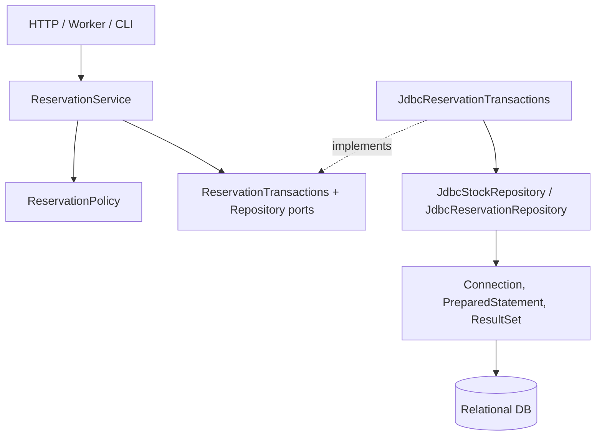

# Giữ quy tắc nghiệp vụ ngoài mã quản lý tài nguyên JDBC

Trong ứng dụng Java dùng **JDBC**, mã truy cập cơ sở dữ liệu thường bắt đầu rất đơn giản: mở `Connection`, tạo `PreparedStatement`, bind tham số, đọc `ResultSet` rồi đóng tài nguyên. Vấn đề xuất hiện khi cùng phương thức đó dần chứa cả quy tắc nghiệp vụ: “mỗi đơn chỉ được giữ tối đa 10 sản phẩm”, “không được bán quá lượng tồn”, “khách bị khóa không được đặt hàng”, “đơn đã thanh toán không thể hủy”. Khi chính sách và JDBC trộn lẫn, thay đổi một điều kiện kinh doanh buộc lập trình viên sửa mã SQL/transaction, kiểm thử quy tắc bằng mock driver phức tạp và dễ phát sinh các nhánh quên đóng kết nối.

Bài thuộc chương **DAO và Repository** trong module **JDBC**. Mục tiêu là tổ chức mã theo trách nhiệm: **domain** định nghĩa quy tắc nghiệp vụ; **application/service** điều phối use case và ranh giới giao dịch; **repository port** mô tả các thao tác dữ liệu cần thiết; **JDBC adapter/DAO** ánh xạ câu SQL, tham số, hàng kết quả và tài nguyên; **transaction runner** sử dụng một `Connection` để thực hiện nhiều thao tác nguyên tử. Ta sẽ xây dựng ví dụ giữ hàng trong kho bằng các API `DataSource`, `PreparedStatement`, `ResultSet` và `Connection`, xử lý lỗi/đồng thời, rồi kiểm thử riêng luật nghiệp vụ và tích hợp DB thật.

Nguyên tắc xuyên suốt: **tách nơi ra quyết định nghiệp vụ khỏi nơi thực hiện I/O không có nghĩa bỏ ràng buộc an toàn dữ liệu ở database**. Quy tắc như “số lượng không âm” cần được bảo vệ bằng cập nhật nguyên tử hoặc constraint SQL, trong khi thông điệp, chính sách và luồng nghiệp vụ vẫn nằm ngoài code quản lý `Connection`.

## 1. Nhận diện vấn đề: DAO đang làm quá nhiều việc

Xem một ví dụ có vẻ tiện vì mọi thứ nằm trong một phương thức:

```java
// Phản mẫu rút gọn: SQL, transaction, luật đơn hàng và xử lý tài nguyên lẫn nhau.
public long reserve(long productId, int quantity) throws SQLException {
    if (quantity <= 0 || quantity > 10) {
        throw new IllegalArgumentException("Mỗi đơn chỉ được giữ 1..10 sản phẩm");
    }
    Connection con = dataSource.getConnection();
    con.setAutoCommit(false);
    PreparedStatement check = con.prepareStatement(
            "SELECT available_qty FROM products WHERE id = ?");
    check.setLong(1, productId);
    ResultSet rs = check.executeQuery();
    if (!rs.next() || rs.getInt(1) < quantity) {
        throw new IllegalStateException("Không đủ hàng"); // Leak và transaction treo!
    }
    // ... UPDATE, INSERT, commit; dễ bỏ sót nhánh rollback/close.
    return 0;
}
```

Đoạn trên có **hai loại lỗi khác nhau**:

1. **Thiết kế trách nhiệm:** luật “tối đa 10 sản phẩm” nằm trong phương thức DAO, không thể kiểm thử độc lập với JDBC và khó tái sử dụng cho API, batch job hay một giao diện khác.
2. **An toàn dữ liệu và tài nguyên:** khi không đủ hàng, ngoại lệ thoát trước khi đóng `ResultSet`, `PreparedStatement`, `Connection` hoặc kết thúc transaction. Ngoài ra, đọc `available_qty` rồi quyết định cập nhật ở bước sau có thể gây oversell khi nhiều request chạy đồng thời.

Chỉ thêm `finally` để đóng connection sẽ giải quyết một phần rò rỉ, **không** giải quyết việc lẫn trách nhiệm hoặc race condition. Chỉ dời điều kiện `quantity > 10` ra một lớp `Service` cũng chưa đủ nếu mỗi repository tự mở connection riêng và hai thao tác cần được commit nguyên tử.

## 2. Bản đồ trách nhiệm đề xuất

| Thành phần | Câu hỏi được phép trả lời | Không nên làm |
| --- | --- | --- |
| **Domain model / policy** | Số lượng hợp lệ? Trạng thái nào được chuyển? Đơn nào được hủy? | Tạo `Connection`, viết SQL, biết SQLState hoặc driver |
| **Application service / use case** | Thao tác nào chạy trước/sau? Khi nào mở transaction? Kết quả nghiệp vụ là gì? | Tự ghép SQL, duyệt `ResultSet`, gọi `setString()` |
| **Repository port (interface)** | Cần tìm/lưu/trừ tồn kho theo yêu cầu nào? | Đưa `SQLException`, `ResultSet`, `Connection` vào hợp đồng nếu muốn domain độc lập |
| **JDBC repository adapter** | Câu SQL nào? Bind tham số ra sao? Kiểm tra update count và map hàng thế nào? | Tự quyết định “mỗi đơn tối đa 10” hoặc chính sách hoàn tiền |
| **Transaction adapter / Unit of Work** | Cùng một connection thực hiện những lệnh nào, `commit/rollback` ra sao? | Quyết định một khách có quyền đặt hàng hay không |
| **DB schema** | PK/FK, `CHECK`, `UNIQUE` và điều kiện cập nhật nguyên tử có giữ bất biến dữ liệu? | Trở thành nơi duy nhất chứa mọi chính sách sản phẩm và thông điệp người dùng |
| **HTTP/controller/UI** | Parse input, xác thực/ủy quyền ở ranh giới, ánh xạ lỗi ra response | Điều khiển `ResultSet.next()` hay giữ connection qua thời gian tương tác của người dùng |

Sơ đồ phụ thuộc mong muốn:



Mũi tên phụ thuộc về phía **interface/kiểu nghiệp vụ**, không phải service gọi trực tiếp constructor của JDBC adapter. Cơ chế dependency injection hoặc composition root ở lúc khởi tạo ứng dụng sẽ nối các interface với implementation. Đây là một phương án thiết kế, **không đòi** áp dụng một framework ORM hoặc clean architecture đầy đủ cho mọi dự án.

## 3. Phân biệt quy tắc nghiệp vụ và quy tắc kỹ thuật

Ranh giới không phải lúc nào cũng là “có `if` thì thuộc domain”. Hãy hỏi **vì sao điều kiện tồn tại**:

| Điều kiện | Nơi chính | Lý do |
| --- | --- | --- |
| Một đơn chỉ được giữ 1–10 sản phẩm | Domain policy | Có thể thay đổi do sản phẩm/kinh doanh |
| Không cho giữ hàng nếu tồn kho không đủ | Domain quyết định kết quả; SQL bảo vệ nguyên tử | Vừa là quy tắc nghiệp vụ, vừa phải chống cạnh tranh ghi |
| `ResultSet.next()` phải trả `true` mới được đọc cột | JDBC mapper | Đặc tính API kỹ thuật |
| Cột `owner_name` `NOT NULL` nhưng driver trả `null` | Mapper/contract dữ liệu, schema | Phát hiện sai lệch dữ liệu, không phải quyết định khuyến mãi |
| Một transaction cần rollback khi SQL lỗi | Transaction adapter | Quản lý I/O/atomicity |
| Có retry sau deadlock hay không | Application resilience policy dựa trên phân loại lỗi của adapter | Không gắn mã SQLState trực tiếp vào domain entity |
| Khách bị khóa không được đặt hàng | Domain/application policy; SQL có thể thêm điều kiện bảo vệ | Là quy tắc quyền/trạng thái, không phải quy tắc cursor |
| `SELECT` dùng `ORDER BY id` để phân trang ổn định | Repository query design | Cách truy xuất dữ liệu |
| Không lưu mật khẩu/PII trong SQL log | Infrastructure/security policy | Cắt nguồn rò rỉ, không làm thay đổi tính đúng của nghiệp vụ |

**Trùng lặp có chủ đích không đồng nghĩa với trộn trách nhiệm.** Domain có thể kiểm tra `quantity > 0` để trả lỗi thân thiện, còn DB có `CHECK(quantity > 0)` để ngăn đường ghi khác làm hỏng dữ liệu. Khi SQL trả 0 hàng vì điều kiện cập nhật không đạt, adapter báo một kết quả đã được định nghĩa; application mới quyết định kết quả đó là “hết hàng” hoặc cần truy vấn thêm.

## 4. Ví dụ xuyên suốt: đặt giữ hàng có transaction

Use case: người dùng yêu cầu giữ `quantity` sản phẩm có `productId`. Quy tắc minh họa:

1. `productId` phải dương; mỗi yêu cầu có từ 1 đến 10 đơn vị.
2. Chỉ giữ hàng khi `available_qty >= quantity`.
3. Nếu giữ thành công, tạo một dòng `reservations` tương ứng **trong cùng transaction**.
4. Nếu không đủ hàng hoặc ghi reservation thất bại, toàn bộ thao tác **không được commit một phần**.

Schema minh họa theo **PostgreSQL**:

```sql
CREATE TABLE products (
    id BIGINT PRIMARY KEY,
    available_qty INTEGER NOT NULL CHECK (available_qty >= 0)
);

CREATE TABLE reservations (
    id BIGINT GENERATED ALWAYS AS IDENTITY PRIMARY KEY,
    product_id BIGINT NOT NULL REFERENCES products(id),
    quantity INTEGER NOT NULL CHECK (quantity BETWEEN 1 AND 10),
    created_at TIMESTAMPTZ NOT NULL DEFAULT now()
);
```

`CHECK` trong DB bảo vệ dữ liệu nếu có một batch khác hoặc script ngoài ứng dụng ghi vào bảng. Quy tắc “tối đa 10” vẫn được diễn đạt rõ ở domain để ứng dụng báo lỗi đúng và có nơi duy nhất quản lý chính sách. Với DB khác, cú pháp identity, timestamp hoặc constraint có thể cần điều chỉnh.

Trình tự mong muốn:

```mermaid
sequenceDiagram
    participant C as Caller
    participant S as ReservationService
    participant P as ReservationPolicy
    participant T as Transaction adapter
    participant D as JDBC repositories / DB
    C->>S: place(productId, quantity)
    S->>P: validate(request)
    P-->>S: hợp lệ / lỗi nghiệp vụ
    S->>T: execute(work)
    T->>D: BEGIN transaction
    T->>D: UPDATE products ... WHERE available_qty >= ?
    D-->>T: update count 1 hoặc 0
    alt count = 0
        T->>D: ROLLBACK
        T-->>S: OutOfStockException
    else count = 1
        T->>D: INSERT reservations; getGeneratedKeys()
        D-->>T: reservationId
        T->>D: COMMIT
        T-->>S: reservationId
    end
    S-->>C: kết quả
```

Trong thực tế `ROLLBACK` diễn ra ở transaction adapter khi callback ném lỗi; sơ đồ gom nhánh để dễ hiểu. Cần xử lý riêng tình huống `commit()` mất phản hồi: không thể suy ra giao dịch chắc chắn đã rollback.

## 5. Domain: policy thuần Java, không import java.sql

Đầu tiên tạo model và quy tắc. Mỗi đoạn `public` bên dưới có thể đặt trong **một file Java riêng** với tên lớp/interface trùng tên, trong package domain/port phù hợp.

```java
// PlaceReservation.java
public record PlaceReservation(long productId, int quantity) {}
```

```java
// InvalidReservationException.java
public final class InvalidReservationException
        extends IllegalArgumentException {
    public InvalidReservationException(String message) {
        super(message);
    }
}

// ReservationPolicy.java -- tách thành file riêng trong dự án thật.
public final class ReservationPolicy {
    public static final int MAX_QUANTITY_PER_REQUEST = 10;

    public void validate(PlaceReservation request) {
        if (request == null) {
            throw new InvalidReservationException("Thiếu yêu cầu giữ hàng");
        }
        if (request.productId() <= 0) {
            throw new InvalidReservationException("productId phải dương");
        }
        if (request.quantity() < 1
                || request.quantity() > MAX_QUANTITY_PER_REQUEST) {
            throw new InvalidReservationException(
                    "Mỗi yêu cầu phải giữ từ 1 đến 10 sản phẩm");
        }
    }
}
```

Hai quy tắc về `productId` và `quantity` **không phụ thuộc database**. Có thể chạy test với các giá trị biên mà không cấu hình `DataSource`, không đợi container DB và không biết SQLState. Nếu sau này mức tối đa thay đổi theo hạng khách, policy có thể nhận một đối tượng `CustomerTier`/cấu hình đã kiểm chứng thay vì mở SQL trong `validate()`.

Không đặt câu `SELECT available_qty` vào `ReservationPolicy`: tồn kho là dữ liệu bên ngoài có thể đổi ngay sau khi đọc. Quy tắc “không bán âm” phải được **thực thi nguyên tử tại nơi ghi**, sau đó application diễn giải kết quả.

## 6. Repository ports: hợp đồng dữ liệu không lộ JDBC

Các interface chỉ nói **ứng dụng cần** gì, không nói **dùng** `PreparedStatement` thế nào:

```java
// StockRepository.java
public interface StockRepository {
    // true nếu và chỉ nếu đã trừ tồn kho cho đúng một sản phẩm.
    // false nếu không có hàng nào thỏa điều kiện cập nhật.
    boolean decreaseIfAvailable(long productId, int quantity);
}
```

```java
// ReservationRepository.java
public interface ReservationRepository {
    // Trả ID của reservation vừa ghi; lỗi lưu trữ phải ném exception.
    long insert(long productId, int quantity);
}
```

```java
// ReservationTransactions.java
public interface ReservationTransactions {
    @FunctionalInterface
    interface Work<T> {
        T run(StockRepository stock, ReservationRepository reservations);
    }

    <T> T execute(Work<T> work);
}
```

Vì `Work.run` nhận hai **repository ports** và không có `SQLException` trong chữ ký, use case không cần biết `Connection`, `ResultSet`, JDBC driver hoặc cách commit. Điều kiện hợp đồng: hai repository được truyền vào callback **cùng sử dụng connection/transaction của một đơn vị công việc**. Nếu implementation tạo hai connection riêng, hợp đồng nguyên tử bị phá vỡ.

Có những trường hợp port nên trả kiểu kết quả phong phú hơn `boolean`, ví dụ `NOT_FOUND`, `INSUFFICIENT_STOCK`, `CONFLICT`. Nhưng không nên cho adapter đoán nguyên nhân khi một `UPDATE` trả 0 mà không đủ thông tin. Mẫu này dùng kết quả thống nhất “không thể giữ hàng”; nếu sản phẩm đòi thông báo khác nhau, application cần một truy vấn xác minh hoặc API DB phù hợp và phải hiểu race giữa các lần đọc.

## 7. Application service: đặt quy tắc và điều phối ở đúng nơi

Service chỉ phụ thuộc policy và transaction port:

```java
// OutOfStockException.java
public final class OutOfStockException extends RuntimeException {
    public OutOfStockException(String message) {
        super(message);
    }
}
```

```java
// ReservationService.java
import java.util.Objects;

public final class ReservationService {
    private final ReservationPolicy policy;
    private final ReservationTransactions transactions;

    public ReservationService(
            ReservationPolicy policy,
            ReservationTransactions transactions) {
        this.policy = Objects.requireNonNull(policy);
        this.transactions = Objects.requireNonNull(transactions);
    }

    public long place(PlaceReservation request) {
        // Luật độc lập với JDBC; tránh borrow connection nếu input sai.
        policy.validate(request);

        return transactions.execute((stock, reservations) -> {
            boolean reserved = stock.decreaseIfAvailable(
                    request.productId(), request.quantity());
            if (!reserved) {
                throw new OutOfStockException(
                        "Không thể giữ đủ hàng cho sản phẩm");
            }
            return reservations.insert(
                    request.productId(), request.quantity());
        });
    }
}
```

Đọc service từ trên xuống thấy rõ **nghiệp vụ**: validate, thử giữ tồn kho, nếu thất bại báo hết hàng, nếu thành công lưu reservation. Không có `SQLException`, `setAutoCommit(false)`, `try-with-resources`, tên bảng hay cú pháp SQL ở đây.

**Vì sao policy chạy trước transaction?** Những điều kiện chỉ phụ thuộc input, không cần đọc dữ liệu thay đổi, có thể kiểm tra sớm để giảm thời gian giữ connection. Ngược lại, kiểm tra dựa trên **dữ liệu DB có thể thay đổi** phải được đồng bộ với thao tác ghi bằng atomic SQL/locking/version phù hợp; không chỉ kiểm tra một lần trước transaction rồi tin giá trị đó không đổi.

Nếu ứng dụng cần nhiều quy tắc (quyền truy cập, hạn mức khách, trạng thái đơn), service có thể gọi các policy domain hoặc các domain object với dữ liệu đã được repository cung cấp. Tách code không đồng nghĩa đặt mọi `if` vào một lớp `Policy` khổng lồ; **invariant của một aggregate** thường thuộc chính aggregate, còn điều phối nhiều aggregate/port thuộc application service.

## 8. JDBC adapter: chỉ ánh xạ SQL, tham số và kết quả

Để không ép `SQLException` vào domain, định nghĩa một ngoại lệ hạ tầng giữ nguyên `cause`:

```java
// PersistenceFailure.java
public class PersistenceFailure extends RuntimeException {
    public PersistenceFailure(String message, Throwable cause) {
        super(message, cause);
    }
}
```

Adapter cập nhật tồn kho bằng **một câu SQL nguyên tử**:

```java
// JdbcStockRepository.java
import java.sql.Connection;
import java.sql.PreparedStatement;
import java.sql.SQLException;
import java.util.Objects;

public final class JdbcStockRepository implements StockRepository {
    private final Connection connection;

    public JdbcStockRepository(Connection connection) {
        this.connection = Objects.requireNonNull(connection);
    }

    @Override
    public boolean decreaseIfAvailable(long productId, int quantity) {
        String sql = """
                UPDATE products
                SET available_qty = available_qty - ?
                WHERE id = ? AND available_qty >= ?
                  AND ? > 0
                """;

        try (PreparedStatement ps = connection.prepareStatement(sql)) {
            ps.setInt(1, quantity);
            ps.setLong(2, productId);
            ps.setInt(3, quantity);
            ps.setInt(4, quantity);

            int affected = ps.executeUpdate();
            if (affected == 0) {
                return false;
            }
            if (affected != 1) {
                throw new PersistenceFailure(
                        "Update count bất thường khi giữ tồn kho", null);
            }
            return true;
        } catch (SQLException error) {
            throw new PersistenceFailure(
                    "Không cập nhật được tồn kho", error);
        }
    }
}
```

Ý nghĩa kỹ thuật của adapter:

1. Nó nhận **connection từ transaction owner**, không tự gọi `DataSource.getConnection()` trong mỗi repository method.
2. Dùng `PreparedStatement` và các tham số `?`, không nối input vào SQL.
3. Dùng `try-with-resources` để đóng statement cả khi bind/execute/close lỗi.
4. Kiểm tra `executeUpdate()` trả 0 hoặc 1 dựa trên **`PRIMARY KEY(id)`**. Nếu driver báo count không chính xác hoặc không hỗ trợ semantics mong đợi, cần kiểm thử trên hệ DB thật.
5. Điều kiện `available_qty >= ?` thực hiện việc không bán âm **ngay trong một UPDATE**, tránh race “SELECT tồn kho rồi UPDATE sau”.
6. Nó không quyết định mức tối đa 10, quyền khách hàng hoặc thông điệp lỗi nghiệp vụ. `false` là một kết quả kỹ thuật có hợp đồng; service chuyển thành `OutOfStockException`.

**Lưu ý đặc biệt:** điều kiện `AND ? > 0` ở SQL là một hàng rào dữ liệu bổ sung để không vô tình **tăng** tồn kho nếu code nào đó gọi port trực tiếp với số lượng âm. Nó **không thay thế** `ReservationPolicy.validate()`: domain vẫn quyết định thông báo và giới hạn tối đa 10, còn DB bảo vệ số lượng tồn kho. Không dựa vào một lớp kiểm tra duy nhất cho bất biến dữ liệu quan trọng.

## 9. JDBC adapter lưu reservation và đọc generated key

Mã lưu một reservation:

```java
// JdbcReservationRepository.java
import java.sql.Connection;
import java.sql.PreparedStatement;
import java.sql.ResultSet;
import java.sql.SQLException;
import java.sql.Statement;
import java.util.Objects;

public final class JdbcReservationRepository
        implements ReservationRepository {
    private final Connection connection;

    public JdbcReservationRepository(Connection connection) {
        this.connection = Objects.requireNonNull(connection);
    }

    @Override
    public long insert(long productId, int quantity) {
        String sql = """
                INSERT INTO reservations(product_id, quantity)
                VALUES (?, ?)
                """;

        try (PreparedStatement ps = connection.prepareStatement(
                sql, Statement.RETURN_GENERATED_KEYS)) {
            ps.setLong(1, productId);
            ps.setInt(2, quantity);

            if (ps.executeUpdate() != 1) {
                throw new PersistenceFailure(
                        "INSERT reservation không tác động đúng một hàng",
                        null);
            }
            try (ResultSet keys = ps.getGeneratedKeys()) {
                if (!keys.next()) {
                    throw new PersistenceFailure(
                            "Driver không trả ID reservation", null);
                }
                long id = keys.getLong(1);
                if (keys.wasNull()) {
                    throw new PersistenceFailure(
                            "ID reservation bất ngờ là NULL", null);
                }
                return id;
            }
        } catch (SQLException error) {
            throw new PersistenceFailure(
                    "Không thể ghi reservation", error);
        }
    }
}
```

Ở đây `getGeneratedKeys()` tạo thêm một `ResultSet` cần được đóng. Câu SQL và việc lấy khóa sinh ra phù hợp với **PostgreSQL JDBC trong mô hình minh họa**; hỗ trợ khóa tự sinh, kiểu cột, thứ tự cột trả về và behavior khác nhau giữa driver. Ở DB có cú pháp `INSERT ... RETURNING`, có thể thiết kế adapter dùng tính năng riêng đã được kiểm thử.

Không log `PreparedStatement.toString()` hoặc giá trị khách hàng khi xử lý lỗi: nhiều driver/proxy có thể hiển thị bind values. `PersistenceFailure` giữ SQL exception làm `cause` cho tầng chẩn đoán có quyền, nhưng tầng log/API cần kiểm soát việc in nguyên message/cause.

## 10. Transaction adapter: một Connection cho toàn bộ use case

Đây là phần mà **JDBC quản lý tài nguyên** thực sự cần xuất hiện. `JdbcReservationTransactions` tạo một connection, tắt `autoCommit`, truyền các adapter cùng dùng connection đó, `commit` khi callback thành công, thử `rollback` khi callback/lệnh JDBC thất bại và đóng connection khi rời scope.

Ngoại lệ riêng để đánh dấu kết quả commit không rõ:

```java
// CommitOutcomeUnknown.java
public final class CommitOutcomeUnknown extends PersistenceFailure {
    public CommitOutcomeUnknown(String message, Throwable cause) {
        super(message, cause);
    }
}
```

Triển khai:

```java
// JdbcReservationTransactions.java
import java.sql.Connection;
import java.sql.SQLException;
import java.util.Objects;
import javax.sql.DataSource;

public final class JdbcReservationTransactions
        implements ReservationTransactions {

    private final DataSource source;

    public JdbcReservationTransactions(DataSource source) {
        this.source = Objects.requireNonNull(source);
    }

    @Override
    public <T> T execute(Work<T> work) {
        Objects.requireNonNull(work);

        try (Connection con = source.getConnection()) {
            boolean originalAutoCommit = con.getAutoCommit();
            boolean started = false;
            boolean ended = false;
            boolean commitAttempted = false;
            Throwable primary = null;

            try {
                con.setAutoCommit(false);
                started = true;

                T result = work.run(
                        new JdbcStockRepository(con),
                        new JdbcReservationRepository(con));

                commitAttempted = true;
                con.commit();
                ended = true;
                return result;

            } catch (SQLException | RuntimeException | Error failure) {
                primary = failure;
                if (started && !ended) {
                    try {
                        con.rollback();
                        ended = true;
                    } catch (SQLException | RuntimeException | Error rollbackError) {
                        if (rollbackError != failure) {
                            failure.addSuppressed(rollbackError);
                        }
                    }
                }

                // COMMIT có thể đã xảy ra dù JDBC nhận SQLException.
                if (commitAttempted && failure instanceof SQLException) {
                    throw new CommitOutcomeUnknown(
                            "Không xác định kết quả commit", failure);
                }
                if (failure instanceof SQLException) {
                    throw new PersistenceFailure(
                            "Lỗi transaction JDBC", failure);
                }
                if (failure instanceof Error error) {
                    throw error;
                }
                throw (RuntimeException) failure;

            } finally {
                if (started && ended) {
                    try {
                        con.setAutoCommit(originalAutoCommit);
                    } catch (SQLException | RuntimeException | Error resetError) {
                        if (primary != null) {
                            if (primary != resetError) {
                                primary.addSuppressed(resetError);
                            }
                        } else {
                            throw new PersistenceFailure(
                                    "Không khôi phục được autoCommit",
                                    resetError);
                        }
                    }
                }
            }

        } catch (SQLException openOrCloseError) {
            throw new PersistenceFailure(
                    "Không mở/đóng được JDBC connection", openOrCloseError);
        }
    }
}
```

**Điều quan trọng khi đọc code:**

- `Connection` chỉ được mở và đóng tại **transaction adapter**; từng repository không tự mở connection. Nhờ vậy, `UPDATE products` và `INSERT reservations` nằm trong cùng transaction.
- `try-with-resources` bảo đảm gọi `Connection.close()` kể cả khi service báo `OutOfStockException`, mapper ném lỗi hoặc commit thất bại.
- Nếu `work.run(...)` ném `OutOfStockException`, adapter thử rollback và **ném lại lỗi nghiệp vụ** thay vì nuốt thành kết quả giả.
- Khi rollback hoặc reset trạng thái thất bại, lỗi phụ được đưa vào `getSuppressed()` của lỗi gốc nếu có, để không che nguyên nhân đầu tiên.
- Nếu rollback thất bại, `ended` không được đặt thành `true`, tránh chuyển lại `autoCommit(true)` trên transaction có thể còn dang dở. Pool/driver vẫn cần chính sách loại connection hỏng.
- Nếu `con.commit()` ném `SQLException`, adapter bọc thành `CommitOutcomeUnknown`. Thử rollback sau lỗi **không chứng minh** DB chưa commit: caller không được retry yêu cầu ghi một cách mù quáng.
- Nếu commit đã thành công nhưng reset state hoặc `close()` lỗi, người gọi vẫn có thể nhận ngoại lệ dù dữ liệu đã commit. Cần ID/idempotency để đối soát kết quả ở tầng nghiệp vụ quan trọng.

Đây là một **mẫu giảng dạy** về tách trách nhiệm và cleanup, không phải transaction framework tổng quát. Những hệ thống có connection pool, driver hoặc kết nối mạng phức tạp nên dùng helper transaction đã được kiểm thử, có thể hủy/quarantine connection khi không an toàn. Trường hợp `setAutoCommit(false)` ném lỗi sau khi trạng thái driver đã thay đổi cũng cần được xử lý theo provider; không giả định trạng thái connection luôn nguyên vẹn sau mọi `SQLException`.

## 11. Ghép các thành phần tại composition root

Ở lúc ứng dụng khởi động, nơi cấu hình `DataSource` có thể ghép các implementation:

```java
// dataSource là instance được cấu hình và sở hữu ở cấp ứng dụng.
ReservationPolicy policy = new ReservationPolicy();
ReservationTransactions transactions =
        new JdbcReservationTransactions(dataSource);
ReservationService service =
        new ReservationService(policy, transactions);

long reservationId = service.place(new PlaceReservation(101L, 3));
```

Đoạn này có thể đặt trong bootstrap/controller/service test; giả định `dataSource` đã được khai báo, có bản ghi sản phẩm `id = 101` và còn đủ số lượng. Các lớp có thể ở những package riêng; ví dụ trình bày ngắn gọn nên không kèm khai báo package và dependency injection framework.

**Không chuyển quyền sở hữu pool xuống service.** `ReservationService` không nên gọi `dataSource.close()`; interface `DataSource` chuẩn cũng không có phương thức `close()`. Lifecycle của pool thuộc application/container. Với từng operation, `JdbcReservationTransactions` sở hữu logical connection và đóng bằng `try-with-resources`.

## 12. Tại sao không để mỗi repository tự mở Connection?

Một lỗi kiến trúc phổ biến:

```java
// Cùng một use case, nhưng hai phương thức tự borrow hai Connection.
stockDao.decreaseIfAvailable(productId, quantity); // Connection A, autoCommit.
reservationDao.insert(productId, quantity);         // Connection B, autoCommit.
```

Nếu trừ tồn kho đã commit nhưng insert reservation lỗi, **dữ liệu không còn nhất quán**. Gọi `@Transactional` ở service cũng không đủ nếu adapter không sử dụng cơ chế transaction manager thực sự gắn cả hai repository vào **cùng một connection**.

Phương án ở mục 10:

```text
ReservationService.place()
    └─ transactions.execute(work)
         ├─ borrow Connection C
         ├─ autoCommit false
         ├─ JdbcStockRepository(C).decreaseIfAvailable(...)
         ├─ JdbcReservationRepository(C).insert(...)
         ├─ commit / rollback trên C
         └─ close C
```

Các biến thể hợp lệ khác:

- Application service dùng một `UnitOfWork`/`TransactionManager` đã kiểm thử và lấy repository từ context transaction.
- Framework quản lý transaction, các JDBC adapter lấy connection **theo transaction hiện hành** qua cơ chế framework phù hợp, thay vì gọi `dataSource.getConnection()` tùy tiện.
- Đối với một câu SQL đơn, repository có thể tự mượn/đóng connection nếu hợp đồng rõ ràng không cần phối hợp nhiều thao tác.

Điều cần giữ là **ranh giới transaction phù hợp với ranh giới nghiệp vụ**, không phải một phong cách class cụ thể.

## 13. Đồng thời: một phép SELECT trước UPDATE không đủ

Giả sử tồn kho của sản phẩm bằng 5. Hai request cùng muốn giữ 4:

```text
T1: SELECT available_qty = 5  → đủ 4
T2: SELECT available_qty = 5  → đủ 4
T1: UPDATE available_qty = 1
T2: UPDATE available_qty = 1 (ghi đè / lost update)

Tồn kho báo 1 nhưng đã có 2 reservation, mỗi reservation 4.
```

Thực tế hành vi tùy transaction isolation và SQL được dùng, nhưng **đọc rồi ghi theo giá trị cũ** có thể làm mất cập nhật hoặc oversell. Không thể sửa lỗi chỉ bằng cách dời `if (stock >= requested)` sang domain service; vấn đề nằm ở **điều kiện ghi dưới cạnh tranh**.

Mẫu trong `JdbcStockRepository` sử dụng:

```sql
UPDATE products
SET available_qty = available_qty - ?
WHERE id = ?
  AND available_qty >= ?;
```

Cùng một câu SQL kiểm tra điều kiện và cập nhật giá trị ở server, nên DB có thể điều phối ghi cạnh tranh theo transaction/locking semantics của nó. Với sản phẩm có khóa chính, update count thường bằng 1 khi đủ hàng hoặc 0 khi không đủ/không tồn tại. **Kiểm thử tích hợp hai transaction song song trên chính DB/driver sẽ triển khai**; đừng coi một mock `executeUpdate()` trả 1 là bằng chứng đã chống oversell thật.

Những lựa chọn khác:

- **Optimistic locking:** `UPDATE ... WHERE id = ? AND version = ?`, tăng version và xử lý 0 hàng như xung đột.
- **Pessimistic locking:** `SELECT ... FOR UPDATE` trong cùng transaction nếu DB hỗ trợ và phù hợp mức khóa.
- **DB constraint:** `CHECK (available_qty >= 0)` và khóa ngoại, không thay thế thuật toán concurrency nhưng là tuyến phòng thủ cuối.
- **Isolation level:** tăng isolation khi nghiệp vụ yêu cầu; phải hiểu chi phí, retry và lỗi deadlock/serialization.

Phần **domain** định nghĩa *không được đặt quá tồn kho*, còn phần **infrastructure** triển khai *cách đảm bảo điều đó dưới tải đồng thời*. Đây là sự phối hợp, không phải trộn lẫn.

## 14. Mapper có được chứa điều kiện if không?

**Có**, nhưng chỉ cho trách nhiệm ánh xạ và kiểm tra hợp đồng dữ liệu. Ví dụ repository đọc dữ liệu:

```java
public record ProductSnapshot(
        long id, int availableQuantity, long version) {}

private static ProductSnapshot mapProduct(ResultSet rs)
        throws SQLException {
    long id = rs.getLong("id");
    int quantity = rs.getInt("available_qty");
    if (rs.wasNull()) {
        throw new SQLException("available_qty không được NULL");
    }
    long version = rs.getLong("version");
    if (rs.wasNull()) {
        throw new SQLException("version không được NULL");
    }
    return new ProductSnapshot(id, quantity, version);
}
```

Đoạn trên chỉ minh họa mapper đặt trong JDBC adapter; nó giả định câu `SELECT` lấy `id, available_qty, version` từ một schema có cột `version`. **Schema ở mục 4 chưa có version**: nếu dùng mapper này, phải thêm cột `version BIGINT NOT NULL DEFAULT 0` ở migration tương ứng. Mục tiêu là minh họa trách nhiệm map/NULL, không gợi ý chạy câu query thiếu cột trên schema ví dụ.

Phân biệt:

- `if (rs.wasNull())`, kiểm tra số hàng, xác nhận cột có trong result set, chuyển `Timestamp` thành kiểu thời gian Java → **JDBC mapper**.
- `if (product.isDiscontinued())`, `if (customer.canReserve())`, tính giá theo hạng khách, giới hạn số lượng mỗi đơn → **domain/application**.
- `if (SQLException.getSQLState().startsWith("23"))` để phân loại constraint violation → **infrastructure error translator**, không nên lan SQLState sang domain entity.

Không nên đặt email gửi khách hàng, gọi payment API hoặc publish sự kiện ngoài DB vào mapper `ResultSet`. Mapper có thể được gọi hàng nghìn lần khi streaming, vì thế nên giữ nó **tập trung vào chuyển đổi dữ liệu**, ngắn, dễ test và không có tác động phụ.

## 15. Lỗi lưu trữ, lỗi nghiệp vụ và HTTP response

Không phải mọi exception đều có cùng ý nghĩa:

| Loại | Ví dụ | Nguồn/điểm xử lý |
| --- | --- | --- |
| **Validation/domain** | `InvalidReservationException` do quantity = 0 hoặc > 10 | Policy; service/controller ánh xạ thành lỗi input |
| **Kết quả nghiệp vụ không đáp ứng** | `OutOfStockException` khi atomic UPDATE trả 0 | Service phát từ kết quả port |
| **Lỗi SQL/driver** | Timeout, deadlock, syntax error, mất kết nối | JDBC adapter nhận `SQLException`, bọc giữ cause |
| **Lỗi commit mơ hồ** | Mất phản hồi ngay sau gửi `commit()` | Transaction adapter báo `CommitOutcomeUnknown`; tầng nghiệp vụ đối soát |
| **Lỗi cleanup** | `ResultSet.close()` hoặc `Connection.close()` thất bại | `try-with-resources`/suppressed; không nuốt |
| **Lỗi hạ tầng không hỗ trợ** | Driver không hỗ trợ generated keys, batch option | Adapter/configuration, kiểm thử tích hợp |

Không **catch `SQLException` trong service rồi giả vờ “hết hàng”**. Một lỗi không kết nối được DB không phải thiếu tồn kho; ánh xạ sai sẽ làm hệ thống đưa ra quyết định nghiệp vụ sai.

Ngược lại, adapter không nên kiểm tra `SQLState` để tự gửi HTTP `409 Conflict` hoặc `400 Bad Request`. Tầng API biết hợp đồng HTTP và thông điệp phù hợp; domain/port chỉ chứa khái niệm nghiệp vụ. Với phân loại lỗi `UNIQUE`/`FOREIGN KEY`, infrastructure có thể dịch thành một mã lỗi lưu trữ có cấu trúc, application xem xét tình huống nghiệp vụ. Không phụ thuộc SQLState vendor trong domain policy.

Ví dụ ánh xạ HTTP có tính minh họa:

| Kết quả service | HTTP thường cân nhắc | Ghi chú |
| --- | --- | --- |
| Input không hợp lệ | 400 | Trả thông điệp đã kiểm soát |
| Không thể giữ tồn kho | 409 | Có thể dùng 409 theo hợp đồng API |
| Không truy cập được DB | 503 hoặc 500 | Không trả nguyên exception message/SQL |
| Kết quả commit chưa rõ | Phản hồi có trạng thái chờ tra cứu hoặc mã lỗi theo thiết kế | Không retry ghi tự động và tạo reservation trùng |

Mã HTTP cụ thể phụ thuộc hợp đồng API; bảng chỉ cho thấy **tầng nào chịu trách nhiệm quyết định**.

## 16. Idempotency, retry và giới hạn của transaction một database

Ví dụ ở các mục 4–11 đảm bảo cả hai SQL chạy trong cùng transaction khi DB hoạt động bình thường. Tuy nhiên, nó **chưa có idempotency key**. Nếu client gửi yêu cầu lần hai sau timeout nhưng lần đầu thật ra đã commit, sẽ có thể tạo **hai reservation** và trừ tồn kho hai lần.

Trong nghiệp vụ cần chống trùng:

1. Caller gửi một `request_id` ổn định cho **một** ý định đặt giữ hàng (không tạo ID mới khi retry cùng ý định).
2. DB lưu `request_id` với `UNIQUE` và trạng thái/kết quả phù hợp trong transaction.
3. Khi nhận lại cùng `request_id`, application truy vấn trạng thái đã hoàn tất hoặc đang thực hiện, không tự động trừ tồn kho lần nữa.
4. Khi `commit()` báo lỗi, **không dùng rollback thử thành công làm kết luận** giao dịch chưa commit; tra cứu theo `request_id`.
5. Với deadlock/serialization failure có thể retry, phải thiết kế retry **toàn bộ transaction**, với giới hạn và chính sách idempotency, không retry từng `PreparedStatement` rời rạc.

Schema mở rộng minh họa:

```sql
-- Phần mở rộng cần được lên kế hoạch như migration riêng;
-- giả định bảng reservations đã tồn tại và request_id được backfill
-- cho dữ liệu cũ trước khi thêm NOT NULL.
ALTER TABLE reservations ADD COLUMN request_id UUID;
CREATE UNIQUE INDEX ux_reservations_request_id
    ON reservations(request_id);
```

Đoạn DDL này **chưa hoàn thiện** quy trình idempotency: còn cần cách nhận request, đổi trạng thái, xử lý race giữa hai request cùng khóa và lưu kết quả; trong PostgreSQL, một lỗi `UNIQUE` có thể khiến transaction hiện tại không thể chạy tiếp trước khi rollback. Không bắt lỗi unique rồi tiếp tục dùng cùng transaction như thể chưa có gì xảy ra.

Tách luật nghiệp vụ khỏi resource code cũng không biến một transaction DB thành transaction giữa DB và email/payment/message broker. Nếu phải tạo reservation rồi phát sự kiện đáng tin cậy, cân nhắc **transactional outbox**: ghi event vào bảng outbox cùng transaction và chuyển event ra ngoài theo worker idempotent.

## 17. Không để tài nguyên JDBC vượt ra ngoài boundary

Một repository port nguy hiểm:

```java
public interface BadOrderRepository {
    ResultSet findOrders(long customerId) throws SQLException;
}
```

Nó ép tầng gọi biết `SQLException`, `ResultSet.next()` và cách đóng cả `Statement`/`Connection`. Khi service return sớm hoặc ném lỗi, không rõ ai sở hữu statement và cursor. Một phiên bản khác trả `Stream<T>` bọc `ResultSet` nhưng không có close handler cũng có nguy cơ tương tự; Java stream terminal operation không tự động đóng stream.

Nên trả:

- **Entity/record/DTO thuần** khi dữ liệu nhỏ hoặc truy vấn một bản ghi.
- **Page/seek result** chứa DTO và checkpoint khi duyệt dữ liệu lớn.
- **Callback/visitor trong scope JDBC** nếu phải stream nhiều hàng, để adapter giữ `try-with-resources` và kết thúc đọc khi callback trả false hoặc ném lỗi.

Ví dụ callback chỉ nhận dữ liệu thuần:

```java
@FunctionalInterface
public interface ProductVisitor {
    // false: ngừng tiêu thụ; JDBC adapter vẫn đóng mọi tài nguyên.
    boolean visit(ProductSnapshot product);
}
```

Adapter implement `withProducts(visitor)` sẽ mở/đóng `ResultSet` trong phương thức của chính nó; không cho visitor giữ `ResultSet` hay `Connection`. Với callback xử lý HTTP/network hoặc có thể chặn lâu, cần thiết kế cancel/timeout/backpressure; không giữ connection vô thời hạn chỉ vì người dùng đã ngắt kết nối.

## 18. Kiểm thử quy tắc nghiệp vụ không cần DB

Vì policy là Java thuần, các trường hợp biên không cần JDBC:

```java
// JUnit Jupiter 5
import static org.junit.jupiter.api.Assertions.*;
import org.junit.jupiter.api.Test;

class ReservationPolicyTest {
    private final ReservationPolicy policy = new ReservationPolicy();

    @Test
    void acceptsBoundaryQuantities() {
        assertDoesNotThrow(
                () -> policy.validate(new PlaceReservation(5L, 1)));
        assertDoesNotThrow(
                () -> policy.validate(new PlaceReservation(5L, 10)));
    }

    @Test
    void rejectsInvalidQuantitiesAndProductIds() {
        assertThrows(InvalidReservationException.class,
                () -> policy.validate(new PlaceReservation(5L, 0)));
        assertThrows(InvalidReservationException.class,
                () -> policy.validate(new PlaceReservation(5L, 11)));
        assertThrows(InvalidReservationException.class,
                () -> policy.validate(new PlaceReservation(0L, 1)));
        assertThrows(InvalidReservationException.class,
                () -> policy.validate(null));
    }
}
```

Test này nhanh, ổn định, không cần PostgreSQL, driver, connection pool hay schema migration. Nếu chính sách thay đổi từ 10 thành 8 đơn vị, test cho biết chính xác điều kiện domain bị tác động.

### Unit test service với fake transaction

Service có thể được test bằng một implementation fake của port:

```java
import static org.junit.jupiter.api.Assertions.*;
import static org.mockito.Mockito.*;
import org.junit.jupiter.api.Test;

class ReservationServiceTest {
    private static ReservationTransactions fake(
            StockRepository stock,
            ReservationRepository reservations) {
        return new ReservationTransactions() {
            @Override
            public <T> T execute(Work<T> work) {
                return work.run(stock, reservations);
            }
        };
    }

    @Test
    void invalidInputDoesNotTouchRepositories() {
        StockRepository stock = mock(StockRepository.class);
        ReservationRepository reservations = mock(ReservationRepository.class);
        ReservationService service = new ReservationService(
                new ReservationPolicy(), fake(stock, reservations));

        assertThrows(InvalidReservationException.class,
                () -> service.place(new PlaceReservation(1L, 99)));

        verifyNoInteractions(stock, reservations);
    }

    @Test
    void noStockDoesNotInsertReservation() {
        StockRepository stock = mock(StockRepository.class);
        ReservationRepository reservations = mock(ReservationRepository.class);
        when(stock.decreaseIfAvailable(7L, 3)).thenReturn(false);
        ReservationService service = new ReservationService(
                new ReservationPolicy(), fake(stock, reservations));

        assertThrows(OutOfStockException.class,
                () -> service.place(new PlaceReservation(7L, 3)));

        verify(stock).decreaseIfAvailable(7L, 3);
        verifyNoInteractions(reservations);
    }

    @Test
    void successReturnsReservationId() {
        StockRepository stock = mock(StockRepository.class);
        ReservationRepository reservations = mock(ReservationRepository.class);
        when(stock.decreaseIfAvailable(7L, 3)).thenReturn(true);
        when(reservations.insert(7L, 3)).thenReturn(501L);
        ReservationService service = new ReservationService(
                new ReservationPolicy(), fake(stock, reservations));

        assertEquals(501L,
                service.place(new PlaceReservation(7L, 3)));
        verify(stock).decreaseIfAvailable(7L, 3);
        verify(reservations).insert(7L, 3);
    }
}
```

Các test `ReservationServiceTest` phụ thuộc **JUnit 5 + Mockito**; cần cấu hình test dependencies riêng. Fake transaction này **không commit/rollback thật**, vì mục tiêu là kiểm thử **luồng nghiệp vụ**. Nó không chứng minh hai câu SQL nguyên tử hoặc DB không bán âm: những điều đó phải kiểm thử ở tầng JDBC integration.

## 19. Kiểm thử JDBC adapter và transaction trên database thật

Không nên dùng mock `PreparedStatement.executeUpdate()` trả 1 rồi kết luận logic chống oversell đã đúng dưới concurrent transactions. Cần kiểm thử tích hợp với DB/driver và pool tương ứng production (ví dụ **Testcontainers PostgreSQL**, **HikariCP** và JUnit Jupiter).

| Kịch bản | Điều cần xác minh |
| --- | --- |
| Product có 10, giữ 3 | Tồn kho còn 7, có đúng một reservation quantity 3 |
| Product có 2, yêu cầu giữ 3 | Service báo hết hàng, tồn kho vẫn 2, không có reservation |
| Product không tồn tại | Adapter trả 0 update count, service không tạo reservation |
| Input quantity 0 hoặc 11 | Policy chặn trước khi borrow connection |
| `INSERT reservations` vi phạm FK/CHECK | Rollback trừ tồn kho trong cùng transaction |
| `PreparedStatement.executeUpdate()` ném lỗi | Connection/statement được đóng, lỗi giữ cause |
| `getGeneratedKeys()` không trả hàng | Không commit trừ tồn kho; rollback và báo lỗi |
| Hai request đồng thời cùng muốn giữ vượt số tồn | Chỉ request hợp lệ theo tồn kho cuối được commit; tồn kho không âm |
| Deadlock/serialization failure | Không báo thành công giả; retry toàn transaction theo chính sách |
| `commit()` mất kết nối | Đối soát bằng request ID, không retry ghi mù |
| Pool connection ở trạng thái hỏng | Pool/driver không phát lại connection không an toàn |
| Kết thúc scope service | Active borrowed connections trở về mức mong đợi, không còn transaction mở |

Một khung kiểm thử transaction thực:

```text
Given: products(id=101, available_qty=5)
When: service.place(productId=101, quantity=3)
Then: available_qty=2 và reservations có 1 hàng

Given: products(id=102, available_qty=2)
When: service.place(productId=102, quantity=3)
Then: OutOfStockException; available_qty=2; không có reservation mới

Given: products(id=103, available_qty=5)
When: hai transaction cùng yêu cầu quantity=4
Then: không thể có hai reservation thành công;
      available_qty không âm; không rò rỉ connection
```

Với bài test cạnh tranh, dùng `CountDownLatch`/barrier và timeout hữu hạn để các thread bắt đầu đồng thời thay vì dựa vào `Thread.sleep()`. Kiểm tra **dữ liệu cuối** và trạng thái active connection của pool, không chỉ số lần gọi repository. Test làm đứt kết nối/timeout chỉ nên chạy trên DB test/sandbox, không gây lỗi có chủ đích trên production.

**Cần phân biệt hai mức bằng chứng:** unit test có thể xác nhận `ResultSet.close()`, `PreparedStatement.close()` và `Connection.close()` được gọi; integration test mới quan sát được connection pool đã nhận lại logical connection, transaction thật rollback và DB không giữ lock/cursor bất thường.

## 20. Khi nào mô hình này là quá nặng?

Không phải một ứng dụng hai câu SQL cũng cần hàng chục interface. Nếu hệ thống đơn giản chỉ có một truy vấn read-only, một DAO nhỏ với `try-with-resources` và mapping rõ ràng đã đủ:

```java
public Optional<String> findName(DataSource source, long id)
        throws SQLException {
    String sql = "SELECT name FROM customers WHERE id = ?";
    try (Connection con = source.getConnection();
         PreparedStatement ps = con.prepareStatement(sql)) {
        ps.setLong(1, id);
        try (ResultSet rs = ps.executeQuery()) {
            return rs.next()
                    ? Optional.ofNullable(rs.getString("name"))
                    : Optional.empty();
        }
    }
}
```

Đoạn minh họa nằm trong một class có import `java.sql.*`, `javax.sql.DataSource` và `java.util.Optional`. Nó chỉ đọc dữ liệu, không áp dụng policy; dùng `Optional.empty()` cho cột `name` bằng `NULL` có thể không phân biệt với việc không có hàng. Nếu schema ràng buộc `name NOT NULL`, mapper nên kiểm tra và ném lỗi khi DB trả null bất ngờ.

Tiêu chí thực dụng để tách thêm lớp:

- Một quy tắc nghiệp vụ được dùng bởi nhiều use case hoặc thay đổi thường xuyên.
- Một transaction cần phối hợp từ hai repository trở lên.
- Mã service đang có `SQLException`, `setLong()`, `rs.next()` hoặc `Connection`.
- Unit test nghiệp vụ phải giả lập quá nhiều `ResultSet`/driver chỉ để kiểm tra một `if`.
- Cần thay cơ chế lưu trữ hoặc thêm đường chạy batch/background nhưng giữ luật nghiệp vụ.

Mục đích của phân tầng là **giảm coupling và tăng độ rõ ràng**, không phải tạo interface cho mọi câu SQL bằng mọi giá.

## 21. Những phản mẫu thường gặp

| Phản mẫu | Hậu quả | Cách sửa |
| --- | --- | --- |
| Đặt luật “mỗi đơn tối đa 10” trong `JdbcStockRepository` | Domain bị gắn với SQL, khó unit test | `ReservationPolicy` thuần Java |
| Service gọi trực tiếp `ResultSet.next()` | Rò rỉ JDBC API vào nghiệp vụ | Adapter map thành DTO/domain object |
| Mỗi DAO tự borrow connection trong một use case đa bước | Không chung transaction, có thể commit một phần | Unit of Work dùng một connection |
| `SELECT` tồn kho rồi `UPDATE` không có điều kiện | Race/oversell | Atomic UPDATE, version hoặc lock |
| Bắt mọi `SQLException` thành “hết hàng” | Che outage/SQL lỗi thành kết quả nghiệp vụ | Port trả kết quả rõ, lỗi hạ tầng giữ cause |
| Mọi policy cần DB đều chạy trước transaction | Có thể dùng dữ liệu stale | Check và ghi dưới cùng transaction/atomic SQL |
| Domain entity biết SQLState vendor | Mất tính độc lập, test khó | Error translator ở adapter |
| Repository phát email sau `INSERT` | Tác động ngoài DB không rollback theo transaction | Service/outbox và idempotency |
| Trả `ResultSet`/`Stream` không close handler | Caller dừng sớm làm rò rỉ connection | DTO/page/callback scoped |
| Dựa vào transaction mà không có PK/FK/CHECK | Đường ghi khác có thể tạo dữ liệu lỗi | Thêm constraint DB |
| Coi `commit()` timeout là thất bại chắc chắn | Có thể retry tạo bản ghi trùng | ID ổn định và đối soát |
| DAO tự đóng cả pool sau một lỗi SQL | Hỏng request khác | Chỉ lifecycle owner đóng pool |
| Log toàn bộ `PreparedStatement`/bind values | Rò rỉ PII/secret | Query ID và thông tin kỹ thuật an toàn |
| Tạo abstraction giả nhưng implementation vẫn mở connection riêng | Bề ngoài “clean” nhưng atomicity hỏng | Kiểm thử hợp đồng transaction thực |
| Tạo 12 lớp wrapper cho một CRUD đơn giản | Tăng độ phức tạp không cần thiết | Phân tầng theo biến động và trách nhiệm thật |

## 22. Bài tập thực hành

**Bài 1 — Phân chia trách nhiệm.** Trong một phương thức `createOrder()` có các câu “kiểm tra khách có bị khóa”, “tối đa 10 dòng sản phẩm”, “`ps.setLong(1, id)`”, “`rs.next()`”, “rollback khi lỗi”, “tính tổng tiền sau giảm giá” và “không đủ tồn kho”. Hãy phân loại mỗi thao tác vào domain, application, repository adapter, transaction runner hoặc database constraint. Giải thích vì sao một số bất biến cần được bảo vệ ở hai tầng.

**Bài 2 — Refactor DAO lẫn policy.** Chuyển đoạn phản mẫu mục 1 thành `ReservationPolicy`, `StockRepository`, `ReservationRepository`, `ReservationService` và `JdbcReservationTransactions`. Giải thích quy tắc nào được test mà không cần DB và lệnh SQL nào bảo vệ cạnh tranh ghi.

**Bài 3 — Kiểm tra atomicity.** Nếu `UPDATE products` thành công nhưng `INSERT reservations` thất bại do FK/constraint, transaction phải làm gì? Dùng integration test kiểm tra cả tồn kho và số reservation. Vì sao test Mockito chỉ xác minh `rollback()` được gọi chưa đủ?

**Bài 4 — Race tồn kho.** Hai request cùng giữ 4 sản phẩm từ tồn kho 5. Viết test cạnh tranh và mô tả vì sao `UPDATE ... WHERE available_qty >= ?` an toàn hơn việc `SELECT available_qty` rồi quyết định trong Java trước khi cập nhật.

**Bài 5 — Lỗi commit mơ hồ.** Kết nối bị mất sau khi lệnh `COMMIT` được gửi. Xây dựng API nhận `request_id` và DB constraint `UNIQUE(request_id)` để tra cứu trạng thái khi retry. Nêu ranh giới giữa giao dịch JDBC và tác động ngoài DB.

**Bài 6 — Mapper và policy.** Với `ResultSet.getBigDecimal("price")` trả `null` trái schema, quyết định xử lý nên thuộc mapper hay policy? Nếu doanh nghiệp muốn giới hạn mức giảm giá, nên đặt quy tắc vào đâu?

**Bài 7 — Stream lớn.** Repository đang trả `Stream<Order>` dùng `ResultSet`, caller dùng `findFirst()` rồi quên đóng. Thiết kế lại bằng callback/visitor trong scope JDBC, có đường dừng sớm và timeout mà không phát tán `ResultSet` ra service.

**Bài 8 — Đánh giá độ phức tạp.** Một batch job chỉ chạy một câu `UPDATE` mỗi ngày có cần đầy đủ repository ports và transaction adapter hay không? Trình bày tiêu chí quyết định dựa trên độ biến động nghiệp vụ, tính nguyên tử và khả năng test.

## 23. Checklist thiết kế DAO/Repository với JDBC

- [ ] Domain policy diễn tả **luật nghiệp vụ**, không import `java.sql` hay phụ thuộc tên driver/SQLState?
- [ ] Application service điều phối use case thay vì duyệt `ResultSet` hoặc bind `PreparedStatement`?
- [ ] Repository ports trả DTO/domain value hoặc kết quả nghiệp vụ rõ, không trả `Connection`/`ResultSet`?
- [ ] JDBC adapter dùng SQL tham số hóa, map kiểu/`NULL` đúng và đóng statement/result set bằng `try-with-resources`?
- [ ] Chỉ transaction owner mở/đóng `Connection` của một use case đa bước, các repository cùng dùng connection đó?
- [ ] Có `commit/rollback` và giữ ngoại lệ chính/suppressed khi cleanup lỗi?
- [ ] Không reset `autoCommit` mù quáng khi rollback thất bại hoặc connection không an toàn?
- [ ] Cập nhật nhạy với đồng thời được bảo vệ bằng SQL nguyên tử, optimistic locking, lock hoặc isolation phù hợp?
- [ ] Database có PK/FK/UNIQUE/CHECK cho những bất biến dữ liệu quan trọng?
- [ ] Phân biệt rõ lỗi validation/hết hàng với `SQLException`/timeout/commit mơ hồ?
- [ ] Khi phải retry ghi hoặc phát sự kiện, có idempotency/checkpoint/outbox theo hợp đồng?
- [ ] Có unit tests thuần domain/service không yêu cầu DB và integration tests với driver/DB thực để kiểm tra concurrency/transaction?
- [ ] Không ghi PII/secret vào SQL logs hoặc trả DB exception nguyên văn qua HTTP?
- [ ] Không trả JDBC resource ra khỏi scope hay để callback async dùng sau khi connection đóng?
- [ ] Độ phức tạp của abstraction tương xứng với số quy tắc, số repository và nhu cầu bảo trì?

Trong **JDBC**, chất lượng của một DAO không chỉ nằm ở việc câu SQL đúng hoặc tài nguyên được đóng. Mã truy cập dữ liệu cần làm tốt **một nhiệm vụ hẹp**: thực thi SQL tham số hóa, chuyển đổi kiểu và kết quả, bảo vệ tài nguyên; transaction adapter quản lý `Connection` và tính nguyên tử; application/domain giữ **ý nghĩa nghiệp vụ và quyết định**. Khi ba trách nhiệm ấy rõ ràng, thay đổi luật kinh doanh ít đụng mã JDBC hơn, unit test nhanh hơn, còn integration test có thể tập trung vào những rủi ro thật sự thuộc database: đồng thời, rollback, commit mơ hồ, lỗi driver và rò rỉ kết nối.
