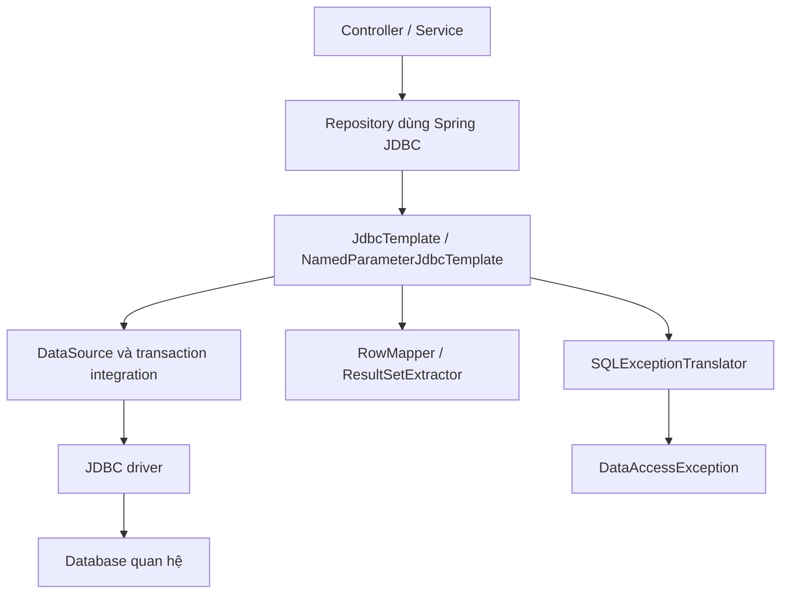

# Vai trò của Spring JDBC trên nền API JDBC

## 1. Spring JDBC đứng ở đâu trong một ứng dụng Java?

Trong Java, **JDBC** là bộ API tiêu chuẩn để ứng dụng trao đổi với cơ sở dữ liệu quan hệ: nạp driver thích hợp, lấy `Connection`, dùng `PreparedStatement` thực thi SQL có tham số, đọc `ResultSet` và điều phối `commit()`/`rollback()` khi cần. Những API này đầy đủ nhưng mã ứng dụng phải tự lặp lại nhiều thao tác: tạo statement, gắn tham số, đóng tài nguyên, chuyển `SQLException` thành lỗi nghiệp vụ và gắn các câu SQL vào cùng transaction.

**Spring JDBC** là lớp hỗ trợ của Spring Framework xây dựng **trên JDBC**, không phải một giao thức kết nối khác. Nó vẫn sử dụng `DataSource`, JDBC driver, `Connection`, `PreparedStatement` và `ResultSet` bên dưới, nhưng cung cấp các thành phần như `JdbcTemplate` để tổ chức phần mã lặp lại.

Giả sử một dịch vụ cần:

- Lấy danh sách đơn hàng của một tenant.
- Thêm đơn và nhận khóa chính do database sinh.
- Cập nhật trạng thái bằng SQL có điều kiện để chống ghi đè.
- Cập nhật hai bảng trong cùng một transaction.
- Ghi nhận ngoại lệ theo nhóm mà không lặp lại mọi nhánh `try/catch/finally`.

Có thể thực hiện toàn bộ bằng JDBC thuần. Với Spring JDBC, ứng dụng **vẫn kiểm soát câu SQL**, nhưng thư viện hỗ trợ xử lý vòng đời tài nguyên, ánh xạ dữ liệu, tham số và giao dịch.

> **Ý chính:** Spring JDBC giúp sử dụng JDBC gọn, nhất quán và dễ tích hợp vào Spring; nó **không** tự động biến ứng dụng thành ORM, không loại bỏ SQL và không thay thế driver hoặc khả năng transaction của database.

Sau bài này, bạn sẽ hiểu kiến trúc Spring JDBC, tự so sánh đoạn mã JDBC thuần với `JdbcTemplate`, sử dụng `RowMapper` và tham số hóa, phân biệt các API Spring JDBC, nhận biết việc quản lý connection và transaction, xử lý `DataAccessException`, đồng thời biết khi nào nên chọn Spring JDBC thay vì JDBC thuần hoặc một công cụ ORM.

## 2. Kiến trúc: Spring JDBC bổ sung một lớp hỗ trợ, không bỏ JDBC



Trong sơ đồ:

1. **Ứng dụng** lựa chọn SQL, điều kiện `WHERE`, dữ liệu tham số, kết quả nghiệp vụ và ranh giới transaction.
2. **Spring JDBC** thực thi quy trình mở/lấy connection, tạo statement, gắn tham số, thực thi, duyệt/ánh xạ kết quả, xử lý tài nguyên và chuyển đổi ngoại lệ.
3. **`DataSource`** cấp các kết nối JDBC; có thể là một connection pool hoặc một implementation khác theo cấu hình.
4. **JDBC driver** chuyển các yêu cầu JDBC thành giao thức của PostgreSQL, MySQL, SQL Server hoặc database tương ứng.
5. **Database** chịu trách nhiệm thực thi SQL, bảo đảm ràng buộc, khóa, transaction isolation và lưu dữ liệu bền vững.

Spring JDBC không thể tự sửa một truy vấn SQL sai, tự tối ưu tất cả execution plan hoặc tự làm cho database hỗ trợ tính năng mà driver/server không có.

### Spring JDBC khác Spring Boot ở điểm nào?

**Spring Framework** cung cấp các API như `JdbcTemplate`, `NamedParameterJdbcTemplate` và quản lý transaction. **Spring Boot** hỗ trợ cấu hình tự động các bean `DataSource`, `JdbcTemplate` và thành phần liên quan khi có dependency/cấu hình thích hợp.

Vì vậy, có thể dùng Spring JDBC trong một ứng dụng Spring Framework **không dùng Boot**; ngược lại, dự án Spring Boot thường dùng Spring JDBC thông qua starter và dependency injection.

## 3. Cùng một truy vấn: JDBC thuần và Spring JdbcTemplate

Giả sử database có bảng:

```sql
CREATE TABLE purchase_orders (
    id           BIGINT PRIMARY KEY,
    tenant_id    BIGINT NOT NULL,
    status       VARCHAR(24) NOT NULL,
    total_amount DECIMAL(15, 2) NOT NULL,
    version      BIGINT NOT NULL DEFAULT 0
);

CREATE INDEX idx_purchase_orders_tenant_id
    ON purchase_orders (tenant_id, id);
```

Ví dụ này giả định ID đã có trong dữ liệu mẫu. Các ví dụ về khóa tự sinh ở phần sau cần cấu hình cột ID theo cú pháp `IDENTITY`, `AUTO_INCREMENT` hoặc cơ chế tương đương của database đích.

Mô hình đọc ứng dụng:

```java
import java.math.BigDecimal;

public record OrderView(
        long id,
        long tenantId,
        String status,
        BigDecimal totalAmount,
        long version) {
}
```

### 3.1. JDBC thuần: lập trình viên quản lý vòng đời trực tiếp

```java
import java.sql.Connection;
import java.sql.PreparedStatement;
import java.sql.ResultSet;
import java.sql.SQLException;
import java.util.ArrayList;
import java.util.List;
import javax.sql.DataSource;

public final class PlainJdbcOrderRepository {
    private final DataSource dataSource;

    public PlainJdbcOrderRepository(DataSource dataSource) {
        this.dataSource = dataSource;
    }

    public List<OrderView> findByTenant(long tenantId)
            throws SQLException {
        String sql = """
                SELECT id, tenant_id, status, total_amount, version
                FROM purchase_orders
                WHERE tenant_id = ?
                ORDER BY id
                """;

        List<OrderView> orders = new ArrayList<>();
        try (Connection connection = dataSource.getConnection();
             PreparedStatement ps = connection.prepareStatement(sql)) {
            ps.setLong(1, tenantId);

            try (ResultSet rs = ps.executeQuery()) {
                while (rs.next()) {
                    orders.add(new OrderView(
                            rs.getLong("id"),
                            rs.getLong("tenant_id"),
                            rs.getString("status"),
                            rs.getBigDecimal("total_amount"),
                            rs.getLong("version")
                    ));
                }
            }
        }
        return List.copyOf(orders);
    }
}
```

Đây là JDBC chuẩn, không có gì sai. `try-with-resources` bảo vệ tài nguyên, `PreparedStatement` truyền tham số đúng kiểu và `ResultSet` cung cấp dữ liệu theo hàng. Nhưng mỗi phương thức repository thường phải viết lại phần lớn cấu trúc tương tự.

### 3.2. Spring JDBC: giữ SQL và mapping, bớt boilerplate

```java
import java.util.List;
import javax.sql.DataSource;
import org.springframework.jdbc.core.JdbcTemplate;
import org.springframework.stereotype.Repository;

@Repository
public final class SpringOrderRepository {
    private final JdbcTemplate jdbc;

    public SpringOrderRepository(DataSource dataSource) {
        this.jdbc = new JdbcTemplate(dataSource);
    }

    public List<OrderView> findByTenant(long tenantId) {
        String sql = """
                SELECT id, tenant_id, status, total_amount, version
                FROM purchase_orders
                WHERE tenant_id = ?
                ORDER BY id
                """;

        return jdbc.query(sql, (rs, rowNumber) -> new OrderView(
                rs.getLong("id"),
                rs.getLong("tenant_id"),
                rs.getString("status"),
                rs.getBigDecimal("total_amount"),
                rs.getLong("version")
        ), tenantId);
    }
}
```

`JdbcTemplate` thực hiện công việc mà mã JDBC thuần phải viết:

- Lấy và giải phóng `Connection` thông qua hạ tầng JDBC/transaction của Spring.
- Tạo `PreparedStatement`, gắn `tenantId` vào dấu `?` và thực thi SQL.
- Duyệt `ResultSet`; với mỗi hàng gọi `RowMapper` để tạo `OrderView`.
- Đóng statement/result set và giải phóng connection theo đúng ngữ cảnh.
- Chuyển `SQLException` thành ngoại lệ truy cập dữ liệu của Spring.

**Điều không thay đổi** là câu SQL và bản chất thực thi: database vẫn chạy `SELECT`, driver JDBC vẫn gửi dữ liệu và ứng dụng vẫn quyết định những cột nào cần lấy. `JdbcTemplate` không tự sinh một mô hình bảng/quan hệ kiểu ORM.

## 4. JdbcTemplate hỗ trợ những thao tác JDBC nào?

`JdbcTemplate` nằm trong `org.springframework.jdbc.core`. Những nhóm phương thức phổ biến:

| Nhu cầu | API Spring JDBC | JDBC phía dưới |
|---|---|---|
| Đọc nhiều hàng | `jdbc.query(sql, mapper, args...)` | `PreparedStatement.executeQuery()` + `ResultSet` |
| Đọc một giá trị | `jdbc.queryForObject(sql, Long.class, args...)` | SELECT và đọc một kết quả |
| Thực thi INSERT/UPDATE/DELETE | `jdbc.update(sql, args...)` | `PreparedStatement.executeUpdate()` |
| DML nhiều bộ tham số | `jdbc.batchUpdate(...)` | `addBatch()` / `executeBatch()` theo khả năng |
| Lấy khóa tự sinh | `jdbc.update(creator, keyHolder)` | `RETURN_GENERATED_KEYS` / `getGeneratedKeys()` |
| Tùy biến việc đặt tham số | `PreparedStatementSetter` | `ps.setXxx()` |
| Tùy biến xử lý kết quả | `RowMapper`, `RowCallbackHandler`, `ResultSetExtractor` | Duyệt và đọc `ResultSet` |
| Tùy biến công việc JDBC đặc biệt | `ConnectionCallback`, `PreparedStatementCallback` | Sử dụng trực tiếp JDBC trong vòng đời do template quản lý |

Spring JDBC vẫn sử dụng các kiểu SQL phổ biến như `VARCHAR`, `BIGINT`, `DECIMAL` và `TIMESTAMP`. Với dữ liệu tiền, tiếp tục dùng `BigDecimal` thay vì `double` nếu muốn tránh sai số nhị phân.

### `queryForObject()` có nghĩa là “đúng một kết quả”

```java
Long numberOfOrders = jdbc.queryForObject(
        "SELECT COUNT(*) FROM purchase_orders WHERE tenant_id = ?",
        Long.class,
        tenantId
);
```

Câu `COUNT(*)` thường trả đúng một hàng. Nếu dùng `queryForObject()` với truy vấn chi tiết không có kết quả, Spring JDBC có thể ném `EmptyResultDataAccessException`; nếu trả quá nhiều hàng, có thể có `IncorrectResultSizeDataAccessException`. Vì thế đừng coi `queryForObject()` là `Optional` tự động.

Khi “không tìm thấy” là trạng thái nghiệp vụ bình thường, một lựa chọn rõ ràng là dùng `query(...)` và kiểm tra danh sách, hoặc thiết kế một helper chuyển riêng lỗi “không có hàng” thành `Optional.empty()` mà không nuốt các lỗi DB khác.

## 5. RowMapper: ranh giới giữa ResultSet và đối tượng Java

`RowMapper<T>` chuyển **một hàng** thành **một đối tượng**. Với ứng dụng JDBC, đây là nơi thích hợp để:

- Đọc tên cột và kiểu `ResultSet` đúng cách.
- Chuyển `DECIMAL` thành `BigDecimal`, `DATE/TIMESTAMP` sang kiểu thời gian Java phù hợp.
- Kiểm tra `NULL` khi getter trả kiểu nguyên thủy, hoặc dùng kiểu tham chiếu.
- Chuyển chuỗi SQL sang enum/record/domain value object.
- Tách phụ thuộc tên cột khỏi phần lớn mã nghiệp vụ.

Ví dụ tạo mapper dùng lại:

```java
import java.sql.ResultSet;
import java.sql.SQLException;
import org.springframework.jdbc.core.RowMapper;

public final class OrderViewMapper implements RowMapper<OrderView> {
    @Override
    public OrderView mapRow(ResultSet rs, int rowNumber)
            throws SQLException {
        return new OrderView(
                rs.getLong("id"),
                rs.getLong("tenant_id"),
                rs.getString("status"),
                rs.getBigDecimal("total_amount"),
                rs.getLong("version")
        );
    }
}
```

Sử dụng:

```java
List<OrderView> orders =
        jdbc.query(sql, new OrderViewMapper(), tenantId);
```

`RowMapper` **không cần tự gọi `rs.next()`**. `JdbcTemplate` chịu trách nhiệm duyệt con trỏ và gọi mapper cho từng hàng. Không đóng `ResultSet` hoặc `Connection` trong `mapRow()`.

### Khi nào không dùng RowMapper?

Nếu cần xử lý toàn bộ kết quả như một cấu trúc duy nhất, Spring có `ResultSetExtractor<T>`. Nếu chỉ cần xử lý từng hàng và **không lưu cả danh sách**, có thể dùng `RowCallbackHandler`.

```java
import java.util.concurrent.atomic.AtomicLong;

AtomicLong total = new AtomicLong();
jdbc.query(
        "SELECT id FROM purchase_orders WHERE tenant_id = ?",
        rs -> total.incrementAndGet(),
        tenantId
);
```

Đoạn này sử dụng overload `RowCallbackHandler`: template tự duyệt các hàng, callback xử lý hàng hiện tại. Nó không đảm bảo driver stream từng hàng với bộ nhớ cố định; với dữ liệu rất lớn cần đánh giá fetch size, cursor và cách buffer của driver. Nếu bài toán là tính số hàng, câu `SELECT COUNT(*)` thường đơn giản hơn ví dụ cộng bộ đếm, nhưng đoạn code giúp minh họa vai trò callback.

Không dùng `BeanPropertyRowMapper` mặc định cho mọi trường hợp rồi bỏ qua vấn đề ánh xạ tên cột, kiểu dữ liệu và bất biến domain. Với bản ghi quan trọng, mapper rõ ràng thường dễ kiểm thử hơn.

## 6. NamedParameterJdbcTemplate: đặt tên tham số thay vì nhớ vị trí

Trong JDBC thuần, thứ tự bind bắt đầu từ 1:

```java
ps.setString(1, "CONFIRMED");
ps.setLong(2, orderId);
ps.setLong(3, tenantId);
ps.setLong(4, expectedVersion);
```

Khi SQL có nhiều `?`, việc đảo vị trí tham số dễ gây sai. `NamedParameterJdbcTemplate` cho phép viết:

```sql
UPDATE purchase_orders
SET status = :newStatus,
    version = version + 1
WHERE id = :id
  AND tenant_id = :tenantId
  AND version = :expectedVersion;
```

Ví dụ Java:

```java
import javax.sql.DataSource;
import org.springframework.jdbc.core.namedparam.MapSqlParameterSource;
import org.springframework.jdbc.core.namedparam.NamedParameterJdbcTemplate;
import org.springframework.stereotype.Repository;

@Repository
public final class OrderCommandRepository {
    private final NamedParameterJdbcTemplate namedJdbc;

    public OrderCommandRepository(DataSource dataSource) {
        this.namedJdbc = new NamedParameterJdbcTemplate(dataSource);
    }

    public boolean changeStatus(
            long id, long tenantId, long expectedVersion,
            String newStatus) {

        String sql = """
                UPDATE purchase_orders
                SET status = :newStatus, version = version + 1
                WHERE id = :id
                  AND tenant_id = :tenantId
                  AND version = :expectedVersion
                """;

        MapSqlParameterSource params = new MapSqlParameterSource()
                .addValue("newStatus", newStatus)
                .addValue("id", id)
                .addValue("tenantId", tenantId)
                .addValue("expectedVersion", expectedVersion);

        int updatedRows = namedJdbc.update(sql, params);
        if (updatedRows > 1) {
            throw new IllegalStateException("Unexpected update count");
        }
        return updatedRows == 1;
    }
}
```

`NamedParameterJdbcTemplate` chuyển cú pháp `:newStatus`, `:tenantId`… thành các placeholder `?` và bộ giá trị tương ứng trước khi dùng JDBC bên dưới. Nó **không** biến `:tableName` thành một tham số tên bảng hợp lệ và không bảo vệ việc nối thẳng tên cột/`ORDER BY` tùy ý từ client.

**Ví dụ an toàn:** trạng thái mới và ID được truyền dưới dạng giá trị bind; `tenantId` phải đến từ ngữ cảnh phân quyền đáng tin, không phải cứ có tham số hóa là được quyền sửa hàng.

### Danh sách giá trị trong IN

`NamedParameterJdbcTemplate` có thể mở rộng tham số collection cho biểu thức `IN (:ids)`:

```java
String sql = """
        SELECT id, tenant_id, status, total_amount, version
        FROM purchase_orders
        WHERE tenant_id = :tenantId
          AND id IN (:ids)
        ORDER BY id
        """;

MapSqlParameterSource params = new MapSqlParameterSource()
        .addValue("tenantId", tenantId)
        .addValue("ids", List.of(101L, 102L));

List<OrderView> result =
        namedJdbc.query(sql, params, new OrderViewMapper());
```

Phải xử lý **danh sách rỗng** trước khi tạo SQL, vì `IN ()` có thể không hợp lệ. Danh sách rất lớn còn bị giới hạn bởi số tham số/bộ nhớ của driver và DB; chia đợt hoặc dùng cấu trúc tạm khi phù hợp.

### JdbcClient: facade có cú pháp fluent trong Spring Framework mới

Từ **Spring Framework 6.1**, `JdbcClient` là một lựa chọn viết code theo chuỗi phương thức (fluent API) ở phía trên các khả năng `JdbcTemplate` và `NamedParameterJdbcTemplate`. Nó không phải driver mới, không thay đổi cách database thực thi SQL.

```java
import java.util.List;
import javax.sql.DataSource;
import org.springframework.jdbc.core.simple.JdbcClient;

JdbcClient client = JdbcClient.create(dataSource);

List<OrderView> rows = client.sql("""
        SELECT id, tenant_id, status, total_amount, version
        FROM purchase_orders
        WHERE tenant_id = :tenantId
        ORDER BY id
        """)
        .param("tenantId", tenantId)
        .query(new OrderViewMapper())
        .list();
```

Đoạn này giả định `dataSource` và `tenantId` đã được khai báo. Cú pháp `JdbcClient` phụ thuộc phiên bản Spring; với dự án dùng Spring Framework cũ hơn, tiếp tục sử dụng `JdbcTemplate`/`NamedParameterJdbcTemplate`. Dù chọn API nào, ứng dụng vẫn chịu trách nhiệm viết SQL, xác thực tenant, xử lý transaction và lựa chọn mapper phù hợp.

## 7. Connection và DataSource: Spring quản lý tài nguyên như thế nào?

JDBC thuần thường viết:

```java
try (Connection connection = dataSource.getConnection();
     PreparedStatement ps = connection.prepareStatement(sql)) {
    // Gán tham số, executeQuery(), ResultSet...
}
```

Spring JDBC dùng `DataSourceUtils` và hạ tầng transaction để lấy connection đúng ngữ cảnh. Nếu một transaction Spring đã bind connection vào thread hiện tại, `JdbcTemplate` sẽ tham gia transaction đó thay vì tùy ý mở một transaction không liên quan.

Điều này giải quyết tình huống: tầng service gọi hai repository trong một transaction và muốn cả hai lệnh dùng **cùng tài nguyên giao dịch**.

### Quy tắc trong repository dùng JdbcTemplate

- Thông thường chỉ inject `JdbcTemplate` hoặc `NamedParameterJdbcTemplate` rồi gọi `query()`/`update()`.
- Không gọi thủ công `Connection.commit()`, `rollback()` hoặc `setAutoCommit(false)` trong mỗi phương thức template.
- Không giữ `Connection`/`ResultSet` sau khi callback của template đã kết thúc.
- Không cất `PreparedStatement` hay `ResultSet` vào field của singleton service/repository.
- Một `JdbcTemplate` đã cấu hình có thể được dùng lại giữa nhiều request; **không** gán các giá trị SQL vào field mutable của template như trạng thái riêng của từng request.

### Nếu cần dùng API JDBC trực tiếp bên trong Spring transaction

Thay vì mượn connection thô mà không nhận biết transaction, có thể dùng `DataSourceUtils`:

```java
import java.sql.Connection;
import java.sql.PreparedStatement;
import java.sql.SQLException;
import javax.sql.DataSource;
import org.springframework.jdbc.datasource.DataSourceUtils;

public static int updateWithJDBC(
        DataSource dataSource, long id, String status) throws SQLException {

    Connection connection = DataSourceUtils.getConnection(dataSource);
    try {
        try (PreparedStatement ps = connection.prepareStatement(
                "UPDATE purchase_orders SET status = ? WHERE id = ?")) {
            ps.setString(1, status);
            ps.setLong(2, id);
            return ps.executeUpdate();
        }
    } finally {
        DataSourceUtils.releaseConnection(connection, dataSource);
    }
}
```

Đây là **phương thức minh họa**. `DataSourceUtils.releaseConnection()` biết connection có đang được Spring quản lý trong transaction hay không; nó không tự đóng connection đã được bind cho transaction hiện tại. Không bọc connection nhận từ `DataSourceUtils` trong `try (Connection ...)` rồi vô tình đóng connection do transaction manager sở hữu.

Trong dự án sử dụng transaction manager, nên nhất quán về `DataSource`: JdbcTemplate, phần JDBC trực tiếp và transaction manager phải trỏ tới **cùng nguồn kết nối phù hợp**. Nếu dùng hai database độc lập, `@Transactional` với một `DataSourceTransactionManager` thông thường **không** tạo transaction nguyên tử xuyên cả hai database.

## 8. Chuyển đổi SQLException thành DataAccessException

Với JDBC thuần, các phương thức thường khai báo `throws SQLException`. Code tầng gọi phải phân tích `SQLState`, mã vendor hoặc loại `SQLException`.

`JdbcTemplate` thường bắt `SQLException` và chuyển thành **`DataAccessException`**, họ ngoại lệ *unchecked* của Spring:

```java
import org.springframework.dao.DataAccessException;
import org.springframework.dao.DuplicateKeyException;

try {
    repository.insertNewOrder(orderDraft);
} catch (DuplicateKeyException duplicate) {
    // Một ràng buộc unique/primary key có thể bị vi phạm.
    // Tùy DB và translator mà phân loại cụ thể có thể khác.
} catch (DataAccessException databaseFailure) {
    // Lỗi truy cập dữ liệu khác: giữ ngữ cảnh và phản hồi phù hợp.
}
```

Đây là ví dụ **luồng xử lý**, giả định `repository.insertNewOrder(orderDraft)` và `orderDraft` do ứng dụng định nghĩa. Các lớp con có thể gồm `DuplicateKeyException`, `DataIntegrityViolationException`, `DataAccessResourceFailureException`, `CannotAcquireLockException`, `QueryTimeoutException` và các loại khác tùy khả năng phân loại.

**Lưu ý về tính di động:**

- Cùng lỗi ràng buộc ở các DB có thể trả SQLState/vendor code khác nhau.
- `SQLExceptionTranslator` ánh xạ sang họ ngoại lệ Spring; không bảo đảm cùng một subclass chính xác trên mọi driver.
- Một số lỗi nằm ngoài `SQLException`, ví dụ bug lập trình Java, vẫn là lỗi khác và không được “dịch” thành lỗi DB.
- `DataAccessException` là unchecked, nhưng không có nghĩa có thể bỏ qua xử lý transaction, log hoặc retry.

Không ghi `exception.getMessage()`, SQL đã nội suy giá trị hoặc toàn bộ tham số nhạy cảm vào log chia sẻ khi có khả năng rò rỉ dữ liệu. Có thể ghi mã thao tác cố định, nhóm lỗi, SQLState/vendor code được kiểm soát và correlation ID do ứng dụng cấp.

### Spring exception không đồng nghĩa rollback đã hoàn tất

`DataAccessException` cho biết truy cập dữ liệu thất bại theo hợp đồng API. Nó **không** tự chứng minh transaction đã được rollback hoặc commit. Tầng transaction phải quản lý ranh giới; nếu lỗi kết nối xảy ra trong `commit()`, trạng thái thực tế có thể chưa rõ và cần đối soát.

## 9. Spring transaction phối hợp các lời gọi JdbcTemplate

Trong một ứng dụng Spring, bạn có thể dùng `@Transactional` ở tầng service để gom nhiều lời gọi repository vào một đơn vị transaction.

```java
import org.springframework.stereotype.Service;
import org.springframework.transaction.annotation.Transactional;

@Service
public final class OrderWorkflowService {
    private final OrderCommandRepository orders;
    private final AuditJdbcRepository audit;

    public OrderWorkflowService(
            OrderCommandRepository orders, AuditJdbcRepository audit) {
        this.orders = orders;
        this.audit = audit;
    }

    @Transactional
    public void confirm(
            long orderId, long tenantId, long expectedVersion) {
        boolean changed = orders.changeStatus(
                orderId, tenantId, expectedVersion, "CONFIRMED");

        if (!changed) {
            throw new IllegalStateException(
                    "Order not found or version conflict");
        }

        // Thành phần audit cũng dùng JdbcTemplate cùng DataSource.
        audit.recordConfirmation(orderId, tenantId);
    }
}
```

`AuditJdbcRepository` là repository ứng dụng giả định, cung cấp `recordConfirmation(...)`. Nếu hai repository sử dụng đúng `DataSource` được transaction manager quản lý, `@Transactional` có thể khiến lệnh cập nhật đơn và lệnh thêm audit cùng commit hoặc rollback.

**Điều Spring hỗ trợ:** lấy đúng connection đang tham gia transaction, điều phối `setAutoCommit(false)`/`commit()`/`rollback()` ở ranh giới giao dịch khi cần, và giải phóng connection khi transaction kết thúc.

**Điều developer vẫn chịu trách nhiệm:** SQL bảo vệ điều kiện nghiệp vụ, xử lý `executeUpdate() == 0`, định nghĩa rollback policy, tránh side effect ngoài DB bị thực hiện trước commit, và xác định mức isolation/locking khi có cập nhật đồng thời.

### Transaction manager nào?

Đối với JDBC local transaction với một `DataSource`, Spring có `DataSourceTransactionManager`; `JdbcTransactionManager` là biến thể tích hợp chuyển đổi ngoại lệ JDBC ở các thao tác commit/rollback.

Khi dùng Spring Boot với một `DataSource` và các dependency phù hợp, transaction manager có thể được cấu hình tự động. Nếu ứng dụng có nhiều datasource/transaction manager, phải chỉ định rõ bean nào quản lý phương thức; không giả định mọi `@Transactional` đều thuộc đúng DB mà repository sử dụng.

### Các điểm dễ nhầm với @Transactional

| Tình huống | Điều cần nhớ |
|---|---|
| Phương thức public gọi từ bên ngoài qua Spring proxy | Đây là trường hợp phổ biến để interceptor transaction hoạt động. |
| Một phương thức trong cùng object gọi `this.otherTransactionalMethod()` | Trong mô hình proxy mặc định, self-invocation thường **không** đi qua interceptor. |
| Runtime exception phát ra khỏi phương thức | Mặc định thường kích hoạt rollback. |
| Checked exception được ném ra | Mặc định không phải lúc nào cũng rollback; cấu hình `rollbackFor` khi cần. |
| Exception bị bắt và nuốt trong service | Transaction có thể tiếp tục/commit nếu không đánh dấu rollback hoặc ném lại. |
| `@Transactional(readOnly = true)` | Là hint/thiết lập tùy transaction manager/DB, không là lớp phân quyền cấm ghi tuyệt đối. |
| Thao tác HTTP/email/object storage ở trong transaction | JDBC transaction không rollback được tác dụng ở hệ thống ngoài. |
| Dùng thread mới hoặc `CompletableFuture` không có tích hợp ngữ cảnh phù hợp | Thread khác thường không tự kế thừa transaction đồng bộ với thread hiện tại. |

Ví dụ một chính sách rollback rõ:

```java
@Transactional(rollbackFor = BusinessCheckedException.class)
public void importOrders() throws BusinessCheckedException {
    // Các JDBC update cùng một DataSource và transaction hiện tại.
}
```

`BusinessCheckedException` là checked exception do ứng dụng định nghĩa. Nếu không cấu hình, Spring theo chính sách mặc định thường rollback khi `RuntimeException`/`Error` thoát khỏi phương thức, không mặc định rollback mọi checked exception.

## 10. Batch và generated keys: Spring giảm mã, JDBC vẫn thực thi

### 10.1. Batch update nhiều bộ tham số

```java
import java.math.BigDecimal;
import java.sql.PreparedStatement;
import java.sql.SQLException;
import java.util.List;
import org.springframework.jdbc.core.BatchPreparedStatementSetter;
import org.springframework.jdbc.core.JdbcTemplate;

record PriceChange(long productId, BigDecimal newPrice) {}

public static int[] applyPrices(
        JdbcTemplate jdbc, List<PriceChange> changes) {
    String sql = "UPDATE products SET price = ? WHERE id = ?";

    return jdbc.batchUpdate(sql, new BatchPreparedStatementSetter() {
        @Override
        public void setValues(PreparedStatement ps, int index)
                throws SQLException {
            PriceChange change = changes.get(index);
            ps.setBigDecimal(1, change.newPrice());
            ps.setLong(2, change.productId());
        }

        @Override
        public int getBatchSize() {
            return changes.size();
        }
    });
}
```

`JdbcTemplate.batchUpdate()` sử dụng khả năng batch của JDBC khi driver hỗ trợ. Tùy API/driver và cấu hình, Spring có thể sử dụng đường xử lý khác nếu batch không được hỗ trợ. Giá trị update count cần được diễn giải theo hợp đồng:

- `1`: driver báo một hàng được cập nhật.
- `0`: không có hàng nào thỏa điều kiện.
- `Statement.SUCCESS_NO_INFO` (`-2`): thành công nhưng không có số dòng chính xác.
- `Statement.EXECUTE_FAILED` (`-3`): báo phần tử thất bại ở những driver tiếp tục batch sau lỗi.

Nếu nghiệp vụ bắt buộc **mỗi ID cập nhật đúng một hàng**, `SUCCESS_NO_INFO` không đủ để xác nhận điều đó. Batch cũng không tự tạo transaction: nếu tất cả thay đổi phải nguyên tử, hãy dùng `@Transactional` hoặc transaction manager phù hợp.

### 10.2. Lấy khóa tự sinh

JDBC thuần dùng `Statement.RETURN_GENERATED_KEYS` và `PreparedStatement.getGeneratedKeys()`. Spring JDBC có `GeneratedKeyHolder` để nhận kết quả đó:

```java
import java.sql.PreparedStatement;
import java.sql.Statement;
import java.util.Objects;
import org.springframework.jdbc.core.JdbcTemplate;
import org.springframework.jdbc.support.GeneratedKeyHolder;
import org.springframework.jdbc.support.KeyHolder;

public static long insertProduct(
        JdbcTemplate jdbc, String name) {
    Objects.requireNonNull(name);
    KeyHolder holder = new GeneratedKeyHolder();

    int affected = jdbc.update(connection -> {
        PreparedStatement ps = connection.prepareStatement(
                "INSERT INTO products(name) VALUES (?)",
                new String[]{"id"});
        ps.setString(1, name);
        return ps;
    }, holder);

    if (affected != 1) {
        throw new IllegalStateException("Expected one inserted product");
    }
    Number key = holder.getKey();
    if (key == null) {
        throw new IllegalStateException("Driver returned no generated key");
    }
    return key.longValue();
}
```

Ví dụ này **giả định** bảng `products` có cột `id` do DB sinh, driver hỗ trợ lấy khóa và khóa phù hợp `long`. Hình dạng của `getGeneratedKeys()` và hỗ trợ khai báo cột khóa phụ thuộc driver. Có DB hỗ trợ `INSERT ... RETURNING` hoặc cơ chế khác phù hợp hơn. `KeyHolder` giảm mã thao tác trên `ResultSet`, không tạo ra khả năng lấy khóa mới nếu driver/DB không cung cấp.

Nếu key không trả về trong chế độ auto-commit, `INSERT` có thể đã được commit dù phương thức ném lỗi. Với nghiệp vụ phải nhận được khóa mới coi là thành công, cần ranh giới transaction rõ và rollback khi thiếu khóa, thay vì tin rằng ném exception tự xóa hàng đã chèn.

## 11. Cấu hình DataSource và JdbcTemplate trong ứng dụng Spring

Một cấu hình Java không dùng Spring Boot có thể khai báo `JdbcTemplate` dựa trên `DataSource` được cấp sẵn:

```java
import javax.sql.DataSource;
import org.springframework.context.annotation.Bean;
import org.springframework.context.annotation.Configuration;
import org.springframework.jdbc.core.JdbcTemplate;
import org.springframework.jdbc.core.namedparam.NamedParameterJdbcTemplate;

@Configuration
public class JdbcConfiguration {
    @Bean
    JdbcTemplate jdbcTemplate(DataSource dataSource) {
        return new JdbcTemplate(dataSource);
    }

    @Bean
    NamedParameterJdbcTemplate namedJdbcTemplate(
            DataSource dataSource) {
        return new NamedParameterJdbcTemplate(dataSource);
    }
}
```

`DataSource` có thể được cấu hình thông qua connection pool, nhưng không cần tạo connection mới cho từng bean: một bean template dùng lại nguồn kết nối để thực thi nhiều truy vấn.

### Với Spring Boot

Trong một dự án Spring Boot có dependency `spring-boot-starter-jdbc` và driver database thích hợp, Boot thường tự cấu hình `DataSource` và `JdbcTemplate` khi các điều kiện auto-configuration được đáp ứng.

Ví dụ cấu hình minh họa (giá trị phải lấy từ secret store hoặc cơ chế cấu hình an toàn, không hardcode):

```yaml
spring:
  datasource:
    url: jdbc:postgresql://db.internal.example:5432/orders
    username: <resolved-from-secret-store>
    password: <resolved-from-secret-store>
  jdbc:
    template:
      query-timeout: 10s
```

Cấu hình cụ thể còn phụ thuộc phiên bản Spring Boot, connection pool và JDBC driver. Nếu yêu cầu TLS, cần đặt thuộc tính xác minh server (ví dụ chế độ xác minh hostname của driver) trong cấu hình nguồn kết nối; chỉ dùng `spring.datasource.url` với endpoint là chưa đủ chứng minh kết nối được bảo vệ đầy đủ.

**Không nên đặt mật khẩu thật trong tài liệu cấu hình commit vào repository.** Hệ thống triển khai cần cung cấp secret và không ghi raw connection properties ra log.

### Không mở rộng Spring quá mức khi không cần

Một thư viện Java nhỏ chạy vài truy vấn độc lập có thể chỉ cần `DataSource` và JDBC thuần. Spring JDBC phát huy lợi ích khi ứng dụng đã có Spring container, nhiều repository, transaction cần phối hợp và muốn giảm lặp mã, chứ không phải mọi chương trình JDBC đều phải sử dụng Spring.

## 12. Spring JDBC không phải ORM

Đây là khác biệt dễ gây hiểu sai:

| Công cụ | Bạn thường viết SQL? | Chuyển kết quả | Theo dõi thay đổi entity tự động? |
|---|---|---|---|
| JDBC thuần | Có | Tự duyệt `ResultSet` | Không |
| Spring JDBC (`JdbcTemplate`) | Có | `RowMapper` / callback | Không |
| Spring Data JDBC | Có thể ít hơn cho thao tác repository cơ bản; vẫn cho phép SQL tùy chỉnh | Mapping theo quy ước aggregate | Không có persistence context/dirty checking kiểu JPA |
| JPA/Hibernate | Có thể dùng JPQL/Criteria hoặc SQL; ORM sinh nhiều SQL | ORM ánh xạ entity/quan hệ | Có persistence context và dirty checking theo mô hình JPA |

Spring JDBC thích hợp khi:

- SQL là một phần quan trọng cần kiểm soát trực tiếp (lọc, join, CTE, thủ tục lưu trữ, tối ưu truy vấn).
- Mô hình dữ liệu không cần một persistence context để theo dõi entity.
- Nhóm phát triển hiểu SQL/JDBC và muốn giảm boilerplate mà không thêm quá nhiều quy ước ORM.
- Cần tích hợp transaction và exception handling vào ứng dụng Spring có sẵn.

JPA/Hibernate có thể phù hợp khi ứng dụng ưu tiên quản lý entity/quan hệ với nhiều thao tác theo vòng đời entity. Spring Data JDBC là một lựa chọn khác dựa trên quan niệm aggregate, không đồng nghĩa với `JdbcTemplate` và cũng không phải JPA.

Không có công cụ nào làm mất nhu cầu hiểu **chỉ mục, isolation, locking, transaction, SQL injection và quyền truy cập dữ liệu**.

## 13. Hiệu năng: giảm boilerplate chứ không miễn phí chi phí DB

`JdbcTemplate` không tự sửa các vấn đề hiệu năng như:

- Câu `SELECT *` kéo dữ liệu lớn dù UI chỉ cần vài cột.
- Query thiếu chỉ mục, quét bảng lớn hoặc `ORDER BY` tốn tài nguyên.
- Truy vấn N+1 do service gọi repository lặp qua từng hàng.
- Không giới hạn kích thước trang, không có query timeout và không có chính sách retry.
- Transaction giữ connection hoặc khóa quá lâu.
- Batch quá lớn gây tăng bộ nhớ và độ trễ.

Một số cấu hình cho phép:

```java
JdbcTemplate jdbc = new JdbcTemplate(dataSource);
jdbc.setFetchSize(200);
jdbc.setQueryTimeout(10);
```

`setFetchSize()` là **gợi ý** dành cho JDBC driver về việc lấy dữ liệu theo đợt; cách dùng bộ nhớ thực tế có thể phụ thuộc driver, cursor và chế độ transaction. `setQueryTimeout()` theo giây; các timeout mở connection, mượn connection từ pool và network timeout cần được quản lý ở tầng tương ứng.

Nếu dùng bean singleton cho nhiều request, việc gọi các setter cấu hình lúc request đang chạy có thể ảnh hưởng request khác. Hãy thiết lập cấu hình template khi khởi tạo ứng dụng hoặc dùng API có callback được quản lý rõ ràng.

Khi xuất hàng triệu hàng, cả `jdbc.query(..., RowMapper)` trả `List` lẫn `List` tạo bằng JDBC thuần đều có thể giữ rất nhiều dữ liệu trong RAM. Cân nhắc phân trang keyset, `RowCallbackHandler`, xử lý luồng phù hợp driver hoặc công cụ xuất dữ liệu chuyên biệt.

## 14. Kiểm thử Spring JDBC và SQL thật

Spring JDBC giúp dễ kiểm thử mapping bằng cách tạo `RowMapper` độc lập; nhưng test mock không đủ để chứng minh câu SQL hợp lệ, database thực thi đúng khóa hoặc transaction thực sự rollback.

### Test đơn vị và test tích hợp

| Loại test | Thứ nên kiểm tra | Giới hạn |
|---|---|---|
| Unit test cho service | Nhánh nghiệp vụ khi repository trả 0/1, timeout, conflict | Không chứng minh SQL đúng |
| Unit test cho `RowMapper` | Chuyển đổi cột, `NULL`, enum, `BigDecimal` | Không chứng minh truy vấn chạy được |
| JDBC integration test | SQL CRUD, ràng buộc, số dòng tác động, generated keys, transaction | Cần DB thật hoặc test DB tương thích |
| Test timeout/concurrency | Isolation, lock, rollback, cancel, pool | Embedded DB có thể khác DB production |

Với Spring Boot, `@JdbcTest` có thể dùng để tạo một test slice tập trung vào JDBC. Tùy cấu hình, Boot có thể chọn database nhúng; những phép thử phụ thuộc cú pháp và hành vi PostgreSQL/MySQL nên chạy trên đúng DB mục tiêu.

Ví dụ phác họa với schema và fixture được chuẩn bị cho test. Đoạn import `@JdbcTest` dưới đây phù hợp với cách tổ chức package của **Spring Boot 3.x**; nếu dùng phiên bản khác, kiểm tra module/package tương ứng của Spring Boot Test thay vì sao chép nguyên import.

```java
import org.junit.jupiter.api.Test;
import org.springframework.beans.factory.annotation.Autowired;
import org.springframework.boot.test.autoconfigure.jdbc.JdbcTest;
import org.springframework.jdbc.core.JdbcTemplate;

import static org.junit.jupiter.api.Assertions.assertEquals;

@JdbcTest
class OrderJdbcQueryTest {
    @Autowired
    JdbcTemplate jdbc;

    @Test
    void countOrdersByTenant() {
        // Giả sử test fixture đã tạo bảng purchase_orders và dữ liệu.
        Long count = jdbc.queryForObject(
                "SELECT COUNT(*) FROM purchase_orders WHERE tenant_id = ?",
                Long.class, 7L);

        assertEquals(Long.valueOf(2L), count);
    }
}
```

`@JdbcTest` là tính năng của **Spring Boot Test**, không phải một class trong JDBC chuẩn. Nên dùng `@Sql`, migration dành cho test hoặc setup fixture nhất quán để tạo dữ liệu, và dọn test giữa các ca. Với môi trường có nhiều phiên bản Spring Boot, kiểm tra package/autoconfiguration của starter test đang dùng.

**Không coi việc test thành công trên H2 là bằng chứng cú pháp, lock hay generated keys sẽ giống PostgreSQL/MySQL/SQL Server.** Các test quan trọng nên chạy trên loại DB mục tiêu, có thể qua container được cách ly.

## 15. Những sai lầm phổ biến khi tích hợp Spring với JDBC

| Sai lầm | Hậu quả | Cách xử lý |
|---|---|---|
| Nghĩ Spring JDBC không dùng JDBC driver | Thiếu driver, lỗi kết nối | Vẫn cấu hình driver và `DataSource` cho DB đích |
| Nghĩ `JdbcTemplate` tự sinh mọi SQL | Bỏ sót điều kiện nghiệp vụ và tối ưu | Viết SQL rõ ràng, dùng `PreparedStatement` qua template |
| Nối giá trị người dùng vào SQL thay vì bind | Nguy cơ SQL injection | Dùng `?` hoặc `:namedParameter` |
| Đưa tên bảng/cột vào named parameter | JDBC không bind được SQL identifier | Dùng whitelist/cấu trúc SQL cố định |
| Trả `ResultSet` từ callback để đọc sau | Tài nguyên có thể đã bị template đóng | Ánh xạ dữ liệu trước khi callback kết thúc |
| Đóng connection Spring đang quản lý transaction | Gây lỗi transaction hoặc commit/rollback sai | Dùng template hoặc `DataSourceUtils` đúng cách |
| Mở transaction trên một `DataSource`, truy vấn trên nguồn khác | Các SQL không thuộc cùng local transaction | Cấu hình cùng nguồn kết nối và đúng transaction manager |
| Gọi `@Transactional` qua `this.method()` rồi chờ proxy áp dụng | Không có interception theo mô hình proxy mặc định | Đưa transaction boundary vào lời gọi qua bean/proxy |
| Nuốt ngoại lệ bên trong `@Transactional` | Transaction có thể commit ngoài ý muốn | Ném lại hoặc đánh dấu rollback rõ ràng |
| Nghĩ mọi `DataAccessException` đều retry được | Có thể thử lại thao tác ghi gây trùng | Phân loại lỗi và đối soát/idempotency |
| Dùng `queryForObject()` khi 0 hàng là bình thường mà không xử lý | `EmptyResultDataAccessException` | Chọn cách trả `Optional` rõ ràng |
| Nghĩ `batchUpdate()` mặc định all-or-nothing | Có thể có cập nhật một phần | Dùng transaction và kiểm tra update count |
| Nghĩ lấy khóa qua `KeyHolder` nghĩa là transaction đã commit | Dữ liệu có thể rollback hoặc commit fail | Xác nhận ranh giới transaction phù hợp |
| Dùng `@Transactional(readOnly = true)` như lớp phân quyền | Không bảo đảm chặn mọi ghi | Cấp quyền DB tối thiểu và kiểm tra quyền nghiệp vụ |
| Chỉ viết mock test cho repository | Không phát hiện lỗi SQL/driver | Thêm test tích hợp trên database đích |

## 16. Bài thực hành tự kiểm chứng

**Chuẩn bị:** một ứng dụng Spring có `spring-jdbc`, JDBC driver tương ứng, `DataSource` test và bảng `purchase_orders`. Tạo hai hàng mẫu thuộc tenant 7 và ít nhất một hàng thuộc tenant khác.

1. **JDBC thuần và JdbcTemplate:** viết hai repository đọc đơn hàng theo `tenant_id = ?`. So sánh số dòng mã và xác nhận cả hai cho cùng dữ liệu với `BigDecimal`, `version` đúng.
2. **RowMapper:** tách `OrderViewMapper` thành class riêng. Thêm một cột nullable vào fixture và dùng getter/`wasNull()` hoặc kiểu tham chiếu phù hợp để không mất thông tin `NULL`.
3. **Named parameters:** viết `UPDATE` với `:newStatus`, `:id`, `:tenantId` và `:expectedVersion`. Kiểm thử `update() == 1` khi version khớp và `0` khi bản ghi đã đổi version.
4. **Tích hợp transaction:** tạo service gọi hai repository cùng `DataSource` trong `@Transactional`. Cố tình ném `RuntimeException` sau lệnh đầu; xác nhận DB rollback cả hai thay đổi bằng kết nối mới.
5. **Exception translation:** thử vi phạm unique constraint trong database test; xem loại `DataAccessException` thực tế. Không hardcode mọi driver phải trả một subclass giống nhau.
6. **Batch:** dùng `batchUpdate()` cập nhật nhiều hàng; kiểm tra update count và thử lỗi ở phần tử giữa batch trong transaction để xác minh rollback.
7. **Generated keys:** thay `id` bằng kiểu ID sinh tự động phù hợp DB, gọi `GeneratedKeyHolder` rồi đọc lại hàng. Thử thiếu khóa trong transaction để quyết định có rollback không.
8. **Lỗi phân quyền:** thử tenant khác; xác nhận không đọc hoặc sửa được hàng ngoài phạm vi, dù câu SQL có dùng template.
9. **Hiệu năng:** so sánh kế hoạch SQL, fetch size, query timeout và thời gian giữ connection giữa các cách. Không kết luận framework luôn làm câu SQL nhanh hơn.

### Câu hỏi tự đánh giá

- Spring JDBC nằm ở lớp nào giữa service, `DataSource`, driver và database?
- `JdbcTemplate` thay bạn quản lý những tài nguyên gì, và SQL còn do ai viết?
- Tại sao `RowMapper` không nên gọi `ResultSet.next()`?
- Khi nào `NamedParameterJdbcTemplate` có ích hơn cách bind tham số theo vị trí?
- `DataAccessException` khác `SQLException` ở đâu; nó có bảo đảm rollback đã hoàn tất không?
- Vì sao nhiều lời gọi `JdbcTemplate` chỉ cùng transaction khi chúng tham gia đúng transaction manager/`DataSource`?
- Spring JDBC có tự theo dõi entity thay đổi và flush như ORM/JPA không?
- Vì sao `@Transactional` không thay thế điều kiện `WHERE version = ?` để phát hiện ghi đè?

### Ghi nhớ

**Spring JDBC là lớp hỗ trợ được xây dựng trên API JDBC chuẩn**, không phải giải pháp thay thế SQL hay JDBC driver. `JdbcTemplate` dùng `DataSource` để lấy connection, thực thi `PreparedStatement`, duyệt `ResultSet`, ánh xạ qua `RowMapper`, dọn tài nguyên và chuyển `SQLException` thành `DataAccessException`. `NamedParameterJdbcTemplate` giúp đặt tên tham số; các tiện ích batch/khóa sinh vẫn dựa vào khả năng JDBC/DB. `@Transactional` và transaction manager của Spring có thể phối hợp nhiều repository trong một transaction khi cấu hình đúng. Tuy vậy, ứng dụng vẫn phải hiểu SQL, transaction, isolation, update count, bảo mật, hiệu năng và kiểm thử trên database đích. Chọn Spring JDBC khi cần quyền kiểm soát SQL như JDBC thuần nhưng muốn giảm mã lặp và tích hợp nhất quán vào hệ sinh thái Spring.
