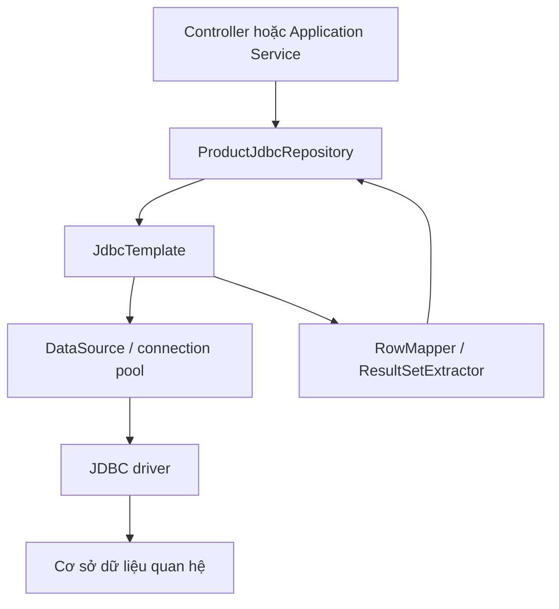

# Thực thi và ánh xạ bằng JdbcTemplate

## 1. Vấn đề mà `JdbcTemplate` giải quyết

Với **JDBC thuần**, để đọc một sản phẩm từ cơ sở dữ liệu, ứng dụng phải lấy `Connection`, tạo `PreparedStatement`, gán tham số, chạy SQL, duyệt `ResultSet`, ánh xạ từng cột và đóng tài nguyên. Nếu mọi DAO đều lặp lại các bước đó, phần mã quản lý hạ tầng có thể dài hơn logic truy vấn thực sự.

**`JdbcTemplate`** thuộc mô-đun **Spring JDBC** (`spring-jdbc`), giúp giảm phần mã lặp nhưng **vẫn sử dụng JDBC và SQL thực**. Nó nhận một `DataSource`, thực thi câu lệnh với kết nối phù hợp, xử lý vòng đời `Statement`/`ResultSet` và chuyển phần lớn lỗi JDBC sang hệ thống ngoại lệ `DataAccessException` của Spring.



Lập trình viên vẫn chịu trách nhiệm với **SQL, tham số, mô hình dữ liệu, chiến lược transaction, hiệu năng và phân quyền**. `JdbcTemplate` không tự biến SQL thành ORM, không tự sinh schema, không loại bỏ N+1 và không cho phép bỏ qua giới hạn tài nguyên.

Mục tiêu của bài: hiểu các API thực thi và ánh xạ chính của `JdbcTemplate`, viết một repository JDBC có thể dùng trong Spring, chọn đúng callback cho từng dạng kết quả và phối hợp `@Transactional` an toàn.

## 2. So sánh JDBC thuần với `JdbcTemplate`

### JDBC thuần

```java
String sql = "SELECT name FROM catalog_products WHERE product_id = ?";

try (Connection c = dataSource.getConnection();
     PreparedStatement ps = c.prepareStatement(sql)) {
    ps.setLong(1, productId);

    try (ResultSet rs = ps.executeQuery()) {
        return rs.next() ? rs.getString("name") : null;
    }
}
```

Đoạn này nằm trong phương thức đã khai báo `throws SQLException`, có biến `dataSource` và `productId`. Cách viết thuần JDBC hoàn toàn hợp lệ nhưng mỗi phương thức lại phải quản lý tài nguyên và checked exception.

### Dùng Spring JDBC

```java
String sql = "SELECT name FROM catalog_products WHERE product_id = ?";

List<String> names = jdbcTemplate.query(
        sql,
        (rs, rowNum) -> rs.getString("name"),
        productId);

return names.isEmpty() ? null : names.get(0);
```

Ở ví dụ trên, `JdbcTemplate` giúp tạo, thực thi và đóng những tài nguyên cần thiết. Callback `RowMapper` chỉ tập trung vào việc biến **một hàng `ResultSet`** thành một giá trị Java.

| Khía cạnh | JDBC thuần | `JdbcTemplate` |
| --- | --- | --- |
| Lấy kết nối | `dataSource.getConnection()` | Template dùng `DataSource` và cơ chế Spring để lấy kết nối |
| Chuẩn bị statement | `prepareStatement` và `setXxx` thủ công | Có overload gán tham số và callback `PreparedStatementSetter` |
| Duyệt kết quả | `while (rs.next())` | `RowMapper`, `ResultSetExtractor` hoặc `RowCallbackHandler` |
| Đóng statement/result set | `try-with-resources` do DAO viết | Template quản lý tài nguyên do nó tạo |
| Báo lỗi | `SQLException` checked | `DataAccessException` unchecked, được dịch từ lỗi JDBC |
| Transaction | `setAutoCommit/commit/rollback` hoặc thư viện khác | Phối hợp với transaction manager của Spring |
| Quyết định SQL | Do lập trình viên | **Vẫn do lập trình viên** |

**Không đóng `Connection` thủ công bên trong callback** do `JdbcTemplate` cung cấp; điều đó có thể phá vỡ transaction đang được Spring quản lý.

## 3. Chuẩn bị môi trường Spring JDBC

Ví dụ trong bài giả định **Java 17+**, Spring Framework 6 / Spring Boot 3.x, PostgreSQL và một `DataSource` hợp lệ. Các API `JdbcTemplate` được dùng là API quen thuộc của Spring JDBC; khi dùng phiên bản khác cần đối chiếu dependency và driver tương thích.

Với Maven và Spring Boot quản lý phiên bản, khai báo các dependency sau trong `pom.xml` (đoạn trích, không phải toàn bộ file):

```xml
<dependencies>
    <dependency>
        <groupId>org.springframework.boot</groupId>
        <artifactId>spring-boot-starter-jdbc</artifactId>
    </dependency>
    <dependency>
        <groupId>org.postgresql</groupId>
        <artifactId>postgresql</artifactId>
        <scope>runtime</scope>
    </dependency>
</dependencies>
```

`spring-boot-starter-jdbc` cung cấp cấu hình nền cho Spring JDBC và thông thường tích hợp connection pool. `spring-boot-starter-data-jdbc` là mô-đun khác, cung cấp cách ánh xạ repository/aggregate của Spring Data JDBC; **không bắt buộc** để sử dụng `JdbcTemplate`.

Ví dụ `application.yml`:

```yaml
spring:
  datasource:
    url: ${DB_JDBC_URL}
    username: ${DB_USER}
    password: ${DB_PASSWORD}
    hikari:
      maximum-pool-size: 8
      connection-timeout: 3000
```

Ứng dụng cung cấp các biến môi trường tương ứng, ví dụ URL dạng `jdbc:postgresql://db-host:5432/demo`; không đưa mật khẩu thật vào mã nguồn hoặc tài liệu.

Khi auto-configuration hợp lệ và chưa có bean thay thế, Spring Boot có thể cung cấp `DataSource`, `JdbcTemplate` và transaction manager thích hợp. Nếu dùng Spring Framework không có Boot, có thể đăng ký `JdbcTemplate` thủ công:

```java
import javax.sql.DataSource;
import org.springframework.context.annotation.Bean;
import org.springframework.context.annotation.Configuration;
import org.springframework.jdbc.core.JdbcTemplate;

@Configuration
public class JdbcConfiguration {
    @Bean
    JdbcTemplate jdbcTemplate(DataSource dataSource) {
        return new JdbcTemplate(dataSource);
    }
}
```

`JdbcTemplate` thường được cấu hình một lần và dùng lại qua dependency injection. Khi đã cấu hình xong, nó được thiết kế để nhiều luồng gọi đồng thời; **`ResultSet`, `Statement` và `Connection` riêng lẻ vẫn không nên dùng chung tùy tiện giữa các luồng**.

## 4. Dữ liệu mẫu: sản phẩm và lịch sử đặt giữ tồn kho

Để có ví dụ tự chứa, ta dùng hai bảng PostgreSQL. Bảng sản phẩm có khóa chính tự sinh; bảng `stock_reservations` ghi nhận số lượng đã được đặt giữ từ một sản phẩm:

```sql
CREATE TABLE catalog_products (
    product_id BIGINT GENERATED ALWAYS AS IDENTITY PRIMARY KEY,
    sku VARCHAR(64) NOT NULL UNIQUE,
    name VARCHAR(200) NOT NULL,
    price NUMERIC(18, 2) NOT NULL CHECK (price >= 0),
    stock INTEGER NOT NULL CHECK (stock >= 0)
);

CREATE TABLE stock_reservations (
    reservation_id BIGINT GENERATED ALWAYS AS IDENTITY PRIMARY KEY,
    product_id BIGINT NOT NULL
        REFERENCES catalog_products(product_id),
    quantity INTEGER NOT NULL CHECK (quantity > 0)
);

CREATE INDEX idx_reservations_product_id
    ON stock_reservations(product_id, reservation_id);

INSERT INTO catalog_products (sku, name, price, stock)
VALUES
    ('KB-001', 'Bàn phím cơ', 650.00, 15),
    ('MS-002', 'Chuột không dây', 240.00, 40);
```

Đây là schema phục vụ bài học; trong ứng dụng thực tế nên quản lý bằng migration thay vì tạo bảng khi mỗi request đến. `price` được khai báo `NUMERIC(18,2)` nên phía Java dùng `BigDecimal`, không dùng `double`.

Định nghĩa đối tượng dữ liệu bằng Java record:

```java
import java.math.BigDecimal;

public record Product(
        long id,
        String sku,
        String name,
        BigDecimal price,
        int stock) {}
```

`Product` ở đây là projection/DTO bất biến đơn giản, không phải đối tượng ORM được tự động theo dõi thay đổi. Việc gọi `new Product(...)` không tự tạo hay cập nhật hàng trong database.

## 5. `RowMapper`: ánh xạ từng hàng thành một đối tượng Java

`RowMapper<T>` là callback nhận một `ResultSet` **đã đứng tại hàng cần ánh xạ** và chỉ số hàng `rowNum`; nó trả về một giá trị kiểu `T`. `JdbcTemplate` chịu trách nhiệm gọi `rs.next()` khi dùng các phương thức `query(..., RowMapper)`.

```java
import java.sql.ResultSet;
import java.sql.SQLException;
import org.springframework.jdbc.core.RowMapper;

public final class ProductRowMapper implements RowMapper<Product> {
    @Override
    public Product mapRow(ResultSet rs, int rowNum)
            throws SQLException {
        return new Product(
                rs.getLong("product_id"),
                rs.getString("sku"),
                rs.getString("name"),
                rs.getBigDecimal("price"),
                rs.getInt("stock"));
    }
}
```

Vì schema đảm bảo `price` và `stock` không `NULL`, getter `getBigDecimal`/`getInt` dùng trực tiếp là phù hợp. Nếu cột số nguyên **có thể NULL**, `getInt` trả 0 khi gặp SQL `NULL`; cần gọi `rs.wasNull()` ngay sau getter hoặc chọn getter đối tượng thích hợp.

Có thể viết mapper bằng lambda:

```java
RowMapper<Product> mapper = (rs, rowNum) -> new Product(
        rs.getLong("product_id"),
        rs.getString("sku"),
        rs.getString("name"),
        rs.getBigDecimal("price"),
        rs.getInt("stock"));
```

Hai kiểu viết đều đúng. Nên tách thành class/hằng dùng lại khi nhiều câu SQL chọn cùng nhóm cột; với projection chỉ sử dụng một lần, lambda ngắn có thể rõ ràng hơn.

**Không gọi `rs.next()` bên trong `mapRow`.** Nếu mapper tự dịch cursor, nó có thể bỏ qua hàng hoặc làm hỏng vòng lặp do `JdbcTemplate` điều khiển. Cũng không nên mở thêm query riêng trong `mapRow` để lấy dữ liệu liên quan cho từng bản ghi; đó là một cách tạo ra **N+1 queries**.

## 6. Thực thi `SELECT`: `query` và `queryForObject`

Các overload thường gặp:

| API | Khi dùng | Đặc tính |
| --- | --- | --- |
| `query(sql, rowMapper, args...)` | 0 đến nhiều hàng | Trả `List<T>`, có thể rỗng |
| `queryForObject(sql, rowMapper, args...)` | Kỳ vọng **đúng một hàng** | Không có hàng: ném lỗi kích thước kết quả; nhiều hơn một: cũng ném lỗi |
| `queryForObject(sql, requiredType, args...)` | Một cột/một hàng như `COUNT(*)` | Trả giá trị kiểu đơn giản nếu chuyển đổi tương thích |
| `queryForList(sql, requiredType, args...)` | Danh sách một cột | Trả `List<T>` cho mỗi hàng |
| `queryForList(sql, args...)` | Nhiều cột theo dạng động | Trả `List<Map<String,Object>>` |

### 6.1. Một đối tượng có thể vắng mặt

`queryForObject` **không** tự trả `Optional.empty()` khi SQL không có hàng. Ví dụ:

```java
import java.util.Optional;
import org.springframework.dao.EmptyResultDataAccessException;

public Optional<Product> findById(long id) {
    String sql = """
            SELECT product_id, sku, name, price, stock
            FROM catalog_products
            WHERE product_id = ?
            """;

    try {
        return Optional.ofNullable(
                jdbcTemplate.queryForObject(
                        sql, PRODUCT_MAPPER, id));
    } catch (EmptyResultDataAccessException notFound) {
        return Optional.empty();
    }
}
```

Trong đoạn này, `jdbcTemplate` và `PRODUCT_MAPPER` là các thành phần của repository ở mục 7. `Optional.ofNullable` giúp xử lý trường hợp mapper trả `null`, nhưng với mapper `Product` ở bài này, một hàng hợp lệ sẽ trả đối tượng khác `null`.

Nếu truy vấn trả **hơn một hàng**, `queryForObject` báo `IncorrectResultSizeDataAccessException`; **không** được bắt chung rồi chuyển hết thành “không tìm thấy”. Truy vấn theo `product_id` có khóa chính nên theo schema nó chỉ có tối đa một hàng.

Một cách khác là gọi `query(..., mapper, id)` và lấy phần tử đầu nếu danh sách không rỗng; cách này thích hợp khi cần một danh sách, nhưng phải cân nhắc có muốn phát hiện nhiều hàng ngoài mong đợi hay không.

### 6.2. Danh sách có phân trang

```java
public List<Product> findNextPage(long lastSeenId, int pageSize) {
    if (lastSeenId < 0 || pageSize < 1 || pageSize > 100) {
        throw new IllegalArgumentException("Tham số trang không hợp lệ");
    }

    String sql = """
            SELECT product_id, sku, name, price, stock
            FROM catalog_products
            WHERE product_id > ?
            ORDER BY product_id
            LIMIT ?
            """;

    return jdbcTemplate.query(
            sql, PRODUCT_MAPPER, lastSeenId, pageSize);
}
```

`query` trả một danh sách `Product`; với trang rỗng, kết quả là danh sách rỗng, **không** ném `EmptyResultDataAccessException`. Sử dụng khóa tăng có thứ tự giúp tránh phân trang `OFFSET` sâu, nhưng cần nhớ dữ liệu thay đổi đồng thời không tự tạo snapshot bất biến giữa những request khác nhau.

### 6.3. Giá trị đơn lẻ

```java
Long count = jdbcTemplate.queryForObject(
        "SELECT COUNT(*) FROM catalog_products", Long.class);

BigDecimal maxPrice = jdbcTemplate.queryForObject(
        "SELECT MAX(price) FROM catalog_products",
        BigDecimal.class);
```

`COUNT(*)` trả một hàng và thường là số 0 khi bảng rỗng. `MAX(price)` cũng trả một hàng nhưng **giá trị cột có thể là SQL `NULL`** khi không có sản phẩm; khi ấy `maxPrice` có thể là `null`. Điều này khác trường hợp toàn truy vấn không trả hàng.

## 7. Repository hoàn chỉnh bằng `JdbcTemplate`

Repository sau kết hợp đọc một hàng, đọc danh sách, cập nhật có điều kiện, chèn bản ghi và lấy khóa do DBMS sinh. Nó chỉ phụ thuộc `JdbcTemplate` thay vì quản lý trực tiếp `Connection`.

```java
import java.math.BigDecimal;
import java.sql.PreparedStatement;
import java.util.List;
import java.util.Optional;

import org.springframework.dao.EmptyResultDataAccessException;
import org.springframework.jdbc.core.JdbcTemplate;
import org.springframework.jdbc.core.RowMapper;
import org.springframework.jdbc.support.GeneratedKeyHolder;
import org.springframework.jdbc.support.KeyHolder;
import org.springframework.stereotype.Repository;

@Repository
public class ProductJdbcRepository {
    private static final RowMapper<Product> PRODUCT_MAPPER =
            (rs, rowNum) -> new Product(
                    rs.getLong("product_id"),
                    rs.getString("sku"),
                    rs.getString("name"),
                    rs.getBigDecimal("price"),
                    rs.getInt("stock"));

    private final JdbcTemplate jdbc;

    public ProductJdbcRepository(JdbcTemplate jdbc) {
        this.jdbc = jdbc;
    }

    public Optional<Product> findById(long id) {
        String sql = """
                SELECT product_id, sku, name, price, stock
                FROM catalog_products
                WHERE product_id = ?
                """;

        try {
            return Optional.ofNullable(
                    jdbc.queryForObject(sql, PRODUCT_MAPPER, id));
        } catch (EmptyResultDataAccessException ignored) {
            return Optional.empty();
        }
    }

    public List<Product> findNextPage(long lastSeenId, int pageSize) {
        if (lastSeenId < 0 || pageSize < 1 || pageSize > 100) {
            throw new IllegalArgumentException(
                    "Tham số trang không hợp lệ");
        }

        String sql = """
                SELECT product_id, sku, name, price, stock
                FROM catalog_products
                WHERE product_id > ?
                ORDER BY product_id
                LIMIT ?
                """;

        return jdbc.query(sql, PRODUCT_MAPPER, lastSeenId, pageSize);
    }

    public long insert(
            String sku, String name, BigDecimal price, int stock) {
        if (sku == null || sku.isBlank()
                || name == null || name.isBlank()
                || price == null || price.signum() < 0
                || stock < 0) {
            throw new IllegalArgumentException(
                    "Thông tin sản phẩm không hợp lệ");
        }

        String sql = """
                INSERT INTO catalog_products
                    (sku, name, price, stock)
                VALUES (?, ?, ?, ?)
                """;

        KeyHolder keys = new GeneratedKeyHolder();
        int changed = jdbc.update(connection -> {
            PreparedStatement ps = connection.prepareStatement(
                    sql, new String[] {"product_id"});
            ps.setString(1, sku);
            ps.setString(2, name);
            ps.setBigDecimal(3, price);
            ps.setInt(4, stock);
            return ps;
        }, keys);

        if (changed != 1) {
            throw new IllegalStateException(
                    "INSERT không tạo đúng một sản phẩm");
        }
        Number key = keys.getKey();
        if (key == null) {
            throw new IllegalStateException(
                    "Driver không trả khóa product_id");
        }
        return key.longValue();
    }

    public boolean reserveStock(long productId, int quantity) {
        if (quantity <= 0) {
            throw new IllegalArgumentException("Số lượng phải dương");
        }

        String sql = """
                UPDATE catalog_products
                SET stock = stock - ?
                WHERE product_id = ?
                  AND stock >= ?
                """;

        return jdbc.update(
                sql, quantity, productId, quantity) == 1;
    }

    public void recordReservation(long productId, int quantity) {
        String sql = """
                INSERT INTO stock_reservations
                    (product_id, quantity)
                VALUES (?, ?)
                """;
        int changed = jdbc.update(sql, productId, quantity);
        if (changed != 1) {
            throw new IllegalStateException(
                    "Không ghi được một bản ghi đặt giữ");
        }
    }
}
```

Ví dụ sử dụng repository qua Spring dependency injection:

```java
long id = products.insert(
        "HP-003", "Tai nghe", new BigDecimal("399.00"), 20);

Optional<Product> product = products.findById(id);
List<Product> page = products.findNextPage(0L, 20);
```

`products` ở đây là bean `ProductJdbcRepository` được inject vào service/controller hợp lệ, không phải biến global. Các code snippet của bài nên được đặt trong cấu trúc lớp/method thích hợp khi đưa vào ứng dụng.

### Điều gì diễn ra bên dưới `insert(...)`?

`jdbc.update(PreparedStatementCreator, KeyHolder)` nhận callback tạo `PreparedStatement`; callback có quyền sử dụng `Connection` mà template cấp phát hoặc liên kết với transaction. Tham số vẫn được gán bằng `setString`, `setBigDecimal`, `setInt`, **không nối vào SQL**.

Với PostgreSQL và driver tương thích, `prepareStatement(sql, new String[] {"product_id"})` yêu cầu trả về **cột khóa được sinh**. `GeneratedKeyHolder.getKey()` phù hợp khi kỳ vọng **một hàng/một cột khóa**. Các driver/DBMS có cách hỗ trợ khóa tự sinh khác nhau; khi không nhận đúng khóa, cần kiểm tra dialect, driver, tên cột và hợp đồng SQL, không đoán key từ `MAX(id)`.

### `update(...)` trả về gì?

`jdbc.update(sql, args...)` trả **số hàng bị ảnh hưởng** theo hợp đồng JDBC:

- `1` với câu `UPDATE` theo khóa chính thường thể hiện một hàng đã được cập nhật.
- `0` có thể có nghĩa không tìm thấy hàng hoặc điều kiện `stock >= ?` không thỏa.
- Ngoại lệ là kênh báo lỗi SQL, khác với kết quả hợp lệ 0 hàng.

Trong `reserveStock`, điều kiện `stock >= quantity` được đặt **ngay trong câu SQL** để tránh kiểu kiểm tra stock trong Java rồi cập nhật sau gây tranh chấp dưới đồng thời. Service nghiệp vụ vẫn quyết định phải làm gì nếu trả `false`.

## 8. Chọn đúng callback ánh xạ kết quả

`JdbcTemplate` có nhiều cơ chế xử lý `ResultSet`; không phải tất cả đều giống nhau:

| Callback | Đối tượng vào | Đầu ra | Khi nên chọn |
| --- | --- | --- | --- |
| `RowMapper<T>` | Một hàng hiện tại của `ResultSet` | Một đối tượng `T` | Danh sách sản phẩm, DTO/record một hàng |
| `ResultSetExtractor<T>` | Toàn bộ `ResultSet` chưa được ứng dụng duyệt | Một kết quả `T` tùy ý | Gom nhiều hàng vào một aggregate, cấu trúc phân cấp |
| `RowCallbackHandler` | Một hàng hiện tại | Không trả kết quả trực tiếp | Xử lý từng hàng, thống kê, xuất theo callback |
| `PreparedStatementSetter` | `PreparedStatement` | Không có giá trị ánh xạ | Gán nhiều tham số, tuỳ biến statement |
| `PreparedStatementCreator` | `Connection` | `PreparedStatement` | Tạo statement đặc biệt, như yêu cầu generated keys |

### 8.1. `ResultSetExtractor`: một sản phẩm có nhiều reservation

Nếu dùng `LEFT JOIN` để đọc sản phẩm và các bản ghi đặt giữ, một sản phẩm có nhiều reservation sẽ xuất hiện trên **nhiều dòng SQL**. `RowMapper<Product>` độc lập cho mỗi hàng sẽ tạo nhiều `Product` trùng nhau.

Định nghĩa kết quả tổng hợp:

```java
import java.util.List;

public record Reservation(long id, int quantity) {}

public record ProductWithReservations(
        Product product, List<Reservation> reservations) {}
```

Có thể thêm phương thức sau vào `ProductJdbcRepository` (bổ sung `import java.util.ArrayList;` và `import org.springframework.jdbc.core.ResultSetExtractor;`):

```java
public Optional<ProductWithReservations> findWithReservations(long id) {
    String sql = """
            SELECT
                p.product_id, p.sku, p.name, p.price, p.stock,
                r.reservation_id, r.quantity
            FROM catalog_products p
            LEFT JOIN stock_reservations r
                ON r.product_id = p.product_id
            WHERE p.product_id = ?
            ORDER BY r.reservation_id
            """;

    ResultSetExtractor<ProductWithReservations> extractor = rs -> {
        Product product = null;
        List<Reservation> reservations = new ArrayList<>();

        while (rs.next()) {
            if (product == null) {
                product = PRODUCT_MAPPER.mapRow(rs, 0);
            }

            long reservationId = rs.getLong("reservation_id");
            if (!rs.wasNull()) {
                reservations.add(new Reservation(
                        reservationId, rs.getInt("quantity")));
            }
        }

        return product == null
                ? null
                : new ProductWithReservations(
                        product, List.copyOf(reservations));
    };

    return Optional.ofNullable(jdbc.query(sql, extractor, id));
}
```

Các điểm quan trọng:

1. Với `ResultSetExtractor`, **chính callback gọi `rs.next()`** và duyệt toàn bộ kết quả. Đây là điểm khác `RowMapper`.
2. `LEFT JOIN` vẫn trả hàng sản phẩm khi không có reservation; `reservation_id` sẽ là SQL `NULL`. Vì `getLong` trả 0 khi SQL `NULL`, phải gọi `wasNull()` **ngay sau** getter đó.
3. Nếu sản phẩm không tồn tại, không có dòng nào, extractor trả `null` và repository chuyển thành `Optional.empty()`.
4. `List.copyOf(...)` tạo danh sách bất biến cho caller, giúp không vô tình sửa dữ liệu đã ánh xạ.
5. Với một sản phẩm có rất nhiều reservation, `List` vẫn có thể tiêu thụ bộ nhớ lớn. Cần giới hạn quy mô hoặc phân trang các bản ghi con theo nhu cầu.

### 8.2. `RowCallbackHandler`: xử lý từng hàng

`RowCallbackHandler` phù hợp khi chỉ cần tính một số thống kê hoặc xử lý từng dòng mà **không dựng `List<Product>`**:

```java
import java.util.concurrent.atomic.AtomicLong;
import org.springframework.jdbc.core.RowCallbackHandler;

AtomicLong count = new AtomicLong();

RowCallbackHandler handler = rs -> {
    // Template đã đưa ResultSet tới hàng hiện tại.
    count.incrementAndGet();
    // Có thể đọc rs.getLong("product_id") nếu cần.
};

jdbcTemplate.query(
        "SELECT product_id FROM catalog_products",
        handler);

System.out.println("Số hàng đã duyệt: " + count.get());
```

Không gọi `rs.next()` bên trong `processRow` của `RowCallbackHandler` vì `JdbcTemplate` điều khiển việc chuyển hàng. `AtomicLong` ở đây chỉ là cách giữ bộ đếm cho lambda/callback, **không có nghĩa nên chia sẻ callback này giữa nhiều request**.

Callback xử lý từng hàng không đồng nghĩa driver chắc chắn streaming từ server với bộ nhớ cố định: driver có thể đệm toàn bộ kết quả tùy `fetchSize`, chế độ transaction và cấu hình. Nếu cần duyệt hàng triệu dòng, hãy giới hạn tổng số hàng/thời gian, đo bộ nhớ, đóng tài nguyên và tránh callback thực hiện công việc ngoài DB quá chậm.

## 9. `queryForList` và mapper tự động: dùng đúng tình huống

`queryForList` hữu ích cho dữ liệu ít cột hoặc cấu trúc động:

```java
List<String> skus = jdbcTemplate.queryForList(
        "SELECT sku FROM catalog_products ORDER BY sku",
        String.class);

List<java.util.Map<String, Object>> rows =
        jdbcTemplate.queryForList(
                "SELECT sku, stock FROM catalog_products WHERE stock < ?",
                10);
```

Trong ví dụ thứ hai, key của `Map` thường dựa trên tên/label cột do driver trả. Đây là cách tiện cho báo cáo nhỏ hoặc prototype, nhưng có các nhược điểm: nhiều ép kiểu runtime, dễ viết sai key, thiếu hợp đồng kiểu rõ ràng.

Spring có `BeanPropertyRowMapper` để ánh xạ cột vào property setter/field của bean, và các mapper dành cho class/record có constructor thích hợp ở những phiên bản Spring hỗ trợ. Tuy nhiên:

- Mapper tự động phụ thuộc quy ước tên cột/property và khả năng khởi tạo class.
- `snake_case` có thể được ánh xạ sang `camelCase` trong một số trường hợp, nhưng không nên xem là hợp đồng tự suy mọi tên.
- Schema có cột nullable, SQL alias phức tạp, value object hoặc kiểu ngày giờ chuyên biệt có thể cần mapping tường minh.
- Với domain object chứa invariant hoặc cần ghép nhiều bảng, `RowMapper` tự viết thường rõ ràng và dễ kiểm thử hơn.

**`JdbcTemplate` không theo dõi đối tượng như JPA.** Sau khi ánh xạ thành `Product`, sửa một trường của đối tượng Java không tự phát sinh `UPDATE`; phải gọi phương thức ghi rõ ràng.

## 10. Batch DML với `batchUpdate`

Khi cần cập nhật giá của nhiều sản phẩm, gọi `jdbc.update(...)` riêng cho từng hàng có thể tạo nhiều lượt gửi SQL. `batchUpdate` gom các lần binding cùng một SQL thành JDBC batch:

```java
import java.math.BigDecimal;
import java.util.List;

public record PriceChange(long productId, BigDecimal newPrice) {}

// Đặt trong một repository/service phù hợp, có biến jdbcTemplate.
List<PriceChange> changes = List.of(
        new PriceChange(1L, new BigDecimal("699.00")),
        new PriceChange(2L, new BigDecimal("259.00")));

int[][] updateCounts = jdbcTemplate.batchUpdate(
        "UPDATE catalog_products SET price = ? WHERE product_id = ?",
        changes,
        100,
        (ps, change) -> {
            ps.setBigDecimal(1, change.newPrice());
            ps.setLong(2, change.productId());
        });
```

Overload trên trả `int[][]`: mỗi mảng con chứa các kết quả cập nhật của một nhóm batch. Tùy driver, một phần tử có thể là `Statement.SUCCESS_NO_INFO` nếu DBMS/driver không trả chính xác số hàng; không luôn được phép kết luận **mỗi phần tử phải bằng 1**.

**Batch không tự bảo đảm nguyên tử cho cả nghiệp vụ.** Nếu một lệnh trong batch thất bại, những lệnh trước đó có thể đã thành công tùy cấu hình auto-commit và DBMS. Nếu cần “tất cả hoặc không có gì”, đặt batch trong một transaction Spring rõ ràng, kiểm tra lỗi và chính sách rollback.

Không nhầm `batchUpdate` với việc gom nhiều `SELECT` vào một truy vấn. Khi cần tải nhiều bản ghi liên quan, nên thiết kế `JOIN`, `WHERE id IN (...)` hoặc SQL tổng hợp để tránh N+1.

## 11. Giao dịch: `@Transactional` cùng `JdbcTemplate`

`JdbcTemplate` phối hợp với transaction manager của Spring. Khi một phương thức service được áp dụng `@Transactional` hợp lệ, các lời gọi repository dùng **cùng `DataSource`** trong cùng transaction sẽ tham gia vào kết nối JDBC do Spring quản lý. Không cần gọi `setAutoCommit(false)`, `commit()` hay `rollback()` thủ công trong từng repository.

Ví dụ: cần **vừa giảm tồn kho, vừa lưu một reservation**. Nếu một bước thất bại, phải rollback cả hai:

```java
import org.springframework.stereotype.Service;
import org.springframework.transaction.annotation.Transactional;

@Service
public class InventoryService {
    private final ProductJdbcRepository products;

    public InventoryService(ProductJdbcRepository products) {
        this.products = products;
    }

    @Transactional
    public void reserve(long productId, int quantity) {
        if (productId <= 0 || quantity <= 0) {
            throw new IllegalArgumentException(
                    "Sản phẩm hoặc số lượng không hợp lệ");
        }

        if (!products.reserveStock(productId, quantity)) {
            throw new IllegalStateException(
                    "Sản phẩm không tồn tại hoặc tồn kho không đủ");
        }

        products.recordReservation(productId, quantity);
        // Spring transaction manager commit khi method kết thúc thành công.
    }
}
```

Khi `recordReservation(...)` ném `DataAccessException` (unchecked), transaction theo cấu hình mặc định được đánh dấu rollback. Nếu `reserveStock` không ảnh hưởng hàng nào, `IllegalStateException` cũng dẫn tới rollback theo quy tắc mặc định áp dụng với runtime exception.

| Tình huống | Kết quả kỳ vọng |
| --- | --- |
| Stock đủ và ghi reservation thành công | Cả hai SQL commit |
| Stock không đủ, `UPDATE` trả 0 | Service ném lỗi, không ghi reservation |
| `UPDATE` đã trừ nhưng `INSERT` reservation thất bại | Rollback toàn transaction, không giữ trừ tồn kho |
| Hai request đồng thời cùng đặt giữ | Điều kiện `stock >= ?` bảo vệ cập nhật nguyên tử trong DBMS |

### Điều kiện để `@Transactional` hoạt động đúng

1. Ứng dụng phải có **transaction manager thích hợp**, ví dụ `JdbcTransactionManager` hoặc `DataSourceTransactionManager` cho một `DataSource` JDBC.
2. Với Spring quản lý transaction bằng proxy, lời gọi phải **đi qua proxy Spring**; một phương thức trong cùng bean tự gọi `this.reserve(...)` sẽ không tự kích hoạt interceptor transaction ở chế độ proxy thông thường. Nếu Spring dùng proxy dựa trên subclass, lớp hoặc phương thức `final` cũng không thể được proxy ghi đè như một phương thức thông thường; vì vậy lớp service ở ví dụ không khai báo `final`.
3. Các repository phải dùng **cùng nguồn dữ liệu và transaction manager** của use case; nếu tự gọi `DriverManager.getConnection()` ở nơi khác, kết nối đó thường không tham gia transaction Spring.
4. Mặc định Spring rollback với `RuntimeException` và `Error`. Với checked exception, cấu hình `rollbackFor` khi nghiệp vụ cần; không giả định mọi exception đều kích hoạt rollback.
5. Không nuốt `DataAccessException` rồi trả về thành công nếu transaction phải rollback. Khi đã bắt lỗi để xử lý, cần quyết định rõ có đánh dấu rollback-only hoặc ném lại ngoại lệ.
6. `@Transactional(readOnly = true)` thường là **gợi ý/tối ưu** cho các tác vụ đọc, không phải một hàng rào bảo mật có thể thay thế quyền DB.

**Tình huống commit không rõ:** nếu mất kết nối đúng lúc commit, ứng dụng có thể không biết DBMS đã commit hay chưa. `@Transactional` không tự làm một nghiệp vụ ghi dữ liệu trở nên lũy đẳng. Với yêu cầu có thể retry (đặt hàng, thanh toán), phải có khóa idempotency và cơ chế đối chiếu kết quả trên DB chính trước khi thực hiện lại tác dụng phụ.

## 12. Xử lý lỗi: hệ thống `DataAccessException`

Trong JDBC thuần, mã ứng dụng thường bắt `SQLException` và kiểm tra `SQLState`/vendor code. `JdbcTemplate` thực hiện **dịch ngoại lệ** sang các lớp con của `org.springframework.dao.DataAccessException`, giúp tầng service không phải phụ thuộc trực tiếp mọi biến thể của driver.

| Ngoại lệ Spring thường gặp | Ý nghĩa điển hình |
| --- | --- |
| `EmptyResultDataAccessException` | Truy vấn yêu cầu một hàng nhưng không có hàng |
| `IncorrectResultSizeDataAccessException` | Số hàng không đúng với kỳ vọng |
| `DuplicateKeyException` | Ràng buộc khóa trùng (nếu translator nhận diện được) |
| `DataIntegrityViolationException` | Vi phạm ràng buộc dữ liệu như FK/CHECK/NOT NULL |
| `BadSqlGrammarException` | Lỗi cú pháp SQL hoặc cấu trúc truy vấn không hợp lệ |
| `QueryTimeoutException` | Lỗi quá thời gian truy vấn khi được translator nhận diện |
| `CannotGetJdbcConnectionException` | Không lấy được kết nối JDBC |
| `DataAccessResourceFailureException` | Lỗi tài nguyên truy cập dữ liệu |

Không phải mọi driver đều được dịch thành **chính xác cùng một subclass** cho một lỗi cụ thể. Tùy DBMS, `SQLState` và cơ chế dịch, có thể nhận một lớp `DataAccessException` tổng quát hơn.

Ví dụ xử lý nghiệp vụ có kiểm soát:

```java
import org.springframework.dao.DuplicateKeyException;

try {
    long productId = products.insert(
            sku, name, price, initialStock);
    return productId;
} catch (DuplicateKeyException conflict) {
    // Ví dụ trong service: SKU đã tồn tại.
    throw new IllegalArgumentException(
            "SKU đã được sử dụng", conflict);
}
```

Đoạn này giả định nó nằm trong một phương thức trả `long` và có các biến đầu vào hợp lệ. Chỉ chuyển `DuplicateKeyException` thành lỗi SKU trùng khi **đã biết constraint liên quan** hoặc hợp đồng truy vấn bảo đảm được điều đó; một câu SQL có nhiều unique constraints có thể thất bại vì ràng buộc khác.

Trong production, log tên thao tác, SQLState/vendor code từ cause khi cần nhưng **không log trực tiếp mật khẩu, token hoặc giá trị tham số nhạy cảm**. Không nên bắt mọi `DataAccessException` rồi tự retry — lỗi cú pháp và ràng buộc cố định không được chữa bằng retry.

## 13. Kiểm soát hiệu năng và bảo mật khi dùng template

`JdbcTemplate` giúp giảm mã lặp nhưng không tự làm câu SQL tối ưu:

| Rủi ro | Cách xử lý |
| --- | --- |
| SQL injection qua input | Dùng `?` và binding tham số; tên bảng/cột động phải nằm trong allowlist |
| Truy vấn danh sách không giới hạn | `WHERE`/`LIMIT` và phân trang theo khóa; từ chối `pageSize` quá lớn |
| `RowMapper` chạy query phụ trên mỗi hàng | Tránh N+1 bằng `JOIN`, batch fetch hoặc SQL aggregation |
| Dữ liệu lớn trong một `List` | Xem xét `RowCallbackHandler`, streaming, phân trang hoặc giới hạn tổng số hàng |
| Nhiều cột CLOB/BLOB không cần thiết | Chỉ chọn cột phục vụ chức năng; đọc LOB theo luồng khi thích hợp |
| Truy vấn/lock chậm | Đặt query timeout, kiểm tra index và kế hoạch SQL, theo dõi lock wait |
| Lạm dụng kết nối | Cấu hình pool có giới hạn, giữ transaction ngắn, không đưa HTTP call chậm vào transaction |
| Truy cập chéo tenant | Lấy tenant ID từ ngữ cảnh đã xác thực, lọc trong SQL và cân nhắc RLS ở DBMS |

Có thể cấu hình `JdbcTemplate` để thiết lập mặc định cho các statement được tạo:

```java
// Đặt khi cấu hình bean, không thay đổi liên tục theo từng request.
jdbcTemplate.setQueryTimeout(5);  // Giây.
jdbcTemplate.setFetchSize(100);    // Gợi ý số hàng mỗi lượt fetch.
jdbcTemplate.setMaxRows(1000);     // Giới hạn kết quả qua JDBC.
```

Các thuộc tính trên có thể hữu ích với một template dành cho báo cáo, nhưng đừng áp dụng cùng một `maxRows=1000` cho mọi DAO nếu có truy vấn cần nhiều hơn một cách hợp lệ. Có thể cấu hình template riêng hoặc sử dụng callback/statement phù hợp cho từng use case.

`fetchSize` **không phải số hàng tối đa**; driver có thể không stream theo kích thước này. `setQueryTimeout` cũng không phải deadline tuyệt đối cho toàn bộ HTTP request hoặc lời bảo đảm rollback transaction. Theo dõi timeout và kiểm thử trên driver/DBMS triển khai.

### `NamedParameterJdbcTemplate` khi tham số nhiều hoặc danh sách ID

`JdbcTemplate` dùng dấu `?` theo vị trí. Nếu câu SQL có nhiều tham số hoặc điều kiện `IN` động, `NamedParameterJdbcTemplate` có thể giúp dễ đọc hơn:

```java
import java.util.List;
import java.util.Map;
import org.springframework.jdbc.core.namedparam.NamedParameterJdbcTemplate;

NamedParameterJdbcTemplate named =
        new NamedParameterJdbcTemplate(jdbcTemplate);

List<Long> ids = List.of(1L, 2L, 3L);
List<Product> found = named.query(
        """
        SELECT product_id, sku, name, price, stock
        FROM catalog_products
        WHERE product_id IN (:ids)
        ORDER BY product_id
        """,
        Map.of("ids", ids),
        PRODUCT_MAPPER);
```

`PRODUCT_MAPPER` trong đoạn trên là mapper của repository ở mục 7; đoạn mã minh họa nên được đặt trong class có quyền truy cập hằng đó. `NamedParameterJdbcTemplate` **mở rộng danh sách giá trị** thành placeholder thích hợp theo hỗ trợ API, chứ không biến `:ids` thành một tên cột hay SQL tùy ý.

Với danh sách rỗng, hãy xử lý trước thay vì sinh `IN ()`. Với danh sách cực lớn, cần giới hạn số bind parameters và cân nhắc chia nhóm/tạm bảng/SQL riêng cho DBMS. `NamedParameterJdbcTemplate` là công cụ **bổ trợ**, không bắt buộc cho bài học dùng `JdbcTemplate`.

## 14. Kiểm thử repository và service

### 14.1. Unit test cho `RowMapper`

Một mapper tường minh có thể kiểm tra bằng một `ResultSet` giả, nhưng nên ưu tiên tích hợp với DBMS thật cho các vấn đề chuyển kiểu `NUMERIC`, timestamp, `NULL` và tên cột. Với DAO, việc mô phỏng toàn bộ chuỗi `ResultSet`/`PreparedStatement` thường tạo mock cồng kềnh; repository test với DB thử nghiệm có giá trị hơn.

### 14.2. Integration test với Spring JDBC

Có thể dùng `@JdbcTest` trong Spring Boot để dựng một test slice có `DataSource`, `JdbcTemplate` và thành phần cần thiết; khi cần kiểm thử class repository tự viết, thường phải `@Import(ProductJdbcRepository.class)` hoặc cấu hình đưa bean vào test context.

Một phác thảo:

```java
import static org.assertj.core.api.Assertions.assertThat;

import org.junit.jupiter.api.Test;
import org.springframework.beans.factory.annotation.Autowired;
import org.springframework.boot.test.autoconfigure.jdbc.JdbcTest;
import org.springframework.context.annotation.Import;

@JdbcTest
@Import(ProductJdbcRepository.class)
class ProductJdbcRepositoryTest {
    @Autowired ProductJdbcRepository repository;

    @Test
    void insertThenFind() {
        long id = repository.insert(
                "TEST-001", "Sản phẩm thử",
                new java.math.BigDecimal("12.50"), 3);

        Product found = repository.findById(id).orElseThrow();
        assertThat(found.sku()).isEqualTo("TEST-001");
        assertThat(found.price())
                .isEqualByComparingTo("12.50");
    }
}
```

Đoạn kiểm thử giả định **schema đã được tạo** trong test database bằng migration hoặc SQL test setup, có AssertJ và các dependency test tương ứng. Khi dùng PostgreSQL thay vì cơ sở dữ liệu nhúng, cần cấu hình test `DataSource` phù hợp, ví dụ bằng Testcontainers; `@JdbcTest` có thể tự cấu hình database nhúng nếu môi trường cung cấp.

`@JdbcTest` thường chạy test trong transaction rồi rollback sau test, nhưng điều này **không thay thế kiểm thử commit thật**, lỗi kết nối tại `commit()` hoặc mức cô lập/concurrency. Các test quan trọng cho ví dụ này:

| Trường hợp | Kỳ vọng |
| --- | --- |
| `findById` không tồn tại | Trả `Optional.empty()` |
| `queryForObject` đúng một hàng | Trả `Product` với `BigDecimal` chính xác |
| `queryForObject` từ query không có hàng | `EmptyResultDataAccessException` nếu chưa được repository chuyển thành `Optional` |
| `insert` | Sinh khóa `product_id` và đọc lại được |
| SKU trùng | Constraint SQL từ chối, translator phản ánh lỗi phù hợp |
| Reserve stock đủ | UPDATE một hàng, reservation được ghi |
| Reserve vượt stock | Không âm tồn kho, service báo lỗi |
| Reservation INSERT thất bại sau UPDATE | `@Transactional` rollback cả giảm stock |
| Hai request đặt giữ đồng thời | Không giảm tồn kho dưới 0, không vượt số lượng thực |
| Một sản phẩm chưa có reservation | `ResultSetExtractor` trả `reservations=[]` |
| Batch cập nhật nhiều giá | Kết quả phù hợp, xử lý lỗi giữa batch |
| Dữ liệu lớn | Giới hạn page size, số câu SQL và bộ nhớ ở mức dự kiến |

## 15. Những lỗi thiết kế dễ gặp

| Sai lầm | Hậu quả | Giải pháp |
| --- | --- | --- |
| `RowMapper` tự gọi `rs.next()` | Bỏ hoặc đọc sai hàng | Template điều khiển cursor; mapper chỉ đọc hàng hiện tại |
| Dùng `queryForObject` với kết quả có thể 0 hoặc N hàng rồi bỏ qua lỗi | Ngoại lệ hoặc che dữ liệu sai | Chọn `query` hoặc xử lý `EmptyResultDataAccessException` đúng ngữ nghĩa |
| Dùng `getInt` cho cột nullable mà không `wasNull` | Nhầm SQL NULL với 0 | Dùng getter đối tượng hoặc kiểm tra `wasNull` |
| Ghép chuỗi input người dùng vào SQL | SQL injection và lỗi cú pháp | Dùng `?`, named parameters và allowlist identifier |
| Mỗi DAO tự tạo `new JdbcTemplate(new DataSource...)` | Trùng pool/connection, khó quản lý transaction | Inject một `DataSource`/template do Spring sở hữu |
| Tự `commit()` trên connection trong callback | Làm vỡ transaction Spring | Để transaction manager quyết định commit/rollback |
| `@Transactional` ở phương thức tự gọi cùng bean | Không đi qua proxy trong cấu hình thông thường | Gọi qua bean Spring thích hợp hoặc thiết kế lại service |
| Bắt `DataAccessException` rồi trả thành công | Transaction có thể commit dữ liệu thiếu | Ném lỗi hoặc đánh dấu rollback-only khi cần |
| Dùng `RowMapper` query phụ cho mỗi hàng | N+1 và tăng round-trip | `JOIN`, batch fetch hoặc `ResultSetExtractor` |
| Dùng `queryForList` Map cho domain lớn | Ép kiểu động, mất hợp đồng rõ ràng | `RowMapper<Product>`/DTO chuyên biệt |
| Tưởng `batchUpdate` tự là một transaction | Có thể lưu một phần batch | `@Transactional` tại service |
| Gọi `getKey()` khi driver trả nhiều cột khóa | Không lấy được một Number đơn | Chỉ định cột key rõ hoặc đọc key list đúng hợp đồng |

## 16. Checklist áp dụng `JdbcTemplate`

Trước khi đưa một DAO/Repository Spring JDBC vào sử dụng:

1. **Cấu hình `DataSource` và driver đúng**, dùng connection pool có giới hạn, không nhúng thông tin bí mật trong mã.
2. **Inject `JdbcTemplate` do Spring quản lý**; không lặp mã mở/đóng connection trong từng câu query.
3. **Chọn API theo số lượng kết quả:** `query` cho danh sách, `queryForObject` khi đúng một hàng, `update` cho DML.
4. **Dùng `RowMapper` đúng trách nhiệm** và kiểm tra SQL `NULL`, `BigDecimal`, thời gian và kiểu dữ liệu.
5. **Dùng `ResultSetExtractor`** khi một kết quả nghiệp vụ trải trên nhiều hàng SQL; cân nhắc `RowCallbackHandler` khi xử lý từng hàng.
6. **Tham số hóa toàn bộ giá trị SQL**, không dùng input người dùng làm identifier động nếu chưa allowlist.
7. **Giới hạn số dòng và số cột trả về**, phân trang, dùng chỉ mục phù hợp và tránh N+1.
8. **Kiểm tra `update()` affected rows**, lấy generated keys theo khả năng driver; batch DML có transaction khi cần.
9. **Đặt transaction ở service** với `@Transactional` và transaction manager phù hợp; hiểu quy tắc proxy/rollback.
10. **Phân biệt lỗi hạ tầng với lỗi nghiệp vụ**, không retry mù quáng khi kết quả commit chưa rõ.
11. **Kiểm thử mapping, SQL và transaction trên DBMS thật**, nhất là kiểu số, dữ liệu rỗng, concurrency và batch failure.

**Ghi nhớ:** `JdbcTemplate` là lớp hỗ trợ thực thi SQL **trên nền JDBC**, không phải ORM. `query` kết hợp `RowMapper` để biến từng hàng thành DTO/record, `ResultSetExtractor` để gom nhiều hàng, `RowCallbackHandler` để xử lý tuần tự; `update` và `batchUpdate` phục vụ ghi dữ liệu. Nó quản lý tài nguyên JDBC và dịch `SQLException`, trong khi **service vẫn chịu trách nhiệm ranh giới transaction và quy tắc nghiệp vụ**. Dùng đúng API, tham số hóa SQL và kiểm thử với driver thật sẽ giúp ứng dụng Spring có mã gọn hơn mà vẫn kiểm soát được tính đúng đắn, hiệu năng và bảo mật truy cập.
